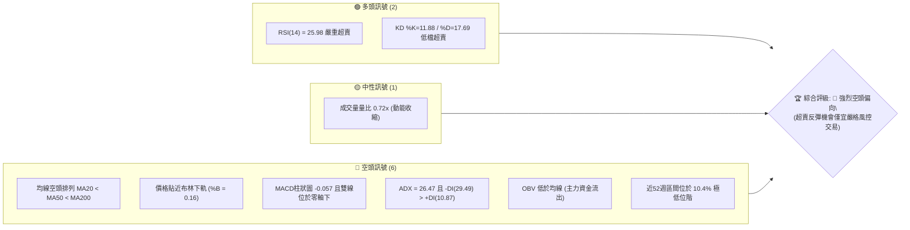
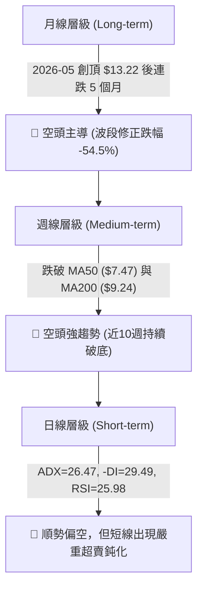
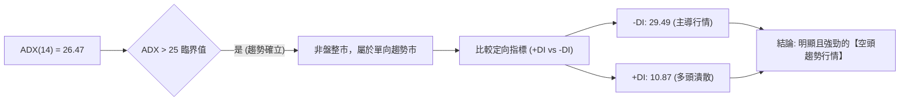
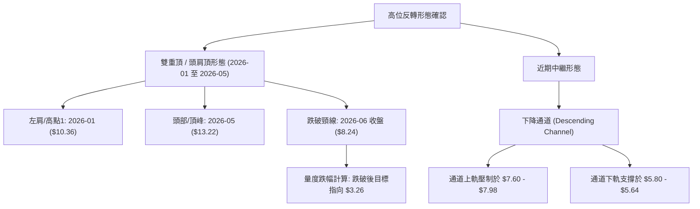
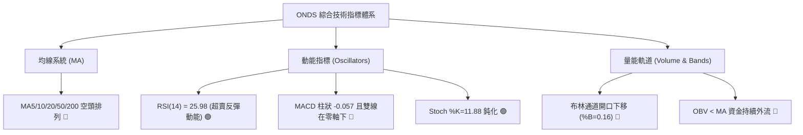
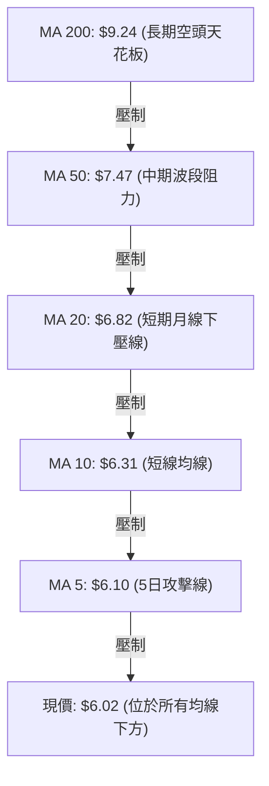
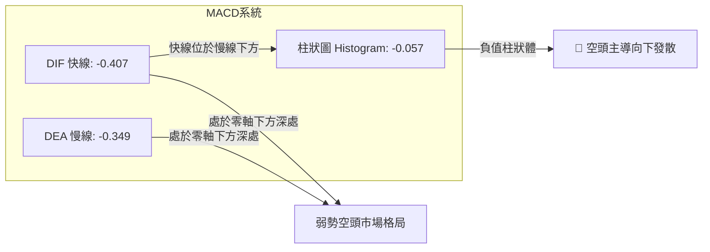
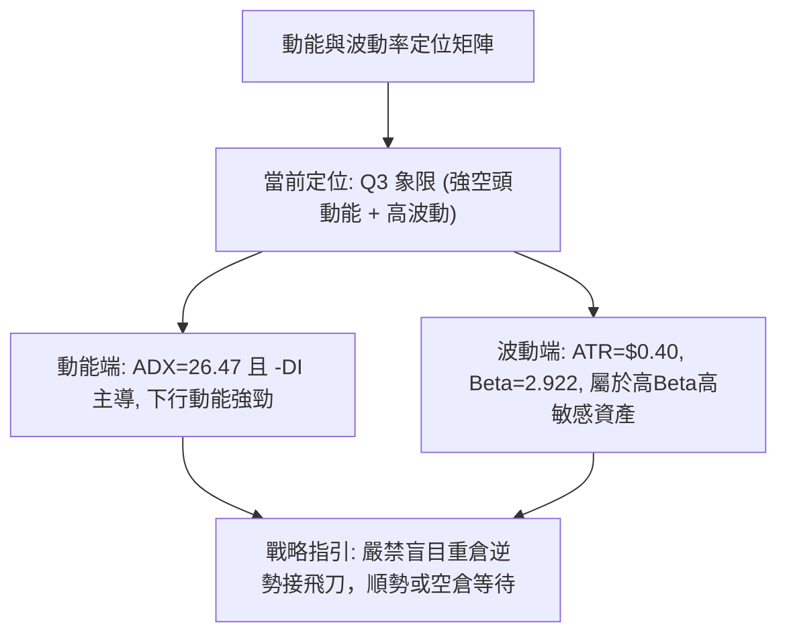
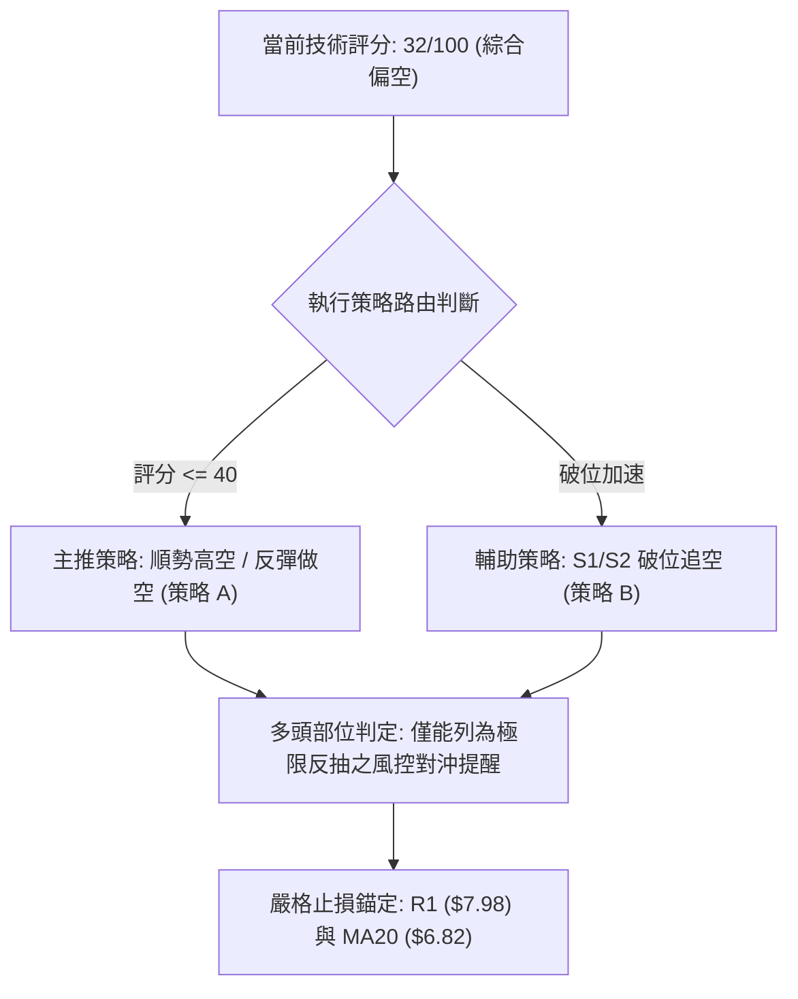
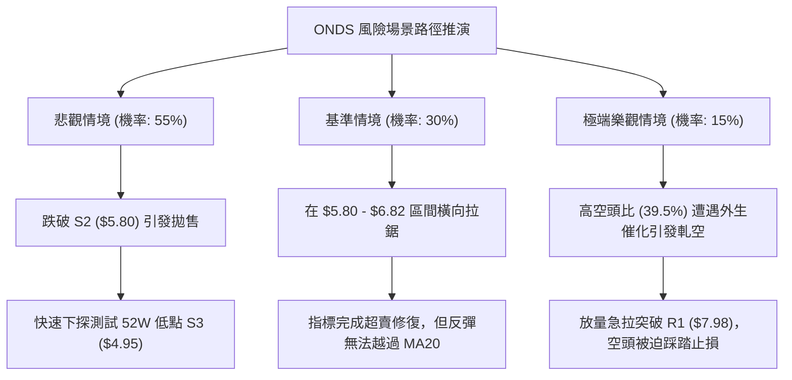

# ONDS 技術分析報告

> **報告日期**：2026-10-23 ｜ **語言**：繁體中文 ｜ **數據來源**：Yahoo Finance ｜ **當前價格**：$6.02 USD

---

## 目錄

| 章節 | 內容 |
|------|------|
| [1. 技術面概覽](#1-技術面概覽) | 訊號儀表板、核心指標、評分卡 |
| [2. 趨勢分析](#2-趨勢分析) | 多時框趨勢、長中短期走勢、ADX強度 |
| [3. 圖表形態分析](#3-圖表形態分析) | 形態識別、K線組合、目標價推算 |
| [4. 支撐與阻力](#4-支撐與阻力) | 關鍵價位結構、斐波那契回調 |
| [5. 技術指標深度解讀](#5-技術指標深度解讀) | 均線系統、RSI、MACD、布林通道、量價OBV |
| [6. 動能與波動率](#6-動能與波動率) | 動能四象限、ATR設定、Beta係數 |
| [7. 多時框架總結](#7-多時框架總結) | 時框架評分矩陣、多時框收斂判定 |
| [8. 交易策略建議](#8-交易策略建議) | 策略路由、主策略詳情、情境階梯、風控設定 |
| [9. 風險提示與監控](#9-風險提示與監控) | 監控清單、極端風險場景、部位管理 |
| [📋 報告總結](#-報告總結) | 核心結論與執行方針摘要 |

---

## 1. 技術面概覽

### 🎯 技術訊號儀表板



### 📊 核心指標速覽表

| 指標類別 | 指標名稱 | 當前數值 | 訊號 | 專業解讀 |
|:---|:---|:---|:---:|:---|
| **價格結構** | 當前收盤價 | $6.02 | 🔴 | 位於 52 週區間 ($4.95 - $15.28) 之 10.4% 百分位，極端弱勢 |
| **均線系統** | MA20 (短期) | $6.82 | 🔴 | 價格低於 MA20 達 -11.76%，短期下行斜率陡峭 |
| **均線系統** | MA50 (中期) | $7.47 | 🔴 | 價格低於 MA50 達 -19.41%，中期波段完全受壓 |
| **均線系統** | MA200 (長期) | $9.24 | 🔴 | 價格低於 MA200 達 -34.85%，長期生命線失守，長期空頭確認 |
| **動能指標** | RSI(14) | 25.98 | 🟢 | 進入 <30 極端超賣區，短線隨時存在均值回歸修復動力 |
| **動能指標** | MACD (12,26,9)| -0.407 / -0.349| 🔴 | DIF < DEA 且位於零軸下，柱狀體 -0.057，空頭動能尚未收斂 |
| **趨勢強度** | ADX(14) / ±DI | 26.47 | 🔴 | ADX > 25 確立趨勢行情；-DI(29.49) 遠壓制 +DI(10.87)，空頭主導 |
| **通道指標** | 布林通道 (%B) | 0.16 | 🔴 | 接近下軌 ($5.64)，頻繁推軌走跌，下行開口擴張中 |
| **波動率** | ATR(14) | $0.40 (6.71%) | 🟡 | 每日平均波動幅度大，需給予充足止損緩衝空間 |

### 🏆 技術評分卡

```
╔══════════════════════════════════════════════════════════════════╗
║                技術評分卡 — ONDS (2026-10-23)                    ║
╠══════════════════════════════════════════════════════════════════╣
║ 趨勢強度 (Trend)      ████████████████░░░░  80/100  🔴 空頭強趨勢 ║
║ 動能指標 (Momentum)   ██████░░░░░░░░░░░░░░  30/100  🔴 動能疲弱   ║
║ 支撐穩定度 (Support)  ████████░░░░░░░░░░░░  40/100  🟡 臨近波段低 ║
║ 成交量配合 (Volume)   ██████░░░░░░░░░░░░░░  30/100  🔴 OBV持續背離║
║ 形態完整度 (Pattern)  ████████░░░░░░░░░░░░  40/100  🔴 下降通道中 ║
║ 均線排列 (MA Align)   ██░░░░░░░░░░░░░░░░░░  10/100  🔴 嚴格空頭排列║
╠══════════════════════════════════════════════════════════════════╣
║ 綜合技術評分          ██████░░░░░░░░░░░░░░  32/100  🔴 偏空格局   ║
╚══════════════════════════════════════════════════════════════════╝
```

---

## 2. 趨勢分析

### 🌐 多時框趨勢分析



### 📈 長期趨勢 — 12個月走勢圖（Unicode）

```
ONDS 月線走勢圖（2025-11 至 2026-10）
價格軸 ($)
$14.00 ┤                                      ● $13.22 (5月波段頂峰)
$13.00 ┤                                     / \
$12.00 ┤                                    /   \
$11.00 ┤                    ● $10.36       /     \
$10.00 ┤           ● $9.76  |      ● $10.04       \
$9.00  ┤          /         \     /                \
$8.00  ┤ ● $7.90 /           ●$9.04                 ● $8.24
$7.00  ┤                                             \  ● $7.49  ● $7.66  ● $7.33
$6.00  ┤━━━━━━━━━━━━━━━━━━━━━━━━━━━━━━━━━━━━━━━━━━━━━━\━━━━━━━━━━━━━━━━━━━━● $6.02 (當前)
$5.00  ┤                                                                   ▼
       └─────┬────────┬────────┬───────┬───────┬───────┬───────┬───────┬───────┬───────┬───────
           25-11    25-12    26-01   26-02   26-03   26-04   26-05   26-06   26-07   26-08   26-09   26-10
```

#### 走勢特徵分析表格

| 階段區間 | 時間段 | 價格起訖 | 區間漲跌幅 | 結構性技術特徵 |
|:---|:---|:---|:---:|:---|
| **主升浪推進** | 2025-11 至 2026-01 | $7.90 → $10.36 | +31.14% | 多頭放量推進，突破雙位數關卡 |
| **高位箱體整理** | 2026-01 至 2026-04 | $10.36 → $10.04 | -3.09% | 構築 $9.00 - $10.50 高檔派發箱體 |
| **末端誘多噴發** | 2026-04 至 2026-05 | $10.04 → $13.22 | +31.67% | 爆量長紅創下月線歷史收盤高點，月線極限乖離 |
| **失速下殺斷頭** | 2026-05 至 2026-06 | $13.22 → $8.24 | -37.67% | 單月重挫逾 37%，形成空頭吞噬，均線結構全面瓦解 |
| **下行趨勢成型** | 2026-06 至 2026-10 | $8.24 → $6.02 | -26.94% | 沿 MA20 逐級走低，成交量遞減，陰跌探底 |

### 📊 中期趨勢（週線分析）

從近 20 週收盤走勢可見，ONDS 於 2026-07-26 週成交量暴增至 8.34 億股，價格反彈至 $7.80；隨後於 2026-08-09 衝刺至 $9.11（當週 RSI 達 70.3）。然而該波反彈受制於長期均線 MA200 反壓後無力維持，隨後 10 週形成連續階梯式下挫，週 RSI 由 70.3 連續跌落至 26.0。

```
近期週線壓力與支撐結構示意圖：
$9.92 ─── [中期強阻力 R3 - 8月反彈頂部區間] ────────────────
          │
$8.58 ─── [阻力 R2 - 週線下行反彈頸線] ──────────────────────
          │
$7.98 ─── [阻力 R1 - 8/30 跌破點與布林上軌重合區] ──────────
          │
$6.02 ─── [現價位置 - 週線 RSI=26.0，連跌4週] ◄─── 當前
          │
$5.93 ─── [即時支撐 S1 - 波段低點聚類線] ────────────────────
          │
$4.95 ─── [終極支撐 S3 - 52週歷史絕對低點] ──────────────────
```

### ⚡ 趨勢強度評估（ADX 解讀）



#### ADX 趨勢強度對照

| 指標變數 | 當前讀數 | 判定門檻 | 技術意義解讀 |
|:---|:---:|:---:|:---|
| **ADX 讀數** | **26.47** | > 25.0 | 明確跨越強弱趨勢分水嶺，表明市場具備顯著方向性動能，不可採用震盪逆勢指標盲目猜底。 |
| **-DI (負向定向)** | **29.49** | > 25.0 | 空方攻擊動能充沛，空頭控盤力量強大。 |
| **+DI (正向定向)** | **10.87** | < 15.0 | 多方毫無防守招架之力，買盤介入意願低落。 |
| **DI 差值差距** | **-18.62** | 負向擴大 | 空多力量差幅持續擴張，代表下行動能尚未出現反轉鈍化跡象。 |

---

## 3. 圖表形態分析

### 🔍 形態識別系統



#### 形態識別與信心度評估表

| 形態類別 | 信心度 | 判斷依據（引用數據） | 完成度 | 目標價（附計算式） |
|:---|:---:|:---|:---:|:---|
| **大型頭肩頂 / 複合頂部** | **85%** | 左肩 2026-01 收盤 $10.36，頭部 2026-05 收盤 $13.22，頸線為 2026-03 低點 $9.04 及 2026-06 跌破收盤 $8.24 | 100% (已完全破位) | 頸線 $8.24 - (形態高度 $13.22 - $8.24 = $4.98) = **$3.26**。中途關鍵停損支撐為 52W 低點 **$4.95** |
| **下行通道 (中繼)** | **75%** | 8月反彈高點 $9.24 與 9月高點 $7.64 形成下行通道頂部，近月低點 $6.53 與當前 $6.02 構成通道下緣 | 80% (進行中) | 跌破通道下軌 $5.80，量度跌幅指向波段低點聚類 **$4.95** |
| **短線潛在雙底 (W底)** | **35%** | 試圖於 S1 ($5.93) 與 S2 ($5.80) 構築底部支撐 | 20% (信心度低) | 頸線為 MA20 ($6.82)，若突破目標 = $6.82 + ($6.82 - $5.80) = **$7.84** (接近 R1 $7.98)。**註：因 ADX>25 且信心度<50%，視為超賣假底，僅做指標型解讀** |

### 🕯️ 重要K線形態分析

| 觀測月份 | 收盤價 | 典型K線形態 | 內涵與結構解讀 | 趨勢訊號 |
|:---|:---:|:---|:---|:---:|
| **2026-05** | $13.22 | 長上影大陽線 (射擊之星變體) | 月內暴漲並創下 52 週高點 $15.28，但收盤回吐至 $13.22，留有長達 $2.06 上影線，高位派發明顯 | 🔴 出貨見頂 |
| **2026-06** | $8.24 | 實體大陰線 (烏雲蓋頂/大陰吞噬)| 單月崩跌 $4.98 (-37.67%)，直接摜破多頭防守頸線，多頭結構瓦解 | 🔴 崩盤確認 |
| **2026-08** | $7.66 | 帶長上影倒轉十字線 | 盤中週線一度反彈至 $9.24，最終受阻於 MA200 大幅下墜，確認「死貓跳」誘多完畢 | 🔴 反彈阻力確認 |
| **2026-10 (即時)** | $6.02 | 實體下挫陰線 | 破位逼近 S1 ($5.93) 與 S2 ($5.80)，暫未出現長下影止跌信號 | 🔴 空方續挫 |

### 📉 ASCII 走勢形態示意圖

```
ONDS 2026年度頭肩頂反轉與下降通道幾何圖形：

$15.28 ┬                     ▲ 頭部 ($15.28 / 月收 $13.22)
       │                    / \
$12.00 ┤        左肩        /   \
       │       ┌───┐       /     \
$10.36 ┤───────│   │──────/       \─────────── (左肩高點 $10.36)
       │       │   │     /         \
$9.04  ┤───────┴───┴────/           \────右肩反彈高點 $9.24
       │               /             \   ┌───┐
$8.24  ┤==============[ 頸線跌破位 $8.24 ]──│   │──────────────── (破位確立)
       │                              └───┘\
$7.00  ┤                                    \   下降通道上軌
       │                                     \ ╲
$6.02  ┤──────────────────────────────────────●───► [當前位置 $6.02]
       │                                         ╲ 下降通道下軌
$4.95  ┴─────────────────────────────────────────── [52W 低點目標 $4.95]
```

### 🎯 形態目標價計算

根據經典技術形態學原理，頭肩頂突破後之最小下行量度幅度計算如下：
1. **頂部最高點**：$13.22（月線收盤）/ $15.28（盤中最高點）。
2. **有效破位頸線**：$8.24（2026-06 確認跌破收盤價）。
3. **形態垂直高度**：$13.22 - $8.24 = **$4.98**。
4. **理論量度下行目標價**：$8.24 - $4.98 = **$3.26**。
5. **現實階梯支撐路徑**：下行目標在觸及理論值 $3.26 之前，必將在**歷史 52 週低點 S3 ($4.95)** 遭遇極強物理買盤與空頭回補抵抗，因此以 $4.95 作為第一主目標區。

---

## 4. 支撐與阻力

### 🗺️ 關鍵價位分布圖（Unicode）

```
ONDS 價位結構分布圖（引用 OHLCV 計算聚類值與斐波那契點位）
═══════════════════════════════════════════════════════════════════
$15.28 ║██████████████████████████████║ 52W 歷史極限高點 (Fib 0.0%)
$11.33 ║████████████████████          ║ 中期反彈黃金分割阻力 (Fib 38.2%)
$9.92  ║████████████████████████      ║ 強阻力 R3 / 密集換手反壓
$9.24  ║██████████████████            ║ 牛熊分界線 (MA200 長期均線)
$8.58  ║████████████████              ║ 波段阻力 R2 (反彈高點聚類)
$7.98  ║████████████████████████      ║ 關鍵阻力 R1 / 布林上軌 ($8.00)
$7.16  ║████████████                  ║ 斐波那契回調位 (Fib 78.6%)
$6.82  ║██████████                    ║ 短線反壓線 (MA20 / 布林中軌)
───────╫──────────────────────────────╫───────────────────────────
$6.02  ╠══════════════════════════════╣ ◄ 現價 ($6.02)
───────╫──────────────────────────────╫───────────────────────────
$5.93  ║▓▓▓▓▓▓▓▓▓▓▓▓▓▓▓▓              ║ 近期即時支撐 S1 (-1.50%)
$5.80  ║▓▓▓▓▓▓▓▓▓▓▓▓▓▓▓▓▓▓▓▓          ║ 波段關鍵支撐 S2 (-3.74%)
$5.64  ║▓▓▓▓▓▓▓▓                      ║ 動態保護位 (布林下軌)
$4.95  ║██████████████████████████████║ 52W 歷史低點 S3 / Fib 100.0% (-17.77%)
═══════════════════════════════════════════════════════════════════
```

### 🚧 阻力位分析表

| 阻力級別 | 精確價位 | 距現價幅幅 | 形成原因與技術共振 | 突破難度 | 重要性評級 |
|:---|:---:|:---:|:---|:---:|:---:|
| **阻力 R1** | **$7.98** | +32.56% | 近一年波段高點聚類、布林上軌 ($8.00) 與 Fib 78.6% ($7.16) 上方密集套牢區 | 極高 🔴 | ★★★★★ |
| **阻力 R2** | **$8.58** | +42.52% | 8月下旬反彈受阻頭部（8/23 收盤 $8.71 區域），多頭波段止步位 | 極高 🔴 | ★★★★☆ |
| **阻力 R3** | **$9.92** | +64.87% | 長期下行趨勢線與 MA200 ($9.24) 之上強壓力帶，多空分水嶺巨幅籌碼峰 | 難以逾越 🔴 | ★★★★★ |

### 🛡️ 支撐位分析表

| 支撐級別 | 精確價位 | 距現價幅幅 | 形成原因與技術共振 | 守住機率 | 重要性評級 |
|:---|:---:|:---:|:---|:---:|:---:|
| **支撐 S1** | **$5.93** | -1.50% | 近一年波段低點聚類，近一週盤中防守底線 | 40% 🟡 | ★★★☆☆ |
| **支撐 S2** | **$5.80** | -3.74% | 波段防守強支撐位，貼近布林通道動態下軌 ($5.64) | 50% 🟡 | ★★★★☆ |
| **支撐 S3** | **$4.95** | -17.77% | 52 週歷史絕對低點、Fib 100.0% 終極支撐，機構最後防線 | 80% 🟢 | ★★★★★ |

### 📐 斐波那契回調位分析

依據 52 週波動極限區間（低點 $4.95 至 高點 $15.28，垂直落差 $10.33）計算之標準黃金分割回調位如下：

| 分割比例 | 價位 | 當前相對位置與技術含義 |
|:---|:---:|:---|
| **0.0% (52W High)** | **$15.28** | 歷史峰值，本輪週期不可逾越之極限天花板 |
| **23.6%** | **$12.84** | 牛市初前回踩線，已徹底失守 |
| **38.2%** | **$11.33** | 強勢回檔保護位，破位後轉化為長期深層壓力 |
| **50.0%** | **$10.11** | 多空心理分水嶺，與整數心理關卡 $10.00 共振 |
| **61.8%** | **$8.90** | 黃金分割防守線，跌破此線代表波段上漲結構全面死絕 |
| **78.6%** | **$7.16** | 深度回撤容忍線；**現價 $6.02 已實質跌破此位** |
| **100.0% (52W Low)**| **$4.95** | 終極回調基底；現價落於 $7.16 (78.6%) 與 $4.95 (100.0%) 之間 |

**解讀**：現價 $6.02 正處於深度回調極端區域（78.6% 至 100.0% 之間）。在跌破 Fib 78.6% ($7.16) 後，下行空間已被打開，空頭引力場的核心終點即為 Fib 100.0% 的 **$4.95**。

---

## 5. 技術指標深度解讀

### 🎛️ 指標訊號總覽



### 📈 移動平均線排列分析



#### 均線發散與乖離數據

| 週期均線 | 當前數值 | 現價與均線距離 | 偏離率 (%) | 均線歷史軌跡走勢 |
|:---|:---:|:---:|:---:|:---|
| **MA 5** | $6.10 | -$0.08 | -1.28% | ▇▇▇▆▇▇▇▇███████▇▇▇▇▆▆▅▄▃▃▂▁▁▁▁ (急速轉折向下) |
| **MA 10** | $6.31 | -$0.29 | -4.58% | █████▇▇▇▇██████████▇▇▆▆▅▄▃▃▂▁▁ (短天期空頭壓制) |
| **MA 20** | $6.82 | -$0.80 | -11.76% | ██▇▇▆▆▅▅▅▅▅▄▄▄▄▄▄▄▄▄▄▄▃▃▃▂▂▁▁▁ (下彎斜率陡峭) |
| **MA 50** | $7.47 | -$1.45 | -19.41% | 中期下沉趨勢明確，反彈重大解套賣壓源 |
| **MA 60** | $7.69 | -$1.67 | -21.71% | ██▇▆▆▆▆▆▅▅▅▅▅▅▅▅▅▅▅▅▅▅▅▄▄▃▂▁▁▁ (季線下行無趨緩) |
| **MA 120**| $8.35 | -$2.33 | -27.92% | ████▇▇▇▇▇▇▆▆▆▆▆▆▅▅▅▅▄▄▃▃▂▂▂▁▁▁ (半年線下壓) |
| **MA 200**| $9.24 | -$3.22 | -34.85% | 牛熊分界線失守，長期空頭格局定錨 |
| **MA 240**| $9.08 | -$3.06 | -33.72% | █████▇▆▆▅▄▃▃▂▁▁▁▁▁▁▁▁▁▁▁▁▁▁▁▁▁ (年線反轉下行) |

**均線綜合判定**：全週期均線呈現標準的「完美空頭排列（Perfect Bearish Alignment）」，價格依序受制於 MA5 < MA10 < MA20 < MA50 < MA200，在未收復 MA20 ($6.82) 之前，任何反彈均僅屬弱勢技術修正。

### 📉 RSI(14) 分析

* 當前 RSI(14) 讀數：**25.98**
* 狀態：進度條展示如下：
  `RSI(14) 25.98 : █████░░░░░░░░░░░░░░░  [極度超賣 < 30]`
* **超賣深度解讀**：RSI 進入 30 以下之嚴重超賣區間，隨機震盪指標 Stoch %K (11.88) 及 %D (17.69) 亦處於低檔鈍化區。此數值顯示短線空頭拋售能量釋放已極為充分。
* **背離研判**：
  * **價格層面**：10月18日收盤 $6.04（RSI: 20.1），10月25日收盤 $6.02（RSI: 26.0）。
  * **結論**：價格微幅創出新低（$6.04 → $6.02），但日/週線 RSI 讀數出現由 20.1 向上收斂至 26.0 的**潛在微型底背離（Bullish Divergence）初萌跡象**。然而，由於成交量並未放大，底背離目前「尚未獲得價格突破確認」，僅能視為下行阻力增大的警告訊號。

### 📊 MACD(12,26,9) 訊號解讀



* **數值明細**：MACD 線為 **-0.407**，信號線 Signal 為 **-0.349**，柱狀圖差值為 **-0.057**。
* **技術解讀**：DIF 與 DEA 均在負值零軸下方加速下行，代表中長期下行動能牢固；柱狀圖維持為負（-0.057），雖較前週之 -0.100 略有收窄，但尚未出現金叉翻紅訊號，確認當前仍處於空頭控制週期。

### 📦 布林通道分析

```
ONDS 當前布林通道截面示意圖（帶寬 $2.36）：
$8.00 ┬────────────────────────────────────────── [BB 上軌: $8.00]
      │
$6.82 ┼ - - - - - - - - - - - - - - - - - - - - - [BB 中軌/MA20: $6.82]
      │
$6.02 ┼──────────────●◄ 現價 $6.02 (%B = 0.16)
$5.64 ┴────────────────────────────────────────── [BB 下軌: $5.64]
```

* **參數數值**：上軌 **$8.00**，中軌 (MA20) **$6.82**，下軌 **$5.64**。
* **%B 震盪指標**：當前 %B 讀數為 **0.16**，處於下軌與中軌之間的極弱帶，顯示價格受下軌磁吸推擠。
* **通道帶寬**：通道處於溫和張開狀態（BandWidth = ($8.00 - $5.64) / $6.82 = 34.6%），下軌下傾角度未變，呈現典型的「跌軌運行狀態（Walking the Band Down）」，說明下跌動能具備持續性。

### 💹 成交量分析（量價配合度）

```
成交量均線對比：
最新成交量 :  36.95M  ███████████░░░░  (量比: 0.72x)
20日均量   :  51.46M  ███████████████
50日均量   :  61.01M  ██████████████████
```

* **量價特徵**：最新成交量 3,694.8 萬股，相對 20 日均量（5,145.6 萬股）僅達 0.72 倍；相對 50 日均量更顯萎縮。
* **OBV 能量潮解讀**：數據指明「OBV 趨勢：OBV < MA → 量能疲弱」。這表明過去 2 個月在價格走低過程中，累積能量潮持續下行，顯示多頭主力資金無進場接盤意願，純屬缺乏買盤支撐的「無量陰跌」格局。在無巨量換手（如 7 月底單週 8.34 億股水準）出現前，難以形成具公信力的V型反轉。

---

## 6. 動能與波動率

### ⚡ 動能評估四象限

| 象限分區 | 動能維度 | 波動維度 | 判定特徵 | ONDS 當前定位與評估 |
|:---:|:---:|:---:|:---|:---:|
| **Q1** | 強多頭動能 | 低波動率 | 穩定攀升牛股 | — |
| **Q2** | 弱多頭動能 | 低波動率 | 橫盤窄幅築底 | — |
| **Q3** | 強空頭動能 | 高波動率 | 破位下殺主跌段 | **✓ ONDS 當前位置 (強下行動能 + 高波動風險)** |
| **Q4** | 衰竭動能 | 高波動率 | 暴跌末端巨震洗盤 | 尚未達標（量能尚未暴增洗盤） |



### 📊 ATR 波動率分析

* **當前 ATR(14)**：**$0.40**，佔當前股價 $6.02 的比率高達 **6.71%**。
* **波動意義**：ONDS 屬於極高日內波動標的，單日正常波動幅度即達 40 美分。
* **交易風控設置**：
  * **超短線日內雜訊過濾閥值**：1.0 × ATR = $0.40。
  * **波段交易防守安全間距**：建議設置 1.5 至 2.0 倍 ATR（即 $0.60 - $0.80）作為動態止損緩衝區，以避免被日內隨機洗盤掃出場。

### 📐 Beta 與市場相關性

* **Beta 係數**：**2.922**。
* **解讀**：ONDS 具備接近 3 倍於標普500指數（S&P 500）的超高系統性敏感度。當大盤微幅回調 1% 時，該股理論下挫期望值接近 3%。在當前大盤不確定性疊加自身基本面虧損（TTM EPS -$0.06、FCF Yield -4.91%）背景下，高 Beta 特性加劇了其技術破位的下殺深度。
* **空頭流通比率 (Short % Float)**：高達 **39.5%**，Short Ratio 3.64 天。極高的放空比例意味著空頭盤踞牢固，但同時也蘊含極端超跌後的潛在「空頭軋空（Short Squeeze）」尾端風險。

---

## 7. 多時框架總結

### 📋 時框架評分表

| 時框架 | 趨勢方向 | 動能狀態 | 均線排列狀況 | 形態特徵 | 綜合評分 | 操作建議方向 |
|:---|:---:|:---:|:---:|:---|:---:|:---|
| **長期 (月線)** | 🔴 強烈看空 | 下挫發散 | MA200 之遠下方 | 高位雙頂/頭肩破位 | 20/100 | 長期部位出清觀望 |
| **中期 (週線)** | 🔴 看空 | 柱狀維持負值 | 空頭排列 (破MA50) | 階梯式陰跌，承壓 R1 | 30/100 | 反彈皆為減碼拋空點 |
| **短期 (日線)** | 🟡 超賣鈍化 | RSI=25.98 | 全面受阻於 MA20 | 貼布林下軌尋求 S1 支撐 | 35/100 | 短線醞釀超賣弱反抽 |

### 🔲 綜合訊號矩陣

| 技術分析維度 | 短期 (日線級別) | 中期 (週線級別) | 長期 (月線級別) | 跨時框一致性研判 |
|:---|:---:|:---:|:---:|:---|
| **趨勢方向** | 🔴 下行 | 🔴 下行 | 🔴 下行 | **100% 高度共振看空** |
| **動能狀態** | 🟢 嚴重超賣 | 🔴 空方控盤 | 🔴 崩解 | 短期超賣引發與中長期下行衝突 |
| **均線排列** | 🔴 均線死叉 | 🔴 空頭排列 | 🔴 破年線 | **100% 均線全面看空** |
| **量價結構** | 🟡 縮量跌 | 🔴 換手不足 | 🔴 頂部爆量出貨 | 主力資金無實質回流確認 |

### ⚖️ 多時框收斂結論

> **依據「嚴格要求 14」執行多時框收斂推導**：
> 1. **趨勢/盤整行情定性**：當前 ADX(14) 讀數為 **26.47 > 25**，依規則明確定義為**「趨勢行情（Trend Regime）」**，而非無方向的盤整震盪市。
> 2. **主導時框優先級**：在趨勢行情下，**以中長期（週線 / MA50: $7.47、MA200: $9.24）方向為主導**，日線時框僅能用作捕捉進場時機與反抽定價。
> 3. **衝突收斂**：日線 RSI(14) 25.98 的極端超賣僅代表短線賣壓衰竭，在強趨勢行情下極易發生「以盤代跌」或「超賣鈍化」。
> 
> **🎯 唯一收斂方向性結論**：**【偏空格局（Bearish Bias）】**。
> 交易哲學嚴格遵循「順中長線空頭大勢，逢反彈阻力高空，切勿主動重倉做多」。

---

## 8. 交易策略建議

### 🗺️ 策略決策流程圖



### 🧭 策略路由說明

* **當前主策略方向**：**【順勢空頭主導（Short Bias）】（依技術評分卡：32/100）**
* **策略架構理由**：綜合評分 32 分落在 ≤40 之空頭專屬區間。全週期均線空頭排列，ADX 26.47 確立空頭趨勢。禁止向投資人推薦多頭主升浪策略。多頭僅列入「極端超賣短線反彈之風險對沖觀察」。

### 🎯 價格情境階梯（Price Scenarios）

價位嚴格引用技術數據已計算之聚類點位與斐波那契回調位：

| 觸發條件 (Trigger) | 下一目標 (Target 1) | 後續延伸 (Target 2) | 情境技術含義與應對要領 |
|:---|:---:|:---:|:---|
| **向上反彈突破 MA20 ($6.82)** | **R1: $7.98** | **R2: $8.58** | 短線超賣引發技術均值回歸，觸及 R1/R2 為絕佳中線加碼放空點 |
| **跌破即時支撐 S1 ($5.93)** | **S2: $5.80** | **布林下軌 $5.64** | 宣告短線橫盤破裂，空頭續推行情啟動 |
| **實體跌破強支撐 S2 ($5.80)** | **S3: $4.95** | **理論值 $3.26** | 破位加速下墜，向 52 週歷史低點 S3 ($4.95 / Fib 100%) 尋求終極測試 |

### 📊 情境機率分佈

| 運行情境 | 發生機率 | 主要技術數據與指標依據 |
|:---|:---:|:---|
| **情境一：破位下行，再探 52W 低點** | **55%** | 均線空頭排列未變、ADX=26.47 趨勢強勁、-DI(29.49) 壓制、OBV 持續失血 |
| **情境二：弱勢震盪，修復超賣指標** | **30%** | RSI=25.98 處於嚴重超賣，多空於 S1 ($5.93) 至 MA20 ($6.82) 間進行時間換空間整理 |
| **情境三：強勢反抽，回測長期壓力** | **15%** | Short Float 高達 39.5%，若有突發外生催化劑引發空頭踩踏回補，或反彈挑戰 R1 ($7.98) |

### 🟢 主策略詳情（空頭主導）

所有價位均基於第四章確認之技術點位（S1: $5.93, S2: $5.80, S3: $4.95, R1: $7.98, MA20: $6.82）：

| 策略要素 | 策略 A（反彈阻力位高空 — 逢高放空） | 策略 B（關鍵支撐破位追空 — 順勢突破） |
|:---|:---|:---|
| **交易邏輯** | 趁 RSI 超賣修復引發的弱反彈，於均線反壓區建立高勝率空單 | 價格跌破近一年波段支撐聚類，動能加速宣洩 |
| **進場條件** | 反彈至 MA20 反壓遇阻，或回測 $6.80 附近滯漲 | 日線實體收盤跌破 S1 ($5.93) 與 S2 ($5.80) |
| **進場價格** | **$6.80**（貼近 MA20: $6.82） | **$5.75**（確認摜破 S2: $5.80 後順勢追入） |
| **目標價 T1** | **$5.93**（波段支撐 S1，獲利空間 12.8%） | **$4.95**（52W 歷史低點 S3，獲利空間 13.9%） |
| **目標價 T2** | **$4.95**（52W 歷史低點 S3，獲利空間 27.2%） | **$3.26**（頭肩頂形態量度跌幅理論值） |
| **止損價格** | **$7.20**（突破 Fib 78.6% $7.16 止損，風險 5.9%）| **$6.15**（重回 S1 之上與 MA5 上方，風險 6.9%） |
| **風險報酬比** | **1 : 2.17 (至 T1) / 1 : 4.61 (至 T2)** | **1 : 2.01 (至 T1) / 1 : 5.25 (至 T2)** |
| **評估勝率** | **65%** | **55%** |
| **建議倉位** | **15% - 20%** 總風險資本 | **10%** 總風險資本（防假跌破洗盤） |

### 🔴 反向風險觸發點（對沖與空頭止損提示）

若發生以下盤口異動，代表空頭結構遭遇強烈威脅，空單必須無條件止損或反向對沖：
1. **價位警訊**：日線以大陽線帶量突破 **R1 ($7.98)**，此舉將徹底扭轉日線空頭架構，並站上布林上軌。
2. **量能警訊**：單日成交量暴增至 **1.5 億股以上**（達 20 日均量之 3 倍），且收盤價站上 **MA20 ($6.82)**，視為機構大額空頭回補（軋空）訊號。
3. **指標警訊**：MACD 出現零軸下方向上發散之「黃金交叉」，且 RSI 迅速跨越 50 中軸。

### ⭐ 整體訊號強度評星

```
做多訊號強度：★☆☆☆☆  (1/5星 — 僅超賣指標支撐，均線與量能全盤皆空)
做空訊號強度：★★★★☆  (4/5星 — 趨勢確立、均線排列完美、空頭控盤)
整體可信度：  ★★★★☆  (4/5星 — ADX>25 趨勢明確，各指標高度共振)
```

---

## 9. 風險提示與監控

### ✅ 關鍵監控指標 Checklist

```
╔══════════════════════════════════════════════════════════════════╗
║              ONDS 交易風控與盤面異動監控清單 (Checklist)           ║
╠══════════════════════════════════════════════════════════════════╣
║ [ ] 價格跌破 S1 ($5.93) 與 S2 ($5.80) 之收盤有效性確認           ║
║ [ ] RSI(14) 能否自 25.98 脫離超賣區，是否引發微型底背離突破     ║
║ [ ] 成交量是否異常放大至 60M 以上 (突破 50 日均量基準線)         ║
║ [ ] 放空比率 (Short Float 39.5%) 引發的短線非理性軋空防範       ║
║ [ ] 跌破 S2 後，向 52W 低點 $4.95 靠攏時的空頭回補動能           ║
║ [ ] 每日 ATR ($0.40) 波動對隔夜部位帳面淨值之衝擊監控            ║
╚══════════════════════════════════════════════════════════════════╝
```

### ⚠️ 風險場景分析



### 🛡️ 風險管理重要提醒

1. **軋空（Short Squeeze）極端風險管控**：
   * ONDS 自由流通股的放空比例高達 **39.5%**，Short Ratio 為 3.64 天。雖然純技術面極度偏空，但在美股小型通訊/無人機標的中，此類高空頭比個股極易在出現消息面刺激時發生報復性日內軋空。**建立放空部位必須嚴格執行單一筆不超過總資金 2% 的實體停損機制**，切忌重倉賭單邊。
2. **基本面與分析師預期背離警示**：
   * 需高度注意：華爾街 10 位分析師全數給予 `strong_buy` 評級，平均目標價高達 **$18.88**（低標亦有 $13.00）。然而，**技術面當前完全由空頭掌控（價格 $6.02，低於所有均線）**。這種「基本面共識極度看好」與「技術走勢持續崩潰」的嚴重背離，歷史經驗顯示往往隱含基本面預期尚未下修的滯後風險，或是增資稀釋籌碼的潛在壓力（公司 TTM 營運現金流為 -$1.61 億美元）。**技術派交易者應以眼前真實的價格走勢為唯一依據，切勿因基本面評級而忽視破位現實**。
3. **部位規模與流動性公式**：
   * 單一部位停損額度控制公式：
     $$\text{部位股數} = \frac{\text{總資本} \times 1\%}{\text{進場點} - \text{止損點}}$$
   * 鑑於 ATR 高達 $0.40 (6.71%)，任何逆勢抄底（多頭操作）之單次曝險部位建議不得超過總倉位之 **5%**，並強制於跌破 $5.80 時離場。

---

## 📋 報告總結

```
╔══════════════════════════════════════════════════════════════════╗
║                    ONDS 技術分析報告總結                         ║
╠══════════════════════════════════════════════════════════════════╣
║ 報告日期：2026-10-23                                             ║
║ 當前價格：$6.02 USD (52W 區間百分位: 10.4%)                      ║
║ 技術評級：🔴 強烈看空 / 逢高做空 (Bearish / Sell on Rallies)       ║
║                                                                  ║
║ 關鍵維度結論：                                                   ║
║ ├─ 長期趨勢：🔴 強烈看空 (月線頭肩頂破位，處於 MA200 $9.24 之下)║
║ ├─ 中期趨勢：🔴 空頭主導 (週線連跌，階梯下行受制於 MA50 $7.47)   ║
║ ├─ 短期趨勢：🟡 嚴重超賣 (RSI 25.98 隨時有弱反彈，但受壓 MA20)  ║
║ ├─ 關鍵阻力：R1: $7.98 ｜ R2: $8.58 ｜ R3: $9.92                 ║
║ ├─ 關鍵支撐：S1: $5.93 ｜ S2: $5.80 ｜ S3: $4.95 (52W 低點)      ║
║ └─ 趨勢強度：ADX=26.47 (確立趨勢市，-DI 29.49 空方全面掌控)      ║
╠══════════════════════════════════════════════════════════════════╣
║ 最優策略指引：                                                   ║
║ 1. 🥇 最佳機會（順勢高空）：反彈至 MA20 ($6.80 附近) 遇阻開空，  ║
║      停損設 $7.20，目標下看 S1 ($5.93) 與 S3 ($4.95)。          ║
║ 2. 🥈 次選機會（破位追空）：實體收盤跌破 S2 ($5.80) 順勢放空，    ║
║      停損設 $6.15，目標下看 52W 歷史低點 S3 ($4.95)。            ║
║ 3. 🥉 防守觀望：持幣者切勿在 $6.02 盲目猜底，等待確立守穩 S2     ║
║      或放量突破 MA20 後再行評估。                               ║
╚══════════════════════════════════════════════════════════════════╝
```

---

> ⚠️ **免責聲明**：本報告為依據客觀技術分析模型與所提供市場數據產出之量化研究報告，報告中所有價位與技術形態解讀均**僅供投資研究與學術探討參考**，**絕不構成任何形式的證券買賣邀約或投資建議**。金融市場具高度價格波動風險，高 Beta 及高放空比標的風險尤甚，投資人決策前應審慎評估自身財務承受能力與風控邊界，並自負盈虧。

---
*報告生成時間：2026-10-23 ｜ 數據來源：Yahoo Finance ｜ 分析框架：多時框架量化技術分析*