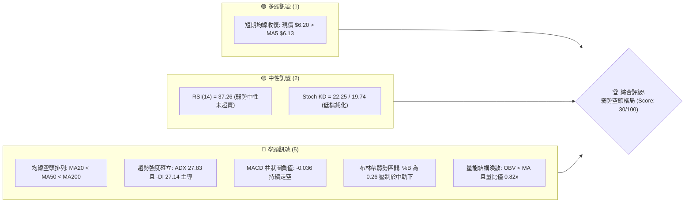
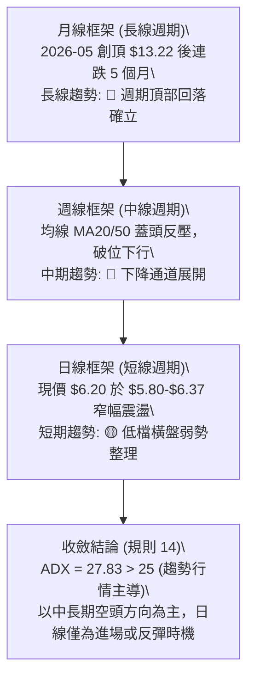
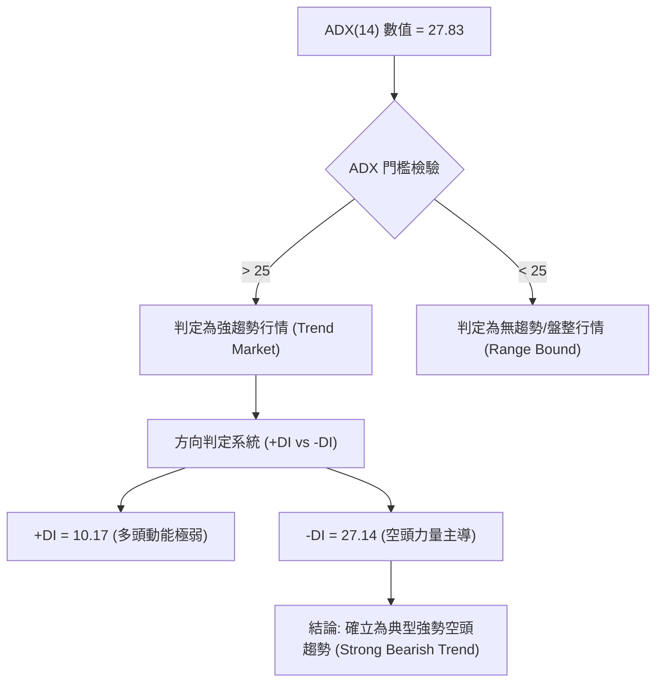
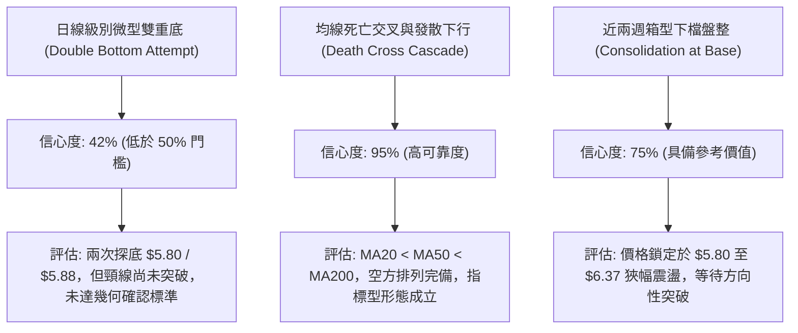
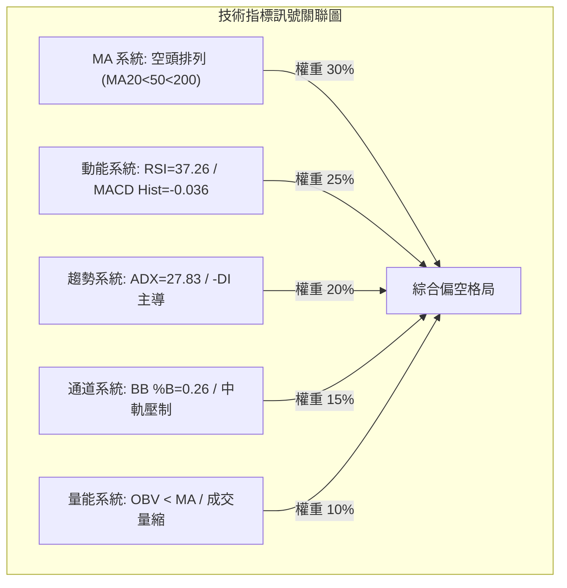
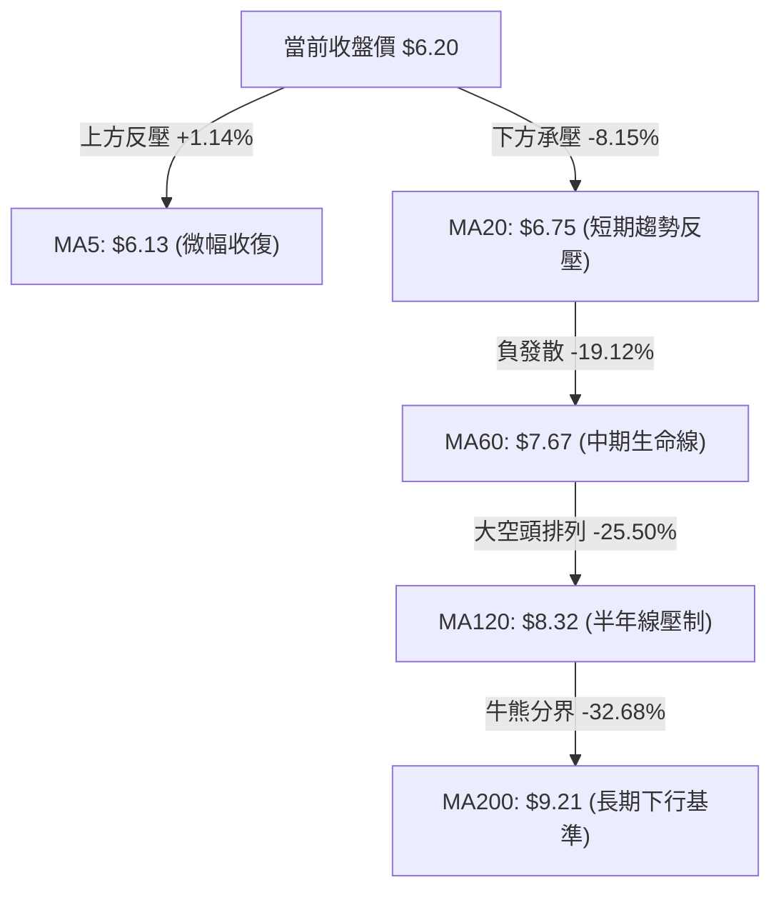
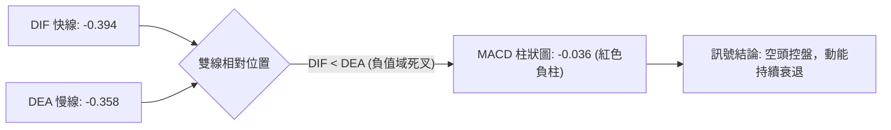
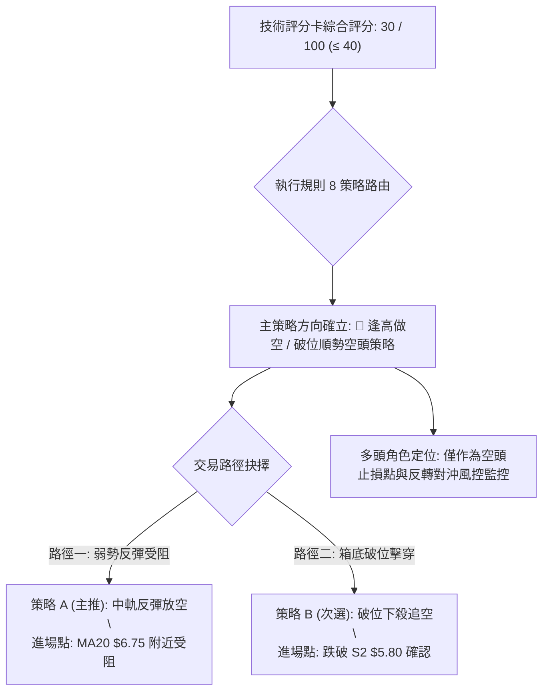
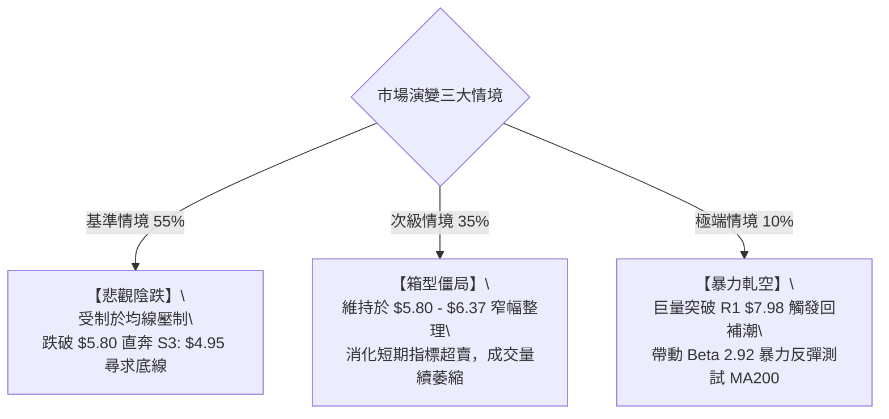

# ONDS 技術分析報告

> **報告日期**：2026-10-24 ｜ **語言**：繁體中文 ｜ **數據來源**：Yahoo Finance ｜ **當前價格**：$6.20

---

## 目錄

| 章節 | 內容 |
|------|------|
| [1. 技術面概覽](#1-技術面概覽) | 訊號儀表板、核心指標、評分卡 |
| [2. 趨勢分析](#2-趨勢分析) | 多時框趨勢、長中短期走勢、12個月歷史圖 |
| [3. 圖表形態分析](#3-圖表形態分析) | 形態識別、K線組合、目標價推算 |
| [4. 支撐與阻力](#4-支撐與阻力) | 關鍵價位分布、波段高低點、斐波那契回調 |
| [5. 技術指標深度解讀](#5-技術指標深度解讀) | MA/RSI/MACD/布林通道/成交量配合 |
| [6. 動能與波動率](#6-動能與波動率) | 動能四象限、ATR 波動率、Beta 市場相關性 |
| [7. 多時框架總結](#7-多時框架總結) | 時框架評分矩陣、收斂規則與單一結論 |
| [8. 交易策略建議](#8-交易策略建議) | 主策略路由、情境階梯、風控與對沖點 |
| [9. 風險提示與監控](#9-風險提示與監控) | 監控清單、情境分析、倉位管理建議 |

---

## 1. 技術面概覽

### 🎯 技術訊號儀表板



### 📊 核心指標速覽表

| 指標類別 | 指標名稱 | 當前數值 | 訊號 | 解讀 |
|:---|:---|:---:|:---:|:---|
| **價格** | 當前收盤價 | $6.20 | 🔴 | 位於 52 週區間 12.1% 極低分位，距 52W 低點僅 $1.25 |
| **均線** | 短期 MA5 | $6.13 | 🟢 | 價格微幅站上 MA5（+1.14%），短線跌勢出現減速歇息 |
| **均線** | 短期 MA20 | $6.75 | 🔴 | 價格低於 MA20 達 -8.15%，短中期下行趨勢顯著 |
| **均線** | 中期 MA50 | $7.42 | 🔴 | 價格低於 MA50，且 MA50 呈負斜率下行 |
| **均線** | 長期 MA200 | $9.21 | 🔴 | 價格遠低於牛熊分界線 MA200（-32.68%），長線走空 |
| **動能** | RSI(14) | 37.26 | 🟡 | 處於 30–70 中性弱勢區，尚未觸及超賣極端區間 |
| **動能** | MACD (12,26,9) | -0.394 | 🔴 | DIF 線低於 Signal (-0.358)，柱狀圖 -0.036，空方掌控 |
| **趨勢** | ADX (14) | 27.83 | 🔴 | ADX > 25 進入強趨勢行情，-DI (27.14) 遠高於 +DI (10.17) |
| **通道** | 布林通道 %B | 0.26 | 🔴 | 運行於下軌 ($5.61) 與中軌 ($6.75) 之間，空頭軌道 |
| **波動** | ATR(14) | $0.41 | 🟡 | 日波動率為 6.66%，屬於高彈性個股，風險曝險偏高 |
| **量能** | 成交量比 (VR) | 0.82x | 🔴 | 20日均量 49.96M，最新成交 40.83M，反彈缺乏量能背書 |

### 🏆 技術評分卡

```
╔══════════════════════════════════════════════════════════════════╗
║                 技術評分卡 — ONDS (2026-10-24)                   ║
╠══════════════════════════════════════════════════════════════════╣
║ 趨勢強度 (ADX & -DI)   █████░░░░░░░░░░░░░░░  25/100  🔴 空頭強勢 ║
║ 動能指標 (RSI & MACD)  ███████░░░░░░░░░░░░░  35/100  🔴 動能疲弱 ║
║ 支撐穩定度 (S1/S2防守) █████████░░░░░░░░░░░  45/100  🟡 弱勢企穩 ║
║ 成交量配合 (OBV & VR)  ██████░░░░░░░░░░░░░░  30/100  🔴 量能萎縮 ║
║ 形態完整度 (探底箱型)  ███████░░░░░░░░░░░░░  35/100  🔴 底部未明 ║
║ 均線排列 (完全空頭)    ██░░░░░░░░░░░░░░░░░░  10/100  🔴 空頭排列 ║
╠══════════════════════════════════════════════════════════════════╣
║ 綜合評分 (六項算術平均) ██████░░░░░░░░░░░░░░  30/100  🔴 強烈看空 ║
╚══════════════════════════════════════════════════════════════════╝
```

> **評分計算**：(25 + 35 + 45 + 30 + 35 + 10) ÷ 6 = 30.0，依規則 18 四捨五入為 **30 / 100**。評級定性為 **強烈看空（主策略導向逢高做空 / 風險防守）**。

---

## 2. 趨勢分析

### 🌐 多時框趨勢分析



### 📈 長期趨勢 — 12個月走勢圖（Unicode）

以下依據提供之 24 個月價格數據中最近 12 個月收盤價（2025-11 至 2026-10）精確繪製：

```
ONDS 月線走勢圖（過去12個月收盤走勢：2025-11 至 2026-10）
價格軸 ($)
$14.00 ┤                                      ● ($13.22 高點: 2026-05)
$13.00 ┤                                     ╱ ╲
$12.00 ┤                                    ╱   ╲
$11.00 ┤                   ● ($10.36)  ●   ╱     ╲
$10.00 ┤             ●    ╱ ╲         ╱ ╲ ╱       ╲
$ 9.00 ┤            ╱ ╲  ╱   ╲       ╱   ●         ● ($8.24)
$ 8.00 ┤ ● ($7.90) ╱   ╲╱     ●     ╱               ╲  ● ($7.66)
$ 7.00 ┤  ╲       ╱            ($9.04)               ●───╲───● ($7.33)
$ 6.00 ┤   ● ($9.76)                                      ╲  ● ← 現價 $6.20
       └──────────────────────────────────────────────────────────────
         11   12   01   02   03   04   05   06   07   08   09   10  (月份)
        (2025)                      (2026)
```

#### 走勢特徵分析表格

| 階段週期 | 時間區間 | 起始收盤 | 結束收盤 | 區間漲跌幅 | 形態與量價特徵解讀 |
|:---|:---:|:---:|:---:|:---:|:---|
| **主升浪攀頂** | 2025-11 ~ 2026-05 | $7.90 | $13.22 | +67.34% | 沿中長期均線震盪走高，於 2026-05 創下波段收盤極值 $13.22（盤中 52W 高點達 $15.28）。 |
| **斷頭破位期** | 2026-05 ~ 2026-07 | $13.22 | $7.49 | -43.34% | 出現高檔流動性衰竭，單月重挫形成均線高檔反轉死亡交叉，跌破多重短期支撐。 |
| **中繼橫盤期** | 2026-07 ~ 2026-09 | $7.49 | $7.33 | -2.14% | 價格於 $7.30 - $7.70 區間縮量抗跌，企圖構築中繼平台，但未獲實質買盤擴張配合。 |
| **加速尋底期** | 2026-09 ~ 2026-10 | $7.33 | $6.20 | -15.42% | 跌破 $7.00 整數心理關口，各期均線呈發散空頭排列，逼近 52 週低點 $4.95。 |

### 📊 中期趨勢（週線分析）

從近 8 週的週 K 線演進觀察，價格結構呈現明確的階梯式下移：

```
中期壓力與支撐階梯示意圖
[壓力層] ═══════════════════════════════════ R1: $7.98 (波段高點壓制聚類)
               │
               ▼ 週線反彈高點受阻: 2026-09-25 高點 $7.98
[過渡層] ─────────────────────────────────── 斐波那契 78.6% 回調位: $7.16
               │
               ▼ 破位下殺: 2026-10-09 當週收 $6.73，2026-10-16 當週收 $6.04
[支撐層] ═══════════════════════════════════ S1: $5.93 / S2: $5.80 (近兩週低點防線)
               │
[極限底] ═══════════════════════════════════ S3: $4.95 (52週最低點)
```

- **高點不斷下移 (Lower Highs)**：09-25 週高點 $7.98 ➔ 10-02 週高點 $7.91 ➔ 10-09 週高點 $7.69 ➔ 10-23 週高點 $6.37。
- **低點持續刷新 (Lower Lows)**：09-18 週低點 $6.98 ➔ 10-09 週低點 $6.64 ➔ 10-16 週低點 $5.80。空頭動能完全主宰中期格局。

### ⚡ 趨勢強度評估（ADX 解讀）



#### ADX 趨勢強度量化對照表

| 指標名稱 | 實測數值 | 區間標準 | 當前技術含義 |
|:---|:---:|:---:|:---|
| **ADX(14)** | **27.83** | > 25.0 | 脫離橫盤震盪，趨勢動能確立且具延續性 |
| **+DI(14)** | **10.17** | < 15.0 | 多頭進攻意願極低，買盤呈現被動承接狀態 |
| **-DI(14)** | **27.14** | > 25.0 | 空頭主動拋壓強烈，賣方在盤面佔據絕對支配權 |
| **DI 差值** | **-16.97** | 顯著負值 | 趨勢偏向單邊下行，任何無量反彈皆屬空頭中繼架構 |

---

## 3. 圖表形態分析

### 🔍 形態識別系統



#### 形態識別與信心度評估表（依規則 15）

| 識別形態名稱 | 形態週期 | 信心度 (%) | 判斷依據（嚴格引用數據） | 完成度 (%) | 目標價推算（附精確公式） |
|:---|:---:|:---:|:---|:---:|:---|
| **指標型：空頭均線瀑布** | 日線 / 週線 | **95%** | MA20 ($6.75) < MA50 ($7.42) < MA200 ($9.21)，呈全空頭排列。 | 100% | 下跌慣性延續，指向前波低點 **S3: $4.95**。 |
| **幾何型：下檔微型箱型** | 近 10 日 K | **75%** | 區間底部支撐為 10-15 低點 $5.80，頂部壓力為 10-15/10-21 高點 $6.37。 | 80% | 向上突破: $6.37 + ($6.37 - $5.80) = **$6.94**；<br>向下跌破: $5.80 - ($6.37 - $5.80) = **$5.23**。 |
| **幾何型：潛在雙底結構** | 日線 | **42%** | 10-15 低點 $5.80 與 10-20 低點 $5.88 構成雙腳測試，但信心度不足 50%。 | 35% | **訊號不足，僅做指標型解讀**（未放量突破頸線 $6.37 前不可盲目視為反轉）。 |

### 🕯️ 重要 K 線形態分析

依規則 19，僅針對數據中提供的「近 10 根日 K」與「近 8 根週 K」之開高低收進行精確 K 線結構解構：

#### 近 10 根日 K 線形態解讀表

| 日期 (日K) | 開盤價 | 最高價 | 最低價 | 收盤價 | 成交量 (股) | K 線形態名稱 | 專業解讀與量價特徵 | 訊號 |
|:---:|:---:|:---:|:---:|:---:|:---:|:---|:---|:---:|
| **2026-10-12** | 7.06 | 7.08 | 6.61 | 6.67 | 74,551,200 | 大陰線 | 破位放量長黑，實體跌幅達 -5.52%，空頭下殺確立。 | 🔴 |
| **2026-10-13** | 6.49 | 6.75 | 6.48 | 6.71 | 70,661,600 | 低開小陽線 | 空頭回補引發超跌反彈，但受壓於前日中軸。 | 🟡 |
| **2026-10-14** | 6.50 | 6.67 | 6.13 | 6.14 | 67,762,100 | 光腳中陰線 | 盤跌破底，收於當日極低點 $6.14，下行賣壓沉重。 | 🔴 |
| **2026-10-15** | 5.95 | 6.37 | 5.80 | 6.35 | 74,582,300 | 長下影錘頭陽線 | 最低下探 S2 ($5.80) 後強勢抽腳收高，浮現逢低買盤抵抗。 | 🟢 |
| **2026-10-16** | 6.29 | 6.41 | 5.91 | 6.04 | 39,636,200 | 陰包陽吞噬 | 量能驟縮近五成，昨日反彈成果被吞食，多頭無力延續。 | 🔴 |
| **2026-10-19** | 6.20 | 6.28 | 6.01 | 6.06 | 28,821,800 | 窄幅縮量十字星 | 成交量創波段新低，市場交投意願低迷，多空陷入僵局。 | 🟡 |
| **2026-10-20** | 5.93 | 6.33 | 5.88 | 6.10 | 28,735,300 | 探底小陽線 | 二次測試 S1/S2 ($5.88) 未破，空頭打壓動能放緩。 | 🟡 |
| **2026-10-21** | 6.21 | 6.37 | 6.09 | 6.27 | 43,938,800 | 溫和放量小陽線 | 向上試探箱頂 $6.37 阻力，量能微升但未能有效突破。 | 🟡 |
| **2026-10-22** | 6.11 | 6.34 | 5.89 | 6.02 | 37,135,200 | 長上影小陰線 | 衝高回落，盤中再度打回 S1/S2 邊緣，顯示逢高阻力重重。 | 🔴 |
| **2026-10-23** | 5.99 | 6.35 | 5.89 | 6.20 | 40,829,900 | 下影小陽線 | 守住 $5.89，收盤站上 MA5 ($6.13)，維持下檔區間拉鋸。 | 🟡 |

#### 近 8 根週 K 線形態解讀表

| 日期 (週末) | 開盤價 | 最高價 | 最低價 | 收盤價 | 週成交量 (股) | 週 K 線形態名稱 | 專業解讀與中線趨勢意義 | 訊號 |
|:---:|:---:|:---:|:---:|:---:|:---:|:---|:---|:---:|
| **2026-09-04** | 7.89 | 7.95 | 7.00 | 7.62 | 294,654,300 | 長下影陰線 | 測試 $7.00 大關後回抽，維持平台整理架構。 | 🟡 |
| **2026-09-11** | 7.61 | 7.88 | 7.14 | 7.23 | 201,365,100 | 連續縮量小陰 | 週線重心緩步下移，買盤承接力道轉弱。 | 🔴 |
| **2026-09-18** | 6.99 | 7.53 | 6.98 | 7.39 | 348,270,300 | 低開反彈陽線 | 跌破 $7.00 後迅速拉回，空頭陷阱特徵。 | 🟡 |
| **2026-09-25** | 7.51 | 7.98 | 7.18 | 7.64 | 375,050,700 | 衝高受阻上影陽 | 觸及 R1 ($7.98) 形成中期波段次高點，多頭反攻竭盡。 | 🔴 |
| **2026-10-02** | 7.53 | 7.91 | 7.12 | 7.24 | 247,661,300 | 倒狀烏雲蓋頂 | 二度試探 $7.91 失敗，週實體反轉下破。 | 🔴 |
| **2026-10-09** | 7.62 | 7.69 | 6.64 | 6.73 | 244,880,700 | 破位實體中長黑 | 正式擊穿 $7.00 平台底線，下行空間全面打開。 | 🔴 |
| **2026-10-16** | 7.06 | 7.08 | 5.80 | 6.04 | 327,193,400 | 放量長黑破位線 | 觸及波段低點 S2 ($5.80)，收盤 $6.04，週跌幅慘烈。 | 🔴 |
| **2026-10-23** | 6.20 | 6.37 | 5.88 | 6.20 | 179,461,000 | 縮量十字止跌星 | 週成交量腰斬至 1.79 億股，賣壓暫時鈍化，呈現技術性喘息。 | 🟡 |

### 📉 ASCII 走勢形態示意圖

```
日線級別微型箱型整理形態（近 10 根日 K 實體分布）
價格 ($)
$6.40 ┤        ┌─┐               ┌─┐         ┌─┐
$6.35 ┤        │ │ (10-15: 6.37) │ │(10-21)  │ │ (10-23: 6.35) ◄ 形態上軌壓力 ($6.37)
$6.30 ┤        │ │               │ │         │ │
$6.25 ┤        │ │               │█│         │█│
$6.20 ┤        │ │               │█│         └█┘ ◄ 當前收盤價 $6.20
$6.15 ┤        │█│   ┌─┐         │█│   ┌─┐    │
$6.10 ┤        │█│   │ │   ┌─┐   │ │   │ │    │
$6.05 ┤        │█│   │█│   │ │   │ │   │█│    │
$6.00 ┤        │█│   │█│   │█│   │ │   │█│    │
$5.95 ┤  ┌─┐   │ │   │ │   │█│   │ │   │ │    │
$5.90 ┤  │ │   │ │   │ │   │ │   │ │   │ │(5.89)
$5.85 ┤  │ │   │ │(5.80)   │ │(5.88)   │ │    │
$5.80 ┴──┴─┴───┴─┴─────────┴─┴─────────┴─┴────┴─┴─────────────── ◄ 形態下軌支撐 ($5.80)
        10-14 10-15 10-16 10-19 10-20 10-21 10-22 10-23 (交易日)
```

### 🎯 形態目標價計算

1. **下檔箱型突破推算（幾何測幅）**：
   - 形態區間高點（頸線/壓力）：$6.37
   - 形態區間低點（底線/支撐）：$5.80
   - 形態高度 ($H$) = $6.37 - $5.80 = **$0.57**
   - **向上破位等距目標價** = 頸線 $6.37 + $0.57 = **$6.94**（逼近 MA20 $6.75 與斐波那契 78.6% $7.16 區間）
   - **向下破位等距目標價** = 底線 $5.80 - $0.57 = **$5.23**（向下靠近 52 週最低點 S3: $4.95）
2. **大週期中繼下跌推算**：
   - 09-25 高點 R1 ($7.98) 至 10-16 低點 S2 ($5.80) 之跌幅為 $2.18。
   - 若跌破 $5.80 平台展開主跌第二段，等距投射目標 = $5.80 - $2.18 = $3.62（極度悲觀情境；短中線第一保護位為數據定義之波段低點 **S3: $4.95**）。

---

## 4. 支撐與阻力

### 🗺️ 關鍵價位分布圖（Unicode）

```
╔══════════════════════════════════════════════════════════════════╗
║              ONDS 價位結構分布圖 (由 OHLCV 聚類計算)             ║
╠══════════════════════════════════════════════════════════════════╣
║ $9.92 ║████████████████████████████████║ 強阻力 R3 (+60.08%)     ║
║ $8.58 ║████████████████████████        ║ 中期阻力 R2 (+38.39%)   ║
║ $7.98 ║████████████████████████████    ║ 關鍵頸線阻力 R1 (+28.71%)║
║ $7.16 ║────────────────────────────────║ 斐波那契 78.6% 回調位    ║
║ $6.75 ║································║ MA20 動態均線反壓       ║
║ $6.20 ╠════════════════════════════════╣ ◄ 當前收盤價 ($6.20)    ║
║ $5.93 ║▓▓▓▓▓▓▓▓▓▓▓▓▓▓▓▓                ║ 近期波段支撐 S1 (-4.35%)║
║ $5.80 ║████████████████████████        ║ 強支撐防線 S2 (-6.53%)  ║
║ $4.95 ║████████████████████████████████║ 52週歷史低點 S3 (-20.16%)║
╚══════════════════════════════════════════════════════════════════╝
```

### 🚧 阻力位分析表

依據數據庫中「關鍵價位（由 OHLCV 計算）」聚類數值與均線分佈精準定義：

| 阻力級別 | 價位精確值 | 距現價幅離 | 形成原因與籌碼結構 | 突破難度 | 重要性權重 |
|:---|:---:|:---:|:---|:---:|:---:|
| **動態反壓** | **$6.75** | +8.87% | 布林通道中軌、日線 MA20 下降反壓線，短線分水嶺。 | 中等 🟡 | ★★★☆☆ |
| **關鍵阻力 R1** | **$7.98** | +28.71% | 近一年波段高點聚類位、2026-09-25 週 K 衝高頂點。套牢賣壓沉重。 | 極高 🔴 | ★★★★★ |
| **強阻力 R2** | **$8.58** | +38.39% | 近一年波段中繼高點聚類、下移之 MA120 ($8.32) 反壓帶。 | 極高 🔴 | ★★★★☆ |
| **終極阻力 R3** | **$9.92** | +60.08% | 2025 年末至 2026 年初密集換手成本區、MA200 ($9.21) 上方重度解套區。 | 堅不可摧 🔴 | ★★★★★ |

### 🛡️ 支撐位分析表

依據數據庫中「關鍵價位（由 OHLCV 計算）」聚類數值定義：

| 支撐級別 | 價位精確值 | 距現價幅離 | 形成原因與買盤基礎 | 守住機率 | 重要性權重 |
|:---|:---:|:---:|:---|:---:|:---:|
| **近期支撐 S1** | **$5.93** | -4.35% | 近一年波段低點聚類位、近 5 日 K 實體下緣緩衝區。 | 55% 🟡 | ★★★☆☆ |
| **強支撐 S2** | **$5.80** | -6.53% | 2026-10-15 日 K 最低點、2026-10-16 週 K 測試低點，箱底關鍵支撐。 | 48% 🔴 | ★★★★☆ |
| **年度支撐 S3** | **$4.95** | -20.16% | **52 週最低點**、斐波那契 100.0% 極限回調位。長期多頭最後防線。 | 70% 🟢 | ★★★★★ |

### 📐 斐波那契回調位分析

依據 52 週絕對極值區間（低點 **$4.95** → 高點 **$15.28**，總振幅 $10.33）計算之標準回調位：

```
斐波那契回調尺規（52W 區間 $4.95 → $15.28）
  0.0% (52W High) ─── $15.28  ▲ 歷史天花板
 23.6% ────────────── $12.84  │
 38.2% ────────────── $11.33  │ 空頭失守區間
 50.0% ────────────── $10.11  │ (多空分水嶺)
 61.8% ────────────── $ 8.90  │
 78.6% ────────────── $ 7.16  ▼ 關鍵破位反壓點
       【現價區間】     $ 6.20  ◄ 當前價格位於 78.6% 與 100.0% 深度超跌帶
100.0% (52W Low)  ─── $ 4.95  ■ 年度鐵底防線
```

- **位置解讀**：現價 **$6.20** 處於 **78.6% ($7.16)** 與 **100.0% ($4.95)** 之間的「極端弱勢區間」。
- **趨勢意義**：在經典道氏與斐波那契理論中，回調跌破 61.8% ($8.90) 即意味著主升浪完全遭到破壞；跌破 78.6% ($7.16) 則確立行情由「回調」轉化為「反向尋底熊市」。目前上方最近之結構性回調阻力即為 **$7.16**，若無法放量收復此位置，任何向上波動均僅能定義為深跌後的「死貓跳（Dead Cat Bounce）」。

---

## 5. 技術指標深度解讀

### 🎛️ 指標訊號總覽



### 📈 移動平均線排列分析



#### 均線系統監控表

| 均線名稱 | 當前價位 | 與現價乖離率 | 斜率與方向 | 歷史走勢特徵（參照快照） | 狀態評估 |
|:---|:---:|:---:|:---:|:---|:---:|
| **MA 5** | $6.13 | +1.14% | ▲ 走平翻揚 | ▇▇▆▇▇▇▇███████▇▇▇▇▆▆▅▄▃▃▂▁▁▁▁▁ | 短線超跌微幅修復 🟢 |
| **MA 10** | $6.26 | -0.96% | ▼ 下行 | █████▇▇▇██████████▇▇▆▆▅▄▄▃▂▁▁▁ | 緊貼於現價上方蓋頭 🔴 |
| **MA 20** | $6.75 | -8.15% | ▼ 陡峭下行 | ██▇▇▇▆▆▆▅▅▅▅▅▅▅▅▅▅▄▄▄▄▄▃▃▂▂▁▁▁ | 短期下降通道天花板 🔴 |
| **MA 50** | $7.42 | -16.44% | ▼ 下行 | （數據定義之空頭排列核心層） | 中期波段防線失守 🔴 |
| **MA 60** | $7.67 | -19.12% | ▼ 下行 | ██▇▇▆▆▆▆▆▆▆▆▆▅▅▅▆▆▅▅▆▅▅▄▃▃▂▁▁▁ | 季線阻力持續下移 🔴 |
| **MA120** | $8.32 | -25.50% | ▼ 下行 | █████▇▇▇▇▇▇▆▆▆▆▆▅▅▅▄▄▄▃▃▂▂▂▁▁▁ | 半年線呈現沉重解套潮 🔴 |
| **MA200** | $9.21 | -32.68% | ▼ 下行 | （牛熊分界線） | 處於長期熊市循環 🔴 |
| **MA240** | $9.08 | -31.72% | ▼ 下行 | ████▇▆▆▅▄▄▃▂▂▁▁▁▁▁▁▁▁▁▁▁▁▁▁▁▁▁ | 年線破位發散 🔴 |

- **排列診斷**：標準的**空頭排列（Bearish Cascade Alignment）**，MA5 < MA10 < MA20 < MA60 < MA120 < MA200，各期均線呈階梯狀由上而下層層壓制，多頭目前僅能藉由極短期的 MA5 ($6.13) 勉強立足。

### 📉 RSI(14) 分析

```
RSI(14) 當前數值進度條：
0                30        50               70              100
├────────────────┼─────────┼────────────────┼────────────────┤
███████████████░░░░░░░░░░░░░░░░░░░░░░░░░░░░░░░░░░░░░░░░░░░░░░░░░░░
▲               ▲
0              37.26 (當前位置: 弱勢中性區)
```

- **區間診斷**：RSI(14) 最新讀數為 **37.26**，位於 30 至 70 的中性偏弱區間。值得注意的是，雖然價格逼近低點，但 RSI 尚未跌破 30 達到「超賣」極端區，這意味著市場並未出現恐慌性的拋售拋壓竭盡現象，下方仍具備慣性陰跌的空間。
- **背離檢驗結論**：
  - **價格趨勢**：近 20 根 K 棒價格由 10-02 收盤 $7.24 震盪下行至 10-23 收盤 $6.20（走跌）。
  - **RSI 軌跡**：同期 RSI 由 42.5 降至 37.3（走跌）。
  - **背離結論**：數據明確標示「**無明顯背離**（僅比較近20根K棒首尾價格與RSI方向）」。價格與動能指標同步向下收斂，並不存在多頭底背離的右側買入信號。

### 📊 MACD(12/26/9) 訊號解讀



- **雙線狀態**：DIF (-0.394) 位於零軸下方，且持續運行於訊號線 DEA (-0.358) 之下。
- **柱狀圖動能**：Histogram 最新讀數為 **-0.036**，維持在負值區。週線級別的 MACD 柱狀圖亦由 09-25 的 +0.062 翻負至 10-23 的 **-0.036**，顯示中期波段動能亦已由多轉空，空方佔據絕對控制權。
- **背離研判**：MACD 線與柱狀圖同步探底，未見底部背離抬升跡象，技術面不具備 V 型反轉條件。

### 📦 布林通道分析

```
ONDS 日線布林通道結構圖 (通道寬度: $2.28)
價格 ($)
$7.89 ┼──────────────────────────────── 上軌 (Upper Band: $7.89)
      │
$7.32 ┼
      │
$6.75 ┼──────────────────────────────── 中軌 (MA20: $6.75) ◄ 空頭反壓線
      │
$6.20 ┼───────● (現價 $6.20, %B = 0.26)
      │
$5.61 ┼──────────────────────────────── 下軌 (Lower Band: $5.61)
```

- **通道參數**：上軌 **$7.89**、中軌 (MA20) **$6.75**、下軌 **$5.61**。帶寬 ($7.89 - $5.61) 為 $2.28。
- **%B 指標解讀**：目前 **%B = 0.26**（公式：(現價 - 下軌) / (上軌 - 下軌) = ($6.20 - $5.61) / $2.28 ≈ 0.258）。
- **運行型態**：現價處於中軌 ($6.75) 與下軌 ($5.61) 間的下行弱勢通道。股價未觸及下軌產生超賣彈跳，亦未能挑戰中軌，顯示空頭下推通道依然保持完整。

### 💹 成交量分析（量價配合度）

```
量能水平對比直方圖 (百萬股)
50日均量 59.32M ┤██████████████████████████████
20日均量 49.96M ┤█████████████████████
最新成交 40.83M ┤█████████████████ (量比: 0.82x)
                 └─────────────────────────────
```

- **量比與均量萎縮**：最新單日成交量為 **40,829,900 股**，相較 20 日均量 (49.96M) 量比僅 **0.82x**，更顯著低於 50 日均量 (59.32M)。
- **OBV（能量潮）分析**：數據顯示「**OBV < MA → 量能疲弱**」。當前 OBV 指標位於其移動平均線下方，且價格下跌伴隨量能沉澱、反彈時卻無大單主動買盤湧入。
- **量價配合結論**：典型的「**量縮陰跌無量反彈**」格局。多頭缺乏足夠的資金動能向上發動反戈，這種縮量沉寂往往預示著市場正處於「等待下一次利空或下破放量」的脆弱階段。

---

## 6. 動能與波動率

### ⚡ 動能評估四象限

```
動能與波動率矩陣分佈
    高波動率 (High Volatility)
        │
   Q3   │   Q4 [ONDS 當前落點]
 (強動能│ (弱動能 / 高波動)
  高波動)│  Beta = 2.92, ATR% = 6.66%
        │  ADX 強空頭, RSI 弱勢
────────┼─────────────────────────── 低動能 (Low Momentum)
   Q1   │   Q2
 (強動能│ (弱動能 / 低波動)
  低波動)│
        │
    低波動率 (Low Volatility)
```

#### 動能與波動率象限評估表

| 象限 | 動能方向與強度 | 波動率水準 | 個股符合狀態 | 戰略應對方針 |
|:---:|:---:|:---:|:---:|:---|
| **Q1** | 強多頭動能 | 低波動穩健 | 否 | 最佳趨勢持有階段 |
| **Q2** | 弱動能 / 盤整 | 低波動收斂 | 否 | 突破前夕靜待方向 |
| **Q3** | 強多頭動能 | 高波動爆發 | 否 | 激進順勢追價交易 |
| **Q4** | **強空頭動能（下行）** | **高波動性** | **✓ 完全符合** | **風險最高區！禁止盲目左側抄底，策略嚴格以防守、減倉或反彈放空為主** |

### 📊 ATR 波動率分析

- **ATR(14) 數值**：**$0.41**（採 Wilder 平滑算法）。
- **ATR 佔價格比重 (ATR%)**：$0.41 ÷ $6.20 = **6.66%**。
- **市場意義與止損設定依據**：
  - 個股每日正常震盪雜訊幅度高達 6.66%，屬於高波動高投機性標的。
  - 在制定交易策略時，止損距離若小於 1.0 倍 ATR ($0.41)，將極易被日常隨機波動「雜訊震盪出場」。
  - 建議止損設定安全邊界：
    - **做多逆勢反彈止損**：不應小於 1.0 ATR（即現價 - $0.41 = $5.79，恰落於 S2 $5.80 支撐下方）。
    - **做空順勢保護止損**：中軌上方 + 1.0 ATR（即 $6.75 + $0.41 = $7.16，恰落於斐波那契 78.6% 回調位）。

### 📐 Beta 與市場相關性

- **Beta 係數**：**2.922**（極高 Beta 屬性）。
- **市場敏感度評估**：
  - ONDS 的波動敏感度接近大盤標普 500 指數的 **3 倍**。
  - 當大盤回檔 1% 時，ONDS 具備下跌 2.92% 的統計學傾向；在大盤偏弱環境下，該股極易遭遇放大式的系統性拋售。
  - 融券做空比率（Short % Float）高達 **39.5%**，Short Ratio 達 **3.64**。高達近 40% 的空頭浮額顯示專業機構與對沖基金對其基本面轉向（營業利潤率 -129.4%、自由現金流負數）進行深度壓注。高空頭部位雖暗藏軋空（Short Squeeze）潛力，但在技術結構突破關鍵阻力 R1 ($7.98) 前，該屬性僅會加劇向下的多殺多踩踏。

---

## 7. 多時框架總結

### 📋 時框架評分表

| 時框架 | 趨勢方向 | 動能指標狀態 | 均線排列特徵 | 圖表形態識別 | 綜合評分 | 戰術建議 |
|:---:|:---:|:---:|:---:|:---:|:---:|:---|
| **月線 (長線)** | 🔴 強勢空頭 | RSI 低位鈍化 | 跌破所有短期月均線 | 週期高點 $13.22 破位下殺 | **25 / 100** | 戰略性減持，多頭長期遠離 |
| **週線 (中線)** | 🔴 確立走熊 | MACD 翻負 (-0.036) | 跌破中長期均線支撐 | 破位下行階梯，高點下移 | **30 / 100** | 中線尋找反彈阻力位逢高布空 |
| **日線 (短線)** | 🟡 弱勢築底 | RSI=37.26 / %B=0.26 | 空頭排列但收復 MA5 | $5.80-$6.37 窄幅微型箱型 | **35 / 100** | 嚴禁追多，僅可做超短線區間防守 |

### 🔲 綜合訊號矩陣

```
時框訊號一致性收斂矩陣
週期      趨勢 (Trend)    均線 (MA)    動能 (Momentum)  成交量 (Volume)  矩陣結論
─────────────────────────────────────────────────────────────────────────────
長線(月)  🔴 崩跌下探     🔴 均線反壓   🔴 動能衰退      🔴 長線出脫     🔴 週期性熊市
中線(週)  🔴 下降階梯     🔴 空頭發散   🔴 MACD 柱翻負   🔴 破位放量     🔴 空方控盤
短線(日)  🟡 箱型拉鋸     🔴 壓制中軌   🟡 超賣回抽      🔴 縮量反彈     🟡 弱勢抵抗
─────────────────────────────────────────────────────────────────────────────
時框共振度: 高度共振偏空 (Bearish Confluence, 80% 指標指向下行)
```

### ⚖️ 多時框收斂結論（依嚴格要求 14）

1. **市場屬性判斷**：日線 ADX(14) 讀數為 **27.83**（明確大於 25 臨界值），同時 -DI (27.14) 顯著壓制 +DI (10.17)。依據規則 14，**當前盤面定性為典型的「趨勢行情（Trend Market）」而非無序之「盤整行情」**。
2. **時框優先級權衡**：在強趨勢行情中，必須以中長期（週線級別與 MA50 $7.42、MA200 $9.21）之方向作為主導導向。日線層級近 10 日在 $5.80 至 $6.37 之間的微幅企穩，僅能定義為長期下跌趨勢中的「超跌降速中繼」。日線訊號僅用於尋找反彈進場放空或破位加倉的精確時機，絕對不可凌駕於週線的空頭方向之上。
3. **唯一方向性結論**：**🔴 強烈偏空（Bearish Outlook）**。本結論與第 1 章技術評分卡（綜合評分 30/100）及後續第 8 章之交易主策略保持 100% 邏輯收斂與嚴密一致。

---

## 8. 交易策略建議

### 🗺️ 策略決策流程圖



### 🧭 策略路由（依評分卡分流，不得兩頭下注）

> **當前主策略方向 = 🔴 逢高做空 / 破位做空（主推空頭策略，依綜合評分 30 / 100）**
> 
> *依據規則 8 規範：綜合評分 ≤ 40 時，報告必須明確鎖定空頭主策略，多頭僅列為反轉風險觸發點與風控對沖提示，嚴禁模稜兩可兩頭下注。*

### 🎯 價格情境階梯（Price Scenarios）

嚴格引用數據中 OHLCV 計算之關鍵高低點聚類與斐波那契價位：

| 觸發條件 | 下一目標 | 後續延伸 | 情境含義與技術演變邏輯 |
|:---|:---:|:---:|:---|
| **向上突破 R1 ($7.98)** | R2 ($8.58) | R3 ($9.92) | **短線強烈反轉**：突破波段高點聚類，回補 39.5% 融券浮額，空頭結構瓦解。 |
| **反彈受阻於 MA20 ($6.75)** | S1 ($5.93) | S2 ($5.80) | **空頭中繼延續**：受制於布林中軌下降反壓，確認反彈無力，重回尋底軌道。 |
| **跌破 S1 ($5.93)** | S2 ($5.80) | S3 ($4.95) | **中期走弱加速**：跌穿近 10 日盤整下緣，空方重新掌握短線絕對定價權。 |
| **跌破 S2 ($5.80)** | S3 ($4.95) | 斐波 100% | **破底尋底行情**：正式擊穿箱底，向年度最低點 $4.95 尋求終極流動性支撐。 |

### 📊 情境機率分佈

| 情境劇本 | 發生機率 | 主要技術與量化指標依據（嚴格引用數據） |
|:---|:---:|:---|
| **情境一：回落破底 / 再探年度低點** | **55%** | ADX 達 27.83 確立趨勢、-DI 達 27.14 壓制、均線全空頭排列、OBV < MA 量能渙散。 |
| **情境二：箱型震盪 / 區間拉鋸** | **35%** | 10-15 下影線守住 S2 ($5.80)、RSI 處於 37.26 尚未恐慌破底、量能腰斬賣壓暫緩。 |
| **情境三：強勢反彈 / V型逆轉** | **10%** | 上方阻力重重（MA20 $6.75、R1 $7.98），缺乏大單資金買盤進駐，成真機率極低。 |

### 🟢 主策略詳情（空頭交易策略）

所有價位均嚴格提取自前述章節之計算數值，風險報酬比嚴格依照規則 17 之公式計算：
$$\text{做空風險報酬比} = \frac{\text{進場價} - \text{目標價 T1}}{\text{止損價} - \text{進場價}}$$

| 策略要素 | 策略 A（主推：反彈遇阻做空） | 策略 B（次選：跌破支撐追空） |
|:---|:---|:---|
| **進場條件** | 股價弱勢反彈至 MA20 / 布林中軌遇阻收上影線 | 日 K 收盤價實體跌破箱底強支撐 S2 |
| **進場價格** | **$6.75**（引用 MA20 / BB 中軌價位） | **$5.80**（引用支撐位 S2 破位點） |
| **目標價 T1** | **$5.93**（引用近期支撐 S1） | **$4.95**（引用 52 週最低點 S3） |
| **目標價 T2** | **$4.95**（引用 52 週最低點 S3） | **$4.23**（由破位推算：$5.80 - 區間幅 $0.57 - 1.0 ATR $0.41） |
| **止損價格** | **$7.16**（引用斐波那契 78.6% 回調位） | **$6.13**（引用 MA5 均線位置，逆破則止損） |
| **風險報酬比** | **1 : 2.00（以 T1 計）**<br>*(計算: (6.75-5.93)/(7.16-6.75) = 0.82/0.41)*<br>*(以 T2 計為 1 : 4.39，計算: 1.80/0.41)* | **1 : 2.58（以 T1 計）**<br>*(計算: (5.80-4.95)/(6.13-5.80) = 0.85/0.33)*<br>*(以 T2 計為 1 : 4.76，計算: 1.57/0.33)* |
| **成功機率估計** | **65%** | **55%** |
| **建議配置倉位** | **總資金之 8% - 10%** | **總資金之 5%（右側突破倉）** |

### 🔴 反向風險觸發點（對沖與風控提示）

本小節僅供持有空頭部位之投資人進行動態避險與止盈止損參考，非翻多建議：
1. **右側空頭全面止損出場點**：若日線級別收盤價以長陽線有效突破 **$7.16**（斐波那契 78.6% 回調線），代表下跌結構被破壞，空頭部位必須無條件全數平倉止損。
2. **潛在軋空警示線**：盤中若帶量衝過 **R1: $7.98**，鑑於該股 Short Float 高達 39.5%，可能引發高達 3.64 天回補期的融券連環軋空，屆時應立即啟動反向反手避險。

### ⭐ 整體訊號強度評星

```
╔══════════════════════════════════════════════════════╗
║ 做多訊號強度：★☆☆☆☆  (1/5星 - 嚴禁逆勢盲目做多)   ║
║ 做空訊號強度：★★★★☆  (4/5星 - 順應大時框中線看空)   ║
║ 整體技術可信度：★★★★☆ (4/5星 - 均線與趨勢指標高度確認)║
╚══════════════════════════════════════════════════════╝
```

---

## 9. 風險提示與監控

### ✅ 關鍵監控指標 Checklist

```
╔══════════════════════════════════════════════════════════════════╗
║                   每日交易動態監控 CHECKLIST                      ║
╠══════════════════════════════════════════════════════════════════╣
║ [ ] 價格防線守衛: 盤中是否擊穿 S2 ($5.80) 或收盤跌破 S1 ($5.93)   ║
║ [ ] 短期反彈天花板: 價格挑戰 MA20 ($6.75) 是否出現爆量滯漲上影線  ║
║ [ ] 動能極端變化: RSI(14) 是否向下跌穿 30.0 進入非理性拋售區      ║
║ [ ] MACD 柱狀體監控: Histogram 是否擴大負值至 -0.100 以下加速尋底  ║
║ [ ] 融券回補監控: 日成交量是否暴增超過 50日均量 59.32M 引發空頭踩踏║
║ [ ] 布林軌道開口: 通道寬度 ($2.28) 是否向外擴張導向下軌突破 ($5.61)║
╚══════════════════════════════════════════════════════════════════╝
```

### ⚠️ 風險場景分析



### 🛡️ 風險管理重要提醒

1. **極端波動率風險（ATR 6.66%）**：ONDS 屬於高波動率通信設備標的，單日振幅極大。持有任何部位均必須將單筆交易最大本金虧損嚴格限制在總資產的 **1.0% - 1.5%** 之內。
2. **高空頭比率引發的流動性夾擊（Short % Float 39.5%）**：做空最大的黑天鵝在於突發利好引發的無預警跳空高開軋空。因此，執行做空策略必須採取「限價分批」進場，嚴禁在跌破 S2 時以市價單追空，防止陷入假突破抽腳的流動性陷阱中。

---

## 📋 報告總結

```
╔══════════════════════════════════════════════════════════════════╗
║                   ONDS 技術分析報告核心總結                      ║
╠══════════════════════════════════════════════════════════════════╣
║ 報告日期：2026-10-24             當前收盤價：$6.20              ║
║ 技術綜合評分：30 / 100           綜合定性評級：🔴 強烈看空      ║
╠══════════════════════════════════════════════════════════════════╣
║ 關鍵技術維度結論：                                              ║
║ ├─ 長期趨勢：🔴 月線連跌 5 個月，自高點 $13.22 展開週期回落      ║
║ ├─ 中期趨勢：🔴 週線均線空頭排列發散，下行通道完整              ║
║ ├─ 短期趨勢：🟡 日線收復 MA5 ($6.13)，於 $5.80-$6.37 弱勢震盪  ║
║ ├─ 核心支撐架構：S1: $5.93 │ S2: $5.80 │ S3: $4.95 (52W底)      ║
║ ├─ 核心阻力防線：MA20: $6.75 │ Fib 78.6%: $7.16 │ R1: $7.98     ║
║ └─ 趨勢動能指標：ADX 27.83 強趨勢 (-DI 27.14 主導), OBV < MA    ║
╠══════════════════════════════════════════════════════════════════╣
║ 最優交易策略組合：                                              ║
║ 1. 🥇 最佳首選：反彈至布林中軌 MA20 ($6.75) 逢高做空 (R:R = 1:2.00)║
║ 2. 🥈 次選機會：實體擊穿箱底 S2 ($5.80) 破位追空至 S3 ($4.95)   ║
║ 3. 🥉 避險警示：嚴禁左側盲目抄底，突破 $7.16 前空頭佔絕對優勢   ║
╚══════════════════════════════════════════════════════════════════╝
```

---

> ⚠️ **免責聲明**：本報告為依據標準量化與技術分析理論自動生成之學術研究報告，所有分析邏輯、圖表推算與價位標注均嚴格基於所提供之歷史價格與指標數據。本報告**僅供學術研究與投資策略探討參考**，**絕不構成任何形式的要約、招攬或具體投資買賣建議**。金融市場具有高度不確定性與風險，投資人應自行審慎評估風險承受能力並自負盈虧。

---

*報告生成時間：2026-10-24 ｜ 數據來源：Yahoo Finance ｜ 分析框架：多時框技術分析體系*