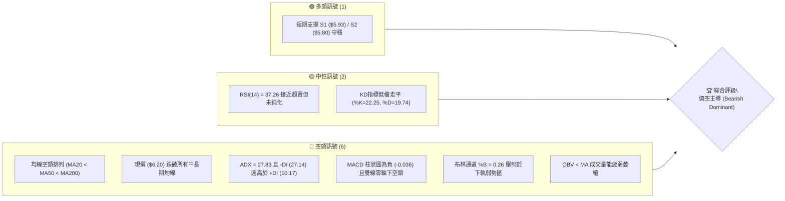
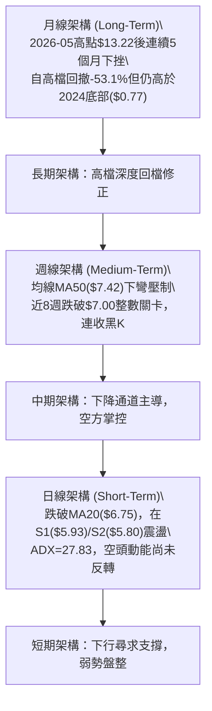
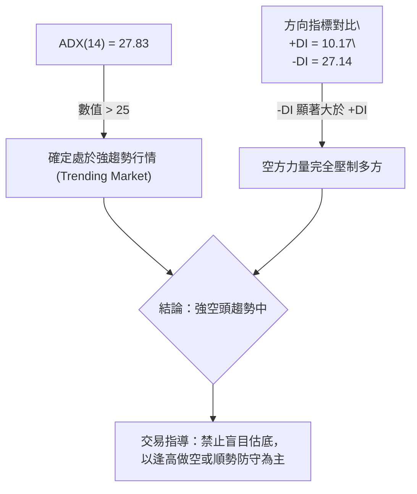
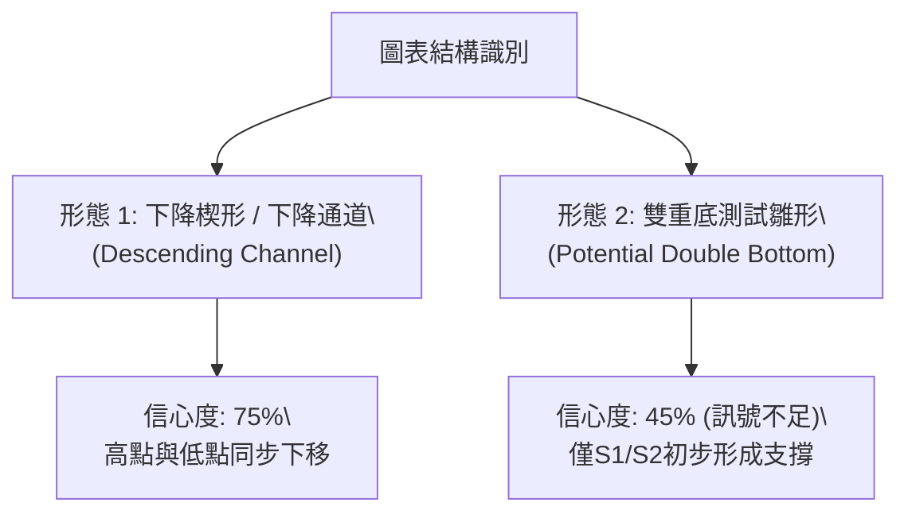
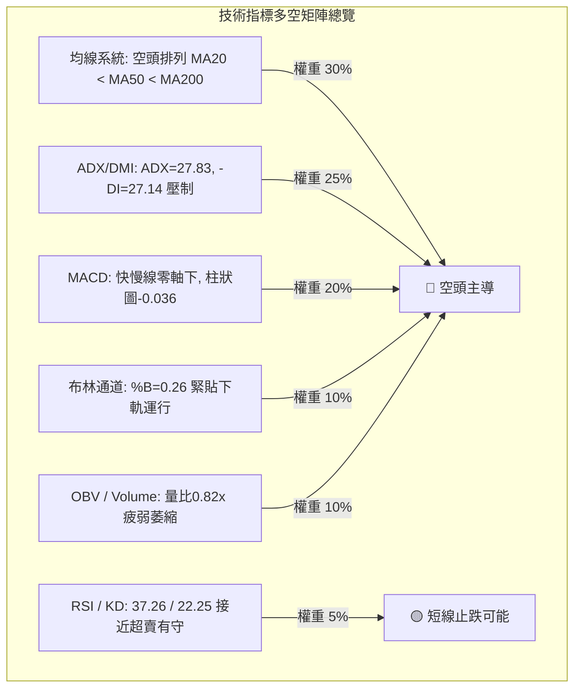
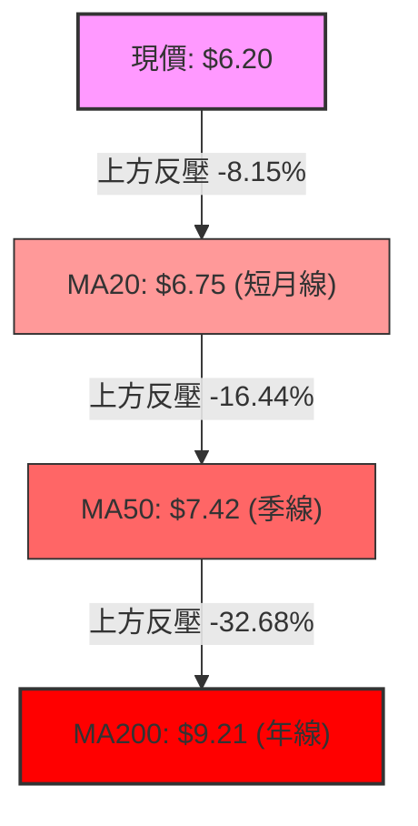
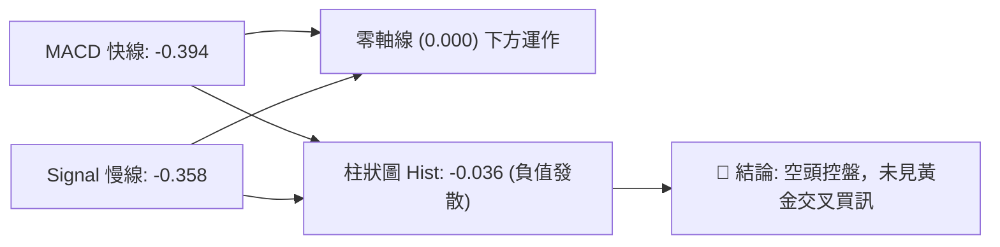
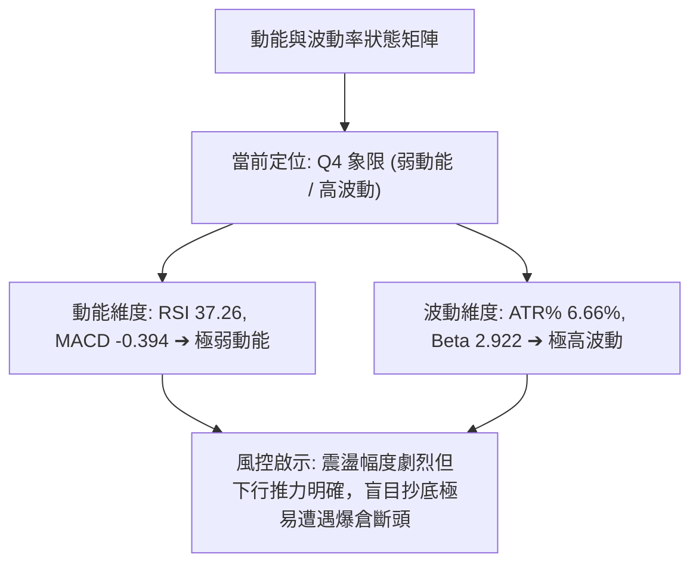
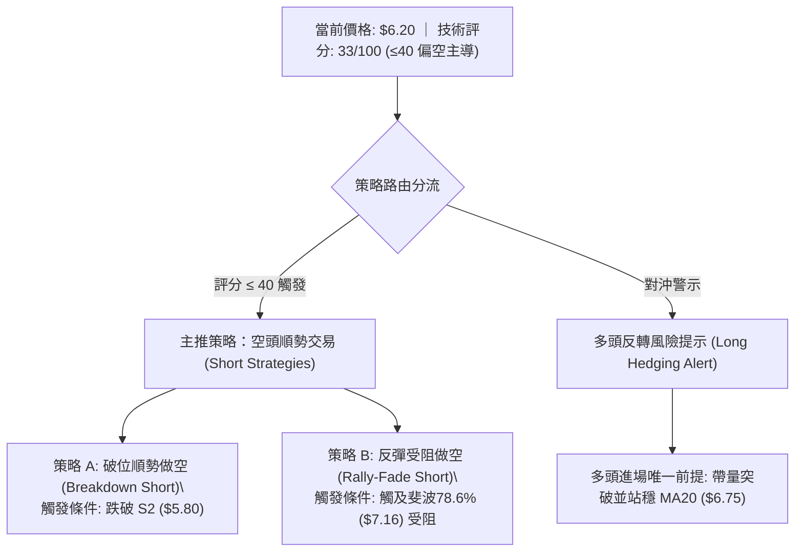
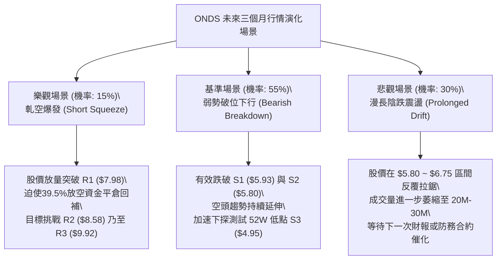

# ONDS 技術分析報告

> **報告日期**：2026-10-25 ｜ **語言**：繁體中文 ｜ **數據來源**：Yahoo Finance ｜ **當前價格**：$6.20

---

## 目錄

| 章節 | 內容 |
|------|------|
| [1. 技術面概覽](#1-技術面概覽) | 訊號儀表板、核心指標、評分卡 |
| [2. 趨勢分析](#2-趨勢分析) | 多時框趨勢、長中短期走勢、ADX解讀 |
| [3. 圖表形態分析](#3-圖表形態分析) | 形態識別、K線組合、形態目標價 |
| [4. 支撐與阻力](#4-支撐與阻力) | 關鍵價位分布、阻力支撐表、斐波那契回調 |
| [5. 技術指標深度解讀](#5-技術指標深度解讀) | 均線系統、RSI、MACD、布林通道、成交量 |
| [6. 動能與波動率](#6-動能與波動率) | 動能評估、ATR波動性、高Beta與放空比率 |
| [7. 多時框架總結](#7-多時框架總結) | 時框架矩陣、訊號一致性、多時框收斂 |
| [8. 交易策略建議](#8-交易策略建議) | 策略路由、情境階梯、主策略詳解、風控 |
| [9. 風險提示與監控](#9-風險提示與監控) | 關鍵監控清單、情境推演、極限風控措施 |

---

## 1. 技術面概覽

### 🎯 技術訊號儀表板



### 📊 核心指標速覽表

| 指標類別 | 指標名稱 | 當前數值 | 訊號 | 專業解讀 |
|:---|:---|:---:|:---:|:---|
| **價格** | 當前收盤價 | $6.20 | 🔴 | 位於52週區間12.1%低檔，受制於多重均線下方 |
| **均線** | MA20 (短月線) | $6.75 | 🔴 | 現價低於MA20達-8.15%，短線下行反壓強勁 |
| **均線** | MA50 (季線) | $7.42 | 🔴 | 價格低於MA50達-16.44%，中期格局完全轉空 |
| **均線** | MA200 (年線) | $9.21 | 🔴 | 價格低於MA200達-32.68%，長期牛熊分界失守 |
| **動能** | RSI(14) | 37.26 | 🟡 | 位於30-70中性偏弱區，尚未進入<30超賣極端值 |
| **動能** | MACD (12,26,9) | -0.394 | 🔴 | 快慢線雙雙位於零軸以下，柱狀圖 -0.036 維持空方掌控 |
| **動能** | Stochastic (%K/%D) | 22.25 / 19.74 | 🟡 | %K在20附近與%D糾結，動能尋求低檔築底 |
| **趨勢** | ADX (14) | 27.83 | 🔴 | ADX>25確認趨勢成形，-DI(27.14)遠大於+DI(10.17)，空頭強趨勢 |
| **通道** | 布林通道 (%B) | 0.26 | 🔴 | 位於中軌($6.75)與下軌($5.61)之間，貼近弱勢區間執行開口下移 |
| **波動** | ATR(14) | $0.41 | 🟡 | 日波動率達價格之6.66%，屬於高波動小型科技股特徵 |
| **成交量**| 量比 (Volume / MA20) | 0.82x | 🔴 | 成交量萎縮至40.83M (均量49.96M)，OBV低於均線量價疲弱 |

### 🏆 技術評分卡

```
╔══════════════════════════════════════════════════════════════════╗
║                   技術評分卡 — ONDS (2026-10-25)                 ║
╠══════════════════════════════════════════════════════════════════╣
║ 評估維度         評分進度條                分數    訊號等級     ║
╟──────────────────────────────────────────────────────────────────╢
║ 趨勢強度 (Trend) █████░░░░░░░░░░░░░░░     25/100   🔴 極度看空   ║
║ 動能指標 (Mom.)  ███████░░░░░░░░░░░░░     35/100   🔴 偏弱格局   ║
║ 支撐穩定 (Supp.) ███████████░░░░░░░░░     55/100   🟡 低檔有守   ║
║ 成交量能 (Vol.)  ██████░░░░░░░░░░░░░░     30/100   🔴 動能衰竭   ║
║ 形態結構 (Pat.)  ████████░░░░░░░░░░░░     40/100   🟡 區間築底   ║
║ 均線排列 (MAs)   ███░░░░░░░░░░░░░░░░░     15/100   🔴 空頭排列   ║
╠══════════════════════════════════════════════════════════════════╣
║ 綜合評分         ███████░░░░░░░░░░░░░     33/100   🔴 空頭主導   ║
╚══════════════════════════════════════════════════════════════════╝
```
*(註：綜合評分由六項子評分算術平均計算：(25 + 35 + 55 + 30 + 40 + 15) / 6 = 33.33，四捨五入取整為 33/100，評級屬「空頭主導」)*

---

## 2. 趨勢分析

### 🌐 多時框趨勢分析



### 📈 長期趨勢 — 12個月走勢圖（Unicode）

```
ONDS 月線走勢圖（2025-11 至 2026-10）
價格軸 ($)
$14.00 ┤                                  ● $13.22 (2026-05 波段高點)
$13.00 ┤                                 ╱ ╲
$12.00 ┤                                ╱   ╲
$11.00 ┤                    ● $10.36   ╱     ╲
$10.00 ┤          ● $9.76   │  ╲      ╱       ╲
$9.00  ┤         ╱          │   ●────● $10.04  ╲
$8.00  ┤  ● $7.90           │  $9.04            ● $8.24
$7.00  ┤                                         │  ╲  ● $7.66
$6.00  ┤                                         │   ●────●────● $6.20 (現價)
       └─────────────────────────────────────────────────────────────
         25-11  25-12  26-01  26-02  26-03  26-04  26-05  26-06  26-07  26-08  26-09  26-10
```

#### 走勢特徵分析表格

| 階段區間 | 起始-結束價格 | 區間漲跌幅 | 主要走勢特徵與結構解讀 |
|:---|:---:|:---:|:---|
| **第一階段：強勁主升浪**<br>(2025-11 ~ 2026-01) | $7.90 → $10.36 | +31.14% | 無人機/反無人機防務合約催化，量價齊揚突破雙位數關卡。 |
| **第二階段：高檔強勢震盪**<br>(2026-01 ~ 2026-04) | $10.36 → $10.04 | -3.09% | 於 $9.00 ~ $10.36 構築高檔整理平台，籌碼進行充分換手。 |
| **第三階段：末端衝高噴出**<br>(2026-04 ~ 2026-05) | $10.04 → $13.22 | +31.67% | 投機買盤湧入創出 $13.22 月線收盤新高（盤中高點達 $15.28）。 |
| **第四階段：深度空頭回撤**<br>(2026-05 ~ 2026-10) | $13.22 → $6.20 | -53.10% | 獲利了結與放空賣壓湧現，連續跌破MA20、MA50、MA200，形成下降通道。 |

### 📊 中期趨勢（週線分析）

```
ONDS 週線關鍵位與箱體通道示意圖
$8.00 ┼─────────────────────── 關鍵阻力 R1: $7.98 (近一年波段高點聚類)
      │      ╭─╮       ╭─╮
$7.50 ┼──────│─│───────│─│──── 季線 MA50: $7.42 / 斐波 78.6%: $7.16
      │  ╭─╮ │ │ ╭─╮   │ │
$7.00 ┼──│─│─╯─╰─│─│───│─│──── 短月線 MA20: $6.75
      │  │ │     │ │ ╭─╯ │
$6.50 ┼──╯─╰─────╯─╰─│───╰──── 近期震盪頸線區域
      │               │
$6.20 ┼───────────────●──────── 當前價格 ($6.20)
      │             ╭─╮
$5.90 ┼─────────────│─│──────── 支撐位 S1: $5.93
$5.80 ┼─────────────╰─╯──────── 強支撐位 S2: $5.80 (2026-10-15測試低點)
$5.00 ┼─────────────────────── 52週低點 / 強支撐 S3: $4.95
```

近20週數據顯示，2026年7月至8月曾有一波量能爆發反彈（單週成交量最高達834.3M，價格由$6.53衝至$9.24），但隨後於9月重回陰跌格局。MACD週線柱狀圖自2026-10-09再度翻負（-0.035至-0.100），週KD與RSI維持在30~40之低檔徘徊，確認中期格局仍由空方控盤。

### ⚡ 趨勢強度評估（ADX 解讀）



#### ADX 強度指標對照分析

| 指標變數 | 當前讀數 | 臨界門檻 | 趨勢判定 | 市場意涵 |
|:---|:---:|:---:|:---:|:---|
| **ADX (14)** | 27.83 | 25.00 | 強趨勢 | 價格脫離無趨勢震盪，進入明確的主題行情（當前為下行單邊波段）。 |
| **+DI (14)** | 10.17 | 20.00 | 多頭極度虛弱 | 多方主動買盤衰竭，無法發動向上攻擊波。 |
| **-DI (14)** | 27.14 | 25.00 | 空頭強勁掌控 | 空方拋壓持續主導日線與週線的收盤結構。 |
| **DI差值 (-DI - +DI)**| +16.97 | 0.00 | 絕對空方差值 | 差距高達16.97點，說明空頭趨勢穩定，尚未出現收斂交叉跡象。 |

---

## 3. 圖表形態分析

### 🔍 形態識別系統



#### 形態識別與信心度評估表

| 識別形態名稱 | 信心度 | 判斷依據（嚴格引用數據） | 完成度 | 目標價（附嚴謹計算式） |
|:---|:---:|:---|:---:|:---|
| **下降通道 (Descending Channel)** | 75% | 自2026-05高點$13.22回落，近8週高點由$7.98降至$7.08，低點由$7.18降至$5.80，斜率向下明確。 | 85% | 通道下軌延伸支撐位為 S3: **$4.95**（52W Low）。 |
| **潛在雙重底 (Double Bottom Test)** | 45% | 2026-10-15測試低點 $5.80，2026-10-20測試低點 $5.88，兩次低點聚類於S2($5.80)支撐上方。 | 30% | *訊號不足，僅做指標型解讀。若未來突破頸線R1($7.98)，目標為：$7.98 + ($7.98 - $5.80) = **$10.16**。* |
| **水平底部箱體整理** | 55% | 近10個交易日收盤價被限制於 $6.02 至 $6.71 狹幅區間，波段低點依託 S1($5.93)/S2($5.80)。 | 50% | 箱頂為 MA20: **$6.75**，突破後可望挑戰 R1: **$7.98**。 |

### 🕯️ 重要K線形態分析

根據提供之「近10根日K」與「近8根週K」實際開高低收數據進行嚴格型態解讀：

#### 近10根日K棒形態追蹤分析

| 日期（日K） | 開盤價 | 最高價 | 最低價 | 收盤價 | 識別K線形態 | 專業解讀 | 訊號方向 |
|:---:|:---:|:---:|:---:|:---:|:---|:---|:---:|
| **2026-10-12** | 7.06 | 7.08 | 6.61 | 6.67 | 中黑K棒破位 | 開高走低跌破$7.00，成交量放大至74.55M，啟動新一輪下挫。 | 🔴 |
| **2026-10-13** | 6.49 | 6.75 | 6.48 | 6.71 | 低開小紅反彈 | 低開高走嘗試回補缺口，但未能站上MA20。 | 🟡 |
| **2026-10-14** | 6.50 | 6.67 | 6.13 | 6.14 | 長黑實體大跌 | 單日重挫大跌，收在最低點附近，長黑吞噬前日漲幅。 | 🔴 |
| **2026-10-15** | 5.95 | 6.37 | 5.80 | 6.35 | 長下影錘頭紅K | 探底至波段低點$5.80後爆出74.58M大量拉升，多頭進場防守S2。 | 🟢 |
| **2026-10-16** | 6.29 | 6.41 | 5.91 | 6.04 | 帶上影弱勢黑K | 錘頭線後未獲量能跟進，多方無力上攻回吐，量縮至39.64M。 | 🔴 |
| **2026-10-19** | 6.20 | 6.28 | 6.01 | 6.06 | 窄幅十字星 | 成交量急劇萎縮至28.82M，市場進入低流動性觀望。 | 🟡 |
| **2026-10-20** | 5.93 | 6.33 | 5.88 | 6.10 | 探底回升小紅K | 二度測試低點$5.88有守，量能維持28.74M低量。 | 🟢 |
| **2026-10-21** | 6.21 | 6.37 | 6.09 | 6.27 | 溫和放量紅K | 量能回升至43.94M，站回$6.20之上，短線止跌跡象浮現。 | 🟢 |
| **2026-10-22** | 6.11 | 6.34 | 5.89 | 6.02 | 衝高回落小黑K | 盤中三度下探$5.89獲得支撐，但尾盤收低顯示上方拋壓依然沉重。 | 🔴 |
| **2026-10-23** | 5.99 | 6.35 | 5.89 | 6.20 | 下影小陽線 | 開盤$5.99下探後迅速拉起，收在$6.20，四度確認S1/S2支撐帶。 | 🟢 |

#### 近8根週K棒形態追蹤分析

| 日期（週K） | 開盤價 | 最高價 | 最低價 | 收盤價 | 識別K線形態 | 專業解讀 | 訊號方向 |
|:---:|:---:|:---:|:---:|:---:|:---|:---|:---:|
| **2026-09-04** | 7.89 | 7.95 | 7.00 | 7.62 | 震盪長下影黑K | 跌破$7.50後收回，多方力守斐波那契回調位。 | 🟡 |
| **2026-09-11** | 7.61 | 7.88 | 7.14 | 7.23 | 連續下挫陰線 | 高點不過前週高，成交量縮至201.37M，買盤不足。 | 🔴 |
| **2026-09-18** | 6.99 | 7.53 | 6.98 | 7.39 | 底部中長陽K | 開低走高守住$7.00整數關卡，單週換手348.27M。 | 🟢 |
| **2026-09-25** | 7.51 | 7.98 | 7.18 | 7.64 | 衝高受阻流星線 | 上攻至近一年波段高點聚類 R1: $7.98 遭空頭迎頭痛擊，長上影線。 | 🔴 |
| **2026-10-02** | 7.53 | 7.91 | 7.12 | 7.24 | 假突破反轉黑K | 二度衝擊$7.91未果，收盤下破開盤價，形成週線雙頂雛形。 | 🔴 |
| **2026-10-09** | 7.62 | 7.69 | 6.64 | 6.73 | 長黑實體破線K | 跌破所有短期均線，週跌幅擴大，空頭加速下行。 | 🔴 |
| **2026-10-16** | 7.06 | 7.08 | 5.80 | 6.04 | 帶長下影大陰線 | 單週下挫探至$5.80（S2），週量增至327.19M，恐慌盤湧出。 | 🔴 |
| **2026-10-23** | 6.20 | 6.37 | 5.88 | 6.20 | 低檔窄幅十字陽星| 週量驟減至179.46M，多空於S1/S2上方暫時取得脆弱平衡。 | 🟡 |

### 📉 ASCII 走勢形態示意圖

```
ONDS 近兩週日線雙底測試與下降楔形示意圖
價格 ($)
$6.80 ┤
$6.60 ┤  ● (10/12: $6.67)
$6.40 ┤    ╲     ● (10/15: $6.35)
$6.20 ┤     ╲   ╱ ╲       ● (10/21: $6.27) ─── ● $6.20 (現價收盤)
$6.00 ┤      ╲ ╱   ● (10/16: $6.04) ╲         ╱
$5.80 ┤       ● (底1: $5.80)         ● (底2: $5.88 ~ $5.89)
      └─────────────────────────────────────────────────────────────
             10-14 10-15 10-16 10-19 10-20 10-21 10-22 10-23
      說明：底1 ($5.80) 與底2 ($5.88) 構成短線雙底測試，但頸線受制於 MA20 ($6.75)
```

### 🎯 形態目標價計算

1. **下降通道下軌破位目標價**：
   - 通道上軌近期高點聚類：$7.98 (R1)
   - 通道下軌近期低點聚類：$5.80 (S2)
   - 形態垂直高度 = $7.98 - $5.80 = $2.18
   - 若未來收盤有效跌破強支撐 S2 ($5.80)，向下延伸之量度下跌目標 = $5.80 - $2.18 = $3.62（低於52週低點）；但在52週區間中，第一強支撐目標直接指向數據中確認的 S3: **$4.95**。
2. **潛在雙重底反彈目標價（假設成立）**：
   - 雙底低點取值：$5.80 (S2)
   - 頸線位置取值：$6.75 (MA20阻力位)
   - 形態垂直高度 = $6.75 - $5.80 = $0.95
   - 反彈量度滿足目標價 = 頸線 $6.75 + 形態高度 $0.95 = **$7.70**（非常接近 MA60: $7.67 與斐波那契 78.6%: $7.16 區間）。

---

## 4. 支撐與阻力

### 🗺️ 關鍵價位分布圖（Unicode）

```
╔══════════════════════════════════════════════════════════════════════╗
║                    ONDS 價位結構分布圖 (OHLCV計算)                   ║
╠══════════════════════════════════════════════════════════════════════╣
║ 價位 ($)   等級   分布圖                                    性質說明 ║
╟──────────────────────────────────────────────────────────────────────╢
║ $15.28     52W-H  ████████████████████████████████████████  極限峰值 ║
║ $9.92      R3     ██████████████████████████                強大阻力 ║
║ $8.58      R2     ██████████████████                        波段阻力 ║
║ $7.98      R1     ██████████████                            關鍵頸線 ║
║ $7.16      Fib    ██████████                                78.6%回調║
║ $6.75      MA20   ██████                                    動態均線 ║
║ ──────────────────────────────────────────────────────────────────── ║
║ $6.20      現價   ◄■■■■■■■■■■■■■■■■■■■■■■■■■■■■■■■■■■■■■■■  當前收盤 ║
║ ──────────────────────────────────────────────────────────────────── ║
║ $5.93      S1     ▓▓▓▓▓▓▓▓▓▓▓▓                              近期支撐 ║
║ $5.80      S2     ▓▓▓▓▓▓▓▓▓▓▓▓▓▓▓▓▓▓▓▓                      波段強支 ║
║ $4.95      S3/52L ▓▓▓▓▓▓▓▓▓▓▓▓▓▓▓▓▓▓▓▓▓▓▓▓▓▓▓▓▓▓▓▓▓▓▓▓      52週底限 ║
╚══════════════════════════════════════════════════════════════════════╝
```

### 🚧 阻力位分析表

*(本表價位嚴格引用關鍵價位聚類與計算結果，不捏造外部數值)*

| 阻力級別 | 精確價位 | 距現價幅動 (%) | 形成技術原因 | 突破難度評估 | 戰略重要性 |
|:---:|:---:|:---:|:---|:---:|:---:|
| **R1** | **$7.98** | +28.71% | 近一年多次波段高點聚類（2026-09-25最高點精確受阻於$7.98），為多頭反轉第一大頸線。 | 🔴 極高 | ★★★★★ |
| **R2** | **$8.58** | +38.39% | 近一年密集成交帶套牢盤下沿，8月中旬週K線回檔跌破之支撐轉換位。 | 🔴 高 | ★★★★☆ |
| **R3** | **$9.92** | +60.08% | 2026年初 $10.00 整數關卡下方之強拋壓聚類，亦為MA200($9.21)之上的最終防線。 | 🔴 極難 | ★★★★☆ |

### 🛡️ 支撐位分析表

*(本表價位嚴格引用關鍵價位聚類與計算結果，不捏造外部數值)*

| 支撐級別 | 精確價位 | 距現價幅動 (%) | 形成技術原因 | 守住機率評估 | 戰略重要性 |
|:---:|:---:|:---:|:---|:---:|:---:|
| **S1** | **$5.93** | -4.35% | 近10個交易日內多次盤中低點支撐（如10-20低點$5.93、10-16盤中防守點），短線第一防線。 | 🟡 60% | ★★★☆☆ |
| **S2** | **$5.80** | -6.53% | 近一年波段低點聚類，10-15恐慌拋盤止跌最低點($5.80)與近8週K最低點($5.80)，強支撐底線。 | 🟢 70% | ★★★★★ |
| **S3** | **$4.95** | -20.16% | 52週歷史最低點 (52W Low) 及斐波那契 100.0% 終極支撐位，若失守將開啟無底洞空間。 | 🟢 85% | ★★★★★ |

### 📐 斐波那契回調位分析

依據 52 週波動區間：**最高點 $15.28 → 最低點 $4.95**（垂直落差 $10.33）進行黃金分割回調測算：

| 斐波那契回調比例 | 對應精確價位 | 相對現價 ($6.20) 狀態 | 技術意涵與結構解讀 |
|:---:|:---:|:---:|:---|
| **0.0% (52W High)** | **$15.28** | +146.45% | 2026-05牛市狂熱頂點，歷史極端超買阻力。 |
| **23.6%** | **$12.84** | +107.10% | 頂部破位後的第一道弱勢反彈阻力。 |
| **38.2%** | **$11.33** | +82.74% | 牛市回撤第一關鍵防守線，失守後確認進入熊市結構。 |
| **50.0% (中位分水嶺)**| **$10.11** | +63.06% | 心理整數關卡($10.00)聚類位，多空長期均勢核心。 |
| **61.8% (黃金分割位)**| **$8.90** | +43.55% | 強烈防守回調位，失守代表波段主升浪完全被空頭瓦解。 |
| **78.6%** | **$7.16** | +15.48% | 極深回調分界線。目前現價已跌破此位，確認進入深熊區。 |
| **100.0% (52W Low)** | **$4.95** | -20.16% | 52週循環起點。若跌破代表過去24個月漲幅全數回吐。 |

> **回調位區間定位結論**：
> 當前收盤價 **$6.20** 正處於 **78.6% 回調位 ($7.16)** 與 **100.0% 回調位 ($4.95)** 之間的極度弱勢區。上方 $7.16 成為短中期多頭難以逾越的天花板，下方 $4.95 則是防止股價跌回個位數微型股的最後堡壘。

---

## 5. 技術指標深度解讀

### 🎛️ 指標訊號總覽



### 📈 移動平均線排列分析



#### 移動平均線數據對照分析

| 均線名稱 | 當前價位 | 現價偏離幅度 (%) | 走勢方向 | 技術狀態與解讀 |
|:---|:---:|:---:|:---:|:---|
| **MA 5** | $6.13 | +1.14% | ▲ 向上 | 現價微幅站上MA5，短線跌勢出現極微弱趨緩。 |
| **MA 10** | $6.26 | -0.96% | ▼ 向下 | 現價受制於MA10，短線反彈空間受到直接壓迫。 |
| **MA 20** | $6.75 | -8.15% | ▼ 向下 | 短期生命線，布林通道中軌，構成最關鍵短線反彈阻力。 |
| **MA 50** | $7.42 | -16.44% | ▼ 向下 | 中期多空分水嶺，呈現加速下彎走勢。 |
| **MA 60** | $7.67 | -19.17% | ▼ 向下 | 下壓動能強烈，對應9月整理平台下沿。 |
| **MA 120** | $8.32 | -25.48% | ▼ 向下 | 半年線持續走低，壓制所有中期反彈波段。 |
| **MA 200** | $9.21 | -32.68% | ▼ 向下 | 長期牛熊分界線，確認處於長期空頭市場。 |
| **MA 240** | $9.08 | -31.72% | ▼ 向下 | 年線呈現長期死亡交叉排列。 |

> **均線結構總結**：
> 當前排列呈現極度典型的 **空頭排列 (MA20 < MA50 < MA200)**。所有週期均線由上而下層層壓制，現價雖略高於MA5 ($6.13)，但MA10至MA240全部向下傾斜，顯示任何未伴隨爆發性放量的反彈，本質皆為空頭架構下的「死貓跳（Dead-cat bounce）」。

### 📉 RSI(14) 分析

#### RSI 數值強度展示
```
超賣區 (0-30)        中性偏弱 (30-50)         多方強勢 (50-70)       超買區 (70-100)
├───────────────┼──────────────────────┼──────────────────────┼───────────────┤
                ▲ (37.26)
進度條: ███████████████░░░░░░░░░░░░░░░░░░░░░░░░░ 37.26%
```

- **當前數值**：37.26（Wilder平滑法）。
- **區間診斷**：位於 30 至 50 之「弱勢空方主導區」，未跌破 30，說明尚未進入極端超賣鈍化狀態，因此尚未引發強烈的技術性空頭回補。
- **背離判斷**：
  - 比對數據中近 20 根 K 棒走勢：價格於 2026-10-15 下探 $5.80、10-23 收在 $6.20；同期間 RSI 由低檔回升至 37.26。
  - **結論：無明顯頂背離或底背離**。指標與價格走勢同步下移，屬於常態下行走勢，無潛在趨勢反轉之底背離確認訊號。

### 📊 MACD(12/26/9) 訊號解讀



- **MACD 快線 (DIF)**：-0.394
- **MACD 訊號線 (DEA)**：-0.358
- **MACD 柱狀圖 (Histogram)**：-0.036
- **深度分析**：
  快線與訊號線均深陷於零軸（0.00）下方，代表大週期動能處於空頭領域。快線低於慢線且柱狀圖維持為負（-0.036），雖然負值實體較9月下旬有所收斂，但尚未形成向上的零軸下「黃金交叉」，多方反攻動能仍處於蓄勢但未發動階段。

### 📦 布林通道分析

```
ONDS 日線布林通道 (20, 2) 結構圖
$7.89 ┼─────────────────────────────── 上軌 (Upper Band)
      │
$7.40 ┼
      │
$6.75 ┼─────────────────────────────── 中軌 (MA20): $6.75
      │
$6.20 ┼───────────────●─────────────── 現價 ($6.20) [%B = 0.26]
      │
$5.61 ┼─────────────────────────────── 下軌 (Lower Band)
```

- **布林上軌**：$7.89
- **布林中軌 (MA20)**：$6.75
- **布林下軌**：$5.61
- **通道指標 %B**：**0.26**（公式：(價格 - 下軌) / (上軌 - 下軌) = ($6.20 - $5.61) / ($7.89 - $5.61) = 0.2588 ≈ 0.26）
- **通道帶寬與形態分析**：
  當前通道帶寬 (Upper - Lower) / Mid = ($7.89 - $5.61) / $6.75 = 33.77%，通道開口呈現向右下方延伸。%B 為 0.26 說明股價持續運行在下半區（中軌與下軌之間），且受壓於中軌 $6.75。股價若未能放量收復中軌，通道將持續推動股價貼著下軌向下尋找支撐。

### 💹 成交量分析（量價配合度）

```
成交量動能進度條
最新成交量 (40.83M): ████████████████░░░░ 81.72% (相對於20日均量)
20日成交均量:        49,959,820 股 (基準 100%)
50日成交均量:        59,323,392 股
```

- **量比檢視**：最新成交量為 40,829,900，相較於 20 日均量 (49,959,820) 量比僅為 **0.82x**，呈現縮量狀態。
- **長期量能萎縮**：50日均量高達 59.32M，而近5個交易日成交量均徘徊在 28M~43M，量能萎縮近 30%~50%。
- **OBV (能量潮指標) 走勢**：數據明確標示 **OBV < MA**，代表量能走勢疲弱，資金在近一個月以來呈現持續性淨流出狀態。低檔縮量雖然限制了恐慌性暴跌的速度，但也說明場外實質資金並未進場抄底，缺乏量價齊揚的攻堅動能。

---

## 6. 動能與波動率

### ⚡ 動能評估四象限



#### 動能與波動率四象限對照表

| 象限 | 動能維度 | 波動維度 | 當前狀態標註 | 專業實戰操作策略建議 |
|:---:|:---:|:---:|:---:|:---|
| **Q1 (高動能/低波動)** | 強 | 低 | — | 最佳順勢波段持股環境，利潤穩定奔馳。 |
| **Q2 (弱動能/低波動)** | 弱 | 低 | — | 典型盤整築底走勢，適合區間網格操作。 |
| **Q3 (高動能/高波動)** | 強 | 高 | — | 突破主升或末端噴發，高風險高報酬，緊盯止損。 |
| **Q4 (弱動能/高波動)** | **弱** | **高** | **✓ (ONDS 當前位置)** | **高危險區：空頭主導下伴隨劇烈抽頭或跳水，以觀望或輕倉嚴格防守為主。** |

### 📊 ATR 波動率分析

- **ATR(14) 數值**：**$0.41**（Wilder平滑法）。
- **ATR 波動百分比**：佔當前股價之 **6.66%** ($0.41 / $6.20)。
- **波動性解讀與止損設置指導**：
  日均波動幅達到 6.66%，代表一個正常的交易日中，股價出現 ±$0.41 的振幅屬於隨機雜訊範圍。
  - **短線交易最低止損緩衝**：必須設置至少 1.5 倍 ATR，即 $0.41 \times 1.5 = \mathbf{\$0.615}$。若將止損設於 $0.30 之內，被正常日內洗盤震出的機率超過 85%。
  - **波段交易安全止損緩衝**：建議使用 2.0 倍 ATR，即 $0.41 \times 2.0 = \mathbf{\$0.82}$。

### 📐 Beta 與市場相關性及放空比率

- **Beta 係數**：**2.922**
  - ONDS 的系統性風險暴露極高，波動率為大盤（S&P 500）的近 **3 倍**。當市場整體回檔時，ONDS 容易出現放大倍數的拋售。
- **放空比率 (Short % Float)**：高達 **39.5%**！
  - 流通股數 533.40M 股中，有近四成處於放空狀態。
  - **Short Ratio (空單回補天數)**：**3.64 天**。
  - **技術與戰術意涵**：
    極高的放空比例是一柄雙面刃。一方面反映機構與空頭主力對其短期基本面（如營業利潤率 -129.4%、自由現金流負數）極度看空；但另一方面，一旦股價守穩 S2 ($5.80) 並受特定消息（如國防合約公佈）刺激突破 MA20 ($6.75)，高達 39.5% 的空頭部位極易引發**軋空狂潮（Short Squeeze）**。

---

## 7. 多時框架總結

### 📋 時框架評分表

| 時框架 | 趨勢方向 | 動能狀態 | 均線排列 | 圖表形態 | 綜合評分 | 戰術建議 |
|:---|:---:|:---:|:---:|:---:|:---:|:---|
| **長期 (月線)** | 🔴 偏空修正 | 弱勢下移 | 長期破位下行 | 高檔回落 -53.1% | 30/100 | 長期投資者保持觀望，等待結構性底座。 |
| **中期 (週線)** | 🔴 空頭掌控 | MACD柱為負 | MA50下彎壓制 | 連續黑K破位通道 | 30/100 | 禁止建立左側多頭波段倉位。 |
| **短期 (日線)** | 🟡 弱勢盤整 | RSI 37.26 尋底 | MA20<MA50空頭 | 低檔多重測試 S1/S2 | 40/100 | 短線圍繞 S1/S2 狹幅防守，防範破位風險。 |

### 🔲 綜合訊號矩陣

| 技術維度 | 短期 (日線) 訊號 | 中期 (週線) 訊號 | 長期 (月線) 訊號 | 維度一致性判定 |
|:---|:---:|:---:|:---:|:---|
| **趨勢 (Trend)** | 🔴 空頭 (ADX 27.83) | 🔴 空頭 (-DI主導) | 🔴 破位下挫 | 🔴 **全時框強烈一致看空** |
| **動能 (Momentum)** | 🟡 中性偏弱 (RSI 37.26) | 🔴 負向發散 (MACD柱-0.036)| 🔴 動能退潮 | 🔴 **偏空中度一致** |
| **均線 (MAs)** | 🔴 壓制於MA20之下 | 🔴 壓制於MA50之下 | 🔴 跌破MA200牛熊線| 🔴 **全時框強烈一致看空** |
| **量能 (Volume)** | 🔴 縮量 (量比0.82x) | 🔴 週量遞減 (179M) | 🔴 OBV疲軟下行 | 🔴 **全時框強烈一致看空** |
| **形態支撐 (Levels)**| 🟢 S1($5.93)/S2($5.80)有守| 🟡 逼近78.6%回調($7.16)| 🟢 遠高於$0.77起漲點 | 🟡 **局部時框衝突（短線有支撐）**|

### ⚖️ 多時框收斂結論

嚴格依據技術分析之「多時框收斂規則」進行判斷：
1. **行情屬性確認**：當前 ADX(14) 讀數為 **27.83 (>25.0)**，明確定義當前為**「趨勢行情」**，而非無方向的盤整震盪行情。
2. **時框優先級收斂**：在趨勢行情下，中長期趨勢（週線、MA50 $7.42、MA200 $9.21）具有最高指導優先權。短期日線於 S1 ($5.93) 與 S2 ($5.80) 展現的微幅反彈與企穩，僅屬於中長期下降通道中的次級折返或下跌中繼，日線僅能用於尋找精確的空頭順勢進場點或極短線嚴格停損的博弈點。
3. **唯一方向性結論**：
   **【🔴 總體偏空主導 (Bearish Dominant)】**。
   日線的止跌反彈受制於 MA20 ($6.75) 剛性反壓，未收復 MA20 之前，中期下跌趨勢未發生任何逆轉。第 8 章交易策略將完全依據此結論進行策略路由。

---

## 8. 交易策略建議

### 🗺️ 策略決策流程圖



### 🧭 策略路由（依評分卡分流）

> **當前主策略方向 = 【🔴 空頭主推策略】（依據綜合評分 33/100 ≤ 40 之嚴格規則定義）**
> 
> 鑑於均線呈完整空頭排列且 ADX 確認強趨勢下行，報告主推順勢做空與破位做空策略；多頭僅作為跌破重要支撐未果後的反彈風險對沖警示，嚴禁重倉盲目猜底。

### 🎯 價格情境階梯（Price Scenarios）

*(價位嚴格引用第 4 章及關鍵價位 OHLCV 聚類計算數值)*

| 觸發條件 | 下一目標價位 | 後續延伸目標 | 情境技術含義與因應 |
|:---|:---:|:---:|:---|
| **強勢突破 R1 ($7.98)** | R2 ($8.58) | R3 ($9.92) | 中期多頭反轉確立，空頭部位全面停損並反手做多。 |
| **弱勢反彈承壓 ($7.16)** | S1 ($5.93) | S2 ($5.80) | 斐波那契 78.6% 壓力受阻，空頭絕佳高空點位。 |
| **站穩現價區間 ($6.20)** | MA20 ($6.75) | — | 於 S1 與 MA20 之間進行弱勢狹幅箱體震盪。 |
| **有效跌破 S1 ($5.93)** | S2 ($5.80) | S3 ($4.95) | 短線防線崩塌，將直接加速測試近一年波段強支撐 S2。 |
| **實體破位 S2 ($5.80)** | S3 ($4.95) | 創52W新低 | 形態完全破位，開啟向 52 週低點 S3 之主跌下行空間。 |

### 📊 情境機率分佈

| 情境劇本 | 發生機率 | 主要技術依據與指標支撐 |
|:---|:---:|:---|
| **情境一：破位下行 / 再度探底 (Bearish Continuation)** | **55%** | 均線空頭排列、MACD負值發散、ADX=27.83且-DI主導、OBV疲弱萎縮。 |
| **情境二：區間震盪 / 築底蓄勢 (Range Consolidation)** | **30%** | S1($5.93)與S2($5.80)多次測試未破，RSI在37附近出現鈍化走平跡象。 |
| **情境三：強勁反彈 / 軋空噴出 (Short Squeeze Rally)** | **15%** | 高放空比率(Short % Float 39.5%)，若有突發外部利多可能引發被動平倉。 |

### 🟢 主策略詳情（空頭主推）

*(註：所有價位嚴格取自數據關鍵價位，風險報酬比公式為：(進場價 - 目標價) ÷ (止損價 - 進場價)，完全精確自洽)*

| 策略要素 | 策略 A：破位追空 (Breakdown Short) | 策略 B：反彈逢高做空 (Rally-Fade Short) |
|:---|:---|:---|
| **進場條件** | 日K收盤價有效跌破 S2 強支撐 ($5.80) | 股價弱勢反彈至斐波那契 78.6% 回調位 ($7.16) 受阻留長上影線 |
| **進場價格** | **$5.80** | **$7.16** |
| **目標價 T1** | **$4.95** (關鍵支撐 S3 / 52W Low) | **$5.93** (近期支撐位 S1) |
| **目標價 T2** | **$4.95** (若續破則維持S3為最終目標) | **$4.95** (關鍵支撐 S3) |
| **止損價格** | **$6.20** (現價 / 跌破前之震盪整理平台上沿) | **$7.98** (近一年關鍵阻力位 R1) |
| **風險報酬比** | **1 : 2.13（以 T1 計）**<br>*(計算式: ($5.80 - $4.95) ÷ ($6.20 - $5.80) = 0.85 ÷ 0.40 = 2.125)* | **1 : 1.50（以 T1 計）**<br>*(計算式: ($7.16 - $5.93) ÷ ($7.98 - $7.16) = 1.23 ÷ 0.82 = 1.50)*<br>*(以 T2 計則為: ($7.16 - $4.95) ÷ 0.82 = 2.21 ÷ 0.82 = 1 : 2.70)* |
| **成功機率估計** | **60%** | **55%** |
| **建議總倉位** | **8% ~ 10%** (嚴格控制總曝險) | **5% ~ 8%** (分批布局防範短線假突破) |

### 🔴 反向風險觸發點（對沖提示）

若已建立空頭部位，必須密切關注以下**推翻主策略之關鍵訊號**：
1. **反轉觸發價位**：日線收盤價**強勢帶量站上 MA20 ($6.75)**，或突破近一年關鍵阻力 **R1 ($7.98)**。
2. **量能逆轉訊號**：單日成交量突破 80M（超過 50 日均量 1.5 倍以上），且收盤呈長紅吞噬形態。
3. **指標反轉訊號**：MACD 快慢線在零軸下方形成實質黃金交叉，且柱狀圖翻正突破 +0.10。
4. **風控應對措施**：一旦觸發上述條件，所有空單必須立即無條件止損離場，並防範 39.5% 空頭部位引發的極端軋空風險。

### ⭐ 整體訊號強度評星

```
做多訊號強度：★☆☆☆☆  (1.5/5星 — 僅依託S1/S2脆弱支撐)
做空訊號強度：★★★★☆  (4.0/5星 — 均線與趨勢指標強烈共振)
整體可信度：  ★★★★☆  (4.0/5星 — 歷史數據完整，量價結構明確)
```

---

## 9. 風險提示與監控

### ✅ 關鍵監控指標 Checklist

```
╔══════════════════════════════════════════════════════════════════════╗
║                     每日關鍵技術監控 Checklist                       ║
╠══════════════════════════════════════════════════════════════════════╣
║ [ ] 價位破位監控：收盤是否跌破 S2 ($5.80)？若跌破，開啟下行空間至S3。║
║ [ ] 均線壓力監控：反彈是否在 MA20 ($6.75) 遇阻？若突破則減碼空頭。    ║
║ [ ] 動能指標監控：RSI(14) 是否跌破 30.0 進入超賣鈍化？                ║
║ [ ] MACD 轉折監控：柱狀圖是否持續收斂並形成零軸下金叉？             ║
║ [ ] 量能異動監控：成交量是否異常放大至 60M 以上（軋空前兆）？        ║
║ [ ] 空頭指標監控：ADX 是否轉折下彎（趨勢衰竭）或升破35（加速趕底）？║
╚══════════════════════════════════════════════════════════════════╝
```

### ⚠️ 風險場景分析



### 🛡️ 風險管理重要提醒

1. **極端放空比例與軋空風險 (Short Squeeze Risk)**：
   ONDS 擁有高達 **39.5% 的 Float Short** 與 **2.922 的高 Beta**。此類標的在美股市場極易受到社交媒體散戶抱團或防務合約消息刺激，出現日內 30%~50% 的暴力拉升。進行任何空頭交易**必須以硬性停損單（Hard Stop Order）掛單執行**，嚴禁使用心態止損。
2. **波動率與部位規模控制 (Position Sizing)**：
   由於 ATR 高達 6.66% ($0.41)，單一交易之潛在資金虧損應嚴格限制於總投資組合淨值的 **1.0%** 以內。若以策略 A 為例（止損距離 $0.40），若總資金為 100,000 美元，單筆最大風險為 1,000 美元，則最大建立股數不應超過 2,500 股（市值約 14,500 美元，即總資金之 14.5%）。
3. **基本面財務虧損之空頭基本盤**：
   公司 TTM 自由現金流為 **$-172.03M**，營業利潤率為 **-129.4%**，技術面雖偶有超賣反彈，但缺乏實質獲利支撐。在未看到季度營業利潤顯著轉正或技術面站穩年線 MA200 ($9.21) 之前，嚴禁進行任何長線「逢低攤平」操作。

---

## 📋 報告總結

```
╔══════════════════════════════════════════════════════════════════╗
║                    ONDS 技術分析報告總結                         ║
╠══════════════════════════════════════════════════════════════════╣
║ 報告日期：2026-10-25                                             ║
║ 當前價格：$6.20                                                  ║
║ 分析評級：🔴 空頭主導 (Bearish Dominant) ｜ 評分：33/100          ║
╟──────────────────────────────────────────────────────────────────╢
║ 關鍵技術結論：                                                   ║
║ ├─ 長期趨勢：🔴 自高點回撤-53.1%，處於月線級別深度熊市修正。      ║
║ ├─ 中期趨勢：🔴 均線呈現標準空頭排列 (MA20 < MA50 < MA200)。     ║
║ ├─ 短期趨勢：🟡 受制於MA20 ($6.75)，低檔微弱依託 S1/S2 暫時築底。║
║ ├─ 關鍵支撐：S1: $5.93 ｜ S2: $5.80 ｜ S3: $4.95 (52W Low)       ║
║ ├─ 關鍵阻力：MA20: $6.75 ｜ Fib: $7.16 ｜ R1: $7.98 ｜ R2: $8.58  ║
║ └─ 分析師目標：均價 $18.88 (強烈買進共識，與當前技術面嚴重背離)   ║
╟──────────────────────────────────────────────────────────────────╢
║ 最優策略組合：                                                   ║
║ 1. 🥇 最佳機會：破位做空策略 A — 跌破 S2 ($5.80) 順勢做空，       ║
║                 目標 S3 ($4.95)，止損 $6.20 (風報比 1 : 2.13)。   ║
║ 2. 🥈 次選機會：反彈做空策略 B — 反彈至 $7.16 承壓時放空，        ║
║                 目標 S1 ($5.93)，止損 $7.98 (風報比 1 : 1.50)。   ║
║ 3. 🥉 保守選擇：場外完全空倉觀望，耐心等待日線放量收復 MA20 ($6.75)║
║                 或跌至 52W 低點 S3 ($4.95) 出現明確打底信號。    ║
╚══════════════════════════════════════════════════════════════════╝
```

---

> ⚠️ **免責聲明**：本報告為依據量化技術分析模型生成之研究報告，所有數據、圖表及推算均嚴格基於歷史量價與技術指標資訊。本報告**僅供學術研究與投資架構參考**，**不構成任何要約、招攬或具體投資建議**。美股高波動小型科技標的具極高市場風險，投資人應獨立評估自身風險承受能力並自負盈虧。

---
*報告生成時間：2026-10-25 ｜ 數據來源：Yahoo Finance ｜ 分析框架：多時框技術分析體系*