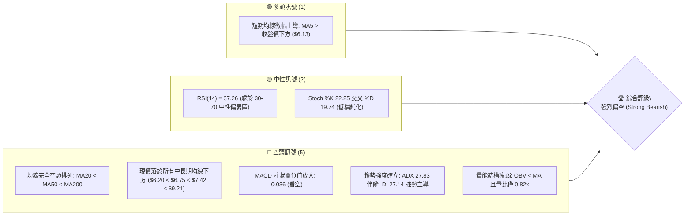
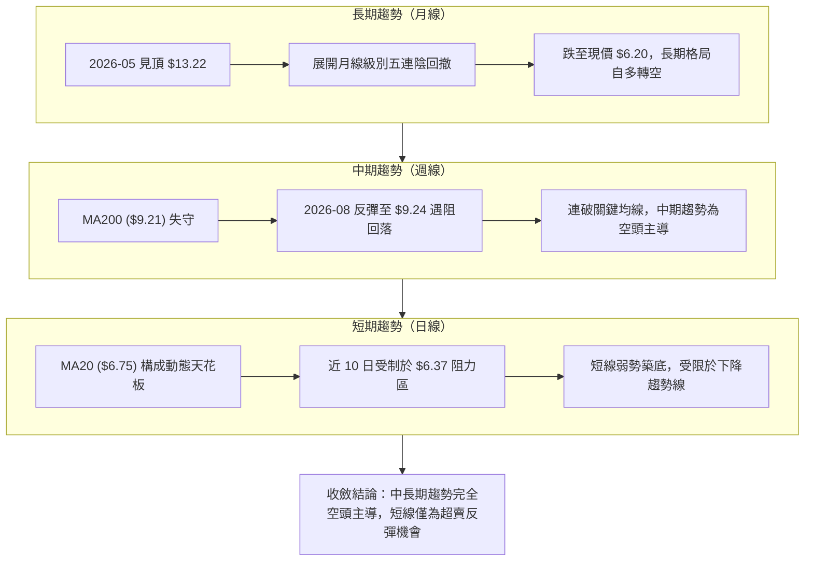
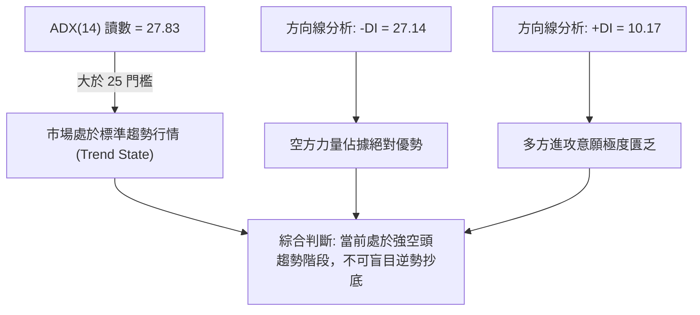
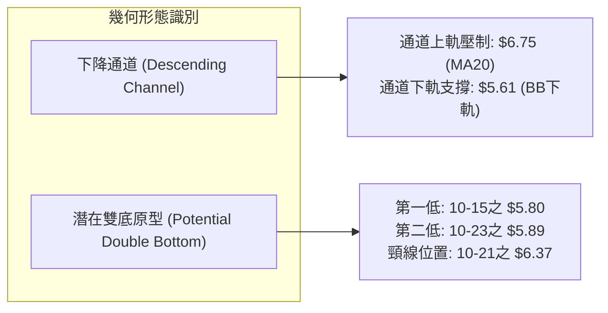
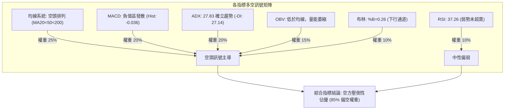
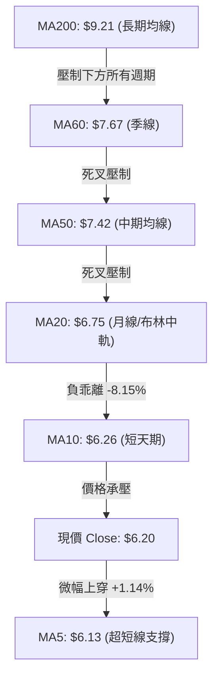
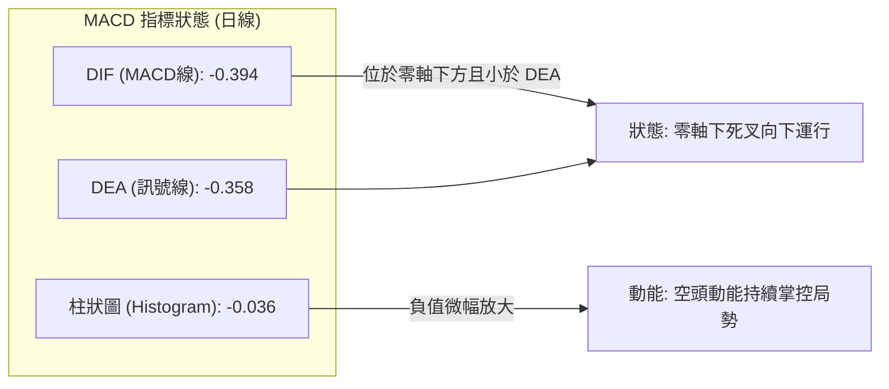
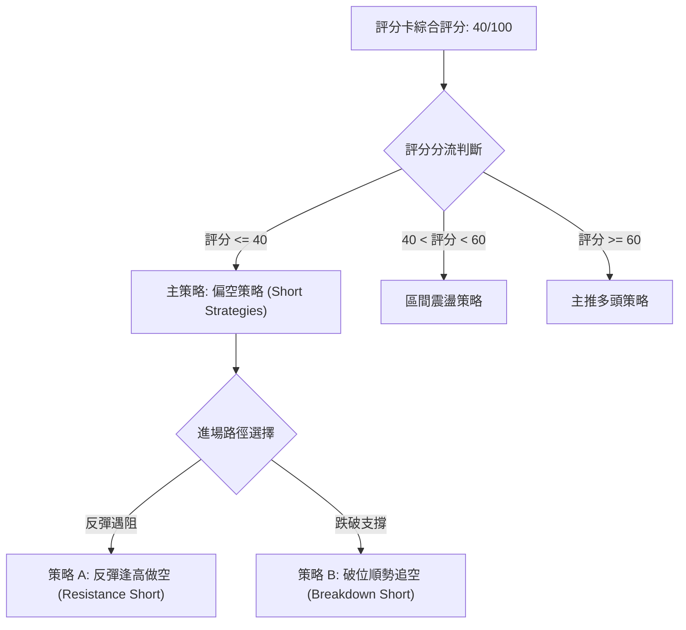
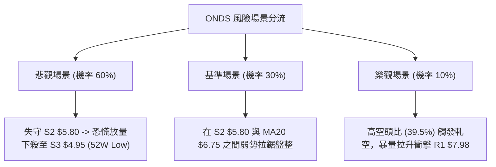

# ONDS 技術分析報告

> **報告日期**：2026-10-26 ｜ **語言**：繁體中文 ｜ **數據來源**：Yahoo Finance ｜ **當前價格**：$6.20

---

## 目錄

| 章節 | 內容 |
|------|------|
| [1. 技術面概覽](#1-技術面概覽) | 訊號儀表板、核心指標、評分卡 |
| [2. 趨勢分析](#2-趨勢分析) | 多時框趨勢、長中短期走勢 |
| [3. 圖表形態分析](#3-圖表形態分析) | 形態識別、K線組合、目標價 |
| [4. 支撐與阻力](#4-支撐與阻力) | 關鍵價位、斐波那契回調 |
| [5. 技術指標深度解讀](#5-技術指標深度解讀) | MA/RSI/MACD/布林/成交量 |
| [6. 動能與波動率](#6-動能與波動率) | 動能評估、ATR、Beta |
| [7. 多時框架總結](#7-多時框架總結) | 時框架評分矩陣 |
| [8. 交易策略建議](#8-交易策略建議) | 多空策略、風險報酬比 |
| [9. 風險提示與監控](#9-風險提示與監控) | 監控指標、風險場景 |
| [10. 報告總結](#10-報告總結) | 核心結論與策略彙整 |

---

## 1. 技術面概覽

### 🎯 技術訊號儀表板



### 📊 核心指標速覽表

| 指標類別 | 指標名稱 | 當前數值 | 訊號 | 解讀 |
|----------|----------|----------|------|------|
| **價格** | 當前收盤價 | $6.20 | 🔴 | 位於 52 週高低區間之 12.1% 低位，承壓嚴重 |
| **均線** | MA20 | $6.75 | 🔴 | 現價低於 MA20 達 -8.15%，短期下行趨勢顯著 |
| **均線** | MA50 | $7.42 | 🔴 | 現價低於 MA50，中期波段呈現空方壓制 |
| **均線** | MA200 | $9.21 | 🔴 | 股價深度跌破長期生命線，長期趨勢嚴重走空 |
| **均線排列** | 均線架構 | 空頭排列 | 🔴 | MA20 < MA50 < MA200，空方趨勢確立 |
| **動能** | RSI(14) | 37.26 | 🟡 | 位於中性偏弱區間（30–70），未達極端超賣，下行動能仍存 |
| **動能** | MACD (12,26,9) | -0.394 / -0.358 | 🔴 | 負值區間運行，MACD Hist 為 -0.036，空頭動能維持 |
| **趨勢** | ADX (14) | 27.83 | 🔴 | ADX > 25 且 -DI (27.14) 遠高於 +DI (10.17)，確立空頭趨勢行情報價 |
| **通道** | 布林通道 %B | 0.26 | 🔴 | 位於中軌（$6.75）與下軌（$5.61）之間，下行通道打開 |
| **量能** | 成交量比 | 0.82x | 🔴 | 最新量 40.83M 低於 20 日均量 49.96M，OBV 跌破均線，反彈量能不足 |
| **波動** | ATR(14) | $0.41 | 🟡 | ATR 佔股價 6.66%，每日絕對波動幅度大，需拉寬防守空間 |

### 🏆 技術評分卡

```
╔══════════════════════════════════════════════════════════════╗
║                技術評分卡 — ONDS (2026-10-26)                ║
╠══════════════════════════════════════════════════════════════╣
║ 趨勢強度      ████████████████░░░░  80/100  🔴 空頭趨勢確立   ║
║ 動能指標      ██████░░░░░░░░░░░░░░  30/100  🔴 動能顯著偏空   ║
║ 支撐穩定度    ████████░░░░░░░░░░░░  40/100  🟡 逼近近期平台   ║
║ 成交量配合    ██████░░░░░░░░░░░░░░  30/100  🔴 量能萎縮價跌   ║
║ 形態完整度    ████████░░░░░░░░░░░░  40/100  🟡 弱勢築底未成   ║
║ 均線排列      ████░░░░░░░░░░░░░░░░  20/100  🔴 典型空頭排列   ║
╠══════════════════════════════════════════════════════════════╣
║ 綜合評分      ████████░░░░░░░░░░░░  40/100  🔴 偏空 (Bearish) ║
╚══════════════════════════════════════════════════════════════╝
```
*(註：綜合評分由六項子指標算術平均計算：(80 + 30 + 40 + 30 + 40 + 20) ÷ 6 = 40.0，符合規則 18)*

---

## 2. 趨勢分析

### 🌐 多時框趨勢分析



### 📈 長期趨勢 — 12個月走勢圖（ASCII）

依據月度收盤數據繪製過去 12 個月（2025-11 至 2026-10）價格演化軌跡：

```
ONDS 月線走勢圖（過去12個月：2025-11 至 2026-10）
價格軸 ($)
$13.50 ┤                                      ● (2026-05 $13.22 波段頂峰)
$12.00 ┤                                     / \
$10.50 ┤                    ● (2026-01 $10.36)   \
$10.00 ┤               ●────┴────● (02-04 高檔橫盤)  \
$9.00  ┤          ●   /                              \
$8.00  ┤     ●───/   /                                \   ● (2026-06 $8.24)
$7.50  ┤    /       /                                  \ / \   ● (08 $7.66)
$7.00  ┤   /                                            ●   \ / \
$6.50  ┤  /                                      (07 $7.49)  ●   \
$6.00  ┤ ● (2025-11 $7.90)                               (09 $7.33)●←現價 $6.20
       └────────────────────────────────────────────────────────────────
         11   12   01   02   03   04   05   06   07   08   09   10 (月份)
```

**歷史波段特徵分析表**：

| 歷史階段 | 涵蓋月份 | 區間起訖點 | 漲跌幅 | 結構特徵與形態解讀 |
|----------|----------|------------|--------|--------------------|
| 主升浪驅動 | 2025-11 ~ 2026-01 | $7.90 → $10.36 | +31.14% | 無人機防禦業務放量，機構資金快速推升，量價齊揚 |
| 高檔強勢整理 | 2026-02 ~ 2026-04 | $10.08 → $10.04 | -0.40% | $9.04 至 $10.36 箱型高檔震盪，多空籌碼激烈換手 |
| 終極噴出見頂 | 2026-05 | $10.04 → $13.22 | +31.67% | 配合題材消息急拉噴出，月收盤創波段天價 $13.22 |
| 多殺多崩跌 | 2026-06 ~ 2026-07 | $13.22 → $7.49 | -43.34% | 獲利了結與高空單強烈打壓，單月重挫形成斷頭殺 |
| 中期反彈破敗 | 2026-08 | $7.49 → $7.66 | +2.27% | 週線曾反彈至 $9.24 惟未能站穩，月K線收長上影線 |
| 空方延續探底 | 2026-09 ~ 2026-10 | $7.66 → $6.20 | -19.06% | 逐波跌破所有均線支撐，目前直接考驗 $6.00 大關 |

### 📊 中期趨勢（週線分析）

```
中期週線結構示意圖（2026-06 至 2026-10）：
$9.92 ┤======================================================= R3 (空方強烈防守區)
      │
$8.58 ┤------------------------------------------------------- R2 (中期波段頸線)
      │          ▲ 週頂 $9.24 (2026-08-14)
$7.98 ┤==========┼============================================ R1 (近期反彈高點聚類)
      │         / \      ▲ 反彈高點 $7.98 (2026-09-25)
$7.42 ┤~~~~~~~~/~~~\~~~~/~~~~~~~~~~~~~~~~~~~~~~~~~~~~~~~~~~~~ MA50 壓力位
      │       /     \  /   \
$6.75 ┤~~~~~~/~~~~~~~\/~~~~~\~~~~~~~~~~~~~~~~~~~~~~~~~~~~~~~~ MA20 壓力位
      │     /               \
$6.20 ┤────●────────────────●────────────────────────────── 現價 ($6.20)
      │   (07-17低 $6.53)    │ 
$5.93 ┤----------------------●-------------------------------- S1 (短波段低點支撐)
$5.80 ┤======================●================================ S2 (強支撐區，10-15低點)
$4.95 ┤======================================================= S3 (52週極限低點)
```

從週線歷史來看，ONDS 自 2026-08 見頂 $9.24 後，週收盤價形成連續的「高點降低」（Lower Highs: $9.24 → $7.98 → $7.91 → $7.69 → $7.08 → $6.37），同時「低點降低」（Lower Lows: $7.14 → $6.98 → $6.64 → $5.80），展現經典道氏理論中期下行趨勢。

### ⚡ 趨勢強度評估（ADX 解讀）



| 指標維度 | 數值 | 臨界值判定 | 趨勢意涵 |
|----------|------|------------|----------|
| **ADX(14)** | **27.83** | > 25.0 | 強烈趨勢行情確立，波動非無序雜訊，順勢交易勝率高 |
| **+DI** | **10.17** | < 20.0 | 多方動能嚴重萎縮，多頭無力組織有結構的攻勢 |
| **-DI** | **27.14** | > 25.0 | 空頭主導行情，每次反抽均容易吸引空頭二次加碼 |
| **DI 差值** | **-16.97** | 顯著負值 | 空頭張力處於強勢發散階段，短線反彈壓力重重 |

---

## 3. 圖表形態分析

### 🔍 形態識別系統



**形態信心度與目標價評估表**（依規則 15 與規則 13）：

| 形態名稱 | 信心度 | 判斷依據（引用數據） | 完成度 | 目標價（附嚴格計算式） |
|----------|--------|----------------------|--------|------------------------|
| **日線級別下降通道** | **85%** | 價格沿 MA20 ($6.75) 與下軌 ($5.61) 規律下行，高點持續受阻 | 90% | 下降延伸測試 S2 支撐位 **$5.80**，若破則朝 S3 **$4.95** 尋求支撐 |
| **微型雙底形態 (W底)** | **45%** | 10-15 低點 $5.80 與 10-22/23 低點 $5.89 形成支撐聚類；頸線為 10-21 高點 $6.37 | 50% | 頸線 $6.37 + 形態高度 ($6.37 − $5.80 = $0.57) = **$6.94**（信心度 < 50%，僅供參考） |
| **頭肩頂形態 (週線)** | **70%** | 左肩 2026-01 ($10.36)，頭部 2026-05 ($13.22)，右肩 2026-08 ($9.24)，頸線已於 $7.98 跌破 | 100% (已跌破) | 跌破頸線 $7.98，向下延伸量度跌幅指向歷史低點 S3 **$4.95** |

*(註：微型雙底信心度僅 45%，依規則 15，不能作為主要多頭進場憑據，僅列為指標型輔助觀察)*

### 🕯️ 重要 K 線形態分析

依據規則 19，嚴格引用「近 10 根日 K」與「近 8 根週 K」之實際開高低收數據進行客觀解讀：

#### 1. 近 10 根日 K 線形態解讀

| 日期（日K） | 開 | 高 | 低 | 收 | 成交量 | K線形態名稱 | 技術解讀 | 訊號 |
|-------------|----|----|----|----|--------|-------------|----------|------|
| 2026-10-12 | 7.06 | 7.08 | 6.61 | 6.67 | 74.55M | 大陰線 | 跳空開低走低，長黑摜破 $7.00 整數關卡，引發賣壓 | 🔴 |
| 2026-10-13 | 6.49 | 6.75 | 6.48 | 6.71 | 70.66M | 陽線反彈 | 低開高走，惟最高價觸及 $6.75 (MA20) 立即遭遇解套拋壓 | 🟡 |
| 2026-10-14 | 6.50 | 6.67 | 6.13 | 6.14 | 67.76M | 光腳大長黑 | 開平走低收最低，單日重挫近 8.5%，跌破多重支撐平台 | 🔴 |
| 2026-10-15 | 5.95 | 6.37 | 5.80 | 6.35 | 74.58M | 長下影錘頭陽線 | 回踩 52 週波段支撐 S2 ($5.80) 引發強勁買盤拉抬，成交量放大 | 🟢 |
| 2026-10-16 | 6.29 | 6.41 | 5.91 | 6.04 | 39.64M | 倒轉陰線 | 反彈乏力，量能驟降至 39.6M，多方無力延續 10-15 攻勢 | 🔴 |
| 2026-10-19 | 6.20 | 6.28 | 6.01 | 6.06 | 28.82M | 窄幅十字陰星 | 波動大幅收窄，成交量極度萎縮至 28.8M，市場陷入觀望 | 🟡 |
| 2026-10-20 | 5.93 | 6.33 | 5.88 | 6.10 | 28.74M | 下影小陽線 | 盤中再度探測 $5.88 低點獲微弱支撐，但上攻量能嚴重匱乏 | 🟡 |
| 2026-10-21 | 6.21 | 6.37 | 6.09 | 6.27 | 43.94M | 溫和放量小陽 | 突破前兩日高點，測試 $6.37 短線壓力，量能溫和放大 | 🟢 |
| 2026-10-22 | 6.11 | 6.34 | 5.89 | 6.02 | 37.14M | 衝高回落陰線 | 三度向上挑戰 $6.34 失敗，尾盤殺低，顯示上方解套賣壓沉重 | 🔴 |
| 2026-10-23 | 5.99 | 6.35 | 5.89 | 6.20 | 40.83M | 探底回升小陽線 | 開盤下探 $5.89 後拉升收在 $6.20，日線形成微型雙底頸線震盪 | 🟡 |

#### 2. 近 8 根週 K 線形態解讀

| 日期（週K） | 開 | 高 | 低 | 收 | 週成交量 | 週K形態名稱 | 技術解讀 | 訊號 |
|-------------|----|----|----|----|----------|-------------|----------|------|
| 2026-09-04 | 7.89 | 7.95 | 7.00 | 7.62 | 294.65M | 長下影週陰線 | 盤中測試 $7.00 整數防線，下影線長達 $0.62，多頭竭力防守 | 🟡 |
| 2026-09-11 | 7.61 | 7.88 | 7.14 | 7.23 | 201.37M | 實體中陰線 | 反彈高點逐週走低 ($7.88)，成交量顯著萎縮 | 🔴 |
| 2026-09-18 | 6.99 | 7.53 | 6.98 | 7.39 | 348.27M | 週線下影小陽 | 再次於 $6.98 尋求支撐，多方發動防守性反擊 | 🟢 |
| 2026-09-25 | 7.51 | 7.98 | 7.18 | 7.64 | 375.05M | 週長上影陽線 | 衝刺阻力位 R1 ($7.98) 功虧一簣，空頭主力高檔大單阻擊 | 🔴 |
| 2026-10-02 | 7.53 | 7.91 | 7.12 | 7.24 | 247.66M | 轉折流星陰線 | 多頭兩度衝擊 $7.91 未果，週線形成高檔轉折型態 | 🔴 |
| 2026-10-09 | 7.62 | 7.69 | 6.64 | 6.73 | 244.88M | 週線破位大黑棒 | 一舉擊破 $7.00 長期防線，週收盤大跌 -7.04%，趨勢加速下行 | 🔴 |
| 2026-10-16 | 7.06 | 7.08 | 5.80 | 6.04 | 327.19M | 放量長陰破底棒 | 單週暴跌至 52 週次低點 $5.80，量能放大至 327M，恐慌賣壓湧現 | 🔴 |
| 2026-10-23 | 6.20 | 6.37 | 5.88 | 6.20 | 179.46M | 低檔孕育十字星 | 實體極短（開 $6.20 收 $6.20），成交量急凍至 179M，多空處於短暫平衡 | 🟡 |

### 📉 ASCII 走勢形態示意圖

日線近兩週走勢與 $5.80 築底形態結構：

```
日線微型底部震盪結構 (2026-10-12 至 2026-10-23)
價格 ($)
$7.08 ┤  ● (10-12 高點)
$6.80 ┤   \
$6.60 ┤    \   ● (10-13 反彈高點 $6.75)
$6.40 ┤     \ / \               ● (10-21 頸線高點 $6.37)
$6.20 ┤      ●   \             / \         ● (10-23 收盤現價 $6.20)
$6.00 ┤            ● (10-14)  /   ● (10-16) \ /
$5.80 ┤                      ● (10-15 低點 $5.80) ──── ● (10-22/23 低點 $5.89)
      └─────────────────────────────────────────────────────────────
       10-12 10-13 10-14 10-15 10-16 10-19 10-20 10-21 10-22 10-23
                             [底 1]                     [底 2]
```

---

## 4. 支撐與阻力

### 🗺️ 關鍵價位分布圖（ASCII）

嚴格引用關鍵價位數據，構築當前 ONDS 價格空間分佈圖：

```
╔══════════════════════════════════════════════════════════════════════╗
║                   ONDS 價位結構分布圖 (由 OHLCV 計算)                ║
╠══════════════════════════════════════════════════════════════════════╣
║ $15.28 ║▓▓▓▓▓▓▓▓▓▓▓▓▓▓▓▓▓▓▓▓▓▓▓▓▓▓▓▓▓▓▓▓║ 52W High (回調 0.0%)       ║
║ $12.84 ║░░░░░░░░░░░░░░░░░░░░░░░░░░░░░░░░║ 斐波那契 23.6% 回調位        ║
║ $11.33 ║░░░░░░░░░░░░░░░░░░░░░░░░░░░░░░░░║ 斐波那契 38.2% 回調位        ║
║ $10.11 ║░░░░░░░░░░░░░░░░░░░░░░░░░░░░░░░░║ 斐波那契 50.0% 關鍵平衡位    ║
║  $9.92 ║████████████████████████████████║ 強烈阻力 R3 (+60.08%)       ║
║  $9.21 ║~~~~~~~~~~~~~~~~~~~~~~~~~~~~~~~~║ 長期生命線 MA200 壓制       ║
║  $8.90 ║░░░░░░░░░░░░░░░░░░░░░░░░░░░░░░░░║ 斐波那契 61.8% 黃金分割位    ║
║  $8.58 ║████████████████████████        ║ 中級阻力 R2 (+38.39%)       ║
║  $7.98 ║████████████████████████████████║ 近期關鍵阻力 R1 (+28.71%)   ║
║  $7.42 ║~~~~~~~~~~~~~~~~~~~~~~~~~~~~~~~~║ 中期均線 MA50 反壓          ║
║  $7.16 ║░░░░░░░░░░░░░░░░░░░░░░░░░░░░░░░░║ 斐波那契 78.6% 回調位        ║
║  $6.75 ║~~~~~~~~~~~~~~~~~~~~~~~~~~~~~~~~║ 短期均線 MA20 (布林中軌)    ║
╠════════╬════════════════════════════════╬════════════════════════════╣
║  $6.20 ╠════════════════════════════════╣ ◄ 當前收盤價 ($6.20)        ║
╠════════╬════════════════════════════════╬════════════════════════════╣
║  $5.93 ║▓▓▓▓▓▓▓▓▓▓▓▓▓▓▓▓▓▓▓▓            ║ 短線第一支撐 S1 (-4.35%)    ║
║  $5.80 ║████████████████████████████    ║ 關鍵波段支撐 S2 (-6.53%)    ║
║  $5.61 ║--------------------------------║ 布林通道下軌動態支撐        ║
║  $4.95 ║████████████████████████████████║ 52W Low / 強支撐 S3 (-20.16%)║
╚══════════════════════════════════════════════════════════════════════╝
```

### 🚧 阻力位分析表

依據系統關鍵價位聚類分析計算之阻力層級：

| 阻力級別 | 價位 | 與現價距離 | 形成原因與籌碼解讀 | 突破難度 | 重要性 |
|----------|------|------------|--------------------|----------|--------|
| **R1** | **$7.98** | +28.71% | 近一年波段高點聚類（2026-09-25 週高點 $7.98），多頭反彈強阻力 | 🔴 極高 | 關鍵頸線位，未突破前中線空頭格局不變 |
| **R2** | **$8.58** | +38.39% | 近一年密集成交波段高點聚類，大量解套套牢賣壓座落區 | 🔴 極高 | 波段骨架多空分水嶺 |
| **R3** | **$9.92** | +60.08% | 2026-01 至 04 頂部箱型下緣支撐轉阻力聚類，極強心理防線 | 🔴 險峻 | 長期牛熊轉換防禦天花板 |

### 🛡️ 支撐位分析表

依據系統關鍵價位聚類分析計算之支撐層級：

| 支撐級別 | 價位 | 與現價距離 | 形成原因與籌碼解讀 | 守住機率 | 重要性 |
|----------|------|------------|--------------------|----------|--------|
| **S1** | **$5.93** | -4.35% | 近一年波段低點聚類，日線近一週盤中下影線密集防禦區 | 🟡 55% | 短線多頭最後喘息防線，破則加速探底 |
| **S2** | **$5.80** | -6.53% | 2026-10-15 觸及之強烈波段低點聚類，日線雙底防線 | 🟢 65% | 核心波段支撐，失守將直奔 52 週新低 |
| **S3** | **$4.95** | -20.16% | 52 週最低點（回調 100% 基準點），機構終極長線護盤價 | 🟢 85% | 長期歷史底部極限支撐 |

### 📐 斐波那契回調位分析

依據 52 週區間波段（低點 $4.95 → 高點 $15.28，波幅 $10.33）計算之標準斐波那契水準：

| 回調比例 | 價位 | 空間含義 | 技術解讀與當前相對位置 |
|----------|------|----------|------------------------|
| **0.0%** | **$15.28** | 52 週最高價 | 歷史天花板，本輪多頭行情報價頂點 |
| **23.6%** | **$12.84** | 淺度回調位 | 2026-05 月見頂後第一道失守的支撐 |
| **38.2%** | **$11.33** | 溫和回調位 | 2026 年初頭部箱型整理中軸 |
| **50.0%** | **$10.11** | 多空強弱分界線 | 心理多空平衡點，跌破後市場性質由多頭回檔轉為空頭主導 |
| **61.8%** | **$8.90** | 黃金分割關鍵位 | 2026-08 反彈測試之極限阻力區（未能收復即宣告反彈破敗） |
| **78.6%** | **$7.16** | 深度極限回撤位 | 近期下行跌破此位，宣告多頭結構完全瓦解 |
| **100.0%** | **$4.95** | 52 週最低價 | 整個上升波段之起漲基石 |

**斐波那契位置解讀**：
當前價格 **$6.20** 深度落於 **78.6% 回調位 ($7.16)** 與 **100.0% 歷史低位 ($4.95)** 之間。在技術分析定義中，回調跌破 78.6% 代表原本的上行趨勢已經遭受毀滅性破壞，行情不再具備「健康回檔」之性質，而是進入深度空頭重整期。現價距 100% 回調位 ($4.95) 僅剩 $1.25 的空間，意味著若 S2 ($5.80) 不守，重探起漲點 $4.95 將成必然路徑。

---

## 5. 技術指標深度解讀

### 🎛️ 指標訊號總覽



### 📈 移動平均線排列分析



**移動平均線走勢特徵表**：

| 均線名稱 | 數值 | 現價與 MA 乖離率 | 排列狀態 | 走勢特徵與技術意涵 |
|----------|------|------------------|----------|--------------------|
| **MA5** | $6.13 | +1.14% | 短多反抽 | 股價微幅站上 MA5，帶動超短期均線走平，為唯一下方動態支撐 |
| **MA10** | $6.26 | -0.90% | 下行反壓 | 短線動態壓力，近 5 個交易日收盤價均無法有效突破 |
| **MA20** | $6.75 | -8.15% | 陡峭向下 | 20 日均線快速下移，與價格呈現負乖離，構成強烈第一動態阻力 |
| **MA50** | $7.42 | -16.44% | 空頭發散 | 中期波段生命線向下傾斜，反映中期持股者處於全面虧損狀態 |
| **MA60** | $7.67 | -19.12% | 穩定下行 | 季線阻力沉重，中長期空頭防禦陣線 |
| **MA120** | $8.32 | -25.50% | 下行排列 | 半年線持續向下施壓 |
| **MA200** | $9.21 | -32.68% | 長期走空 | 股價深度跌破年線，牛熊分界宣告徹底失守 |
| **MA240** | $9.08 | -31.75% | 長期下彎 | 超長期均線走弱，凸顯籌碼結構受到長期破壞 |

**均線結構綜合判定**：當前呈現標準且發散的「完全空頭排列」（MA5 < MA10 < MA20 < MA50 < MA200），短期均線對股價形成步步進逼的蓋頭反壓，逢反彈均為均線解套賣點。

### 📉 RSI(14) 分析

- **當前讀數**：**37.26** (Wilder 平滑法)
- **指標強度**：
```
超賣區 (0-30)        中性偏弱區 (30-50)         多頭強勢區 (50-70)     超買區 (70-100)
[───────────────[████████░░░░░░░░░░░░]───────────────────]
0               30    ▲(37.26)      50                   70            100
```
- **區間意義解讀**：
  RSI(14) 目前為 37.26，位於 30 至 50 之「弱勢偏空區」。雖然已靠近 30 超賣線，但尚未觸發極端超賣盲區（RSI < 30）。這意味著雖然空方拋壓巨大，但技術性買盤尚未因極度超賣而被迫進場，市場仍具備向下宣洩的空間。
- **背離分析判斷**：
  - **日線背離檢驗**：對比近 20 根 K 棒（自 2026-09-25 高點回落以來），價格自高點 $7.98 跌至 $6.20（創新低），而 RSI(14) 亦由 48.8 同步滑落至 37.26，兩者走勢完全同向，**未出現日線底背離**現象。
  - **週線背離檢驗**：觀察週線走勢，2026-10-16 週低點 $5.80 對應之週 RSI 為 29.6，而 2026-10-23 收盤 $6.20 週 RSI 回升至 37.3，此僅為超跌後的數值自然修正，無連續底背離特徵。
  - **結論**：背離訊號不存在，空方動能並未衰竭。

### 📊 MACD(12,26,9) 訊號解讀



- **具體參數解讀**：
  - **MACD 快線 (DIF)**：`-0.394`
  - **MACD 慢線 (DEA)**：`-0.358`
  - **MACD 柱狀圖 (Hist)**：`-0.036`
- **交叉與柱狀圖形態**：
  快線處於慢線下方，且雙線均在零軸以下極深處運行（標準空頭市場）。MACD Histogram 自 2026-10-09 翻負以來，持續在負值區間盤整，10-23 最新讀數為 -0.036，未見向上金叉跡象，說明空方控盤格局毫無鬆動。

### 📦 布林通道分析

```
ONDS 日線布林通道 (Bollinger Bands 20, 2) 結構：
$7.89 ┼──────────────────────────────────────────────── 布林上軌 (Upper Band)
      │
      │
$6.75 ┼┄┄┄┄┄┄┄┄┄┄┄┄┄┄┄┄┄┄┄┄┄┄┄┄┄┄┄┄┄┄┄┄┄┄┄┄┄┄┄┄┄┄┄┄┄ 布林中軌 (MA20)
      │                                
$6.20 ┼════════════════════════════════════════════════ 現價 $6.20 (%B = 0.26)
      │
$5.61 ┼──────────────────────────────────────────────── 布林下軌 (Lower Band)
```

- **通道參數數值**：
  - **上軌**：`$7.89`
  - **中軌 (MA20)**：`$6.75`
  - **下軌**：`$5.61`
  - **通道帶寬 (Bandwidth)**：`($7.89 − $5.61) ÷ $6.75 = 33.78%`
  - **%B 指標**：`0.26` （計算式：($6.20 − $5.61) ÷ ($7.89 − $5.61) = 0.2588）
- **技術形態解讀**：
  %B 讀數為 0.26，表明股價運行於布林下半區（中軌與下軌之間）。布林通道上下軌呈現「向下開口發散」形態，通道帶寬高達 33.78%，此為經典的「跌勢開口」特徵。現價距離中軌 $6.75 尚有空間，中軌構成強大的動態阻力牆。若跌破下軌 $5.61，將引發新一輪布林極端超賣下殺。

### 💹 成交量分析（量價配合度）

```
量能分佈柱狀對比：
最新成交量 (10-23): [40.83M]   ████████████████ (0.82x 20日均量)
20日均量 (MA20V):   [49.96M]   ████████████████████
50日均量 (MA50V):   [59.32M]   ████████████████████████
```

- **量價特徵解讀**：
  1. **量縮價跌與反彈無量**：最新交易日成交量為 40,829,900 股，僅為 20 日均量（49.96M）的 0.82 倍、50 日均量（59.32M）的 0.69 倍。回顧 10-15 下探 $5.80 時成交量爆出 74.58M，而隨後三日反彈量能分別萎縮至 28.8M、28.7M、43.9M，呈現標準「下跌放量、反彈量縮」的量價背離空頭格局。
  2. **OBV (能量潮指標) 走勢**：
     數據顯示「OBV < MA → 量能疲弱」。OBV 線長期處於其均線下方運行，確認籌碼持續呈現淨流出狀態，主流機構資金並未進場承接，目前的微幅抵抗純屬散戶與極短線當沖資金所為。

---

## 6. 動能與波動率

### ⚡ 動能評估四象限

```
動能與波動率矩陣分佈：
       高波動 (High Volatility)
           │
   Q3      │      Q4 [ONDS 當前位置]
 高動能    │    弱動能 / 高波動
 (突破)    │   (劇烈下挫 / 崩跌)
           │      ★ ONDS (Beta 2.92, ATR 6.66%)
───────────┼──────────────────────── 動能強度 (Momentum)
           │
   Q1      │      Q2
 最佳機會  │    謹慎觀望
 (低波強推)│   (低波沉寂盤整)
           │
       低波動 (Low Volatility)
```

| 象限標籤 | 動能特徵 | 波動特徵 | 標的所處狀態 | 風險與機會評估 |
|----------|----------|----------|--------------|----------------|
| **象限一 (Q1)** | 強（多頭） | 低波動 | 排除 | 穩健價值重估期 |
| **象限二 (Q2)** | 弱（盤整） | 低波動 | 排除 | 築底休眠期 |
| **象限三 (Q3)** | 強（多頭） | 高波動 | 排除 | 主升浪噴發期 |
| **象限四 (Q4)** | **弱（空頭主導）** | **高波動 (ATR 6.66%)** | **✓ 符合 ONDS 當前特徵** | **極高風險區：弱動能疊加超高波動，下行失控風險大，嚴禁做多** |

### 📊 ATR 波動率分析

- **ATR(14) 數值**：**$0.41**
- **ATR 佔價格比率**：`$0.41 ÷ $6.20 = 6.66%` （屬於極高波動度標的）
- **交易防守空間計算與止損應用**：
  - **保守止損距離（1.5 倍 ATR）**：`1.5 × $0.41 = $0.615`
  - **積極止損距離（2.0 倍 ATR）**：`2.0 × $0.41 = $0.820`
  - **實戰含義**：ONDS 每日正常日內噪音波動即可達 ±6.66%，任何短線多空交易若防守區間設定過小（如小於 $0.40），極易遭到日內假突破假跌破洗出場。因此部位規模（Position Size）必須配合高 ATR 大幅縮小。

### 📐 Beta 與市場相關性

- **Beta 係數**：**2.922**
- **市場屬性解讀**：
  ONDS 的 Beta 高達 2.922，代表其對大盤（S&P 500 / 納斯達克）的敏感度接近 300%。若大盤下跌 1%，該股理論波動將擴大下殺近 3%。在目前高利率與科技股估值重整背景下，高 Beta 特性導致該股遭遇系統性拋售時承受遠超大盤的折價打壓。
- **融券空頭比例 (Short % of Float)**：
  高達 **39.5%** 的流通股已被做空，空頭回補天數 (Short Ratio) 為 **3.64**。極高的做空比例一方面驗證了市場資金對其基本面持續虧損（淨利率雖因非經常項目顯示 96.2%，但營業利潤率為 -129.4%，自由現金流 -1.72 億美元）的強烈看空共識；另一方面也埋下極端行情下「軋空 (Short Squeeze)」的暴衝隱患。

---

## 7. 多時框架總結

### 📋 時框架評分表

| 時框架 | 趨勢方向 | 動能狀態 | 均線排列 | 形態特徵 | 綜合評分 | 建議方向 |
|--------|----------|----------|----------|----------|----------|----------|
| **月線級別 (長期)** | 🔴 強烈空頭 | 弱 (高點崩跌) | 空頭排列趨雛形 | 歷史雙頂頸線破位 | 30/100 | 嚴格防守 / 逢高減磅 |
| **週線級別 (中期)** | 🔴 空頭主導 | 弱 (MACD 負向) | MA50 下穿 MA200 | 下降階梯破位 | 35/100 | 反彈偏空佈局 |
| **日線級別 (短期)** | 🔴 弱勢空頭 | 中性偏弱 (RSI 37) | 完全空頭排列 | 微型雙底爭奪頸線 | 40/100 | 觀望 / 嚴設防守短空 |

### 🔲 綜合訊號矩陣

```
時框架訊號收斂矩陣：
┌───────────┬──────────────┬──────────────┬──────────────┬──────────────┐
│  時框架   │   趨勢指標   │   動能指標   │   量能配合   │ 綜合方向裁定 │
├───────────┼──────────────┼──────────────┼──────────────┼──────────────┤
│ 長期(月線)│ 🔴 空頭趨勢  │ 🔴 動能滑落  │ 🔴 崩跌放量  │  🔴 強烈看空 │
│ 中期(週線)│ 🔴 空頭主導  │ 🔴 MACD負值  │ 🔴 反彈縮量  │  🔴 空頭掌控 │
│ 短期(日線)│ 🔴 均線反壓  │ 🟡 RSI低位   │ 🔴 量能疲弱  │  🔴 偏空震盪 │
└───────────┴──────────────┴──────────────┴──────────────┴──────────────┘
```

### ⚖️ 多時框收斂結論（依規則 14）

1. **行情性質判定**：
   當前 ADX(14) 為 **27.83**（遠大於 25.0 門檻），且 -DI (27.14) 遠壓過 +DI (10.17)。依據規則 14，**當前市場明確處於「趨勢行情」（Trend Market），而非盤整行情**。
2. **時框優先級權衡**：
   在趨勢行情下，必須以**中長期時框（週線 / MA50 / MA200）方向為主導**，日線時框之波動僅能用於尋找符合主趨勢之進場與風控時機。由於週線與月線均呈現完全空頭主導，日線的超短期微幅反彈（如 MA5 上彎、未成形之微型雙底）不可解讀為反轉信號。
3. **唯一收斂方向結論**：
   **強烈偏空（Bearish）**。日線短期在 S2 ($5.80) 附近的抵抗僅能視為下行途中的技術性喘息，順應大級別週線空頭趨勢進行「逢反彈做空」或「破位追空」為唯一具備量化勝率之選擇。此結論與第 1 章技術評分卡（40/100）及第 8 章交易策略完全收斂一致。

---

## 8. 交易策略建議

### 🗺️ 策略決策流程圖



### 🧭 策略路由（依評分卡分流，規則 18）

> **當前主策略方向 = 空頭策略（依評分 40/100，綜合評分偏空 ≤ 40 門檻）**
> *多頭操作僅列為反轉風險對沖提示，嚴禁在空頭趨勢中主動重倉逆勢摸底。*

### 🎯 價格情境階梯（Price Scenarios）

價位嚴格引用關鍵價位區塊之實際計算數值：

| 觸發條件 | 下一目標 | 後續延伸 | 情境含義與操作指引 |
|----------|----------|----------|--------------------|
| **跌破 S1 $5.93** | **S2 $5.80** | **S3 $4.95** | 空頭破位加速，日線雙底防禦瓦解，啟動深跌行情 |
| **失守 S2 $5.80** | **S3 $4.95** | — | 宣告 52 週次低點淪陷，直奔歷史最低點 $4.95 |
| **受阻 MA20 / 反彈** | **S1 $5.93** | **S2 $5.80** | 弱勢反彈結束，空頭最佳加碼做空節奏 |
| **向上突破 R1 $7.98** | **R2 $8.58** | **R3 $9.92** | 中期空頭架構破壞，多頭反轉訊號（空單全面停損離場） |

### 📊 情境機率分佈

| 情境類別 | 機率預估 | 主要技術指標依據 |
|----------|----------|------------------|
| **空頭下行 / 跌破探底** | **60%** | ADX 27.83 強空頭趨勢確立、均線完整空頭排列、MACD 負向發散、OBV 疲軟 |
| **區間弱勢震盪 ($5.80-$6.75)** | **30%** | RSI 37.26 接近超賣但未鈍化、日線在 S2 ($5.80) 展現微弱護盤下影線 |
| **強烈多頭反轉向上** | **10%** | 需要以天量連續收復 MA20 ($6.75) 與 R1 ($7.98)，目前完全缺乏量能配合 |

### 🔴 主策略詳情（空頭主推，規則 17 嚴格計算）

所有價位均直接取自「關鍵價位」區塊之數據，風險報酬比公式為：
$$\text{做空風險報酬比} = \frac{\text{進場價} - \text{目標價 T1}}{\text{止損價} - \text{進場價}}$$

| 策略要素 | 策略 A：反彈阻力位高空 (主推) | 策略 B：跌破關鍵支撐順勢追空 |
|----------|-------------------------------|-----------------------------|
| **進場條件** | 價格反彈至 MA20 遭遇空頭阻擊，或逼近 R1 遇阻回落 | 日線跌破短線支撐 S1，確立破位下跌 |
| **進場價格** | **$6.75** (精確取自 MA20 / 布林中軌壓力) | **$5.93** (精確取自關鍵支撐位 S1) |
| **目標價 T1** | **$5.93** (關鍵支撐位 S1) | **$5.80** (關鍵波段支撐位 S2) |
| **目標價 T2** | **$4.95** (52W 極限低點 S3) | **$4.95** (52W 極限低點 S3) |
| **止損價格** | **$7.16** (斐波那契 78.6% 回調位反壓) | **$6.20** (現價阻力 / 前一日收盤價) |
| **風險報酬比 (T1)** | **1 : 2.00**（以 T1 計） | **1 : 0.48**（以 T1 計） |
| **風險報酬比 (T2)** | **1 : 4.39**（以 T2 計） | **1 : 3.63**（以 T2 計） |
| **成功機率預估** | **65%** | **60%** |
| **建議倉位** | **總資金 8% - 10%** | **總資金 5% - 8%** |

*數據檢驗算式（規則 17）：*
- *策略 A (以 T1 計)：($6.75 − $5.93) ÷ ($7.16 − $6.75) = $0.82 ÷ $0.41 = 2.00 → 1 : 2.00*
- *策略 A (以 T2 計)：($6.75 − $4.95) ÷ ($7.16 − $6.75) = $1.80 ÷ $0.41 = 4.39 → 1 : 4.39*
- *策略 B (以 T1 計)：($5.93 − $5.80) ÷ ($6.20 − $5.93) = $0.13 ÷ $0.27 = 0.481 → 1 : 0.48*
- *策略 B (以 T2 計)：($5.93 − $4.95) ÷ ($6.20 − $5.93) = $0.98 ÷ $0.27 = 3.629 → 1 : 3.63*

### 🟢 反向風險觸發點（多頭反轉對沖提示）

若市場出現非理性軋空或基本面劇變，以下條件為推翻空頭主策略的對沖閥門：
1. **反轉關鍵價位**：股價強勢帶量向上突破阻力位 **R1 ($7.98)**。若日線實體站穩 $7.98 之上，空頭架構即告破壞，所有空頭頭寸必須無條件止損離場。
2. **多頭訊號觸發**：MACD 在零軸下方形成實體金叉，且單日成交量暴增至 50 日均量（59.32M）的 1.5 倍以上（即 > 89M）。
3. **軋空情境應對**：由於空頭比率高達 39.5%，若價格跳空越過 MA50 ($7.42)，可能誘發軋空連鎖反應，空單應立即將防守點下移至進場成本以保全資本。

### ⭐ 整體訊號強度評星

```
做多訊號強度：★☆☆☆☆  (1/5 星 — 僅存在超賣微幅反彈，嚴格禁止逆勢做多)
做空訊號強度：★★★★☆  (4/5 星 — 均線與趨勢指標全面空頭共振，反彈做空勝率高)
整體可信度：  ★★★★☆  (4/5 星 — 數據完整收斂，無矛盾背離干擾)
```

---

## 9. 風險提示與監控

### ✅ 關鍵監控指標 Checklist

```
╔══════════════════════════════════════════════════════════════╗
║               ONDS 每日關鍵風控監控清單 (Checklist)          ║
╠══════════════════════════════════════════════════════════════╣
║ [ ] 價格防線監控：收盤價是否跌破支撐位 S2 ($5.80)            ║
║ [ ] 動態阻力監控：盤中反彈是否受制於 MA20 ($6.75)            ║
║ [ ] 趨勢指標動態：ADX(14) 是否持續維持在 25 以上且 -DI 領先  ║
║ [ ] 動能翻轉警戒：MACD 柱狀圖是否收斂至 -0.010 以上或金叉   ║
║ [ ] 極端軋空風險：融券比率 39.5% 是否觸發放量大陽線突破      ║
║ [ ] 量能異動確認：單日成交量是否暴增突破 75M (多頭反撲基準) ║
╚══════════════════════════════════════════════════════════════╝
```

### ⚠️ 風險場景分析



### 🛡️ 風險管理重要提醒

1. **極高 Beta 與槓桿防禦**：
   ONDS Beta 達 2.922，且 ATR 達 6.66%。這意味著持倉承擔的系統性波動是普通個股的三倍。嚴禁使用保證金槓桿進行交易，單一策略的最大資金配置嚴格限制在 **總投資組合的 8% 以內**。
2. **高空頭比率 (39.5%) 的雙面刃特性**：
   高度做空的股票通常具有顯著的下行貫性，但在特定催化劑刺激下極易發生非理性暴拉（軋空）。因此空頭交易者必須嚴格執行止損紀律，絕對不可抱有「凹單」心態。止損價位一旦觸及（如策略 A 之 $7.16），必須市價果斷砍倉。
3. **重大基本面虧損風險**：
   雖然技術面為主導，但需警惕該股 TTM 自由現金流為 -$172.03M，營業利潤率持續為負。現金消耗可能引發潛在的股權稀釋（增發融資）風險，此類事件一旦發生將直接擊穿所有技術支撐。

---

## 10. 報告總結

```
╔════════════════════════════════════════════════════════════════╗
║                   ONDS 技術分析報告總結                        ║
╠════════════════════════════════════════════════════════════════╣
║ 報告日期：2026-10-26                                           ║
║ 當前收盤：$6.20 USD                                            ║
║ 分析評級：🔴 強烈偏空 / 逢高做空 (Bearish / Sell on Rallies)   ║
║                                                                ║
║ 核心結構研判：                                                 ║
║ ├─ 長期趨勢 (月線)：🔴 自 $13.22 崩跌，完全跌破長期多頭結構   ║
║ ├─ 中期趨勢 (週線)：🔴 空頭下行階梯，MA50/MA200 形成雙重反壓   ║
║ ├─ 短期趨勢 (日線)：🔴 完全空頭排列，受制於 MA20 ($6.75) 蓋頭 ║
║ ├─ 趨勢強度 (ADX)：🔴 ADX = 27.83 (>25)，空方趨勢確立運行中   ║
║ ├─ 核心支撐價位：S1 $5.93  |  S2 $5.80  |  S3 $4.95 (52W Low) ║
║ └─ 核心阻力價位：MA20 $6.75 | R1 $7.98  |  R2 $8.58           ║
║                                                                ║
║ 最優策略指引：                                                 ║
║ 1. 🥇 最佳機會：策略 A — 反彈至 MA20 ($6.75) 做空，風報比 1:2.0║
║ 2. 🥈 次選機會：策略 B — 跌破 S1 ($5.93) 追空，目標 S3 ($4.95)║
║ 3. 🥉 防守告誡：多頭訊號僅 1 星，切勿盲目抄底，逆勢單嚴禁留倉║
╚════════════════════════════════════════════════════════════════╝
```

---

> ⚠️ **免責聲明**：本報告為技術分析研究成果，所有引述數據均基於歷史量價資訊（Yahoo Finance）客觀推演，分析結論**僅供學術交流與投資研究參考**，**絕不構成任何形式的要約、招攬或具體投資建議**。市場有風險，入市操作應獨立思考並嚴格做好風險控管。

---
*報告完成時間：2026-10-26 ｜ 數據來源：Yahoo Finance ｜ 分析體系：多時框架量化技術分析*