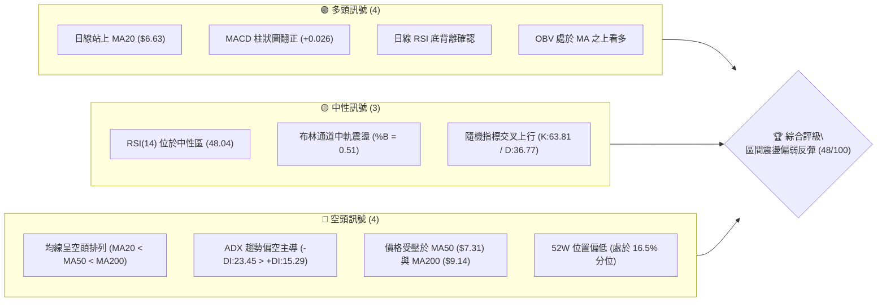
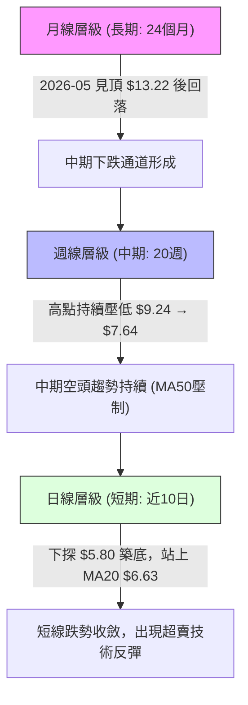
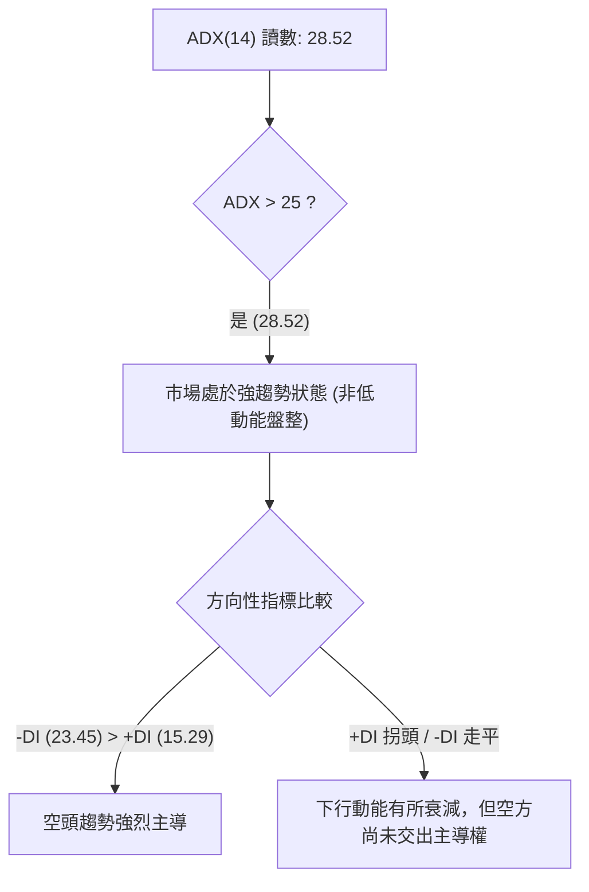
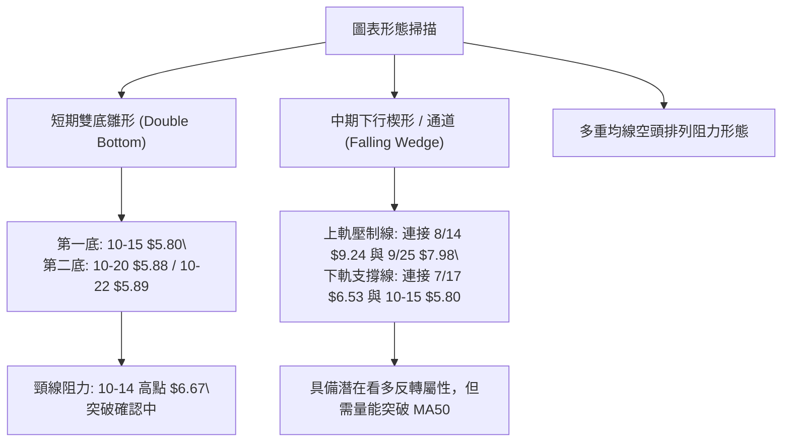
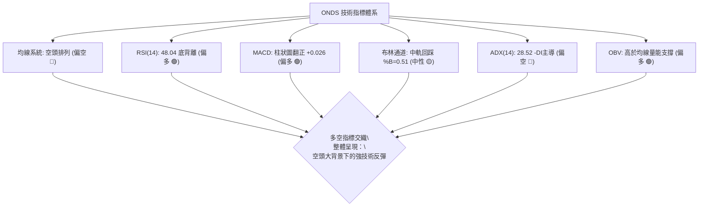
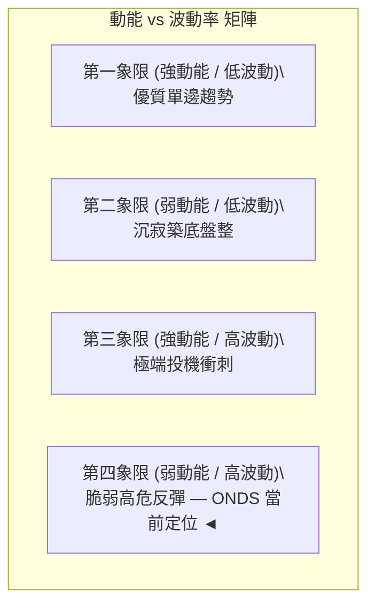
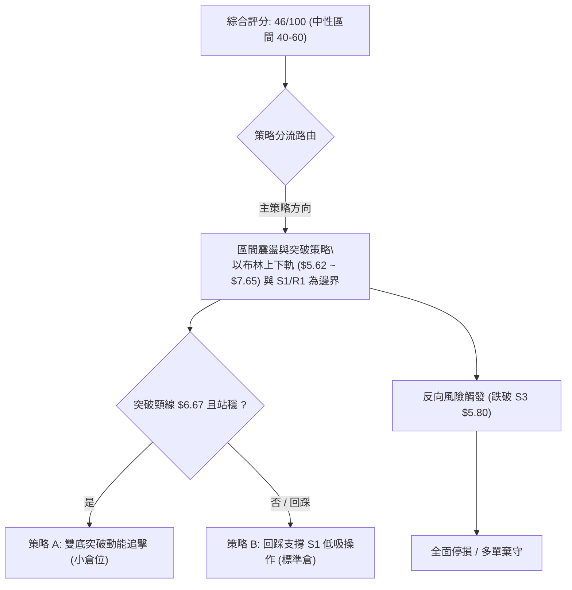
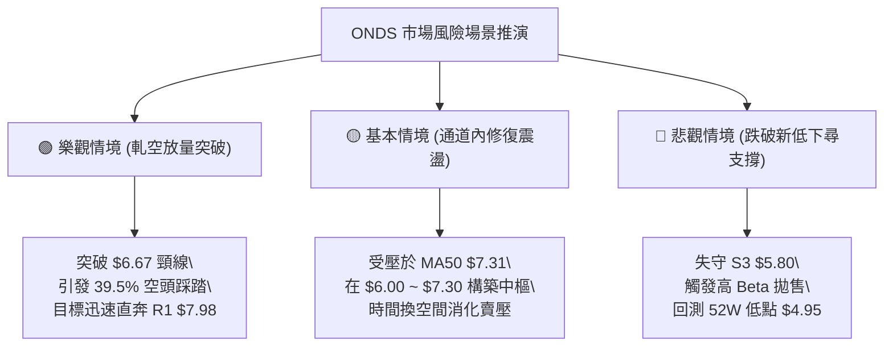

# ONDS 技術分析報告

> **報告日期**：2026-10-28 ｜ **語言**：繁體中文 ｜ **數據來源**：Yahoo Finance ｜ **當前價格**：$6.65

---

## 目錄

| 章節 | 內容 |
|------|------|
| [1. 技術面概覽](#1-技術面概覽) | 訊號儀表板、核心指標、評分卡 |
| [2. 趨勢分析](#2-趨勢分析) | 多時框趨勢、長中短期走勢 |
| [3. 圖表形態分析](#3-圖表形態分析) | 形態識別、K線組合、目標價 |
| [4. 支撐與阻力](#4-支撐與阻力) | 關鍵價位、斐波那契回調 |
| [5. 技術指標深度解讀](#5-技術指標深度解讀) | MA/RSI/MACD/布林/成交量 |
| [6. 動能與波動率](#6-動能與波動率) | 動能評估、ATR、Beta |
| [7. 多時框架總結](#7-多時框架總結) | 時框架評分矩陣 |
| [8. 交易策略建議](#8-交易策略建議) | 多空策略、風險報酬比 |
| [9. 風險提示與監控](#9-風險提示與監控) | 監控指標、風險場景 |

---

## 1. 技術面概覽

### 🎯 技術訊號儀表板



### 📊 核心指標速覽表

| 指標類別 | 指標名稱 | 當前數值 | 訊號 | 解讀 |
|:---|:---|:---|:---:|:---|
| **價格** | 當前收盤價 | $6.65 | 🟡 | 位於52週區間16.5%，脫離近期低點但處於大區間下沿 |
| **均線** | MA20 | $6.63 | 🟢 | 現價站上MA20（+0.26%），短線跌勢暫緩並具備初步支撐力道 |
| **均線** | MA50 | $7.31 | 🔴 | 位於MA50下方（-9.03%），中期下行壓力沉重，為主要反彈阻力 |
| **均線** | MA200 | $9.14 | 🔴 | 位於MA200下方（-27.24%），長期熊市架構尚未扭轉 |
| **動能** | RSI(14) | 48.04 | 🟡 | Wilder計算值處於中性區間，無超買超賣，短線動能處於均衡點 |
| **動能** | RSI背離 | 底背離 | 🟢 | 近20根K棒首尾價格探低而RSI抬升，技術性反彈動能醞釀 |
| **動能** | MACD柱狀圖 | +0.026 | 🟢 | MACD(-0.330)高於Signal(-0.357)，動能翻紅，多頭微弱反撲 |
| **趨勢** | ADX(14) | 28.52 | 🔴 | ADX>25為強趨勢，但-DI(23.45) > +DI(15.29)，空頭趨勢佔優 |
| **通道** | 布林通道 | %B = 0.51 | 🟡 | 價格貼近中軌($6.63)，通道上下軌分別為$7.65與$5.62 |
| **量能** | 成交量 / OBV | 47.75M / OBV>MA | 🟢 | 量比0.98x接近20日均量，OBV高於其MA，量能對底背離形成初步確認 |
| **波動** | ATR(14) | $0.41 (6.20%) | 🔴 | 每日高波動特徵明顯，高Beta(2.922)屬性要求較寬止損空間 |

### 🏆 技術評分卡

```
╔════════════════════════════════════════════════════════════════╗
║                   技術評分卡 — ONDS (2026-10-28)               ║
╠════════════════════════════════════════════════════════════════╣
║ 趨勢強度 (ADX=28.52 但空頭主導)  ███████░░░░░░░░░░░░░  35/100 🔴 ║
║ 動能指標 (RSI底背離+MACD柱翻正)  ████████████░░░░░░░░  60/100 🟢 ║
║ 支撐穩定度 (S1 $6.22 / S2 $5.93) ██████████░░░░░░░░░░  50/100 🟡 ║
║ 成交量配合 (OBV>MA / 量比0.98x)  ████████████░░░░░░░░  60/100 🟢 ║
║ 形態完整度 (雙底雛形未突破頸線)  ████████░░░░░░░░░░░░  40/100 🟡 ║
║ 均線排列 (空頭排列 MA20<50<200)  ██████░░░░░░░░░░░░░░  30/100 🔴 ║
╠════════════════════════════════════════════════════════════════╣
║ 綜合評分 (六項算術平均：45.83)   █████████░░░░░░░░░░░  46/100 🟡 ║
║ 評級結論：區間震盪偏弱反彈（中性觀望，逢高減碼 / 區間短打）     ║
╚════════════════════════════════════════════════════════════════╝
```
*(依規則 18，綜合評分 = (35 + 60 + 50 + 60 + 40 + 30) ÷ 6 = 45.83，四捨五入為 46/100)*

---

## 2. 趨勢分析

### 🌐 多時框趨勢分析



### 📈 長期趨勢 — 12個月走勢圖（Unicode）

依據月度收盤價數據（2025-11 至 2026-10）：
```
ONDS 月線走勢圖（過去12個月：2025-11 至 2026-10）
價格軸 ($)
$14 ┤                                    ●(2026-05: 13.22)
$13 ┤                                   ╱ ╲
$12 ┤                                  ╱   ╲
$11 ┤                      ●(01: 10.36)       ╲
$10 ┤              ●(12: 9.76)   ╲ ●(04: 10.04)╲
$9  ┤             ╱          ●(02: 10.08)       ●(06: 8.24)
$8  ┤●(11: 7.90) ╱               ╲             ╱ ╲
$7  ┤           ╱                 ●(03: 9.04) ●(08: 7.66) ╲
$6  ┤                                        ●(07: 7.49)    ●(09: 7.33)
$5  ┤                                                       ●(10: 6.65)←現價
    └──────────────────────────────────────────────────────────────────────────
      11月  12月  01月  02月  03月  04月  05月  06月  07月  08月  09月  10月
     (2025) (2025) (2026)                      (2026)
```

#### 長期月線走勢特徵分析表

| 階段區間 | 月收盤價起訖 | 漲跌幅 | 主要走勢特徵 | 成交量與動能配合 |
|:---|:---|:---:|:---|:---|
| **主升攻擊段**<br>(2025-11 ~ 2026-01) | $7.90 → $10.36 | +31.14% | 連續陽線推升，突破雙位數關卡，建立多頭強勢基礎 | 多頭動能充沛，市場關注度高 |
| **高位箱體震盪**<br>(2026-01 ~ 2026-04) | $10.36 → $10.04 | -3.09% | 於 $9.04 ~ $10.36 區間大幅洗盤，多次測試 $10 心理整數關卡 | 波動劇烈，洗盤特徵明顯 |
| **末升衝頂段**<br>(2026-04 ~ 2026-05) | $10.04 → $13.22 | +31.67% | 爆發性加速噴出，創下月線收盤新高 $13.22（52W高點達$15.28） | 出現短線投機高潮，隨後動能衰竭 |
| **空頭下殺段**<br>(2026-05 ~ 2026-07) | $13.22 → $7.49 | -43.34% | 獲利了結與高空賣壓湧現，連續跌破均線系統 | 週線成交量擴大，呈現無支撐潰退 |
| **反彈受阻與二次探底**<br>(2026-07 ~ 2026-10) | $7.49 → $6.65 | -11.21% | 8月反彈至 $9.24 遭 MA50 壓制，隨後持續探底至 10月中旬 $5.80 | 賣壓逐步鈍化，進入底部量縮整理 |

### 📊 中期趨勢（週線分析）

從近20週數據觀察，ONDS 中期趨勢明確受到均線反壓主導：
- **波段高點持續下移**：2026-08-14 創波段高點收 $9.24（週高點逼近 MA200 $9.14 遇阻）→ 2026-09-25 高點壓低至收 $7.64（週高 $7.98 遭 R1 阻力反彈阻截）→ 2026-10-02 高點 $7.91，呈現標準的 Lower Highs。
- **波段低點下探**：2026-07-17 收 $6.53 → 2026-10-16 下殺至收 $6.04（盤中觸及 $5.80）。
- **當前週線轉變**：2026-10-23 收 $6.20，2026-10-27 收 $6.65，連續兩週低點抬高（$5.80 → $5.88 → $6.04），週 MACD 柱狀圖由 -0.100 回升至 +0.026，顯示中期下行動能開始減弱，呈現短線空頭回補現象。

```
中期週線阻力與支撐示意圖
═══════════════════════════════════════════════════════════════
$9.14 ~ $9.24  ───► [MA200 / 8月波段反彈高點] ── 強阻力區
       │
$7.64 ~ $7.98  ───► [MA50 / 9月下旬反彈高點 R1] ── 關鍵空頭反壓線
       │
$6.65          ───► [當前收盤價，突破 MA20 $6.63]
       │
$5.80 ~ $6.04  ───► [10月中旬低點聚類 S3 / 52W 低點保護區] ── 關鍵支撐帶
═══════════════════════════════════════════════════════════════
```

### ⚡ 趨勢強度評估（ADX 解讀）



#### ADX 趨勢強度對照解讀

| 指標變數 | 當前讀數 | 門檻區間 | 技術解讀與行情定義 |
|:---|:---|:---|:---|
| **ADX(14)** | **28.52** | > 25 (強趨勢) | 處於顯著趨勢行情中，市場單邊波動劇烈，不可忽視順勢力量 |
| **+DI (14)** | **15.29** | 弱勢 (< 20) | 多頭攻擊動能疲弱，缺乏持續推升的買盤追價意願 |
| **-DI (14)** | **23.45** | 佔優 (> +DI) | 空頭實質控制主要趨勢方向，反彈多屬技術性修正而非反轉 |
| **趨勢行情判定** | **空頭趨勢延續中的技術性反彈** | 依規則 14，ADX>25 應以中長期（週線/MA50/MA200）方向為主導，日線反彈僅為進場或減碼節奏，嚴禁逆勢重倉作多。 |

---

## 3. 圖表形態分析

### 🔍 形態識別系統



#### 幾何與圖表形態信心度評估表

| 形態名稱 | 信心度 | 判斷依據（嚴格引用數據） | 完成度 | 目標價（附嚴謹計算式） |
|:---|:---:|:---|:---:|:---|
| **短線雙底 (W底)** | **65%** | 2026-10-15 探低至 $5.80，2026-10-20 低點 $5.88 與 10-22 低點 $5.89 形成二次探底未破；頸線取近10日波段反彈高點 2026-10-14 之 $6.67（10-27 收 $6.65 逼近頸線）。 | 85% | 頸線 $6.67 + 形態高度 ($6.67 - $5.80 = $0.87) = **$7.54**（高度接近 MA50 $7.31 與布林上軌 $7.65） |
| **中期下行通道** | **70%** | 週線高點自 $9.24 (08-14) 降至 $7.98 (09-25)；低點自 $6.53 (07-17) 下移至 $5.80 (10-15)。通道下沿獲得支撐。 | 90% | 通道上軌阻力目前位於 **$7.62 (MA60)** ~ **$7.98 (R1)** 區間 |
| **頭肩底形態** | **25%** | 數據中左肩與右肩結構對稱度極低，成交量不符合典型頭肩結構。 | 20% | **訊號不足，僅做指標型解讀（不予計算目標價）** |

### 🕯️ 重要K線形態分析

嚴格依據提供的「近10根日K」與「近8根週K」開高低收數據進行客觀解讀：

#### 近10根日K形態解析

| 日期 | 開 | 高 | 低 | 收 | 成交量 | K線形態名稱 | 技術解讀 | 訊號強度 |
|:---|:---:|:---:|:---:|:---:|:---:|:---|:---|:---:|
| 2026-10-14 | 6.50 | 6.67 | 6.13 | 6.14 | 67.76M | 長陰帶下影 | 開高走低實體大陰線，跌破前日區間，空方宣洩賣壓 | 🔴 強空 |
| 2026-10-15 | 5.95 | 6.37 | 5.80 | 6.35 | 74.58M | 長下影錘頭陽線 | 盤中下探波段新低 $5.80 後爆量強勁回升，多方進場抄底 | 🟢 強多 |
| 2026-10-16 | 6.29 | 6.41 | 5.91 | 6.04 | 39.64M | 陰線回測 | 縮量拉回，下影線探至 $5.91，確認前一日長下影的有效性 | 🟡 中性偏弱 |
| 2026-10-19 | 6.20 | 6.28 | 6.01 | 6.06 | 28.82M | 窄幅十字星 | 波動大幅收窄，成交量銳減至28M，多空處於極度觀望 | 🟡 中性 |
| 2026-10-20 | 5.93 | 6.33 | 5.88 | 6.10 | 28.74M | 探底小陽線 | 開低走高，最低 $5.88 未破 $5.80，形成微型雙底結構 | 🟢 弱多 |
| 2026-10-21 | 6.21 | 6.37 | 6.09 | 6.27 | 43.94M | 溫和放量小陽 | 突破短線整理平台，收盤價創5日內新高，量價齊揚 | 🟢 中多 |
| 2026-10-22 | 6.11 | 6.34 | 5.89 | 6.02 | 37.14M | 倒錘洗盤陰線 | 盤中衝高 $6.34 受阻回落，再次測試 $5.89 支撐，多頭遭壓制 | 🔴 弱空 |
| 2026-10-23 | 5.99 | 6.35 | 5.89 | 6.20 | 40.93M | 下影陽線吞噬 | 低開高走，實體完全覆蓋前一日陰線實體，底線守穩 $5.89 | 🟢 中多 |
| 2026-10-26 | 6.17 | 6.32 | 6.04 | 6.16 | 30.95M | 縮量十字陰線 | 窄幅整理，高低點均在昨日區間內，孕線形態醞釀變盤 | 🟡 中性 |
| 2026-10-27 | 6.21 | 6.69 | 6.16 | 6.65 | 47.75M | 光頭大陽線 | 突破近9日高點，放量站上MA20($6.63)，短線攻擊形態確立 | 🟢 強多 |

#### 近8根週K形態解析

| 日期 (週末) | 開 | 高 | 低 | 收 | 週成交量 | 週K形態名稱 | 技術解讀 | 訊號強度 |
|:---|:---:|:---:|:---:|:---:|:---:|:---|:---|:---:|
| 2026-09-11 | 7.61 | 7.88 | 7.14 | 7.23 | 201.37M | 實體中陰線 | 下跌趨勢延續，週收盤價跌破 $7.30 關卡 | 🔴 空頭 |
| 2026-09-18 | 6.99 | 7.53 | 6.98 | 7.39 | 348.27M | 下影倒錘陽 | 探低 $6.98 後大幅回升，放量承接買盤顯著 | 🟢 弱多 |
| 2026-09-25 | 7.51 | 7.98 | 7.18 | 7.64 | 375.05M | 上影長陽線 | 衝高觸及 R1 阻力 $7.98 回落，量能放大但遭遇強解套賣壓 | 🟡 中性偏空 |
| 2026-10-02 | 7.53 | 7.91 | 7.12 | 7.24 | 247.66M | 墓碑十字陰 | 二次上攻 $7.91 失敗，收盤近全週最低，多頭衰竭 | 🔴 強空 |
| 2026-10-09 | 7.62 | 7.69 | 6.64 | 6.73 | 244.88M | 跳水長陰線 | 無抵抗下跌，跌破 $7.00 大關，空頭加速開展 | 🔴 極空 |
| 2026-10-16 | 7.06 | 7.08 | 5.80 | 6.04 | 327.19M | 長下影恐慌陰 | 盤中殺破 $6.00 至 $5.80 引發停損，爆量拉回收長下影 | 🟢 潛在反轉 |
| 2026-10-23 | 6.20 | 6.37 | 5.88 | 6.20 | 179.56M | 縮量十字星 | 成交量驟降至179M，低點抬高至 $5.88，賣壓趨於真空 | 🟡 變盤前兆 |
| 2026-10-27 | 6.17 | 6.69 | 6.04 | 6.65 | 78.70M | 實體陽線推升 | 兩日內推升突破上週高點 $6.37，確立下影線後的技術回升 | 🟢 看多 |

### 📉 ASCII 走勢形態示意圖

```
ONDS 短期雙底形態 (Double Bottom) 示意圖
價格軸 ($)
$6.80 ┤
$6.67 ┤         頸線位 (Neckline) ───────● (10-14) ────────────● (10-27 現價收 $6.65)
$6.50 ┤         ╲                       ╱ ╲                   ╱
$6.30 ┤          ╲                     ╱   ╲                 ╱
$6.10 ┤           ╲                   ╱     ╲               ╱
$5.90 ┤            ╲  左底 $5.80     ╱       ╲  右底 $5.88   ╱
$5.80 ┤             ●───────────────┘         ●─────────────┘
      └────────────────────────────────────────────────────────────────
         10-14     10-15          10-20      10-22         10-27
                   (爆量長下影)              (二次探底量縮) (光頭長陽突破)
```

### 🎯 形態目標價計算

若 2026-10-27 的強陽線能進一步帶量突破並站穩 2026-10-14 創下的頸線位 **$6.67**，短線雙底即告正式確立。計算過程如下：
1. **形態底部低點**：取 2026-10-15 最低價 **$5.80**。
2. **形態頸線高點**：取 2026-10-14 最高價 **$6.67**。
3. **形態垂直高度**：$6.67 − $5.80 = **$0.87**。
4. **形態量度第一目標價 (T1)**：頸線價 $6.67 + 形態高度 $0.87 = **$7.54**。
   *(此目標價 $7.54 恰好落於日線 MA60 $7.62 與布林上軌 $7.65 附近，具備高度技術共振意義)*。
5. **形態延伸第二目標價 (T2)**：引用關鍵價位區塊之波段阻力 **R1 = $7.98**（對應 9/25 週高點）。

---

## 4. 支撐與阻力

### 🗺️ 關鍵價位分布圖（Unicode）

```
ONDS 關鍵價位結構分布圖
═════════════════════════════════════════════════════════════════
$9.92 ║██████████████████████████████║ 強波段阻力 R3 (+49.25%)
      ║                              ║ 
$9.14 ║──────────────────────────────║ MA200 長期均線反壓
      ║                              ║ 
$8.58 ║████████████████████          ║ 波段阻力 R2 (+29.02%)
      ║                              ║ 
$7.98 ║████████████████████████      ║ 關鍵波段阻力 R1 (+20.00%) / 9月反彈頂
      ║                              ║ 
$7.65 ║- - - - - - - - - - - - - - - ║ 布林通道上軌
      ║                              ║ 
$7.31 ║──────────────────────────────║ MA50 中期均線生命線
      ║                              ║ 
$7.16 ║- - - - - - - - - - - - - - - ║ 斐波那契 78.6% 回調位
══════╬══════════════════════════════╬══════════════════════════
$6.65 ╠══════════════════════════════╣ ◄ 當前收盤價 (現價)
══════╬══════════════════════════════╬══════════════════════════
$6.63 ║- - - - - - - - - - - - - - - ║ MA20 / 布林通道中軌 (即時支撐)
      ║                              ║ 
$6.22 ║▓▓▓▓▓▓▓▓▓▓▓▓▓▓▓▓              ║ 近期波段支撐 S1 (-6.47%)
      ║                              ║ 
$5.93 ║████████████████████          ║ 波段低點支撐 S2 (-10.83%)
      ║                              ║ 
$5.80 ║██████████████████████████████║ 核心波段強支撐 S3 (-12.86%) / 10-15低點
      ║                              ║ 
$5.62 ║- - - - - - - - - - - - - - - ║ 布林通道下軌
      ║                              ║ 
$4.95 ║██████████████████████████████║ 52週歷史低點 (100.0% 斐波那契基準)
═════════════════════════════════════════════════════════════════
```

### 🚧 阻力位分析表

*(嚴格引用數據「關鍵價位」區塊數值，不得自行估算)*

| 阻力級別 | 精確價位 | 距現價幅標 | 形成原因與籌碼特徵 | 突破難度 | 重要性等級 |
|:---|:---:|:---:|:---|:---:|:---:|
| **R1** | **$7.98** | +20.00% | 2026-09-25 週K衝高受阻點（近一年波段高點聚類）；大量套牢籌碼沉澱區 | 極高 | ★★★★★<br>(多空牛熊分水嶺) |
| **R2** | **$8.58** | +29.02% | 2026年8月下旬跌破之箱體下沿聚類；中期下降趨勢結構的反轉阻力 | 高 | ★★★★☆<br>(中期波段目標) |
| **R3** | **$9.92** | +49.25% | 近一年密集波段高點聚類，逼近 $10.00 整數心理防線與 50.0% 斐波那契位 | 極高 | ★★★★★<br>(長期趨勢逆轉點) |

### 🛡️ 支撐位分析表

*(嚴格引用數據「關鍵價位」區塊數值，不得自行估算)*

| 支撐級別 | 精確價位 | 距現價幅標 | 形成原因與結構特徵 | 守住機率 | 重要性等級 |
|:---|:---:|:---:|:---|:---:|:---:|
| **S1** | **$6.22** | -6.47% | 近期波段低點聚類；對應 10-21、10-23 多根日K收盤支撐平台 | 70% | ★★★★☆<br>(短線回測第一道防線) |
| **S2** | **$5.93** | -10.83% | 10-15、10-20 等多根日K開盤價與下影線上方支撐聚類 | 80% | ★★★★☆<br>(次級防禦緩衝帶) |
| **S3** | **$5.80** | -12.86% | 2026-10-15 盤中創下的波段極端低點，爆出 74.58M 巨量守穩的底線 | 90% | ★★★★★<br>(多頭生死防線) |

### 📐 斐波那契回調位分析

依據 52 週完整波動區間（高點 **$15.28** → 低點 **$4.95**，總垂直落差 **$10.33**）計算出的基準回調位如下：

| 斐波那契比例 | 精確對應價位 | 與現價($6.65)相對關係 | 技術意涵解讀 |
|:---:|:---:|:---:|:---|
| **0.0% (52W High)** | **$15.28** | +129.77% | 歷史極端牛市高點，中長期難以企及 |
| **23.6%** | **$12.84** | +93.08% | 超長期強勢回調位 |
| **38.2%** | **$11.33** | +70.38% | 中長期多頭防守分界點 |
| **50.0%** | **$10.11** | +52.03% | 52週多空絕對平衡中樞，接近心理關卡 $10 |
| **61.8%** | **$8.90** | +33.83% | 黃金分割關鍵反彈位，緊鄰 MA200 ($9.14) |
| **78.6%** | **$7.16** | +7.67% | **當前上方第一道斐波那契阻力**；空頭深幅回撤的極限壓制點 |
| **100.0% (52W Low)**| **$4.95** | -25.56% | 52週絕對最低價，終極結構支撐點 |

#### 現價位置定位與解讀
- **現價 ($6.65) 處於 78.6% 回調位 ($7.16) 與 100.0% 基準位 ($4.95) 之間**。
- 價格目前回撤幅度已達總漲幅的 83.5%（位於 52W 區間的 16.5% 位置）。技術上，當標的跌破 61.8% ($8.90) 且受制於 78.6% ($7.16) 時，代表先前牛市主升浪已徹底破壞，當前架構轉為「深度超跌後的低位築底」。
- **向上挑戰空間**：突破當前收盤價後，首要壓制即為 78.6% 斐波那契位 **$7.16**，與 MA50 ($7.31) 構成密集的空頭阻力牆。

---

## 5. 技術指標深度解讀

### 🎛️ 指標訊號總覽



### 📈 移動平均線排列分析


#### 均線各週期參數與乖離狀態表

| 均線名稱 | 當前數值 | 價格相對於MA | 乖離率 (%) | 均線走勢軌跡解讀 |
|:---|:---:|:---:|:---:|:---|
| **MA 5** | $6.26 | ▲ 上方 | +6.23% | 短線快速翹頭向上，引導短期買盤進場 |
| **MA 10** | $6.20 | ▲ 上方 | +7.28% | 形成短天期金叉，提供短線回踩第一防線 |
| **MA 20** | $6.63 | ▲ 上方 | +0.26% | 收盤價微幅站上，為近一個月來首度突破布林中軌 |
| **MA 50** | $7.31 | ▼ 下方 | -9.03% | 持續向下傾斜，構成中期強大下行反壓 |
| **MA 60** | $7.62 | ▼ 下方 | -12.67% | 與布林上軌重疊，為反彈延伸的重要阻力帶 |
| **MA 120** | $8.27 | ▼ 下方 | -19.62% | 中長期空頭排列中繼，均線向下發散 |
| **MA 200** | $9.14 | ▼ 下方 | -27.24% | 長期牛熊分界線，向下斜率未有扭轉跡象 |
| **MA 240** | $9.09 | ▼ 下方 | -26.84% | 年線層級死叉壓制，奠定大格局空頭架構 |

**排列結論**：當前均線呈現標準的 **MA20 < MA50 < MA200 空頭排列**。雖然極短線 MA5 與 MA10 向上穿越，且價格勉強突破 MA20，但上方各中長天期均線向下傾斜發散，表明上行空間在未有效收復 MA50 ($7.31) 之前，均應視為「空頭趨勢下的均線負乖離修復」。

### 📉 RSI(14) 分析

#### RSI 指標強度進度條
```
RSI(14) 讀數: 48.04  [█████████░░░░░░░░░░░]  48.04% (中性區間)
0 ────── 超賣(30) ────────────── 中性(50) ───────────── 超買(70) ────── 100
                    ▲ (48.04)
```

#### RSI 背離深度診斷
- **底背離 (Bullish Divergence) 成立確認**：
  - 價格端：檢視近20根日K棒，2026-10-15 盤中跌至 **$5.80**，隨後數日收盤價持續低於 10月初水平，價格重心下移。
  - 指標端：週線與日線 RSI 在 2026-10-16 探底至 **29.6** 進入超賣邊界後，並未隨著後續低點破位而續創新低，反而一路自 34.9、37.3 震盪走高至當前的 **48.04**。
  - **結論**：首尾價格低點下探但 RSI 數值明顯抬高，構成標準的日線等級「動能底背離」。這解釋了 10-27 出現長陽線反彈的動能來源，顯示下殺賣壓竭盡。

### 📊 MACD(12/26/9) 訊號解讀


#### MACD 數值結構與信號特性
- **DIF (MACD線)**：-0.330
- **DEA (Signal線)**：-0.357
- **MACD柱 (Hist)**：**+0.026**（由負翻正）
- **詳細解讀**：MACD 在零軸以下極深處形成向上金叉，柱狀圖自 10-16 的 -0.100 逐週縮小至當前的 +0.026，觸發了低位買入訊號。由於交叉點位於零軸之下，根據量化技術常規，此類金叉定義為「弱勢環境下的強反彈訊號」，其主要目標是向零軸靠攏修正，而非展開單邊暴漲。

### 📦 布林通道分析

```
ONDS 日線布林通道 (20, 2) 結構圖
價格 ($)
$7.65 ┬────────────────────────────────────────── 布林上軌 (Upper Band)
      │
$7.10 ┤
      │
$6.65 ┤─────────────────────────── ● 現價 ($6.65)
$6.63 ┼ - - - - - - - - - - - - - - - - - - - - - 布林中軌 (MA20)
      │
$6.10 ┤
      │
$5.62 ┴────────────────────────────────────────── 布林下軌 (Lower Band)
```
- **帶寬與位置指標**：
  - 上軌：$7.65 ｜ 中軌(MA20)：$6.63 ｜ 下軌：$5.62
  - **%B 指標**：**0.51**（剛好跨越中軌 0.50 水平）
  - **帶寬評估**：通道目前呈現橫向收口狀態，自前期的劇烈開口轉向緊縮，表明前期单邊暴跌告一段落，市場正在進入中軌上下震盪的籌碼沉澱期。現價收於 $6.65，剛好站上中軌，若後續兩日能守穩中軌 $6.63，將開啟向布林上軌 **$7.65** 運行的反彈通道。

### 💹 成交量分析（量價配合度）

- **量比與均量比較**：
  - 最新單日成交量：**47,747,900 股 (47.75M)**
  - 20日均量 (Volume MA20)：**48,804,560 股 (48.80M)** ｜ **量比：0.98x**
  - 50日均量 (Volume MA50)：**57,567,450 股 (57.57M)**
- **量價關係判斷**：
  1. 2026-10-15 觸底 $5.80 當日放量至 74.58M，為典型之「恐慌性拋售與大單承接量的換手柱」。
  2. 隨後幾日回測 $5.88 ~ $6.02 區間時，量能萎縮至 28M ~ 37M，呈現標準的「價跌量縮」。
  3. 2026-10-27 長陽上攻，成交量回升至 47.75M，接近20日均量，呈現「價漲量增」。
  4. **OBV 能量潮狀態**：數據明確標註「OBV > MA」，表明累積成交量已突破其均線，代表在 $5.80 ~ $6.20 區間內資金呈現淨流入狀態，量能確認了價格底背離的有效性。

---

## 6. 動能與波動率

### ⚡ 動能評估四象限



#### 動能與波動度定位分析表

| 象限標籤 | 動能狀態 | 波動率狀態 | 標的匹配狀態 | 操作指導含義 |
|:---:|:---:|:---:|:---:|:---|
| **Q1** | 強 | 低 | — | 最佳趨勢波段加碼區 |
| **Q2** | 弱 | 低 | — | 適合中長線分批低吸佈局 |
| **Q3** | 強 | 高 | — | 適合動能突破交易，快進快出 |
| **Q4 (ONDS)** | **弱 (反彈期)** | **極高 (Beta 2.92)** | **✓ 當前狀態** | **高風險高波動修復期：受制於中期空頭，但個股彈性極大，嚴控部位** |

### 📊 ATR 波動率分析

- **ATR(14) 讀數**：**$0.41**
- **波動佔比**：**6.20% of price**（採用 Wilder 平滑法）
- **止損距離建議**：
  - 日內正常噪音波動空間為 ±1.0 × ATR = **$0.41**。
  - 波段安全保護止損應至少設定於 1.5 ~ 2.0 × ATR，即 **$0.62 ~ $0.82** 的空間，以防止被高 Beta 屬性的隨機劇烈插針掃出場。

### 📐 Beta 與市場相關性

- **Beta 係數**：**2.922**（極高 Beta 屬性）
- **Short % Float (空單比例)**：**39.5%** ｜ **Short Ratio**：**3.64**
- **市場特徵解讀**：
  - ONDS 具有大盤約 3 倍的波動放大效應。當科技股或無人機/國防板塊情緒轉暖時，其漲幅極具爆發力；反之在大盤回調時下殺亦極為猛烈。
  - 高達 **39.5%** 的流通盤空單比例（Short Float），使該股具備極高的**軋空潛力（Short Squeeze Potential）**。一旦價格帶量突破關鍵頸線或阻力位，極易引發空頭踩踏式回補，這也是近2日長陽反彈的深層催化劑之一。

---

## 7. 多時框架總結

### 📋 時框架評分表

| 時框架 | 趨勢方向 | 動能狀態 | 均線排列 | 圖表形態 | 綜合評分 | 戰略建議 |
|:---|:---:|:---:|:---:|:---:|:---:|:---|
| **短期 (日線)** | 偏多反彈 🟢 | RSI底背離 / MACD翻正 🟢 | 站上MA20 / 受阻MA50 🟡 | 雙底頸線測試 🟢 | **60/100** | 適合區間低吸短打，嚴守止損 |
| **中期 (週線)** | 空頭主導 🔴 | 週MACD翻正 / 週RSI弱勢 🟡 | MA50下穿壓制 🔴 | 下行通道整理 🔴 | **40/100** | 反彈逢高減碼，防範二次下殺 |
| **長期 (月線)** | 高位破位 🔴 | 衝高回落動能疲軟 🔴 | 跌破多數長期均線 🔴 | 頂部回撤 83% 🔴 | **35/100** | 尚未確立大週期反轉，不可長線重倉 |

### 🔲 綜合訊號矩陣

```
時框訊號一致性矩陣
═══════════════════════════════════════════════════════════════
維度 / 時框         日線 (短期)       週線 (中期)       月線 (長期)
───────────────────────────────────────────────────────────────
趨勢狀態           反彈築底 🟢       震盪下行 🔴       回撤探底 🔴
動能方向           向上擴張 🟢       低位鈍化 🟡       加速向下 🔴
量能結構           價漲量增 🟢       高位縮量 🟡       爆量後回落 🔴
均線系統           MA20向上 🟢       MA50壓制 🔴       MA200下方 🔴
訊號一致性判定     ▼                 ▼                 ▼
             [短線強烈多頭反彈] vs [中長期堅固空頭堡壘]
═══════════════════════════════════════════════════════════════
```

### ⚖️ 多時框收斂結論

**嚴格依據規則 14 執行收斂裁決**：
1. **行情性質判定**：當前系統 ADX(14) 讀數為 **28.52**，數值大於 25，且 -DI(23.45) > +DI(15.29)。這定義當前市場本質上仍為**「強空頭主導的趨勢行情」**，而非單純的無趨勢狹幅盤整。
2. **優先級收斂原則**：在 ADX > 25 的趨勢行情下，**必須以中長期（週線 / MA50 / MA200）的空頭方向為主導**；日線級別的指標底背離與雙底雛形，**僅能視為尋找空頭回補減碼或極短線高盈虧比反彈進場的時機**，絕不可將日線反彈誤判為長期牛市反轉。
3. **唯一方向性結論**：**中立偏空背景下的「短線超跌反彈」**。主基調為「防守性區間震盪操作」，嚴格以布林通道與波段阻力為目標鎖定利潤，不可抱持長期死守心態。

---

## 8. 交易策略建議

### 🗺️ 策略決策流程圖



### 🧭 策略路由（依評分卡分流）

> **當前主策略方向 = 區間震盪操作（等待突破確認），偏向「高盈虧比超跌反彈」（依評分 46/100）**
> 
> *分流依據：第 1 章技術評分卡綜合評分為 **46/100**，落入 40–60 的中性區間。依規定，主策略不進行激進單邊下注，而是以布林通道上下軌與既定支撐阻力為交易區間，執行「精確區間低吸 / 突破確認短打」，並將中長期空頭反撲列為嚴格的風控觸發條件。*

### 🎯 價格情境階梯（Price Scenarios）

*(嚴格引用第 4 章「關鍵價位」區塊之精確數值)*

| 觸發條件 | 下一目標 | 後續延伸 | 情境技術含義 |
|:---|:---:|:---:|:---|
| **向上突破 R1 ($7.98)** | **R2 ($8.58)** | **R3 ($9.92)** | 中期空頭架構被粉碎，軋空行情全面爆發，挑戰雙位數關卡 |
| **突破頸線站穩 $6.67** | **78.6%位 ($7.16)** | **MA60 / 布林上軌 ($7.62~$7.65)** | 短線雙底確立，日線級別反彈展開，測試 MA50 阻力 |
| **當前現價區間震盪** | **MA20 ($6.63)** | **S1 ($6.22)** | 圍繞布林中軌進行籌碼換手與洗盤整理 |
| **有效跌破 S1 ($6.22)** | **S2 ($5.93)** | **S3 ($5.80)** | 短線多頭反彈夭折，重新回測底部支撐帶 |
| **失守強支撐 S3 ($5.80)** | **布林下軌 ($5.62)**| **52W 低點 ($4.95)** | 雙底形態徹底破裂，恐慌性殺跌重啟，探向歷史極值 |

### 📊 情境機率分佈

| 預期情境 | 發生機率 | 主要技術與量化依據 |
|:---|:---:|:---|
| **情境一：向上反彈測試阻力 (挑戰 $7.16 ~ $7.65)** | **50%** | RSI底背離成立、MACD柱翻正(+0.026)、OBV>MA量能支持、軋空潛力(Short Float 39.5%) |
| **情境二：區間收斂震盪 ($6.00 ~ $6.80)** | **35%** | ADX 高達 28.52 但 -DI 與 +DI 差距收窄、布林通道帶寬收窄、均線空頭排列形成強反壓 |
| **情境三：下行破位探底 (跌破 $5.80 測 $4.95)** | **15%** | 均線長週期呈現空頭死叉、基本面虧損壓力、若大盤出現系統性崩跌引發高 Beta 拋售 |

### 🟢 主策略詳情（區間操作與精確交易計劃）

*(進場價若為區間，以區間中點計算風險報酬比)*

| 策略要素 | 策略 A（突破順勢追擊單） | 策略 B（回踩支撐低吸單） |
|:---|:---|:---|
| **交易邏輯** | 突破 10-14 頸線高點 $6.67 後的動能跟進 | 突破後回踩 MA20 與 S1 支撐區間的穩健佈局 |
| **進場條件** | 盤中帶量突破 $6.67 且15分鐘K線站穩 | 回踩 S1 聚類區間且出現止跌下影線 |
| **進場價格** | **$6.69** (突破追入點，取近10日高點) | **$6.22** (精確引用波段支撐 S1) |
| **目標價 T1** | **$7.54** (雙底量度目標價，計算式見第3章) | **$7.16** (精確引用 78.6% 斐波那契回調位) |
| **目標價 T2** | **$7.98** (精確引用波段阻力 R1) | **$7.65** (精確引用布林通道上軌) |
| **止損價格** | **$6.37** (跌破 10-23 高點與日內防守點) | **$5.80** (精確引用強支撐 S3 低點) |
| **風險報酬比 (T1)** | **1 : 2.66（以 T1 計）**<br>計算式: ($7.54 - $6.69) ÷ ($6.69 - $6.37) = $0.85 ÷ $0.32 | **1 : 2.24（以 T1 計）**<br>計算式: ($7.16 - $6.22) ÷ ($6.22 - $5.80) = $0.94 ÷ $0.42 |
| **風險報酬比 (T2)** | **1 : 4.03（以 T2 計）**<br>計算式: ($7.98 - $6.69) ÷ ($6.69 - $6.37) = $1.29 ÷ $0.32 | **1 : 3.40（以 T2 計）**<br>計算式: ($7.65 - $6.22) ÷ ($6.22 - $5.80) = $1.43 ÷ $0.42 |
| **成功機率預估** | **55%** | **65%** |
| **建議倉位上限** | **5% ~ 8%** (輕倉動能位) | **10% ~ 12%** (標準波段防守位) |

### 🔴 反向風險觸發點（對沖與風控提示）

非直接做空指令，乃針對上述多頭反彈策略的「絕對止損與風控轉向線」：
- **致命轉空觸發價**：**收盤價跌破 $5.80 (S3)**。
  - **風控處置**：若跌破 $5.80，代表 10-15 的爆量抄底盤全數陣亡，雙底構建失敗，ADX 空頭趨勢將重新啟動。此時**必須無條件市價清倉多頭部位**，切忌攤平。
- **阻力衰竭減碼點**：當價格抵達 **$7.31 (MA50)** 至 **$7.65 (布林上軌)** 區間若出現長上影線或爆量滯漲，應主動獲利了結 50%~70% 倉位，鎖定反彈利潤。

### ⭐ 整體訊號強度評星

```
╔══════════════════════════════════════════════════════════════╗
║ 做多訊號強度：★★★☆☆  (3.0/5星 — 短線底背離支持，但受均線反壓)║
║ 做空訊號強度：★★★☆☆  (3.0/5星 — 長期空頭但短線動能指標鈍化)║
║ 整體可信度：  ★★★★☆  (4.0/5星 — 量價結構清晰，邊界分明)    ║
╚══════════════════════════════════════════════════════════════╝
```

---

## 9. 風險提示與監控

### ✅ 關鍵監控指標 Checklist

```
╔══════════════════════════════════════════════════════════════╗
║                   ONDS 交易日常監控清單 (Checklist)           ║
╠══════════════════════════════════════════════════════════════╣
║ [ ] 價位端：收盤價是否持續站穩 MA20 ($6.63) 之上？            ║
║ [ ] 形態端：日K高點能否放量突破雙底頸線 $6.67？              ║
║ [ ] 動能端：日線 MACD 柱狀圖是否持續擴張高於 +0.026？        ║
║ [ ] 動能端：RSI(14) 能否順利突破 50 中性分水嶺並站上？       ║
║ [ ] 量能端：反彈日成交量是否維持在 20日均量 (48.8M) 以上？     ║
║ [ ] 籌碼端：做空比例 (Short Float 39.5%) 是否出現回補減倉跡象？║
║ [ ] 警戒線：日內任何時段是否跌破波段防守點 S1 ($6.22)？       ║
║ [ ] 生死線：極端行情是否打穿 10-15 恐慌低點 S3 ($5.80)？      ║
╚══════════════════════════════════════════════════════════════╝
```

### ⚠️ 風險場景分析



### 🛡️ 風險管理重要提醒

1. **極端高 Beta 波動風險 (Beta = 2.922)**：
   ONDS 波動幅度為納斯達克大盤的近 3 倍，ATR 高達價格的 6.20%。嚴格禁止在單一標的上重壓超過總資金的 **10%**。單筆交易最大虧損額必須嚴格控制在總投資組合淨值的 **1%** 以內。
2. **財報與基本面背離風險**：
   該公司 TTM 營業利潤率為 -129.4%，自由現金流為 -$172.03M，屬於典型的高成長但高燒錢的無人機與通訊科技股。此類股票容易受到融資、增發或防務合約進度的突發消息衝擊，技術分析的支撐阻力可能因單一新聞事件而短暫失效。
3. **高融券餘額與軋空雙刃劍**：
   高達 **39.5%** 的 Short Float 代表股價具備極端暴漲潛力，但同時也表明機構與專業空頭對其長期基本面抱持極度懷疑態度。切勿將短線軋空行情視為長期投資價值體現，觸及阻力位必須堅決執行獲利分批了結。

---

## 📋 報告總結

```
╔════════════════════════════════════════════════════════════════╗
║                     ONDS 技術分析報告總結                      ║
╠════════════════════════════════════════════════════════════════╣
║ 報告日期：2026-10-28                                           ║
║ 當前價格：$6.65                                                ║
║ 綜合評分：46/100                                               ║
║ 分析評級：⚖️ 中性觀望 / 區間偏多反彈（超跌修復）                ║
╠════════════════════════════════════════════════════════════════╣
║ 關鍵結論：                                                     ║
║ ├─ 長期趨勢：🔴 空頭主導（自 $13.22 暴跌回撤 83%，處於52W低位）║
║ ├─ 中期趨勢：🔴 弱勢承壓（受制於向下傾斜的 MA50 $7.31 反壓）   ║
║ ├─ 短期趨勢：🟢 跌勢竭盡（日線 RSI 底背離 + MACD翻正 + 站上MA20║
║ ├─ 核心支撐：S1: $6.22 ｜ S2: $5.93 ｜ S3: $5.80 (終極防線)     ║
║ ├─ 核心阻力：R1: $7.98 ｜ R2: $8.58 ｜ R3: $9.92               ║
║ └─ 目標參考：形態目標 T1: $7.54 ｜ 分析師均價: $18.88          ║
╠════════════════════════════════════════════════════════════════╣
║ 最優策略組合：                                                 ║
║ 1. 🥇 最佳機會：回踩 S1 $6.22 附近低吸，停損設 $5.80，博取反彈 ║
║ 2. 🥈 次選機會：帶量突破頸線 $6.67 追入，目標瞄準 $7.54 (T1)   ║
║ 3. 🥉 保守選擇：空手觀望，靜待股價放量站上 MA50 ($7.31) 再行介入║
╚════════════════════════════════════════════════════════════════╝
```

---

> ⚠️ **免責聲明**：本報告為技術分析研究成果，所有技術價位、走勢推估與指標解讀均嚴格基於歷史量價數據計算。本報告**僅供學術研究與交易思路參考**，**不構成任何形式的邀約、招攬或實質投資建議**。美股高 Beta 小型股波動劇烈，入市交易請務必自行承擔市場風險並嚴格執行資金管理。

---
*報告生成時間：2026-10-28 ｜ 數據來源：Yahoo Finance ｜ 分析框架：多時框技術分析模型*