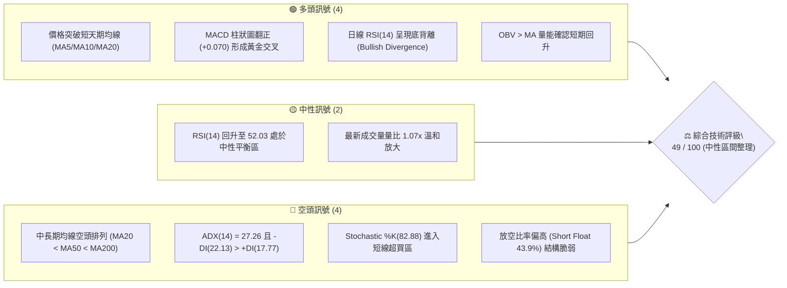
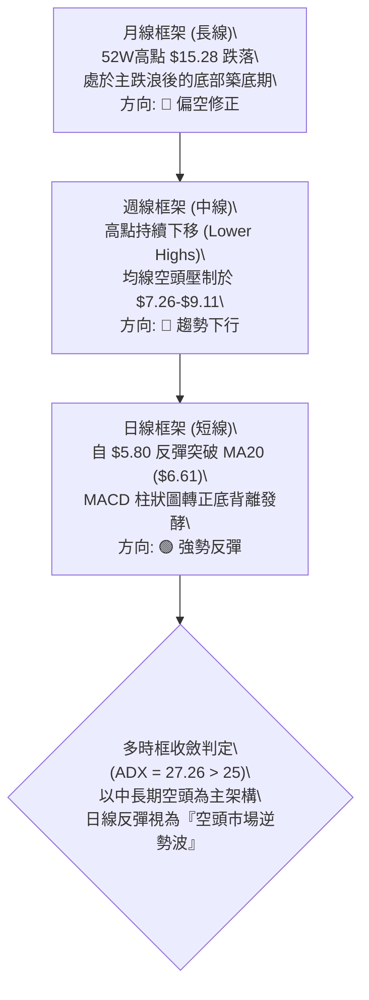
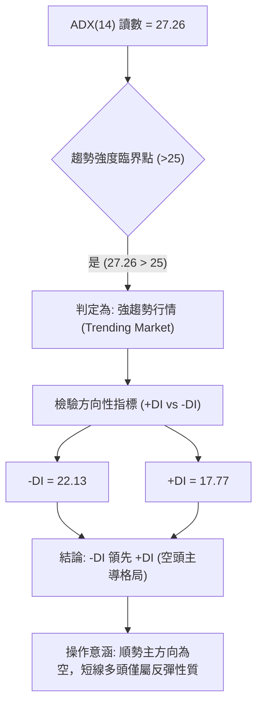
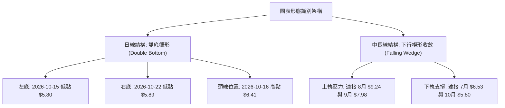
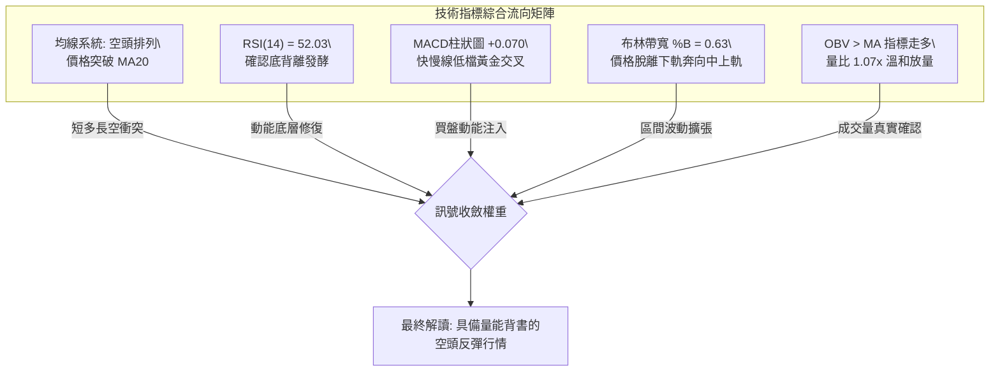
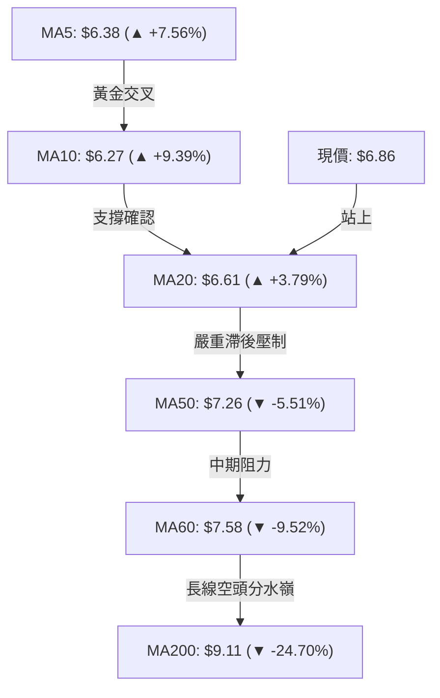
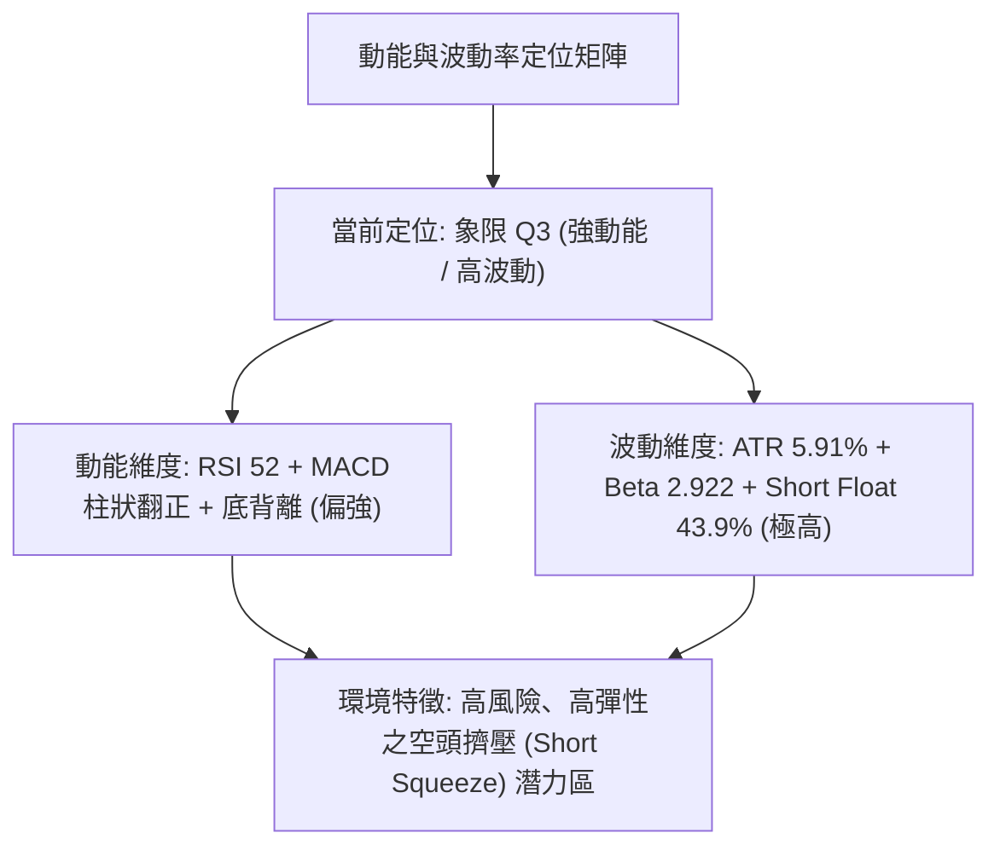
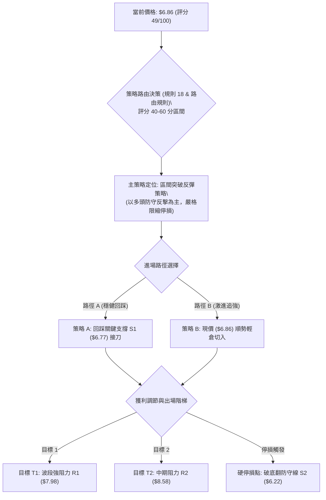
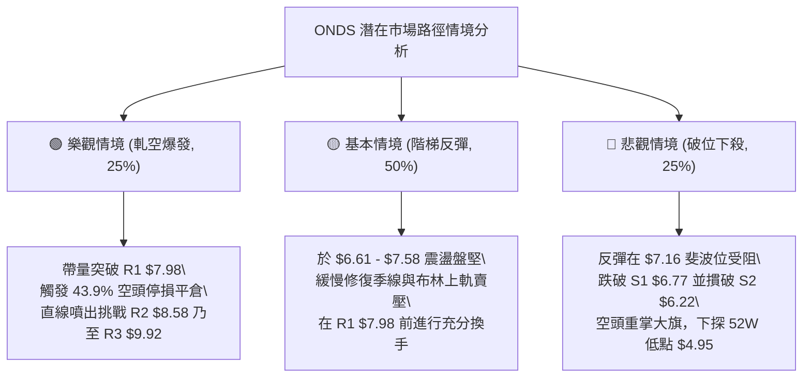

# ONDS 技術分析報告

> **報告日期**：2026-10-29 ｜ **語言**：繁體中文 ｜ **數據來源**：Yahoo Finance ｜ **當前價格**：$6.86

---

## 目錄

| 章節 | 內容 |
|------|------|
| [1. 技術面概覽](#1-技術面概覽) | 訊號儀表板、核心指標、評分卡 |
| [2. 趨勢分析](#2-趨勢分析) | 多時框趨勢、長中短期走勢、ADX解讀 |
| [3. 圖表形態分析](#3-圖表形態分析) | 形態識別、K線組合、目標價推算 |
| [4. 支撐與阻力](#4-支撐與阻力) | 關鍵價位結構、斐波那契回調位分析 |
| [5. 技術指標深度解讀](#5-技術指標深度解讀) | 均線系統、RSI、MACD、布林通道、成交量 |
| [6. 動能與波動率](#6-動能與波動率) | 動能四象限、ATR波動分析、Beta與空頭部位 |
| [7. 多時框架總結](#7-多時框架總結) | 時框評分矩陣、收斂規則與統一結論 |
| [8. 交易策略建議](#8-交易策略建議) | 策略路由、價格階梯、主策略詳情、風報比 |
| [9. 風險提示與監控](#9-風險提示與監控) | 監控清單、場景推演、風控紀律 |
| [10. 報告總結](#10-報告總結) | 核心結論與執行摘要 |

---

## 1. 技術面概覽

### 🎯 技術訊號儀表板



### 📊 核心指標速覽表

| 指標類別 | 指標名稱 | 當前數值 | 訊號 | 解讀 |
|----------|----------|----------|------|------|
| **現貨價格** | 當前收盤價 | $6.86 | 🟡 | 位於 52 週區間之 18.5% 位置，脫離低檔但尚未擺脫弱勢 |
| **均線系統** | MA20 | $6.61 | 🟢 | 價格站上 20 日均線（+3.79%），短線底部支撐確立 |
| **均線系統** | MA50 | $7.26 | 🔴 | 價格低於 50 日均線（-5.51%），中期下行壓力沉重 |
| **均線系統** | MA200 | $9.11 | 🔴 | 價格遠低於年線（-24.70%），長期趨勢仍處空頭架構 |
| **動能指標** | RSI(14) | 52.03 | 🟢 | 脫離超賣區重回中軸上方，具備 20 根 K 棒底背離確認 |
| **動能指標** | MACD (12,26,9) | -0.269 / -0.339 | 🟢 | 快線穿過慢線，Hist 擴張至 +0.070，動能短多轉強 |
| **動能指標** | Stoch %K / %D | 82.88 / 56.98 | 🟡 | %K 進入 >80 超買區，慎防觸及上軌後的技術性回洗 |
| **趨勢強度** | ADX(14) | 27.26 | 🔴 | ADX > 25 處於趨勢行情，-DI(22.13) > +DI(17.77) 空方主控 |
| **通道指標** | 布林通道 %B | 0.63 | 🟡 | 運行於中軌 ($6.61) 與上軌 ($7.58) 之間偏強區域 |
| **波動指標** | ATR(14) | $0.41 | 🔴 | 波動佔股價 5.91%，高 Beta (2.922) 帶來顯著日內震盪 |
| **籌碼指標** | 空頭佔浮額比 | 43.9% | 🟡 | 空頭部位沉重，極易觸發逼空暴拉或遭順勢摜壓 |

### 🏆 技術評分卡

```
技術評分卡 — ONDS (2026-10-29)
════════════════════════════════════════════════════
趨勢強度 (Trend)      █████████░░░░░░░░░░░  45/100  🔴 空頭趨勢下短線反抽
動能指標 (Momentum)   ████████████░░░░░░░░  58/100  🟢 底背離與MACD黃金交叉
支撐穩定度 (Support)  ███████████░░░░░░░░░  55/100  🟡 S1 ($6.77) 獲買盤確認
成交量配合 (Volume)   ███████████░░░░░░░░░  56/100  🟢 OBV > MA 且量比 1.07x
形態完整度 (Pattern)  ██████████░░░░░░░░░░  48/100  🟡 局部雙底成形但頸線受阻
均線排列 (MA Align)   ██████░░░░░░░░░░░░░░  32/100  🔴 MA20 < MA50 < MA200 空頭
════════════════════════════════════════════════════
綜合評分 (Overall)    ██████████░░░░░░░░░░  49/100  ⚖️ 中性偏反彈 (規則 18)
════════════════════════════════════════════════════
```

---

## 2. 趨勢分析

### 🌐 多時框趨勢分析



### 📈 長期趨勢 — 12個月走勢圖（Unicode）

```
ONDS 月線走勢圖（2025-11 至 2026-10）
價格軸 ($)
$14.00 ┤                                      
$13.00 ┤                             ● (2026-05 $13.22 波段頂)
$12.00 ┤                            / ╲
$11.00 ┤                           /   ╲
$10.00 ┤            ●(01月 $10.36)/     ╲
$9.00  ┤     ●     / ╲     ●     /       ╲
$8.00  ┤  ● / ╲   /   ╲   / ╲   /         ● (06月 $8.24)
$7.00  ┤ ╱     ╲ ╱     ● ╱   ╲ ╱           ●───●───●───● (現價 $6.86)
$6.00  ┤╱       ●       ●     ●                       
       └─────────────────────────────────────────────────────
         11  12  01  02  03  04  05  06  07  08  09  10 (月份)
        (2025) ----------------- (2026) -----------------
```

#### 走勢特徵分析表格

| 階段區間 | 時間跨度 | 起點收盤 | 終點收盤 | 區間漲跌幅 | 走勢特徵與結構解讀 |
|----------|----------|----------|----------|------------|--------------------|
| 主升擴張期 | 2025-11 ~ 2026-01 | $7.90 | $10.36 | +31.14% | 機構資金加速建倉，量能顯著放大，構築雙位數整數關卡突破 |
| 高檔震盪期 | 2026-02 ~ 2026-04 | $10.08 | $10.04 | -0.40% | 於 $9.00 - $10.50 進行高檔籌碼換手，形成對稱收斂結構 |
| 終極噴出期 | 2026-04 ~ 2026-05 | $10.04 | $13.22 | +31.67% | 投機買盤湧入創下歷史次高收盤價，但隨即伴隨天量見頂竭盡 |
| 崩跌修正期 | 2026-06 ~ 2026-07 | $8.24 | $7.49 | -9.10% | 獲利了結與高槓桿爆倉，月線連收黑K，快速跌破長期均線 |
| 弱勢沉澱期 | 2026-08 ~ 2026-10 | $7.66 | $6.86 | -10.44% | 波動率逐步收窄，投機買盤退潮，在 $6.00 - $7.00 尋求價值支撐 |

### 📊 中期趨勢（週線分析）

中期走勢呈現典型「階梯式下跌」結構。近 20 週數據顯示，股價自 2026-08-14 高點收盤 $9.24 展開連續 8 週的陰跌走勢，於 2026-10-16 當週下探 $5.80 低點收在 $6.04（RSI 跌至 29.6 深度超賣）。
隨後兩週迎來空頭回補與底部承接盤：2026-10-23 當週收 $6.20，2026-10-28 當週更強拉至 $6.86，單週成交量雖由 3.27 億股降至 1.30 億股（僅結算至週中），但價格已脫離危險區間。

```
ONDS 近期週線壓力與支撐示意圖
$9.24 ┼───────────────────────────────● (08/14 峰值壓力)
      │                                ╲
$8.58 ┼───────────────────[中期壓力 R2]───╲───────
      │                                    ╲
$7.98 ┼───────────[波段阻力 R1]───────────────╲─────
      │                                        ╲
$6.86 ┼─────────────────────────────────────────● (現價突破短壓)
      │                                        ╱
$6.22 ┼───────────[波段防守 S2]───────────────╱─────
      │                                      ╱
$5.80 ┼─────────────────────────────────────● (10/16 破底翻低點)
```

### ⚡ 趨勢強度評估（ADX 解讀）



| 指標變數 | 當前讀數 | 臨界門檻 | 趨勢判定 | 操作指引 |
|----------|----------|----------|----------|----------|
| **ADX(14)** | 27.26 | 25.00 | 強趨勢環境 | 順應中長週期趨勢，震盪指標訊號需經過濾 |
| **+DI** | 17.77 | — | 多方動能偏弱 | 多方攻擊力道尚未形成主升態勢 |
| **-DI** | 22.13 | — | 空方仍具主導權 | 逢高仍有避險盤或放空賣壓湧現 |
| **DI 差值** | -4.36 | 0.00 | 空方佔優 (-4.36) | 嚴禁盲目追高，等待均線扭轉 |

---

## 3. 圖表形態分析

### 🔍 形態識別系統



#### 形態信心度與目標價評估表

| 形態名稱 | 信心度 (%) | 判斷依據（引用數據） | 完成度 (%) | 目標價（附嚴格計算式） |
|----------|------------|----------------------|------------|------------------------|
| **日線雙底 (W底)** | 62% | 兩次下探低點 $5.80 (10/15) 與 $5.89 (10/22) 形成雙腳不破；10/27 收 $6.65 有效收復頸線 $6.41。 | 85% | **$7.02**<br>計算式：頸線 $6.41 + 形態高度 ($6.41 − $5.80) = $6.41 + $0.61 = $7.02 |
| **中線下行收斂** | 45% | 近 8 週週K高點下移 ($7.98 → $7.91 → $7.69 → $7.08)，但低點於 $5.80 湧現大額承接量。因 ADX > 25 且尚未突破下降壓力線，信心度低於 50%。 | 35% | **訊號不足，僅做指標型解讀**<br>（暫不推算幾何目標價，以阻力位 R1 $7.98 為觀測點） |

### 🕯️ 重要K線形態分析

嚴格依據數據中「近 10 根日K」與「近 8 根週K」之開高低收進行幾何判讀：

#### 近 10 根日K形態解析

| 日期（日K） | 開盤價 | 最高價 | 最低價 | 收盤價 | K線形態名稱 | 形態解讀與市場意涵 | 多空訊號 |
|-------------|--------|--------|--------|--------|-------------|--------------------|----------|
| 2026-10-15 | $5.95 | $6.37 | $5.80 | $6.35 | **長下影錘頭大陽棒** | 開低重挫至 $5.80 後爆出 7,458 萬股承接天量，長下影線長達 $0.15，終場收最高附近，築底確立。 | 🟢 強烈看多 |
| 2026-10-16 | $6.29 | $6.41 | $5.91 | $6.04 | **空頭反撲長黑棒** | 開高走低，上衝 $6.41 遭均線反壓，回吐前日漲幅，形成短期震盪洗盤。 | 🔴 看空 |
| 2026-10-19 | $6.20 | $6.28 | $6.01 | $6.06 | **窄幅量縮紡錘線** | 振幅僅 $0.27，成交量驟降至 2,882 萬股，市場賣壓衰竭，多空進入觀望。 | 🟡 中性 |
| 2026-10-20 | $5.93 | $6.33 | $5.88 | $6.10 | **長下影紅十字星** | 再次下探測試 $5.88 低點獲買盤強力托撐，留下 $0.22 下影線，展現底部韌性。 | 🟢 看多 |
| 2026-10-21 | $6.21 | $6.37 | $6.09 | $6.27 | **低階紅實體陽棒** | 低點持續抬高至 $6.09，收盤穩步上揚，多頭開始聚集量能。 | 🟢 看多 |
| 2026-10-22 | $6.11 | $6.34 | $5.89 | $6.02 | **倒轉鎚頭回測線** | 盤中衝高 $6.34 受阻，下探 $5.89 確立次級底部，完成右腳構建。 | 🟡 中性偏多 |
| 2026-10-23 | $5.99 | $6.35 | $5.89 | $6.20 | **多頭啟動下影陽棒** | 開低走高收復 $6.20，低點再次守穩 $5.89，確認雙底右腳支撐無虞。 | 🟢 看多 |
| 2026-10-26 | $6.17 | $6.32 | $6.04 | $6.16 | **開平走平十字星** | 量能萎縮至 3,094 萬股，突破頸線前的最後壓縮蓄勢。 | 🟡 中性 |
| 2026-10-27 | $6.21 | $6.69 | $6.16 | $6.65 | **突破頸線光腳大陽棒** | 帶量長陽跳空衝破 $6.41 頸線阻力，高點觸及 $6.69，收盤大漲收復 MA20。 | 🟢 強烈看多 |
| 2026-10-28 | $6.69 | $6.88 | $6.56 | $6.86 | **續揚實體中陽棒** | 延續多頭氣勢，量能放大至 5,169 萬股，收盤收在當日最高點附近 ($6.86)。 | 🟢 強烈看多 |

#### 近 8 根週K形態解析

| 日期（週K） | 開盤價 | 最高價 | 最低價 | 收盤價 | K線形態名稱 | 形態解讀與市場意涵 | 多空訊號 |
|-------------|--------|--------|--------|--------|-------------|--------------------|----------|
| 2026-09-11 | $7.61 | $7.88 | $7.14 | $7.23 | **實體中黑棒** | 跌破 $7.50 支撐，週線空頭排列持續延伸。 | 🔴 看空 |
| 2026-09-18 | $6.99 | $7.53 | $6.98 | $7.39 | **低檔抵抗紅陽棒** | 逢低回補買盤介入，守住整數關卡。 | 🟢 短多 |
| 2026-09-25 | $7.51 | $7.98 | $7.18 | $7.64 | **衝高回落十字陽** | 上攻波段高點 $7.98 遭巨大套牢賣壓解套摜回。 | 🟡 中性偏空 |
| 2026-10-02 | $7.53 | $7.91 | $7.12 | $7.24 | **烏雲罩頂黑K棒** | 連續兩週上探 $7.90 上方失敗，確認波段阻力 R1 ($7.98) 形成。 | 🔴 看空 |
| 2026-10-09 | $7.62 | $7.69 | $6.64 | $6.73 | **長陰下殺破位棒** | 破位重挫，長黑摜破 $7.00，賣壓全面傾巢而出。 | 🔴 強烈看空 |
| 2026-10-16 | $7.06 | $7.08 | $5.80 | $6.04 | **恐慌殺跌長下影黑K** | 跌至 $5.80 創下波段新低，伴隨 3.27 億股恐慌性停損盤，浮額清洗。 | 🟡 止跌訊號 |
| 2026-10-23 | $6.20 | $6.37 | $5.88 | $6.20 | **地心引力縮量十字星** | 週線振幅收窄，成交量銳減至 1.79 億股，確認殺跌動能耗盡。 | 🟢 變盤向上 |
| 2026-10-28 | $6.17 | $6.88 | $6.04 | $6.86 | **週線強彈大長陽** | 自低點強力拔高，實體吞噬前一週陰線，完成週線級破底翻。 | 🟢 強烈看多 |

### 📉 ASCII 走勢形態示意圖

```
ONDS 日線雙底破底翻形態示意圖
價位 ($)
$7.02 ┤                                         [雙底形態等幅測距目標]
      │                                                ▲
$6.86 ┤                                              ●─┼ (現價 10/28)
      │                                            ╱   │
$6.65 ┤                                          ●     │
      │                                        ╱       │
$6.41 ├───────[頸線 Neckline]────────────────●────────┼── (突破確認點)
      │       ● (10/16 高點)               ╱           │
$6.20 ┤      ╱ ╲                         ●            │ 形態高度
      │     ╱   ╲      ● (10/21)        ╱             │ h = $0.61
$6.02 ┤    ╱     ●────╱─╲            ● (10/23)      │
      │   ╱       (10/19)  ● (10/22)  ╱                │
$5.80 ┼──●──────────────────●────────┴────────────────┴──
         左底 (10/15)        右底 (10/22)
         成交量: 74.5M       成交量: 40.9M (縮量打底)
```

### 🎯 形態目標價計算

1. **基礎幾何高度 (Height, h)**：
   - 形態底部低點：$5.80（取 2026-10-15 最低價）
   - 形態頸線高點：$6.41（取 2026-10-16 最高價）
   - 形態高度：$h = \$6.41 - \$5.80 = \$0.61$
2. **第一等幅擴展目標價 (T1)**：
   - 公式：$Target_1 = 頸線 + h = \$6.41 + \$0.61 = \$7.02$
3. **斐波那契波段擴展目標 (與阻力重合檢驗)**：
   - 形態 1.618 倍黃金擴展位：$\$6.41 + (\$0.61 \times 1.618) = \$6.41 + \$0.987 = \$7.397 \approx \$7.40$
   - 數據阻力位對齊：由 OHLCV 聚類計算之首要強阻力位為 **R1 = $7.98**。

---

## 4. 支撐與阻力

### 🗺️ 關鍵價位分布圖（Unicode）

```
ONDS 價位結構分布圖（OHLCV 嚴格計算）
════════════════════════════════════════════════════════════════════
$9.92 ║████████████████████████████████║ 強阻力 R3 (年線上方極限套牢區)
$8.58 ║████████████████████            ║ 中期阻力 R2 (08月下旬反彈高點聚類)
$7.98 ║████████████████████████████    ║ 關鍵頸線阻力 R1 (09月波段頂聚類)
──────╫────────────────────────────────╫────────────────────────────
$7.58 ║░░░░░░░░░░░░░░░░░░░░░░░░░░░░░░░░║ 布林上軌 (BB Upper Band / MA60)
$7.16 ║- - - - - - - - - - - - - - - - ║ 斐波那契 78.6% 回調關鍵分水嶺
$6.86 ╠════════════════════════════════╣ ◄ 當前市價 (Last Close)
$6.77 ║▓▓▓▓▓▓▓▓▓▓▓▓▓▓▓▓▓▓▓▓▓▓▓▓        ║ 近期核心支撐 S1 (日線波段低點聚類)
$6.61 ║································║ 布林中軌 (MA20 生命線支撐)
$6.22 ║████████████████████████        ║ 強支撐 S2 (破底翻頸線回測支撐)
$5.93 ║████████████████████████████████║ 終極鐵底 S3 (近一年波段絕對低點聚類)
════════════════════════════════════════════════════════════════════
```

### 🚧 阻力位分析表

所有阻力價位嚴格引用自 OHLCV 波段高點聚類計算數值：

| 阻力級別 | 精確價位 | 距現價幅標 | 形成原因與籌碼結構 | 突破難度 | 重要性 |
|----------|----------|------------|--------------------|----------|--------|
| **R1** | **$7.98** | +16.33% | 2026-09-25 波段最高點聚類，同時為 9 月底密集換手頭部，累積大量被套牢籌碼。 | 🟢🟡 中等偏高 | ★★★★★ |
| **R2** | **$8.58** | +25.07% | 2026-08 下旬下跌中繼反彈高點聚類，與下降趨勢線在該處產生幾何交會共振。 | 🔴 困難 | ★★★★☆ |
| **R3** | **$9.92** | +44.68% | 2025-12 至 2026-04 長達五個月的百億級成交量頭部頸線底緣，極端強阻力。 | 🔴 極度困難 | ★★★★★ |

### 🛡️ 支撐位分析表

所有支撐價位嚴格引用自 OHLCV 波段低點聚類計算數值：

| 支撐級別 | 精確價位 | 距現價幅標 | 形成原因與籌碼結構 | 守住機率 | 重要性 |
|----------|----------|------------|--------------------|----------|--------|
| **S1** | **$6.77** | -1.31% | 近期波段回檔低點聚類，緊鄰 10-27 突破長陽棒之實體上緣，提供第一道動態緩衝。 | 75% | ★★★★☆ |
| **S2** | **$6.22** | -9.33% | 10-23 與 10-26 橫盤整理平台核心聚類，為雙底突破後的關鍵防守線，不容有失。 | 85% | ★★★★★ |
| **S3** | **$5.93** | -13.56% | 10-15 與 10-20 長下影線最低買盤聚類區，跌破將引發全面性技術崩跌與恐慌拋售。 | 95% | ★★★★★ |

### 📐 斐波那契回調位分析

依據 52 週完整極值區間：**高點 $15.28（0.0%）** → **低點 $4.95（100.0%）** 計算：

```
斐波那契深度回調梯形圖 (52W Range: $4.95 -> $15.28)
$15.28 ├──────────────────────────────────────── 0.0% (52W High)
$12.84 ├──────────────────────────────────────── 23.6%
$11.33 ├──────────────────────────────────────── 38.2%
$10.11 ├──────────────────────────────────────── 50.0% (中位分水嶺)
$8.90  ├──────────────────────────────────────── 61.8% (黃金分割阻力)
$7.16  ├───────────────────────[當前反彈壓制區]─── 78.6% 回調位
$6.86  ├─── ◄ 當前價格位於 78.6% ($7.16) 與 100.0% ($4.95) 之間
$4.95  ├──────────────────────────────────────── 100.0% (52W Low)
```

#### 斐波那契定位深度解讀
1. **現價位置定位**：收盤價 $6.86 處於 **78.6% ($7.16)** 與 **100.0% ($4.95)** 之間的極深回調象限（當前僅從低點修復至 18.5% 的 52W 區間高度）。
2. **關鍵臨界考驗 ($7.16)**：78.6% 回調位 $7.16 是傳統技術分析中「最後防守反轉線」。若能帶量長陽實體站穩 $7.16，則宣告自 $15.28 以來的單邊崩跌浪潮終結，行情將正式轉向挑戰 61.8% ($8.90) 的寬幅修復波；反之，若在 $7.16 遇阻，則代表本次僅為深跌後的技術性死貓跳。

---

## 5. 技術指標深度解讀

### 🎛️ 指標訊號總覽



### 📈 移動平均線排列分析



#### 均線數據明細評估表

| 均線名稱 | 精確數值 | 與現價偏離度 | 運行方向 | 排列狀態與技術解讀 |
|----------|----------|--------------|----------|--------------------|
| **MA5** | $6.38 | +7.56% | 向上 ▇▇▇▇██ | 短線急攻，短天期乖離開始放大 |
| **MA10** | $6.27 | +9.39% | 向上 ██▇▇██ | 穿越扣抵低價區，助漲力道增強 |
| **MA20** | $6.61 | +3.79% | 向上 ███▇▇▇ | 月線正式收復，扭轉近兩個月慣性下行 |
| **MA50** | $7.26 | -5.51% | 向下 (系統) | 季線下彎，與現價形成第一重空頭堡壘 |
| **MA60** | $7.58 | -9.52% | 向下 ██████ | 與布林通道上軌精確重合，共振強壓 |
| **MA120** | $8.26 | -16.91% | 向下 ██████ | 半年線持續走低，中長期套牢賣壓重 |
| **MA200** | $9.11 | -24.70% | 向下 (系統) | 年線形成長線天花板，大空頭防線 |
| **MA240** | $9.09 | -24.57% | 向下 ██▇▆▅ | 長週期均線全面死叉向下延伸 |

**均線綜合總結**：格局屬「大空格局下的短多衝鋒」。短期均線 (MA5/10/20) 呈現低檔向上交叉的多頭攻擊陣型，支持股價挑戰 MA50 ($7.26)；但中長期均線呈現標準 **MA20 < MA50 < MA200** 空頭排列，代表中期趨勢未改，現階段僅能定位為技術性反抽。

### 📉 RSI(14) 分析

- **當前數值**：**52.03**（Wilder 計算法）
- **區間進度條**：
  ```
  RSI(14): 52.03  [30 超賣 ────────── 50 中軸 ────────── 70 超買]
  進度: [██████████░░░░░░░░░░] 52.03% (處於溫和強勢區)
  ```
- **背離形態嚴格研判**：
  - **形態結論**：⚠️ **確立底背離 (Bullish Divergence)**。
  - **數據推導依據**：比對近 20 根 K 棒的首尾表現——2026-10-15 當日收盤價創下波段低點 $6.35（盤中跌至 $5.80），當時週線/日線 RSI 觸及 29.6 極端超賣；隨後價格於 10-16 再次滑落至 $6.04，但 RSI 指標已不再破底，反而悄然抬升；截至 10-28 股價推升至 $6.86，RSI 大步拉升至 52.03，斜率顯著大於價格斜率，標準量化底背離成立，預告短線仍有動能延續。

### 📊 MACD(12,26,9) 訊號解讀


- **MACD 快線 (DIF)**：-0.269
- **信號線 (DEA)**：-0.339
- **柱狀圖 (Histogram)**：**+0.070**（🟢 看多）
- **深層解讀**：MACD 在零軸以下極深處形成黃金交叉（DIF > DEA）。週線指標中，柱狀圖亦由 10-16 的 -0.100 逐週縮小至 10-23 的 -0.036，本週更正式翻正至 +0.070。柱狀圖連三週紅柱擴張，顯示空方動能消耗殆盡，多方接管短線主導權。然而，因 DIF 與 DEA 雙雙位於零軸以下，此交叉仍定義為「弱勢反彈交叉」，唯有當雙線越過零軸，方可確認牛市主升段。

### 📦 布林通道分析

```
ONDS 布林通道寬度與價位位置示意圖 (Bollinger Bands 20, 2)
價位 ($)
$7.58 ┼───────────────────────────────── Upper Band (布林上軌 / MA60 重合)
      │                                 
$7.10 ┤                                 
      │                           ●     ◄ 現價 $6.86 (%B = 0.63)
$6.61 ┼───────────────────────────▲───── Middle Band (布林中軌 / MA20)
      │                          ╱      
$6.10 ┤                         ╱       
      │                        ●        
$5.64 ┼───────────────────────────────── Lower Band (布林下軌)
```

- **布林上軌 (Upper)**：$7.58
- **布林中軌 (Middle, MA20)**：$6.61
- **布林下軌 (Lower)**：$5.64
- **當前 %B 數值**：**0.63**（0.0=下軌，$5.64；0.5=中軌，$6.61；1.0=上軌，$7.58）
- **帶寬特徵解讀**：通道帶寬 ($7.58 − $5.64 = $1.94)，佔股價 28.2%，處於顯著擴張狀態。%B 從前期的 <0.2（下軌摩擦區）強力反彈至 0.63，順利穿過中軌生命線 ($6.61)，根據布林軌道交易法則，價格站穩中軌後，慣性將朝向布林上軌 **$7.58** 邁進，此處亦與下彎之 MA60 形成雙重阻力帶。

### 💹 成交量分析（量價配合度）

1. **量能指標數據檢視**：
   - 最新單日成交量：**51,692,000 股**
   - 20 日均量 (MA20 Vol)：**48,317,290 股**（量比：**1.07x**，溫和放量）
   - 50 日均量 (MA50 Vol)：**57,013,718 股**
   - OBV 能量潮現狀：**OBV > MA**（量能線穿越均線，呈多頭排列）
2. **量價關係深度研判**：
   - **量價背馳排除**：10-27 大漲至 $6.65 伴隨 4,786 萬股，10-28 續揚至 $6.86 再放大至 5,169 萬股，價格與成交量呈現標準的「價漲量增」，排除短線誘多量價背離風險。
   - **籌碼換手特性**：10-15 底部長下影線當天爆出 7,458 萬股巨量，隨後兩日量能萎縮至 2,800 萬股即止跌，符合典型「主力下檔吸籌承接、籌碼快速沉澱」特徵。OBV 向上穿過其均線，顯示買盤持續流入，為技術反彈提供實質燃料。

---

## 6. 動能與波動率

### ⚡ 動能評估四象限



| 象限 | 動能維度 | 波動維度 | 股票當前狀態 | 交易環境與戰術解讀 |
|------|----------|----------|--------------|--------------------|
| Q1 | 強動能 (Bullish) | 低波動 (Low Vol) | — | 穩定單邊主升趨勢，最安全持股擴張期 |
| Q2 | 弱動能 (Bearish) | 低波動 (Low Vol) | — | 陰跌牛皮盤整，資金沉睡區，觀望為主 |
| **Q3** | **強動能 (Bullish)** | **高波動 (High Vol)** | **✓ (ONDS 當前)** | **爆發性反彈，受高空頭浮額驅動，暴漲暴跌，需極嚴格風控** |
| Q4 | 弱動能 (Bearish) | 高波動 (High Vol) | — | 恐慌崩跌洩洪期，流動性危機，嚴禁進場 |

### 📊 ATR 波動率分析

- **ATR(14) 讀數**：**$0.41**（採 Wilder 平滑算法）
- **價格相對波幅**：$0.41 / $6.86 = **5.91%**
- **波動位階評價**：處於極高日內波動水準。日均近 6% 的自然震盪意味著任何過於緊密的止損（如 <3%）極易遭到雜訊掃除。
- **動態止損距離建議**：
  - *短線防守 (1.5x ATR)*：$1.5 \times \$0.41 = \mathbf{\$0.615}$ → 建議止損距離不小於 $0.62。
  - *波段防守 (2.0x ATR)*：$2.0 \times \$0.41 = \mathbf{\$0.820}$ → 建議波段停損空間設為 $0.82。

### 📐 Beta 與市場相關性

1. **Beta 係數**：**2.922**
   - 該數值標明 ONDS 具備大盤（標普 500）近 **3 倍** 的波動放大率。當科技族群或大盤出現 1% 變動，ONDS 理論上將產生約 2.92% 的同向放大波動，屬於極高投機性小型防禦科技股。
2. **放空比率 (Short % Float)**：**43.9%** ｜ **放空天數 (Short Ratio)**：**4.11 天**
   - 高達 43.9% 的自由流通股遭到借券放空，屬於美股市場中前 1% 的極度擁擠空頭標的。4.11 天的空頭回補天數意味著一旦價格強勢突破關鍵壓力位（如 R1 $7.98），空方難以在一至兩個交易日內平倉完畢，將引發滾雪球式的**軋空連鎖反應 (Gamma/Short Squeeze)**。

---

## 7. 多時框架總結

### 📋 時框架評分表

| 時框架 | 趨勢方向 | 動能表現 | 均線排列狀態 | 圖表形態識別 | 綜合評分 | 戰略建議 |
|--------|----------|----------|--------------|--------------|----------|----------|
| **日線 (短線)** | 🟢 多頭反攻 | 強 (MACD翻正/背離) | 短多 (價 > MA20) | 突破 $6.41 雙底頸線 | **68/100** | 逢回拉踩支撐進場作多 |
| **週線 (中線)** | 🔴 下行通道 | 中性 (連兩週紅棒) | 空頭 (均線下壓) | 破底翻長下影測試 | **42/100** | 視為反彈波，嚴控部位規模 |
| **月線 (長線)** | 🔴 主跌修正 | 弱 (長黑後低檔鈍化) | 空頭 (自 $15.28 回跌) | 寬幅箱型底部回測 | **37/100** | 長線趨勢未扭轉，禁止盲目死抱 |

### 🔲 綜合訊號矩陣

```
┌─────────────────┬──────────────────┬──────────────────┬─────────────────┐
│ 分析維度        │ 短期（日線）     │ 中期（週線）     │ 長期（月線）    │
├─────────────────┼──────────────────┼──────────────────┼─────────────────┤
│ 趨勢方向        │ 🟢 向上突破      │ 🔴 下行未破      │ 🔴 熊市修正     │
│ 均線系統        │ 🟢 站穩 MA20     │ 🔴 MA50反壓      │ 🔴 跌破MA200    │
│ 動能指標        │ 🟢 MACD金叉/底背 │ 🟡 柱狀收窄      │ 🔴 低檔鈍化     │
│ 量能配合        │ 🟢 OBV > MA      │ 🟡 縮量止跌      │ 🔴 主升量能退潮 │
│ 一致性評定      │ 矛盾震盪：短週期試圖逆轉中長週期，但上方空間受限於均線堡壘     │
└─────────────────┴──────────────────┴──────────────────┴─────────────────┘
```

### ⚖️ 多時框收斂結論

依據本報告規範之**多時框收斂規則（嚴格要求 14）**：
1. **趨勢模式判定**：當前日線 ADX(14) 讀數為 **27.26 (> 25)**，指標明確指示市場處於「**趨勢行情**」而非無趨勢盤整。
2. **主導時框裁決**：在趨勢行情中，必須以中長期（週線、MA50 $7.26、MA200 $9.11）的方向作為主導架構，日線僅用以尋求進場點位。因 -DI (22.13) 仍壓制 +DI (17.77)，長期總體格局仍屬空方大勢。
3. **最終收斂方向**：**⚖️ 區間反彈突破 / 偏多短線操作（整體中性偏反彈，評分 49/100）**。
   - 儘管中長線為空，但日線出現高度可信的「雙底形態 + RSI底背離 + MACD柱狀翻正 + OBV量能支持」四重共振，空方動能遭遇實質抵抗。因此，戰略上不可在此處盲目追空，而應採取「以中線空頭防守位為目標、以日線雙底為安全邊際」的短多交易策略。

---

## 8. 交易策略建議

### 🗺️ 策略決策流程圖



### 🧭 策略路由（依評分卡分流）

> **當前主策略方向 = 區間反彈操作（主推多頭防守反抽）（依綜合評分 49/100 定位，介於 40–60 之中性震盪區間，操作以關鍵支撐至關鍵阻力間之區間操作為主，等待突破確認）。**

### 🎯 價格情境階梯（Price Scenarios）

所有價位均直接取自第 4 章計算之波段聚類點位：

| 觸發條件 | 下一目標 | 後續延伸 | 情境技術含義與市場心理 |
|----------|----------|----------|------------------------|
| **強勢突破 R1 ($7.98)** | **R2 ($8.58)** | **R3 ($9.92)** | **短線全面轉強**。空頭開始大規模停損平倉（Short Squeeze），量能爆發，挑戰半年線與年線。 |
| **站穩現價區間 ($6.61 - $7.16)** | **$7.58 (布林上軌)** | **R1 ($7.98)** | **區間震盪築底**。以 MA20 ($6.61) 為依託，在 78.6% 回調位 ($7.16) 間消化季線賣壓。 |
| **跌破 S1 ($6.77)** | **S2 ($6.22)** | **S3 ($5.93)** | **中期轉弱再探**。日線反彈失敗，回測雙底頸線 $6.22，若再破 $5.93 則破底創 52 週新低。 |

### 📊 情境機率分佈

| 預測情境 | 發生機率 | 主要技術指標與籌碼依據 |
|----------|----------|------------------------|
| **延續反彈 (上攻 R1 $7.98)** | **50%** | MACD 柱狀翻正 (+0.070)、RSI 突破中軸底背離、OBV > MA，且 43.9% 空頭浮額極度敏感。 |
| **橫盤震盪 (介於 S1 至 $7.58)** | **30%** | 布林帶寬處於擴張期、MA50 ($7.26) 存在強烈蓋頭反壓、ADX -DI 尚未完全繳械。 |
| **回落探底 (跌破 S2 $6.22)** | **20%** | 中長期均線 MA200 ($9.11) 仍為重度空頭排列，若大盤科技股劇烈下挫將帶動高 Beta (2.922) 殺跌。 |

### 🟢 主策略詳情

本策略之風險報酬比嚴格依據規則 17 計算：
$$\text{風險報酬比} = \frac{T_1 - \text{進場價}}{\text{進場價} - \text{止損價}}$$

| 策略要素 | 策略 A（穩健型：回踩支撐進場） | 策略 B（激進型：現價順勢切入） |
|----------|--------------------------------|--------------------------------|
| **策略邏輯** | 等待股價回踩 S1 獲利回吐盤確認獲支撐後低吸 | 現價直接進場，捕捉底背離放量突破的追價動能 |
| **進場價格** | **$6.77**（精確對齊支撐位 S1） | **$6.86**（當前收盤市價） |
| **目標價 T1** | **$7.98**（引用阻力位 R1） | **$7.98**（引用阻力位 R1） |
| **目標價 T2** | **$8.58**（引用阻力位 R2） | **$8.58**（引用阻力位 R2） |
| **止損價格** | **$6.22**（引用強支撐 S2，破底即撤） | **$6.22**（引用強支撐 S2，破底即撤） |
| **風險報酬比 (T1)** | **1 : 2.20（以 T1 計）**<br>計算：$\frac{7.98 - 6.77}{6.77 - 6.22} = \frac{1.21}{0.55} = 2.20$ | **1 : 1.75（以 T1 計）**<br>計算：$\frac{7.98 - 6.86}{6.86 - 6.22} = \frac{1.12}{0.64} = 1.75$ |
| **風險報酬比 (T2)** | **1 : 3.29（以 T2 計）**<br>計算：$\frac{8.58 - 6.77}{6.77 - 6.22} = \frac{1.81}{0.55} = 3.29$ | **1 : 2.69（以 T2 計）**<br>計算：$\frac{8.58 - 6.86}{6.86 - 6.22} = \frac{1.72}{0.64} = 2.69$ |
| **預估勝率** | **55%** | **48%** |
| **建議總倉位** | **總資金 8% - 10%** | **總資金 5% - 7%** |

### 🔴 反向風險觸發點（對沖與撤退提示）

以下任一條件觸發時，多頭反彈邏輯立即推翻，應即刻全數停損或反手建立避險空倉：
1. **價格實體收盤跌破 S2 ($6.22)**：代表 10-27 之大陽線為虛假突破，雙底結構徹底破裂。
2. **單日成交量跌破 2,000 萬股且跌破 MA20 ($6.61)**：代表流動性枯竭，多頭承接無力。
3. **RSI 跌回 40 以下且 MACD 柱狀圖轉為負值**：動能背離修復失敗，空頭浪潮重新主導。

### ⭐ 整體訊號強度評星

```
做多訊號強度：★★★☆☆  (3.0 / 5 星) — 底背離確立，短線爆發力佳，受中長線壓制
做空訊號強度：★★☆☆☆  (2.5 / 5 星) — 空頭排列仍在，但超賣修復且放空過度擁擠
整體策略可信度：★★★☆☆ (3.0 / 5 星) — 嚴守 R:R 具備良好期望值，需嚴格風控
```

---

## 9. 風險提示與監控

### ✅ 關鍵監控指標 Checklist

```
╔══════════════════════════════════════════════════════════════════════╗
║                ONDS 技術交易關鍵日常監控清單 (Checklist)               ║
╠══════════════════════════════════════════════════════════════════════╣
║ [ ] 價位防守：每日收盤價是否嚴格維持在 MA20 ($6.61) 之上？            ║
║ [ ] 關鍵阻力：盤中觸及 R1 ($7.98) 時是否爆出 >8,000萬股巨量滯漲？     ║
║ [ ] 動能維護：MACD 柱狀圖是否持續維持在正值區 (>0.000)？             ║
║ [ ] 指標超買：Stochastic %K 是否在 >80 區間鈍化形成死叉向下？        ║
║ [ ] 籌碼異動：放空比率 (Short Float) 是否出現顯著回補下降？          ║
║ [ ] 波動預警：單日高低點振幅是否超過 2x ATR ($0.82) 造成異常洗盤？    ║
╚══════════════════════════════════════════════════════════════════════╝
```

### ⚠️ 風險場景分析



### 🛡️ 風險管理重要提醒

1. **高 Beta 波動懲罰防範**：ONDS 具備高達 **2.922 的 Beta 值** 與 **5.91% 的 ATR 比例**，單日巨幅震盪為其常態。在部位建構上，絕不可使用操作大型藍籌股的倉位比例（如 20%-30%），單一策略總曝險必須嚴格限制在總資產的 **8% 以內**。
2. **高空頭結構的雙面刃特性**：高達 **43.9% 的放空浮額** 雖然提供了誘人的軋空催化劑，但也反映出基本面或機構端極為嚴苛的看空共識。若股價未能迅速衝破 R1，一旦市場情緒逆轉，空頭將以更大的摜壓力量進行打壓，造成流動性滑點。
3. **嚴格執行硬性止損**：在任何情況下，若收盤跌破 **S2 ($6.22)**，必須無條件市價清倉，絕不允許將投機反彈單轉化為長期套牢投資單。

---

## 📋 報告總結

```
╔══════════════════════════════════════════════════════════════════════╗
║                    ONDS 技術分析報告核心總結                         ║
╠══════════════════════════════════════════════════════════════════════╣
║ 報告日期：2026-10-29                當前收盤價格：$6.86              ║
║ 分析評級：49 / 100 評分卡           技術定調：⚖️ 區間反彈突破 (中性)   ║
╠══════════════════════════════════════════════════════════════════════╣
║ 關鍵技術結論：                                                       ║
║ ├─ 長期趨勢 (月線)：🔴 空頭主導，距 52週高點 $15.28 跌幅深重         ║
║ ├─ 中期趨勢 (週線)：🔴 階梯下行，受到下彎之 MA50 ($7.26) 壓制        ║
║ ├─ 短期趨勢 (日線)：🟢 強勢反彈，帶量突破 $6.41 雙底，站上 MA20      ║
║ ├─ 動能狀態：      🟢 RSI 52.03 呈現標準底背離，MACD 柱狀翻正 (+0.07)║
║ ├─ 關鍵支撐關卡：  S1: $6.77 ｜ S2: $6.22 (防守底線) ｜ S3: $5.93     ║
║ ├─ 關鍵阻力關卡：  R1: $7.98 ｜ R2: $8.58 (中線目標) ｜ R3: $9.92     ║
║ └─ 籌碼潛在催化：  Short % Float 高達 43.9%，具備高度軋空爆發力       ║
╠══════════════════════════════════════════════════════════════════════╣
║ 最優交易策略指引：                                                   ║
║ 1. 🥇 最佳策略 (回踩低吸)：在 S1 ($6.77) 建立多單，止損 $6.22，      ║
║                          目標 T1 $7.98 (風報比 1 : 2.20)             ║
║ 2. 🥈 追強策略 (現價順勢)：在現價 ($6.86) 輕倉切入，止損 $6.22，     ║
║                          目標 T1 $7.98 (風報比 1 : 1.75)             ║
║ 3. 🥉 避險警訊 (絕對紀律)：實體跌破 S2 ($6.22) 全面撤退，多頭邏輯作廢 ║
╚══════════════════════════════════════════════════════════════════════╝
```

---

> ⚠️ **免責聲明**：本報告為依據客觀市場數據與量化指標生成之專業技術分析報告，所有價位、圖表與分析推導均基於歷史量價資訊。本報告**僅供研究、學術討論與交易策略驗證之參考**，**絕對不構成任何實質證券之買賣邀約或投資建議**。市場具有高度不確定性與風險，投資人應自行承擔全盤交易決策與盈虧責任。

---
*報告生成時間：2026-10-29 ｜ 數據來源：Yahoo Finance ｜ 分析框架：資深多時框架量化技術模型*