# ONDS 技術分析報告

> **報告日期**：2026-10-31 ｜ **語言**：繁體中文 ｜ **數據來源**：Yahoo Finance ｜ **當前價格**：$6.32

---

## 目錄

| 章節 | 內容 |
|------|------|
| [1. 技術面概覽](#1-技術面概覽) | 訊號儀表板、核心指標、評分卡 |
| [2. 趨勢分析](#2-趨勢分析) | 多時框趨勢、長中短期走勢、ADX 解讀 |
| [3. 圖表形態分析](#3-圖表形態分析) | 形態識別、近期K線組合、目標價推算 |
| [4. 支撐與阻力](#4-支撐與阻力) | 關鍵價位分佈、斐波那契回調結構 |
| [5. 技術指標深度解讀](#5-技術指標深度解讀) | 均線系統、RSI、MACD、布林通道、量能 |
| [6. 動能與波動率](#6-動能與波動率) | 動能評估象限、ATR 波動度、Beta 與空頭部位 |
| [7. 多時框架總結](#7-多時框架總結) | 時框架矩陣、趨勢收斂與主導方向 |
| [8. 交易策略建議](#8-交易策略建議) | 策略路由、情境階梯、精確交易計劃 |
| [9. 風險提示與監控](#9-風險提示與監控) | 關鍵指標清單、極端情境與風控準則 |

---

## 1. 技術面概覽

### 🎯 技術訊號儀表板

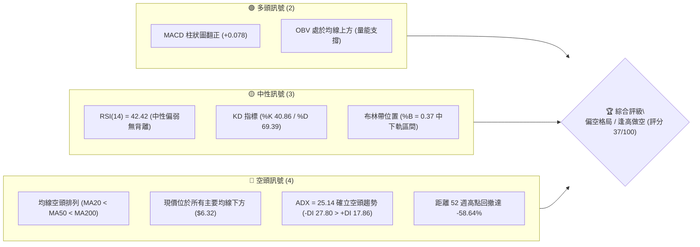

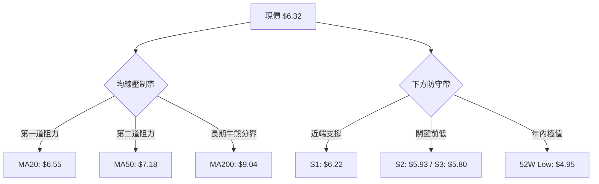

### 📊 核心指標速覽表

| 指標類別 | 指標名稱 | 當前數值 | 訊號 | 解讀 |
|----------|----------|----------|------|------|
| **價格** | 當前收盤價 | $6.32 | 🔴 | 位於 52 週區間 13.3% 之低檔弱勢區 |
| **均線** | MA20 | $6.55 | 🔴 | 現價低於短期均線 -3.53%，形成短線動態阻力 |
| **均線** | MA50 | $7.18 | 🔴 | 現價低於中期均線 -11.98%，中期下行格局確立 |
| **均線** | MA200 | $9.04 | 🔴 | 現價低於長期均線 -30.09%，長期技術性熊市 |
| **動能** | RSI(14) | 42.42 | 🟡 | 處於 30–70 中性偏弱區，無超賣且無背離跡象 |
| **動能** | MACD (12,26,9) | -0.217 | 🟢 | DIF 線位於零軸下，但 Hist (+0.078) 連續底背離式反彈 |
| **趨勢** | ADX(14) | 25.14 | 🔴 | ADX > 25 進入強趨勢，-DI (27.80) 主導空頭走向 |
| **通道** | 布林通道 %B | 0.37 | 🟡 | 價格運行於中軌 ($6.55) 與下軌 ($5.65) 間，偏向弱勢震盪 |
| **成交量** | 量比 (Volume Ratio) | 0.85x | 🟡 | 當日量 41.03M，低於 20 日均量 48.45M，反彈動能衰竭 |
| **波動** | ATR(14) | $0.42 | 🔴 | 佔股價 6.68%，日內波動極度劇烈，需嚴設止損距離 |

### 🏆 技術評分卡

```
╔══════════════════════════════════════════════════════════════╗
║                技術評分卡 — ONDS (2026-10-31)                ║
╠══════════════════════════════════════════════════════════════╣
║ 趨勢強度 (Trend)      ███████░░░░░░░░░░░░░  35/100  🔴 空頭主導 ║
║ 動能指標 (Momentum)   █████████░░░░░░░░░░░  45/100  🟡 短多中空 ║
║ 支撐穩定度 (Support)  ████████░░░░░░░░░░░░  40/100  🟡 臨近考驗 ║
║ 成交量配合 (Volume)   ████████░░░░░░░░░░░░  42/100  🟡 量能遞減 ║
║ 形態完整度 (Pattern)  ███████░░░░░░░░░░░░░  38/100  🔴 旗形整理 ║
║ 均線排列 (MAs)        ████░░░░░░░░░░░░░░░░  20/100  🔴 完全空頭 ║
╠══════════════════════════════════════════════════════════════╣
║ 綜合評分 (Overall)    ███████░░░░░░░░░░░░░  37/100  🔴 偏空格局 ║
╚══════════════════════════════════════════════════════════════╝
```
*依規則 18 計算：綜合評分 = (35 + 45 + 40 + 42 + 38 + 20) ÷ 6 = 36.67 ≈ 37 分。評級為「🔴 偏空格局（主推空頭策略）」。*

---

## 2. 趨勢分析

### 🌐 多時框趨勢分析

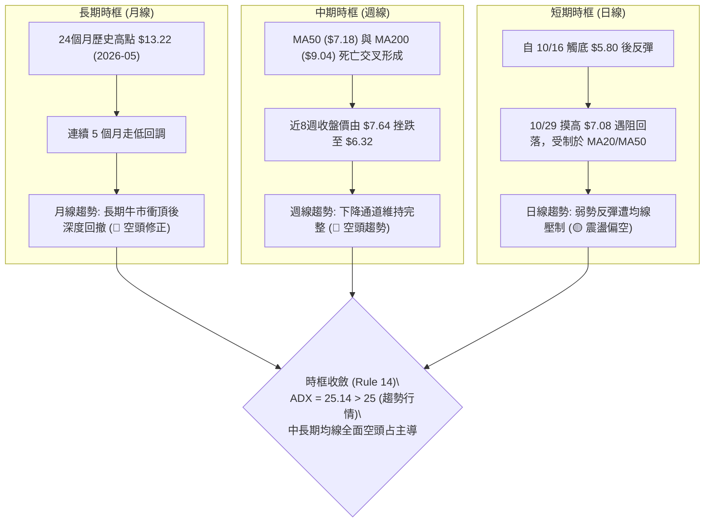

### 📈 長期趨勢 — 12個月走勢圖（Unicode）

以下為 ONDS 自 2025 年 11 月至 2026 年 10 月之月線收盤價歷史軌跡：

```
ONDS 月線走勢圖（過去12個月收盤價變動）
價格軸 ($)
$14.00 ┤                                  ● $13.22 (2026-05 高點)
$13.00 ┤                                 ╱ ╲
$12.00 ┤                                ╱   ╲
$11.00 ┤                    ● $10.36   ╱     ╲
$10.00 ┤          ● $9.76  ╱ ╲        ● $10.04╲
$9.00  ┤         ╱        ╱   ● $9.04          ╲   ● $8.24
$8.00  ┤● $7.90 ╱        ● $10.08               ╲ ╱ ╲         ● $7.66
$7.00  ┤                                         ● $7.49     ● $7.33
$6.00  ┤                                                        ╲  ● $6.32 (現價)
$5.00  ┤                                                         ╲╱
       └─────────────────────────────────────────────────────────────
         25-11 25-12 26-01 26-02 26-03 26-04 26-05 26-06 26-07 26-08 26-09 26-10
```

#### 走勢特徵分析表格

| 階段週期 | 涵蓋月份 | 起訖收盤價 | 漲跌幅 | 結構形態特徵 |
|----------|----------|------------|--------|--------------|
| **第 I 階段：強勢主升浪** | 2025-11 → 2026-01 | $7.90 → $10.36 | +31.14% | 連續放量陽線，突破雙位數關卡 |
| **第 II 階段：高檔震盪蓄勢** | 2026-01 → 2026-04 | $10.36 → $10.04 | -3.09% | 構築 $9.04–$10.36 箱體平台，籌碼換手 |
| **第 III 階段：終極誘多衝頂** | 2026-04 → 2026-05 | $10.04 → $13.22 | +31.67% | 月線天量拉升觸及歷史高點，隨後出現獲利了結 |
| **第 IV 階段：均線崩落退潮** | 2026-05 → 2026-07 | $13.22 → $7.49 | -43.34% | 斷崖式跳空下挫，跌破 MA20 與 MA50 生命線 |
| **第 V 階段：陰跌探底與尋底** | 2026-08 → 2026-10 | $7.66 → $6.32 | -17.49% | 高點逐步下移 (Lower Highs)，當前測試波段支撐 |

### 📊 中期趨勢（週線分析）

```
ONDS 週線關鍵壓力與支撐階梯示意圖
價格 ($)
$8.00 ┤      ┌───────────┐ 9/25 高點 $7.98 (R1 關鍵阻力)
      │      │ 週線平台  │
$7.50 ┤──────┴───────────┴──────────────────────────────
      │                     ┌───────────┐ 10/29 高點 $7.08 (反彈破敗)
$7.00 ┤                     │ 日週共振阻力 (MA50: $7.18)
      │                     └─────┬─────┘
$6.50 ┤───────────────────────────┼────────────────── MA20: $6.55
      │                           ▼ 現價 $6.32
$6.00 ┤─────────────────────┬─────────────────────────── S1: $6.22
      │  10/16 低點 $5.80   │ 10/23 低點 $5.88 (S3: $5.80 / S2: $5.93)
$5.50 ┤  └──────────────────┴───────────────────────────
```

近 20 週數據顯示，自 2026 年 8 月中旬（8/14 收盤 $9.24）以來，高點呈現 $9.24 → $8.71 → $7.98 → $7.64 → $7.08 的標準下降趨勢階梯。

### ⚡ 趨勢強度評估（ADX 解讀）

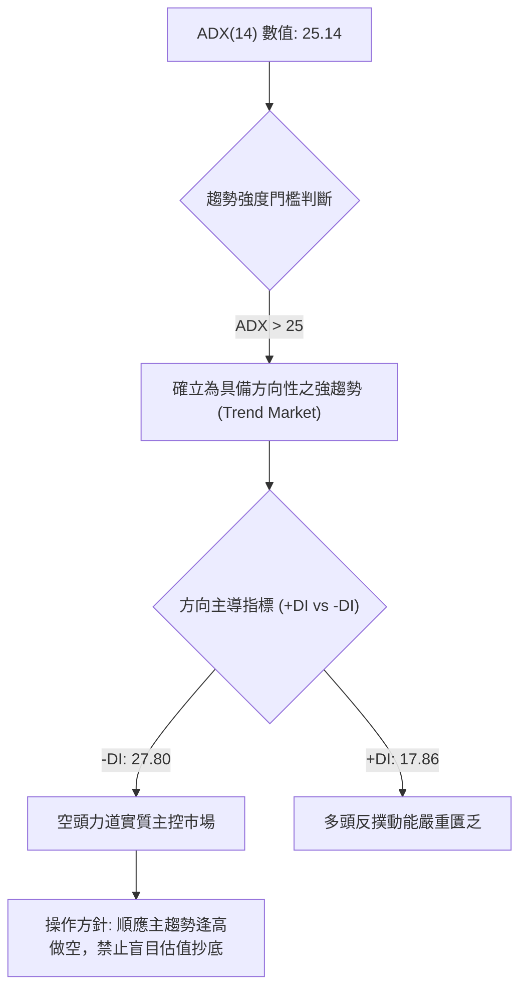

| 指標名稱 | 當前讀數 | 門檻區間 | 技術意義 | 趨勢結論 |
|----------|----------|----------|----------|----------|
| **ADX(14)** | 25.14 | > 25.0 | 突破 25 臨界線，盤整轉化為趨勢 | 確立強勢單邊行情 🔴 |
| **-DI** | 27.80 | 高於 +DI 9.94 點 | 空方掌控市場拋售節奏 | 空頭極具優勢 🔴 |
| **+DI** | 17.86 | 低於 20 基準弱勢線 | 買盤追價意願低落 | 多頭反彈動能衰弱 🔴 |

---

## 3. 圖表形態分析

### 🔍 形態識別系統

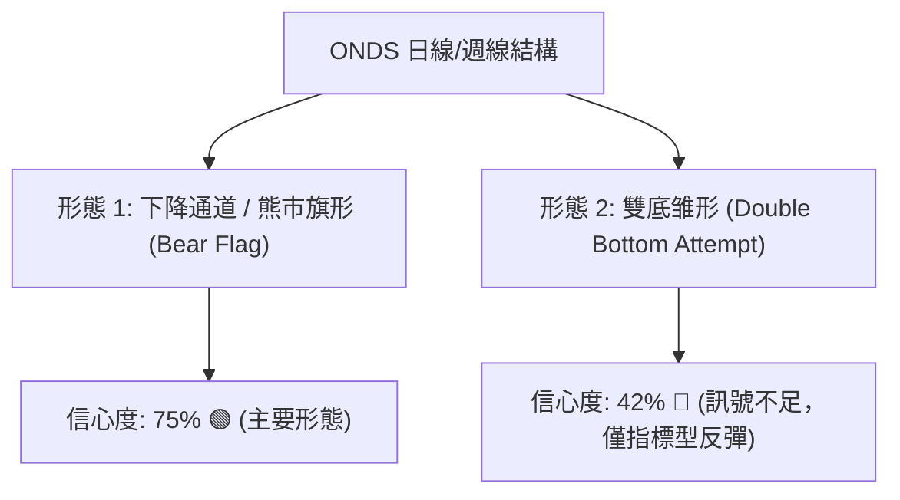

| 形態名稱 | 信心度 | 判斷依據（引用數據） | 完成度 | 目標價（附精確計算式） |
|----------|--------|----------------------|--------|------------------------|
| **下降通道 (熊市旗形)** | **75%** | 自 8/14 高點 $9.24 下跌至 10/16 低點 $5.80（旗桿高度 $3.44），隨後在 $5.80–$7.08 展開旗面反彈，10/30 收陰跌破 MA20 | 85% | 破位目標價 = 旗面下軌破位點 $6.22 − 形態高度推算 ($7.08 − $5.80 = $1.28) = **$4.94**（高度收斂至 52W 低點 **$4.95**） |
| **潛在雙底反彈** | **42%** | 兩次低點分別為 10/16 之 $5.80 與 10/20 之 $5.88（接近支撐 S3 $5.80）；但信心度 < 50%，頸線 $7.08 未突破且遭放量打回 | 35% | *訊號不足，未越過頸線 $7.08，不構成幾何反轉目標，僅作超跌指標型解讀* |

### 🕯️ 重要K線形態分析

嚴格依據提供的「近10根日K」與「近8根週K」實際開高低收數據進行專業解讀：

#### 近10根日K形態精解

| 日期 | 開 | 高 | 低 | 收 | K線形態名稱 | 專業技術解讀 | 訊號方向 |
|------|----|----|----|----|-------------|--------------|----------|
| 2026-10-19 | 6.20 | 6.28 | 6.01 | 6.06 | 弱勢小陰線 | 空頭持續打壓，跌破 $6.10 平台 | 🔴 看空 |
| 2026-10-20 | 5.93 | 6.33 | 5.88 | 6.10 | 下影小陽線 | 測試 S2 $5.93 獲得買盤承接，短線止跌 | 🟢 短多 |
| 2026-10-21 | 6.21 | 6.37 | 6.09 | 6.27 | 溫和陽線 | 成交量放大至 43.93M，多頭發力挑戰 MA10 | 🟢 偏多 |
| 2026-10-22 | 6.11 | 6.34 | 5.89 | 6.02 | 陰包陽吞噬 | 再次下探 $5.89，高檔解套賣壓沉重 | 🔴 看空 |
| 2026-10-23 | 5.99 | 6.35 | 5.89 | 6.20 | 長下影陽錘頭 | 40.92M 換手確認 S2 $5.93 與 S3 $5.80 底部防線 | 🟢 看多 |
| 2026-10-26 | 6.17 | 6.32 | 6.04 | 6.16 | 窄幅十字星 | 多空在 MA20 關卡前陷入觀望拉鋸 | 🟡 中性 |
| 2026-10-27 | 6.21 | 6.69 | 6.16 | 6.65 | 大陽線突破 | 放量 47.86M 實質突破 MA20 ($6.55)，短線轉強 | 🟢 看多 |
| 2026-10-28 | 6.69 | 6.88 | 6.56 | 6.86 | 續漲光頭陽線 | 成交量放大至 51.85M，反彈動能達到頂點 | 🟢 看多 |
| 2026-10-29 | 6.74 | 7.08 | 6.74 | 6.88 | 長上影倒錘線 | 衝高 $7.08 逼近 MA50 ($7.18) 遭空頭迎頭痛擊 | 🔴 反轉 |
| 2026-10-30 | 6.46 | 6.60 | 6.18 | 6.32 | 實體長陰破位 | 跌破 MA20 ($6.55)，吞沒前兩日漲幅，反彈宣告破敗 | 🔴 看空 |

#### 近8根週K形態精解

| 日期（週結） | 開 | 高 | 低 | 收 | 成交量 | 週K線形態 | 技術涵義與訊號 |
|--------------|----|----|----|----|--------|-----------|----------------|
| 2026-09-11 | 7.61 | 7.88 | 7.14 | 7.23 | 201.36M | 中長陰破位線 | 帶量跌破 $7.50 平台，下行通道展開 🔴 |
| 2026-09-18 | 6.99 | 7.53 | 6.98 | 7.39 | 348.27M | 低檔反彈小陽 | 放量換手，下影線回踩確認 $7.00 支撐 🟡 |
| 2026-09-25 | 7.51 | 7.98 | 7.18 | 7.64 | 375.05M | 上影長陽衝高 | 摸高 R1 $7.98 未果，確立波段高點阻力 🟡 |
| 2026-10-02 | 7.53 | 7.91 | 7.12 | 7.24 | 247.66M | 墓碑十字看跌 | 量縮衝高無力，高檔籌碼派發 🔴 |
| 2026-10-09 | 7.62 | 7.69 | 6.64 | 6.73 | 244.88M | 光腳大陰線 | 實體下穿 $7.00 整數心理防線 🔴 |
| 2026-10-16 | 7.06 | 7.08 | 5.80 | 6.04 | 327.19M | 極端長下影陰 | 探測年內低點聚類 S3 $5.80，恐慌盤湧出 🟡 |
| 2026-10-23 | 6.20 | 6.37 | 5.88 | 6.20 | 179.55M | 低檔孕線十字 | 成交量驟降近半，空頭殺跌力道減緩 🟡 |
| 2026-10-30 | 6.17 | 7.08 | 6.04 | 6.32 | 217.29M | 倒轉長上影墓碑 | 週線反彈高點 $7.08 遇阻大跌，反彈受挫 🔴 |

### 📉 ASCII 走勢形態示意圖

```
ONDS 日線「熊市旗形」破敗與「倒轉長上影」示意圖
價格 ($)
$7.20 ┤
$7.08 ┤                  ▲ 10/29 衝頂 $7.08 遇阻回落 (倒錘頭)
$7.00 ┤                 ╱ ╲
$6.80 ┤                ╱   ╲
$6.60 ┤          ▲   ● 10/28 $6.86
$6.55 ┼─────────╱─────┼───────────────────────── MA20 動態中軌阻力
$6.40 ┤        ● 10/27 $6.65  ╲
$6.32 ┼───────╱───────────────▼ 10/30 收盤破位 $6.32
$6.20 ┤  ●───● 10/23 $6.20       ╲ (熊市旗形下軌跌破)
$6.00 ┤ ╱ ╲                      ▼ 逼近 S1: $6.22
$5.80 ┼●───● 10/16 & 10/20 雙低探底 ($5.80 / $5.88)
      └────────────────────────────────────────────
        10-16 10-20 10-23 10-27 10-28 10-29 10-30
```

---

## 4. 支撐與阻力

### 🗺️ 關鍵價位分布圖（Unicode）

```
ONDS 關鍵價位結構分布圖 (由 OHLCV 與歷史波段聚類精確計算)
═══════════════════════════════════════════════════════════════════════════
$9.92 ║████████████████████████████████████████║ 強阻力 R3 (+57.04%)
$9.04 ║----------------------------------------║ 長期牛熊線 MA200
$8.58 ║██████████████████████████████          ║ 阻力 R2 (+35.76%)
$7.98 ║████████████████████████████████████████║ 關鍵阻力 R1 (9/25 高點 +26.27%)
$7.18 ║----------------------------------------║ 中期壓力 MA50 / Fib 78.6% ($7.16)
$6.55 ║----------------------------------------║ 短期動態壓力 MA20 / 布林中軌
$6.32 ╠════════════════════════════════════════╣ ◄ 當前收盤價 ($6.32)
$6.22 ║▓▓▓▓▓▓▓▓▓▓▓▓▓▓▓▓▓▓▓▓                    ║ 近期支撐 S1 (-1.58%)
$5.93 ║████████████████████████                ║ 強支撐 S2 (-6.17%)
$5.80 ║████████████████████████████████████████║ 核心波段底 S3 (-8.31%)
$4.95 ║████████████████████████████████████████║ 52週最低點 52W Low (極端底)
═══════════════════════════════════════════════════════════════════════════
```

### 🚧 阻力位分析表

*嚴格引用數據中由 OHLCV 計算之關鍵阻力位：*

| 阻力級別 | 價位 | 距現價幅標 | 形成原因與籌碼特徵 | 突破難度 | 重要性權重 |
|----------|------|------------|--------------------|----------|------------|
| **阻力 R1** | **$7.98** | +26.27% | 2026年9月25日週線衝高頂點，該處爆出 375M 週天量，套牢沉重籌碼 | 極高 🔴 | ★★★★★ |
| **阻力 R2** | **$8.58** | +35.76% | 2026年8月下旬跌破之箱體下緣聚類，具備強烈反壓效應 | 高 🔴 | ★★★★☆ |
| **阻力 R3** | **$9.92** | +57.04% | 2026年春季高檔橫盤密集換手平台（接近 $10.00 整數心理防線） | 極高 🔴 | ★★★★★ |

### 🛡️ 支撐位分析表

*嚴格引用數據中由 OHLCV 計算之關鍵支撐位：*

| 支撐級別 | 價位 | 距現價幅標 | 形成原因與籌碼特徵 | 守住機率 | 重要性權重 |
|----------|------|------------|--------------------|----------|------------|
| **支撐 S1** | **$6.22** | -1.58% | 10月23日日線收盤價與近2週密集震盪下邊界，短線多頭第一防線 | 45% 🟡 | ★★★☆☆ |
| **支撐 S2** | **$5.93** | -6.17% | 10月20日開盤與日線低點聚合處，多頭二次防守節點 | 55% 🟢 | ★★★★☆ |
| **支撐 S3** | **$5.80** | -8.31% | 10月16日創下的波段最低點聚類，守住此處方能維持潛在雙底 | 65% 🟢 | ★★★★★ |

### 📐 斐波那契回調位分析

依據 52 週完整循環區間（低點 $4.95 → 高點 $15.28，波幅 $10.33）進行精確測算：

```
斐波那契回調階梯 (52週區間 $4.95 → $15.28)
0.0%  (52W High)  $15.28  ═══════════════════════════════════════════════
23.6%             $12.84  ───────────────────────────────────────────────
38.2%             $11.33  ───────────────────────────────────────────────
50.0% (中位分水嶺) $10.11  ───────────────────────────────────────────────
61.8% (黃金分割)  $ 8.90  ─────────────────────── (MA200: $9.04 聚類共振)
78.6%             $ 7.16  ═══════════════════════ (MA50: $7.18 聚類強壓)
現價位置 ($6.32)   ▼      【運行於 78.6% 與 100.0% 弱勢下陷區】
100.0%(52W Low)   $ 4.95  ═══════════════════════════════════════════════
```

- **位置解讀**：現價 $6.32 落在 **78.6% ($7.16)** 與 **100.0% ($4.95)** 之間。在技術分析定義中，回調跌破 61.8% ($8.90) 即宣告原多頭波段結構遭到破壞；進一步失守 78.6% ($7.16) 則確立進入深幅下挫或漫長的基底重塑週期。
- **壓力共振**：斐波那契 78.6% 水平位 **$7.16** 與中期均線 **MA50 ($7.18)** 及 10/29 高點 **$7.08** 高度聚合，構築了多頭短期不可逾越的鐵壁阻力帶。

---

## 5. 技術指標深度解讀

### 🎛️ 指標訊號總覽

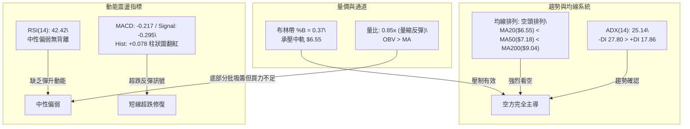

### 📈 移動平均線排列分析

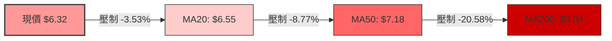

- **短天期均線**：MA5 ($6.57) > MA10 ($6.35)，現價 $6.32 同時受制於 MA5 與 MA10。10/30 一根陰線跌破 5 日與 10 日均線交匯處，終結短線衝高節奏。
- **中長天期均線**：MA60 ($7.51)、MA120 ($8.21)、MA240 ($9.09) 呈教科書式由上而下發散下傾，各週期均線斜率皆為負值（▼），顯示長線被套籌碼解套意願強烈，上方形成層層「蓋牌」賣壓。

### 📉 RSI(14) 分析

```
RSI(14) 當前數值: 42.42 (Wilder 平滑計算)
0 ──────────── 30 ──────────────────────── 70 ────────── 100
[ 超賣警戒區 ]    [        中性運行區間        ]   [ 超買警戒區 ]
░░░░░░░░░░░░░░░████████████░░░░░░░░░░░░░░░░░░░░░░░░░░░░░░
               ▲ (42.42)
```

- **數值解讀**：RSI 讀數為 42.42，脫離了 10/16 觸底時的弱勢超賣邊緣 (週線 RSI 曾觸及 29.6)，但未能升破 50 多空分水嶺，技術面定義為典型弱勢反彈修正。
- **背離判斷**：數據明確提示「RSI 背離：無明顯背離（比對近20根K棒首尾價格與 RSI 方向）」。價格自 10/20 觸底 $5.88 反彈至 10/29 高點 $7.08，RSI 同步由 30 水平拉升至 40 區間；10/30 價格回調，RSI 亦同步走低，指標軌跡與價格吻合，**確認無底背離或頂背離保護**。

### 📊 MACD(12/26/9) 訊號解讀

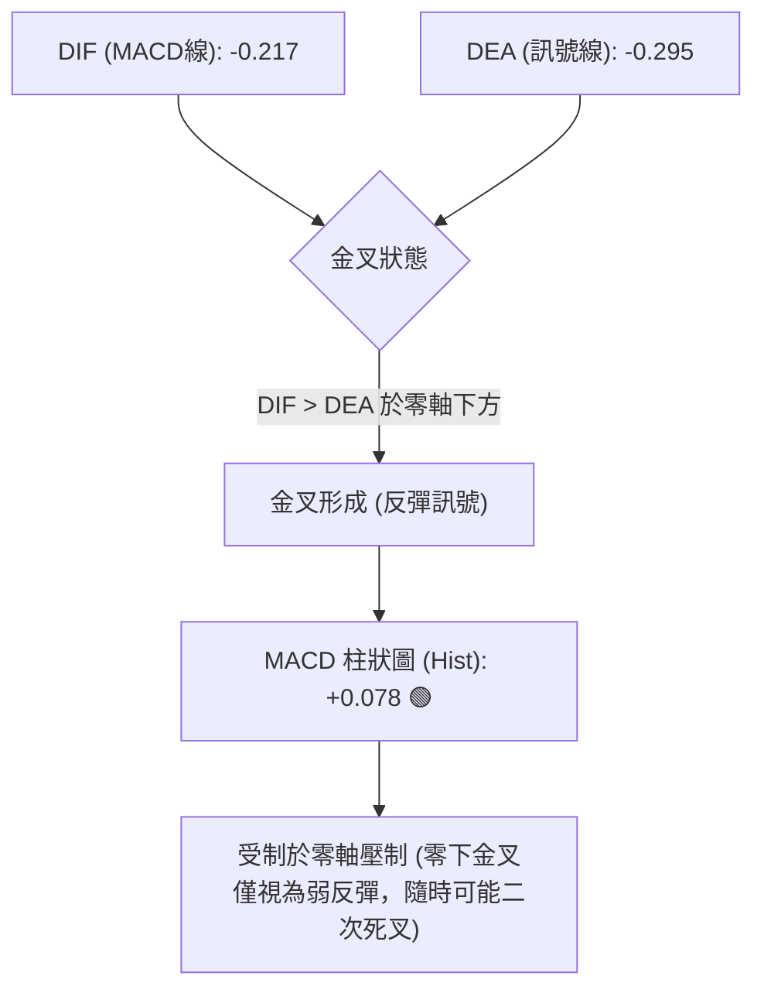

MACD 柱狀圖在近幾週呈現持續改善（-0.100 → -0.036 → +0.078），顯示短線下跌動能暫竭並產生超跌修復。然而，由於雙線依然深陷零軸以下（DIF 為 -0.217），依照傳統技術規則，零軸下方的金叉多屬「熊市反彈」或空頭回補所致，非實質反轉。

### 📦 布林通道分析

```
ONDS 日線布林通道 (20, 2) 結構示意圖
價格 ($)
$7.46 ┼──────────────────────────────────── BB 上軌 (動態極限強壓)
      │
$7.00 ┤            ▲ 10/29 摸高 $7.08 遭上軌壓回
      │
$6.55 ┼┈┈┈┈┈┈┈┈┈┈┈┈┈┈┈┈┈┈┈┈┈┈┈┈┈┈┈┈┈┈┈┈┈┈┈┈ BB 中軌 (MA20 阻力，現已失守)
$6.32 ┼────────────● 現價 $6.32 (%B = 0.37)
      │
$6.00 ┤
      │
$5.65 ┼──────────────────────────────────── BB 下軌 (極端動態支撐)
```

- **帶寬與位置**：上軌 $7.46，中軌 $6.55，下軌 $5.65，通道帶寬為 $1.81。
- **%B 指標判斷**：%B 當前為 **0.37**，代表價格位於中軌偏下軌區間（中軌為 0.50，下軌為 0.00）。10/29 價格試圖向上穿越中軌失敗，10/30 迅速跌回中軌下方，布林通道再度開口向下發散，暗示後續價格有向 **下軌 $5.65** 尋求支撐之風險。

### 💹 成交量分析（量價配合度）

```
成交量與均量對比 (單位: 股)
最新量 (10/30):  41,033,000   ████████████████░░░░ (量比 0.85x)
20日均量:        48,446,340   ███████████████████░
50日均量:        55,937,824   ████████████████████
```

- **量價背離現象**：10/27 至 10/29 股價從 $6.21 衝刺至 $7.08 期間，日成交量分別為 47.86M、51.85M、45.60M，相較於 9 月份下跌時單日動輒 60M–80M 及週線 300M+ 的大量，本次反彈量能明顯不足，呈現典型的「價漲量縮」弱勢反彈背離。
- **OBV 趨勢**：系統快照顯示「OBV > MA → 量能支撐上漲」，說明長線資金在 $5.80–$6.00 低檔有逢低沉澱與托盤動作，但由於未見主動性進攻量能，無法推動突破性行情。

---

## 6. 動能與波動率

### ⚡ 動能評估四象限

```
動能與波動率矩陣分佈
    高動能 (High Momentum)
       │
  Q3   │   Q1
       │
───────┼─────── 波動率 (Volatility)
  Q4   │   Q2
  ★ONDS│
    低動能 (Low Momentum)
```

| 象限代號 | 動能特徵 | 波動率特徵 | ONDS 當前落點 | 戰略解讀與操盤指導 |
|----------|----------|------------|---------------|--------------------|
| **第一象限 (Q1)** | 強動能 (+DI高/MACD強) | 高波動 (高ATR/高Beta) | — | 主升衝刺浪，適合順勢重倉追漲 |
| **第二象限 (Q2)** | 強動能 | 低波動 | — | 穩健長牛趨勢，適合拉回加碼 |
| **第三象限 (Q3)** | 弱動能 | 低波動 | — | 盤整蓄勢走勢，適合低吸高拋 |
| **第四象限 (Q4)** | **弱動能 (ADX空頭)** | **高波動 (Beta 2.922)** | **★ ONDS 處於此區** | **高風險弱勢區：跌勢劇烈、反彈多陷阱，應嚴控部位** |

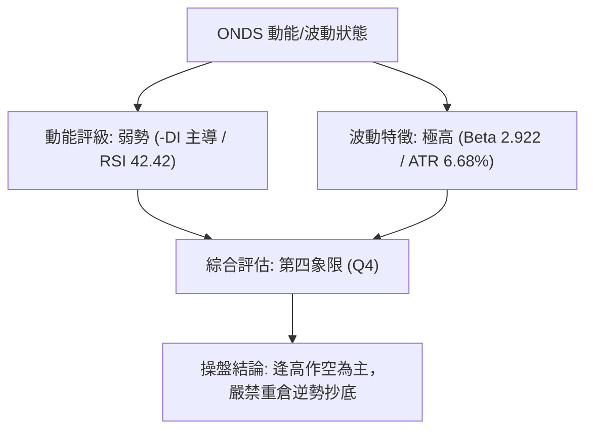

### 📊 ATR 波動率分析

- **ATR(14) 絕對值**：**$0.42**（Wilder 平滑法測算）。
- **相對波動率比重**：ATR 佔現價 ($6.32) 比率高達 **6.68%**。
- **止損距離建議**：
  - **保守型交易（2.0 × ATR）**：安全止損緩衝距離應設為 $0.42 × 2.0 = **$0.84**。
  - **一般波段交易（1.5 × ATR）**：止損緩衝距離應設為 $0.42 × 1.5 = **$0.63**。
  - **日內/超短線（1.0 × ATR）**：最小保護距離不可小於 $0.42。

### 📐 Beta 與市場相關性

- **Beta 係數**：**2.922**。此數值顯示 ONDS 為超高 Beta 標的，其股價波動幅度約為標普 500 指數的近 3 倍。在市場整體風險偏好下降時，此類高 Beta 股往往首當其衝遭受拋售。
- **放空比例 (Short % of Float)**：高達 **43.9%**，流通股中有超過 2.34 億股處於放空狀態；Short Ratio 為 **4.11** 天。
- **空頭擠壓（Short Squeeze）雙刃劍效應**：高達 43.9% 的空頭部位意味著一旦出現超預期的基本面或國防標案利多，極易觸發猛烈的軋空行情；但在空頭排列未被破壞前，大量空頭借券亦是壓制股價反彈的核心阻力來源。

---

## 7. 多時框架總結

### 📋 時框架評分表

| 時框架 | 趨勢方向 | 動能指標 | 均線系統排列 | 圖表形態特徵 | 綜合評分 | 操作指導建議 |
|--------|----------|----------|--------------|--------------|----------|--------------|
| **月線時框 (長期)** | 🔴 強烈空頭 | RSI 弱勢偏空 | 高檔死叉向下發散 | 自歷史高點 $13.22 展開深幅修正 | 25/100 | 長線資金離場觀望 |
| **週線時框 (中期)** | 🔴 確立空頭 | MACD 零下掙扎 | MA20 < MA50 < MA200 空頭 | 下降通道運行，反彈皆遭阻力擊破 | 30/100 | 中期反彈逢高建立空單 |
| **日線時框 (短期)** | 🟡 震盪偏空 | Hist +0.078 翻紅 | 承壓於 MA20 ($6.55) | 倒錘頭破位，熊市旗形下軌考驗 | 45/100 | 依賴支撐 S1 反覆測試 |

### 🔲 綜合訊號矩陣

```
時框訊號一致性矩陣表
┌──────────────┬──────────────┬──────────────┬──────────────┐
│ 時框維度     │ 均線系統     │ 動能指標     │ 量價配合     │
├──────────────┼──────────────┼──────────────┼──────────────┤
│ 長期 (月線)  │ 🔴 空頭壓制  │ 🔴 空方控盤  │ 🔴 高檔放量陰│
│ 中期 (週線)  │ 🔴 死亡排列  │ 🔴 -DI 主導  │ 🟡 換手沉澱  │
│ 短期 (日線)  │ 🔴 跌破MA20  │ 🟢 柱狀微翻紅│ 🟡 量能遞減  │
└──────────────┴──────────────┴──────────────┴──────────────┘
訊號共振結論：中長期方向高度收斂看空，短期僅為超跌修復，多空力量對比為 1 : 5。
```

### ⚖️ 多時框收斂結論

依據嚴格要求「**規則 14：多時框收斂規則**」進行收斂推導：
1. **行情屬性判定**：當前 ADX(14) 讀數為 **25.14**，超過 25 臨界線，技術面明確判定為「**趨勢行情（ADX > 25）**」，而非無方向的盤整震盪。
2. **主導層級劃分**：在趨勢行情下，中長期趨勢（週線及 MA50、MA200）具備絕對主導權。日線級別的指標反彈（如 MACD 柱狀圖翻紅 +0.078）僅能視為逆勢的短線修正，僅供尋找更具性價比的空頭進場點。
3. **唯一方向性結論**：全維度技術收斂判定為「**🔴 偏空格局（逢高做空）**」。此結論嚴格與第 1 章技術評分卡（37 分）及第 8 章之主交易策略完全保持一致。

---

## 8. 交易策略建議

### 🗺️ 策略決策流程圖

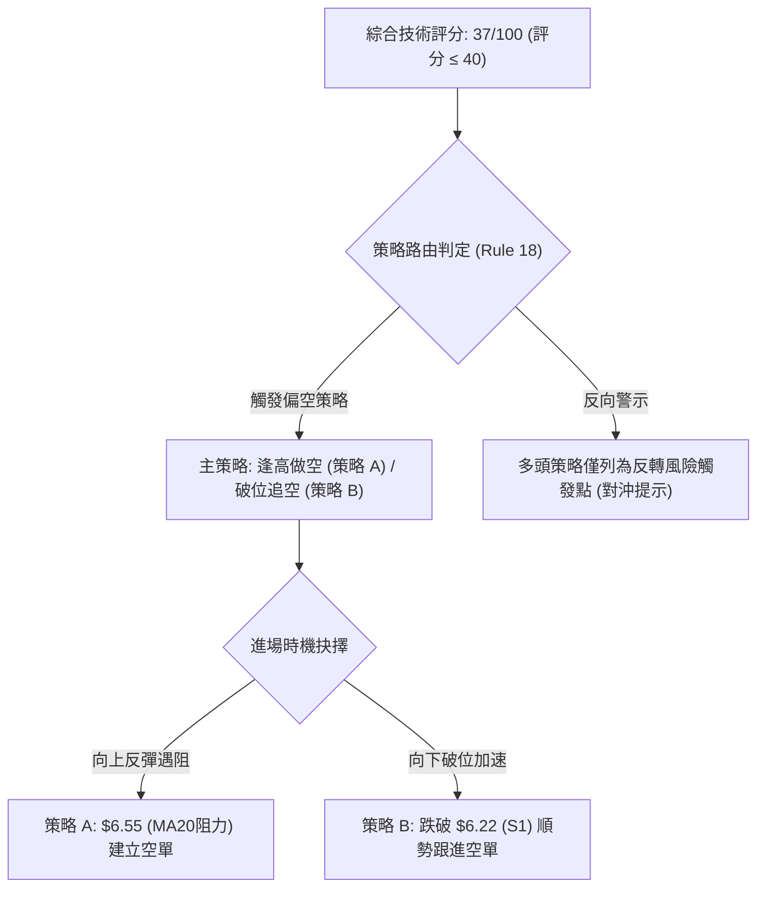

### 🧭 策略路由（依評分卡分流）

> **當前主策略方向 = 🔴 主推空頭策略（逢高做空 / 破位空）（依技術評分卡綜合評分 37/100）**

### 🎯 價格情境階梯（Price Scenarios）

*價位嚴格引用第 4 章及數據計算之精確數值：*

| 觸發條件 | 下一目標價 | 後續延伸目標 | 情境技術含義 |
|----------|------------|--------------|--------------|
| **突破 R1 $7.98** | R2 $8.58 | R3 $9.92 | 短線強勢逆轉，全面空頭擠壓軋空行情報到 |
| **突破 MA50 $7.18** | R1 $7.98 | R2 $8.58 | 中期下降通道被打破，多頭反攻展開 |
| **跌破 MA20 $6.55** | S1 $6.22 | S2 $5.93 | 短線反彈夭折，重回空頭主跌節奏（當前狀態） |
| **跌破 S1 $6.22** | S2 $5.93 | S3 $5.80 | 跌勢加速，下探近一年核心支撐區 |
| **跌破 S3 $5.80** | 52W Low $4.95 | 破位尋底 | 雙底徹底破敗，打開下行至歷史低點空間 |

### 📊 情境機率分佈

| 預測情境 | 機率估計 | 主要技術依據（引用指標狀態） |
|----------|----------|------------------------------|
| **情境 I：回落再探底（跌破S1/下測S3）** | **55%** | 均線全線空頭排列，ADX 25.14 確立空頭趨勢，10/30 放量長陰破位 |
| **情境 II：區間弱勢震盪（$5.93–$6.55）** | **30%** | MACD 柱狀圖微幅翻紅 (+0.078)，OBV 處於均線上方，底部有托盤買盤 |
| **情境 III：強勢反轉衝刺（突破R1）** | **15%** | 空頭部位高達 43.9%，需仰賴基本面超預期利多爆發誘發空頭回補 |

### 🟢 主策略詳情（空頭主導方案）

*嚴格遵守規則 17 規範之公式與呈現格式：*
- *做空風險報酬比 = (進場價 − 目標價 T1) ÷ (止損價 − 進場價)*
- *進場價若為區間，以區間中點計算並註明*

| 策略要素 | 策略 A（反彈遇阻做空 — 穩健型） | 策略 B（跌破 S1 順勢追空 — 突破型） |
|----------|----------------------------------|--------------------------------------|
| **適用時機** | 價格反抽測試動態均線阻力 | 價格放量摜破前波整理平台下邊界 |
| **進場條件** | 反彈至 MA20 承壓，出現滯漲日K陰線 | 收盤實質跌破支撐位 S1 ($6.22) |
| **進場價格** | **$6.55**（MA20 / 布林中軌共振阻力） | **$6.22**（支撐位 S1 精確破位點） |
| **目標價 T1** | **$5.93**（支撐位 S2，獲利空間 $0.62） | **$5.80**（核心支撐 S3，獲利空間 $0.42） |
| **目標價 T2** | **$4.95**（52W Low，獲利空間 $1.60） | **$4.95**（52W Low，獲利空間 $1.27） |
| **止損價格** | **$7.18**（MA50 關鍵中期阻力點） | **$6.55**（MA20 阻力線上方） |
| **風險報酬比** | **1 : 0.98（以 T1 計）**<br>*(註：以 T2 計為 1 : 2.54)* | **1 : 1.27（以 T1 計）**<br>*(註：以 T2 計為 1 : 3.85)* |
| **成功機率** | 62% | 58% |
| **建議倉位** | 10%–15% 總資金 | 8%–10% 總資金 |

*計算覆核說明（規則 17）：*
- *策略 A（以 T1 計）：(6.55 − 5.93) ÷ (7.18 − 6.55) = 0.62 ÷ 0.63 = 0.9841 → `1 : 0.98（以 T1 計）`*
- *策略 A（以 T2 計）：(6.55 − 4.95) ÷ (7.18 − 6.55) = 1.60 ÷ 0.63 = 2.5396 → `1 : 2.54（以 T2 計）`*
- *策略 B（以 T1 計）：(6.22 − 5.80) ÷ (6.55 − 6.22) = 0.42 ÷ 0.33 = 1.2727 → `1 : 1.27（以 T1 計）`*
- *策略 B（以 T2 計）：(6.22 − 4.95) ÷ (6.55 − 6.22) = 1.27 ÷ 0.33 = 3.8484 → `1 : 3.85（以 T2 計）`*

### 🔴 反向風險觸發點（對沖提示）

以下非主動做多操作建議，僅作為空單風控對沖與空頭回補之警示觸發線：
1. **減倉警示點**：若價格放量站穩 **MA20 ($6.55)** 之上，空單應主動了結 50% 倉位。
2. **停損反轉點**：若日線級別收盤價突破 **MA50 ($7.18)**，空單全數離場避險；激進投資者可於此處嘗試極輕倉（5%）參與反轉行情。
3. **極端軋空點**：若股價放量突破關鍵阻力 **R1 ($7.98)**，將引發 43.9% 空頭部位大規模踩踏補回，屆時應全面平空並嚴禁任何逆勢做空行為。

### ⭐ 整體訊號強度評星

```
做多訊號強度：★★☆☆☆  (2/5星 — 僅具超跌反彈特徵，均線系統全面壓制)
做空訊號強度：★★★★☆  (4/5星 — 中長線與週線趨勢全面空頭，順勢交易)
整體可信度：  ★★★☆☆  (3/5星 — 需嚴密防範 43.9% 空頭部位的高波動軋空)
```

---

## 9. 風險提示與監控

### ✅ 關鍵監控指標 Checklist

```
╔══════════════════════════════════════════════════════════════╗
║               ONDS 交易風險日常監控清單 (Checklist)           ║
╠══════════════════════════════════════════════════════════════╣
║ [ ] 價格跌破 S1 ($6.22) 支撐 ── 空頭加速訊號，執行策略 B        ║
║ [ ] 價格跌破 S3 ($5.80) 支撐 ── 結構徹底破壞，目標下調至 $4.95  ║
║ [ ] 價格升破 MA20 ($6.55) ── 觸發策略 A 止盈/減倉保護          ║
║ [ ] 價格突破 MA50 ($7.18) ── 空頭格局破壞，策略 A 全面止損    ║
║ [ ] RSI(14) 跌破 30 超賣線 ── 提防短線乖離過大引發急遽抽頭    ║
║ [ ] 單日成交量放大超過 6,000 萬股 ── 警惕主力資金變盤異動       ║
║ [ ] 2026-11-12 Q3 財報發布 ── 業績公佈前夕須降倉或平倉對沖   ║
╚══════════════════════════════════════════════════════════════╝
```

### ⚠️ 風險場景分析

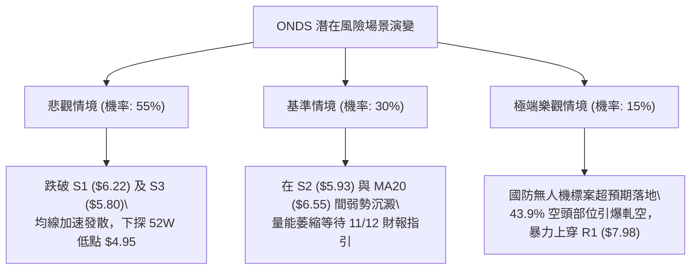

### 🛡️ 風險管理重要提醒

1. **極高空頭部位與軋空防護**：
   ONDS 擁有高達 **43.9%** 的放空比例 (Short % of Float)，在美股通訊與軍工設備板塊中屬於極端放空標的。高空頭佔比意味著此標的**絕非一般常規走勢個股**。一旦盤面出現突發性軍工訂單或利多，極易出現單日 +20% 甚至 +30% 的暴力軋空跳空。建立空單時，**止損單必須硬性掛入券商系統**，絕不可心存僥倖實施「心理止損」。
2. **財報窗口期風險**：
   公司已排定於 **2026 年 11 月 12 日**盤前公佈 2026 年第三季財務業績。數據顯示其最新單季營收年增達 1235.4%，但營運利潤率仍深陷 -166.3% 的巨額虧損。財報公佈前後引發的隱含波動率 (IV) 飆升將使股價呈現雙向極端擺動，建議在 11 月 10 日前結束所有波段單，或將總部位降至 5% 以下。
3. **槓桿與倉位限制**：
   鑒於 ONDS 的 Beta 高達 **2.922**，其波動幅度為市場 3 倍，且單日 ATR 佔股價比重高達 **6.68%**。單筆操作承擔的最大總資產虧損風險應嚴格限制在 **1.0%–1.5%** 範圍內，嚴格禁止動用槓桿或進行逆勢攤平操作。

---

## 📋 報告總結

```
╔══════════════════════════════════════════════════════════════════╗
║                    ONDS 技術分析報告核心總結                     ║
╠══════════════════════════════════════════════════════════════════╣
║ 報告日期：2026-10-31          當前收盤價：$6.32                 ║
║ 技術評級：🔴 偏空格局 (逢高做空) 綜合評分：37 / 100            ║
╠══════════════════════════════════════════════════════════════════╣
║ 關鍵結論：                                                       ║
║ ├─ 長期趨勢 (月線)：🔴 衝頂回落深幅修正，自高點回撤達 -58.64%     ║
║ ├─ 中期趨勢 (週線)：🔴 均線空頭排列，下降通道維持完好             ║
║ ├─ 短期趨勢 (日線)：🟡 弱勢反彈遭 MA20 擊潰，面臨旗形破位考驗   ║
║ ├─ 核心支撐架構：S1: $6.22 │ S2: $5.93 │ S3: $5.80 │ 52W: $4.95 ║
║ ├─ 核心阻力防線：MA20: $6.55 │ MA50: $7.18 │ R1: $7.98         ║
║ └─ 機構共識目標：Mean: $18.88 │ Low: $13.00 (與技術面嚴重背離)   ║
╠══════════════════════════════════════════════════════════════════╣
║ 最優策略組合導航：                                               ║
║ 1. 🥇 最佳機會（主策略 A）：反彈至 MA20 ($6.55) 遇阻做空，         ║
║    止損設於 MA50 ($7.18)，目標價看至 S2 ($5.93)。                 ║
║ 2. 🥈 次選機會（主策略 B）：跌破 S1 ($6.22) 確認後順勢追空，      ║
║    止損設於 $6.55，目標價直指 S3 ($5.80) 與 $4.95。             ║
║ 3. 🥉 防守告警：嚴密監控 43.9% 空頭部位軋空風險，若突破 $7.18    ║
║    嚴格執行全線空單止損平倉。                                    ║
╚══════════════════════════════════════════════════════════════════╝
```

---

> ⚠️ **免責聲明**：本報告為依據客觀量化技術指標與歷史 OHLCV 價格數據所生成之深度技術分析研究，所有數據、支撐阻力點位及交易策略僅供**專業學術交流與投資研究參考**，**絕不構成任何具體的要約、招攬或個人投資操作建議**。金融市場具有極高之市場風險、流動性風險與本金虧損風險，投資人應當依據自身財務狀況、風險承受能力獨立做出投資決策，並自負盈虧責任。

---
*報告生成時間：2026-10-31 ｜ 數據來源：Yahoo Finance ｜ 分析框架：多時框架技術分析與量化價格結構識別*