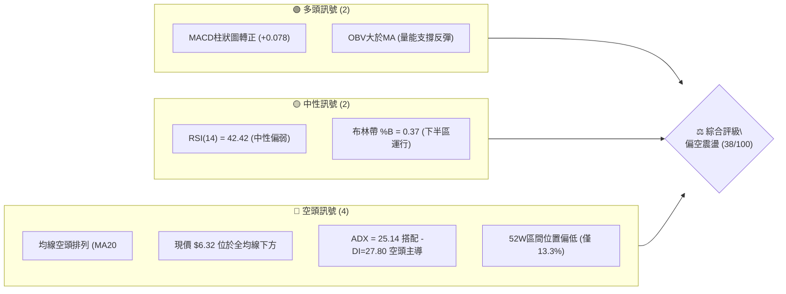
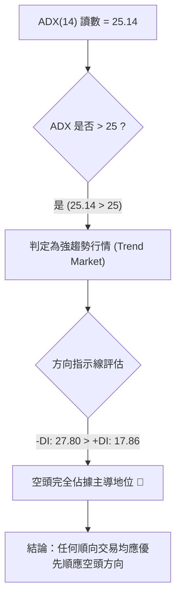
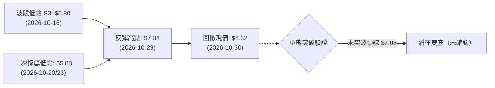
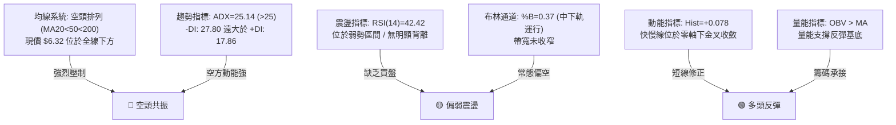
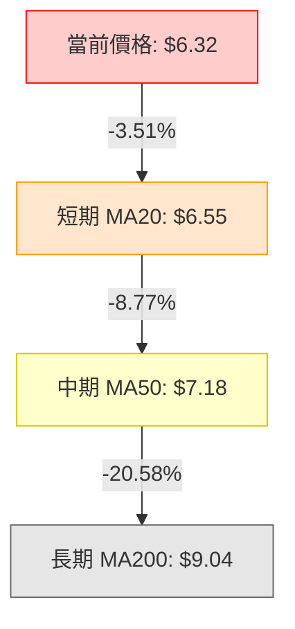
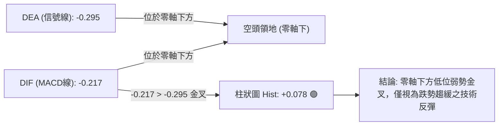
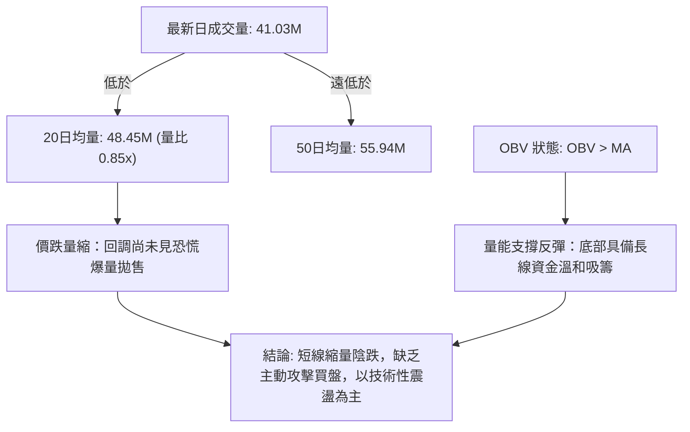
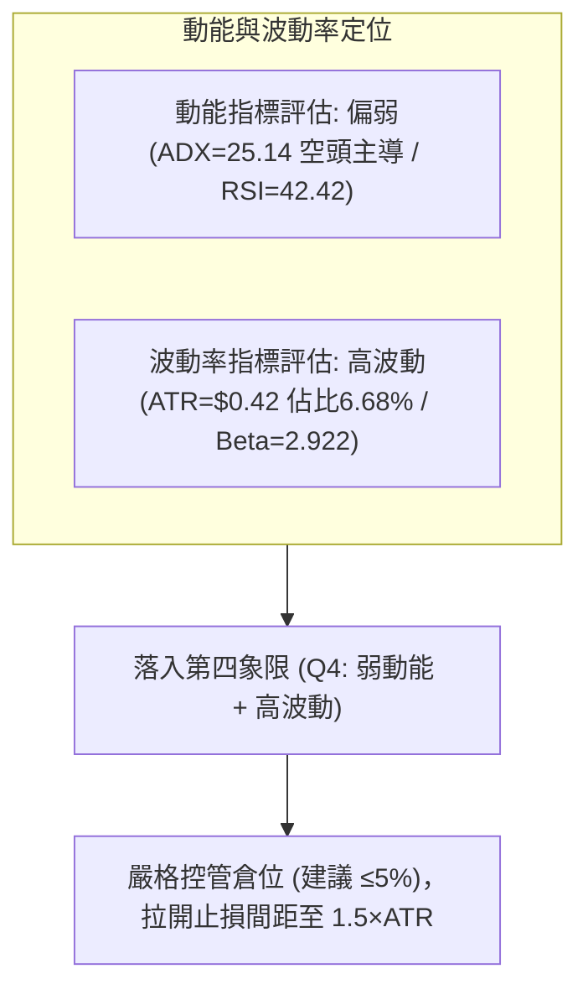
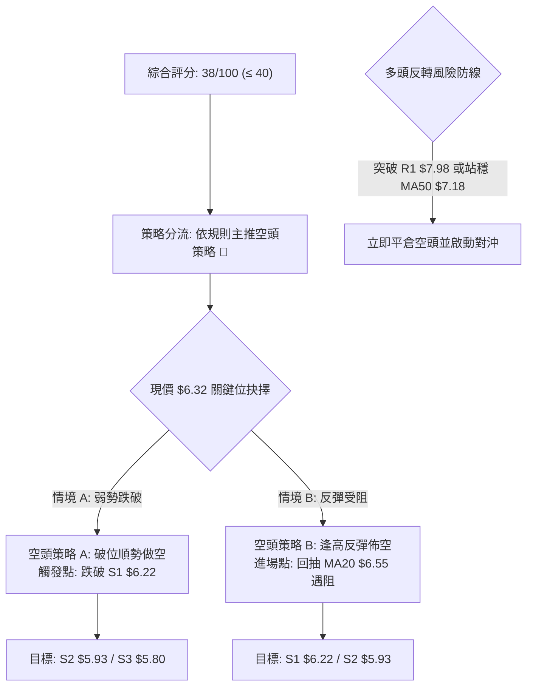
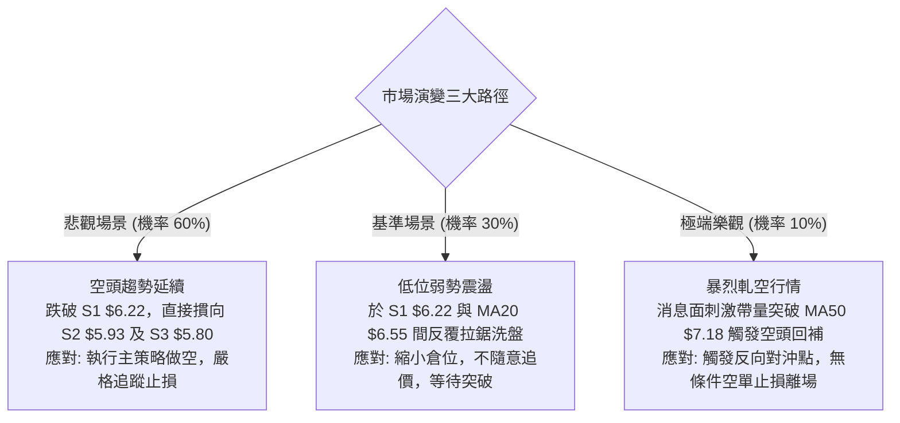

# ONDS 技術分析報告

> **報告日期**：2026-11-01 ｜ **語言**：繁體中文 ｜ **數據來源**：Yahoo Finance ｜ **當前價格**：$6.32

---

## 目錄

| 章節 | 內容 |
|------|------|
| [1. 技術面概覽](#1-技術面概覽) | 訊號儀表板、核心指標、評分卡 |
| [2. 趨勢分析](#2-趨勢分析) | 多時框趨勢、長中短期走勢 |
| [3. 圖表形態分析](#3-圖表形態分析) | 形態識別、K線組合、目標價 |
| [4. 支撐與阻力](#4-支撐與阻力) | 關鍵價位、斐波那契回調 |
| [5. 技術指標深度解讀](#5-技術指標深度解讀) | MA/RSI/MACD/布林/成交量 |
| [6. 動能與波動率](#6-動能與波動率) | 動能評估、ATR、Beta |
| [7. 多時框架總結](#7-多時框架總結) | 時框架評分矩陣 |
| [8. 交易策略建議](#8-交易策略建議) | 多空策略、風險報酬比 |
| [9. 風險提示與監控](#9-風險提示與監控) | 監控指標、風險場景 |

---

## 1. 技術面概覽

### 🎯 技術訊號儀表板



### 📊 核心指標速覽表

| 指標類別 | 指標名稱 | 當前數值 | 訊號 | 解讀 |
|----------|----------|----------|------|------|
| **價格** | 當前價格 | $6.32 | 🔴 | 位於52週區間僅13.3%位置，承壓顯著 |
| **均線** | MA20 | $6.55 | 🔴 | 現價位於MA20下方 (-3.51%)，短線壓制明顯 |
| **均線** | MA50 | $7.18 | 🔴 | 現價位於MA50下方 (-11.98%)，中期結構偏空 |
| **均線** | MA200 | $9.04 | 🔴 | 現價位於MA200下方 (-30.09%)，長期處於空頭市場 |
| **動能** | RSI(14) | 42.42 | 🟡 | 位於30-70中性區間偏下緣，暫無超賣保護 |
| **動能** | MACD | -0.217 | 🟢 | 快慢線雖在零軸下，但Hist=+0.078釋出短多收斂 |
| **動能** | 隨機指標 %K/%D | 40.86 / 69.39 | 🟡 | %K向下穿過%D，短線超買回吐進行中 |
| **趨勢** | ADX(14) / ±DI | 25.14 / -DI:27.80 | 🔴 | ADX>25且-DI主導，確認空頭趨勢強勢 |
| **波動** | ATR(14) | $0.42 | 🟡 | 佔現價6.68%，維持中高波動，日震盪顯著 |
| **量能** | 成交量比 | 0.85x | 🟡 | 最新量41.03M低於20日均量48.45M，縮量整理 |

### 🏆 技術評分卡

```
╔══════════════════════════════════════════════════════════════╗
║                 技術評分卡 — ONDS (2026-11-01)               ║
╠══════════════════════════════════════════════════════════════╣
║ 趨勢強度      ██████░░░░░░░░░░░░░░  30/100  🔴 (空頭趨勢顯著)║
║ 動能指標      ██████████░░░░░░░░░░  50/100  🟡 (MACD正背離)  ║
║ 支撐穩定度    ████████░░░░░░░░░░░░  40/100  🔴 (貼近S1考驗)  ║
║ 成交量配合    ██████████░░░░░░░░░░  50/100  🟡 (OBV支撐反彈) ║
║ 形態完整度    ██████░░░░░░░░░░░░░░  30/100  🔴 (頭部回跌延續)║
║ 均線排列      ██████░░░░░░░░░░░░░░  30/100  🔴 (標準空頭排列)║
╠══════════════════════════════════════════════════════════════╣
║ 綜合評分      ████████░░░░░░░░░░░░  38/100  🔴 偏空震盪      ║
╚══════════════════════════════════════════════════════════════╝
```
*(註：綜合評分由六項子評分算術平均：(30 + 50 + 40 + 50 + 30 + 30) / 6 = 38.33，四捨五入為 38/100，符合規則 18)*

---

## 2. 趨勢分析

### 🌐 多時框趨勢分析

```mermaid
graph TD
    M["月線架構 (長期)"] -->|"2026-05 創頂 $13.22 後急跌至 $6.32 (-52.2%)"| M_STAT["長期空頭修正 🔴"]
    W["週線架構 (中期)"] -->|"連續跌破MA20/50，空頭階梯下移"| W_STAT["中期震盪下行 🔴"]
    D["日線架構 (短期)"] -->|"觸底 $5.80 後反彈至 $7.08，現回吐至 $6.32"| D_STAT["短期反彈受阻 🟡"]
    
    M_STAT --> SYNTHESIS{"多時框收斂判定"}
    W_STAT --> SYNTHESIS
    D_STAT --> SYNTHESIS
    
    SYNTHESIS -->|"ADX("14")=25.14 > 25 且 -DI 壓制"| FINAL["以週線及MA中長期空向為主導"]
```

### 📈 長期趨勢 — 12個月走勢圖（Unicode）

```
ONDS 月線走勢圖（過去12個月：2025-11 至 2026-10）
價格軸 ($)
$13.22 ┤                                      ● (2026-05 峰值高點)
$12.00 ┤                                     / \
$11.00 ┤                   ●                /   \
$10.00 ┤          ●       / \        ●     /     \
 $9.00 ┤         / \     /   \      / \   /       ● (2026-06 跌破)
 $8.00 ┤ ●      /   \   /     ●    /   \ /         \
 $7.00 ┤  \    /     ● /       \  /     ●            ●━━━● (2026-07~09)
 $6.32 ┤   \  /       ●          ●                   \
 $5.80 ┤    ●                                         ● (2026-10 現價 $6.32)
       └────────────────────────────────────────────────────────
         11   12    01    02    03   04    05    06    07   08    09   10 (月份)
        (25) (25)  (26)  (26)  (26) (26)  (26)  (26)  (26) (26)  (26) (26)
```

**12個月走勢特徵分析表格**：

| 時間階段 | 起訖收盤價 | 區間漲跌幅 | 主要走勢特徵與結構 |
|----------|------------|------------|--------------------|
| 2025-11 ~ 2026-01 | $7.90 → $10.36 | +31.14% | 突破加速期，國防無人機題材發酵，成交量顯著推升 |
| 2026-01 ~ 2026-04 | $10.36 → $10.04 | -3.09% | 高檔箱型寬幅震盪，於 $9.04 ~ $10.36 間反覆築頂洗盤 |
| 2026-04 ~ 2026-05 | $10.04 → $13.22 | +31.67% | 噴出高潮段，月收盤創 $13.22 歷史次高（波段最高 $15.28） |
| 2026-05 ~ 2026-06 | $13.22 → $8.24 | -37.67% | 斷崖式暴跌，獲利了結與高估值回吐，直接摜破所有短期均線 |
| 2026-06 ~ 2026-09 | $8.24 → $7.33 | -11.04% | 弱勢反彈受制於 $8.50-$9.00 平台，波動率收縮，重心持續下移 |
| 2026-09 ~ 2026-10 | $7.33 → $6.32 | -13.78% | 空頭二次探底，跌穿 $7.00 整數關卡，最低見 $5.80，收盤 $6.32 |

### 📊 中期趨勢（週線分析）

```
近期週線壓力與支撐階梯示意圖
$9.92 ─── [R3 強阻力：2026年Q1震盪中樞/前波密集套牢區]
   │
$8.58 ─── [R2 阻力：8月中旬反彈高點聚類/MA200下方反壓]
   │
$7.98 ─── [R1 關鍵阻力：9月下旬反彈高點聚類，近一月多頭天花板]
   │
$7.18 ─── [MA50 中期均線反壓位]
   │
$6.55 ─── [MA20 / BB中軌 短線多空轉換線]
   │
$6.32 ═══ ◄ 當前收盤價位 ($6.32)
   │
$6.22 ─── [S1 支撐：近一年波段低點聚類，前波回踩頸線]
   │
$5.93 ─── [S2 強支撐：10月下旬盤整平台下沿]
   │
$5.80 ─── [S3 極限支撐：10-16 當週所創近一年最低探底點]
```

### ⚡ 趨勢強度評估（ADX 解讀）



**ADX 趨勢強度與方向指標對照表**：

| 指標變數 | 當前讀數 | 門檻區間 | 趨勢狀態解讀 |
|----------|----------|----------|--------------|
| **ADX(14)** | 25.14 | > 25.00 | 越過強趨勢門檻，行情擺脫純盤整，具備明確趨勢驅動力 |
| **+DI (14)** | 17.86 | 弱勢 (<20) | 多方動能明顯潰散，買盤僅具備被動護盤性質 |
| **-DI (14)** | 27.80 | 強勢 (>25) | 空方佔據行情絕對主導權，反彈易引發空頭二次打壓 |
| **方向差距 (Spread)** | -9.94 | 負值擴大 | 空多差值接近10點，技術結構嚴格偏向空方控制 |

---

## 3. 圖表形態分析

### 🔍 形態識別系統



**形態識別與信心度評估表**（嚴格遵守規則 15）：

| 形態名稱 | 信心度 | 判斷依據（引用數據） | 完成度 | 目標價（附計算式） |
|----------|--------|----------------------|--------|--------------------|
| **潛在雙底 (Double Bottom)** | 45% | 10-16 週低 $5.80 與 10-20/23 日低 $5.88 構成雙底雛形（接近 S2 $5.93 / S3 $5.80 聚類），但頸線位於 10-29 高點 $7.08 未突破 | 60% | 若突破頸線 $7.08：$7.08 + ($7.08 - $5.80) = $8.36（接近阻力 R2 $8.58） |
| **中期下降通道 (Down Channel)** | 85% | 8月高點 $9.24、9月高點 $7.98（R1）、10月高點 $7.08 高點持續下移，且低點由 $7.14 跌至 $5.80（S3） | 90% | 通道下軌支撐延伸指向 S2: $5.93 與 S3: $5.80 |
| **均線死叉空頭排列** | 95% | MA20 ($6.55) < MA50 ($7.18) < MA200 ($9.04)，空頭發散形態 | 100% | 依趨勢延續性向下測底 S1: $6.22 及 S2: $5.93 |

*(註：潛在雙底因信心度 45% < 50% 且頸線未突破，依規則 15 僅作潛在參考，不作為主要交易依據)*

### 🕯️ 重要K線形態分析

嚴格依據近10根日K與近8根週K的開高低收數據進行客觀解讀（規則 19）：

| 日期（週期） | 開盤 | 最高 | 最低 | 收盤 | K線形態 | 解讀 | 訊號 |
|--------------|------|------|------|------|---------|------|------|
| **2026-10-16 (週K)** | 7.06 | 7.08 | 5.80 | 6.04 | **破位大陰線** | 一舉摜破 $6.50 支撐，探底 $5.80，收盤低迷，確立空頭延伸 | 🔴 |
| **2026-10-23 (週K)** | 6.20 | 6.37 | 5.88 | 6.20 | **長下影十字線** | 開盤與收盤同為 $6.20，最低探 $5.88，於 S3 $5.80 上方出現承接力道 | 🟢 |
| **2026-10-27 (日K)** | 6.21 | 6.69 | 6.16 | 6.65 | **實體長陽線** | 帶量突破短線整理平台，陽線實體覆蓋多根K棒，動能迅速轉強 | 🟢 |
| **2026-10-28 (日K)** | 6.69 | 6.88 | 6.56 | 6.86 | **續揚陽線** | 延續多頭買氣，突破 MA20 ($6.55)，收盤逼近高點 | 🟢 |
| **2026-10-29 (日K)** | 6.74 | 7.08 | 6.74 | 6.88 | **長上影流星線** | 開盤即最低，盤中衝高至 $7.08 被空頭強勢壓回，顯露受阻訊號 | 🔴 |
| **2026-10-30 (日K)** | 6.46 | 6.60 | 6.18 | 6.32 | **反噬大陰線** | 跳空低開走低，收盤 $6.32 跌破 MA20 ($6.55)，兩日盡吐週內漲幅 | 🔴 |
| **2026-10-30 (週K)** | 6.17 | 7.08 | 6.04 | 6.32 | **高位倒錘頭週K** | 衝高 $7.08 受阻於 MA50 反壓，長上影線達 $0.76，週線反彈夭折 | 🔴 |

### 📉 ASCII 走勢形態示意圖

```
ONDS 近10日 K線形態演變圖 ($)
$7.10 ┤                     ┌─┐ (10-29 高 $7.08 流星線長上影)
$6.90 ┤                 ┌─┐ │ │
$6.70 ┤             ┌─┐ │ │ │ █
$6.50 ┤             │ │ │ █ └─┘ ┌─┐ (MA20: $6.55 壓制)
$6.30 ┤     ┌─┐     │ █ └─┘     │ █ ◄ 10-30 收 $6.32
$6.10 ┤ ┌─┐ │ █ ┌─┐ └─┘         └─┘
$5.90 ┤ │ █ └─┘ │ █                 (下測支撐區 S1: $6.22)
$5.70 ┴─┴─┴───┴─┴─┴─────────────────────────────────
       10/20 10/22 10/26 10/27 10/28 10/29 10/30 (日期)
       (築底階段)      (衝高突破段) (流星壓回段)
```

### 🎯 形態目標價計算

根據日線回吐形態與中期通道推算：
1. **短線回撤破位測算**：
   - 形態波段頂點（2026-10-29 高點）：$7.08
   - 跌破關鍵頸線（2026-10-30 收盤破位點）：$6.46
   - 跌幅測算空間：$7.08 - $6.46 = $0.62
   - 等幅下行測算目標：$6.46 - $0.62 = $5.84（高度密合支撐位 S3: $5.80）
2. **中期通道下軌測算**：
   - 下降趨勢上軌由 R2 ($8.58) 連接 R1 ($7.98) 下降斜率推估，中軌壓制於 MA50 ($7.18)。
   - 當前價格若失守 S1 ($6.22)，形態延伸直接下探近一年聚類支撐 S2 ($5.93) 與 S3 ($5.80)。

---

## 4. 支撐與阻力

### 🗺️ 關鍵價位分布圖（Unicode）

```
ONDS 價位結構分布圖 (由 OHLCV 聚類計算與斐波那契疊加)
═════════════════════════════════════════════════════════════════════════
$10.11 ║████████████████████████████████████████║ 斐波那契 50.0% 回調位
$9.92  ║████████████████████████████████████    ║ 強阻力 R3 (波段高點聚類)
$9.04  ║████████████████████████████            ║ 長期均線 MA200 強反壓
$8.90  ║████████████████████████                ║ 斐波那契 61.8% 黃金回調位
$8.58  ║████████████████████                    ║ 阻力 R2 (8月高點聚類)
$7.98  ║████████████████                        ║ 關鍵阻力 R1 (9月高點聚類)
$7.18  ║████████████                            ║ MA50 中期均線 / 斐波 78.6% ($7.16)
$6.55  ║████████                                ║ MA20 短期均線 / 布林中軌
$6.32  ╠════════════════════════════════════════╣ ◄ 當前價格 ($6.32)
$6.22  ║▓▓▓▓▓▓▓▓▓▓▓▓▓▓▓▓                        ║ 近期支撐 S1 (近一年波段低點聚類)
$5.93  ║████████████████████                    ║ 強支撐 S2 (近一年波段低點聚類)
$5.80  ║████████████████████████████            ║ 極限支撐 S3 (近一年波段低點聚類)
$4.95  ║████████████████████████████████████████║ 52週最低價 (斐波 100.0%)
═════════════════════════════════════════════════════════════════════════
```

### 🚧 阻力位分析表

所有價位均來自提供的近一年波段高點聚類數據（R1/R2/R3）：

| 阻力級別 | 價位 | 形成原因與技術共振 | 突破難度 | 重要性 |
|----------|------|--------------------|----------|--------|
| **R1** | $7.98 | 近一年波段高點聚類，與 2026-09-25 週高點完全吻合，距現價 +26.27% | ⭐️⭐️⭐️⭐️☆ (極高) | 🔴 極重要：多頭反轉的牛熊分水嶺 |
| **R2** | $8.58 | 近一年波段高點聚類，與 8月中旬盤整區高點重疊，距現價 +35.76% | ⭐️⭐️⭐️⭐️☆ (高) | 🔴 次要強壓：接近 MA120 ($8.21) 延伸壓力 |
| **R3** | $9.92 | 近一年波段高點聚類，接近 $10.00 整數心理大關與 MA200 ($9.04)，距現價 +57.04% | ⭐️⭐️⭐️⭐️⭐️ (極難) | 🔴 中長期重大天花板 |

### 🛡️ 支撐位分析表

所有價位均來自提供的近一年波段低點聚類數據（S1/S2/S3）：

| 支撐級別 | 價位 | 形成原因與技術共振 | 守住機率 | 重要性 |
|----------|------|--------------------|----------|--------|
| **S1** | $6.22 | 近一年波段低點聚類，10-23 週K開盤與收盤共振位，距現價僅 -1.58% | 55% | 🟡 關鍵防線：短線多頭最後堡壘 |
| **S2** | $5.93 | 近一年波段低點聚類，10-20 日K最低點 $5.88 附近買盤堆積區，距現價 -6.17% | 65% | 🟢 強支撐：跌破將引發停損賣壓 |
| **S3** | $5.80 | 近一年波段最低點聚類，10-16 週K極限低點，距現價 -8.31% | 80% | 🟢 生死防線：波段終極防禦底線 |

### 📐 斐波那契回調位分析

依據 52 週波段區間（低點 $4.95 → 高點 $15.28，波幅 $10.33）計算之標準回調位：

| 斐波那契層級 | 精確價位 | 技術意義與當前相對位置 |
|--------------|----------|------------------------|
| **0.0% (52W High)** | $15.28 | 歷史高點壓力，多頭歷史天花板 |
| **23.6%** | $12.84 | 早期強勢回調位（已完全跌破） |
| **38.2%** | $11.33 | 中期多頭防守位（已完全跌破） |
| **50.0%** | $10.11 | 多空強弱分界嶺，與阻力 R3 ($9.92) 產生技術共振 |
| **61.8%** | $8.90 | 黃金分割關鍵回調位，與 MA200 ($9.04) 形成重疊反壓帶 |
| **78.6%** | $7.16 | 極度弱勢防守位，精準共振於 MA50 ($7.18) 與 10-29 高點 ($7.08) |
| **100.0% (52W Low)**| $4.95 | 52週最低價，極端恐慌極限支撐 |

**斐波那契結構深度解讀**：
當前收盤價 $6.32 處於 **78.6% 回調位 ($7.16)** 與 **100.0% 底部 ($4.95)** 之間的極弱勢超跌區域。價格已跌穿代表多頭生命線的 61.8% ($8.90)，且近期向上測試 78.6% 反壓位（$7.16）時於 2026-10-29 見高 $7.08 即遭遇空頭迎頭痛擊，確立 $7.16 為上方不可逾越之中期天塹。下檔技術空間已被開啟至 S1 ($6.22) 至 52週低點 ($4.95) 的防禦區間。

---

## 5. 技術指標深度解讀

### 🎛️ 指標訊號總覽



### 📈 移動平均線排列分析



**移動平均線數值與乖離率一覽表**：

| 均線週期 | 數值 | 現價乖離率 | 排列狀態 | 走勢特徵解讀 |
|----------|------|------------|----------|--------------|
| **MA 5** | $6.57 | -3.81% | 下行 ▼ | 極短線失守，五日走勢由升轉跌 |
| **MA 10** | $6.35 | -0.47% | 下行 ▼ | 貼近現價，構成當前即時微型壓制 |
| **MA 20** | $6.55 | -3.51% | 下行 ▼ | 短線生命線，10-30 長陰線跌破確認轉弱 |
| **MA 50** | $7.18 | -11.98% | 下行 ▼ | 中期趨勢線，10-29 衝高至 $7.08 未能觸碰 |
| **MA 60** | $7.51 | -15.85% | 下行 ▼ | 季線下彎，中期均線重壓區間 |
| **MA 120** | $8.21 | -23.02% | 下行 ▼ | 半年線壓制，空頭縱深顯著 |
| **MA 200** | $9.04 | -30.09% | 下行 ▼ | 年線長期牛熊線，與 2026-03 收盤一致，遙不可及 |
| **MA 240** | $9.09 | -30.47% | 下行 ▼ | 長期扣抵高位，下行斜率陡峭 |

均線系統呈現完美的空頭排列（MA5 < MA10 < MA20 < MA50 < MA200），所有均線斜率均向下傾斜，未見任何走平或拐頭跡象，確認整體技術架構處於標準空頭市場。

### 📉 RSI(14) 分析

```
RSI(14) 讀數：42.42
0               30             50             70             100
├───────────────┼──────────────┼──────────────┼──────────────┤
████████████████░░░░░░░░░░░░░░░░░░░░░░░░░░░░░░░░░░░░░░░░░░░░░ 42.42%
[   超賣區間    ]   ▲當前位置   [   強勢區間   ] [   超買區間   ]
```

- **超買超賣區間評估**：RSI(14) 目前讀數為 42.42，處於 30 至 50 之間的弱勢空頭控盤區。既未進入 <30 的極端超賣區（缺乏技術性跌深反彈動能），亦未能突破 50 中軸（顯示買方無力奪回主導權）。
- **背離檢驗結論**：依近20根K棒首尾之價格與RSI比對，前低（10-16 收盤 $6.04，週RSI 29.6）至最新收盤（10-30 收盤 $6.32，週RSI 42.4），價格與 RSI 指標同步墊高，**無明顯頂背離或底背離**。此走勢僅屬常態超跌後的低位抽腳，並非反轉背離形態。

### 📊 MACD(12/26/9) 訊號解讀



- **MACD 線與訊號線狀態**：DIF 讀數為 -0.217，DEA 讀數為 -0.295。兩線均深陷於零軸下方負值區域，顯示宏觀動能仍由空方掌控。
- **柱狀圖動能分析**：柱狀圖 Histogram 讀數為 **+0.078**，顯示呈現綠色正向增長，DIF 與 DEA 形成零軸下方的弱勢金叉。這表明短線拋壓有所緩解，下行速率放慢，但因發生在零軸下方深處，不應過度解讀為反轉信號，往往僅為反彈觸及 MA20/MA50 後的再度做空點。

### 📦 布林通道分析

```
ONDS 日線布林通道示意圖 ($)
$7.46 ── 上軌 (BB Upper) ──────────────────────────────────
         │
$6.55 ── 中軌 (BB Middle / MA20) ─────────────────────────
         │   ◄ 10-30 跳空跌破中軌 ($6.32, %B = 0.37)
$6.32 ══ ╧═════════════════════════════════════════════════
         │
$5.65 ── 下軌 (BB Lower) ──────────────────────────────────
```

- **帶寬與位置分析**：當前布林上軌為 $7.46，中軌為 $6.55，下軌為 $5.65。布林帶寬為 $1.81（佔中軌約 27.6%），未見顯著極端收縮，顯示市場維持標準趨勢發散。
- **%B 指標解讀**：最新 %B 讀數為 **0.37**，精確反映價格已由 10-29 衝擊上軌附近的狀態迅速回墜至中軌（$6.55）下方。收盤於 0.37 代表空方重新奪回通道下半部之主導權，技術軌跡存在向下軌 $5.65 尋求支撐之慣性。

### 💹 成交量分析（量價配合度）



- **量價關係**：最新單日成交量為 41,033,000 股，相較於 20 日均量 48,446,340 股，量比僅為 **0.85x**。10-30 大跌 -0.56 美元伴隨縮量，顯示並無大規模流動性恐慌湧出，但同時反映多方買盤嚴重承接乏力。
- **OBV 趨勢解讀**：當前指標標注「OBV > MA → 量能支撐上漲」，這反映 10-27 至 10-29 反彈過程中有資金進行回補，長線量能結構未遭徹底破壞；但若後續跌破 S1 ($6.22) 且帶動 OBV 跌破其均線，量價將轉為全面量價背離轉弱。

---

## 6. 動能與波動率

### ⚡ 動能評估四象限

| 象限 | 動能維度 | 波動維度 | ONDS 當前狀態 | 策略評估與指引 |
|------|----------|----------|---------------|----------------|
| **Q1** | 強 (High) | 低 (Low) | — | 最佳多頭趨勢順風區（目前不符合） |
| **Q2** | 弱 (Low) | 低 (Low) | — | 低波盤整積累區（目前不符合） |
| **Q3** | 強 (High) | 高 (High) | — | 極高風險進攻區（多頭突破段，不符合） |
| **Q4** | **弱 (Low)** | **高 (High)** | **✓ (符合現狀)** | **風險高危區：動能偏空且波動劇烈，反彈宜空不宜追多** |



### 📊 ATR 波動率分析

- **ATR 讀數解讀**：Wilder 14日平均真實波幅 **ATR(14) = $0.42**，佔當前價格 $6.32 的比例高達 **6.68%**。這意味著 ONDS 每日正常的隨機波動區間即可達 ±$0.42，屬於高波動性微型防衛科技股。
- **止損距離建議**：
  - 日內／極短線交易：最低止損保護距離應設為 1.0 × ATR = **$0.42**。
  - 波段交易：標準止損保護距離應設為 1.5 × ATR = 1.5 × $0.42 = **$0.63**。
  - 保守波段：應採用 2.0 × ATR = 2.0 × $0.42 = **$0.84**。
  - 結論：任何進場點若止損設定小於 $0.42，極易被正常的日內噪聲洗出場外。

### 📐 Beta 與市場相關性

- **Beta 數值解讀**：ONDS 的 Beta 值高達 **2.922**，顯示該股對標普500等大盤指數具有將近 3 倍的放大波動效應。當大盤下跌 1% 時，理論上 ONDS 將放大下挫 2.92%。
- **放空比例 (Short % of Float) 風險疊加**：當前放空比例達驚人的 **43.9%**，空頭回補天數 (Short Ratio) 為 4.11 天。高 Beta 與極高的空頭部位共振，造成該股一旦出現突發利多極易引發暴烈軋空，但若缺乏催化劑，則會在高 Beta 驅動下呈現無支撐加速陰跌。

---

## 7. 多時框架總結

### 📋 時框架評分表

| 時框架 | 趨勢方向 | 動能指標 | 均線排列 | 形態結構 | 綜合評分 | 操作建議 |
|--------|----------|----------|----------|----------|----------|----------|
| **月線 (長期)** | 🔴 強烈看空 | 🔴 弱勢負向 | 🔴 跌破MA20/50 | 頂部斷崖式破位 | 25/100 | 長期投資者逢反彈減碼避險 |
| **週線 (中期)** | 🔴 空頭下行 | 🟡 跌勢趨緩 | 🔴 空頭發散 | 下降階梯通道 | 35/100 | 中期波段以反彈逢高佈空為主 |
| **日線 (短期)** | 🟡 震盪整理 | 🟢 MACD金叉 | 🔴 壓制於MA20下 | 反彈遇流星線受阻 | 45/100 | 短線區間操作，嚴控停損點位 |

### 🔲 綜合訊號矩陣

```
綜合訊號矩陣 — 跨週期多維度一致性檢驗
┌──────────────┬──────────────┬──────────────┬──────────────┐
│ 分析維度     │ 短期 (日線)  │ 中期 (週線)  │ 長期 (月線)  │
├──────────────┼──────────────┼──────────────┼──────────────┤
│ 趨勢方向     │ 🟡 震盪整理  │ 🔴 空頭主導  │ 🔴 空頭主導  │
│ 均線架構     │ 🔴 MA20壓制  │ 🔴 MA50反壓  │ 🔴 跌破均線  │
│ 動能強度     │ 🟢 Hist>0    │ 🔴 RSI<45    │ 🔴 巨幅回撤  │
│ 量能配合     │ 🟡 縮量跌破  │ 🟡 換手減緩  │ 🔴 頂部巨量  │
│ 關鍵位關聯   │ 考驗 S1 $6.22│ 遠離 R1 $7.98│ 回測 78.6%   │
└──────────────┴──────────────┴──────────────┴──────────────┘
訊號一致性評估：中長期高度偏空（一致性 85%），短期僅見弱勢超跌反彈（衝突性 15%）。
```

### ⚖️ 多時框收斂結論

依據多時框收斂優先級規則（規則 14）：
1. **趨勢/盤整判定**：當前日線 ADX(14) 讀數為 **25.14**，正式突破 25 臨界線，且 -DI (27.80) 顯著高於 +DI (17.86)。因此市場當前處於**明確的空頭趨勢行情**，而非純粹的無方向盤整。
2. **時框優先級取捨**：依規則，當 ADX > 25 時，**必須以中長期（週線／MA50、MA200）方向為主導**，日線級別的指標回暖（如 MACD 柱狀圖 +0.078）僅能作為空頭趨勢中的次級折返走勢，用於尋找更高勝率的逢高進場做空時機，絕對不可作為逆勢重倉做多的依據。
3. **唯一方向性結論**：**偏空主導（綜合評分 38/100）**。日線反彈在觸碰 $7.08（接近 MA50 $7.18）後宣告失敗，整體價格將延續中長期空頭軌跡，順勢下探測底。此結論與第 8 章之主策略完全契合。

---

## 8. 交易策略建議

### 🗺️ 策略決策流程圖



### 🧭 策略路由（依評分卡分流）

> **當前主策略方向 = 主推空頭策略（依綜合評分 38/100，落於 ≤40 偏空區間，符合規則分流要求）**

多頭策略在本報告中不作為主推方案，僅於後文列為反轉風險觸發點與對沖參考，嚴防兩頭下注。

### 🎯 價格情境階梯（Price Scenarios）

價位嚴格引用關鍵價位區塊已計算之數值：

| 觸發條件 | 下一目標 | 後續延伸 | 情境含義與技術演變 |
|----------|----------|----------|--------------------|
| **跌破 S1 ($6.22)** | S2 ($5.93) | S3 ($5.80) | 空頭破位加速，日線雙底預期落空，探底展開 |
| **跌破 S2 ($5.93)** | S3 ($5.80) | 52W低 ($4.95) | 恐慌賣壓湧現，測試 2026-10-16 極限低點 |
| **受阻於 MA20 ($6.55)**| S1 ($6.22) | S2 ($5.93) | 反彈確立夭折，確認均線動態反壓有效 |
| **反彈站穩 MA50 ($7.18)**| R1 ($7.98) | R2 ($8.58) | 空頭結構被動搖，空單必須全數撤離並止損 |

### 📊 情境機率分佈

| 行情情境 | 機率 | 主要指標依據 |
|----------|------|--------------|
| **回落下行 / 再探前低 (主情境)** | **60%** | ADX=25.14空頭主導、均線空頭排列、10-30長陰線破位收最低 |
| **低位區間震盪 (次情境)** | **30%** | OBV>MA 量能尚存、MACD Hist=+0.078 跌勢趨緩、S1-S3 密集低點支撐 |
| **強勢反轉上行 (極端情境)** | **10%** | Short Float 43.9% 突發性非理性軋空、大盤強勁拉抬帶動高 Beta 股 |

### 🔴 主策略詳情（空頭交易矩陣）

嚴格依據規則 17 進行風險報酬比計算：做空風險報酬比 = (進場價 − 目標價 T1) ÷ (止損價 − 進場價)。

| 策略要素 | 策略 A（破位追空策略） | 策略 B（逢高反抽沽空策略） |
|----------|------------------------|----------------------------|
| **策略邏輯** | 跌破前波低點聚類 S1 順勢加碼 | 弱勢反彈至 MA20 阻力受阻沽空 |
| **進場條件** | 日K收盤跌破 S1 ($6.22) 或實體穿透 | 盤中反抽觸及 MA20 且未能站穩 |
| **進場價格** | **$6.20** (確認跌穿 S1) | **$6.55** (精確掛單於 MA20) |
| **目標價 T1** | **$5.93** (支撐位 S2) | **$6.22** (支撐位 S1) |
| **目標價 T2** | **$5.80** (極限支撐 S3) | **$5.93** (強支撐 S2) |
| **止損價格** | **$6.33** (設於現價與進場點上方) | **$6.71** (進場價 + 1.0×ATR $0.42，減緩噪聲) |
| **風險報酬比** | **1 : 2.08（以 T1 計）**<br/>*(計算式: (6.20-5.93)/(6.33-6.20) = 0.27/0.13)*<br/>*另以 T2 計為 1 : 3.08* | **1 : 2.06（以 T1 計）**<br/>*(計算式: (6.55-6.22)/(6.71-6.55) = 0.33/0.16)*<br/>*另以 T2 計為 1 : 3.88* |
| **成功機率** | **65%** | **60%** |
| **建議倉位** | **3% - 5%** (高 Beta 股嚴格限倉) | **3%** (防範日內波動穿透) |

### 🟢 反向風險觸發點（對沖提示）

若市場出現以下走勢，本報告偏空結論即刻推翻，空單須全數離場：
1. **第一防禦觸發點**：日線收盤價強勢站回 **MA20 ($6.55)** 之上，短線破位結構被破壞，應將空單部位減半。
2. **終極對沖觸發點**：價格強勢突破 **MA50 ($7.18)** 及 **阻力 R1 ($7.98)**。若見此訊號，空頭結構徹底反轉，高達 43.9% 的空頭浮額將產生軋空連鎖反應，應全面停損空單並可反手追多，首要目標看至 **R2 ($8.58)** 與 **R3 ($9.92)**。

### ⭐ 整體訊號強度評星

```
做多訊號強度：★☆☆☆☆  (1/5星 — 缺乏左側安全邊際，均線重重壓制)
做空訊號強度：★★★★☆  (4/5星 — 趨勢指標、均線結構、K線流星線共振)
整體可信度：  ★★★★☆  (4/5星 — 多時框指標一致，量價數據驗證清晰)
```

---

## 9. 風險提示與監控

### ✅ 關鍵監控指標 Checklist

```
╔════════════════════════════════════════════════════════════════════╗
║                   ONDS 關鍵技術風控監控清單 (Checklist)            ║
╠════════════════════════════════════════════════════════════════════╣
║ [ ] 支撐 S1 ($6.22) 防守狀況：日線收盤是否跌破？跌破即啟動策略 A   ║
║ [ ] MA20 ($6.55) 壓制效力：反彈是否在此形成長上影線？確認策略 B   ║
║ [ ] ADX(14) 數值變化：是否持續維持在 25 以上？低於 25 轉為純震盪   ║
║ [ ] 軋空指標監控：Short Float 達 43.9%，日成交量是否突發突破 80M？ ║
║ [ ] 財報催化劑鎖定：2026-11-12 Q3 財報公佈，嚴防波動率缺口外溢     ║
║ [ ] ATR 擴散風險：當日波動若超出 $0.63 (1.5×ATR)，啟動強制減倉     ║
╚════════════════════════════════════════════════════════════════════╝
```

### ⚠️ 風險場景分析



### 🛡️ 風險管理重要提醒

1. **極端高空頭比例帶來的「非對稱跳空風險」**：
   ONDS 當前 Short % Float 高達 **43.9%**，且空頭回補天數為 4.11 天。在這種微型防衛科技股中，任何非預期的國防合約訂單公告或機構評級調升，都極易在盤前或盤後引發高達 20%~40% 的跳空高開。因此，進行空頭交易**絕對禁止隔夜重倉**，且必須在現貨市場設置硬性止損單。
2. **極高 Beta 與大盤聯動風險**：
   該股 Beta 值高達 **2.922**，本質上是一隻「高倍槓桿股」。當宏觀市場風險偏好惡化時，流動性收縮會導致其跌幅數倍於納斯達克指數。投資者不應將其視為一般通訊設備股，而應視為高波動性的衍生工具級標的進行風控。
3. **財報公佈日的時間窗口禁忌**：
   公司已宣布將於 **2026-11-12 盤前公佈 Q3 財報**。歷史數據顯示財報日當天隱含波動率 (IV) 崩塌伴隨巨大跳空，所有短線技術交易者應在 2026-11-10 收盤前將相關部位平倉或將倉位降至 1% 以下，嚴禁技術指標在重組重大基本面事件時強行留倉。

---

## 📋 報告總結

```
╔════════════════════════════════════════════════════════════════╗
║                    ONDS 技術分析報告總結                       ║
╠════════════════════════════════════════════════════════════════╣
║ 報告日期：2026-11-01                                           ║
║ 當前價格：$6.32                                                ║
║ 技術評分：38 / 100 (算術平均)                                  ║
║ 分析評級：🔴 偏空震盪（空頭主導，主推逢高佈空/破位跟進）        ║
║                                                                ║
║ 關鍵結論：                                                     ║
║ ├─ 長期趨勢：🔴 跌勢延續，自峰值腰斬，跌破主要長週期均線       ║
║ ├─ 中期趨勢：🔴 下降通道維持，受制於 MA50 ($7.18) 反壓         ║
║ ├─ 短期趨勢：🟡 反彈夭折，10-29 見流星線後 10-30 長陰反噬      ║
║ ├─ 關鍵支撐：S1: $6.22 ｜ S2: $5.93 ｜ S3: $5.80               ║
║ ├─ 關鍵阻力：MA20: $6.55 ｜ R1: $7.98 ｜ R2: $8.58             ║
║ └─ 52W 區間：$4.95 - $15.28 (目前位於極度弱勢區 13.3%)          ║
║                                                                ║
║ 最優策略組合：                                                 ║
║ 1. 🥇 最佳機會：空頭策略 A（跌破 S1 $6.22 追空，目標 S2 $5.93，║
║                 止損 $6.33，風報比 1:2.08）                    ║
║ 2. 🥈 次選機會：空頭策略 B（反抽 MA20 $6.55 佈空，目標 $6.22， ║
║                 止損 $6.71，風報比 1:2.06）                    ║
║ 3. 🥉 防守告誡：突破 MA50 ($7.18) 必須無條件止損空單           ║
╚════════════════════════════════════════════════════════════════╝
```

---

> ⚠️ **免責聲明**：本報告為 AI 自動生成之技術分析，所有數據及估算均基於提供的歷史價格資訊。本報告**僅供研究與學術參考**，**不構成任何投資建議**。投資有風險，入市需謹慎。

---

*報告生成時間：2026-11-01 ｜ 數據來源：Yahoo Finance ｜ 分析框架：多時框技術分析*