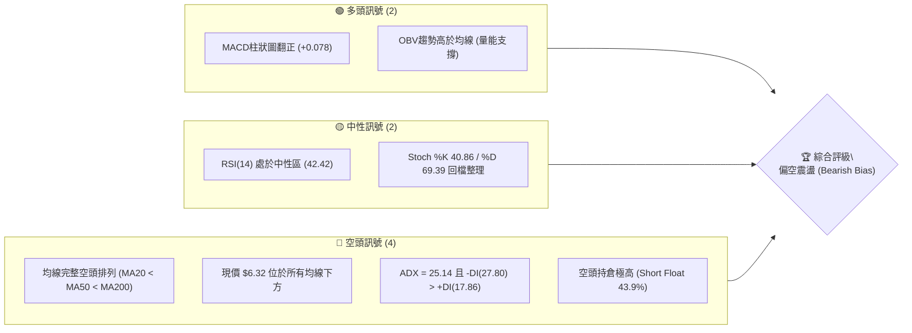
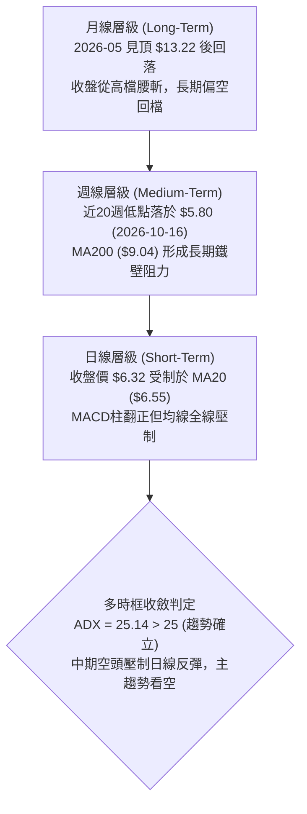
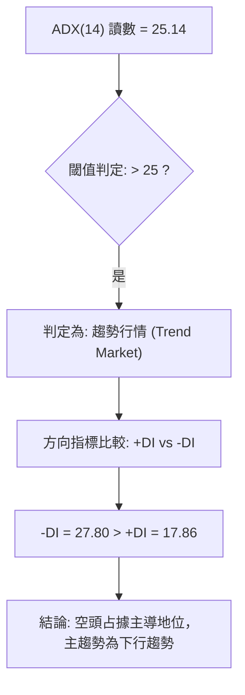
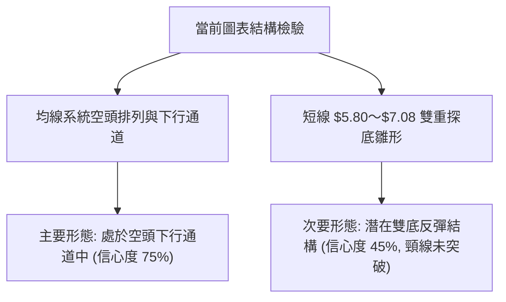
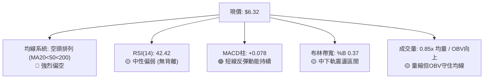
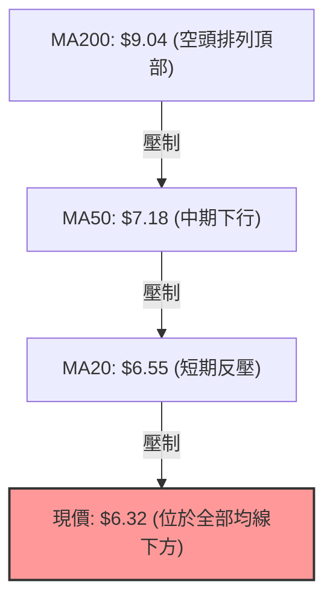
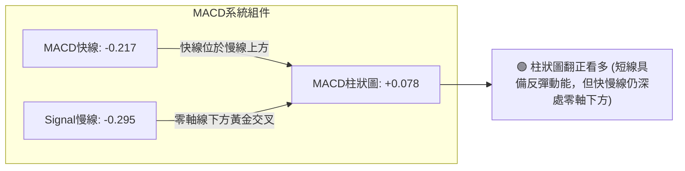
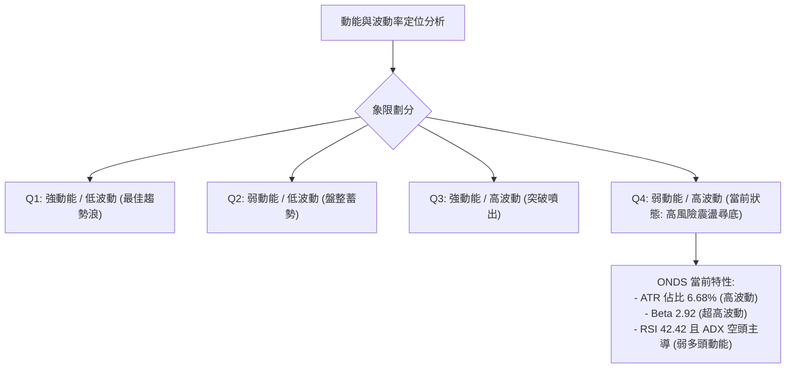
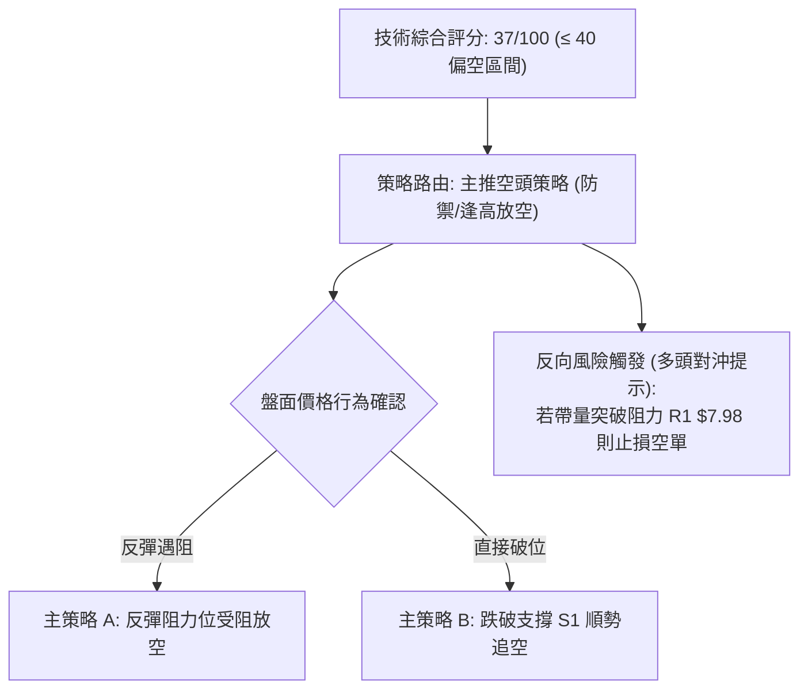
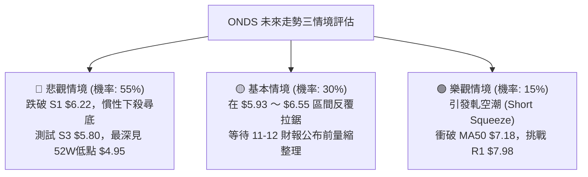

# ONDS 技術分析報告

> **報告日期**：2026-11-02 ｜ **語言**：繁體中文 ｜ **數據來源**：Yahoo Finance ｜ **當前價格**：$6.32

---

## 目錄

| 章節 | 內容 |
|------|------|
| [1. 技術面概覽](#1-技術面概覽) | 訊號儀表板、核心指標、評分卡 |
| [2. 趨勢分析](#2-趨勢分析) | 多時框趨勢、長中短期走勢 |
| [3. 圖表形態分析](#3-圖表形態分析) | 形態識別、K線組合、目標價 |
| [4. 支撐與阻力](#4-支撐與阻力) | 關鍵價位、斐波那契回調 |
| [5. 技術指標深度解讀](#5-技術指標深度解讀) | MA/RSI/MACD/布林/成交量 |
| [6. 動能與波動率](#6-動能與波動率) | 動能評估、ATR、Beta |
| [7. 多時框架總結](#7-多時框架總結) | 時框架評分矩陣 |
| [8. 交易策略建議](#8-交易策略建議) | 多空策略、風險報酬比 |
| [9. 風險提示與監控](#9-風險提示與監控) | 監控指標、風險場景 |

---

## 1. 技術面概覽

### 🎯 技術訊號儀表板



### 📊 核心指標速覽表

| 指標類別 | 指標名稱 | 當前數值 | 訊號 | 解讀 |
|----------|----------|----------|------|------|
| **價格** | 當前收盤價 | $6.32 | 🔴 | 位於52週區間 13.3%，貼近年度低檔區 |
| **均線** | MA20 | $6.55 | 🔴 | 價格位於 MA20 下方 -3.53%，短期均線下彎 |
| **均線** | MA50 | $7.18 | 🔴 | 價格位於 MA50 下方 -11.98%，中期阻力沉重 |
| **均線** | MA200 | $9.04 | 🔴 | 價格遠低於長期牛熊分界線 (-30.09%) |
| **動能** | RSI(14) | 42.42 | 🟡 | 位於中性偏弱區間，未觸及超賣 (<30) |
| **動能** | MACD Hist | +0.078 | 🟢 | MACD(-0.217) > Signal(-0.295)，柱狀圖翻正看多 |
| **趨勢** | ADX (14) | 25.14 | 🔴 | ADX>25 呈現趨勢行情，-DI(27.80) 主導空頭趨勢 |
| **通道** | 布林 %B | 0.37 | 🟡 | 位於中軌($6.55)與下軌($5.65)之間震盪 |
| **波動** | ATR(14) | $0.42 | 🔴 | 佔股價 6.68%，屬於極高日內波動標的 |

### 🏆 技術評分卡

```
技術評分卡 — ONDS (2026-11-02)
════════════════════════════════════════════════════
趨勢強度      ██████░░░░░░░░░░░░░░  30/100  🔴 空頭主導 (ADX 25.14, -DI 27.80)
動能指標      ██████████░░░░░░░░░░  50/100  🟡 中性偏弱 (RSI 42.42, MACD柱轉正)
支撐穩定度    ████████░░░░░░░░░░░░  40/100  🔴 逼近 S1 $6.22，低檔防線受考驗
成交量配合    ██████████░░░░░░░░░░  50/100  🟡 量能略縮 (量比 0.85x)，OBV仍守均線
形態完整度    ██████░░░░░░░░░░░░░░  30/100  🔴 均線反壓沉重，反轉底型未確認
均線排列      ████░░░░░░░░░░░░░░░░  20/100  🔴 嚴格空頭排列 (MA20<MA50<MA200)
════════════════════════════════════════════════════
綜合評分      ███████░░░░░░░░░░░░░  37/100  🔴 空頭防禦 (嚴格依六項算術平均四捨五入)
════════════════════════════════════════════════════
```

---

## 2. 趨勢分析

### 🌐 多時框趨勢分析



### 📈 長期趨勢 — 12個月走勢圖（Unicode）

```
ONDS 月線走勢圖（過去12個月：2025-11 至 2026-10）
價格軸 ($)
$13.22 ┤                                      ● (2026-05 高點)
$12.00 ┤                                     / \
$10.50 ┤                     ●        ●     /   \
$9.00  ┤               ●      \  ●   / \   /     \
$7.50  ┤         ●             \    /   \ /       ●───●───●
$6.32  ┤  ●─────────────────────────────────────────────────● (現在 2026-10: $6.32)
$4.95  ┤                                                      (52W Low: $4.95)
       └───────────────────────────────────────────────────────
          11   12   01   02   03   04   05   06   07   08   09   10  (月份)
```

**走勢特徵分析表格**：

| 階段 | 時間區間 | 起始價 → 結束價 | 漲跌幅 | 走勢特徵與量價結構 |
|------|----------|-----------------|--------|--------------------|
| 主升浪攻擊 | 2025-11 ～ 2026-01 | $7.90 → $10.36 | +31.14% | 突破個位數大關，多頭買盤強勁推升 |
| 高檔高原震盪 | 2026-01 ～ 2026-04 | $10.36 → $10.04 | -3.09% | 圍繞 $10.00 大關進行高檔籌碼換手 |
| 爆發衝頂噴出 | 2026-04 ～ 2026-05 | $10.04 → $13.22 | +31.67% | 52週高點 $15.28 於此階段盤中創出，月線收 $13.22 |
| 空頭高檔崩跌 | 2026-05 ～ 2026-06 | $13.22 → $8.24 | -37.67% | 巨量長黑回吐全部噴出利潤，反轉確立 |
| 陰跌下行尋底 | 2026-06 ～ 2026-10 | $8.24 → $6.32 | -23.30% | 均線轉為空頭排列，逐波下探至 $5.80 支撐 |

### 📊 中期趨勢（週線分析）

從近20週數據觀察，ONDS 在 2026-07-24 爆出 8.34 億股週成交量反彈至 $7.80，隨後於 2026-08-14 見 $9.24 波段高點後無力上攻。9月下旬起，週K線連續下行，於 2026-10-16 創出 $5.80 波段低點（收盤 $6.04）。近兩週呈現低檔縮量弱勢反彈，但受制於 7.00～7.50 密集套牢區。

```
ONDS 週線層級關鍵壓力與支撐示意圖
價格 ($)
 $9.04 ═══════════════════════════════════════════ MA200 長期牛熊分界 (超強反壓)
 $7.98 ─────────────────────────────────────────── R1 (波段阻力聚類 / 斐波 78.6% $7.16 上方)
 $7.18 ------------------------------------------- MA50 中期下行壓力線
 $6.55 ........................................... MA20 / BB中軌 (短線爭奪線)
 $6.32 ◄═════ 現價 (位於所有均線下方)
 $6.22 ------------------------------------------- S1 (近期波段低點聚類)
 $5.80 ═══════════════════════════════════════════ S3 / 2026-10-16 週低點 (強支撐)
 $4.95 ═══════════════════════════════════════════ 52W 低點 (終極防線)
```

### ⚡ 趨勢強度評估（ADX 解讀）



**ADX 趨勢強度對照表**：

| 指標變數 | 當前數值 | 評估標準 | 解讀結論 |
|----------|----------|----------|----------|
| **ADX (14)** | 25.14 | 25～50：具備明確趨勢 | 行情脫離純橫盤整理，空頭趨勢力量已越過強弱分界線 |
| **+DI (14)** | 17.86 | 數值偏低 (<20) | 多頭買盤力道貧弱，無法形成持續推進浪 |
| **-DI (14)** | 27.80 | 顯著高於 +DI (+9.94) | 空方完全掌控盤面節奏，反彈多屬技術性修正 |

---

## 3. 圖表形態分析

### 🔍 形態識別系統



**圖表形態識別與信心度評估表**（依規則 15）：

| 形態 | 信心度 | 判斷依據（引用數據） | 完成度 | 目標價（附計算式） |
|------|--------|----------------------|--------|--------------------|
| **空頭下行通道** | 75% | 高點由 $10.08 下移至 $8.24, $7.66, $7.33，均線空頭排列 | 85% | 維持空頭指向，通道下軌朝向 S3 $5.80 延伸 |
| **潛在雙底 (W底)** | 45% | 2026-10-16 低點 $5.80 與 10-20 低點 $5.88 構成雙低點聚類 | 35% | 頸線取 2026-10-29 高點 $7.08。若突破：$7.08 + ($7.08 − $5.80) = $8.36（接近阻力 R2 $8.58）。因信心度 < 50%，暫不視為有效形態 |
| **布林通道下軌反抽** | 60% | 股價自下軌 $5.65 附近反彈至 %B 0.37，受阻於中軌 $6.55 | 70% | 指標型反抽，短線受制中軌 $6.55，突破則測上軌 $7.46 |

### 🕯️ 重要K線形態分析

嚴格依據數據中「近10根日K」與「近8根週K」之開高低收進行客觀辨識：

**近10根日K線形態分析表**：

| 日期（日K） | 開 | 高 | 低 | 收 | K線形態 | 解讀 | 訊號 |
|-------------|----|----|----|----|---------|------|------|
| 2026-10-19 | 6.20 | 6.28 | 6.01 | 6.06 | 黑K實體 | 跌破前低支撐，延續弱勢探底 | 🔴 |
| 2026-10-20 | 5.93 | 6.33 | 5.88 | 6.10 | 下影紅K星 | 探測 $5.88 後拉升收紅，短線買盤進駐 | 🟡 |
| 2026-10-21 | 6.21 | 6.37 | 6.09 | 6.27 | 溫和中紅K | 伴隨成交量放大至 4,393 萬股，反彈延續 | 🟢 |
| 2026-10-22 | 6.11 | 6.34 | 5.89 | 6.02 | 陰線吞噬 | 高開低走跌回 $6.02，多頭攻勢受挫 | 🔴 |
| 2026-10-23 | 5.99 | 6.35 | 5.89 | 6.20 | 下影長紅K | 第三次測試 $5.89 獲支撐，低檔買盤頑強 | 🟢 |
| 2026-10-26 | 6.17 | 6.32 | 6.04 | 6.16 | 窄幅十字星 | 成交量縮至 3,094 萬股，多空觀望對峙 | 🟡 |
| 2026-10-27 | 6.21 | 6.69 | 6.16 | 6.65 | 放量突破大紅K | 實體貫穿 MA20，量能擴增至 4,786 萬股 | 🟢 |
| 2026-10-28 | 6.69 | 6.88 | 6.56 | 6.86 | 強勢長紅K | 成交量增至 5,185 萬股，連續推升攻勢 | 🟢 |
| 2026-10-29 | 6.74 | 7.08 | 6.74 | 6.88 | 長上影倒錘K | 盤中衝擊 $7.08 遇沉重拋壓回落，見波段頂 | 🔴 |
| 2026-10-30 | 6.46 | 6.60 | 6.18 | 6.32 | 中陰線跳空下殺 | 跌破 MA20 ($6.55)，吞噬前三日漲幅，短多力竭 | 🔴 |

**近8根週K線形態分析表**：

| 日期（週K） | 開 | 高 | 低 | 收 | K線形態 | 解讀 | 訊號 |
|-------------|----|----|----|----|---------|------|------|
| 2026-09-11 | 7.61 | 7.88 | 7.14 | 7.23 | 中黑K棒 | 跌破 $7.50，中期弱勢成型 | 🔴 |
| 2026-09-18 | 6.99 | 7.53 | 6.98 | 7.39 | 下影長紅K | 7元關卡見支撐買盤回補 | 🟢 |
| 2026-09-25 | 7.51 | 7.98 | 7.18 | 7.64 | 衝高回落小紅 | 受阻於阻力 R1 $7.98，量增但漲幅受限 | 🟡 |
| 2026-10-02 | 7.53 | 7.91 | 7.12 | 7.24 | 長上影流星陰K | 再次挑戰 $7.91 失敗，空方全面反撲 | 🔴 |
| 2026-10-09 | 7.62 | 7.69 | 6.64 | 6.73 | 大黑K破位跌 | 重挫跌破 $7.00 整數防線 | 🔴 |
| 2026-10-16 | 7.06 | 7.08 | 5.80 | 6.04 | 探底長下影黑K | 創近半年低點 $5.80，爆量下影線 | 🔴 |
| 2026-10-23 | 6.20 | 6.37 | 5.88 | 6.20 | 縮量十字星 | 成交量縮至 1.79 億股，低檔初步止跌 | 🟡 |
| 2026-10-30 | 6.17 | 7.08 | 6.04 | 6.32 | 帶長上影紡錘K | 上探 $7.08 遭均線反壓壓回收於 $6.32 | 🔴 |

### 📉 ASCII 走勢形態示意圖

```
ONDS 近10日日K走勢示意圖（衝高受阻回落形態）
價格 ($)
$7.08 ┤                  ▲ (10-29 衝高 $7.08 倒錘線)
$6.88 ┤               ┌─┐│
$6.65 ┤            ┌─┐│ ││ ┌─┐
$6.55 ┼────────────│─┼│─┼│─┼─┼───── MA20 阻力線 ($6.55)
$6.32 ┤      ┌─┐   │ ││ ││ │ ◄現價 (10-30 收黑 $6.32)
$6.20 ┤   ┌─┐│ │┌─┐│ ││ │└─┘
$6.02 ┤┌─┐│ ││ ││ ││ ││ │
$5.88 ┼┴─┴┴─┴┴─┴┴─┴┴─┴┴─┴────────── 低檔支撐區 ($5.88～$5.89)
       19 20 21 22 23 26 27 28 29 30 (十月交易日)
```

### 🎯 形態目標價計算

根據上述形態識別：
1. **空頭通道目標價**：通道上軌在 MA50 ($7.18) 至 R1 ($7.98) 形成天花板，下軌指向支撐位 S3 **$5.80**，若失守則指向 52週低點 **$4.95**。
2. **潛在雙底推算式（指標參考，信心度僅 45%）**：
   - 雙底頸線：2026-10-29 盤中高點 = **$7.08**
   - 底部支撐：2026-10-16 波段低點 = **$5.80**
   - 形態高度：$7.08 − $5.80 = $1.28
   - 突破目標價：$7.08 + $1.28 = **$8.36**（接近數據阻力位 R2 $8.58）
   - **判定**：由於 10-30 日K已大跌收在 $6.32，跌回頸線之下且破 MA20，雙底突破未獲確認，形態不成立。

---

## 4. 支撐與阻力

### 🗺️ 關鍵價位分布圖（Unicode）

```
ONDS 價位結構分布圖
═══════════════════════════════════════════════════
$9.92 ║████████████████████████║ 強阻力 R3 (+57.04%)
$9.04 ║▓▓▓▓▓▓▓▓▓▓▓▓▓▓▓▓▓▓▓▓    ║ MA200 牛熊分界線
$8.58 ║████████████████████    ║ 阻力 R2 (+35.76%)
$7.98 ║████████████████████████║ 關鍵阻力 R1 (+26.27%)
$7.18 ║▓▓▓▓▓▓▓▓▓▓▓▓            ║ MA50 中期下行反壓
$6.55 ║▒▒▒▒▒▒▒▒▒▒              ║ MA20 / BB中軌 短線反壓
$6.32 ╠════════════════════════╣ ◄ 現價 ($6.32)
$6.22 ║▓▓▓▓▓▓▓▓▓▓▓▓▓▓▓▓        ║ 近期支撐 S1 (-1.58%)
$5.93 ║████████████████        ║ 次級支撐 S2 (-6.17%)
$5.80 ║████████████████████████║ 強支撐 S3 (-8.31%)
$4.95 ║████████████████████████║ 52W 低點終極支撐 (-21.68%)
═══════════════════════════════════════════════════
```

### 🚧 阻力位分析表

所有阻力價位嚴格引用自數據之「關鍵價位」與均線系統：

| 阻力級別 | 價位 | 形成原因 | 突破難度 | 重要性 |
|----------|------|----------|----------|--------|
| **短期阻力 (MA20)** | $6.55 | 20日均線與布林通道中軌重合點 | 中等 | 短線轉強第一道門檻，10-30 已跌破 |
| **關鍵阻力 R1** | $7.98 | 近一年波段高點聚類（2026-09-25 週高點 $7.98） | 極高 | 多頭反轉的生命線，距離現價 +26.27% |
| **阻力 R2** | $8.58 | 波段次高聚類與斐波 61.8% ($8.90) 前哨 | 極高 | 需巨量配合方可攻克，距離現價 +35.76% |
| **強阻力 R3** | $9.92 | 近一年密集頭部換手區（接近 $10 整數關卡） | 超高 | 中長期重大反壓，距離現價 +57.04% |

### 🛡️ 支撐位分析表

所有支撐價位嚴格引用自數據之「關鍵價位」：

| 支撐級別 | 價位 | 形成原因 | 守住機率 | 重要性 |
|----------|------|----------|----------|--------|
| **近期支撐 S1** | $6.22 | 近一年波段低點聚類，貼近目前價格 | 55% | 跌破將引發新一輪短線停損賣壓 |
| **次級支撐 S2** | $5.93 | 2026-10-20 開盤價與下影線買盤聚類 | 65% | 整數關卡 $6.00 下方的緩衝防線 |
| **強支撐 S3** | $5.80 | 2026-10-16 週K最低點，近期大底聚類 | 75% | 多頭退無可退的中期防線，距離現價 -8.31% |
| **終極支撐 (52W Low)**| $4.95 | 52週歷史最低點（斐波那契 100.0%） | 85% | 跌破將進入無支撐的深水區 |

### 📐 斐波那契回調位分析

依據 52週區間最低點 **$4.95** 至最高點 **$15.28** 嚴格計算之回調位分布如下：

| 斐波那契回調比例 | 對應價位 | 與現價 ($6.32) 相對位置 | 技術面解讀 |
|------------------|----------|------------------------|------------|
| 0.0% (52W High) | $15.28 | +141.77% | 歷史高點，長期極限壓力位 |
| 23.6% | $12.84 | +103.16% | 極度強勢區間分界線 |
| 38.2% | $11.33 | +79.27% | 多頭強弱分水嶺 |
| 50.0% | $10.11 | +59.97% | 半數回吐位，整數關卡重要心理線 |
| 61.8% | $8.90 | +40.82% | 黃金分割強壓力（與 MA200 $9.04 形成共振區）|
| 78.6% | $7.16 | +13.29% | 深幅回調分界線（與 MA50 $7.18 形成共振區）|
| **現價落點** | **$6.32** | — | **落在 78.6% ($7.16) 與 100.0% ($4.95) 之間** |
| 100.0% (52W Low) | $4.95 | -21.68% | 52週波段起漲點，終極底部防線 |

**解讀**：現價 $6.32 已跌破斐波那契 78.6% 極限回調位 ($7.16)，這意味著自 $4.95 至 $15.28 的一整年牛市推升浪已經受到極度嚴重的破壞。若無法迅速收復 $7.16，股價將朝向 100.0% 回調位 **$4.95** 尋求最終支撐。

---

## 5. 技術指標深度解讀

### 🎛️ 指標訊號總覽



### 📈 移動平均線排列分析



**移動平均線系統詳細數據追蹤表**：

| 均線名稱 | 數值 | 與現價差距 ($) | 差距百分比 | 均線走勢圖與斜率解讀 | 訊號評估 |
|----------|------|----------------|------------|----------------------|----------|
| **MA 5** | $6.57 | -$0.25 | -3.86% | ▇▇███████▇▇ (微幅拐頭向上後受挫) | 🔴 短線翻空 |
| **MA 10** | $6.35 | -$0.03 | -0.50% | ▇▇█████████ (貼平現價附近) | 🟡 爭奪之中 |
| **MA 20** | $6.55 | -$0.23 | -3.53% | ████▇▇▇▇▆▆ (持續下行中) | 🔴 短期阻力 |
| **MA 60** | $7.51 | -$1.19 | -15.83% | █████████▇▇ (斜率陡峭向下) | 🔴 中期反壓 |
| **MA 120**| $8.21 | -$1.89 | -23.04% | ███████▇▇▆▆ (中長期下行) | 🔴 籌碼深套 |
| **MA 240**| $9.09 | -$2.77 | -30.49% | █▇▆▅▅▄▃▂▁ (牛熊大週期反壓) | 🔴 長期走熊 |

### 📉 RSI(14) 分析

- **當前讀數**：42.42（Wilder 計算）
- **動能強度進度條**：
  ```
  RSI(14) 強度：████████░░░░░░░░░░░░  42.42/100 (中性弱勢區)
  [0 ── 超賣區 ── 30 ────── 現價 42.42 ────── 70 ── 超買區 ── 100]
  ```
- **區間評估**：數值介於 30 至 70 之間，尚未進入 <30 的超賣極端區，意味著空頭拋售雖然減緩，但尚未引發具備力道的超賣抄底盤。
- **背離檢驗結論**：
  - **嚴格檢驗**：比較近20根K棒首尾（價格由 $7.24 跌至 $6.32，RSI 由 42.5 降至 42.42），兩者均呈現同步下滑或低檔鈍化。
  - **結論**：**無明顯背離（無頂背離、無底背離）**，價格下跌受到技術動能支持，不存在虛假破位或量能衰竭反轉現象。

### 📊 MACD(12/26/9) 訊號解讀



- **MACD 線**：-0.217
- **訊號線 (Signal)**：-0.295
- **柱狀圖 (Histogram)**：**+0.078**（綠色看多柱體）
- **深層解讀**：雖然 MACD 柱狀圖維持為正（+0.078），顯示日線級別具備超跌修復動能，但快慢線皆深陷於零軸下方（< 0），這在技術分析中屬於典型的「水下金叉」。水下金叉通常只帶來弱勢反彈，遇到均線反壓容易再次夭折，不可盲目視為牛市反轉。

### 📦 布林通道分析

```
布林通道結構示意圖 (Bandwidth: $5.65 ～ $7.46)
價格 ($)
$7.46 ┼──────────────────────────────── 上軌 (強阻力區)
$7.00 ┤                   
$6.55 ┼──────────────────────────────── 中軌 (MA20 短線分界)
$6.32 ┤              ▲ 現價 ($6.32, %B = 0.37)
$6.00 ┤        
$5.65 ┼──────────────────────────────── 下軌 (動態支撐區)
```

- **BB 上軌**：$7.46
- **BB 中軌 (MA20)**：$6.55
- **BB 下軌**：$5.65
- **BB %B 數值**：**0.37**（計算式：($6.32 − $5.65) ÷ ($7.46 − $5.65) = $0.67 ÷ $1.81 ≈ 0.37）
- **通道狀態分析**：當前 %B 為 0.37，顯示股價在中軌與下軌之間徘徊，偏向弱勢區運行。10-29 股價曾試圖上衝中軌上方，但 10-30 立即遭空方擊退回到中軌下方，布林帶寬未呈現張口擴張，處於中等收斂震盪。

### 💹 成交量分析（量價配合度）

- **最新成交量**：41,033,000 股
- **20日均量**：48,446,340 股（量比：**0.85x**，呈現量縮）
- **50日均量**：55,937,824 股（長期成交動能遞減）
- **OBV 能量潮解讀**：數據顯示「OBV > MA → 量能支撐上漲」。這代表儘管近期價格逐波走低，但近幾日反彈過程中（如 10-27 至 10-29 連續放量至 4,700～5,100 萬股）有部分資金低接吸收籌碼，OBV 曲線維持在自身均線之上。
- **量價背離檢驗**：10-30 日K線大跌至 $6.32，成交量縮減至 4,103 萬股（低於前兩日），顯示此波殺跌並非恐慌性無序拋售，但買盤承接意願不足，形成「縮量陰跌」格局。

---

## 6. 動能與波動率

### ⚡ 動能評估四象限



**動能評估四象限對照表**：

| 象限 | 動能維度 | 波動維度 | 標的落點 | 戰略評估 |
|------|----------|----------|----------|----------|
| **第一象限 (Q1)** | 強（多頭） | 低 | — | 穩定單邊上漲，最佳持倉階段 |
| **第二象限 (Q2)** | 弱 | 低 | — | 狹幅無序整理，觀望為主 |
| **第三象限 (Q3)** | 強（突破） | 高 | — | 暴利暴虧階段，適合順勢突破單 |
| **第四象限 (Q4)** | **弱（空頭主導）** | **高 (ATR 6.68%)** | **✓ ONDS** | **極高下行風險，反彈脆弱，應嚴格控管倉位** |

### 📊 ATR 波動率分析

- **ATR(14) 絕對數值**：**$0.42**
- **波動率佔比 (Wilder)**：**6.68%** of price
- **日內波動特徵**：股價單日正常跳動區間即達 $0.42，代表在 $6.32 的價格下，單日波幅超過 6% 為常態。
- **風控止損距離建議**：
  - **一般波段止損**：設定為 1.5 倍 ATR = 1.5 × $0.42 = **$0.63**。
  - **緊密防守止損**：設定為 1.0 倍 ATR = 1.0 × $0.42 = **$0.42**。
  - **應用於現價**：若以現價 $6.32 建立防禦，多頭止損點必須設於 $6.32 − $0.42 = **$5.90** 之下（與支撐位 S2 $5.93 高度吻合）。

### 📐 Beta 與市場相關性

- **Beta 數值**：**2.922**
- **市場敏感度解讀**：ONDS 屬於極高波動的高 Beta 股票（接近大盤 3 倍彈性）。當大盤納斯達克或標普500指數波動 1% 時，該股理論上將產生近 3% 的放大波動。
- **做空比率警示**：目前 **Short % Float 高達 43.9%**，Short Ratio 為 4.11。超高做空比例意味著空頭力量盤踞，但在特定利多刺激下，極易引發劇烈的軋空（Short Squeeze）暴衝行情，呈現暴漲暴跌的不穩定特性。

---

## 7. 多時框架總結

### 📋 時框架評分表

| 時框架 | 趨勢方向 | 動能 | 均線排列 | 形態 | 綜合評分 | 建議 |
|--------|----------|------|----------|------|----------|------|
| **短期 (日線)** | 空頭回檔 | 弱勢反彈中受阻 | 空頭排列 (MA20 反壓) | 倒錘黑K破位 | 35/100 | 反彈減碼 / 順勢輕倉偏空 |
| **中期 (週線)** | 下行尋底 | RSI 42.4，量縮 | 均線下彎，失守 MA50 | 空頭通道整理 | 40/100 | 嚴禁盲目抄底，等待底部確立 |
| **長期 (月線)** | 牛轉熊回撤 | 高檔腰斬回吐 | 股價跌落 MA200 下方 | 跌破斐波 78.6% | 35/100 | 長期籌碼套牢沉重，防禦為上 |

### 🔲 綜合訊號矩陣

| 維度 | 短期 (日線) | 中期 (週線) | 長期 (月線) | 多時框一致性 |
|------|-------------|-------------|-------------|--------------|
| **趨勢方向** | 🔴 偏空 | 🔴 偏空 | 🔴 偏空 | **高（全維度空頭指向）** |
| **均線支撐/阻力**| 🔴 承壓 MA20 | 🔴 承壓 MA50 | 🔴 遠低於 MA200 | **高（層層均線天花板）** |
| **量價結構** | 🟡 縮量回跌 | 🟡 週成交量收縮 | 🔴 月線高檔巨量回落 | **中偏空（追價動能匱乏）** |
| **指標動能** | 🟢 MACD柱正 | 🔴 RSI 低檔徘徊 | 🔴 遠離歷史高檔 | **低（短線微幅超跌修復，中長期深陷空頭）** |

### ⚖️ 多時框收斂結論

嚴格依據**規則 14 多時框收斂優先級**進行收斂判定：
1. **行情性質判定**：當前 ADX(14) = **25.14**（越過 25 臨界線），且 -DI(27.80) 顯著大於 +DI(17.86)，依規則嚴格定義為**「趨勢行情」**，而非單純無序盤整。
2. **時框優先級權重**：在趨勢行情下，中長期時框（週線下行通道、MA50 $7.18 下彎、MA200 $9.04 鐵壁反壓）佔據絕對支配地位；日線級別的 MACD 柱狀圖翻正（+0.078）僅能視為空頭主趨勢中的技術性弱反彈。
3. **最終收斂結論**：**🔴 偏空防禦（Bearish Bias）**。日線的反彈無法對抗週線與月線層級的空頭壓制，任何反彈接近均線阻力區皆為空方主導的高拋機會。此結論與第 1 章評分卡（37分）完全一致，並作為第 8 章策略構建的唯一基準。

---

## 8. 交易策略建議

### 🗺️ 策略決策流程圖



### 🧭 策略路由（依評分卡分流）

> **當前主策略方向 = 🔴 主推空頭策略（依技術評分卡綜合評分 37/100，處於 ≤40 偏空防禦區）**
> 
> *註：依規定多頭策略不作為主推，僅在下方「反向風險觸發點」中列出多頭關鍵對沖條件。*

### 🎯 價格情境階梯（Price Scenarios）

所有價位均嚴格引用自第 4 章「關鍵價位」區塊之客觀數值：

| 觸發條件 | 下一目標 | 後續延伸 | 情境含義 |
|----------|----------|----------|----------|
| **反彈受阻於 MA20 / R1** | 回測支撐 S1 **$6.22** | 探測支撐 S2 **$5.93** | 空頭均線壓制有效，重回跌勢 |
| **直接摜破 S1 $6.22** | 下探支撐 S2 **$5.93** | 測試強支撐 S3 **$5.80** | 下行趨勢加速，尋求下軌支撐 |
| **有效跌破 S3 $5.80** | 探測 52W 低點 **$4.95** | 創歷史新低 | 破位深幅回檔，空方全面大勝 |
| **帶量向上突破 R1 $7.98** | 挑戰阻力 R2 **$8.58** | 衝擊阻力 R3 **$9.92** | 軋空爆發，空頭架構遭徹底瓦解 |

### 📊 情境機率分佈

| 情境 | 機率 | 主要依據 |
|------|------|----------|
| **回落 / 再探底 (熊市延續)** | **55%** | 均線空頭排列，ADX=25.14 空頭趨勢確立，Short Float 43.9% 盤面沉重 |
| **區間震盪 (S1～MA20 盤整)** | **30%** | RSI 42.42 處於中性區，MACD 柱翻正 (+0.078)，低檔有零星買盤護盤 |
| **強勢反彈 / 反轉破阻** | **15%** | 需克服 MA50 ($7.18) 與 R1 ($7.98) 巨大套牢帶，除非引發劇烈軋空否則難以達成 |

### 🟢 主策略詳情（方向：主推空頭策略）

*風險報酬比嚴格依規則 17 計算：做空時風險報酬比 = (進場價 − 目標價 T1) ÷ (止損價 − 進場價)*

| 策略要素 | 策略 A（反彈高空） | 策略 B（破位追空） |
|----------|-------------------|-------------------|
| **交易邏輯** | 股價弱勢反抽 MA20/BB中軌受阻建立空單 | 跌破波段低點聚類 S1 順勢加碼做空 |
| **進場條件** | 反彈至 $6.55 遇阻回落，或現價 $6.32 輕倉布局 | 日K收盤跌破 S1 $6.22 確認失守 |
| **進場價格** | **$6.55**（MA20 阻力位） | **$6.20**（跌破 S1 $6.22 後入場） |
| **目標價 T1** | **$5.93**（支撐位 S2） | **$5.80**（強支撐位 S3） |
| **目標價 T2** | **$5.80**（強支撐位 S3） | **$4.95**（52W Low 終極支撐） |
| **止損價格** | **$6.86**（突破 10-28 實體高點） | **$6.40**（重返 S1 之上並突破日內高點） |
| **風險報酬比** | **1 : 2.00（以 T1 計）**<br/>計算式：($6.55 − $5.93) ÷ ($6.86 − $6.55) = $0.62 ÷ $0.31 = 2.00<br/>*(以 T2 計則為 1 : 2.42)* | **1 : 2.00（以 T1 計）**<br/>計算式：($6.20 − $5.80) ÷ ($6.40 − $6.20) = $0.40 ÷ $0.20 = 2.00<br/>*(以 T2 計則為 1 : 6.25)* |
| **成功機率** | **60%** | **55%** |
| **建議倉位** | **10%**（總資金部位） | **5%**（突破確認後執行） |

### 🔴 反向風險觸發點（對沖提示）

若出現以下情境，將徹底推翻當前偏空判斷，空單必須無條件止損離場，並可轉為短多對沖：
1. **關鍵點位觸發**：股價強勢收復 MA50 (**$7.18**)，進一步放量突破阻力位 R1 (**$7.98**)。
2. **量價訊號觸發**：單日成交量爆出 1 億股以上（逾 20日均量 2倍），且日K收出大陽線封死高點。
3. **軋空訊號觸發**：高達 43.9% 的空頭浮額若遭遇機構集中回補，價格將脫離技術指標呈拋物線飆升。

### ⭐ 整體訊號強度評星

```
做多訊號強度：★★☆☆☆  (2/5星 - 僅有水下MACD柱翻正，上方阻力重重)
做空訊號強度：★★★★☆  (4/5星 - 均線空頭排列，趨勢強度ADX>25確立)
整體可信度：  ★★★★☆  (4/5星 - 多時框趨勢具備高度收斂性)
```

---

## 9. 風險提示與監控

### ✅ 關鍵監控指標 Checklist

```
╔══════════════════════════════════════════════════════════════════╗
║               ONDS 技術面日常風控監控清單 (Checklist)            ║
╠══════════════════════════════════════════════════════════════════╣
║ [ ] 價格防線監控：現價 $6.32 是否跌破 S1 $6.22 與 S3 $5.80     ║
║ [ ] 均線動態監控：每日收盤是否依然壓制在 MA20 ($6.55) 之下      ║
║ [ ] 趨勢指標檢驗：ADX(14) 是否持續高於 25 且 -DI 維持在上       ║
║ [ ] 動能背離觀察：日K線破底時 RSI 是否跌破 30 或出現底背離      ║
║ [ ] 異常放量警報：成交量是否突發超越 5,000 萬股（異常軋空預警） ║
║ [ ] 財報事件倒數：2026-11-12 Q3 財報公布前之期權隱含波動變化   ║
╚══════════════════════════════════════════════════════════════════╝
```

### ⚠️ 風險場景分析



### 🛡️ 風險管理重要提醒

1. **財報事件風險（重大日曆風險）**：
   - 公司預計於 **2026-11-12** 開盤前公布 2026 年第三季財務業績。
   - 儘管近期營收同比增長 1235.4%，但營業利潤率為極度負值（最新季度 -166.3%），自由現金流為負（-$1.72億）。財報前後可能出現跳空缺口，技術指標將在財報瞬間失真，持倉應於財報前夕嚴格縮減至安全水準以下。
2. **軋空（Short Squeeze）與高 Beta 雙重風險**：
   - Beta 值高達 **2.922**，且做空比例達 **43.9%**。此類標的極端反彈往往迅速且暴力。任何參與空頭策略的交易者，**嚴禁不設止損裸空**，必須將單筆交易的最大虧損金額嚴格鎖定在總資金的 1%～2% 以內。
3. **日內波動（ATR）過大之部位規模調整**：
   - 該股每日 ATR 為 **$0.42**（高達股價的 6.68%）。在資金管理上，部位規模應相應調降。公式建議：`持股口數 = (總資金 × 1% 風險額) ÷ (1.5 × ATR)`，避免因正常的日內雜訊波動而被洗出場外。

---

## 📋 報告總結

```
ONDS 技術分析報告總結
════════════════════════════════════════════════════════
報告日期：2026-11-02
當前價格：$6.32
分析評級：🔴 偏空防禦 (綜合技術評分: 37/100)

關鍵結論：
├─ 長期趨勢：🔴 偏空回撤（高檔腰斬，失守斐波那契 78.6% $7.16）
├─ 中期趨勢：🔴 下行通道（受制於 MA50 $7.18 與 R1 $7.98）
├─ 短期趨勢：🔴 反彈受挫（10-30 日K跌破 MA20 $6.55）
├─ 關鍵支撐：S1 $6.22 ｜ S2 $5.93 ｜ S3 $5.80
├─ 關鍵阻力：MA20 $6.55 ｜ MA50 $7.18 ｜ R1 $7.98
└─ 分析師目標：均價 $18.88 (僅供參考，技術面嚴重脫節)

最優策略組合：
1. 🥇 最佳機會：策略 A — 反彈至 MA20 ($6.55) 受阻放空，
              目標 S2 ($5.93)，止損 $6.86，風報比 1 : 2.00
2. 🥈 次選機會：策略 B — 破位追空，跌破 S1 ($6.22) 追空至 S3 ($5.80)，
              目標價2 看 52W低點 ($4.95)，風報比 1 : 2.00
3. 🥉 保守選擇：完全空倉觀望，靜待 2026-11-12 財報公布及底部形態確立
════════════════════════════════════════════════════════
```

---

> ⚠️ **免責聲明**：本報告為 AI 自動生成之技術分析，所有數據及估算均基於提供的歷史價格資訊。本報告**僅供研究與學術參考**，**不構成任何投資建議**。投資有風險，入市需謹慎。

---

*報告生成時間：2026-11-02 ｜ 數據來源：Yahoo Finance ｜ 分析框架：多時框技術分析*