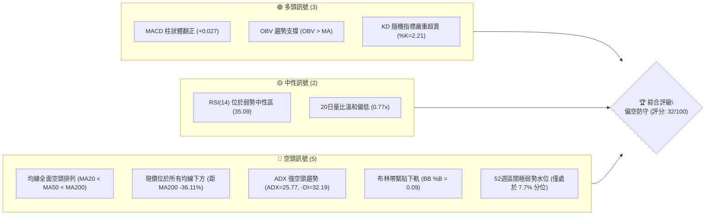
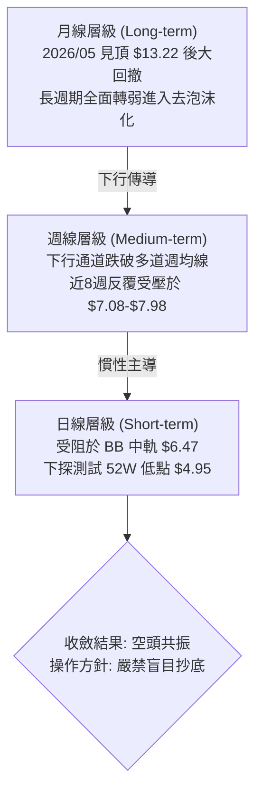
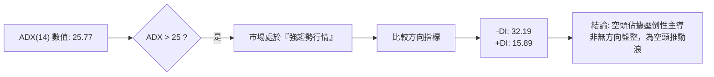
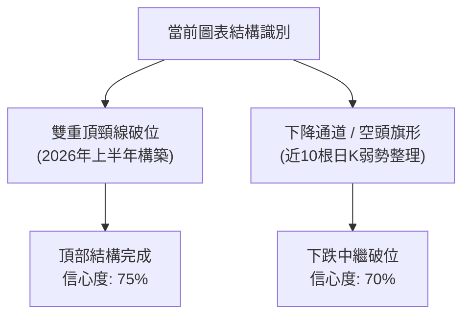
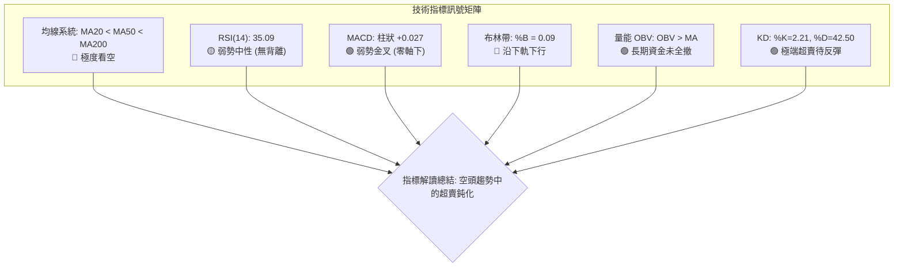
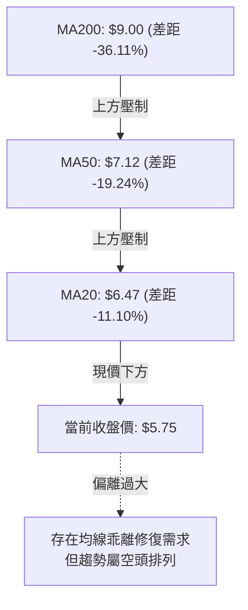
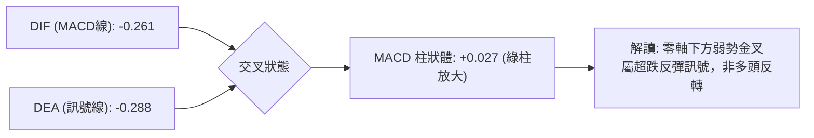
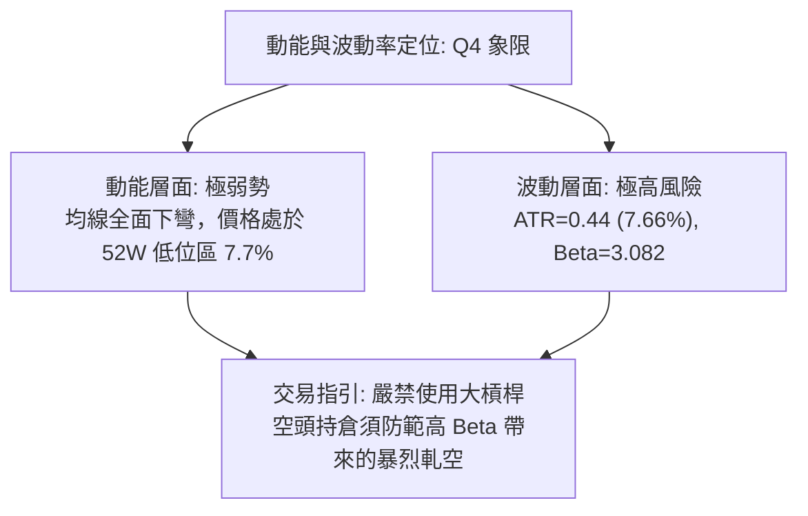
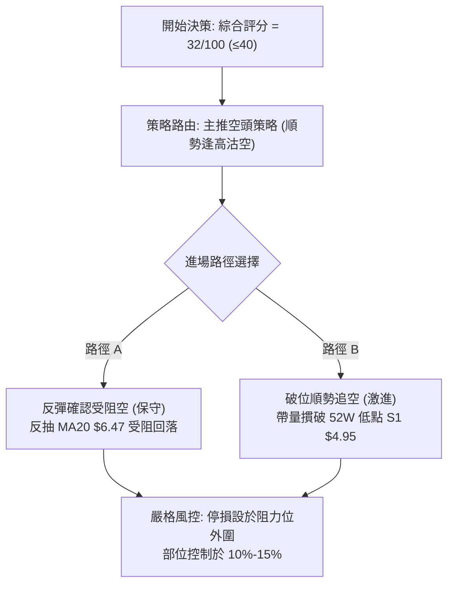
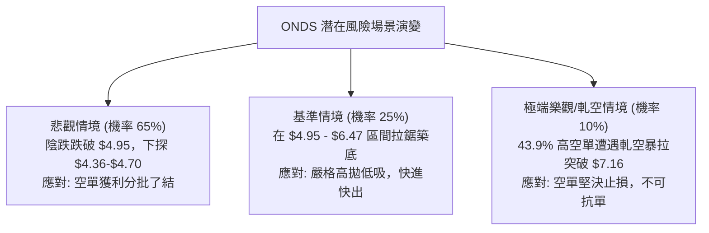

# ONDS 技術分析報告

> **報告日期**：2026-11-03 ｜ **語言**：繁體中文 ｜ **數據來源**：Yahoo Finance ｜ **當前價格**：$5.75

---

## 目錄

| 章節 | 內容 |
|------|------|
| [1. 技術面概覽](#1-技術面概覽) | 訊號儀表板、核心指標、評分卡 |
| [2. 趨勢分析](#2-趨勢分析) | 多時框趨勢、長中短期走勢、ADX 解讀 |
| [3. 圖表形態分析](#3-圖表形態分析) | 形態識別、K線組合、目標價推算 |
| [4. 支撐與阻力](#4-支撐與阻力) | 關鍵價位、斐波那契回調結構 |
| [5. 技術指標深度解讀](#5-技術指標深度解讀) | MA/RSI/MACD/布林/成交量量價解析 |
| [6. 動能與波動率](#6-動能與波動率) | 動能四象限、ATR 波動度、Beta 敏感度 |
| [7. 多時框架總結](#7-多時框架總結) | 時框架評分矩陣與收斂結論 |
| [8. 交易策略建議](#8-交易策略建議) | 策略路由、主策略、情境機率、風險報酬比 |
| [9. 風險提示與監控](#9-風險提示與監控) | 監控清單、風險情境與風控指引 |
| [10. 報告總結](#-報告總結) | 最終技術面結論與策略彙整 |

---

## 1. 技術面概覽

### 🎯 技術訊號儀表板



### 📊 核心指標速覽表

| 指標類別 | 指標名稱 | 當前數值 | 訊號 | 解讀 |
|----------|----------|----------|------|------|
| **價格** | 當前收盤價 | $5.75 | 🔴 | 位於52週區間極低位（7.7%），距52週低點 $4.95 僅差 13.91% |
| **均線** | 短期 MA20 | $6.47 | 🔴 | 價格低於 MA20 達 11.10%，短期下行趨勢明確 |
| **均線** | 中期 MA50 | $7.12 | 🔴 | 價格低於 MA50 達 19.24%，中期波段嚴重承壓 |
| **均線** | 長期 MA200 | $9.00 | 🔴 | 價格低於 MA200 達 36.11%，長期牛熊分界線失守形成強壓 |
| **動能** | RSI(14) | 35.09 | 🟡 | 位於 30–70 中性弱勢區，接近超賣邊界，首尾無顯著背離 |
| **動能** | MACD (12,26,9) | 柱狀: +0.027 | 🟢 | MACD線 (-0.261) 向上金叉訊號線 (-0.288)，出現微弱反彈雛形 |
| **動能** | 隨機 KD(14) | %K: 2.21 / %D: 42.50 | 🟢 | %K 跌至極端超賣區，隨時具備短線技術性超跌抽頭動能 |
| **趨勢** | ADX(14) | 25.77 (-DI: 32.19) | 🔴 | ADX > 25 確認為單邊趨勢行情，-DI 壓倒 +DI(15.89) 顯示空頭主導 |
| **通道** | 布林通道 | 寬度: $5.59–$7.34 | 🔴 | %B 為 0.09，價格極度貼近下軌 ($5.59)，空頭慣性擴張 |
| **量能** | 當日成交量 | 37,397,700 股 | 🟡 | 量比為 0.77x（低於20日均量 48.51M），下跌伴隨量縮整理 |
| **波動** | ATR(14) | $0.44 (7.66%) | 🔴 | 日內波動率高達 7.66%，市場情緒敏感，停損幅度需放大 |

### 🏆 技術評分卡

```
╔══════════════════════════════════════════════════════════════════╗
║              技術評分卡 — ONDS (2026-11-03)                      ║
╠══════════════════════════════════════════════════════════════════╣
║ 趨勢強度 (Trend)     ██████░░░░░░░░░░░░░░  30/100 🔴 空頭壓制   ║
║ 動能指標 (Momentum)  ████████░░░░░░░░░░░░  40/100 🟡 低檔鈍化   ║
║ 支撐穩定度 (Support) ██████░░░░░░░░░░░░░░  30/100 🔴 逼近新低   ║
║ 成交量配合 (Volume)  ████████░░░░░░░░░░░░  40/100 🟡 量能退潮   ║
║ 形態完整度 (Pattern) ██████░░░░░░░░░░░░░░  30/100 🔴 破位下行   ║
║ 均線排列 (Moving Avg)████░░░░░░░░░░░░░░░░  20/100 🔴 空頭排列   ║
╠══════════════════════════════════════════════════════════════════╣
║ 綜合評分             ██████░░░░░░░░░░░░░░  32/100 🔴 強烈偏空   ║
║ (評級標準: 0-40 偏空, 41-59 中性, 60-100 偏多；依規則18算術平均)║
╚══════════════════════════════════════════════════════════════════╝
```
*註：綜合評分計算式 = (30 + 40 + 30 + 40 + 30 + 20) ÷ 6 = 31.67，四捨五入至整數為 32/100。*

---

## 2. 趨勢分析

### 🌐 多時框趨勢分析



### 📈 長期趨勢 — 12個月走勢圖（Unicode）

以下為 ONDS 過去 12 個月（2025-12 至 2026-11）的月線收盤走勢：

```
ONDS 月線走勢圖（過去12個月）
價格軸 ($)
$14.00 ┤                                  ● (2026-05: $13.22 波段最高)
$13.00 ┤                                 ╱ ╲
$12.00 ┤                                ╱   ╲
$11.00 ┤                  ●            ╱     ╲
$10.00 ┤        ●        ╱ ╲    ●     ╱       ╲
$ 9.00 ┤       ╱ ╲      ╱   ╲  ╱ ╲   ╱         ● (2026-06: $8.24 斷崖重挫)
$ 8.00 ┤      ╱   ●────●     ●    ╲ ╱           ╲  ●──● (08月反彈後震盪)
$ 7.00 ┤     ╱                     ●             ●─┘   ╲
$ 6.00 ┤    ●                                           ●──●← 當前 ($5.75)
$ 5.00 ┤
       └────┬─────┬─────┬─────┬─────┬─────┬─────┬─────┬─────┬─────┬─────┬─────
          25-12 26-01 26-02 26-03 26-04 26-05 26-06 26-07 26-08 26-09 26-10 26-11
```

#### 月線走勢特徵分析表格

| 週期階段 | 起訖月份 | 起點價格 | 終點價格 | 區間漲跌幅 | 走勢結構與技術特徵 |
|----------|----------|----------|----------|------------|--------------------|
| 主升段衝頂 | 2025-12 ~ 2026-05 | $9.76 | $13.22 | +35.45% | 多頭放量攻堅，月線拉出長陽線，創下波段高點 $13.22（年內高點 $15.28） |
| 轉折殺跌期 | 2026-05 ~ 2026-06 | $13.22 | $8.24 | -37.67% | 頂部迅速崩解，單月重挫近 38%，高位套牢籌碼沉重 |
| 弱勢盤整期 | 2026-06 ~ 2026-09 | $8.24 | $7.33 | -11.04% | 於 $7.33–$7.66 區間縮量抗跌，反彈無法收復 $9.00 長期均線 |
| 破位探底期 | 2026-09 ~ 2026-11 | $7.33 | $5.75 | -21.56% | 陰跌破位，接連跌破 $7.00 與 $6.00 整數關卡，直逼年內新低 $4.95 |

### 📊 中期趨勢（週線分析）

週線格局上，ONDS 呈現標準的空頭階梯式下行（Lower Highs & Lower Lows）。上方自 2026 年 8 月反彈見高點 $9.24 後，連續 12 週未曾再度創高；近 8 週更是在 $7.08–$7.98 遭遇密集賣壓，週線級別 MACD 多次在零軸下方弱勢金叉後迅速衰竭。

```
週線走勢階梯式下行示意圖：
價格 ($)
 9.24 ──────┐ (2026-08-14 週高點)
            │
 7.98 ──────┴───────┐ (2026-09-25 阻力 R1)
                    │
 7.08 ──────────────┴───────┐ (2026-10-29 日高 / 週高阻力點)
                            │
 5.75 ──────────────────────┴───────► 現價（空頭主導，下尋支撐）
                                    │
 4.95 ──────────────────────────────┴────── 52W 最低支撐 S1
```

### ⚡ 趨勢強度評估（ADX 解讀）



#### ADX 趨勢強度對照表

| 指標名稱 | 當前數值 | 臨界標準 | 狀態評估 | 技術意義與指引 |
|----------|----------|----------|----------|----------------|
| **ADX(14)** | 25.77 | > 25.0 | 🟢 強趨勢確認 | 數值跨越 25 臨界線，擺脫無序震盪，趨勢力道強烈 |
| **+DI** | 15.89 | — | 🔴 多方極弱 | 買盤推升力量渙散，難以形成具持續性的上攻 |
| **-DI** | 32.19 | — | 🔴 空方主導 | 賣方動能維持高位，數值約為 +DI 的兩倍以上 |
| **綜合研判** | 空頭強趨勢 | -DI 遠高於 +DI 且 ADX 抬頭 | 🔴 順勢偏空 | 依多時框收斂規則，本波為趨勢行情，操作必須順應週線/日線空頭 |

---

## 3. 圖表形態分析

### 🔍 形態識別系統



#### 圖表形態信心度評估表

| 形態名稱 | 信心度 (%) | 判斷依據（引用數據） | 完成度 (%) | 目標價計算式與數值 |
|----------|------------|----------------------|------------|--------------------|
| **下降通道 (中繼破位)** | 70% | 價格受阻於 MA20 ($6.47) 及日K反彈高點 $7.08，反覆創下低點 $5.72 | 85% | 跌破通道下軌：通道上沿 $7.08 - 形態高度 ($7.08 - $5.72 = $1.36) = **$4.36** |
| **雙重頂頸線破位** | 75% | 2026-05 頂部 $13.22 與 2026-08 反彈次頂 $9.24，跌破前波中繼支撐 R1 ($7.98) | 100% | 頸線 $7.98 - 形態落差 ($9.24 - $7.98 = $1.26) = **$6.72**（已跌破並成為上方阻力） |
| **潛在雙底 (52W低點)** | 35% | 逼近 52W 低點 S1 ($4.95)，但目前價格仍位於 $5.75，尚未觸及低點 | 15% | 訊號不足，僅做指標型解讀（未成形前嚴禁預測底座） |

### 🕯️ 重要K線形態分析

嚴格依據提供的「近10根日K」與「近8根週K」之開、高、低、收數據進行客觀解讀：

#### 近10根日K線組合解讀

| 日期 | 開盤價 | 最高價 | 最低價 | 收盤價 | 成交量 | K線形態 | 解讀與訊號 |
|------|--------|--------|--------|--------|--------|---------|------------|
| 2026-10-20 | $5.93 | $6.33 | $5.88 | $6.10 | 28,735,300 | 小陽線 | 52W低點上方弱勢反彈，量能未放大 🟡 |
| 2026-10-21 | $6.21 | $6.37 | $6.09 | $6.27 | 43,938,800 | 溫和小陽線 | 震盪走高，量能擴增至 43M 🟢 |
| 2026-10-22 | $6.11 | $6.34 | $5.89 | $6.02 | 37,135,200 | 陰包陽吞噬 | 衝高回落吞噬前一日漲幅，短線承壓 🔴 |
| 2026-10-23 | $5.99 | $6.35 | $5.89 | $6.20 | 40,927,400 | 下影小陽線 | $5.89 處見抄底買盤支撐，低檔回升 🟢 |
| 2026-10-26 | $6.17 | $6.32 | $6.04 | $6.16 | 30,948,700 | 窄幅十字星 | 多空拉鋸，成交量萎縮至 30M，觀望濃烈 🟡 |
| 2026-10-27 | $6.21 | $6.69 | $6.16 | $6.65 | 47,861,100 | 光腳中陽線 | 帶量突破 MA20 短期壓力，反彈動能增強 🟢 |
| 2026-10-28 | $6.69 | $6.88 | $6.56 | $6.86 | 51,851,200 | 連續上攻陽線 | 伴隨 51M 大量推升，短線動能達到極值 🟢 |
| 2026-10-29 | $6.74 | $7.08 | $6.74 | $6.88 | 45,600,200 | 長上影倒錘頭 | 觸及 $7.08 遭遇空頭頑抗，高位套牢盤湧出 🔴 |
| 2026-10-30 | $6.46 | $6.60 | $6.18 | $6.32 | 41,150,400 | 跳空放量中陰線 | 跌破多根日均線，獲利盤與空頭合力下殺 🔴 |
| 2026-11-02 | $6.38 | $6.40 | $5.72 | $5.75 | 37,397,700 | 光頭大陰線 | 實體幾乎收於全日最低 ($5.72)，重挫破位 🔴 |

#### 近8根週K線組合解讀

| 日期 | 開盤價 | 最高價 | 最低價 | 收盤價 | 成交量 | K線形態 | 解讀與訊號 |
|------|--------|--------|--------|--------|--------|---------|------------|
| 2026-09-18 | $6.99 | $7.53 | $6.98 | $7.39 | 348,270,300 | 溫和週陽線 | 下探 $6.98 後獲得支撐回升 🟢 |
| 2026-09-25 | $7.51 | $7.98 | $7.18 | $7.64 | 375,050,700 | 衝高上影週陽線 | 試探阻力位 R1 ($7.98) 承壓未過 🟡 |
| 2026-10-02 | $7.53 | $7.91 | $7.12 | $7.24 | 247,661,300 | 週中陰線 | 二次試探阻力失敗，多頭量能衰退 🔴 |
| 2026-10-09 | $7.62 | $7.69 | $6.64 | $6.73 | 244,880,700 | 破位長陰線 | 跌破 $7.00 整數支撐，空方發力 🔴 |
| 2026-10-16 | $7.06 | $7.08 | $5.80 | $6.04 | 327,193,400 | 放量下殺陰線 | 最低見 $5.80，創下波段新低，恐慌湧現 🔴 |
| 2026-10-23 | $6.20 | $6.37 | $5.88 | $6.20 | 179,558,500 | 縮量十字星 | 在 $5.88 附近獲得短暫喘息，成交量急凍 🟡 |
| 2026-10-30 | $6.17 | $7.08 | $6.04 | $6.32 | 217,411,600 | 長上影倒T週線 | 衝高 $7.08 遭空頭迎頭痛擊，長上影線確立場內阻力 🔴 |
| 2026-11-02 | $6.38 | $6.40 | $5.72 | $5.75 | 37,397,700 | 單日成週弱勢K | 新週開盤即遭拋售，直逼年內低點 $4.95 🔴 |

### 📉 ASCII 走勢形態示意圖

```
ONDS 近期日K線形態示意圖（反彈受阻於 $7.08 後下殺）：
價格 ($)
 7.20 ┤
 7.08 ┤                     ┌─┐ (10-29 倒錘頭高點 $7.08)
 6.88 ┤               ┌─┐   │ │
 6.65 ┤         ┌─┐   │ │   │ █ (10-30 中陰線)
 6.47 ┼─────────┼─┼───┼─┼───┼─┼─── [MA20: $6.47 中軌阻力]
 6.27 ┤   ┌─┐   │ │   │ │   │ █
 6.00 ┤ ┌─┘ └─┐ │ │   │ │   │ █     ┌─┐
 5.75 ┼─┼─────┼─┼─┼───┼─┼───┼─┼─────┼─█ ◄ 現價: $5.75 (11-02 光頭大陰線)
 5.59 ┼─┴─────┴─┴─┴───┴─┴───┴─┴─────┴───┴── [布林下軌: $5.59]
 4.95 ┼───────────────────────────────────────── [52W 低點 S1: $4.95]
      └─10/21──10/23──10/27──10/29──10/30──11/02
```

### 🎯 形態目標價計算

根據近 10 根日 K 線所構成的極短線「上升楔形/旗形整理破位」形態推算：
1. **頸線/基準點**：2026-10-30 破位陰線之開盤阻力 $6.46。
2. **形態高度**：自整理高點 2026-10-29 高點 $7.08 至起漲低點 2026-10-23 低點 $5.89，落差 $H = 7.08 - 5.89 = \$1.19$。
3. **等距下行目標價**：破位低點 $5.89 - 形態高度 \$1.19 = **\$4.70**（註：低於 52W 低點 $4.95，顯示若 $4.95 失守將產生嚴重超跌）。

---

## 4. 支撐與阻力

### 🗺️ 關鍵價位分布圖（Unicode）

```
╔══════════════════════════════════════════════════════════════════╗
║                    ONDS 價位結構分布圖                           ║
╠══════════════════════════════════════════════════════════════════╣
║ $15.28 ║████████████████████████████████║ 52週歷史高點 (0.0% Fib)║
║ $12.84 ║████████████████████            ║ 斐波那契 23.6% 回調位  ║
║ $11.33 ║████████████████████            ║ 斐波那契 38.2% 回調位  ║
║ $10.11 ║████████████████████████        ║ 斐波那契 50.0% 多空分水║
║ $ 9.92 ║████████████████████████████████║ 強阻力 R3 (年內成交密集)║
║ $ 9.00 ║████████████████████████        ║ 200日牛熊均線 MA200     ║
║ $ 8.90 ║████████████████████            ║ 斐波那契 61.8% 黃金分割║
║ $ 8.58 ║████████████████████            ║ 阻力 R2 (反彈波段頂部) ║
║ $ 7.98 ║████████████████████████████    ║ 關鍵阻力 R1 (近一年高點)║
║ $ 7.16 ║████████████████                ║ 斐波那契 78.6% 回調位  ║
║ $ 6.47 ║████████                        ║ 布林中軌 / MA20 短壓   ║
║ $ 5.75 ╠════════════════════════════════╣ ◄ 現價 ($5.75)         ║
║ $ 5.59 ║▓▓▓▓▓▓▓▓                        ║ 近期動態支撐 (布林下軌)║
║ $ 4.95 ║████████████████████████████████║ 52週絕對支撐 S1 (年低) ║
╚══════════════════════════════════════════════════════════════════╝
```

### 🚧 阻力位分析表

*嚴格引用數據「關鍵價位」區塊之 R1/R2/R3 及均線數據，不臆造數值。*

| 阻力級別 | 價位 | 形成原因 | 突破難度 | 重要性評級 |
|----------|------|----------|----------|------------|
| **R1** | $7.98 | 近一年波段高點聚類；2026-09-25 週高點壓制位；距現價 +38.78% | 極高 | ★★★★★ (中期空轉多關鍵頸線) |
| **R2** | $8.58 | 近一年波段高點聚類次高位；介於 MA120 ($8.18) 與 MA200 之間；距現價 +49.22% | 極高 | ★★★★☆ (強阻力帶下緣) |
| **R3** | $9.92 | 近一年密集震盪頂部區間聚類；迫近 50% 斐波那契 ($10.11)；距現價 +72.61% | 難以逾越 | ★★★★☆ (長期多頭防線) |

*補充動態阻力：MA20 ($6.47)、MA50 ($7.12)、MA200 ($9.00)。*

### 🛡️ 支撐位分析表

*嚴格引用數據「關鍵價位」區塊之 S1 數據。*

| 支撐級別 | 價位 | 形成原因 | 守住機率 | 重要性評級 |
|----------|------|----------|----------|------------|
| **S1** | $4.95 | 近一年波段最低點聚類（52週最低價）；斐波那契 100% 水位；距現價 -13.91% | 45% | ★★★★★ (全年生死關鍵防線) |
| **S2** | N/A | *數據中未偵測到近一年波段低點聚類 S2* | N/A | N/A（數據未提供） |
| **S3** | N/A | *數據中未偵測到近一年波段低點聚類 S3* | N/A | N/A（數據未提供） |

*補充動態通道支撐：布林帶下軌動態支撐為 $5.59。*

### 📐 斐波那契回調位分析

依據 52 週極端區間（最高點 $15.28 至最低點 $4.95）計算之標準回調位如下：

```
斐波那契回調尺規（$15.28 → $4.95）
 0.0%  (52W High) ─────────────────────── $15.28
23.6%             ─────────────────────── $12.84
38.2%             ─────────────────────── $11.33
50.0%             ─────────────────────── $10.11
61.8%             ─────────────────────── $ 8.90
78.6%             ─────────────────────── $ 7.16
                  [現價 $5.75 位於 78.6% 與 100% 之間]
100.0% (52W Low)  ─────────────────────── $ 4.95
```

#### 斐波那契結構深度解讀
1. **現價區間定位**：當前價格 **$5.75** 深陷於 **78.6% 回調位 ($7.16)** 與 **100.0% 回調位 ($4.95)** 的極度弱勢區間中。
2. **多空結構破壞**：一般技術性多頭防守底線為 61.8% ($8.90)，一旦 61.8% 與 78.6% 均被帶量摜破，原有的上升週期架構已全數瓦解，技術面定性為「深度回撤甚至趨勢反轉」。
3. **上方強固壓力網**：未來任何向上的反彈，78.6% 水位 ($7.16) 將與 50日均線 MA50 ($7.12) 高度重疊，形成極為沉重的「斐波那契-均線共振阻力區」。

---

## 5. 技術指標深度解讀

### 🎛️ 指標訊號總覽



### 📈 移動平均線排列分析



#### 均線數據明細表

| 均線名稱 | 當前價格 | 與現價差距 ($) | 偏離率 (%) | 均線軌跡趨勢 | 排列解讀 |
|----------|----------|----------------|------------|--------------|----------|
| **MA 5** | $6.49 | -$0.74 | -11.43% | 下行 (▼) | 短線極弱，壓制日K線 |
| **MA 10** | $6.32 | -$0.57 | -9.03% | 下行 (▼) | 短期反彈第一道阻力 |
| **MA 20** | $6.47 | -$0.72 | -11.10% | 下行 (▼) | 月線級別走空，多空分水嶺 |
| **MA 60** | $7.45 | -$1.70 | -22.84% | 下行 (▼) | 季線下彎，中期空頭明確 |
| **MA 120** | $8.18 | -$2.43 | -29.75% | 下行 (▼) | 半年線持續下壓籌碼 |
| **MA 240** | $9.09 | -$3.34 | -36.75% | 下行 (▼) | 長期均線走空，大格局偏空 |

*定性結論：MA5 < MA10 < MA20 < MA60 < MA120 < MA240，呈現教科書級別的「完整均線空頭排列」。*

### 📉 RSI(14) 分析

#### RSI 數值進度條
```
RSI(14) 數值: 35.09
[0] ─────────── [30] ──────●────── [70] ─────────── [100]
超賣區          │    35.09        │          超買區
███████░░░░░░░░░░░░░░░░░░░░░░░░░░░░░░░░░  35.09% 🟡 弱勢區間
```

#### 背離判斷與解讀
- **區間評估**：RSI(14) 為 **35.09**，位於 30 臨界線上方，尚未進入低於 30 的極端超賣區，顯示空頭拋壓仍有釋放空間。
- **背離分析**：檢視近 20 根 K 棒的首尾表現：
  - 價格端：由 2026-10-20 之 $6.10 跌至 2026-11-02 之 $5.75（創下波段收盤低點）；
  - RSI 端：維持在 35 水位附近同步走低。
  - **結論：無明顯頂背離或底背離**。指標與價格同向走弱，屬於動能支持價格下跌的常態下行，無反轉確認訊號。

### 📊 MACD(12,26,9) 訊號解讀



#### MACD 結構解讀
- **MACD 線**：-0.261，處於零軸之下，反映中期空頭格局不變。
- **訊號線**：-0.288。
- **柱狀體 (Histogram)**：**+0.027**，呈正值擴張。這表明下行速率在近兩週有所放緩，出現技術性弱勢「水下金叉」。然而在強趨勢行情（ADX > 25）中，零軸下方的弱勢金叉極易演變為「零軸反抽受阻再殺一波」的走勢，不可將其誤讀為大級別翻多。

### 📦 布林通道分析

```
ONDS 日線布林通道示意圖（帶寬 $5.59 – $7.34）：
價格 ($)
 $7.34 ┼───────────────────────────────── Upper 布林上軌
       │
 $6.47 ┼───────────────────────────────── Middle 布林中軌 (MA20)
       │
 $5.75 ┼─────────────────────●─────────── Close 當前價格 ($5.75)
 $5.59 ┼───────────────────────────────── Lower 布林下軌
       └──────────────────────────────────
       當前 %B 數值: 0.09 (極端貼近下軌)
```

- **通道上下軌**：上軌 **$7.34**，中軌 **$6.47**，下軌 **$5.59**。
- **帶寬與位置**：%B 數值為 **0.09**，價格與下軌 $5.59 僅一步之遙（距下軌僅差 $0.16）。在技術上此現象稱為「沿布林下軌滑落（Riding the lower band）」，顯示拋售動能仍牢牢主控盤面，中軌 $6.47 構成第一道強阻力。

### 💹 成交量分析（量價配合度）

1. **成交量對比**：
   - 當前最新成交量：**37,397,700 股**。
   - 20日均量：**48,513,610 股**（量比僅 **0.77x**）。
   - 50日均量：**55,512,282 股**。
2. **量價關係解讀**：
   - 近兩日下跌過程伴隨量能萎縮（由 10-28 的 51.85M 降至 37.40M），顯示當前並非「恐慌爆量拋售」，而是「買盤嚴重匱乏」所導致的無量陰跌。
3. **OBV (能量潮指標)**：
   - 當前呈現 **OBV > MA** 狀態，表明在更長期的資金結構中，尚未出現全面斷頭式出逃，長線特定機構資金仍有部分留存。但短線成交量無法放大，缺乏發動反攻的銀彈。

---

## 6. 動能與波動率

### ⚡ 動能評估四象限

| 象限 | 動能維度 | 波動維度 | 代表特徵 | ONDS 當前定位與評估 |
|------|----------|----------|----------|---------------------|
| **Q1** | 強動能 (Bullish) | 低波動 | 穩定上升牛市 | ❌ 完全不符合 |
| **Q2** | 弱動能 (Bearish) | 低波動 | 窒息縮量盤整 | ❌ 目前波動率偏高 |
| **Q3** | 強動能 (Bullish) | 高波動 | 投機飆升狂熱 | ❌ 目前動能向下 |
| **Q4** | **弱動能 (Bearish)** | **高波動** | **空頭宣洩下跌** | **✓ 當前狀態 (ATR 7.66%, Beta 3.082, ADX 25.77)** |



### 📊 ATR 波動率分析

- **ATR(14) 數值**：**$0.44**（採 Wilder 計算法）。
- **ATR 佔價格比重**：高達 **7.66%**。
- **止損與風控量化指引**：
  - 由於單日平均波幅達 $0.44，常規的 1%–2% 緊密止損極易被市場雜訊掃出場。
  - **建議止損距離**：短線交易至少需預留 **1.5 倍 ATR = $0.66**；波段操作需預留 **2.0 倍 ATR = $0.88** 的安全空間。

### 📐 Beta 與市場相關性

- **Beta 係數**：**3.082**（極高 Beta 屬性）。
- **解讀與市場聯動**：
  - ONDS 的波動敏感度是大盤（S&P 500）的 **3.08 倍**。在市場情緒偏向避險或科技/無人機高估值板塊回調時，該股將遭遇倍數級別的拋售（例如近期新聞提及無人機板塊集體重挫，ONDS 隨之下跌 9%）。
  - 做空或做多該股時，倉位規模必須壓縮至常規配置的 **1/3**，以對沖過高的系統性敏感度。

---

## 7. 多時框架總結

### 📋 時框架評分表

| 時框架 | 趨勢方向 | 動能狀態 | 均線排列 | 圖表形態 | 綜合評分 | 操作建議 |
|--------|----------|----------|----------|----------|----------|----------|
| **長期 (月線)** | 🔴 空頭下行 | 弱勢衰退 | MA240 走平下彎 | 頂部大回撤 | 25/100 | 長期投資者離場觀望 |
| **中期 (週線)** | 🔴 空頭階梯 | MACD低檔弱反彈 | 空頭排列 | 下降通道 | 30/100 | 反彈遇均線阻力做空 |
| **短期 (日線)** | 🔴 破位探底 | KD超賣, RSI弱 | 空頭排列 (破MA20) | 旗形破位向下 | 35/100 | 短線順勢偏空，防急彈 |

### 🔲 綜合訊號矩陣

| 維度 | 短期 (日線) | 中期 (週線) | 長期 (月線) | 跨時框一致性研判 |
|------|-------------|-------------|-------------|------------------|
| **趨勢方向** | 🔴 偏空 ($5.75 破位) | 🔴 偏空 (連收黑K) | 🔴 偏空 (自高位腰斬) | 高度共振看空 |
| **均線架構** | 🔴 承壓於 MA20 ($6.47) | 🔴 承壓於週均線 | 🔴 遠低於 MA200 ($9.00) | 全週期均線阻力壓頂 |
| **量價配合** | 🟡 縮量陰跌 | 🟡 週量逐級退潮 | 🔴 頂部爆量後無量 | 買盤支撐乏力 |
| **超買超賣** | 🟢 短期極度超賣 | 🟡 位於中性偏低水位 | 🟡 修正中 | 短期具反抽要求，中長線仍未到底 |

### ⚖️ 多時框收斂結論

依據多時框收斂規則（規則 14）：
1. **行情定性**：當前 ADX(14) = **25.77 > 25**，且 -DI (32.19) 壓倒性勝過 +DI (15.89)，確定為**「空頭趨勢行情」**，絕非無方向的區間震盪。
2. **時框主導原則**：趨勢行情中，中長期（週線/MA50、MA200）方向具有最高決定權，日線層級的一切反彈或超賣訊號（如 MACD 柱狀 +0.027、KD %K=2.21）只能視為**短線逢高佈空的進場時機**，不得作為大舉翻多的依據。
3. **收斂結論**：**唯一方向性結論為【強烈順勢偏空】**。此結論與第 1 章評分卡（綜合評分 32/100）、第 2 章空頭排列完全一致，並在第 8 章主推空頭交易策略。

---

## 8. 交易策略建議

### 🗺️ 策略決策流程圖



### 🧭 策略路由（依評分卡分流）

> **當前主策略方向 = 【主推空頭策略（逢高沽空）】（依技術評分卡綜合評分：32/100）**
> 
> *分流理由：綜合評分 32 屬於 ≤ 40 區間。根據嚴格交易規則，本報告主推空頭策略，多頭僅列為反轉風險觸發點與風控對沖提示。*

### 🎯 價格情境階梯（Price Scenarios）

*價位嚴格引用第 4 章及數據計算數值（現價 $5.75）：*

| 觸發條件 | 下一目標 | 後續延伸 | 情境含義與操作對策 |
|----------|----------|----------|--------------------|
| **向上突破 R1 $7.98** | R2 $8.58 | R3 $9.92 | 中期趨勢逆轉，全面停損空單並翻多 |
| **反彈受阻 MA20 $6.47** | S1 $4.95 | $4.36 (形態目標) | 短線超跌修復結束，最佳放空點位 |
| **跌破 S1 $4.95** | $4.70 (旗形目標) | $4.36 (通道目標) | 創 52 週新低，開啟新一輪無支撐下殺 |

### 📊 情境機率分佈

| 情境 | 機率 | 主要依據 |
|------|------|----------|
| **回落再探底（測試或跌破 S1）** | **65%** | 均線空頭排列（MA20 < MA50 < MA200）、ADX=25.77 空頭主導、日K光頭大陰線收低 |
| **區間弱勢震盪（$5.59–$6.47）** | **25%** | KD 極端超賣（%K=2.21）、MACD 柱狀體翻正（+0.027），在下軌附近產生技術性拉鋸 |
| **強勢反轉上行（挑戰 R1 $7.98）** | **10%** | 缺乏量能（成交量低於20日均量）、上方層層均線套牢重壓，基本面營業利益率為負 |

### 🔴 主策略詳情（空頭交易策略）

*嚴格遵守規則 17 之風險報酬比定義：做空時風險報酬比 = (進場價 − 目標價 T1) ÷ (止損價 − 進場價)*

| 策略要素 | 策略 A（反彈沽空 — 保守型） | 策略 B（破位追空 — 突破型） |
|----------|------------------------------|------------------------------|
| **策略邏輯** | 趁 KD 超賣引發的反彈，在 MA20 阻力處佈空 | 待現價有效摜破 52W 最低支撐 S1 後順勢跟進 |
| **進場條件** | 價格反抽至 $6.32–$6.47 遇阻收上影線 | 日K收盤價實體跌破 $4.95 |
| **進場價格** | **$6.40**（取區間中點 $6.395 四捨五入） | **$4.90**（確認破位 $4.95） |
| **目標價 T1** | **$4.95**（52週波段低點支撐 S1） | **$4.36**（由日線下降通道推算目標） |
| **目標價 T2** | **$4.36**（由日線下降通道推算目標） | **$3.80**（推算：$4.95 - $1.15 形態落差） |
| **止損價格** | **$7.12**（50日均線 MA50 關鍵阻力） | **$5.20**（跌破後反抽確認線，留 0.30 緩衝） |
| **風險報酬比** | **1 : 2.01**（以 T1 計）<br/>*計算: (6.40-4.95)÷(7.12-6.40) = 1.45÷0.72*<br/>*[1 : 2.83（以 T2 計）]* | **1 : 1.80**（以 T1 計）<br/>*計算: (4.90-4.36)÷(5.20-4.90) = 0.54÷0.30*<br/>*[1 : 3.67（以 T2 計）]* |
| **成功機率** | **65%** | **55%** |
| **建議倉位** | **12%**（高 Beta 標的，嚴控部位） | **8%**（破位加倉或純順勢追單） |

### 🟢 反向風險觸發點（對沖提示）

若出現以下情境，說明空頭邏輯被推翻，空單必須立即全數離場，並可適度建立防守型多單對沖：
1. **價格帶量強勢收復 MA20 ($6.47)** 並站穩 3 個交易日以上，日成交量放大至 60M 股以上。
2. **日線 MACD 零軸上穿** 且 RSI(14) 強勢跨越 55 中軸。
3. **空頭止損引爆點**：若價格無預警拉升突破 **$7.16（斐波那契 78.6%）及 MA50 ($7.12)**，可能引發空頭回補軋空潮（目前空單餘額佔流通股高達 43.9%）。

### ⭐ 整體訊號強度評星

```
做多訊號強度：★☆☆☆☆  (1.5/5星 — 僅有超賣指標支撐，趨勢極度不利)
做空訊號強度：★★★★☆  (4.0/5星 — 均線與趨勢指標強烈共振)
整體可信度：  ★★★★☆  (4.0/5星 — 指標衝突低，空頭結構完整)
```

---

## 9. 風險提示與監控

### ✅ 關鍵監控指標 Checklist

```
╔══════════════════════════════════════════════════════════════════╗
║                    交易風險監控清單 (Checklist)                  ║
╠══════════════════════════════════════════════════════════════════╣
║ [ ] 監控項 1: 52週低點 $4.95 防守力度（收盤跌破即確認破位）       ║
║ [ ] 監控項 2: MA20 ($6.47) 動態下移壓制（反彈不能突破此線）      ║
║ [ ] 監控項 3: 空頭回補風險（Short % Float 高達 43.9%，防暴烈軋空） ║
║ [ ] 監控項 4: 財報事件風險（2026-11-12 盤前公佈 Q3 財報）         ║
║ [ ] 監控項 5: 日成交量異動（若量能突然暴增至 80M+，警惕主力換手）║
║ [ ] 監控項 6: 板塊情緒聯動（無人機概念股整體 Beta 下挫風險）      ║
╚══════════════════════════════════════════════════════════════════╝
```

### ⚠️ 風險場景分析



### 🛡️ 風險管理重要提醒

1. **極高放空比率（Short Interest）雙刃劍**：
   - 數據顯示 ONDS **Short % Float 高達 43.9%**，Short Ratio 為 4.11。這意味著空方高度擁擠。一旦市場出現利多刺激或大盤強勁反彈，極易觸發嚴重的「軋空（Short Squeeze）」，導致股價在單日內出現 20% 以上的非理性暴力拉升。因此**做空絕不可不設止損**。
2. **財報公佈日逼近**：
   - 根據最新新聞公告，公司將於 **2026-11-12** 公佈 2026 年第三季財報。該股目前營業利潤率為負（-129.4%），基本面極不穩定。在財報日前 48 小時，建議將部位壓縮至 5% 以下或暫時離場，規避跳空風險。
3. **高 Beta 特性的部位管理**：
   - 本股 Beta 為 **3.082**，每日 ATR 達 7.66%。單筆交易最大虧損額必須嚴格控制在總投資組合淨值的 **1.0%** 以內。

---

## 📋 報告總結

```
╔══════════════════════════════════════════════════════════════════╗
║                    ONDS 技術分析報告總結                         ║
╠══════════════════════════════════════════════════════════════════╣
║ 報告日期：2026-11-03                                             ║
║ 當前價格：$5.75                                                  ║
║ 分析評級：🔴 強烈偏空（技術評分卡綜合評分：32/100）              ║
║                                                                  ║
║ 關鍵結論：                                                       ║
║ ├─ 長期趨勢：🔴 空頭主導，由五月高點腰斬，MA200 ($9.00) 形成天花板║
║ ├─ 中期趨勢：🔴 週線下降通道，反覆於 $7.08–$7.98 承壓回落        ║
║ ├─ 短期趨勢：🔴 跌破 MA20 ($6.47)，日K大陰線貼近布林下軌滑落     ║
║ ├─ 關鍵支撐：$4.95（52週波段低點支撐 S1）                        ║
║ ├─ 關鍵阻力：$6.47 (MA20)、$7.12 (MA50)、$7.98 (波段阻力 R1)      ║
║ └─ 華爾街目標價：平均 $18.88（技術面與基本面暫處嚴重背離）       ║
║                                                                  ║
║ 最優策略組合：                                                   ║
║ 1. 🥇 最佳機會：反彈至 $6.32–$6.47 佈局空單，停損 $7.12，看 $4.95║
║ 2. 🥈 次選機會：實體跌破 $4.95 順勢追空，看形態目標 $4.36        ║
║ 3. 🥉 保守選擇：在 2026-11-12 財報公佈前保持空倉觀望            ║
╚══════════════════════════════════════════════════════════════════╝
```

---

> ⚠️ **免責聲明**：本報告為技術分析研究，所有數據、圖表及估算均基於歷史量價資訊與客觀技術指標運算生成。本報告**僅供研究與學術參考**，**不構成任何要約、招攬或投資建議**。高 Beta 與高空單比例股票波動劇烈，投資有風險，入市需獨立思考並嚴格執行風控。

---

*報告生成時間：2026-11-03 ｜ 數據來源：Yahoo Finance ｜ 分析框架：多時框技術分析體系*