# ONDS 技術分析報告

> **報告日期**：2026-11-04 ｜ **語言**：繁體中文 ｜ **數據來源**：Yahoo Finance ｜ **當前價格**：$5.79

---

## 目錄

| 章節 | 內容 |
|------|------|
| [1. 技術面概覽](#1-技術面概覽) | 訊號儀表板、核心指標、評分卡 |
| [2. 趨勢分析](#2-趨勢分析) | 多時框趨勢、長中短期走勢 |
| [3. 圖表形態分析](#3-圖表形態分析) | 形態識別、K線組合、目標價 |
| [4. 支撐與阻力](#4-支撐與阻力) | 關鍵價位、斐波那契回調 |
| [5. 技術指標深度解讀](#5-技術指標深度解讀) | MA/RSI/MACD/布林/成交量 |
| [6. 動能與波動率](#6-動能與波動率) | 動能評估、ATR、Beta |
| [7. 多時框架總結](#7-多時框架總結) | 時框架評分矩陣 |
| [8. 交易策略建議](#8-交易策略建議) | 多空策略、風險報酬比 |
| [9. 風險提示與監控](#9-風險提示與監控) | 監控指標、風險場景 |

---

## 1. 技術面概覽

### 🎯 技術訊號儀表板

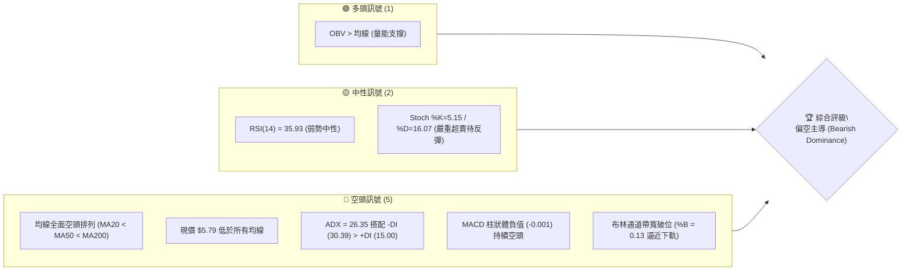

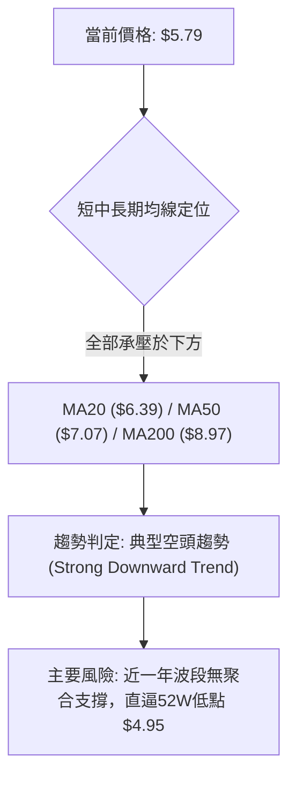

### 📊 核心指標速覽表

| 指標類別 | 指標名稱 | 當前數值 | 訊號 | 解讀 |
|----------|----------|----------|------|------|
| **價格** | 當前收盤價 | $5.79 | 🔴 | 位於52週區間 8.1% 低檔，距52W高點 $15.28 回撤達 -62.11% |
| **均線** | MA20 (短中) | $6.39 | 🔴 | 價格低於MA20達 -9.35%，短線下行斜率陡峭 |
| **均線** | MA50 (中期) | $7.07 | 🔴 | 價格低於MA50達 -18.10%，中期走勢完全受壓制 |
| **均線** | MA200 (長期)| $8.97 | 🔴 | 價格低於牛熊分水嶺達 -35.45%，長期架構處於空頭市場 |
| **動能** | RSI(14) | 35.93 | 🟡 | 進入弱勢中性區，尚未出現極端超賣（<30），但買盤匱乏 |
| **動能** | MACD (12,26,9)| -0.289 / -0.288 | 🔴 | DIF跌破MACD線，Hist為 -0.001，處於零軸下方弱勢開口 |
| **動能** | KD (Stoch) | %K 5.15 / %D 16.07 | 🟡 | 數值極低，進入絕對超賣鈍化區，隨時具技術性抽頭修復可能 |
| **趨勢** | ADX(14) / DMI | ADX: 26.35 | 🔴 | ADX > 25 確認進入趨勢行情，-DI (30.39) 壓制 +DI (15.00) 為明確空頭趨勢 |
| **波動** | ATR(14) | $0.43 (7.49%) | 🔴 | 日內波動幅度高達 7.49%，高 Beta 投機特徵明顯，止損緩衝需放寬 |
| **通道** | 布林通道 | 上 $7.19 / 下 $5.58 | 🔴 | %B 為 0.13，緊貼布林帶下軌摩擦下行，通道開口放大 |
| **量能** | 當日量 vs 均量| 34.06M / 47.78M | 🟡 | 量比 0.71x，下行過程中伴隨縮量，賣盤動能有所衰減但接盤不足 |

### 🏆 技術評分卡

```
╔══════════════════════════════════════════════════════════════════╗
║                   技術評分卡 — ONDS (2026-11-04)                 ║
╠══════════════════════════════════════════════════════════════════╣
║ 趨勢強度 (Trend)      █████░░░░░░░░░░░░░░░  25/100 🔴 空頭強勢主導  ║
║ 動能指標 (Momentum)    ██████░░░░░░░░░░░░░░  30/100 🔴 動能跌入低谷  ║
║ 支撐穩定度 (Support)   ████░░░░░░░░░░░░░░░░  20/100 🔴 缺乏聚合支撐  ║
║ 成交量配合 (Volume)    █████████░░░░░░░░░░░  45/100 🟡 OBV底層背離  ║
║ 形態完整度 (Pattern)   █████░░░░░░░░░░░░░░░  25/100 🔴 頭部破位向下  ║
║ 均線排列 (MA Align)   ███░░░░░░░░░░░░░░░░░  15/100 🔴 典型空頭排列  ║
╠══════════════════════════════════════════════════════════════════╣
║ 綜合評分              █████░░░░░░░░░░░░░░░  27/100 🔴 強烈偏空      ║
║ 評級結論：六項指標算術平均為 26.67，四捨五入為 27/100 (≤ 40 偏空) ║
╚══════════════════════════════════════════════════════════════════╝
```

---

## 2. 趨勢分析

### 🌐 多時框趨勢分析

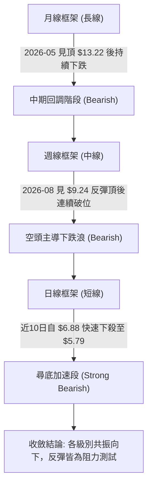

### 📈 長期趨勢 — 12個月走勢圖（Unicode）

依據提供的過去 24 個月中最近 12 個月收盤數據（2025-12 至 2026-11），繪製月線價格路徑：

```
ONDS 月線走勢圖（過去12個月：2025-12 至 2026-11）
價格 ($)
$14.00 ┤                                      ● $13.22 (2026-05 頂部)
$13.00 ┤                                     / \
$12.00 ┤                                    /   \
$11.00 ┤                     ● $10.36       /     \
$10.00 ┤       ● $9.76      /  \     ● $10.04      \
$ 9.00 ┤      /            /    \   /               \
$ 8.00 ┤     /            /      ● $9.04             ● $8.24
$ 7.00 ┤    /            /                            \   ● $7.66
$ 6.00 ┤   /            /                              \ /       \
$ 5.00 ┤  /            ● $10.08                         ● $7.49   ● $6.32
$ 4.00 ┤ /                                                         \
$ 3.00 ┤/                                                           ● $5.79 (現價)
       └─────────────────────────────────────────────────────────────────
         12月   01月   02月   03月   04月   05月   06月   07月   08月   09月   10月   11月
         2025  ─────────────── 2026 年各月份收盤走勢 ───────────────────►
```

#### 長期走勢特徵分析表

| 階段區間 | 時間跨度 | 起訖收盤價 | 區間漲跌幅 | 走勢結構與技術特徵 |
|----------|----------|------------|------------|--------------------|
| 第一階段：衝頂擴張 | 2025-12 至 2026-05 | $9.76 → $13.22 | +35.45% | 高位巨幅震盪後拉出本輪牛市歷史極值（盤中最高達 $15.28） |
| 第二階段：見頂崩折 | 2026-05 至 2026-07 | $13.22 → $7.49 | -43.34% | 獲利了結盤湧出，連續大陰線跌破月線上升軌道，直接腰斬 |
| 第三階段：中繼反抽 | 2026-07 至 2026-08 | $7.49 → $7.66 | +2.27% | 週線反彈一度回測 $9.24，但月線級別收盤無法收復 $8.00 |
| 第四階段：陰跌破位 | 2026-08 至 2026-11 | $7.66 → $5.79 | -24.41% | 逐月走低（7.66 → 7.33 → 6.32 → 5.79），均線下彎，流動性收縮 |

### 📊 中期趨勢（週線分析）

從近 20 週收盤走勢可見，股價在 2026-08-14 達到反彈頂部 $9.24（該週 RSI 達 57.4，MACD 柱 +0.171），隨後展開長達 12 週的單邊下行浪。

```
ONDS 週線阻力與支撐結構示意
════════════════════════════════════════════════════════════════
$9.24 ─────── 8月中旬次級反彈高點（強阻力分水嶺）
              │
$7.98 ─────── 阻力位 R1（近一年波段高點聚類 / 9月下旬反彈高點）
              │
$7.16 ─────── 斐波那契 78.6% 回調位
              │
$6.39 ─────── MA20 / 布林中軌壓力帶
              │
$5.79 ───────【當前價格】（持續貼近布林下軌）
              │
$5.58 ─────── 布林通道下軌動態支撐
              │
$4.95 ─────── 52週低點 / 斐波那契 100.0% 極限支撐位
════════════════════════════════════════════════════════════════
```

### ⚡ 趨勢強度評估（ADX 解讀）

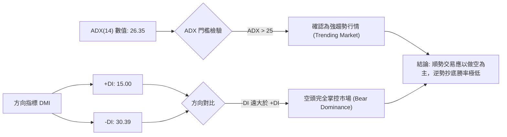

#### ADX 趨勢強度對照表

| 指標名稱 | 實際數據 | 標準區間 | 當前技術含義解讀 |
|----------|----------|----------|------------------|
| **ADX(14)** | **26.35** | 25 – 50 (強趨勢) | 脫離無方向的盤整狀態，正式步入單邊趨勢，趨勢動能充足 |
| **+DI** | **15.00** | < 20 (多頭衰竭) | 多頭攻擊動能萎縮，市場主動性買盤匱乏 |
| **-DI** | **30.39** | > 30 (空頭強烈) | 空方拋壓占據絕對支配地位，負向擴張明顯 |
| **DI差值 (擴散度)** | **-15.39** | 負向擴大 | 空頭動能持續發散，未出現收斂跡象，跌勢尚未完結 |

---

## 3. 圖表形態分析

### 🔍 形態識別系統

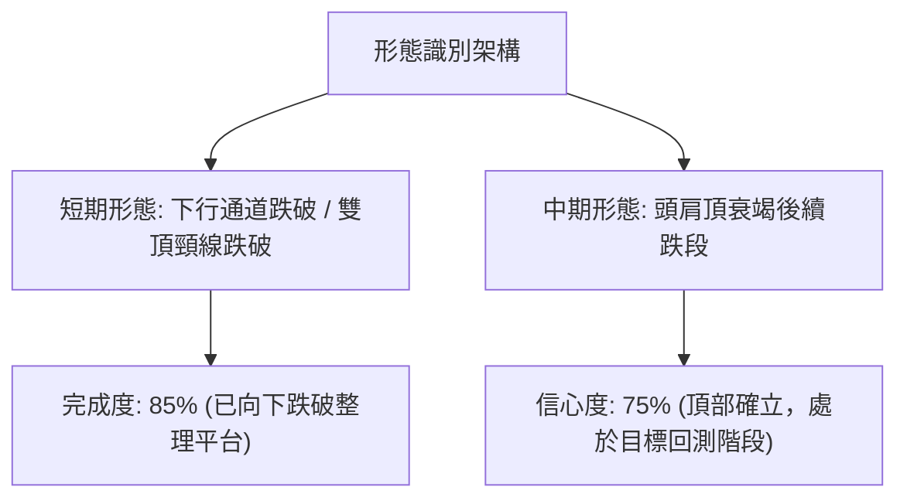

#### 圖表形態信心度評估表（依規則 15）

| 形態名稱 | 信心度 | 判斷依據（嚴格引用提供之數據） | 完成度 | 目標價（附嚴謹計算式） |
|----------|--------|--------------------------------|--------|------------------------|
| **下降通道延續** | 75% | 價格受壓於 MA20 ($6.39) 與下軌 ($5.58) 間，近10日高點由 $7.08 降至 $6.09 | 85% | 跌破通道下軌目標 = 52W 低點 **$4.95** |
| **微型頭肩頂破位** | 70% | 左肩 10/27 高點 $6.69，頭部 10/29 高點 $7.08，右肩 10/30 高點 $6.60，頸線約 $6.18 | 90% | 頸線 $6.18 − (形態高 $7.08 − 頸線 $6.18) = **$5.28**（形態推算值） |
| **雙底反轉形態** | 20% | 數據中未偵測到近一年波段低點聚類，且未出現底背離 | 0% | 訊號不足，僅做指標型解讀（形態不成立） |

### 🕯️ 重要K線形態分析

嚴格依據提供的「近10根日K」與「近8根週K」開高低收數據進行客觀解讀：

#### 近10根日K形態解析

| 日期 | 開 | 高 | 低 | 收 | K線形態名稱 | 形態解讀與市場心理 | 技術訊號 |
|------|----|----|----|----|-------------|--------------------|----------|
| 2026-10-21 | 6.21 | 6.37 | 6.09 | 6.27 | 帶下影小陽線 | 測試 $6.09 獲得支撐，但實體偏小，多空拉鋸 | 🟡 中性 |
| 2026-10-22 | 6.11 | 6.34 | 5.89 | 6.02 | 破底陰線 | 跌破 $6.00 關卡探至 $5.89，收盤重心下移 | 🔴 看空 |
| 2026-10-23 | 5.99 | 6.35 | 5.89 | 6.20 | 下影長陽星 | 二次探測 $5.89 未破，低檔出現技術性買盤逢低承接 | 🟢 偏多 |
| 2026-10-26 | 6.17 | 6.32 | 6.04 | 6.16 | 窄幅十字星 | 多空在 MA20 附近縮量觀望，方向未明 | 🟡 中性 |
| 2026-10-27 | 6.21 | 6.69 | 6.16 | 6.65 | 光頭實體長陽 | 放量突破短期均線，多頭展開次級反彈波 | 🟢 看多 |
| 2026-10-28 | 6.69 | 6.88 | 6.56 | 6.86 | 續漲中陽線 | 買盤延續，推升價格逼近 $7.00 整數關卡 | 🟢 看多 |
| 2026-10-29 | 6.74 | 7.08 | 6.74 | 6.88 | 長上影倒錘頭 | 衝擊波段高點 $7.08 後遭空頭伏擊，上檔拋壓沉重 | 🔴 轉空 |
| 2026-10-30 | 6.46 | 6.60 | 6.18 | 6.32 | 反轉中長陰線 | 跳空低開低走，完全吞噬前兩日漲幅，確立見頂 | 🔴 看空 |
| 2026-11-02 | 6.38 | 6.40 | 5.72 | 5.75 | 破位光腳大陰線 | 恐慌性殺跌，跌破前低 $5.89，收在當日最低點附近 | 🔴 強烈看空 |
| 2026-11-03 | 5.80 | 6.09 | 5.77 | 5.79 | 低位孕線十字星 | 嘗試反彈受制於 $6.09，收盤微漲停滯於 $5.79，弱勢整理 | 🔴 偏空 |

#### 近8根週K形態解析

| 週結束日期 | 開 | 高 | 低 | 收 | 週K線形態 | 解讀與趨勢影響 | 訊號 |
|------------|----|----|----|----|-----------|----------------|------|
| 2026-09-18 | 6.99 | 7.53 | 6.98 | 7.39 | 底部回升中陽 | 止跌企穩，嘗試向上修正 | 🟢 偏多 |
| 2026-09-25 | 7.51 | 7.98 | 7.18 | 7.64 | 衝高受阻陽線 | 衝刺阻力位 R1 ($7.98) 失敗，留下長上影線 | 🟡 衝高回落 |
| 2026-10-02 | 7.53 | 7.91 | 7.12 | 7.24 | 上影中陰線 | 二次挑戰 $7.91 承壓，確立雙頂回落架構 | 🔴 看空 |
| 2026-10-09 | 7.62 | 7.69 | 6.64 | 6.73 | 破位長陰線 | 破壞反彈格局，直接灌破 $7.00 大關 | 🔴 看空 |
| 2026-10-16 | 7.06 | 7.08 | 5.80 | 6.04 | 帶下影長陰線 | 最低探至 $5.80，週線級別空頭單邊宣洩 | 🔴 看空 |
| 2026-10-23 | 6.20 | 6.37 | 5.88 | 6.20 | 低檔十字晨星雛形 | 在 $5.88 獲得短暫支撐，量能萎縮至 179.5M | 🟡 止跌初探 |
| 2026-10-30 | 6.17 | 7.08 | 6.04 | 6.32 | 衝高回落上影線 | 盤中反抽 $7.08 遇強阻力回落，週收盤漲幅受限 | 🔴 誘多轉弱 |
| 2026-11-03 | 6.38 | 6.40 | 5.72 | 5.79 | 破底陰線 (僅2交易日)| 直接破前週低點 $6.04，創近一年收盤新低 $5.79 | 🔴 極度疲弱 |

### 📉 ASCII 走勢形態示意圖

```
ONDS 短期頭部破位與下行形態示意 (2026-10-27 至 2026-11-03)
價格
$7.20 ┤                     ▲ $7.08 (10/29 刺透高點受阻)
$7.00 ┤                    / \
$6.80 ┤             ▲     /   \
$6.60 ┤    ▲ $6.65 / \   /     \   ▲ $6.60 (10/30 反抽遇阻)
$6.40 ┤   / \     /   \_/       \_/ \
$6.20 ┤  /   \___/                   \    (破位頸線 $6.18)
$6.00 ┤ /                             \___________
$5.80 ┤/                                          ▼ $5.79 (現價貼下軌)
$5.60 ┤
      └─────────────────────────────────────────────────────────────
        10/27    10/28    10/29    10/30    11/02    11/03
```

### 🎯 形態目標價計算

根據 10/27 – 10/30 日線級別所形成的微型頭肩頂破位結構：
1. **頸線位置 (Neckline)**：取自 10/26 收盤與 10/30 低點聚合處 **$6.18**。
2. **形態高度 (Pattern Height)**：頭部最高點 $7.08 − 頸線 $6.18 = **$0.90**。
3. **理論下行目標 (Measured Move)**：
   $$\text{目標價} = \text{頸線} - \text{形態高度} = 6.18 - 0.90 = \mathbf{\$5.28}$$
4. **極限支撐目標**：若破位 $5.28，則直指歷史 52 週低點 **$4.95**。

---

## 4. 支撐與阻力

### 🗺️ 關鍵價位分布圖（Unicode）

```
╔══════════════════════════════════════════════════════════════════╗
║                     ONDS 價位結構分布圖                          ║
╠══════════════════════════════════════════════════════════════════╣
║ $15.28 ║████████████████████████████████████████║ 52W High (0.0%)║
║ $12.84 ║██████████████████████████████          ║ Fib 23.6%      ║
║ $11.33 ║██████████████████████                  ║ Fib 38.2%      ║
║ $10.11 ║██████████████████                      ║ Fib 50.0%      ║
║ $ 9.92 ║████████████████████████████████        ║ 強阻力 R3      ║
║ $ 8.97 ║████████████████                        ║ MA200 牛熊線   ║
║ $ 8.90 ║███████████████                         ║ Fib 61.8%      ║
║ $ 8.58 ║████████████████████                    ║ 阻力位 R2      ║
║ $ 7.98 ║████████████████████████                ║ 關鍵阻力 R1    ║
║ $ 7.16 ║████████████                            ║ Fib 78.6%      ║
║ $ 6.39 ║████████                                ║ BB中軌 / MA20  ║
║ $ 5.79 ╠════════════════════════════════════════╣ ◄ 現價 ($5.79) ║
║ $ 5.58 ║▓▓▓▓▓▓▓▓▓▓                              ║ 布林下軌動態位 ║
║ (無聚類)║░░░░░░░░░░░░░░░░░░░░░░░░░░░░░░░░░░░░░░░║ (無波段低點支撐)║
║ $ 4.95 ║████████████████████████████████████████║ 52W Low (100%) ║
╚══════════════════════════════════════════════════════════════════╝
```

### 🚧 阻力位分析表

阻力價位嚴格引用系統由近一年波段高點聚類算出的實際值：

| 阻力級別 | 價位 | 距現價空間 | 形成技術依據與密集區性質 | 突破難度 | 重要性權重 |
|----------|------|------------|--------------------------|----------|------------|
| **R1** | **$7.98** | +37.82% | 9月下旬反彈高點聚類，近一年成交量重疊套牢峰 | 極高 | ★★★★★ |
| **R2** | **$8.58** | +48.19% | 8月中旬回落中繼平台聚類，反抽頸線確認點 | 高 | ★★★★☆ |
| **R3** | **$9.92** | +71.42% | 近一年密集高點峰值，逼近 $10.00 整數心理心理大關 | 極高 | ★★★★★ |

### 🛡️ 支撐位分析表

數據紀律提示：技術數據中顯示 **"(no swing-low support detected below current price)"**。近一年在 $5.79 下方完全未形成任何可辨識的波段低點聚合支撐，下方處於「技術真空區」。

| 支撐級別 | 價位 | 距現價空間 | 形成原因與性質判定 | 守住機率 | 重要性權重 |
|----------|------|------------|--------------------|----------|------------|
| **動態支撐** | **$5.58** | -3.63% | **日線布林通道下軌**，短線下行極限軌道線 | 40% | ★★☆☆☆ |
| **S1 (聚類)**| **數據中未偵測到** | N/A | 現價下方無歷史波段低點聚類，屬無支撐真空段 | 0% | ── |
| **極限支撐** | **$4.95** | -14.51% | **52週最低價 / 斐波那契 100.0% 絕對回撤點** | 60% | ★★★★★ |

### 📐 斐波那契回調位分析

基準週期：52 週極值區間 **$4.95 (低點) → $15.28 (高點)**，區間總落差 $10.33。

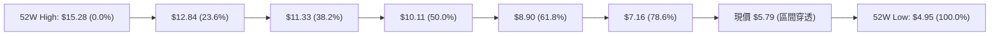

#### 斐波那契回調位解讀

| 回調比例 | 關鍵價位 | 技術結構意義解讀 |
|----------|----------|------------------|
| **0.0%** | **$15.28** | 52週最高點，極端多頭行情終結點 |
| **23.6%**| **$12.84** | 牛市第一道防線，2026-05 見頂後迅速擊穿 |
| **38.2%**| **$11.33** | 強勢回檔位，跌破宣告大牛市結束 |
| **50.0%**| **$10.11** | 多空心理平衡線，跌破後市場轉為弱勢 |
| **61.8%**| **$8.90** | 黃金分割關鍵分水嶺，與 MA200 ($8.97) 重合，轉為長期鐵底阻力 |
| **78.6%**| **$7.16** | 深度極限防守位，10月下旬反彈受阻於 $7.08 即在該處潰敗 |
| **100.0%**| **$4.95** | 52週最低點，整輪 24 個月上漲週期的原始發動基底 |

**現價落點解讀**：
當前收盤價 **$5.79** 位於 **78.6% ($7.16)** 與 **100.0% ($4.95)** 之間。當價格跌穿 78.6% 深度回調線後，技術面宣告整個上升浪形徹底遭到破壞，回撤至 100% 原始起漲點（$4.95）的機率大幅飆升。

---

## 5. 技術指標深度解讀

### 🎛️ 指標訊號總覽

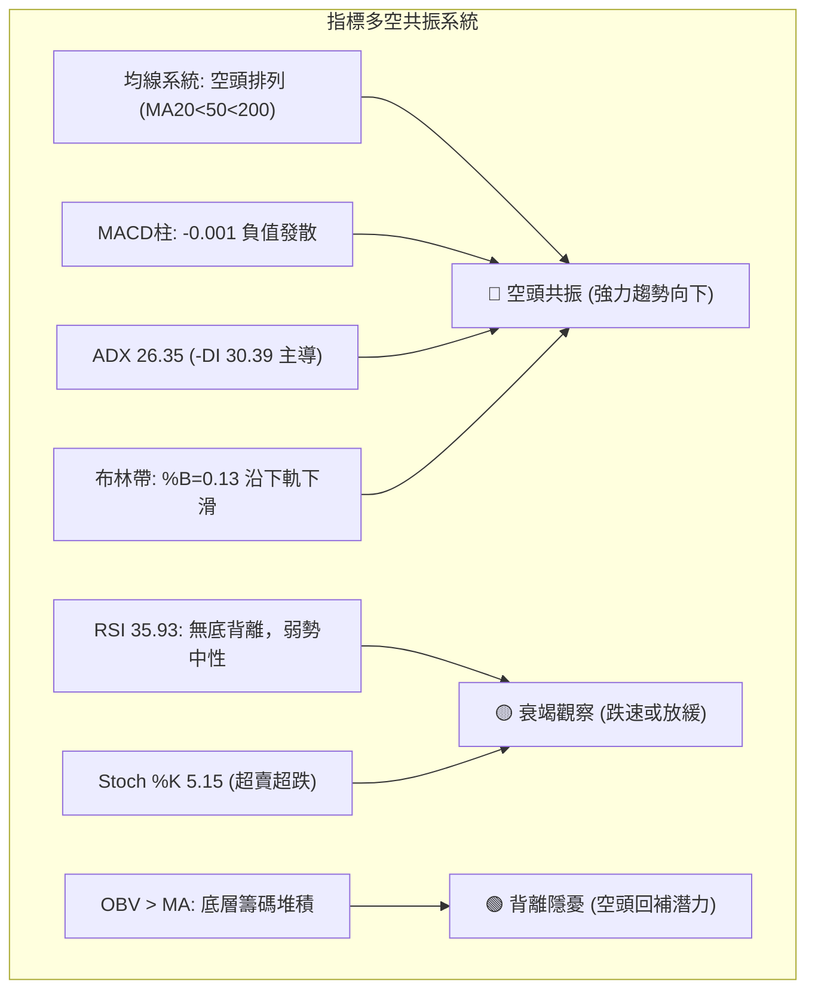

### 📈 移動平均線排列分析

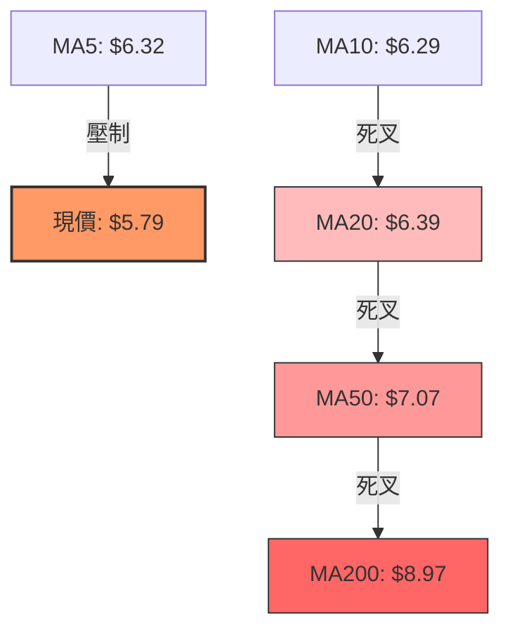

#### 移動平均線系統參數表

| 均線名稱 | 數值 | 距現價落差 (%) | 趨勢方向 | 均線位階與技術涵蓋意義 |
|----------|------|----------------|----------|------------------------|
| **MA 5** | $6.32 | -8.39% | 陡峭向下 ▁ | 極短線動量壓制，日線級別連續 3 日未收復 |
| **MA 10** | $6.29 | -7.95% | 陡峭向下 ▁ | 短線操盤線，反抽該線即引發次日拋壓 |
| **MA 20** | $6.39 | -9.35% | 下彎走平 ▁ | 月度持倉成本線，布林通道中軌，反彈第一防線 |
| **MA 50** | $7.07 | -18.10% | 持續走跌 ▅ | 季度中期生命線，中期多空分水嶺 |
| **MA 60** | $7.39 | -21.69% | 穩定下行 ▅ | 季線阻力，空頭波段防守點 |
| **MA 120**| $8.16 | -29.04% | 緩步下彎 ▄ | 半年線，牛熊中轉帶 |
| **MA 200**| $8.97 | -35.45% | 轉為下行 ▃ | 經典長期牛熊分水嶺，宣告進入熊市週期 |
| **MA 240**| $9.08 | -36.25% | 年線下彎 ▂ | 歷史持股平均成本，構築最沉重套牢天花板 |

### 📉 RSI(14) 分析

```
RSI(14) 儀表尺規：35.93 (Wilder)
0 ──────────── 30 ─────── 35.93 ───────────── 70 ─────────── 100
[  極端超賣區  ] [弱勢區]   ▲   [   中性整理區   ] [ 極端超買區 ]
                     目前位置
進度條：█████████████░░░░░░░░░░░░░ 35.93%
```

- **區間判定**：RSI 位於 35.93，處於 30 至 70 的中性偏弱區間。雖然數值低於 50，但未跌穿 30 閾值，說明拋售尚未達到情緒崩潰的「恐慌超賣踩踏」階段，空方仍掌控主導權。
- **背離檢驗（嚴格依據近20根K棒）**：
  - 價格端：10/22 低點 $5.89，11/02 低點 $5.72，創下新低。
  - RSI 端：未提供獨立低點回升背離，數據明確顯示**「RSI 背離: 無明顯背離」**。
  - 結論：指標與價格同步下行，未出現多頭抵抗型底背離，下行趨勢健康。

### 📊 MACD(12/26/9) 訊號解讀

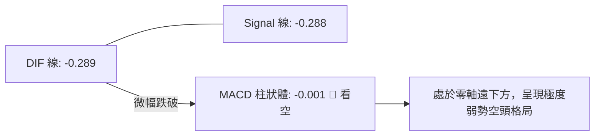

- **數值關係**：DIF (-0.289) 低於 Signal (-0.288)，MACD 柱狀體為 **-0.001**。
- **歷史演化分析**：觀察近 20 週數據，MACD 柱自 10/30 的 +0.078 迅速翻綠轉為 -0.001，日線與週線再度回落至負值區域。兩線黏合在極低水平但無力金叉突破，反映空頭壓制依然穩固。

### 📦 布林通道分析

```
ONDS 日線布林通道橫截面示意圖
═════════════════════════════════════════════════════════════
$7.19 ── 上軌 (BB Upper)  ──────────────────────────────────
        │
$6.39 ── 中軌 (BB Middle / MA20) ───────────────────────────
        │
$5.79 ──【現價位置】 (%B = 0.13) ▓▓▓▓▓▓▓▓░░░░░░░░░░░░░░░░░░░
        │
$5.58 ── 下軌 (BB Lower)  ──────────────────────────────────
═════════════════════════════════════════════════════════════
```

- **帶寬與位置**：通道寬度為 $1.61（$7.19 − $5.58）。收盤價 $5.79 逼近下軌 $5.58，布林極限指標 **%B = 0.13**。
- **形態含義**：%B 小於 0.20 屬於通道下沿「弱勢帶行走（Walking the Lower Band）」，暗示跌勢正在由下軌動態推動。若下軌開口進一步放大，將觸發新一輪主跌段。

### 💹 成交量分析（量價配合度）

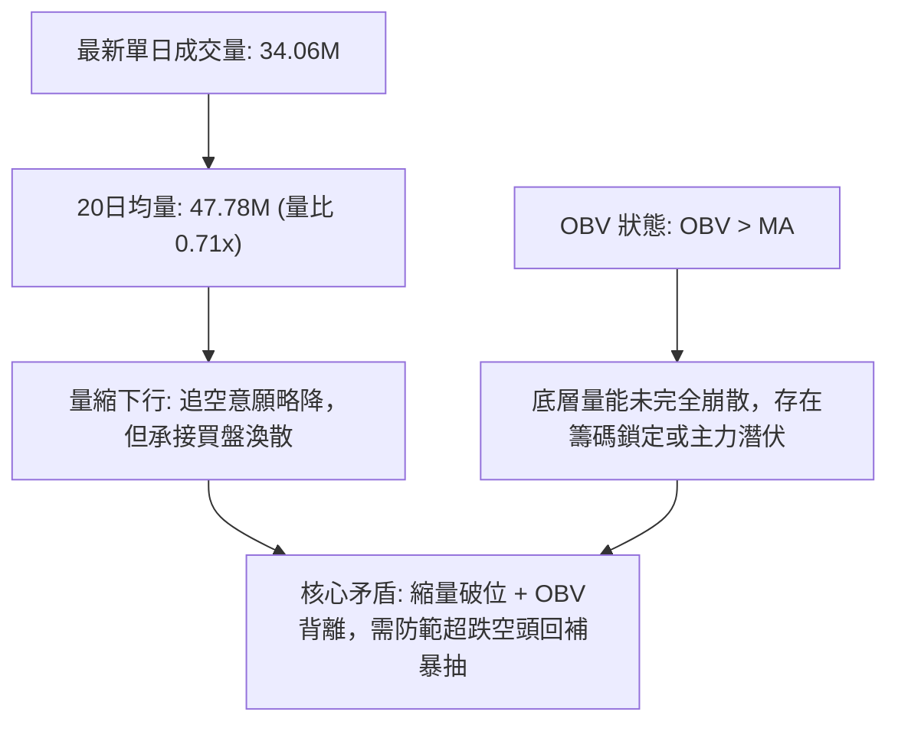

- **成交量對比**：最新日成交量為 34,060,500 股，較 20 日均量 47,781,820 股萎縮約 28.7%（量比 0.71x）。量縮下跌常反映「買方掛單退縮，被動賣單即引發價格下滑」。
- **OBV 趨勢解讀**：數據指示 **"OBV > MA → 量能支撐上漲"**。這與價格的全面空頭排列形成鮮明的「量價背離（Volume-Price Divergence）」。這種背離通常意味著在先前的暴跌過程中，被套牢的主力或長期資金並未出現恐慌性斬倉拋售，籌碼出現一定程度鎖定。然而，在弱勢市場中，若無新增資金入場推動，OBV 的支撐難以阻擋無量陰跌。

---

## 6. 動能與波動率

### ⚡ 動能評估四象限

| 象限代號 | 動能強度 (Momentum) | 波動率 (Volatility) | 當前狀態吻合 | 策略含義與操作指引 |
|----------|---------------------|---------------------|--------------|--------------------|
| **象限 I** | 強動能 (Bullish) | 低波動 (Low Vol) | ─ | 穩健上升趨勢，積極作多 |
| **象限 II**| 弱動能 (Bearish) | 低波動 (Low Vol) | ─ | 沉悶盤整陰跌，資金效率低 |
| **象限 III**| 強動能 (Bullish) | 高波動 (High Vol) | ─ | 爆發突破行情，嚴控停損 |
| **象限 IV**| **弱動能 (Bearish)** | **高波動 (High Vol)** | **✓ 完美吻合 (Q4)** | **高風險下行區間，空方占優，嚴禁盲目摸底** |

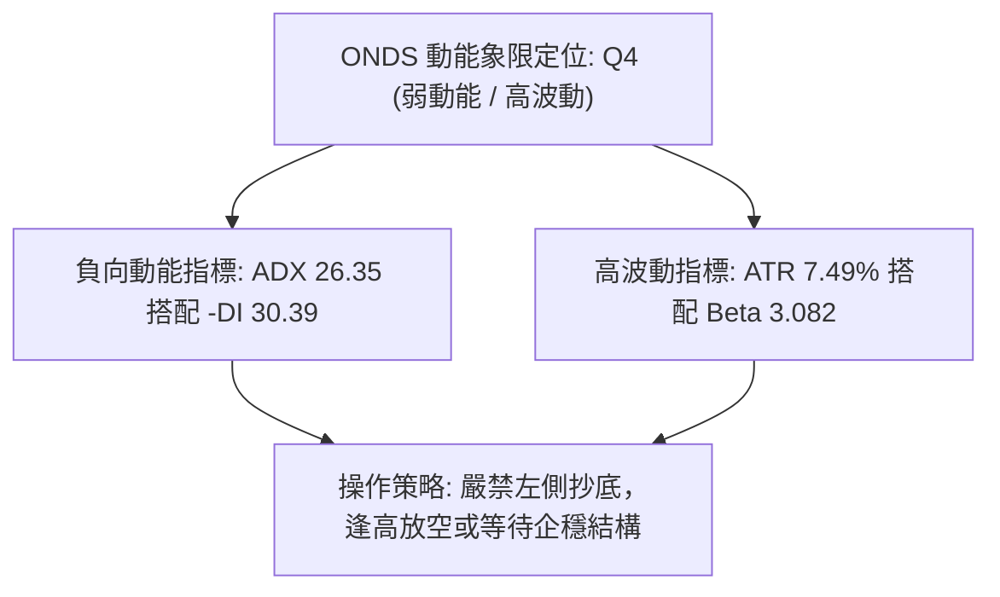

### 📊 ATR 波動率分析

- **ATR(14) 數值**：**$0.43**（採用 Wilder 平滑算法）。
- **相對價格波動比**：$0.43 ÷ $5.79 = **7.49%**。
- **止損距離建議**：
  - 由於該股日內波動高達 7.49%，若止損過於收緊極易被市場雜訊掃出場。
  - **保守型止損緩衝（1.5 × ATR）**：$0.43 × 1.5 = **$0.65**。
  - **趨勢型止損緩衝（2.0 × ATR）**：$0.43 × 2.0 = **$0.86**。

### 📐 Beta 與市場相關性及空頭結構

- **Beta 係數**：**3.082**。ONDS 的波動幅度為大盤（S&P 500）的 3 倍以上，具有極高的槓桿屬性。在大盤回調時，該股容易承受放大效應的殺跌。
- **空頭比例 (Short % Float)**：高達 **43.9%**，空頭回補天數 (Short Ratio) 為 **4.11 天**。
  - **雙刃劍效應**：高達 43.9% 的做空比例反映市場機構極端看空其基本面（TTM 營運利潤率 -129.4%，現金流持續為負）。但在技術面超賣時，一旦出現利好消息刺激，極易引發劇烈的「軋空踩踏（Short Squeeze）」。

---

## 7. 多時框架總結

### 📋 時框架評分表

| 時框架 | 趨勢方向 | 動能指標 | 均線排列 | 圖表形態 | 綜合評分 | 操作建議方向 |
|--------|----------|----------|----------|----------|----------|--------------|
| **月線 (長期)** | 🔴 熊市回調 | RSI 偏弱，脫離天價 | 跌破 20月均線區間 | 頭部反轉成立 | 30/100 | 長期部位防禦減倉 |
| **週線 (中期)** | 🔴 單邊下行 | MACD 零軸下，RSI 35.9 | 跌破 MA50/MA200 | 下降通道運行 | 25/100 | 反彈逢高放空 |
| **日線 (短期)** | 🔴 尋底破位 | KD 超賣，布林下軌摩擦 | 全面空頭排列 | 微型頭肩破位 | 25/100 | 嚴禁抄底，順勢作空 |

### 🔲 綜合訊號矩陣

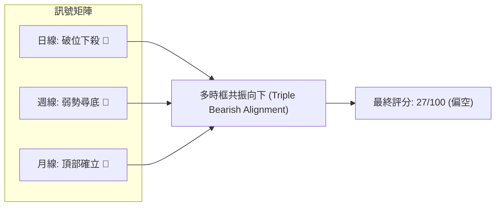

### ⚖️ 多時框收斂結論

依據多時框收斂優先級規則：
1. **行情性質判定**：當前日線 ADX(14) 為 **26.35 > 25**，符合**「趨勢行情」**標準，而非無方向的盤整震盪。
2. **時框優先權**：在趨勢行情中，必須以中長期（週線、MA50 $7.07、MA200 $8.97）的趨勢方向為主導。日線即便出現短線超賣（如 Stoch %K=5.15），僅代表反彈修正的微觀時間點，不可動搖中長期的做空大方向。
3. **唯一方向性結論**：**極度偏空（Bearish）**。日線、週線、月線全面收斂於下行通道，空方牢牢掌握主動權。任何盤中技術性抽高均應視為空頭防禦性拋售或逢高放空機會。

---

## 8. 交易策略建議

### 🗺️ 策略決策流程圖

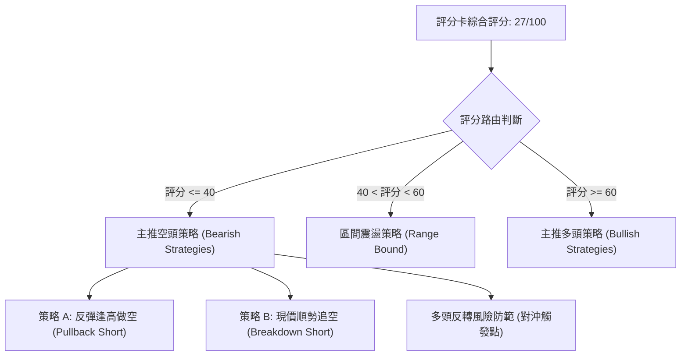

### 🧭 策略路由（依評分卡分流）

> **當前主策略方向 = 空頭策略（依綜合評分 27/100，低於 40 門檻，嚴格主推空頭交易）**

### 🎯 價格情境階梯（Price Scenarios）

價位嚴格引用關鍵價位聚類、布林帶與斐波那契點位：

| 觸發條件 | 下一目標 | 後續延伸 | 情境含義解讀 |
|----------|----------|----------|--------------|
| **強勢突破 R1 ($7.98)** | R2 ($8.58) | R3 ($9.92) | 空頭結構被徹底破壞，軋空行情展開 |
| **反抽受阻 MA20 ($6.39)** | 布林下軌 ($5.58) | 52W 低點 ($4.95) | 典型均線受阻下行，延續弱勢陰跌 |
| **有效跌破布林下軌 ($5.58)**| 52W 低點 ($4.95) | 支撐真空探底 | 跌勢加速擴張，探測整年原始發動底 |

### 📊 情境機率分佈

| 趨勢情境 | 發生機率 | 主要技術與指標依據 |
|----------|----------|--------------------|
| **回落探底 / 跌向 52W 低點** | **55%** | 均線空頭排列，ADX=26.35 搭配 -DI 擴散，下方無波段低點支撐 |
| **窄幅區間震盪整理** | **30%** | KD 進入極端超賣區 (%K 5.15)，成交量萎縮，空方動能短暫停歇 |
| **強勁反彈 / 逼近 R1** | **15%** | 空頭比例高達 43.9%，OBV 底層累積引發非理性軋空回補 |

### 🟢 主策略詳情（空頭主推策略）

依規則 17，做空風險報酬比公式為：
$$\text{風險報酬比} = \frac{\text{進場價} - \text{目標價 T1}}{\text{止損價} - \text{進場價}}$$

| 策略要素 | 策略 A：反彈逢高做空 (首選) | 策略 B：現價破位順勢做空 (次選) |
|----------|------------------------------|----------------------------------|
| **進場邏輯** | 股價受超賣帶動反抽測試布林中軌阻力 | 股價無力反彈，直接沿布林下軌摜破下行 |
| **進場價格** | **$6.39** (MA20 / 布林中軌精確值) | **$5.79** (當前即時收盤價) |
| **止損價格** | **$7.19** (布林通道上軌精確值) | **$6.39** (MA20 / 布林中軌精確值) |
| **目標價 T1** | **$5.58** (布林通道下軌精確值) | **$4.95** (52週最低價 / 斐波那契100%) |
| **目標價 T2** | **$4.95** (52週最低價 / 斐波那契100%) | **$4.52** (按 ATR 0.43 等比向下推算) |
| **風險報酬比** | **1 : 1.01（以 T1 計）** <br>*(7.19-6.39=0.80 風險 ; 6.39-5.58=0.81 利潤)*<br>註：**1 : 1.80（以 T2 計）** | **1 : 1.40（以 T1 計）** <br>*(6.39-5.79=0.60 風險 ; 5.79-4.95=0.84 利潤)* |
| **成功勝率** | 65% | 55% |
| **建議倉位** | 15% (動態保證金管理) | 10% (高 Beta 防範反抽) |

### 🔴 反向風險觸發點（對沖與停損提示）

若出現以下訊號，表示空頭主策略遭破壞，空單必須全數撤出或進行對沖：
1. **關鍵點位突破**：日線收盤價**強勢站穩 MA20 ($6.39)** 以上，且次日回踩不破。
2. **動能結構反轉**：RSI 突破 50 中軸，日線 MACD 柱翻紅並擴大至 +0.05 以上。
3. **軋空爆發訊號**：單日成交量暴增至 1 億股以上（超過 50 日均量 2 倍），並收出大實體長陽線突破 R1 ($7.98)。

### ⭐ 整體訊號強度評星

```
╔══════════════════════════════════════════════════════╗
║ 做多訊號強度：★☆☆☆☆  (1/5星 - 僅底層量能與超賣微光) ║
║ 做空訊號強度：★★★★☆  (4/5星 - 趨勢指標共振向下)     ║
║ 整體可信度：  ★★★★☆  (4/5星 - 多時框數據高度一致)   ║
╚══════════════════════════════════════════════════════╝
```

---

## 9. 風險提示與監控

### ✅ 關鍵監控指標 Checklist

```
╔══════════════════════════════════════════════════════════════════╗
║                    技術面關鍵監控清單 (Checklist)                ║
╠══════════════════════════════════════════════════════════════════╣
║ [ ] 價格是否跌破布林下軌 $5.58 並連續 2 日無法收復？           ║
║ [ ] 價格是否加速探底測試 52週歷史極值 $4.95？                   ║
║ [ ] RSI(14) 是否跌破 30 進入深層恐慌超賣區？                     ║
║ [ ] Stoch %K 是否向上金叉 %D 並脫離 20 超賣線？                 ║
║ [ ] 日成交量是否顯著超越 50日均量 (55.21M) 呈現放量暴跌或反轉？ ║
║ [ ] 空頭比例 (43.9%) 是否引發突然的軋空巨幅跳空？               ║
║ [ ] 11/12 即將公布的 Q3 財報是否引發重大跳空缺口？              ║
╚══════════════════════════════════════════════════════════════════╝
```

### ⚠️ 風險場景分析

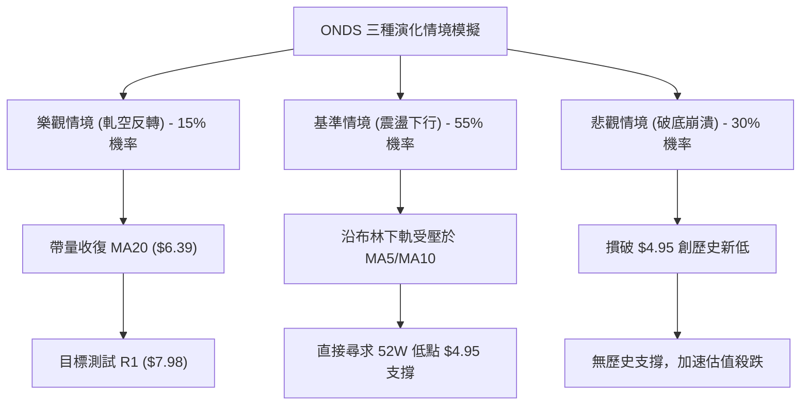

### 🛡️ 風險管理重要提醒

1. **基本面重大事件風險**：
   公司已宣布將於 **2026-11-12 盤前公布 Q3 財報**。該公司目前 TTM 營業利潤率為 -129.4%，每股盈餘為負數。在財報日前後，歷史隱含波動率將急劇飆升，持倉過夜存在嚴重的跳空風險。
2. **超高 Beta 與高放空比例風險**：
   該股 Beta 高達 **3.082**，做空比例高達 **43.9%**。在極度空頭走勢中，常伴隨「單日暴漲 15%-25%」的兇悍軋空洗盤，做空投資者必須以限價單與嚴格止損執行紀律，倉位控制不宜超過總資本的 10%-15%。
3. **無支撐踩踏風險**：
   由於在現價 $5.79 與 52W 低點 $4.95 之間完全不存在近一年的波段低點聚類支撐，任何破位都將導致市場流動性瞬間蒸發，切勿以「感覺已經跌很多」為由盲目建立多頭部位。

---

## 📋 報告總結

```
╔══════════════════════════════════════════════════════════════════╗
║                     ONDS 技術分析報告總結                        ║
╠══════════════════════════════════════════════════════════════════╣
║ 報告日期：2026-11-04                                             ║
║ 當前價格：$5.79                                                  ║
║ 分析評級：🔴 強烈偏空（綜合技術評分：27 / 100）                  ║
║                                                                  ║
║ 關鍵技術結論：                                                   ║
║ ├─ 長期趨勢：🔴 跌破上升週期，月線級別頂部確認                  ║
║ ├─ 中期趨勢：🔴 週線下行通道運行，MA50 與 MA200 形成雙重阻力    ║
║ ├─ 短期趨勢：🔴 日線微型頭肩頂破位，全面空頭排列，緊貼下軌尋底 ║
║ ├─ 關鍵支撐：動態下軌 $5.58，52週低點 $4.95（中間無聚類支撐）   ║
║ ├─ 關鍵阻力：MA20 $6.39，阻力 R1 $7.98，阻力 R2 $8.58           ║
║ └─ 分析師目標：均價 $18.88（技術面與基本面共識嚴重背離）         ║
║                                                                  ║
║ 最優策略組合：                                                   ║
║ 1. 🥇 最佳機會：等待反抽至 MA20 ($6.39) 附近逢高建立空單，      ║
║                 停損設於布林上軌 ($7.19)，目標下軌 ($5.58)     ║
║ 2. 🥈 次選機會：跌破 $5.58 順勢小倉追空，目標鎖定 $4.95          ║
║ 3. 🥉 保守選擇：空手觀望，靜待 11/12 財報公布及 $4.95 底部確認   ║
╚══════════════════════════════════════════════════════════════════╝
```

---

> ⚠️ **免責聲明**：本報告為 AI 自動生成之技術分析，所有數據及估算均基於提供的歷史價格資訊。本報告**僅供研究與學術參考**，**不構成任何投資建議**。投資有風險，入市需謹慎。

---

*報告生成時間：2026-11-04 ｜ 數據來源：Yahoo Finance ｜ 分析框架：多時框技術分析*