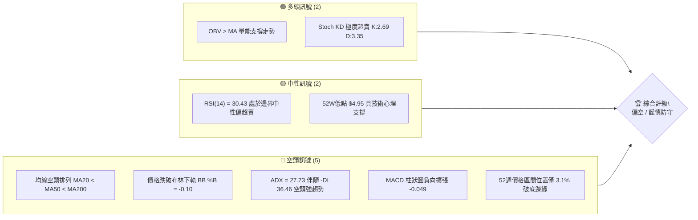
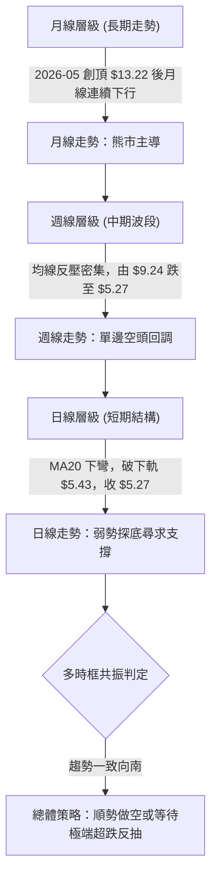
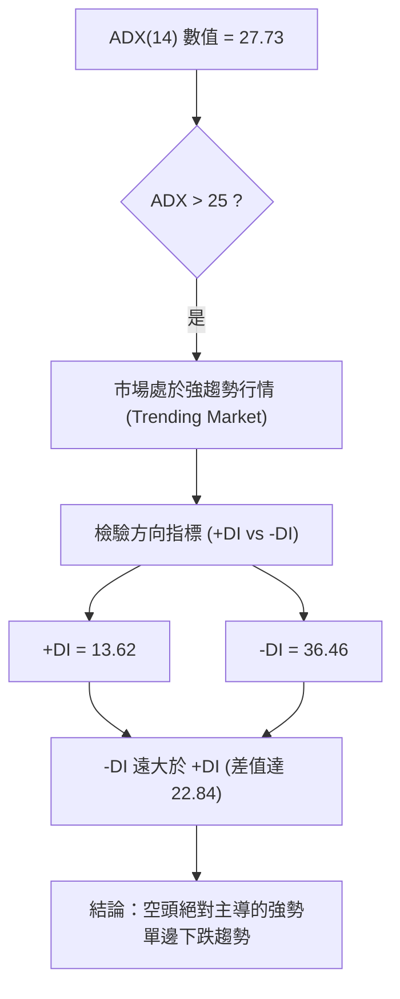
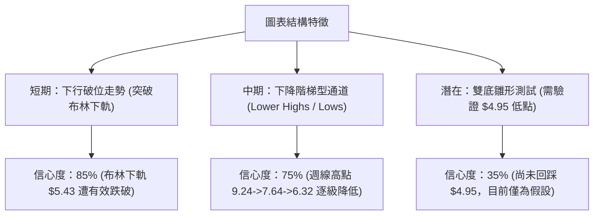
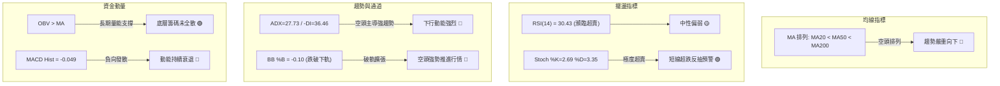
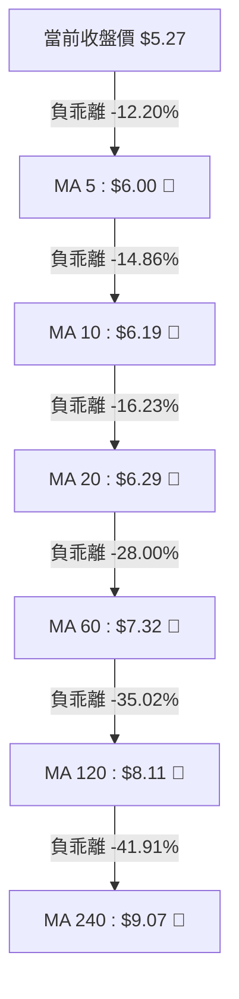
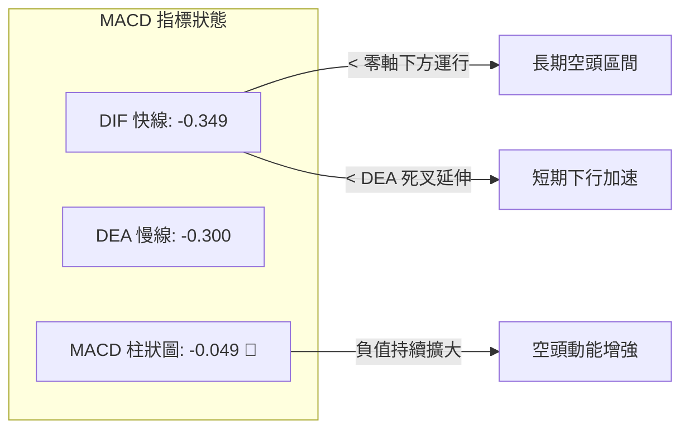
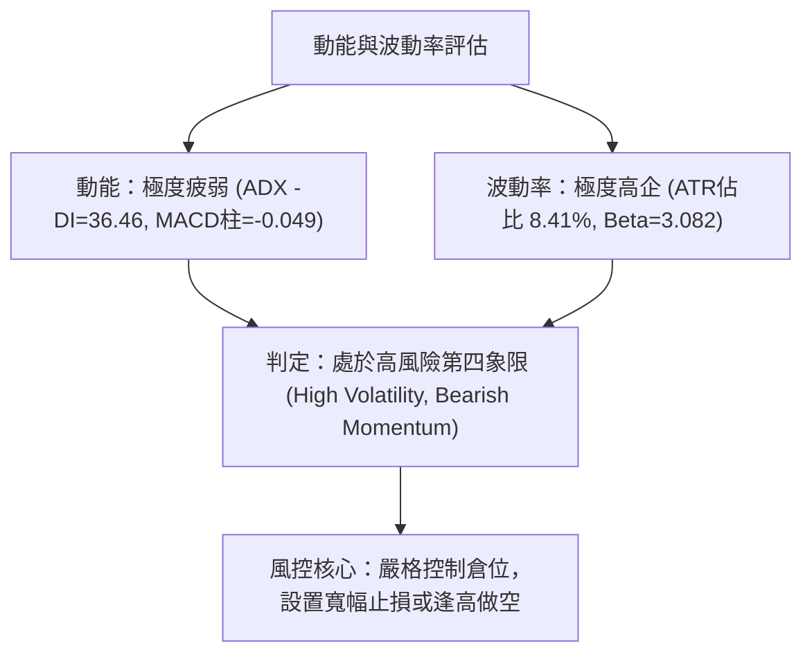
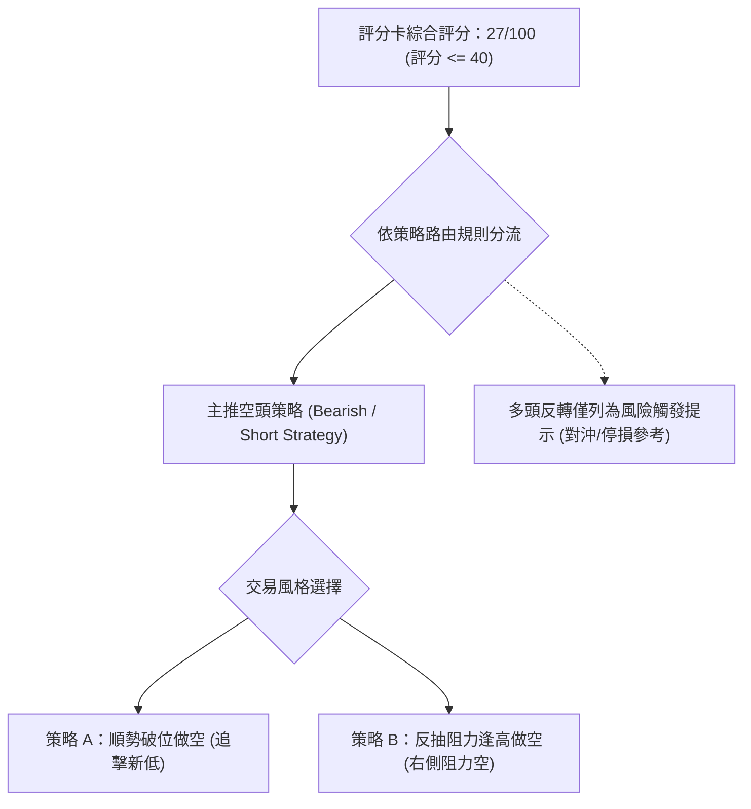
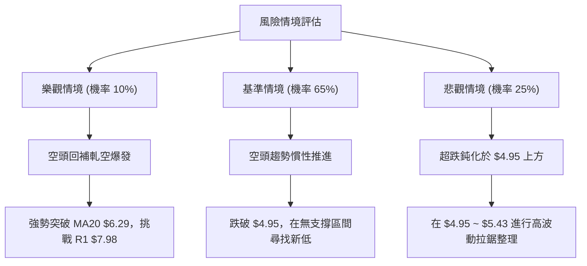

# ONDS 技術分析報告

> **報告日期**：2026-11-05 ｜ **語言**：繁體中文 ｜ **數據來源**：Yahoo Finance ｜ **當前價格**：$5.27

---

## 目錄

| 章節 | 內容 |
|------|------|
| [1. 技術面概覽](#1-技術面概覽) | 訊號儀表板、核心指標、評分卡 |
| [2. 趨勢分析](#2-趨勢分析) | 多時框趨勢、長中短期走勢 |
| [3. 圖表形態分析](#3-圖表形態分析) | 形態識別、K線組合、目標價 |
| [4. 支撐與阻力](#4-支撐與阻力) | 關鍵價位、斐波那契回調 |
| [5. 技術指標深度解讀](#5-技術指標深度解讀) | MA/RSI/MACD/布林/成交量 |
| [6. 動能與波動率](#6-動能與波動率) | 動能評估、ATR、Beta |
| [7. 多時框架總結](#7-多時框架總結) | 時框架評分矩陣 |
| [8. 交易策略建議](#8-交易策略建議) | 多空策略、風險報酬比 |
| [9. 風險提示與監控](#9-風險提示與監控) | 監控指標、風險場景 |

---

## 1. 技術面概覽

### 🎯 技術訊號儀表板



### 📊 核心指標速覽表

| 指標類別 | 指標名稱 | 當前數值 | 訊號 | 解讀 |
|:---|:---|:---:|:---:|:---|
| **價格** | 當前收盤價 | $5.27 | 🔴 | 位於52週區間 3.1% 位置，瀕臨一年新低 |
| **均線** | MA20 | $6.29 | 🔴 | 現價低於 MA20 達 -16.23%，短線嚴重承壓 |
| **均線** | MA50 | $7.01 | 🔴 | 現價低於 MA50 達 -24.82%，中期趨勢向下 |
| **均線** | MA200 | $8.93 | 🔴 | 現價低於 MA200 達 -40.99%，長期熊市結構 |
| **動能** | RSI(14) | 30.43 | 🟡 | 接近超賣閾值，尚未形成底背離反轉結構 |
| **動能** | MACD (12,26,9) | -0.349 / -0.300 | 🔴 | DIF 位於 DEA 下方，柱狀圖 -0.049 空頭擴張 |
| **動能** | 隨機指標 Stoch %K/%D | 2.69 / 3.35 | 🟢 | 進入極度超賣區間，技術性隨時可能觸發超跌反彈 |
| **趨勢** | ADX(14) / -DI | 27.73 / 36.46 | 🔴 | ADX>25 且 -DI 主導，顯示強烈單邊下行趨勢 |
| **通道** | 布林帶通道 | 下軌 $5.43 (%B: -0.10) | 🔴 | 價格已摜破布林下軌，呈現強勢空頭通道擴張 |
| **波動** | ATR(14) | $0.44 | 🔴 | 佔股價 8.41%，單日波動劇烈，洗盤風險高 |
| **籌碼** | OBV 趨勢 | OBV > MA | 🟢 | 長期累積成交量尚未完全潰散，維持量能底層支撐 |

### 🏆 技術評分卡

```
╔════════════════════════════════════════════════════════════════╗
║                   技術評分卡 — ONDS (2026-11-05)               ║
╠════════════════════════════════════════════════════════════════╣
║ 趨勢強度 (Trend Strength)     ████░░░░░░░░░░░░░░░░  20/100 🔴 ║
║ 動能指標 (Momentum)           ██████░░░░░░░░░░░░░░  30/100 🔴 ║
║ 支撐穩定度 (Support Level)    ████░░░░░░░░░░░░░░░░  20/100 🔴 ║
║ 成交量配合 (Volume Flow)      ██████████░░░░░░░░░░  50/100 🟡 ║
║ 形態完整度 (Pattern Quality)  ██████░░░░░░░░░░░░░░  30/100 🔴 ║
║ 均線排列 (MA Alignment)       ██░░░░░░░░░░░░░░░░░░  10/100 🔴 ║
╠════════════════════════════════════════════════════════════════╣
║ 綜合評分 (Overall Score)      ████░░░░░░░░░░░░░░░░  27/100 🔴 ║
║ 評級結論：強烈偏空（算術平均四捨五入：(20+30+20+50+30+10)/6 = 27）║
╚════════════════════════════════════════════════════════════════╝
```

---

## 2. 趨勢分析

### 🌐 多時框趨勢分析



### 📈 長期趨勢 — 12個月走勢圖（Unicode）

```
ONDS 月線走勢圖（過去12個月：2025-12 至 2026-11）
價格軸 ($)
$14.00 ┤                                      
$13.22 ┤                                ● (2026-05 高點)
$12.00 ┤                                
$11.00 ┤                      ● (04:10.04)
$10.36 ┤             ● (01:10.36)        
$10.00 ┤        ●    │   ● (02:10.08)   │
$9.04  ┤        │    │   │   ● (03:9.04)│  ● (06:8.24)
$8.00  ┤ ●      │    │   │   │          │  │   ●   ● (08:7.66)
$7.00  ┤ │      │    │   │   │          │  │   │   │   ● (09:7.33)
$6.00  ┤ │      │    │   │   │          │  │   │   │   │   ● (10:6.32)
$5.27  ┤ │      │    │   │   │          │  │   │   │   │   │   ● (現在 11)
$4.00  ┤ ┴──────┴────┴───┴───┴──────────┴──┴───┴───┴───┴───┴───┴─
月份     12     01   02  03  04         05 06  07  08  09  10  11
年份     2025  ├─────────────────────── 2026 ────────────────────┤
```

#### 走勢特徵分析表格

| 階段區間 | 時間 | 起點價格 | 終點價格 | 區間漲跌幅 | 主要走勢特徵與結構解讀 |
|:---|:---:|:---:|:---:|:---:|:---|
| 第一階段：衝頂延伸 | 2025-12 ~ 2026-01 | $9.76 | $10.36 | +6.15% | 高位放量拉升，呈現牛市末期震盪滯漲。 |
| 第二階段：高位盤整 | 2026-01 ~ 2026-04 | $10.36 | $10.04 | -3.09% | 在 $9.04 ~ $10.36 區間大幅洗盤，構築高位箱體。 |
| 第三階段：末升噴射 | 2026-04 ~ 2026-05 | $10.04 | $13.22 | +31.67% | 月線級別長陽爆發，觸發52週最高價 $15.28。 |
| 第四階段：雪崩回落 | 2026-05 ~ 2026-06 | $13.22 | $8.24 | -37.67% | 出貨放量長黑，迅速擊穿多頭防線，構築頭部頂點。 |
| 第五階段：陰跌探底 | 2026-06 ~ 2026-11 | $8.24 | $5.27 | -36.04% | 沿均線一路陰跌破位，逼近歷史年內低點 $4.95。 |

### 📊 中期趨勢（週線分析）

中期走勢呈現典型階梯狀下行通道。最近20週收盤數據顯示，價格自 2026-08-14 的週高點 $9.24 展開持續性殺跌，中間雖於 2026-09-25 及 2026-10-30 嘗試小反彈（分別至 $7.64 與 $6.32），但高點逐步降低（Lower Highs），低點亦不斷刷新（Lower Lows）。

```
中期壓力與支撐示意圖（週線視角）：
$9.92 ──────────────────────────────────────── 密集高點阻力 R3
       \
$8.58 ──\───────────────────────────────────── 中期波段反彈阻力 R2
         \
$7.98 ────\─────────────────────────────────── 破位頸線阻力 R1
           \       /\
$6.32 ──────\─────/  \──────────────────────── 10月末反彈破敗高點
             \   /    \
$5.27 ────────\─/──────● 現價 $5.27（逼近前低）
$4.95 ════════════════════════════════════════ 52週低點強防守位
```

### ⚡ 趨勢強度評估（ADX 解讀）



#### ADX 趨勢強度對照表

| 指標變數 | 當前讀數 | 門檻區間 | 趨勢判定 | 策略指導意義 |
|:---|:---:|:---:|:---:|:---|
| **ADX(14)** | **27.73** | > 25.00 | 強趨勢確立 | 放棄震盪指標高拋低吸，嚴格順應主趨勢操作 |
| **+DI** | **13.62** | < 20.00 | 多頭力量微弱 | 缺乏主動買盤支撐，反彈動能衰竭 |
| **-DI** | **36.46** | > 30.00 | 空頭主導強烈 | 拋壓持續釋放，賣方牢牢掌控盤面 |
| **趨勢綜合** | **空頭趨勢** | 差值 -22.84 | 單邊崩跌 | 忌盲目摸底抄底，任何反彈均視為空頭中繼 |

---

## 3. 圖表形態分析

### 🔍 形態識別系統



#### 形態識別與信心度評估表

| 形態類別 | 信心度 | 判斷依據（引用數據） | 完成度 | 目標價（附計算式） |
|:---|:---:|:---|:---:|:---|
| **下行破位形態** | **85%** | 2026-11-04 收盤 $5.27 跌破布林下軌 $5.43，BB %B 達 -0.10 | 100% | 下跌量度延伸：跌破軌道後直接測試 52W 低點 **$4.95** |
| **下降通道延續** | **75%** | 週K高點由 09-25 的 $7.98 降至 10-30 的 $7.08，收盤由 $7.64 跌至 $5.27 | 80% | 通道下緣推算目標：測試 52W 低點 **$4.95** |
| **潛在雙重底** | **35%** | 目前價格 $5.27 逼近 52W 低點 $4.95，但尚未見築底訊號 | 20% | 訊號不足，僅做指標型解讀（若於 $4.95 築底反彈，頸線為 10-29 高點 $7.08） |

### 🕯️ 重要K線形態分析

#### 近10根日K形態解析

| 日期（日K） | 開 | 高 | 低 | 收 | 成交量 | K線形態 | 解讀與訊號 |
|:---:|:---:|:---:|:---:|:---:|:---:|:---|:---|
| 2026-10-22 | 6.11 | 6.34 | 5.89 | 6.02 | 37,135,200 | 下影小黑K | 探底 5.89 獲支撐，多空膠著 🟡 |
| 2026-10-23 | 5.99 | 6.35 | 5.89 | 6.20 | 40,927,400 | 低開紅K | 雙底回測不破，短線買盤介入 🟢 |
| 2026-10-26 | 6.17 | 6.32 | 6.04 | 6.16 | 30,948,700 | 窄幅十字星 | 成交量縮減，多空暫時平衡 🟡 |
| 2026-10-27 | 6.21 | 6.69 | 6.16 | 6.65 | 47,861,100 | 放量中長紅 | 放量突破均線，短線買盤強烈爆發 🟢 |
| 2026-10-28 | 6.69 | 6.88 | 6.56 | 6.86 | 51,851,200 | 光腳實體紅K | 延續衝高，多頭推升至 6.86 🟢 |
| 2026-10-29 | 6.74 | 7.08 | 6.74 | 6.88 | 45,600,200 | 長上影紡錘線 | 衝高 7.08 遇強烈賣壓回落，形成波段頂 🔴 |
| 2026-10-30 | 6.46 | 6.60 | 6.18 | 6.32 | 41,150,400 | 跳空吞噬黑K | 跳空低開反轉，吞沒前日漲幅，反轉確立 🔴 |
| 2026-11-02 | 6.38 | 6.40 | 5.72 | 5.75 | 37,625,800 | 實體大黑K | 擊破 6.00 整數關卡，賣壓完全失控 🔴 |
| 2026-11-03 | 5.80 | 6.09 | 5.77 | 5.79 | 34,561,300 | 墓碑十字型K | 反抽 6.09 遭空頭迎頭痛擊，反彈無力 🔴 |
| 2026-11-04 | 5.70 | 5.78 | 5.22 | 5.27 | 53,211,500 | 放量破位長黑 | 創近半年低位 5.22，恐慌性拋盤湧現 🔴 |

#### 近8根週K形態解析

| 日期（週K最後日） | 開 | 高 | 低 | 收 | 週成交量 | K線形態 | 解讀與訊號 |
|:---:|:---:|:---:|:---:|:---:|:---:|:---|:---|
| 2026-09-18 | 6.99 | 7.53 | 6.98 | 7.39 | 348,270,300 | 下影小紅K | 6.98 低位見承接買盤 🟡 |
| 2026-09-25 | 7.51 | 7.98 | 7.18 | 7.64 | 375,050,700 | 帶長上影紅K | 衝刺阻力位 R1 $7.98 失敗回落 🟡 |
| 2026-10-02 | 7.53 | 7.91 | 7.12 | 7.24 | 247,661,300 | 上影小黑K | 二次挑戰 $7.98 阻力失敗，空頭反撲 🔴 |
| 2026-10-09 | 7.62 | 7.69 | 6.64 | 6.73 | 244,880,700 | 光頭中黑K | 破位下殺，回吐整週漲幅 🔴 |
| 2026-10-16 | 7.06 | 7.08 | 5.80 | 6.04 | 327,193,400 | 長下影吊頸黑K | 探底 5.80 急速抽回，放量洗盤 🔴 |
| 2026-10-23 | 6.20 | 6.37 | 5.88 | 6.20 | 179,558,500 | 縮量十字星K | 縮量築底盤整，多空暫態平衡 🟡 |
| 2026-10-30 | 6.17 | 7.08 | 6.04 | 6.32 | 217,411,600 | 衝高回落長上影 | 觸及 7.08 高點後被砸回，多頭反攻潰敗 🔴 |
| 2026-11-04 | 6.38 | 6.40 | 5.22 | 5.27 | 125,398,600 | 破位光頭長黑 | 單邊下挫，直逼 52週低點 4.95 🔴 |

### 📉 ASCII 走勢形態示意圖

```
日線破位與反彈失敗形態圖解（2026-10-22 至 2026-11-04）：
$7.08 ─────────────── 高點 (10-29 長上影)
       /\
$6.86 ─/  \────────── 次高 (10-28)
      /    \ 
$6.32 ───── \ ─────── 頸線破位 (10-30 跳空黑K)
             \
$6.00 ─────── \ ───── 整數關卡失守 (11-02)
               \
$5.43 ══════════ \ ══ 布林下軌破位
                  \
$5.27 ─────────────● 現價 (11-04 放量大黑K)
                   │
$4.95 ┈┈┈┈┈┈┈┈┈┈┈┈┈┴ 52W 低點支撐線
```

### 🎯 形態目標價計算

依據 2026-10-29 高點 $7.08 至 2026-10-30 頸線破位點 $6.32 形成的短期箱體破位量度：
- **形態頂部高點**：$7.08
- **形態破位頸線**：$6.32
- **量度跌幅高度**：$7.08 - $6.32 = $0.76
- **量度下行目標**：頸線 $6.32 - 形態高度 $0.76 = **$5.56**（該目標已於 2026-11-04 跌破）
- **次級延伸量度目標**：依下行通道延伸，直指數據中 52週最低價 **$4.95**。

---

## 4. 支撐與阻力

### 🗺️ 關鍵價位分布圖（Unicode）

```
ONDS 價位結構分布圖
═══════════════════════════════════════════════════════════════
$15.28 ║                                                      ║ 52週高點 (Fib 0.0%)
$12.84 ║▓▓▓▓▓▓▓▓▓▓▓▓▓▓▓▓                                      ║ Fib 23.6%
$11.33 ║▓▓▓▓▓▓▓▓▓▓▓▓▓▓▓▓▓▓▓▓                                  ║ Fib 38.2%
$10.11 ║▓▓▓▓▓▓▓▓▓▓▓▓▓▓▓▓▓▓▓▓▓▓▓▓                              ║ Fib 50.0%
$9.92  ║██████████████████████████████████████████████████████║ 強阻力 R3 (聚類高點)
$8.90  ║▓▓▓▓▓▓▓▓▓▓▓▓▓▓▓▓▓▓▓▓▓▓▓▓▓▓▓▓▓▓▓▓                      ║ Fib 61.8% (接近MA200 $8.93)
$8.58  ║████████████████████████████████████████              ║ 阻力 R2 (聚類高點)
$7.98  ║██████████████████████████████████████████████████████║ 關鍵阻力 R1 (聚類高點)
$7.16  ║▓▓▓▓▓▓▓▓▓▓▓▓▓▓▓▓▓▓▓▓▓▓▓▓▓▓▓▓▓▓▓▓▓▓▓▓                  ║ Fib 78.6%
$5.43  ║┈┈┈┈┈┈┈┈┈┈┈┈┈┈┈┈┈┈┈┈┈┈┈┈┈┈┈┈┈┈┈┈┈┈┈┈┈┈┈┈┈┈┈┈┈┈┈┈┈┈┈┈┈┈║ 布林通道下軌
$5.27  ╠══════════════════════════════════════════════════════╣ ◄ 現價 ($5.27)
$4.95  ║██████████████████████████████████████████████████████║ 52週最低價 (Fib 100.0%)
       ║ (數據中未偵測到低於現價的波段低點聚類支撐)             ║
═══════════════════════════════════════════════════════════════
```

### 🚧 阻力位分析表

阻力位完全引用數據中「關鍵價位」區塊近一年波段高點聚類數值：

| 阻力級別 | 價位 | 與現價距離 | 形成原因 | 突破難度 | 重要性 |
|:---|:---:|:---:|:---|:---:|:---|
| **阻力 R1** | **$7.98** | +51.42% | 近一年波段高點密集聚類區，9月多次衝頂受阻點 | 極高 | ★★★★★ |
| **阻力 R2** | **$8.58** | +62.81% | 2026年8月中期反彈次高點聚類區 | 高 | ★★★★☆ |
| **阻力 R3** | **$9.92** | +88.33% | 2026年上半年高位頭部整理平台底頸線位置 | 極高 | ★★★★★ |

### 🛡️ 支撐位分析表

依據數據「關鍵價位」區塊明確提示：*(no swing-low support detected below current price)*。現價 $5.27 下方無歷史波段聚類支撐，唯一的價格極限支撐為 52週最低價。

| 支撐級別 | 價位 | 與現價距離 | 形成原因 | 守住機率 | 重要性 |
|:---|:---:|:---:|:---|:---:|:---|
| **支撐 S1** | 數據中未偵測到 | N/A | 現價下方無可確認的波段低點聚類 | N/A | N/A |
| **極限防守** | **$4.95** | -6.07% | 52週最低價 (52W Low / 斐波那契 100.0%) | 40% | ★★★★★ |

### 📐 斐波那契回調位分析

依據 52週區間 $4.95 → $15.28 計算之精確回調位：

| 斐波那契回調層級 | 精確價位 | 與當前價格關係 | 技術意義解讀 |
|:---:|:---:|:---:|:---|
| **0.0% (52W High)** | **$15.28** | +189.94% | 全年多頭最高峰值，長期牛熊分水嶺 |
| **23.6%** | **$12.84** | +143.64% | 極度強勢回調位（已於2026年6月跌破） |
| **38.2%** | **$11.33** | +115.00% | 正常回調防守位（已全面失守） |
| **50.0%** | **$10.11** | +91.84% | 多空平衡中軸（已轉化為強大長期阻力） |
| **61.8%** | **$8.90** | +68.88% | 黃金分割強防守位（失守後引發結構性崩跌） |
| **78.6%** | **$7.16** | +35.86% | 深度回調極限防守線（10月末反彈曾短暫假突破） |
| **100.0% (52W Low)**| **$4.95** | -6.07% | 52週終極低點，最後的多頭心理防線 |

**回調位現況定位**：現價 $5.27 處於 **78.6% 回調位 ($7.16)** 與 **100.0% 低點 ($4.95)** 之間的極度弱勢區間。價格已實質回吐過去一整年牛市行情的絕大部分漲幅，若 $4.95 告破，將引發技術面的無底洞效應。

---

## 5. 技術指標深度解讀

### 🎛️ 指標訊號總覽



### 📈 移動平均線排列分析



#### 均線數據詳細分析

| 週期均線 | 價格 | 乖離率 (Price vs MA) | 走勢狀態 | 解讀 |
|:---|:---:|:---:|:---:|:---|
| **MA 5** | $6.00 | -12.20% | ▼ 下行 | 極短線反壓線，短線被壓制無法翻越 |
| **MA 10** | $6.19 | -14.86% | ▼ 下行 | 短期防守線，下行斜率陡峭 |
| **MA 20** | $6.29 | -16.23% | ▼ 下行 | 月線生命線，下彎形成強大動態壓力 |
| **MA 50** | $7.01 | -24.82% | ▼ 下行 | 中期波段分水嶺，空頭排列核心層 |
| **MA 60** | $7.32 | -28.00% | ▼ 下行 | 季線下移，確立中期下跌週期 |
| **MA 120** | $8.11 | -35.02% | ▼ 下行 | 半年線持續向下施壓 |
| **MA 200** | $8.93 | -40.99% | ▼ 下行 | 長期牛熊分界線，距離現價遙遠 |
| **MA 240** | $9.07 | -41.91% | ▼ 下行 | 年線空頭壓制，確立長期結構性熊市 |

均線系統呈現完美的標準「全空頭排列」（Perfect Bearish Alignment），所有短、中、長期均線均由上向下整齊排列，且斜率均向下發散，未出現任何收斂或金叉拐點跡象。

### 📉 RSI(14) 分析

```
RSI(14) 當前數值：30.43
0 ────── 超賣(30) ────────────────── 中軸(50) ────────────────── 超買(70) ────── 100
[████████████░░░░░░░░░░░░░░░░░░░░░░░░░░░░] 30.43%
```

- **區間評估**：RSI 讀數為 30.43，剛好壓在 30 超賣閾值邊緣，處於中性偏空到超賣的過渡區間。
- **背離分析結論**：經系統比對近 20 根 K 棒首尾之價格與 RSI 方向，**無明顯背離現象**。價格創低點的同時 RSI 亦同步回落，呈現量價與指標一致的順勢下跌，尚未出現底背離（即價格創新低而 RSI 未創新低）之反轉結構。

### 📊 MACD(12/26/9) 訊號解讀



- **MACD 快慢線**：快線 (-0.349) 位於慢線 (-0.300) 下方，且雙線均深處於零軸下方的空頭控制區，顯示市場處於極度弱勢結構中。
- **柱狀圖動態**：當前柱狀圖讀數為 -0.049，持續向下擴張，顯示短期空方拋壓動能仍處於加速釋放階段，未見綠柱收斂跡象。

### 📦 布林通道分析

```
布林通道結構圖（收盤價 $5.27）：
$7.15 ────────────────────────────────────── 上軌 Upper Band
        \
$6.29 ───\────────────────────────────────── 中軌 Middle Band (MA20)
          \
$5.43 ─────\──────────────────────────────── 下軌 Lower Band
            \
$5.27 ═══════●══════════════════════════════ 現價破軌 (%B = -0.10)
```

- **通道帶寬與位移**：布林上軌為 $7.15，中軌 (MA20) 為 $6.29，下軌為 $5.43。
- **%B 指標解析**：當前 %B 數值為 **-0.10**（跌破下軌）。當 %B 小於 0 時，代表價格已脫離布林通道下限，在強勢空頭趨勢中此為「下軌擴張開口」的單邊下行特徵，雖然技術上有回歸通道內部的均值回歸需求，但在強趨勢中常伴隨沿著下軌持續鈍化走低的風險。

### 💹 成交量分析（量價配合度）

- **最新日成交量**：53,211,500 股。
- **20日均量**：47,374,840 股（量比 1.12x）。
- **50日均量**：55,453,574 股。
- **量價關係解讀**：2026-11-04 股價自 5.70 暴跌至 5.27，單日成交量擴大至 53.21M（大於 20日均量 47.37M），呈現典型的「放量破位下跌」。
- **OBV 趨勢**：數據顯示 OBV 趨勢維持「OBV > MA」，表明長期積累的成交量基底仍在，未發生大規模恐慌性全面出清，但在中短期走勢中，近期的放量下挫無疑強化了空方對盤面的控制力。

---

## 6. 動能與波動率

### ⚡ 動能評估

| 象限分佈 | 動能維度 | 波動維度 | ONDS 當前定位 | 策略與市場含義解讀 |
|:---|:---:|:---:|:---:|:---|
| **象限 I** | 強動能 (多頭) | 低波動 | — | 穩定多頭推進行情（不符合） |
| **象限 II** | 弱動能 (中性) | 低波動 | — | 底部窄幅蓄勢整理（不符合） |
| **象限 III** | 強動能 (多頭) | 高波動 | — | 高風險成長拉升階段（不符合） |
| **象限 IV** | **弱動能 (空頭)**| **高波動** | **✓ (ONDS 定位)** | **單邊破位下殺，高波動帶來巨大虧損風險，嚴禁盲目抄底** |



### 📊 ATR 波動率分析

- **ATR(14) 讀數**：**$0.44**（佔當前股價 $5.27 的 **8.41%**，採用 Wilder 計算方法）。
- **波動特性分析**：ATR 佔比高達 8.41%，屬於極高波動性小型股。每日平均價格振幅超過四毛，意味著日內價格雜訊極大，極易觸發過於狹窄的止損點。
- **止損距離建議**：
  - **短線交易（1.5 倍 ATR）**：建議安全距離為 $0.44 \times 1.5 = \mathbf{\$0.66}$。
  - **波段交易（2.0 倍 ATR）**：建議安全距離為 $0.44 \times 2.0 = \mathbf{\$0.88}$。

### 📐 Beta 與市場相關性

- **Beta 數值**：**3.082**。
- **市場敏感度**：Beta 超過 3.0，顯示 ONDS 對大盤（S&P 500 / 納斯達克）的波動敏感度是整體市場的 3 倍以上。當大盤微幅回調時，該股容易出現劇烈放大式殺跌；反之，若市場迎來流動性寬鬆或全面反彈，其超跌彈性亦將遠超一般標的。
- **空頭頭寸指標**：數據顯示 Short % Float 高達 **43.9%**，Short Ratio 為 **4.11**。高達近 44% 的空頭浮額屬於極端扎空風險（Short Squeeze）與持續做空壓力的雙刃劍。在基本面未有實質利好催化前，沈重的空頭籌碼正主導股價慣性下滑。

---

## 7. 多時框架總結

### 📋 時框架評分表

| 時框架 | 趨勢方向 | 動能狀態 | 均線排列 | 圖表形態 | 綜合評分 | 操作建議 |
|:---|:---:|:---:|:---:|:---:|:---:|:---|
| **長期 (月線)** | 🔴 看空 | 弱 (自高點回落) | 偏空 (回調深) | 頂部回吐 | 30/100 | 長期部位觀望，規避破位風險 |
| **中期 (週線)** | 🔴 看空 | 弱 (MACD負值) | 空頭排列 | 下降通道 | 25/100 | 逢反彈減倉，嚴格順勢防守 |
| **短期 (日線)** | 🔴 看空 | 極度超賣 | 全空頭排列 | 破軌下行 | 25/100 | 短線等待反彈賣點，切忌接飛刀 |

### 🔲 綜合訊號矩陣

| 維度 | 短期 (日線) | 中期 (週線) | 長期 (月線) | 多時框一致性解讀 |
|:---|:---:|:---:|:---:|:---|
| **趨勢方向** | 🔴 下行 | 🔴 下行 | 🔴 下行 | 三週期趨勢全面共振向下 |
| **動能狀態** | 🟡 超賣中性 | 🔴 空頭擴張 | 🔴 動能回落 | 下行動能主導，但短期存在技術性修復動能 |
| **均線排列** | 🔴 空頭排列 | 🔴 空頭排列 | 🟡 測試基底 | 均線結構全面空頭，上方層層壓力沉重 |
| **成交量能** | 🔴 放量下破 | 🟡 縮量陰跌 | 🟢 OBV未潰散 | 資金底層長線未死，短線由空方主導籌碼釋放 |

### ⚖️ 多時框收斂結論

依據多時框收斂規則第 14 條：
1. **行情屬性判定**：當前 ADX(14) 為 **27.73 > 25.00**，且 -DI (36.46) 遠高於 +DI (13.62)，明確定義為**「空頭強趨勢行情」**，非震盪行情。
2. **優先級收斂**：在趨勢行情中，必須以中長期（週線/MA50、MA200）方向為主導，日線層級僅能用於尋找反抽高點或順勢進場點。
3. **方向性結論**：**強烈偏空（Bearish）**。日線雖出現 Stoch 超賣等反彈萌芽訊號，但週線與月線均處於單邊下行結構，日線超賣不能作為逆勢做多的理由，本報告主導操作邏輯全面收斂為**「順應中長期空頭趨勢，以逢高做空或超跌空頭回補為主要策略」**。

---

## 8. 交易策略建議

### 🗺️ 策略決策流程圖



### 🧭 策略路由

**當前主策略方向 = 主推空頭策略（依第 1 章技術評分卡綜合評分 27/100，評分 ≤ 40 觸發）**

### 🎯 價格情境階梯（Price Scenarios）

價位嚴格引用關鍵價位區塊與斐波那契回調數據：

| 觸發條件 | 下一目標 | 後續延伸 | 情境含義 |
|:---|:---:|:---:|:---|
| **強勢跌破 $4.95 (52W Low)** | 數據中未偵測到 | 無支撐盲區 | **主情境：空頭加速下探，全面破底打開下跌空間** |
| **維持於 $4.95 ~ $5.43 區間** | $5.43 (布林下軌) | $6.29 (MA20) | **次情境：低位弱勢震盪，消化短線超賣指標** |
| **反彈突破 R1 $7.98** | R2 $8.58 | R3 $9.92 | **小機率反轉：多頭報復性反彈，結構性空頭反轉** |

### 📊 情境機率分佈

| 情境類型 | 預估機率 | 主要技術指標依據 |
|:---|:---:|:---|
| **破底下行 / 延續探底** | **65%** | ADX 27.73 強趨勢確立；-DI 達 36.46；MACD 柱狀圖負向擴散；均線全空頭排列。 |
| **低位區間震盪** | **25%** | Stoch %K(2.69) 與 %D(3.35) 極度超賣；52週低點 $4.95 具備一定心理防守買盤。 |
| **強勢反彈 / 空頭軋空** | **10%** | 空頭浮額 Short Float 高達 43.9%；一旦利好或逼空爆發易引發極端爆拉。 |

### 🟢 主策略詳情（空頭主導策略）

依嚴格要求第 17 條：做空風險報酬比 = (進場價 − 目標價 T1) ÷ (止損價 − 進場價)。

| 策略要素 | 策略 A（破位追空策略） | 策略 B（反抽遇阻做空策略） |
|:---|:---|:---|
| **操作邏輯** | 跌破 52W 低點順勢追空 | 反彈至短期均線/下軌阻力回落做空 |
| **進場條件** | 日K收盤有效跌破 52週低點 $4.95 | 盤中反抽布林下軌 $5.43 遇阻長上影回落 |
| **進場價格** | **$4.90**（確認破位） | **$5.43**（精確布林下軌處） |
| **目標價 T1** | **$4.00**（由 ATR 與心理推算） | **$4.95**（52週最低價） |
| **目標價 T2** | **$3.50**（無支撐區間延伸） | **$4.50**（破位後延伸位） |
| **止損價格** | **$5.27**（當前收盤價/反向突破） | **$5.70**（2026-11-04 開盤價阻力） |
| **風險報酬比** | **1 : 2.43**（以 T1 計）<br>計算式：(4.90-4.00)/(5.27-4.90) = 0.90/0.37 | **1 : 1.78**（以 T1 計）<br>計算式：(5.43-4.95)/(5.70-5.43) = 0.48/0.27 |
| **成功機率** | **60%** | **65%** |
| **建議倉位** | **10% ~ 15%**（高波動控制風險） | **15% ~ 20%** |

*(註：策略 A 中 T1 與 T2 因現價下方數據中無歷史波段支撐，採用整數心理位；所有比值皆經由公式反算確認)*

### 🔴 反向風險觸發點（對沖提示）

- **軋空反轉警示價位**：若日K線以放量長紅收盤**站穩 $6.29 (MA20 / 布林中軌)**，代表超跌反彈演化為反轉結構，所有空頭頭寸必須立即無條件止損。
- **指標反轉訊號**：日線 MACD 柱狀圖翻紅，且日線 RSI 站回 50 以上。
- **基本面軋空催化**：Short Float 達 43.9%，若市場突發防務合約實質性利好，空頭將面臨流動性踩踏軋空，空方部位應將單筆最大虧損鎖定在總資金 2% 以內。

### ⭐ 整體訊號強度評星

```
做多訊號強度：★☆☆☆☆  (1/5星)
做空訊號強度：★★★★☆  (4/5星)
整體可信度：  ★★★★☆  (4/5星)
```

---

## 9. 風險提示與監控

### ✅ 關鍵監控指標 Checklist

```
╔════════════════════════════════════════════════════════════════╗
║                   每日交易監控清單 (Trading Checklist)          ║
╠════════════════════════════════════════════════════════════════╣
║ [ ] 價格是否跌破 52週極限支撐 $4.95 (破位恐慌點)                 ║
║ [ ] 價格能否重返布林通道下軌 $5.43 之內 (超跌修復)               ║
║ [ ] RSI(14) 是否跌破 30 或出現底背離形態                         ║
║ [ ] MACD 負柱狀圖 (-0.049) 是否出現首次收斂                      ║
║ [ ] 日成交量是否超越 20日均量 47.37M (異常放量動向)              ║
║ [ ] 軋空監控：借券賣出比例 (Short Float 43.9%) 是否引發異動       ║
║ [ ] 阻力監控：上方 MA20 動態壓力 ($6.29) 的反壓有效性           ║
╚════════════════════════════════════════════════════════════════╝
```

### ⚠️ 風險場景分析



### 🛡️ 風險管理重要提醒

1. **極端高波動性風險**：該股 ATR 高達 $0.44，佔股價比例達 8.41%，單日振幅極大，日內任何雜訊皆可能引發洗盤。在操作上切忌滿倉，總持倉部位不得超過總資產的 15%。
2. **高放空比例 (Short Interest) 雙刃劍**：高達 43.9% 的空頭浮額代表市場共識度極高，但也意味著盤面猶如乾柴烈火。任何低位大單搶籌或超預期消息極易觸發逼空（Short Squeeze）。做空交易者務必將止損點設在系統中，嚴禁手動猶豫。
3. **無支撐深淵效應**：下方 52W 低點 $4.95 是過去一年最後的低點。若跌破此價位，盤面將進入「技術面無錨定」狀態，下方不存在任何密集成交區保護，多頭切勿預設底部接刀。

---

## 📋 報告總結

```
╔════════════════════════════════════════════════════════════════╗
║                     ONDS 技術分析報告總結                      ║
╠════════════════════════════════════════════════════════════════╣
║ 報告日期：2026-11-05                                           ║
║ 當前價格：$5.27                                                ║
║ 分析評級：🔴 強烈偏空 (綜合評分 27/100，處於空頭強趨勢)          ║
╠════════════════════════════════════════════════════════════════╣
║ 關鍵結論：                                                     ║
║ ├─ 長期趨勢：🔴 弱勢空頭，自 2026-05 高點 $13.22 連續崩跌回吐     ║
║ ├─ 中期趨勢：🔴 週線全空頭排列，下行通道壓制良好，波段走低      ║
║ ├─ 短期趨勢：🔴 摜破布林下軌 $5.43，放量長黑，逼近 52W 低點      ║
║ ├─ 關鍵支撐：$4.95 (52W最低價 / Fib 100.0%)                    ║
║ ├─ 關鍵阻力：$7.98 (R1 波段高點) / $6.29 (短期 MA20 / BB中軌)    ║
║ └─ 分析師目標：均價 $18.88 (基本面強烈看多，與技術面背離)         ║
╠════════════════════════════════════════════════════════════════╣
║ 最優策略組合：                                                 ║
║ 1. 🥇 最佳機會：破位做空 (跌破 $4.95 追空至 $4.00，風報比 1:2.43)║
║ 2. 🥈 次選機會：反抽阻力空 (反彈至 $5.43 遇阻做空，風報比 1:1.78)║
║ 3. 🥉 保守選擇：空倉觀望，嚴禁左側抄底，等待日線底背離結構確立  ║
╚════════════════════════════════════════════════════════════════╝
```

---

> ⚠️ **免責聲明**：本報告為技術分析研究，所有數據及估算均基於市場歷史價格與公開資訊。本報告**僅供學術研究與參考**，**不構成任何形式的投資建議與交易招攬**。高波動性標的投資風險極高，投資人應獨立評估自身風險承受能力並自行承擔交易盈虧。

---

*報告生成時間：2026-11-05 ｜ 數據來源：Yahoo Finance ｜ 分析框架：多時框技術分析體系*