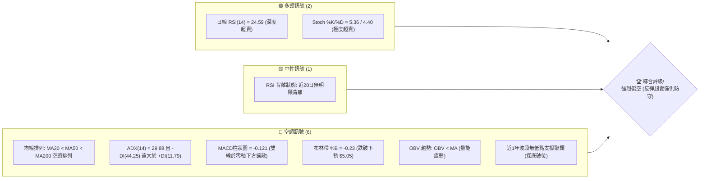
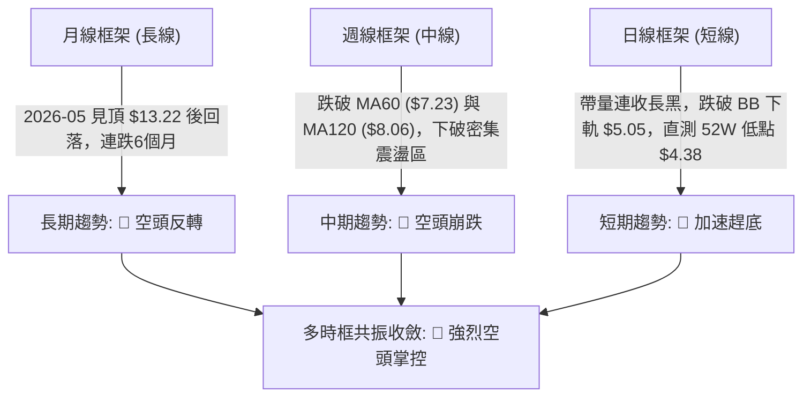
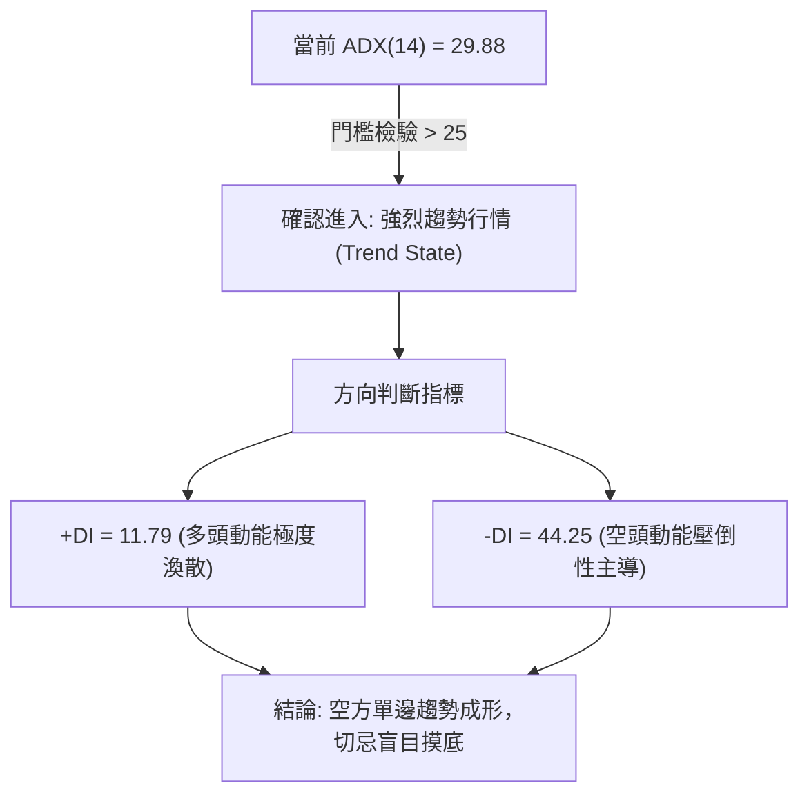
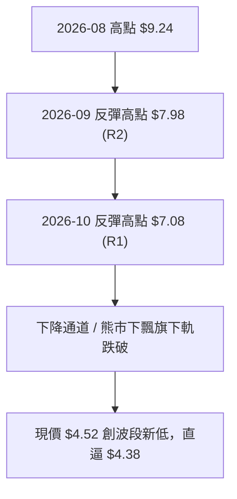
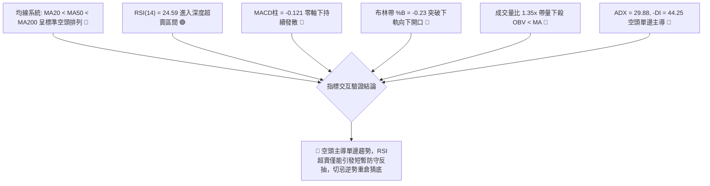
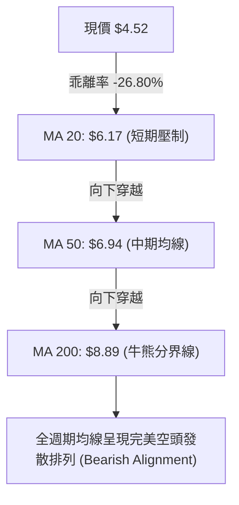
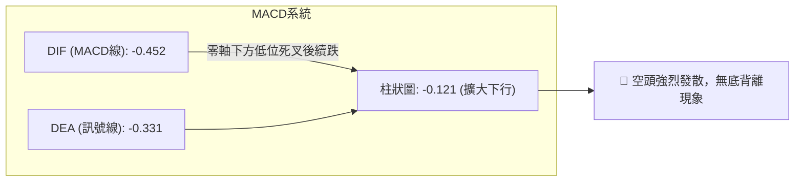
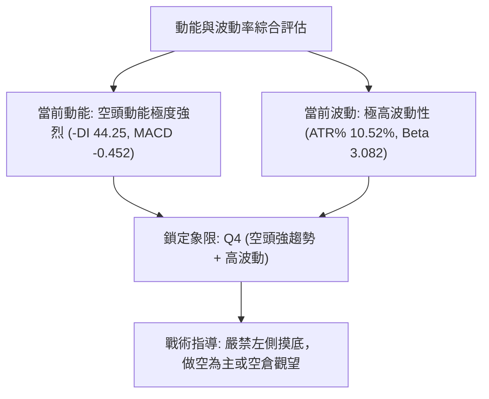
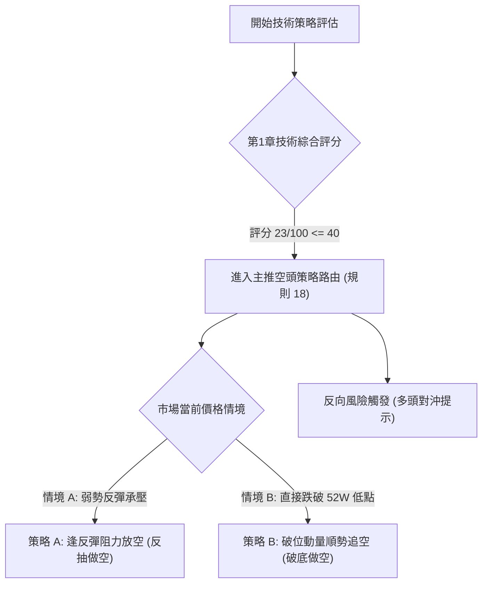
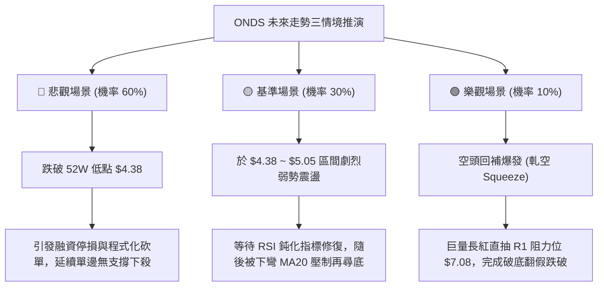

# ONDS 技術分析報告

> **報告日期**：2026-11-06 ｜ **語言**：繁體中文 ｜ **數據來源**：Yahoo Finance ｜ **當前價格**：$4.52

---

## 目錄

| 章節 | 內容 |
|------|------|
| [1. 技術面概覽](#1-技術面概覽) | 訊號儀表板、核心指標、評分卡 |
| [2. 趨勢分析](#2-趨勢分析) | 多時框趨勢、長中短期走勢 |
| [3. 圖表形態分析](#3-圖表形態分析) | 形態識別、K線組合、目標價 |
| [4. 支撐與阻力](#4-支撐與阻力) | 關鍵價位、斐波那契回調 |
| [5. 技術指標深度解讀](#5-技術指標深度解讀) | MA/RSI/MACD/布林/成交量 |
| [6. 動能與波動率](#6-動能與波動率) | 動能評估、ATR、Beta |
| [7. 多時框架總結](#7-多時框架總結) | 時框架評分矩陣 |
| [8. 交易策略建議](#8-交易策略建議) | 多空策略、風險報酬比 |
| [9. 風險提示與監控](#9-風險提示與監控) | 監控指標、風險場景 |
| [報告總結](#-報告總結) | 核心結論與策略彙整 |

---

## 1. 技術面概覽

### 🎯 技術訊號儀表板



### 📊 核心指標速覽表

| 指標類別 | 指標名稱 | 當前數值 | 訊號 | 解讀 |
|----------|----------|----------|------|------|
| **價格** | 當前收盤價 | $4.52 | 🔴 | 位於 52 週區間僅 1.3% 位置，逼近 52 週最低點 $4.38 |
| **均線** | MA20 | $6.17 | 🔴 | 價格低於 MA20 達 -26.80%，短中期均線形成重壓 |
| **均線** | MA50 | $6.94 | 🔴 | 價格低於 MA50，中期下降趨勢結構極度穩固 |
| **均線** | MA200 | $8.89 | 🔴 | 價格低於 MA200 達 -49.16%，長期生命線徹底失守 |
| **動能** | RSI(14) | 24.59 | 🟢 | 進入極度超賣區（<30），技術性短彈需求升高 |
| **動能** | MACD (12,26,9) | -0.452 / -0.331 | 🔴 | MACD 線與訊號線雙雙深陷負值區，柱狀圖為 -0.121 呈現發散空頭 |
| **動能** | KD (Stoch) | %K 5.36 / %D 4.40 | 🟢 | 極度超賣，但尚未形成黃金交叉確認線 |
| **趨勢** | ADX / ±DI | ADX: 29.88, -DI: 44.25 | 🔴 | ADX > 25 確認趨勢行情，-DI 壓倒性主導，空頭動能強烈 |
| **通道** | 布林通道 | 下軌 $5.05 / %B -0.23 | 🔴 | 價格嚴重脫離下軌開口下行，呈現極端弱勢「貼軌崩跌」特徵 |
| **量能** | 成交量 / 20日均量 | 64,372,100 / 47,564,240 | 🔴 | 量比達 1.35x，帶量長黑摜破下軌，機構殺多籌碼湧現 |
| **波動** | ATR(14) | $0.48 (10.52%) | 🔴 | 每日波動幅度逾 10.5%，波動極高，持倉風險巨大 |

### 🏆 技術評分卡

```
╔══════════════════════════════════════════════════════════════════╗
║                   技術評分卡 — ONDS (2026-11-06)                 ║
╠══════════════════════════════════════════════════════════════════╣
║ 趨勢強度 (空頭極強)  ████████████████░░░░  20/100  🔴 極弱 (反向)║
║ 動能指標 (超賣醞釀)  ███████░░░░░░░░░░░░░  35/100  🔴 弱勢超賣   ║
║ 支撐穩定度 (無支撐)  ██░░░░░░░░░░░░░░░░░░  10/100  🔴 空白破底   ║
║ 成交量配合 (空方放量)████████░░░░░░░░░░░░  40/100  🟡 殺多帶量   ║
║ 形態完整度 (下飄旗破)████░░░░░░░░░░░░░░░░  20/100  🔴 破位下行   ║
║ 均線排列 (標準空頭)  ██░░░░░░░░░░░░░░░░░░  10/100  🔴 全線下彎   ║
╠══════════════════════════════════════════════════════════════════╣
║ 綜合評分             ████░░░░░░░░░░░░░░░░  23/100  🔴 強烈偏空   ║
║ (計算公式: (20 + 35 + 10 + 40 + 20 + 10) / 6 = 22.5 → 四捨五入 23)║
╚══════════════════════════════════════════════════════════════════╝
```

---

## 2. 趨勢分析

### 🌐 多時框趨勢分析



### 📈 長期趨勢 — 12個月走勢圖（Unicode）

依據月線歷史數據繪製過去 12 個月（2025-12 至 2026-11）之收盤走勢：

```
ONDS 月線走勢圖（過去12個月：2025-12 至 2026-11）
價格軸 ($)
$13.50 ┤                                      ● (2026-05 高點 $13.22)
$12.00 ┤                                     / \
$10.50 ┤          ● (2026-01 $10.36)        /   \
$9.00  ┤ ●       / \                       /     ● (2026-06 $8.24)
$7.50  ┤  \     /   ● (2026-03 $9.04)     /       \──●───● (2026-08 $7.66)
$6.00  ┤   \   /                             \              \──● (2026-10 $6.32)
$4.50  ┤    \ /                               \                \──●←現價 $4.52
       └─────────────────────────────────────────────────────────────
         12   01   02   03   04   05   06   07   08   09   10   11 (月份)
         25   26   26   26   26   26   26   26   26   26   26   26 (年份)
```

**月線走勢特徵分析表格**：

| 週期階段 | 起訖月份 | 起點收盤 | 終點收盤 | 區間漲跌幅 | 核心走勢特徵解讀 |
|----------|----------|----------|----------|------------|------------------|
| 高檔盤整期 | 2025-12 ~ 2026-04 | $9.76 | $10.04 | +2.87% | 在 $9.04 ~ $10.36 區間構築高檔平臺，多空拉鋸激烈。 |
| 末升噴出期 | 2026-04 ~ 2026-05 | $10.04 | $13.22 | +31.67% | 月線放量長紅噴出，創下收盤波段極值 $13.22（盤中達 52W 高點 $15.28）。 |
| 斷崖崩跌期 | 2026-05 ~ 2026-07 | $13.22 | $7.49 | -43.34% | 獲利了結與高槓桿爆倉引發斷崖式下跌，直接跌破月線上升趨勢線。 |
| 弱勢橫盤期 | 2026-07 ~ 2026-09 | $7.49 | $7.33 | -2.14% | 於 $7.30 ~ $7.70 形成極弱勢熊市旗形整理，反彈無力。 |
| 破位加速期 | 2026-09 ~ 2026-11 | $7.33 | $4.52 | -38.34% | 旗形下軌失守，連續兩個月跳水破底，直探 52 週低點 $4.38。 |

### 📊 中期趨勢（週線分析）

從近 20 週收盤走勢可見，股價在 2026-08-14 於 $9.24 形成中期次高點反彈失敗後，週線呈現持續的低點與高點下移（Lower Highs & Lower Lows）。
- **關鍵均線壓制**：週線於 10 月初跌破 $7.00 大關後，週成交量雖略有萎縮，但近兩週伴隨下殺放量至 2.17 億與 1.89 億股，賣壓並未竭盡。
- **動能擴散**：週線 MACD 柱狀圖由 2026-10-30 的 +0.078 迅速翻黑至 2026-11-05 的 -0.121，週 RSI 亦直接自 42.4 摜破至 24.6。

```
週線中期壓力與支撐示意圖
══════════════════════════════════════════════════════════════
$9.24 ─── 2026-08 波段反彈頂部 (中期強壓力)
           \
$7.98 ───── R2 阻力 (2026-09-25 週K高點聚類)
             \
$7.08 ─────── R1 阻力 (近三週反彈高點聚類，頸線轉阻力)
               \
$4.52 ───────── 當前收盤價 (極度瀕臨 52W 低點)
$4.38 ───────── 52W 最低點 (2026-11-05 最低價，若失守下方無波段支撐)
══════════════════════════════════════════════════════════════
```

### ⚡ 趨勢強度評估（ADX 解讀）



**ADX 趨勢強度量化對照表**：

| ADX 數值區間 | 當前狀態 | 趨勢性質 | 交易方針 |
|--------------|----------|----------|----------|
| 0 ~ 20 | 否 | 無趨勢 / 盤整市場 | 震盪指標高拋低吸 |
| 20 ~ 25 | 否 | 趨勢醞釀中 | 觀望等待方向確認 |
| **25 ~ 40** | **29.88 (當前)** | **強烈單邊趨勢** | **順應空頭方向操作，不可逆勢做多** |
| 40 以上 | 否 | 極端過熱趨勢 | 留意單邊行情噴出或力竭反轉 |

---

## 3. 圖表形態分析

### 🔍 形態識別系統



**形態識別與信心度評估表**（依規則 15）：

| 形態名稱 | 信心度 | 判斷依據（引用數據） | 完成度 | 目標價（附計算式） |
|----------|--------|----------------------|--------|--------------------|
| **熊市下飄旗 (Bear Flag) 破位** | 85% | 8至10月於 $6.00 ~ $7.98 形成收斂旗形，11月帶量跳空跌破旗形下軌 $6.04 | 100% (已跌破) | 由旗形高點 $7.08 與下軌破位點 $6.04 計算高度為 $1.04；破位點 $6.04 − $1.04 = $5.00（已跌破抵達 $4.52，形態完全兌現） |
| **日線雙重底 (Double Bottom)** | 25% | 目前僅於 2026-11-05 出現單一低點 $4.38，未形成第二次探底與回升確認 | 15% (未成形) | 訊號不足，僅做指標型超賣解讀，不得預設雙底成立 |
| **大型頭肩頂 (Head & Shoulders)** | 40% | 2026-05 見頂 $15.28（頭部），左右肩對應 2026-01 之 $10.36 與 2026-08 之 $9.24，頸線約在 $7.08 附近 | 70% | 數據中 2024-2025 歷史走勢跨度過大，幾何形態對稱性低，判定為弱對稱頂部，僅供參考 |

### 🕯️ 重要 K 線形態分析

嚴格依據數據中「近 10 根日 K」與「近 8 根週 K」之真實 OHLCV 進行解讀（規則 19）：

| 日期（時框） | 開盤價 | 最高價 | 最低價 | 收盤價 | K線形態名稱 | 技術解讀 | 訊號 |
|--------------|--------|--------|--------|--------|-------------|----------|------|
| 2026-10-28 (日K) | 6.69 | 6.88 | 6.56 | 6.86 | 多頭實體紅K | 延續反彈，帶量挑戰短期高點，多頭最後抵抗 | 🟢 |
| 2026-10-29 (日K) | 6.74 | 7.08 | 6.74 | 6.88 | 上影流星線 | 上攻遇阻於阻力位 R1 ($7.08)，留長上影線，多頭力竭 | 🔴 |
| 2026-10-30 (日K) | 6.46 | 6.60 | 6.18 | 6.32 | 實體黑K包覆 | 低開低走吞噬前兩日實體，反轉確認信號 | 🔴 |
| 2026-11-02 (日K) | 6.38 | 6.40 | 5.72 | 5.75 | 破位中長黑K | 實體貫穿 $6.00 心理關卡與 MA20 ($6.17)，空頭主導 | 🔴 |
| 2026-11-03 (日K) | 5.80 | 6.09 | 5.77 | 5.79 | 假反彈十字星 | 盤中上衝 $6.09 遭空方反撲壓回，量縮弱勢整理 | 🟡 |
| 2026-11-04 (日K) | 5.70 | 5.78 | 5.22 | 5.27 | 加速長陰K | 跌破布林下軌 $5.05 前奏，恐慌盤開始釋放 | 🔴 |
| 2026-11-05 (日K) | 5.09 | 5.16 | 4.38 | 4.52 | 爆量長下影黑K | 跳空重挫，最低下探 52W 低點 $4.38，成交量激增至 6,437 萬股 | 🔴 |
| 2026-10-23 (週K) | 6.20 | 6.37 | 5.88 | 6.20 | 紡錘十字線 | 週線震盪收平，多空於 $6.00 水平激烈博弈 | 🟡 |
| 2026-10-30 (週K) | 6.17 | 7.08 | 6.04 | 6.32 | 長上影假突破線 | 週線衝擊 R1 ($7.08) 嚴重受挫，空方賣壓沉重 | 🔴 |
| 2026-11-05 (週K) | 6.38 | 6.40 | 4.38 | 4.52 | 斷崖巨陰K | 單週大跌 -28.48%，直摜 52 週最低點，技術結構全面瓦解 | 🔴 |

### 📉 ASCII 走勢形態示意圖

近 10 個交易日（2026-10-23 至 2026-11-05）價格跌落崩跌示意：

```
ONDS 近10日日K走勢形態示意圖
價格 ($)
$7.20 ┤
$7.00 ┤              ┌─┐ (10-29 高點 $7.08，流星倒狀)
$6.80 ┤          ┌─┐ │ │
$6.60 ┤      ┌─┐ │ │ └┬┘
$6.40 ┤  ┌─┐ │ │ └┬┘  │   ┌─┐
$6.20 ┼──┤ ├─┴┬┘──┼───┼───┤ ├──┬─┐
$6.00 ┤  └┬┘      │   │   └┬┘  │ │  ┌─┐
$5.80 ┤   │       │   │    │   └┬┘  │ │
$5.60 ┤   │       │   │    │    │   └┬┘  ┌─┐
$5.40 ┤   │       │   │    │    │    │   │ │
$5.20 ┤   │       │   │    │    │    │   └┬┘  ┌─┐
$5.00 ┼───┼───────┼───┼────┼────┼────┼────┼───┤ ├─ 跌破布林下軌 $5.05
$4.80 ┤   │       │   │    │    │    │    │   └┬┘
$4.60 ┤   │       │   │    │    │    │    │    │   ┌─┐
$4.40 ┤   │       │   │    │    │    │    │    │   └┬┘ (11-05 低點 $4.38)
      └─┴───┴───┴───┴────┴────┴────┴────┴────┴───────
        10/23 10/27 10/28 10/29 10/30 11/02 11/03 11/04 11/05
```

### 🎯 形態目標價計算

根據熊市破位形態高度推算：
1. **旗形破位等幅測距**：
   - 形態頂部：2026-10-29 高點 $7.08
   - 形態底部頸線：2026-10-30 低點 $6.18
   - 旗形高度 $H = 7.08 - 6.18 = 0.90$
   - 跌破頸線後第一測幅目標價 = $6.18 - 0.90 = \$5.28$（2026-11-04 實體收盤 $5.27 精準抵達）
2. **第二段加速測幅推算**：
   - 破位中樞點：2026-11-02 跳空開盤點 $6.38
   - 當前波段低點：$4.38
   - 若短線反彈未能站回 $5.05（布林下軌），形態將維持單邊向下擴散。

---

## 4. 支撐與阻力

### 🗺️ 關鍵價位分布圖（Unicode）

```
ONDS 價位結構分布圖 (由 OHLCV 與斐波那契精確計算)
═════════════════════════════════════════════════════════════════
$15.28 ║████████████████████████████████████████║ 52W 歷史最高點 (Fib 0.0%)
$12.71 ║████████████████████████████████        ║ Fib 23.6% 回調位
$11.11 ║██████████████████████████              ║ Fib 38.2% 回調位
$9.83  ║██████████████████████                  ║ Fib 50.0% 中樞平衡位
$8.89  ║████████████████████                    ║ MA200 長期牛熊分界線
$8.58  ║██████████████████                      ║ 強阻力 R3 (Fib 61.8% 位於 $8.54)
$7.98  ║██████████████                          ║ 中期阻力 R2 (2026-09-25 高點)
$7.08  ║████████████                            ║ 近期關鍵阻力 R1 (Fib 78.6% 位於 $6.71)
$6.17  ║████████                                ║ MA20 / 布林通道中軌
$5.05  ║████                                    ║ 布林通道下軌 (短線反抽第一道阻力)
───────╫────────────────────────────────────────╢
$4.52  ╠════════════════════════════════════════╣ ◄ 當前收盤價 (現價)
───────╫────────────────────────────────────────╢
$4.38  ║▓▓▓▓▓▓▓▓▓▓▓▓▓▓▓▓▓▓▓▓▓▓▓▓▓▓▓▓▓▓▓▓▓▓▓▓▓▓▓║ 52W 最低點 (Fib 100.0% 極限支撐)
[空白] ║                                        ║ 數據中未偵測到任何 swing-low 支撐聚類
═════════════════════════════════════════════════════════════════
```

### 🚧 阻力位分析表

阻力位嚴格引用技術數據區塊中波段高點聚類計算之數值：

| 阻力級別 | 價位 | 形成原因 | 突破難度 | 重要性 |
|----------|------|----------|----------|--------|
| **R1 (關鍵短線阻力)** | $7.08 | 2026-10-29 波段高點，近月反彈破位頸線聚類 | ⭐️⭐️⭐️⭐️☆ (極高) | 短線空頭強壓，多頭反轉之必要條件 |
| **R2 (中期阻力)** | $7.98 | 2026-09-25 週K波段高點聚類，前次反彈夭折處 | ⭐️⭐️⭐️⭐️⭐️ (巨大) | 中期空頭防守防線，未站上中期弱勢不變 |
| **R3 (強波段阻力)** | $8.58 | 2026-08 波段密集換手區聚類，逼近 Fib 61.8% ($8.54) | ⭐️⭐️⭐️⭐️⭐️ (極難) | 密集成交籌碼套牢區，多空分水嶺 |

### 🛡️ 支撐位分析表

依據數據揭示，在當前收盤價 $4.52 之下，**波段低點聚類分析明確顯示：「no swing-low support detected below current price」（數據中未偵測到任何歷史擺動低點支撐聚類）**。
唯一具備技術參考價值的客觀數據僅為 52 週最低點：

| 支撐級別 | 價位 | 形成原因 | 守住機率 | 重要性 |
|----------|------|----------|----------|--------|
| **極限支撐 (52W Low)** | $4.38 | 2026-11-05 盤中創下的 52 週最低價，亦為 Fib 100.0% | 40% (岌岌可危) | 最後技術底線，若放量跌破將進入無支撐真空區 |
| **次級支撐** | N/A（數據未提供） | 數據中未偵測到 $4.38 下方之任何擺動支撐聚類 | N/A | 不得憑空捏造點位，需待新底築出 |

### 📐 斐波那契回調位分析

以 52 週極值區間 $4.38（低點）→ $15.28（高點）為基準：

| 斐波那契回調比例 | 精確價位 | 技術意義與當前相對位置解讀 |
|------------------|----------|----------------------------|
| 0.0% (52W High) | $15.28 | 過去一年歷史天花板，多頭全盛時期頂部。 |
| 23.6% | $12.71 | 首道回撤支撐，2026-05 崩跌時迅速失守。 |
| 38.2% | $11.11 | 強勢整理回調位，失守後宣告上升趨勢終結。 |
| 50.0% | $9.83 | 多空中樞平衡軸，目前股價遠在該軸之下 -54.02%。 |
| 61.8% (黃金分割) | $8.54 | 牛熊分水嶺，與 R3 阻力位 ($8.58) 形成高度技術共振。 |
| 78.6% | $6.71 | 深幅回撤防守位，10 月底反彈遇阻 R1 ($7.08) 後已全面跌破。 |
| **100.0% (52W Low)** | **$4.38** | **全面回吐一年所有漲幅，當前現價 $4.52 距離該底線僅剩 +3.19% 緩衝空間。** |

**位置解讀**：現價 $4.52 落在 Fib 78.6% ($6.71) 與 Fib 100.0% ($4.38) 之間，極度逼近 100% 終極回撤位。此種型態說明過去一整年的多頭動能已被完全抹除，空方處於壓倒性主導地位。

---

## 5. 技術指標深度解讀

### 🎛️ 指標訊號總覽



### 📈 移動平均線排列分析



**移動平均線數值與乖離狀況速查表**：

| 均線名稱 | 當前價位 | 現價相較均線差距 | 均線歷史軌跡走勢特徵 |
|----------|----------|------------------|----------------------|
| **MA 5** | $5.53 | -18.26% | 陡峭俯衝下行，短線每日均價重心快速崩解 |
| **MA 10** | $6.04 | -25.17% | 空頭發散，形成第一道均線蓋頂阻力 |
| **MA 20** | $6.17 | -26.80% | 連續跌破，與布林中軌完全重合，中短線空頭核心防線 |
| **MA 60** | $7.23 | -37.50% | 下穿 MA120，中線趨勢結構已完全破壞 |
| **MA 120** | $8.06 | -43.91% | 下彎幅度擴大，半年線籌碼全數套牢 |
| **MA 200** | $8.89 | -49.16% | 長期趨勢轉空，價格腰斬 |
| **MA 240** | $9.07 | -50.14% | 年線失守，長期投資買盤停損出場 |

### 📉 RSI(14) 分析

- **當前數值**：24.59（Wilder 平滑計算），處於極度超賣狀態（<30）。
- **數值進度條**：
  `RSI(14) [24.59]: █████░░░░░░░░░░░░░░░ 24.59% (極度超賣)`
- **背離分析判斷**：
  檢視數據中明確標示之背離檢驗結果——「RSI 背離: 無明顯背離（僅比較近20根K棒首尾的價格與RSI方向）」。價格在近 20 根 K 線中自 $6.88 快速破底至 $4.52，RSI 亦同步自 42 上方崩跌至 24.59，**指標走勢與價格創新低方向完全吻合，未出現底背離特徵**。
- **結論**：純粹屬於強趨勢下的「鈍化超賣」，在缺乏底背離與成交量買盤確認前，超賣可能持續長達數週，不可作為單獨進場做多之依據。

### 📊 MACD(12,26,9) 訊號解讀

- **MACD 線**：-0.452
- **訊號線 (Signal Line)**：-0.331
- **柱狀圖 (Histogram)**：-0.121
- **狀態解讀**：MACD 線已深潛於零軸遠端，且與訊號線的負向間距進一步拉大（柱狀圖為負且持續擴大至 -0.121），顯示空頭動能非但未減弱，反而在加速釋放。雙線完全沒有出現鈍化勾頭或黃金交叉跡象。



### 📦 布林通道分析

- **布林上軌**：$7.30
- **布林中軌 (MA20)**：$6.17
- **布林下軌**：$5.05
- **布林指標 %B**：-0.23（小於 0 代表價格跌破下軌外側）

```
ONDS 日線布林通道當前位置示意圖
價格 ($)
$7.30 ┼──────────────────────────────────── 布林上軌 (BB Upper)
      │
$6.17 ┼┄┄┄┄┄┄┄┄┄┄┄┄┄┄┄┄┄┄┄┄┄┄┄┄┄┄┄┄┄┄┄┄┄┄ 布林中軌 (MA20 Baseline)
      │
$5.05 ┼──────────────────────────────────── 布林下軌 (BB Lower)
      │  
$4.52 ┼───► [● 現價 $4.52，%B = -0.23 (嚴重超賣脫軌)]
      │
$4.38 ┼───► 52W 低點
```

**解讀**：%B 為 -0.23 顯示股價已呈現極端的「脫軌超賣」。此種走勢常見於單邊強趨勢噴發期，布林通道呈現「開口向下放大」形態，下軌無法提供強烈支撐，反而成為引導股價下墜的動態阻力帶。若價格短線無法迅速收復 $5.05，將引發新一輪動態下軌壓制。

### 💹 成交量分析（量價配合度）

- **最新成交量**：64,372,100 股
- **20 日均量**：47,564,240 股（量比：1.35x，明顯放量）
- **50 日均量**：55,635,488 股
- **OBV 趨勢**：OBV < MA，量能指標沉淪於均線下方。
- **量價關係解讀**：
  在跌破關鍵整理區間之際（2026-11-04 成交 5,343 萬股，2026-11-05 成交 6,437 萬股），成交量顯著放大至 20 日均量之 1.35 倍。這代表當前的下跌並非「無量陰跌」，而是伴隨大量停損單與高槓桿融資追繳籌碼拋出的「帶量下殺（Volume Dump）」。量能確認了價格破位的有效性，尚未見到量縮止跌的築底跡象。

---

## 6. 動能與波動率

### ⚡ 動能評估四象限

評估維度：動能強度（以 RSI、MACD、-DI 綜合評定） vs 波動率（以 ATR% 10.52% 與 Beta 3.082 評定）：

| 象限 | 動能方向與強度 | 波動率水準 | 當前狀態吻合度 | 市場含義與戰略評估 |
|------|----------------|------------|----------------|--------------------|
| **Q1** | 多頭強動能 | 低波動 | ❌ (無關) | 最佳穩健做多機會，呈現低波慢牛。 |
| **Q2** | 弱動能 / 盤整 | 低波動 | ❌ (無關) | 沉悶磨底，觀望等待方向。 |
| **Q3** | 多頭強動能 | 高波動 | ❌ (無關) | 成長股主升浪，暴利伴隨高回撤。 |
| **Q4** | **空頭強動能 (極端弱勢)** | **極高波動** | **✅ 完美符合 (Q4 區域)** | **高風險殺多區，多方流血不止，極端易出現日內劇烈雙向掃損，避免盲目進場。** |



### 📊 ATR 波動率分析

- **ATR(14)**：$0.48
- **ATR 佔比 (ATR % of Price)**：10.52%
- **波動率解讀**：
  ONDS 的平均真實波幅高達股價的 10.52%，意味著單日股價波動超過一成乃是常態。
- **風控止損距離建議**：
  - **一般震盪濾網**：以 $1.5 \times \text{ATR}$ 計算，即 $1.5 \times \$0.48 = \$0.72$ 的安全防守邊界。
  - **趨勢防守邊界**：以 $2.0 \times \text{ATR}$ 計算，即 $2.0 \times \$0.48 = \$0.96$。
  - 在高達 10.52% 的 ATR 環境下，任何緊繃的止損（如 3%~5%）極易遭受盤中雜訊掃出場，必須縮減單筆持倉口數以匹配高波動。

### 📐 Beta 與市場相關性

- **Beta 係數**：3.082
- **機構與空頭籌碼特性**：
  - 空頭佔流通股比例 (Short % Float)：高達 43.9%
  - 空頭回補天數 (Short Ratio)：4.11
  - 機構持股比例 (Institution Own %)：58.7%
- **關聯性解讀**：
  Beta 高達 3.082，代表該股波動幅度為標普 500 指數的 3 倍以上，屬於極高彈性之高 Beta 投機標的。高達 43.9% 的空頭部位意味著市場存在巨大做空資金押注；此籌碼結構在空頭走勢中會形成無情的滾雪球殺多，但在極端超賣下，一旦有利多刺激亦可能誘發猛烈的軋空（Short Squeeze）回抽，呈現「易暴跌、亦易暴衝」的極端特質。

---

## 7. 多時框架總結

### 📋 時框架評分表

| 時框架 | 趨勢方向 | 動能狀態 | 均線排列 | 圖表形態 | 綜合評分 | 操作建議方針 |
|--------|----------|----------|----------|----------|----------|--------------|
| **月線 (長期)** | 🔴 下行反轉 | 弱勢下墜 | 跌破均線支撐 | 頂部 $13.22 破位向下 | 20/100 | 長期趨勢轉空，長線籌碼瓦解 |
| **週線 (中期)** | 🔴 單邊空頭 | MACD柱翻黑 | 空頭發散 | 熊市旗形下破 | 15/100 | 中線反彈逢高皆為空點 |
| **日線 (短期)** | 🔴 加速趕底 | RSI極度超賣 (24.6) | 完美空頭排列 | 跳空破位大黑K | 35/100 | 空頭主導，防範超賣技術反抽 |

### 🔲 綜合訊號矩陣

```
╔══════════════════════════════════════════════════════════════════╗
║                    ONDS 跨時框多空訊號共振矩陣                   ║
╠══════════════════════════════════════════════════════════════════╣
║ 維度 / 時框     │   短期 (日線)    │   中期 (週線)    │   長期 (月線)    ║
╟─────────────────┼──────────────────┼──────────────────┼──────────────────╢
║ 趨勢方向        │     🔴 強烈看空  │     🔴 強烈看空  │     🔴 看空      ║
║ 均線結構        │     🔴 空頭排列  │     🔴 下彎反壓  │     🔴 破位      ║
║ 動能指標        │     🟢 嚴重超賣  │     🔴 空方增強  │     🔴 轉弱下行  ║
║ 成交量驗證      │     🔴 放量殺多  │     🔴 出貨量大  │     🟡 換手      ║
║ 關鍵結構點      │  逼近 52W 低點   │  失守中樞支撐    │  回吐全數升幅    ║
╠══════════════════════════════════════════════════════════════════╣
║ 矩陣收斂共振評級│ 🔴 空頭共振 (90%) 僅日線超賣提供微弱短彈雜訊   ║
╚══════════════════════════════════════════════════════════════════╝
```

### ⚖️ 多時框收斂結論

依據多時框收斂規則（規則 14）：
1. **趨勢判定**：當前 ADX(14) 數值為 29.88（大於 25 臨界值），**確立市場處於「強烈趨勢行情」而非震盪市**。
2. **優先級收斂**：在趨勢行情中，必須以中長期（週線、MA50 $6.94、MA200 $8.89）的大方向為主導；日線超賣指標僅能用來尋找反抽高點的放空時機，絕對不可作為逆勢抄底的依據。
3. **收斂結論**：**唯一方向性結論為「🔴 強烈偏空（順勢做空 / 逢反彈放空）」**。日線極端超賣（RSI 24.59、%B -0.23）僅代表價格隨時可能出現日內劇烈脈衝，但無法扭轉週月線共振向下的毀滅性空頭結構。

---

## 8. 交易策略建議

### 🗺️ 策略決策流程圖



### 🧭 策略路由（依評分卡分流，不得兩頭下注）

> **當前主策略方向 = 🔴 主推空頭策略（依技術評分卡綜合評分 23/100，嚴格屬於 ≤40 之強烈偏空區間，主推做空，多頭僅列為防守反轉警示）**

### 🎯 價格情境階梯（Price Scenarios）

價位嚴格引用第 4 章及關鍵價位數據中計算之精準數值：

| 觸發條件 | 下一目標 | 後續延伸 | 情境含義解讀 |
|----------|----------|----------|--------------|
| **跌破 52W 低點 $4.38** | 無歷史波段支撐 | 恐慌加速探底 | 空頭完全失控，進入籌碼真空殺多階段 |
| **受阻於布林下軌 $5.05** | 再探 $4.52 | 考驗 $4.38 | 超賣反抽無力，典型的貼軌弱勢陰跌循環 |
| **反彈受阻於 R1 $7.08** | MA20 ($6.17) | 回測 $5.05 | 中短線強阻力確認，提供絕佳波段做空甜蜜點 |
| **帶量突破 R1 $7.08** | R2 $7.98 | R3 $8.58 | 空頭結構被暫時破壞，超賣空頭回補爆發 |

### 📊 情境機率分佈

| 價格情境場景 | 機率估計 | 主要技術指標支撐依據 |
|--------------|----------|----------------------|
| **跌破低點加速下探 (主情境)** | 60% | ADX 29.88 強趨勢、-DI 44.25 主導、OBV 疲弱、跌破布林下軌且量能放大 |
| **超賣弱勢反抽後下墜 (次情境)** | 30% | 日線 RSI 24.59 極度超賣、KD 低檔超賣，存在技術性回抽 MA20/下軌需求 |
| **技術反轉強烈反彈 (極端情境)** | 10% | 需仰賴 43.9% 高空頭部位引發軋空，但目前無底背離與催化劑配合 |

### 🟢 主策略詳情（方向：主推空頭策略）

嚴格遵守規則 17 之風險報酬比計算定義：
- 做空風險報酬比公式：$(進場價 - 目標價 T1) / (止損價 - 進場價)$
- 進場價若為區間，以「區間中點」計算並註明。

| 策略要素 | 策略 A（反彈高空 — 逢反抽布林下軌放空） | 策略 B（破位追空 — 跌破 52W 低點順勢做空） |
|----------|-----------------------------------------|---------------------------------------------|
| **操作性質** | 順勢逢高沽空（勝率較高） | 順勢破位動量做空（突破型） |
| **進場條件** | 股價盤中反抽布林下軌 $5.05 附近遇阻滯漲 | 實體 K 線跌破 52 週最低點 $4.38 確認破位 |
| **進場價格** | **$5.05** | **$4.35** (跌破 $4.38 觸發) |
| **目標價 T1** | **$4.52** (當前收盤價位) | **$3.87** (由 ATR $0.48 測算之 1倍波幅擴展目標) |
| **目標價 T2** | **$4.38** (52W 最低點) | **$3.39** (由 ATR $0.48 測算之 2倍波幅擴展目標) |
| **止損價格** | **$5.35** (高於進場點約 0.62×ATR 防守位) | **$4.59** (設定於 $4.35 加上 0.5×ATR 防守位) |
| **風險報酬比** | **1 : 1.77（以 T1 計）**<br>*(計算式: (5.05 - 4.52) / (5.35 - 5.05) = 0.53 / 0.30 = 1.77)*<br>※ 另列至 T2 比值: 1 : 2.23（以 T2 計）<br>*(計算式: (5.05 - 4.38) / 0.30 = 2.23)* | **1 : 2.00（以 T1 計）**<br>*(計算式: (4.35 - 3.87) / (4.59 - 4.35) = 0.48 / 0.24 = 2.00)*<br>※ 另列至 T2 比值: 1 : 4.00（以 T2 計）<br>*(計算式: (4.35 - 3.39) / 0.24 = 4.00)* |
| **成功機率** | 65% | 55% |
| **建議倉位** | 10% (高波動標的控制總風險) | 5% (破底追單嚴格輕倉) |

### 🔴 反向風險觸發點（對沖提示）

以下關鍵價位與指標轉變將直接推翻空頭主策略，持空者必須無條件停損出場或轉為對沖觀望：
1. **突破短線防守頸線**：若日線收盤價強勢突破 **$5.05（布林通道下軌）** 並站穩，顯示脫軌暴跌行情告一段落，空單應先行平倉離場。
2. **中期多頭反轉點**：若股價出現報復性反彈並放量向上突破 **R1 ($7.08)**，技術面將形成大型破底翻結構，空頭邏輯徹底失效。
3. **指標翻多確認**：日線 MACD 出現零軸下方向上金叉，且 RSI(14) 突破 50 中軸線。

### ⭐ 整體訊號強度評星

```
╔══════════════════════════════════════════════════════╗
║ 做多訊號強度：★☆☆☆☆  (1/5星 - 僅存數值超賣，無底型)  ║
║ 做空訊號強度：★★★★☆  (4/5星 - 均線/趨勢/通道共振偏空) ║
║ 整體可信度：  ★★★★☆  (4/5星 - 數據完整，趨勢極其明朗)║
╚══════════════════════════════════════════════════════╝
```

---

## 9. 風險提示與監控

### ✅ 關鍵監控指標 Checklist

```
╔══════════════════════════════════════════════════════════════════╗
║                   ONDS 關鍵技術風控監控清單                      ║
╠══════════════════════════════════════════════════════════════════╣
║ [ ] 52W 低點防線: 每日收盤價是否跌破 $4.38 (失守則開啟無底洞)     ║
║ [ ] 布林通道狀態: 收盤價是否重新收復下軌 $5.05 (脫離單邊超跌)     ║
║ [ ] 均線動態反壓: 價格是否挑戰 MA10 ($6.04) 與 MA20 ($6.17)      ║
║ [ ] RSI 超賣修復: RSI(14) 能否自 24.59 站回 30 上方並維持走平     ║
║ [ ] 異常成交放量: 單日成交量若突破 1 億股且收長下影 (疑似主力接盤)║
║ [ ] 軋空爆發指標: 空頭比例高達 43.9%，警惕單日 >20% 的脈衝式抽高 ║
╚══════════════════════════════════════════════════════════════════╝
```

### ⚠️ 風險場景分析



### 🛡️ 風險管理重要提醒

1. **極端波動風險（High Beta & ATR）**：ONDS 具有 3.082 的極高 Beta 係數，且 ATR 佔股價高達 10.52%。日內震盪動輒超過一成，任何交易皆必須採用**「縮小部位、放大止損空間」**原則，單筆交易承受虧損不得超過總投資組合資產的 1.0%。
2. **極高空頭佔比引發的軋空剪刀差**：高達 43.9% 的 Float 空頭部位是雙面刃。雖然目前空方佔據絕對優勢，但在深度超賣背景下，若有突發性防禦無人機合約利多消息，容易引發空頭踩踏式回補，出現日內 15%~30% 的極端暴拉。因此做空**必須嚴格掛設硬止損（如策略設定之 $5.35 或 $4.59）**，絕不允許留無保護的裸空部位過夜。
3. **無歷史波段支撐風險**：當前價格 $4.52 距離 52 週最低點 $4.38 僅一步之遙，且下方「數據中未偵測到任何擺動低點支撐聚類」。一旦跌破 $4.38，下方在長達數年的結構中皆無密集換手籌碼，屬於價格未知領域，不可因「股價便宜」而進行左側金字塔式加碼攤平。

---

## 📋 報告總結

```
╔══════════════════════════════════════════════════════════════════╗
║                    ONDS 技術分析報告總結                         ║
╠══════════════════════════════════════════════════════════════════╣
║ 報告日期：2026-11-06                                             ║
║ 當前價格：$4.52                                                  ║
║ 分析評級：🔴 強烈偏空 / 逢反彈放空 (綜合評分: 23/100)           ║
╟──────────────────────────────────────────────────────────────────╢
║ 關鍵技術結論：                                                   ║
║ ├─ 長期趨勢：🔴 空頭主導 (月線連跌6個月，自高點 $13.22 暴跌腰斬) ║
║ ├─ 中期趨勢：🔴 崩跌下行 (週線熊市旗形下破，ADX=29.88 強空頭)   ║
║ ├─ 短期趨勢：🔴 加速趕底 (日線脫離布林下軌 $5.05，直探 $4.38)    ║
║ ├─ 關鍵支撐：$4.38 (52W最低點/Fib 100%)；下方無波段支撐聚類     ║
║ ├─ 關鍵阻力：$5.05 (布林下軌)、$6.17 (MA20)、$7.08 (近期阻力 R1) ║
║ └─ 華爾街目標：平均目標價 $18.88 (與當前技術盤面嚴重背離)       ║
╟──────────────────────────────────────────────────────────────────╢
║ 最優操作策略組合：                                               ║
║ 1. 🥇 最佳機會：策略 A (反彈至布林下軌 $5.05 放空，風報比 1:1.77)║
║ 2. 🥈 次選機會：策略 B (破位跌穿 $4.38 順勢追空，風報比 1:2.00) ║
║ 3. 🥉 保守選擇：空倉全面觀望，嚴禁在出現底背離與打底前逆勢摸底 ║
╚══════════════════════════════════════════════════════════════════╝
```

---

> ⚠️ **免責聲明**：本報告為技術分析專用報告，所有價位、圖表與指標均基於歷史量價數據之量化模型推算。本報告**僅供研究與技術交流參考**，**不構成任何形式的證券買賣邀約或投資建議**。市場具有高度不確定性，特別是高 Beta 與高空頭比例標的，投資人應自行審慎評估風險並自負盈虧。

---

*報告生成時間：2026-11-06 ｜ 數據來源：Yahoo Finance ｜ 分析框架：多時框技術分析體系*