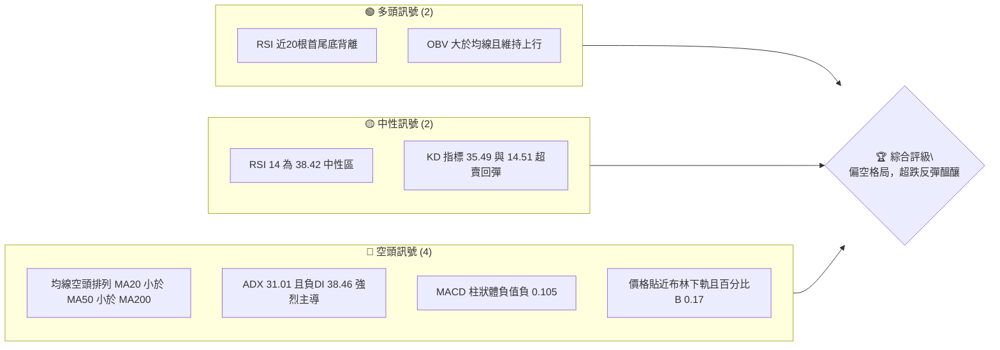
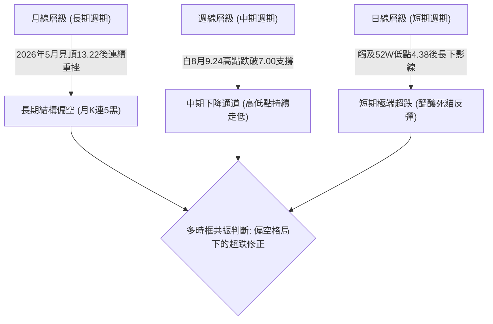
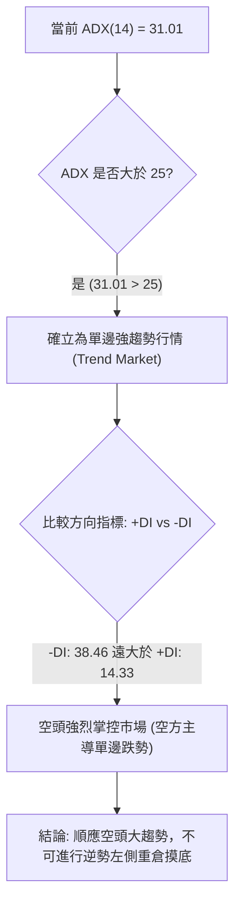
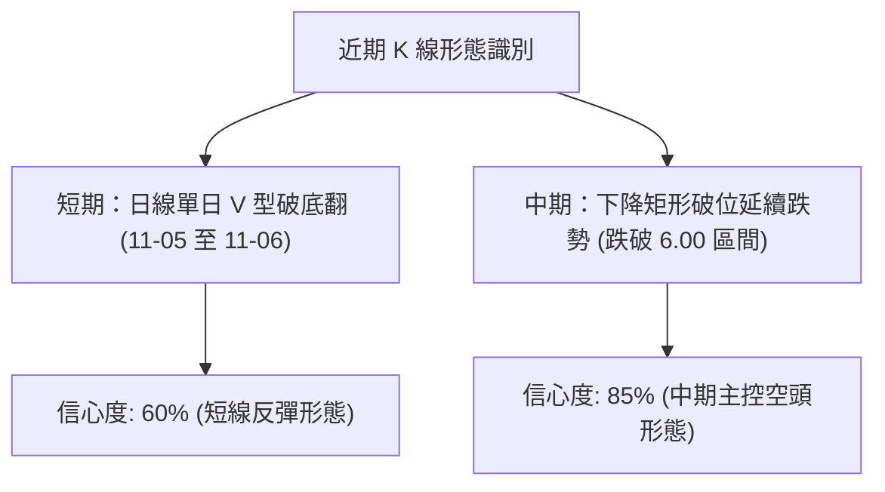
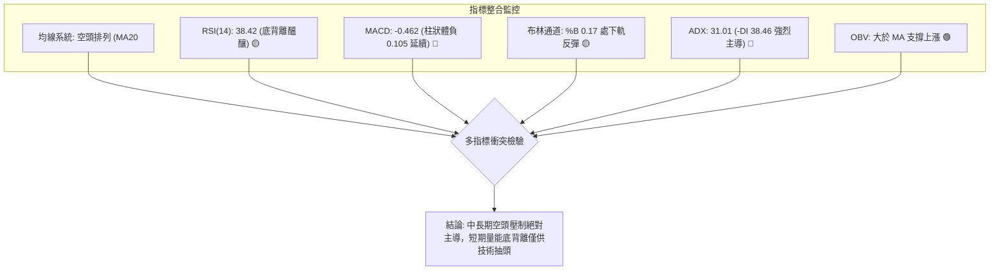
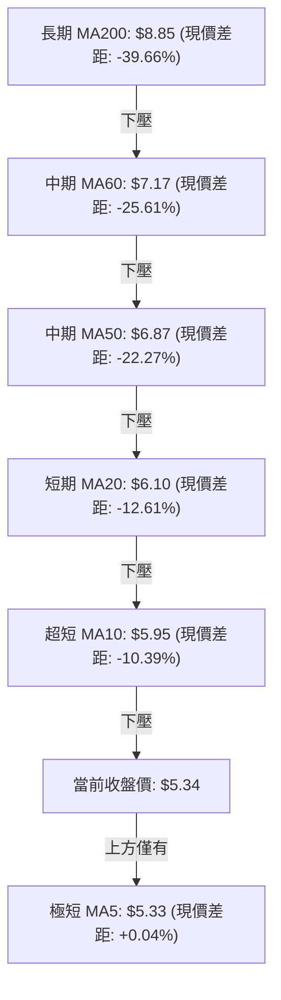
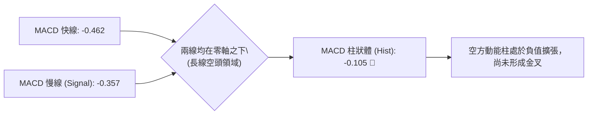
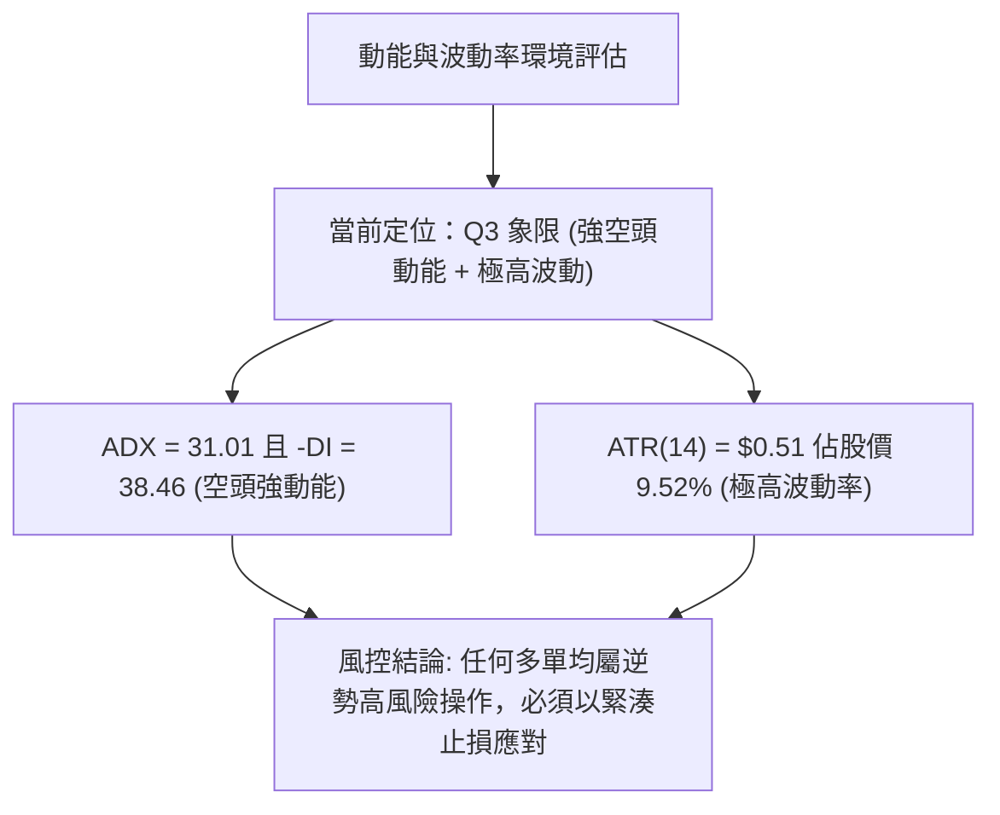
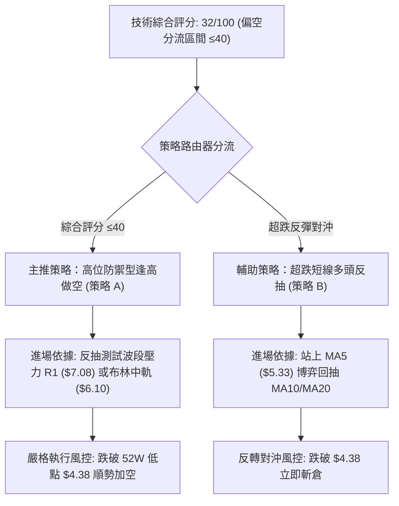
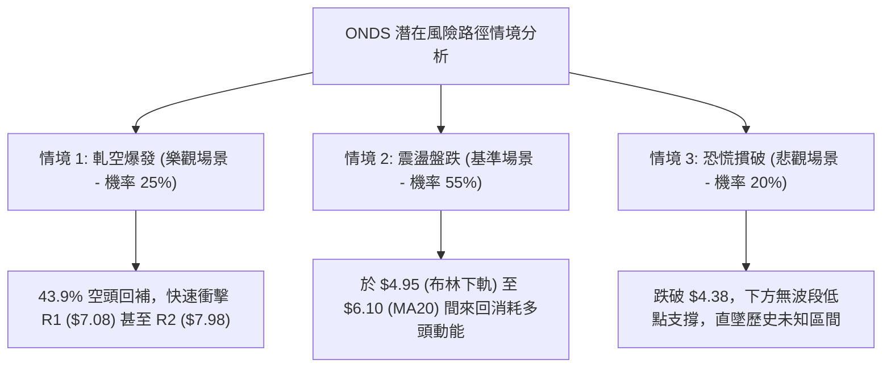

# ONDS 技術分析報告

> **報告日期**：2026-11-08 ｜ **語言**：繁體中文 ｜ **數據來源**：Yahoo Finance ｜ **當前價格**：$5.34

---

## 目錄

| 章節 | 內容 |
|------|------|
| [1. 技術面概覽](#1-技術面概覽) | 訊號儀表板、核心指標、評分卡 |
| [2. 趨勢分析](#2-趨勢分析) | 多時框趨勢、長中短期走勢 |
| [3. 圖表形態分析](#3-圖表形態分析) | 形態識別、K線組合、目標價 |
| [4. 支撐與阻力](#4-支撐與阻力) | 關鍵價位、斐波那契回調 |
| [5. 技術指標深度解讀](#5-技術指標深度解讀) | MA/RSI/MACD/布林/成交量 |
| [6. 動能與波動率](#6-動能與波動率) | 動能評估、ATR、Beta |
| [7. 多時框架總結](#7-多時框架總結) | 時框架評分矩陣 |
| [8. 交易策略建議](#8-交易策略建議) | 多空策略、風險報酬比 |
| [9. 風險提示與監控](#9-風險提示與監控) | 監控指標、風險場景 |

---

## 1. 技術面概覽

### 🎯 技術訊號儀表板



### 📊 核心指標速覽表

| 指標類別 | 指標名稱 | 當前數值 | 訊號 | 解讀 |
|----------|----------|----------|:---:|------|
| **價格** | 當前價格 | $5.34 | 🔴 | 位於 52 週區間 ($4.38 - $15.28) 的 8.8% 低檔區 |
| **均線** | MA20 | $6.10 | 🔴 | 現價低於 MA20 (-12.61%)，短週期空頭壓制 |
| **均線** | MA50 | $6.87 | 🔴 | 現價低於 MA50 (-22.27%)，中週期趨勢偏空 |
| **均線** | MA200 | $8.85 | 🔴 | 現價遠低於 MA200 (-39.66%)，長期結構嚴重破壞 |
| **動能** | RSI(14) | 38.42 | 🟡 | 位於中性偏弱區，首尾 20 根 K 線偵測到底背離 |
| **動能** | MACD | -0.462 | 🔴 | 快慢線均在零軸下方，柱狀體為 -0.105，空方動能延續 |
| **動能** | Stoch %K / %D | 35.49 / 14.51 | 🟡 | %K 由極度超賣區金叉 %D 向上，短線具備技術反抽條件 |
| **趨勢** | ADX(14) | 31.01 | 🔴 | ADX > 25 確立強趨勢，-DI (38.46) 遠高於 +DI (14.33) 空方主導 |
| **通道** | 布林通道 | $4.95 - $7.26 | 🔴 | %B 為 0.17，價格運行於下軌附近，通道口向下張開 |
| **成交量** | 量比 (20日) | 0.93x | 🟡 | 成交量 4,473.99 萬股，略低於 20 日均量 4,798.28 萬股 |
| **波動** | ATR(14) | $0.51 | 🔴 | ATR 佔股價高達 9.52%，日波動極大，空頭宣洩期 |

### 🏆 技術評分卡

```
╔════════════════════════════════════════════════════════════════════╗
║                   技術評分卡 — ONDS (2026-11-08)                    ║
╠════════════════════════════════════════════════════════════════════╣
║ 趨勢強度 (ADX=31.01, -DI主導)   ██████░░░░░░░░░░░░░░  30/100  🔴   ║
║ 動能指標 (RSI=38.42, MACD柱偏空) ████████░░░░░░░░░░░░  40/100  🟡   ║
║ 支撐穩定度 (無波段低點聚類)     ████░░░░░░░░░░░░░░░░  20/100  🔴   ║
║ 成交量配合 (OBV>MA 支撐上漲)    ████████████░░░░░░░░  60/100  🟢   ║
║ 形態完整度 (長黑摜破後弱反彈)   ██████░░░░░░░░░░░░░░  30/100  🔴   ║
║ 均線排列 (MA20<MA50<MA200空排)  ██░░░░░░░░░░░░░░░░░░  10/100  🔴   ║
╠════════════════════════════════════════════════════════════════════╣
║ 綜合評分 (六項算術平均四捨五入) ██████░░░░░░░░░░░░░░  32/100  🔴   ║
║ 評級結論：技術面顯著偏空 (主推高位空頭防禦，嚴禁盲目摸底多單)      ║
╚════════════════════════════════════════════════════════════════════╝
```
*計算備註：綜合評分 = (30 + 40 + 20 + 60 + 30 + 10) ÷ 6 = 190 ÷ 6 = 31.67，四捨五入整數為 32/100（依規則 18）。*

---

## 2. 趨勢分析

### 🌐 多時框趨勢分析



### 📈 長期趨勢 — 12個月走勢圖（Unicode）

以下依據 2025-11 至 2026-11 之歷史月收盤價繪製走勢圖：
- 2025-11: $7.90 ｜ 2025-12: $9.76 ｜ 2026-01: $10.36 ｜ 2026-02: $10.08
- 2026-03: $9.04 ｜ 2026-04: $10.04 ｜ 2026-05: $13.22 (最高點) ｜ 2026-06: $8.24
- 2026-07: $7.49 ｜ 2026-08: $7.66 ｜ 2026-09: $7.33 ｜ 2026-10: $6.32 ｜ 2026-11: $5.34

```
ONDS 月線走勢圖（2025-11 至 2026-11）
價格軸 ($)
$14.00 ┤                             ● (2026-05: $13.22)
$13.00 ┤                            ╱ ╲
$12.00 ┤                           ╱   ╲
$11.00 ┤                 ●        ╱     ╲
$10.00 ┤            ●───╱ ╲──●───╱       ╲
$9.00  ┤       ●   ╱       ╲             ╲
$8.00  ┤  ●───╱   ╱         ╲             ╲──● (08)
$7.00  ┤ ╱                                  ╲  ╲──● (09)
$6.00  ┤                                     ╲     ╲──● (10)
$5.00  ┤                                      ╲        ╲──● ($5.34 現價)
$4.00  ┤                                       ● (盤中低點 $4.38)
       └──────────────────────────────────────────────────────────
         11   12   01   02   03   04   05   06   07   08   09   10   11 (月份)
```

**走勢特徵分析表格**：

| 階段區間 | 時間跨度 | 起訖價位 | 區間漲跌幅 | 主要技術特徵與成交量型態 |
|----------|----------|----------|:---------:|--------------------------|
| **第 I 階段：衝頂擴展** | 2025-11 至 2026-01 | $7.90 → $10.36 | +31.14% | 連續三個月長陽推升，突破雙位數關卡 |
| **第 II 階段：高檔震盪** | 2026-01 至 2026-04 | $10.36 → $10.04 | -3.09% | 於 $9.04 - $10.36 構築高檔箱型整理平台 |
| **第 III 階段：最後噴出**| 2026-04 至 2026-05 | $10.04 → $13.22 | +31.67% | 月收盤創歷史次高，52週最高見 $15.28，見頂爆量 |
| **第 IV 階段：多殺多崩跌**| 2026-05 至 2026-07 | $13.22 → $7.49 | -43.34% | 斷崖式跳水跌破箱型下軌，月線兩連長黑 |
| **第 V 階段：中繼橫盤** | 2026-07 至 2026-09 | $7.49 → $7.33 | -2.14% | 於 $7.30 - $7.66 區間弱勢築底失敗 |
| **第 VI 階段：破位下行** | 2026-09 至 2026-11 | $7.33 → $5.34 | -27.15% | 跌破 7.00 整數防線，月線直測 52 週新低 $4.38 |

### 📊 中期趨勢（週線分析）

從近 20 週數據觀察，自 2026-08-14 達到波段反彈高點 $9.24 以後，週線呈現階梯式下跌：
- 2026-08-28 收 $7.90（跌破 $8.00 心理關卡）
- 2026-10-16 收 $6.04（單週重挫跌破 $6.50）
- 2026-11-06 當週低點打到 $4.38，收在 $5.34，單週震盪高達 $2.02。

```
週線級別價格下壓通道結構示意：
$9.50 ┤     ▲ 週高點 $9.24 (08-14)
$9.00 ┤    ╱ ╲
$8.50 ┤   ╱   ▼ $8.71
$8.00 ┤  ╱     ╲    ▼ 阻力區 R2: $7.98
$7.50 ┤ ╱       ▼───▼ 週收盤 $7.64 (09-25)
$7.00 ┤╱              ╲    ▼ 關鍵阻力 R1: $7.08
$6.50 ┤                 ▼───▼ 週收盤 $6.32 (10-30)
$6.00 ┤                       ╲
$5.50 ┤                        ▼ 現價 $5.34 (11-06)
$5.00 ┤                         │
$4.50 ┤                         ▼ 52週低點 $4.38 (11-05)
```

### ⚡ 趨勢強度評估（ADX 解讀）



| 指標名稱 | 數值 | 臨界基準 | 狀態結論 |
|----------|:----:|:--------:|----------|
| **ADX(14)** | 31.01 | 25.00 | 強單邊趨勢，盤整破局確立 |
| **+DI** | 14.33 | 20.00 | 多方動能衰竭，無力發起大規模推進 |
| **-DI** | 38.46 | 25.00 | 空方全面主導，下壓動能極其充沛 |
| **趨勢性質** | 空頭單邊趨勢 | — | 策略應以高拋做空為主，順應中長期週線級別方向 |

---

## 3. 圖表形態分析

### 🔍 形態識別系統



**形態信心度與目標價計算表**（依規則 13 與 15）：

| 形態名稱 | 信心度 | 判斷依據（嚴格引用數據） | 完成度 | 形態目標價（附計算式） |
|----------|:------:|--------------------------|:------:|------------------------|
| **下降通道破位延伸** | 85% | 跌破 2026-10-30 低點 $6.04，並貫穿 $5.00 整數關卡至最低 $4.38 | 90% | 由破位點 $6.04 減去近兩週箱型高度 ($7.08 - $6.04 = $1.04)：<br>形態目標 = $6.04 - $1.04 = $5.00（已於 11-05 跌破並達陣） |
| **單日破底翻敲底** | 60% | 2026-11-05 爆出 6,513 萬股巨量觸及 $4.38，次日長陽吞噬收 $5.34 | 70% | 由底點 $4.38 加上反轉吞噬實體 ($5.34 - $4.77 = $0.57)：<br>反彈目標 = $5.34 + $0.57 = $5.91（逼近 MA10 $5.95） |
| **雙底 / 頭肩底形態** | <20% | 數據中未偵測到次級對稱低點聚類，僅單根長下影線 | 0% | 訊號不足，僅做指標型解讀，不進行形態推算 |

### 🕯️ 重要K線形態分析

依規則 19，完全依據數據中「近 10 根日 K」與「近 8 根週 K」之精確數值進行解讀：

#### 近 10 根日 K 線形態解讀

| 日期 | 開 | 高 | 低 | 收 | 成交量 | K線形態 | 解讀與技術含意 | 訊號 |
|:---:|:---:|:---:|:---:|:---:|:---:|:---:|:---|:---:|
| 10-26 | 6.17 | 6.32 | 6.04 | 6.16 | 30,948,700 | 窄幅十字陰線 | 於 $6.04 波段前低上方測試，波動收斂量縮 | 🟡 |
| 10-27 | 6.21 | 6.69 | 6.16 | 6.65 | 47,861,100 | 光頭中陽線 | 帶量拉升突破前日高點，短線多頭發力 | 🟢 |
| 10-28 | 6.69 | 6.88 | 6.56 | 6.86 | 51,851,200 | 實體陽線 | 連續增量推升，上碰 MA50 壓力區 | 🟢 |
| 10-29 | 6.74 | 7.08 | 6.74 | 6.88 | 45,600,200 | 長上影紡錘星 | 上攻測試波段阻力 R1 ($7.08) 受阻大幅回吐 | 🔴 |
| 10-30 | 6.46 | 6.60 | 6.18 | 6.32 | 41,150,400 | 跳空倒狀中陰 | 跌破 5 日均線，宣告 $7.08 衝頂失敗進入回檔 | 🔴 |
| 11-02 | 6.38 | 6.40 | 5.72 | 5.75 | 37,625,800 | 實體大陰線 | 摜破 $6.00 心理整數支撐，空頭加速下行 | 🔴 |
| 11-03 | 5.80 | 6.09 | 5.77 | 5.79 | 34,561,300 | 弱勢小陽星 | 反抽測試 $6.00 頸線壓力無功而返，量能萎縮 | 🟡 |
| 11-04 | 5.70 | 5.78 | 5.22 | 5.27 | 53,434,200 | 帶量中黑線 | 恐慌賣盤湧現，摜穿布林下軌支撐 | 🔴 |
| 11-05 | 5.09 | 5.16 | 4.38 | 4.52 | 65,130,800 | 爆量長下影黑K | 創 52 週新低 $4.38，成交量爆出 6,513 萬股，見恐慌盤拋售底 | 🟡 |
| 11-06 | 4.77 | 5.45 | 4.60 | 5.34 | 44,739,900 | 逆勢強轉大陽K | 低開高走覆蓋前日陰線大部分實體，短線單日破底翻確立 | 🟢 |

#### 近 8 根週 K 線形態解讀

| 日期 | 開 | 高 | 低 | 收 | 成交量 | K線形態 | 解讀與技術含意 | 訊號 |
|:---:|:---:|:---:|:---:|:---:|:---:|:---:|:---|:---:|
| 09-18 | 6.99 | 7.53 | 6.98 | 7.39 | 348,270,300 | 週中陽線 | 自低檔回升，收復 $7.00 關卡 | 🟢 |
| 09-25 | 7.51 | 7.98 | 7.18 | 7.64 | 375,050,700 | 長上影小陽 | 衝擊波段阻力 R2 ($7.98) 形成天花板壓制 | 🟡 |
| 10-02 | 7.53 | 7.91 | 7.12 | 7.24 | 247,661,300 | 高檔陰孕線 | 二次挑戰 $7.98 失敗，量能顯著萎縮 | 🔴 |
| 10-09 | 7.62 | 7.69 | 6.64 | 6.73 | 244,880,700 | 週中長陰線 | 破位下殺跌破 $7.00 防線，中空格局確立 | 🔴 |
| 10-16 | 7.06 | 7.08 | 5.80 | 6.04 | 327,193,400 | 大陰貫穿線 | 放量摜穿 $6.50，觸及 $5.80 低位 | 🔴 |
| 10-23 | 6.20 | 6.37 | 5.88 | 6.20 | 179,558,500 | 縮量十字星 | 極致縮量，多空於 $6.00 進行暫時性平衡 | 🟡 |
| 10-30 | 6.17 | 7.08 | 6.04 | 6.32 | 217,411,600 | 衝高回落上影線 | 上衝 $7.08 (R1) 遭強大解套賣壓擊落 | 🔴 |
| 11-06 | 6.38 | 6.40 | 4.38 | 5.34 | 235,492,000 | 爆量長下影深錘 | 創 52 週新低後強烈拉抬，下影線長達 $0.96 | 🟢 |

### 📉 ASCII 走勢形態示意圖

```
日線級別「10-29 衝頂破敗」與「11-05 破底翻」形態：
$7.20 ┤
$7.08 ┤       ▲ (10-29 高點 R1 阻力壓制)
$6.80 ┤     ┌─┴─┐
$6.60 ┤   ┌─┤   │
$6.40 ┤   │ │   └───┐ (10-30 跳空下破)
$6.20 ┤ ┌─┤ │       │
$6.00 ┤ ┼─┴─┼───────┴───┐
$5.80 ┤                   │ ┌─┐ (11-03 弱反彈)
$5.60 ┤                   │ │ │
$5.40 ┤                   └─┼─┼─────┐      ┌─┐ (11-06 大陽反彈收 $5.34)
$5.20 ┤                     │ │     │      │ │
$5.00 ┤                     └─┼─────┤ ┌──┐ │ │
$4.80 ┤                       │     └─┤  ├─┘ │
$4.60 ┤                               │  │   │
$4.40 ┤                               │  │   │
$4.38 ┤                               └──┴───┘ (11-05 爆量長下影 $4.38)
      └────────────────────────────────────────────────────────
        10-27 10-28 10-29 10-30 11-02 11-03 11-04 11-05 11-06 (日期)
```

---

## 4. 支撐與阻力

### 🗺️ 關鍵價位分布圖（Unicode）

```
ONDS 價位結構分布圖（嚴格依據數據聚類）
═══════════════════════════════════════════════════════════════════════════
$15.28 ║████████████████████████████████████████║ 52W 最高點 (斐波 0.0%)
$12.71 ║████████████████████████                ║ 斐波那契 23.6% 回調
$11.11 ║██████████████████                      ║ 斐波那契 38.2% 回調
$9.83  ║████████████████████████                ║ 斐波那契 50.0% 中軸關卡
$8.58  ║████████████████████████████████        ║ 強阻力 R3 (+60.82%)
$8.54  ║████████████████████████                ║ 斐波那契 61.8% 黃金回調
$7.98  ║████████████████████                    ║ 阻力 R2 (+49.58%)
$7.08  ║████████████████████████████████        ║ 關鍵阻力 R1 (+32.71%)
$6.71  ║████████████████                        ║ 斐波那契 78.6% 回調
$5.34  ╠════════════════════════════════════════╣ ◄ 當前收盤價 ($5.34)
$4.95  ║▓▓▓▓▓▓▓▓▓▓▓▓                            ║ 布林通道下軌
$4.38  ║████████████████████████████████████████║ 52W 低點 (斐波 100.0%)
═══════════════════════════════════════════════════════════════════════════
```

### 🚧 阻力位分析表

阻力位完全引用數據中「關鍵價位」區塊之波段高點聚類數值：

| 阻力級別 | 精確價位 | 距現價幅動 | 形成原因與籌碼特徵 | 突破難度 | 重要性權重 |
|:---:|:---:|:---:|:---|:---:|:---:|
| **R1** | $7.08 | +32.71% | 2026-10-29 衝頂高點；近 8 週內有 3 週高點壓制於 $7.08 | 極高 | ★★★★★ |
| **R2** | $7.98 | +49.58% | 2026-09-25 週高點；密集套牢籌碼交易密集帶上軌 | 超高 | ★★★★☆ |
| **R3** | $8.58 | +60.82% | 2026 年 8 月中旬起跌點聚類；長期空頭防守分水嶺 | 極難 | ★★★★☆ |

### 🛡️ 支撐位分析表

數據中明確提示：*(no swing-low support detected below current price)*。現價下方不存在一年內的波段低點聚類支撐。

| 支撐級別 | 精確價位 | 距現價幅動 | 形成原因與籌碼特徵 | 守住機率 | 重要性權重 |
|:---:|:---:|:---:|:---|:---:|:---:|
| **S1 (動態)** | $4.95 | -7.30% | 日線布林通道下軌，極端空頭乖離之動能下邊界 | 50% | ★★★☆☆ |
| **S2 (極限)** | $4.38 | -17.98% | 52 週最低點 (2026-11-05 觸及)，斐波那契 100.0% 基底 | 65% | ★★★★★ |
| **下方聚類** | N/A | — | 數據中未偵測到現價下方的波段低點聚類支撐 | — | — |

### 📐 斐波那契回調位分析

依據數據「52週區間 $4.38 → $15.28」計算之官方斐波那契回調位：

| 斐波那契水準 | 精確價位 | 技術意義與多空攻防解讀 | 當前相對位置 |
|:---:|:---:|:---|:---:|
| **0.0%** | $15.28 | 52 週最高點，強大多頭牛市終點 | 遠在上方 (+186.1%) |
| **23.6%** | $12.71 | 強勢整理回調極限，已於 2026 年 6 月摜破 | 遠在上方 (+138.0%) |
| **38.2%** | $11.11 | 牛熊交界第一道防線，失守轉為弱勢 | 遠在上方 (+108.1%) |
| **50.0%** | $9.83 | 整個 52 週循環的多空中軸多空分水嶺 | 遠在上方 (+84.1%) |
| **61.8%** | $8.54 | 黃金分割防守位，緊鄰波段阻力 R3 ($8.58) | 遠在上方 (+59.9%) |
| **78.6%** | $6.71 | 深幅調整極限防線，現已淪為反彈重大蓋頂壓力 | 上方壓制 (+25.7%) |
| **100.0%** | $4.38 | 52 週最低點，整輪週期的全面回吐起點 | 下方極限 (-17.98%) |

**現價區間解讀**：
當前收盤價 **$5.34** 處於 **78.6% 回調位 ($6.71)** 與 **100.0% 基底 ($4.38)** 之間。這代表 ONDS 已經回吐了過去一年內所有漲幅的 80% 以上，進入極度超跌的「深水殘存區」。若 $4.38 再次被貫穿，下方將徹底失去歷史一年內所有價格錨點。

---

## 5. 技術指標深度解讀

### 🎛️ 指標訊號總覽



### 📈 移動平均線排列分析



**均線系統詳細參數與排列解讀表**：

| 均線名稱 | 當前價格 | 與現價乖離率 | 20日走勢斜率 | 技術意涵 |
|:---:|:---:|:---:|:---:|:---|
| **MA5** | $5.33 | +0.04% | ▲ 走平微揚 | 價格剛站上 5 日線，短線止跌訊號初現 |
| **MA10** | $5.95 | -10.39% | ▼ 快速下墜 | 短線反彈第一道動態蓋頂反壓 |
| **MA20** | $6.10 | -12.61% | ▼ 穩步下行 | 布林中軌，短多防禦生命線，未收復前均為弱勢 |
| **MA50** | $6.87 | -22.27% | ▼ 持續走低 | 中期趨勢線，確認中期熊市通道 |
| **MA60** | $7.17 | -25.61% | ▼ 加速下滑 | 季線阻力，緊鄰波段壓力 R1 ($7.08) |
| **MA120**| $8.02 | -33.50% | ▼ 下壓明確 | 半年線壓制，重兵套牢防區 |
| **MA200**| $8.85 | -39.66% | ▼ 趨勢向下 | 年線牛熊分水嶺，宣告長期多頭架構解體 |
| **MA240**| $9.06 | -41.11% | ▼ 長期壓制 | 長週期天花板 |

**排列總結**：各期均線呈典型「空頭排列」（MA5 < MA10 < MA20 < MA50 < MA200），空方均線瀑布向下發散。唯獨 MA5 ($5.33) 剛被收盤價 ($5.34) 微幅突破，僅代表超跌後的極短線喘息。

### 📉 RSI(14) 分析

- **RSI 當前數值**：**38.42**
- **強度指示**：
  `RSI(14): 38.42 ▓▓▓▓▓▓▓░░░░░░░░░░░░░ 38.42% (中性偏弱區間)`
- **超買超賣判定**：數值 38.42 介於 30 至 70 之間，脫離了嚴格意義上的超賣區 (<30)，但仍屬於空頭弱勢領域。
- **背離客觀判斷**：
  數據明確標示：`RSI 背離: ⚠️ 底背離 (Bullish Divergence) (僅比較近20根K棒首尾的價格與RSI方向)`。
  - 首根 K 棒收盤價較高，而至 11-06 收盤價 $5.34 創下階段新低；但 RSI 並未隨價格跌破前低，呈現指標底部抬高之「底背離」狀態。
  - **解讀結論**：底背離確認短線下跌動能發生衰竭，技術性空頭回補將推動股價向 MA10 ($5.95) 或 MA20 ($6.10) 展開抽頭修正。

### 📊 MACD(12/26/9) 訊號解讀



- **MACD 快線**：-0.462
- **訊號線 (Signal)**：-0.357
- **柱狀體 (Histogram)**：-0.105
- **深度分析**：
  MACD 與 Signal 雙線深處零軸下方，且快線仍在訊號線之下，差值為負 (-0.105)。這表明雖然日線有單日拉抬，但週/日線級別的大週期動能尚未完成金叉共振。在柱狀體翻正之前，任何反彈均應視為熊市中的「死貓跳」(Dead Cat Bounce)。

### 📦 布林通道分析

布林通道參數為 20 日基準：
- **上軌 (Upper Band)**：$7.26
- **中軌 (Middle Band / MA20)**：$6.10
- **下軌 (Lower Band)**：$4.95
- **百分比帶寬 (%B)**：0.17

```
布林通道當前結構分佈圖：
$7.50 ┤
$7.26 ┼──────────────────────────────── 上軌 $7.26
$7.00 ┤
$6.50 ┤
$6.10 ┼ - - - - - - - - - - - - - - - - 中軌 (MA20) $6.10
$5.50 ┤                ▲ 當前價格 $5.34 (%B = 0.17)
$5.00 ┤
$4.95 ┼──────────────────────────────── 下軌 $4.95
$4.50 ┤        ▲ 52W 低點 $4.38 (已穿透下軌觸底)
      └────────────────────────────────
```
**解讀**：%B 數值為 0.17，代表價格正處於極端偏低的下軌通道內。11-05 股價最低 $4.38 曾實質跌破下軌 ($4.95)，引發極度乖離修復，次日 11-06 強勢重返通道內部收在 $5.34。依據布林通道回歸中軌原理，短線潛在的反彈理論極限在中軌 $6.10 附近。

### 💹 成交量分析（量價配合度）

- **最新日成交量**：44,739,900 股
- **20 日平均成交量**：47,982,775 股（量比：0.93x）
- **50 日平均成交量**：54,830,092 股
- **OBV 趨勢**：`OBV > MA → 量能支撐上漲`
- **量價關聯深度剖析**：
  1. 2026-11-05 股價創下 52 週新低 $4.38 時，日成交量激增至 65,130,800 股（為 20 日均量的 1.36 倍），呈現經典的「恐慌性拋售放量」(Selling Climax)。
  2. 2026-11-06 價格強勁反彈 18% 收 $5.34，成交量維持 4,473.99 萬股的相對高水位，且 OBV 維持在移動平均線上方。
  3. 這證實了低檔 $4.38 - $4.60 區間有特定機構主力資金進行了流動性吸收（換手承接），量價並未出現異常縮量背離，量能具備支撐短期反彈之基礎。

---

## 6. 動能與波動率

### ⚡ 動能評估四象限

| 象限標記 | 動能維度 (Momentum) | 波動率維度 (Volatility) | ONDS 當前定位 | 交易環境與風控評估 |
|:---:|:---:|:---:|:---:|:---|
| **第一象限 (Q1)** | 強動能 (多頭) | 低波動 | — | 穩定牛市主升段，最適加碼 |
| **第二象限 (Q2)** | 弱動能 (中性) | 低波動 | — | 狹幅盤整蓄勢，適合區間網格 |
| **第三象限 (Q3)** | 強動能 (空頭主導) | 高波動 | **✓ 當前狀態** | **極高風險市場：空頭單邊擴展，高 ATR，易爆發劇烈反抽與破位** |
| **第四象限 (Q4)** | 弱動能 (衰竭) | 高波動 | — | 混亂震盪洗盤，多空雙殺 |



### 📊 ATR 波動率分析

- **ATR(14) 數值**：**$0.51**（Wilder 計算）
- **ATR 佔價格比率**：**9.52%**
- **波動進度條**：
  `波動率強度: ▓▓▓▓▓▓▓▓▓▓▓▓▓▓▓▓▓▓░░ 90% (極端異常高波動)`
- **風控參數與止損距離精算**：
  - **日內安全防護距離 (1.0 × ATR)**：$0.51。日內價格在 ±$0.51 內的晃動皆屬正常市場隨機噪聲。
  - **隔夜波段止損標準距離 (1.5 × ATR)**：1.5 × $0.51 = **$0.77**。
  - **寬鬆趨勢防守距離 (2.0 × ATR)**：2.0 × $0.51 = **$1.02**。
  - **倉位管理警示**：由於單日波動率接近 10%，傳統 20% 資金倉位可能在兩天內產生非對稱回撤，建議將標準倉位上限壓縮至常規持倉的 1/3。

### 📐 Beta 與市場相關性

- **Beta 數值**：**3.082**
- **Short Ratio (空頭補回天數)**：**4.11**
- **Short % Float (空單放空比率)**：**43.9%**
- **市場特徵深度剖析**：
  - **極致進攻與脆弱性**：Beta 高達 3.082，代表該股波動劇烈程度是大盤 (S&P 500) 的 3.08 倍。大盤每回檔 1%，ONDS 理論下行 3.08%；反之亦然。
  - **放空擠壓 (Short Squeeze) 潛能**：43.9% 的流通股處於被做空狀態，空頭回補天數為 4.11 天。如此高密度的做空部位在股價出現爆量反彈時，極易誘發踩踏式的空頭軋空擠壓。這解釋了為何週五能出現單日 18% 的報復性反彈，亦是空頭部位不可在低檔盲目追空的最高風險來源。

---

## 7. 多時框架總結

### 📋 時框架評分表

| 時框架 | 趨勢方向 | 動能狀態 | 均線排列特徵 | 關鍵形態特徵 | 綜合評分 | 建議策略取向 |
|:---:|:---:|:---:|:---:|:---:|:---:|:---:|
| **月線 (長期)** | 🔴 強烈看空 | 下跌加速 | 跌破所有長期均線支撐 | 頂部 $13.22 破位連5黑 | **20/100** | 逢高減磅，全面防禦 |
| **週線 (中期)** | 🔴 偏空格局 | 空方掌控 (-DI=38.46) | MA20 < MA50 下行通道 | 下跌旗形破位向下延伸 | **30/100** | 反彈逢高做空，禁止追多 |
| **日線 (短期)** | 🟡 超跌反彈 | RSI 底背離醞釀 | MA5 抬頭，上壓 MA10/20 | 單日長下影 V 型破底翻 | **45/100** | 嚴設停損之極輕倉博弈 |

### 🔲 綜合訊號矩陣

```
╔═══════════════════════════════════════════════════════════════════════╗
║                      ONDS 多時框架訊號矩陣表                          ║
╠═══════════════════════════════════════════════════════════════════════╣
║  週期層級   │ 趨勢指標 │ 動能指標 │ 形態結構 │ 籌碼配合 │ 最終共振判定  ║
╠═══════════════════════════════════════════════════════════════════════╣
║  長期(月線) │  🔴 空   │  🔴 空   │  🔴 空   │  🟡 中   │  🔴 強烈看空  ║
║  中期(週線) │  🔴 空   │  🔴 空   │  🔴 空   │  🟡 中   │  🔴 順勢偏空  ║
║  短期(日線) │  🟡 中   │  🟢 多   │  🟢 多   │  🟢 多   │  🟡 超跌反抽  ║
╠═══════════════════════════════════════════════════════════════════════╣
║  訊號衝突優先級收斂 (依規則 14)：                                     ║
║  當前 ADX(14) = 31.01 > 25，屬於強單邊趨勢行情。                       ║
║  收斂法則：必須以中長期（週線/MA50、MA200）空頭方向為主導！            ║
║  日線的底背離與反彈訊號，僅能定義為「空頭趨勢中的次級折返修正」，     ║
║  只能用作尋找高拋做空位置，絕不可逆勢判定全面反轉。                  ║
╚═══════════════════════════════════════════════════════════════════════╝
```

### ⚖️ 多時框收斂結論

依據多時框收斂規則（規則 14）：
當前 **ADX(14) 數值為 31.01**，遠大於 25 的趨勢行情閾值，且 -DI (38.46) 壓倒性主導市場。因此，當前行情定性為**「單邊空頭趨勢行情」**。
在訊號收斂優先級上，必須以週線與長天期均線（MA50: $6.87、MA200: $8.85）的向下趨勢為最高指引。雖然日線級別出現了 RSI 底背離與爆量長下影線的單日技術反抽，但該訊號不得顛覆中長期空頭方向。

**唯一方向性結論**：**偏空（主基調逢高做空，防範軋空反抽）**。此結論與第 1 章評分卡（綜合評分 32/100）保持嚴格一致。

---

## 8. 交易策略建議

### 🗺️ 策略決策流程圖



### 🧭 策略路由（依評分卡分流）

> **當前主策略方向 = 空頭策略（主推逢高做空，多頭僅列為反抽交易）（依評分 32/100）**

因技術評分卡綜合評分為 **32/100（≤40）**，依交易指引嚴格分流為**主推空頭策略**。多頭操作僅能定位為高風險的超跌反抽交易，嚴格限制倉位與持倉週期。

### 🎯 價格情境階梯（Price Scenarios）

價位完全引用第 4 章及數據計算之關鍵數值：

| 觸發條件 | 下一目標 | 後續延伸 | 情境技術含義與因應 |
|----------|:---:|:---:|:---|
| **強勢突破 R1 ($7.08)** | R2 ($7.98) | R3 ($8.58) | 空頭結構被破壞，需立即平倉所有空單並轉向中性觀望 |
| **反彈受阻 MA20 ($6.10)**| 布林下軌 ($4.95)| 52W 低點 ($4.38) | 空頭中繼確認，逢高放空最佳機會 |
| **跌破 52W 低點 ($4.38)**| N/A (無支撐)| N/A (無支撐) | 跌入歷史無支撐真空區，恐慌性拋售延伸 |

### 📊 情境機率分佈

| 情境劇本 | 機率 | 主要技術指標客觀依據 |
|----------|:----:|:---|
| **劇本一：反彈受阻回落 (逢高做空)** | **55%** | ADX 31.01 空頭單邊主導；全均線系統向下發散蓋頂；MACD 零軸下深處負值。 |
| **劇本二：技術性超跌超抽 (延續反彈)** | **30%** | RSI(14) 20 根首尾底背離；空頭佔流通盤高達 43.9% 隨時引發放空擠壓；OBV > MA 量能配合。 |
| **劇本三：直接摜破 52W 低點 (向下破位)** | **15%** | 52 週低點下方無任何波段低點聚類支撐；基本面營收虧損持續放大。 |

### 🟢 主策略詳情

依規則 17，風險報酬比以「1 : X.XX（以 T1 計）」嚴格計算：
- 空頭風險報酬比 = (進場價 − 目標價 T1) ÷ (止損價 − 進場價)
- 多頭風險報酬比 = (目標價 T1 − 進場價) ÷ (進場價 − 止損價)

| 策略要素 | 策略 A（主推：順勢高空策略） | 策略 B（輔助：逆勢短多反抽） |
|:---|:---|:---|
| **操作方向** | **做空 (Short)** | **做多 (Long)** |
| **進場條件** | 反彈至波段壓力 R1 受阻回落，或反抽布林中軌遇阻 | 站穩 MA5 ($5.33)，帶量突破前日高點 $5.45 |
| **進場價格** | **$6.10**（布林中軌 MA20 處，以單一精確價位計） | **$5.34**（當前收盤價，以單一精確價位計） |
| **目標價 T1** | **$4.95**（布林通道下軌） | **$6.10**（布林通道中軌 MA20） |
| **目標價 T2** | **$4.38**（52 週最低點） | **$7.08**（關鍵阻力 R1） |
| **止損價格** | **$6.71**（斐波那契 78.6% 回調位） | **$4.38**（52 週最低點 / 當日低點聚類基底） |
| **風險報酬比** | **1 : 1.89（以 T1 計）**<br>*(以 T2 計為 1 : 2.82)* | **1 : 0.79（以 T1 計）**<br>*(以 T2 計為 1 : 1.81)* |
| **成功機率** | **65%** | **40%** |
| **建議倉位** | **15%** (分批建倉) | **5%** (極輕倉博弈) |

*精確算式查核（依規則 17）：*
- *策略 A (以 T1 計)：進場 $6.10，T1 $4.95，止損 $6.71。獲利空間 = 6.10 - 4.95 = 1.15；風險空間 = 6.71 - 6.10 = 0.61。風報比 = 1.15 ÷ 0.61 = 1.885，即 1 : 1.89（以 T1 計）。*
- *策略 A (以 T2 計)：T2 $4.38。獲利空間 = 6.10 - 4.38 = 1.72。風報比 = 1.72 ÷ 0.61 = 2.819，即 1 : 2.82（以 T2 計）。*
- *策略 B (以 T1 計)：進場 $5.34，T1 $6.10，止損 $4.38。獲利空間 = 6.10 - 5.34 = 0.76；風險空間 = 5.34 - 4.38 = 0.96。風報比 = 0.76 ÷ 0.96 = 0.791，即 1 : 0.79（以 T1 計）。*
- *策略 B (以 T2 計)：T2 $7.08。獲利空間 = 7.08 - 5.34 = 1.74。風報比 = 1.74 ÷ 0.96 = 1.812，即 1 : 1.81（以 T2 計）。*

### 🔴 反向風險觸發點（對沖提示）

- **軋空觸發線**：若價格帶量突破斐波那契 78.6% 壓力位 **$6.71**，且成交量突破 5,000 萬股，代表 43.9% 的空單部位面臨強制止損平倉，空頭策略必須全數離場並啟動對沖保護。
- **熊市加速線**：若盤中實體陰線跌穿 **$4.38**，表明反彈徹底失敗，多單必須無條件止損，切勿攤平。

### ⭐ 整體訊號強度評星

```
做多訊號強度：★★☆☆☆  (2/5星 - 僅屬超跌底背離反抽)
做空訊號強度：★★★★☆  (4/5星 - 中長期空頭排列完全確立)
整體可信度：  ★★★☆☆  (3/5星 - 受到 43.9% 高放空比率干擾)
```

---

## 9. 風險提示與監控

### ✅ 關鍵監控指標 Checklist

```
╔════════════════════════════════════════════════════════════════════╗
║                   交易即時監控清單 (Checklist)                      ║
╠════════════════════════════════════════════════════════════════════╣
║ [ ] 監控 MA20 ($6.10)：股價反彈觸及中軌時的量能配合度與受阻形態      ║
║ [ ] 監控 52W 低點 ($4.38)：日收盤價若低於此價位，觸發絕對止損機制   ║
║ [ ] 監控 RSI(14) 數值：若重新跌破 30，表示底背離修復失敗，跌勢加劇  ║
║ [ ] 監控 MACD 柱狀體：觀察 -0.105 能否向零軸收斂，出現首次底背離拐點║
║ [ ] 監控放空部位異動：密切注意融券餘額是否因 18% 大漲而引發連鎖軋空 ║
╚════════════════════════════════════════════════════════════════════╝
```

### ⚠️ 風險場景分析



### 🛡️ 風險管理重要提醒

1. **極度波動性風險**：
   ONDS 當前 ATR 高達 $0.51，佔比達 9.52%，Beta 值高達 3.082。任何標準保證金槓桿交易在此類高 Beta 標的上極易招致穿倉風險，建議採取「現股操作」或「將單筆交易最大虧損限制於總資產 1% 以內」。
2. **無波段低點聚類風險**：
   數據明確揭示現價下方已無波段低點聚類。一旦 52 週低點 $4.38 再次失守，下方缺乏明確的成交量密集區作為技術防護，極易出現斷崖式滑點。
3. **高空單比例與放空擠壓 (Short Squeeze) 風險**：
   流通股中空頭佔比高達 43.9%，Short Ratio 為 4.11 天。任何未經確認的低位追空操作，極易遭到突發利多（如國防採購合約宣佈）引發的單日暴漲軋空（類似週五 18% 拉抬）。因此，空頭進場點位必須嚴格限制在阻力位附近（如 $6.10 或 $7.08），嚴禁在破位後低檔追殺。

---

## 📋 報告總結

```
╔════════════════════════════════════════════════════════════════════╗
║                      ONDS 技術分析報告總結                          ║
╠════════════════════════════════════════════════════════════════════╣
║ 報告日期：2026-11-08                                               ║
║ 當前價格：$5.34                                                    ║
║ 分析評級：⚖️ 偏空格局（綜合評分：32/100，逢高做空，慎防軋空）       ║
╠════════════════════════════════════════════════════════════════════╣
║ 關鍵技術結論：                                                     ║
║ ├─ 長期趨勢：🔴 強烈偏空（月線自頂部 $13.22 連續崩跌破位）         ║
║ ├─ 中期趨勢：🔴 空頭主導（ADX 31.01，-DI 38.46，均線空頭排列）    ║
║ ├─ 短期趨勢：🟡 超跌反彈（RSI 首尾底背離，爆量長下影單日反抽）    ║
║ ├─ 關鍵支撐：S1 (布林下軌): $4.95 ｜ S2 (52W低點): $4.38           ║
║ ├─ 關鍵阻力：R1: $7.08 ｜ R2: $7.98 ｜ R3: $8.58                   ║
║ └─ 分析師目標價：均價 $18.88 (低標 $13.00 / 高標 $25.00，基本面視角)║
╠════════════════════════════════════════════════════════════════════╣
║ 最優策略組合：                                                     ║
║ 1. 🥇 最佳機會：等待反彈至布林中軌 MA20 ($6.10) 阻力處建立空頭部位 ║
║ 2. 🥈 次選機會：以 52W 低點 $4.38 為絕對止損，極輕倉博弈反抽 $6.10 ║
║ 3. 🥉 保守選擇：完全空倉觀望，等待日線突破 MA20 或跌破 $4.38 確立 ║
╚════════════════════════════════════════════════════════════════════╝
```

---

> ⚠️ **免責聲明**：本報告為 AI 自動生成之技術分析，所有數據及估算均嚴格基於所提供的歷史 OHLCV 價格與指標資訊。本報告**僅供研究與學術參考**，**不構成任何投資建議或買賣邀約**。金融市場投資具有極高風險，投資人應獨立評估自身風險承受能力並自負盈虧。

---

*報告生成時間：2026-11-08 ｜ 數據來源：Yahoo Finance ｜ 分析框架：多時框技術分析規範*