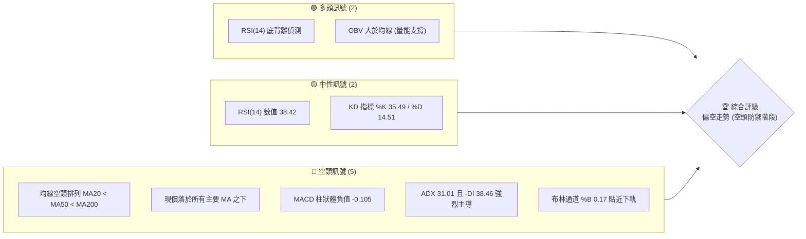
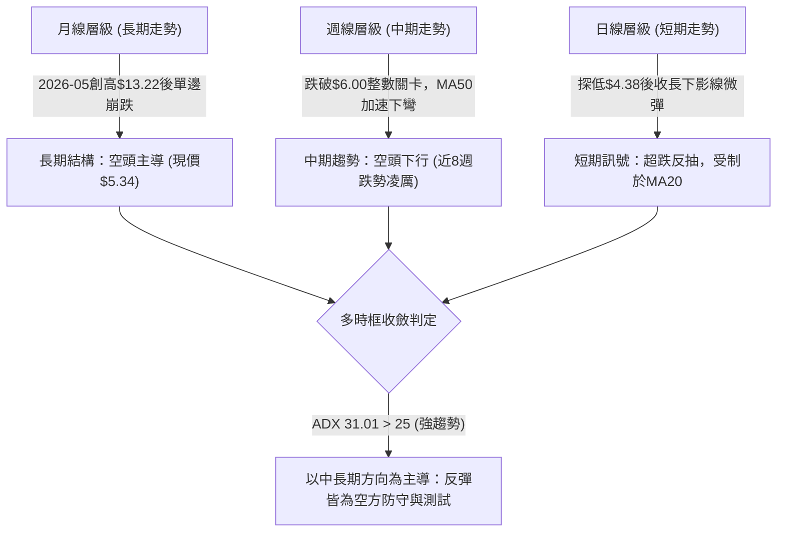
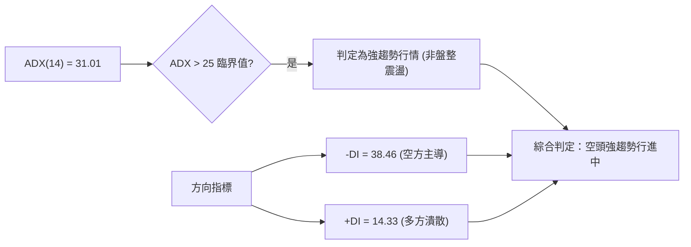
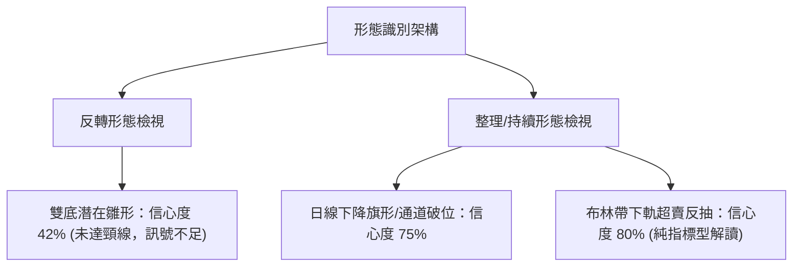
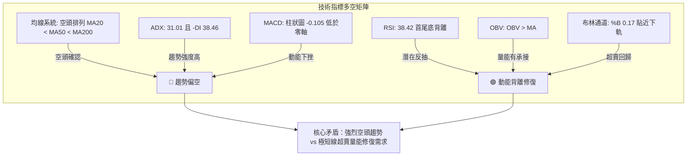
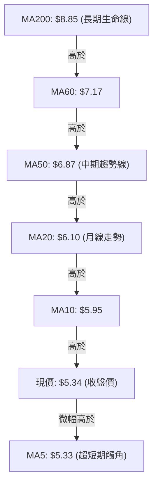
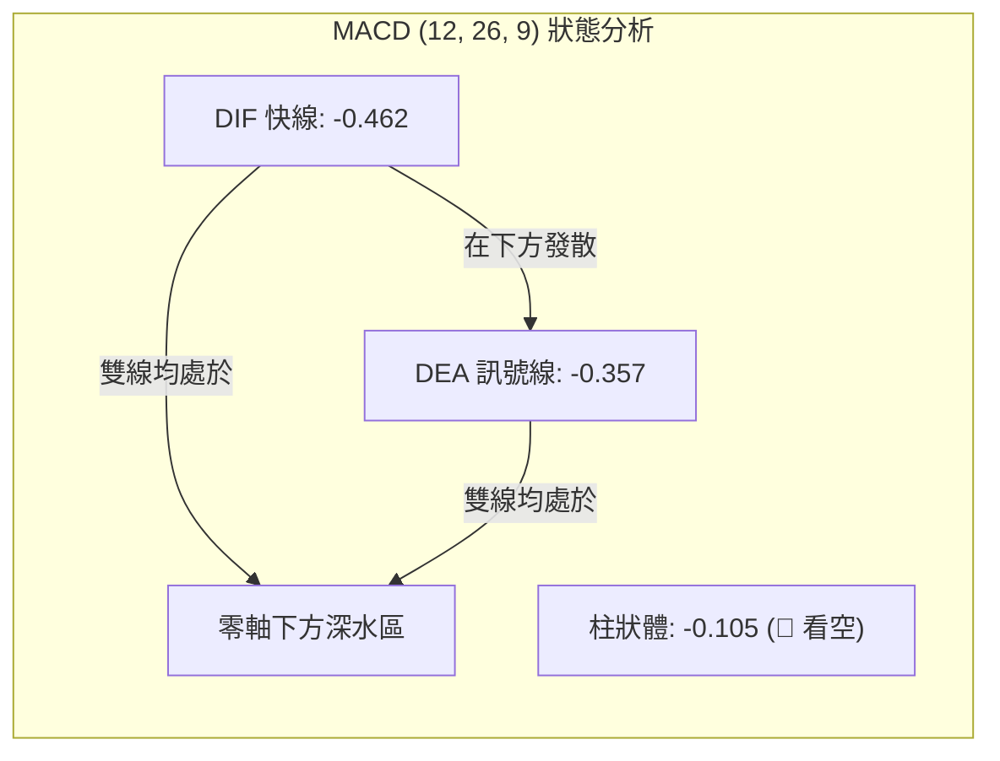
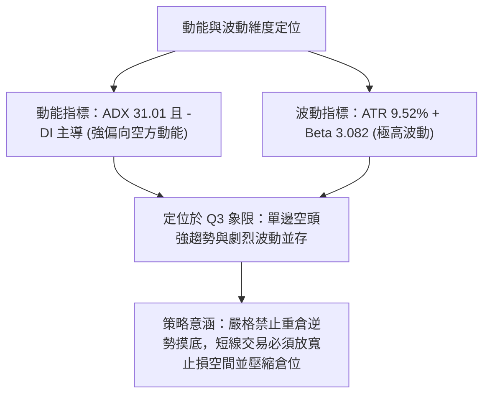
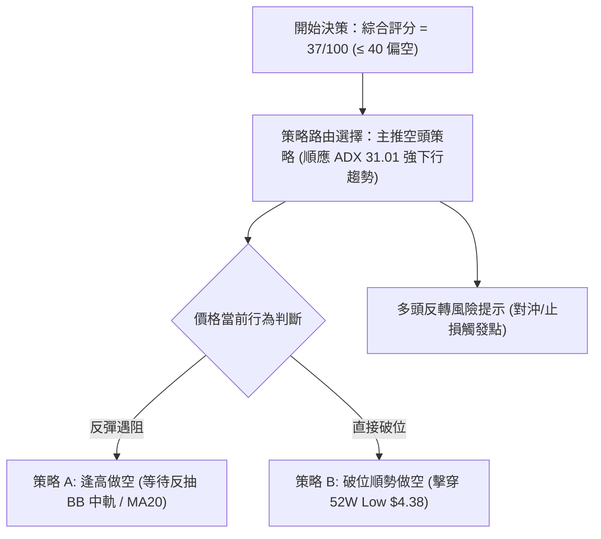
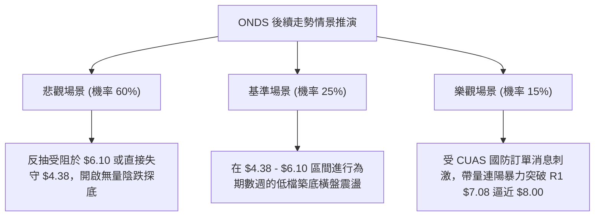

# ONDS 技術分析報告

> **報告日期**：2026-11-09 ｜ **語言**：繁體中文 ｜ **數據來源**：Yahoo Finance ｜ **當前價格**：$5.34

---

## 目錄

| 章節 | 內容 |
|------|------|
| [1. 技術面概覽](#1-技術面概覽) | 訊號儀表板、核心指標、評分卡 |
| [2. 趨勢分析](#2-趨勢分析) | 多時框趨勢、長中短期走勢 |
| [3. 圖表形態分析](#3-圖表形態分析) | 形態識別、K線組合、目標價 |
| [4. 支撐與阻力](#4-支撐與阻力) | 關鍵價位、斐波那契回調 |
| [5. 技術指標深度解讀](#5-技術指標深度解讀) | MA/RSI/MACD/布林/成交量 |
| [6. 動能與波動率](#6-動能與波動率) | 動能評估、ATR、Beta |
| [7. 多時框架總結](#7-多時框架總結) | 時框架評分矩陣 |
| [8. 交易策略建議](#8-交易策略建議) | 多空策略、風險報酬比 |
| [9. 風險提示與監控](#9-風險提示與監控) | 監控指標、風險場景 |

---

## 1. 技術面概覽

### 🎯 技術訊號儀表板



### 📊 核心指標速覽表

| 指標類別 | 指標名稱 | 當前數值 | 訊號 | 解讀 |
|----------|----------|----------|------|------|
| **價格** | 當前價格 | $5.34 | 🔴 | 位於52週區間 8.8% 位置，逼近一年低點 |
| **均線** | MA20 | $6.10 | 🔴 | 現價在 MA20 下方 -12.61%，短期壓力沉重 |
| **均線** | MA50 | $6.87 | 🔴 | 現價在 MA50 下方 -22.27%，中期趨勢向下 |
| **均線** | MA200 | $8.85 | 🔴 | 現價在 MA200 下方 -39.66%，長期結構完全偏空 |
| **動能** | RSI(14) | 38.42 | 🟡 | 弱勢中性偏冷，但出現首尾 20 根 K 棒底背離警訊 |
| **動能** | MACD(12,26,9) | -0.462 / -0.357 | 🔴 | MACD 與訊號線均在零軸下方，柱狀體 -0.105 持續看空 |
| **波動** | ATR(14) | $0.51 | 🔴 | 每日震幅佔比達 9.52%，個股呈現極端高波動 |

### 🏆 技術評分卡

```
╔══════════════════════════════════════════════════════════════╗
║              技術評分卡 — ONDS (2026-11-09)                 ║
╠══════════════════════════════════════════════════════════════╣
║ 趨勢強度      ████████████░░░░░░░░  60/100  🔴 空頭強趨勢   ║
║ 動能指標      ████████░░░░░░░░░░░░  40/100  🟡 弱勢見背離   ║
║ 支撐穩定度    ████░░░░░░░░░░░░░░░░  20/100  🔴 下無波段低點 ║
║ 成交量配合    ████████████░░░░░░░░  60/100  🟢 OBV量能尚存  ║
║ 形態完整度    ██████░░░░░░░░░░░░░░  30/100  🔴 下跌破位築底 ║
║ 均線排列      ██░░░░░░░░░░░░░░░░░░  10/100  🔴 完全空頭排列 ║
╠══════════════════════════════════════════════════════════════╣
║ 綜合評分      ██████░░░░░░░░░░░░░░  37/100  🔴 空頭主導     ║
╚══════════════════════════════════════════════════════════════╝
```
*(註：綜合評分由六項評分之算術平均計算：(60 + 40 + 20 + 60 + 30 + 10) / 6 = 36.67，四捨五入為 37/100，落於 ≤40 偏空區間。)*

---

## 2. 趨勢分析

### 🌐 多時框趨勢分析



### 📈 長期趨勢 — 12個月走勢圖（Unicode）

```
ONDS 月線走勢圖（過去12個月：2025-12 至 2026-11）
價格軸 ($)
$13.22 ┤                                  ● (2026-05 波段頂部)
$12.00 ┤                                 ╱ ╲
$10.36 ┤             ●        ●         ╱   ╲
$10.00 ┤            ╱ ╲      ╱ ╲       ╱     ╲
$9.04  ┤           ╱   ╲    ╱   ╲     ╱       ╲
$8.24  ┤  ●       ╱     ●──╱     ╲   ╱         ●
$7.33  ┤   ╲     ╱                ╲ ╱           ●───●
$6.32  ┤    ╲   ╱                  ●                 ●
$5.34  ┤     ╲ ╱                                      ●← 現價 ($5.34)
$4.38  ┤      ● (52W Low)                              
       └──────────────────────────────────────────────────────────
         12月  01月  02月  03月  04月  05月  06月  07月  08月  09月  10月  11月
        (2025) <------------------------ 2026年 ------------------------>
```

#### 走勢特徵分析表格

| 階段區間 | 時間段 | 價格起訖 | 漲跌幅 | 結構特徵與技術解讀 |
|----------|--------|----------|--------|--------------------|
| 主升擴張期 | 2025-11 → 2026-01 | $7.90 → $10.36 | +31.14% | 多頭放量推進，突破雙位數整數關卡 |
| 高檔箱型震盪 | 2026-01 → 2026-04 | $10.36 → $10.04 | -3.09% | 於 $9.04 - $10.36 構築高檔整理平台，籌碼持續換手 |
| 假突破誘多點 | 2026-04 → 2026-05 | $10.04 → $13.22 | +31.67% | 最終極速拉升創 24 個月最高月收盤，形成月線流星反轉 |
| 主跌段第一波 | 2026-05 → 2026-06 | $13.22 → $8.24 | -37.67% | 單月斷崖式暴跌，直接擊穿高檔震盪箱底 |
| 陰跌整理期 | 2026-06 → 2026-09 | $8.24 → $7.33 | -11.04% | 於 $7.30 - $7.90 窄幅抵抗，均線轉為下彎空頭排列 |
| 加速崩跌破位 | 2026-09 → 2026-11 | $7.33 → $5.34 | -27.15% | 跌破所有支撐聚類，探 52 週新低 $4.38，空頭動能宣洩 |

### 📊 中期趨勢（週線分析）

中期技術面正經歷極度惡化的下行週期。觀察近 8 週的週 K 線，高點從 2026-09-25 的 $7.98 連續下移至 $7.91、$7.69、$7.08，直至最近一週的 $6.40；低點亦由 $7.18 跌穿至 $4.38。

```
ONDS 近期週線壓力與支撐示意圖
價格軸 ($)
$7.98 ┼───────────────────── 週線波段高點聚類 (R2: $7.98)
      │      ╭─╮
$7.08 ┼──────┼─┼────────────── 短期反彈重要頸線壓力 (R1: $7.08)
      │   ╭──╯ │
$6.10 ┼───┼────┼────────────── BB中軌 / MA20 下降壓力帶 ($6.10)
      │   │    ╰─╮
$5.34 ┼───┼──────●───────── 現價位置 ($5.34)
      │   │        ╲   ╭─
$4.38 ┴───┴─────────●──╯─── 52週極限低點 / 斐波那契 100% ($4.38)
```

中期均線系統中，MA50 ($6.87) 與 MA20 ($6.10) 呈負斜率陡峭向下發散，週成交量在下殺過程雖見縮減，但彈升力度顯著疲軟，確認中級反彈尚未成形。

### ⚡ 趨勢強度評估（ADX 解讀）



#### ADX 強度對照與解讀

| 指標變數 | 當前讀數 | 強度區間 | 實質市場意義 |
|----------|----------|----------|--------------|
| **ADX(14)** | **31.01** | 25 – 50 (強趨勢) | 宣告當前市場脫離無序盤整，進入動能強勁的單邊趨勢階段 |
| **-DI(14)** | **38.46** | > 30 (極度強勢) | 空方完全掌控定價權，賣盤持續壓制價格下移 |
| **+DI(14)** | **14.33** | < 20 (極度疲弱) | 買盤毫無抵抗意願，缺乏主動性推升資金 |
| **DI差值 (-DI - +DI)** | **24.13** | > 20 (強烈空方優勢) | 多空力量極度失衡，不可輕易在此階段預測底部建立重倉 |

---

## 3. 圖表形態分析

### 🔍 形態識別系統



#### 形態識別與信心度評估表

| 形態類別 | 信心度 | 判斷依據（引用數據） | 完成度 | 目標價（附計算式） |
|----------|--------|----------------------|--------|--------------------|
| 日線下降通道破位 | **75%** | 價格沿 MA20 下方持續走低，2026-11-05 跌破通道下緣探 $4.38 | 90% | 跌破點 $5.70 − 通道高度 ($6.88 − $5.70 = $1.18) = **$4.52** (已於 11/05 達標) |
| 潛在雙底反轉 | **42%** | 訊號不足，僅有 2026-11-05 低點 $4.38，未形成第二隻腳與頸線突破 | 25% | 頸線阻力 R1 $7.08；形態高度 = $7.08 − $4.38 = $2.70；理論目標 = $7.08 + $2.70 = **$9.78** (信心度低，不採納) |
| 布林通道下軌抽腳 | **80%** | 指標型態：2026-11-05 觸及 $4.38 遠低於 BB 下軌 $4.95，次日長陽拉回 | 100% | 均值回歸目標 = BB中軌 (MA20) = **$6.10** |

*(依規則 15，幾何形態中雙底信心度低於 50%，故本報告判定形態主要為「下降趨勢延伸與超賣抽腳指標型解讀」，不盲目假定反轉幾何形態成立。)*

### 🕯️ 重要K線形態分析

根據數據所列之「近10根日K」與「近8根週K」四價，進行嚴謹之單根與組合 K 線判定：

#### 近 10 根日 K 線形態解讀

| 日期 | 開 | 高 | 低 | 收 | K線形態 | 解讀 | 訊號 |
|------|----|----|----|----|---------|------|------|
| 2026-10-26 | 6.17 | 6.32 | 6.04 | 6.16 | 紡錘十字小陰線 | 多空於 $6.10 附近膠著，量能萎縮 | 🟡 |
| 2026-10-27 | 6.21 | 6.69 | 6.16 | 6.65 | 中陽線 | 放量反彈，實體穿過 MA20 | 🟢 |
| 2026-10-28 | 6.69 | 6.88 | 6.56 | 6.86 | 續漲紅K棒 | 創短線反彈高點 $6.88，直逼 MA50 ($6.87) | 🟢 |
| 2026-10-29 | 6.74 | 7.08 | 6.74 | 6.88 | 長上影倒狀錘頭 | 觸碰波段高點 R1 ($7.08) 遭遇強烈拋壓解套賣盤 | 🔴 |
| 2026-10-30 | 6.46 | 6.60 | 6.18 | 6.32 | 跳空下行中陰線 | 吞噬前日低點，反彈波宣告夭折 | 🔴 |
| 2026-11-02 | 6.38 | 6.40 | 5.72 | 5.75 | 光頭長陰破位線 | 實體貫穿 $6.00 整數關卡，收於全日低檔 | 🔴 |
| 2026-11-03 | 5.80 | 6.09 | 5.77 | 5.79 | 假陽十字星 | 盤中嘗試回抽 $6.00 失敗，空方續控盤 | 🔴 |
| 2026-11-04 | 5.70 | 5.78 | 5.22 | 5.27 | 實體大陰線 | 放量 53.4M 下挫，破壞近期微型支撐 | 🔴 |
| 2026-11-05 | 5.09 | 5.16 | 4.38 | 4.52 | 長下影帶量恐慌陰線 | 創 52 週新低 $4.38，爆量 65.1M 出現恐慌拋售 | 🟡 |
| 2026-11-06 | 4.77 | 5.45 | 4.60 | 5.34 | 低開長紅反轉陽線 | 吞噬前日大部分跌幅，確認短期底部出清 | 🟢 |

#### 近 8 根週 K 線形態解讀

| 日期 | 開 | 高 | 低 | 收 | K線形態 | 解讀 | 訊號 |
|------|----|----|----|----|---------|------|------|
| 2026-09-18 | 6.99 | 7.53 | 6.98 | 7.39 | 震盪反彈紅K | 抵抗型買盤介入，量能 348M 尚屬溫和 | 🟡 |
| 2026-09-25 | 7.51 | 7.98 | 7.18 | 7.64 | 衝高受阻流星陽線 | 上攻近一年波段高點 R2 ($7.98) 遇阻收長上影 | 🔴 |
| 2026-10-02 | 7.53 | 7.91 | 7.12 | 7.24 | 倒狀反轉小陰線 | 高點未破前高，形成雙頂壓制 | 🔴 |
| 2026-10-09 | 7.62 | 7.69 | 6.64 | 6.73 | 破位中長黑K | 擊破 $7.00 平台，下影線微弱，空頭確立 | 🔴 |
| 2026-10-16 | 7.06 | 7.08 | 5.80 | 6.04 | 大陰線破線走勢 | 連續破位逼近 $6.00，量能放大 | 🔴 |
| 2026-10-23 | 6.20 | 6.37 | 5.88 | 6.20 | 止跌十字小陽線 | 量能驟縮至 179M，顯示殺跌意願暫歇 | 🟡 |
| 2026-10-30 | 6.17 | 7.08 | 6.04 | 6.32 | 長上影反彈假陽線 | 衝高觸及 R1 ($7.08) 即遭重挫，主力解套出逃 | 🔴 |
| 2026-11-06 | 6.38 | 6.40 | 4.38 | 5.34 | 巨幅長下影錘頭陰線 | 跌至 $4.38 獲強力承接，下影線長達 $0.96 | 🟢 |

### 📉 ASCII 走勢形態示意圖

```
ONDS 近10日 K 線與支撐壓力形態圖
價格軸 ($)
$7.08 ┤                  ┬ (10/29 倒狀錘頭高點 R1: $7.08)
$6.88 ┤             ┌─┐  │
$6.65 ┤        ┌─┐  │ │  │
$6.32 ┤        │ │  │ │  │    ┌─┐ (10/30 崩跌陰線)
$6.10 ┼────────┼─┼──┴─┴──┴────┼─┼─────────────── MA20 頸線壓力 ($6.10)
$5.75 ┤        │ │            │ │  ┌─┐
$5.34 ┤        │ │            │ │  │ │        ┌─┐ (11/06 吞噬長紅: 現價 $5.34)
$5.27 ┤        └─┘            └─┘  │ │  ┌─┐  │ │
$4.52 ┤                            └─┘  │ │  │ │
$4.38 ┴─────────────────────────────────┴─┴──┴─┴─ 52W Low 錘頭探底 ($4.38)
       ──────────────────────────────────────────────
       日期:   10/27 10/28    10/29    10/30 11/02 11/04 11/05 11/06
```

### 🎯 形態目標價計算

根據上述日線與週線已確認之走勢，進行量化推算：

1. **下行跌破測幅目標（已完成）**：
   - 跌破頸線點位：2026-10-30 起跌破之 $6.32
   - 前一波反彈頂點：$7.08（2026-10-29 高點）
   - 形態等幅對稱下跌高度：$7.08 − $6.32 = $0.76
   - 第一跌幅滿足點：$6.32 − $0.76 = **$5.56**（11/04 擊穿）
   - 極限等幅延伸（2 倍高度）：$6.32 − ($0.76 × 2) = **$4.80**（11/05 盤中跌至 $4.38，迅速收復回 $4.52，空頭跌幅滿足）。

2. **短線反抽測幅目標（超賣均值回歸）**：
   - 短期低點（52W Low）：$4.38（2026-11-05）
   - 第一反彈壓力目標（BB中軌 / MA20）：**$6.10**
   - 第二強阻力目標（近一年波段高點聚類 R1）：**$7.08**

---

## 4. 支撐與阻力

### 🗺️ 關鍵價位分布圖（Unicode）

```
ONDS 價位結構分布圖
═══════════════════════════════════════════════════════════
$8.58 ║██████████████████████████████║ 強阻力 R3 (波段高點聚類)
$7.98 ║████████████████████          ║ 阻力 R2 (近一年高點聚類)
$7.08 ║████████████████████████      ║ 關鍵阻力 R1 (波段頂部)
$6.71 ║──────────────────────────────║ 斐波那契 78.6% 回調位
$6.10 ║┈┈┈┈┈┈┈┈┈┈┈┈┈┈┈┈┈┈┈┈┈┈┈┈┈┈┈┈┈┈║ 布林中軌 / MA20 均線重壓
$5.34 ╠══════════════════════════════╣ ◄ 當前收盤價 ($5.34)
$4.95 ║░░░░░░░░░░░░░░░░░░░░          ║ 布林通道下軌動態支撐
$4.38 ║██████████████████████████████║ 52週極限低點 (斐波那契 100%)
$0.00 ║(下方無近一年波段低點聚類)    ║ 
═══════════════════════════════════════════════════════════
```

### 🚧 阻力位分析表

所有阻力數值完全嚴格引用數據中計算之「近一年波段高點聚類」：

| 阻力級別 | 價位 | 形成原因 | 突破難度 | 重要性 |
|----------|------|----------|----------|--------|
| **R1** | **$7.08** | 近一年波段高點聚類；2026-10-29 日K衝高回落高點，週線多次受阻頸線 | ★★★★☆ | 極高。若未能有效突破，整體中長期下降趨勢無法被打破 |
| **R2** | **$7.98** | 近一年波段高點聚類；2026-09-25 週K波段高點，長期籌碼密集套牢套底 | ★★★★★ | 強阻力。對應大量長期套牢解套賣壓，具強烈分水嶺意義 |
| **R3** | **$8.58** | 近一年波段高點聚類；鄰近 MA200 ($8.85) 與斐波那契 61.8% ($8.54) | ★★★★★ | 終極空頭堡壘。牛熊反轉的根本防線 |

### 🛡️ 支撐位分析表

依據數據「支撐位 (Support) — 近一年波段低點聚類：(no swing-low support detected below current price)」與 52 週最低價進行客觀判定：

| 支撐級別 | 價位 | 形成原因 | 守住機率 | 重要性 |
|----------|------|----------|----------|--------|
| **S1 (動態)** | **$4.95** | 布林通道下軌位置；跌破將觸發指標嚴重超賣修正 | 55% | 中等。短線短線多頭維持均值回歸反彈的第一道緩衝防線 |
| **S2 (極限)** | **$4.38** | 52週最低價 (52W Low)；斐波那契 100.0% 終極回調水平線 | 65% | 極高。此處為近一年多空最後防禦陣地，一旦收盤跌破將引發無支撐探底 |
| **S3 (聚類)** | **N/A（數據未提供）** | 數據中未偵測到現價下方之波段低點聚類支撐 (no swing-low support detected) | N/A | 無波段聚類，下方處於歷史籌碼真空狀態 |

### 📐 斐波那契回調位分析

依據 52 週區間 **$4.38 → $15.28** 之精準回調數據進行解讀：

```
斐波那契回調結構位與當前位置標註
0.0%  (52W High)   $15.28 ══════════════════════════════════════════
23.6%              $12.71 ──────────────────────────────────────────
38.2%              $11.11 ──────────────────────────────────────────
50.0%              $ 9.83 ──────────────────────────────────────────
61.8%              $ 8.54 ────────────────────────────────────────── (鄰近 R3 $8.58)
78.6%              $ 6.71 ────────────────────────────────────────── (短線強弱分界)
[現價落點]         $ 5.34 ◄ 現價位於 78.6% ($6.71) 與 100.0% ($4.38) 之間
100.0% (52W Low)   $ 4.38 ══════════════════════════════════════════ (終極支撐)
```

#### 技術意義解析
1. **深度回撤格局**：現價 $5.34 處於 78.6% ($6.71) 與 100.0% ($4.38) 之間的極端下沉區，顯示 52 週以來的漲幅已經被抹去 88.44%（現價落於區間 8.8%），屬於技術性深度破位。
2. **反彈首要分界點**：斐波那契 78.6% ($6.71) 恰位於 MA50 ($6.87) 下方附近，與 R1 ($7.08) 構成 $6.71 – $7.08 的高密度多重反壓帶。在價格有效站上 $6.71 之前，任何拉升在斐波那契視角下均僅能定義為「跌深技術性反抽」，而非趨勢反轉。

---

## 5. 技術指標深度解讀

### 🎛️ 指標訊號總覽



### 📈 移動平均線排列分析



#### 移動平均線數據分析矩陣

| 均線名稱 | 數值 | 現價與均線差距 ($) | 差距百分比 (%) | 斜率與狀態 | 技術意涵 |
|----------|------|-------------------|----------------|------------|----------|
| **MA 5** | $5.33 | +$0.01 | +0.04% | ▲ 轉平微揚 | 11/06 反彈使超短天期均線暫時走平 |
| **MA 10** | $5.95 | -$0.61 | -10.25% | ▼ 陡峭向下 | 短期空方阻截線 |
| **MA 20** | $6.10 | -$0.76 | -12.46% | ▼ 穩定向下 | 中短天期生命線，布林通道中軌，重要阻力 |
| **MA 50** | $6.87 | -$1.53 | -22.27% | ▼ 持續下行 | 中期空頭主防線 |
| **MA 60** | $7.17 | -$1.83 | -25.52% | ▼ 穩定下行 | 季線下壓，壓抑中級反彈高度 |
| **MA 120** | $8.02 | -$2.68 | -33.42% | ▼ 單邊走低 | 半年線沉積巨額套牢盤 |
| **MA 200** | $8.85 | -$3.51 | -39.66% | ▼ 負斜率確認 | 年線下行，長期空頭市場所屬 |
| **MA 240** | $9.06 | -$3.72 | -41.06% | ▼ 長期壓制 | 長週期資金出逃完畢 |

**解讀**：典型的空頭完全發散排列（Bearish Stacked Alignment），價格自 MA240 至 MA10 均遭受層層壓制。雖然 MA5 於 11/06 收盤以 $5.34 微幅收復 $5.33（+0.04%），但此僅代表跌勢暫時停頓，上方從 MA10 ($5.95) 到 MA20 ($6.10) 存在密集拋壓區。

### 📉 RSI(14) 分析

- **RSI(14) 當前讀數**：**38.42** (Wilder 平滑法)
- **指標區間強度展示**：
  ```
  超賣 (0-30)           中性弱勢 (30-50)         中性強勢 (50-70)        超買 (70-100)
  [░░░░░░░░░░░░░░░░]   [███████░░░░░░░░░]      [░░░░░░░░░░░░░░░░]     [░░░░░░░░░░░░░░░░]
  0                  30       38.42           50                     70                100
  進度條：███████░░░░░░░░░░░░░ (38.42%) 🟡 弱勢區間
  ```
- **背離判斷（重要）**：
  - 根據系統偵測：「⚠️ 底背離 (Bullish Divergence)  (僅比較近20根K棒首尾的價格與RSI方向)」。
  - **背離具體解析**：在近 20 根 K 棒期間，價格自高位 $6.88 - $7.08 連續走低並摜破前低來到 $4.38（價格創下波段顯著新低），但 RSI 在探底過程中的數值並未刷新極低點，且收盤快速拉回至 38.42，顯示下殺動能已出現衰竭徵兆，具備短線技術性底背離的超跌反彈契機。

### 📊 MACD(12/26/9) 訊號解讀



#### 指標綜合解讀
1. **負向發散**：DIF (-0.462) 位於 DEA (-0.357) 之下，且兩者均處於遠離零軸的負值區域，顯示空頭仍全盤掌控宏觀動能。
2. **柱狀圖動向**：MACD Hist 當前為 **-0.105**，維持負值狀態，證實尚未產生黃金交叉訊號。儘管日線在 11/06 出現吞噬陽線，但在 MACD 柱狀體未收斂變短並跨越零軸前，不得將其視為波段反轉成立。

### 📦 布林通道分析

```
ONDS 日線布林通道 (20, 2) 結構示意圖
價格軸 ($)
$7.26 ┼──────────────────────────────── 上軌 (Upper Band: $7.26)
      │
$6.50 ┤
      │
$6.10 ┼──────────────────────────────── 中軌 (Middle Band / MA20: $6.10)
      │
$5.34 ┼──────────────●───────────────── 現價位置 ($5.34, %B = 0.17)
$4.95 ┼──────────────────────────────── 下軌 (Lower Band: $4.95)
      │              │ (11/05 盤中刺穿 $4.38)
$4.38 ┴──────────────●───────────────── 52W Low (極端假跌破帶)
```

- **布林參數**：週期 20，偏差 2 倍標準差
- **通道指標數值**：
  - BB 上軌：**$7.26**
  - BB 中軌 (MA20)：**$6.10**
  - BB 下軌：**$4.95**
  - **%B 指標**：**0.17**
- **解讀**：%B 為 0.17 代表現價處於下軌至中軌之間僅 17% 的位置。在 2026-11-05，價格最低觸及 $4.38，大幅摜破下軌 $4.95（當時 %B < 0），屬於典型之通道外極限超賣；次日 (11/06) 收盤價 $5.34 重新站回下軌之上，構成短線「均值回歸」型態，第一目標指向中軌 **$6.10**。

### 💹 成交量分析（量價配合度）

#### 量能數據對照

| 數據項目 | 成交量股數 | 相對比例 | 量能屬性評價 |
|----------|------------|----------|--------------|
| 最新成交量 (11/06) | 44,739,900 | 0.93x (量比) | 略低於 20 日均量，但維持相對充沛 |
| 20 日均量 (MA20 Vol) | 47,982,775 | 1.00x | 中短期籌碼基準換手線 |
| 50 日均量 (MA50 Vol) | 54,830,092 | 0.82x | 中長期籌碼基準換手線 |
| 前日恐慌量 (11/05) | 65,130,800 | 1.36x | 爆量下影長黑，呈現恐慌盤湧出 |

- **OBV 趨勢解讀**：系統明示「OBV > MA → 量能支撐上漲」。此為當前極少數亮起綠燈的結構性指標。在近 20 週的下挫過程中，週成交量未見持續性崩潰，OBV 保持在均線上方運行，顯示主力資金在股價大跌中並未出現徹底棄守的斷崖式失血，低檔承接意願（如 11/05 爆出 65.1M 的恐慌低吸量）對價格具備底部緩衝效果。

---

## 6. 動能與波動率

### ⚡ 動能評估四象限

| 象限 | 動能維度 | 波動維度 | 象限特徵 | 當前歸屬狀態 |
|------|----------|----------|----------|--------------|
| **Q1** | 強動能 (多頭) | 低波動 | 穩健多頭爬升，最佳進場區 | ─ |
| **Q2** | 弱動能 (中性) | 低波動 | 縮量橫盤盤整，謹慎觀望 | ─ |
| **Q3** | 強動能 (多/空) | 高波動 | 趨勢激烈宣洩，高風險高收益 | **✓ (Q3: 空頭強動能 + 高波動)** |
| **Q4** | 弱動能 (無序) | 高波動 | 混亂寬幅拉扯，易遭反覆掃損 | ─ |



### 📊 ATR 波動率分析

- **ATR(14) 讀數**：**$0.51**
- **波動率比重**：佔當前股價 $5.34 的 **9.52%**（Wilder 平滑法）
- **操作風險解讀**：
  - 單日平均真實震幅超過股價的 9.5%，意味著常規的緊密止損（如 2%-3%）在 ONDS 身上極易被盤中常規噪音無情掃出。
  - **風控止損距離建議**：
    - 短線保守止損緩衝：至少需給予 **1.5 倍 ATR** = $0.51 × 1.5 = **$0.765**。
    - 擺動交易安全緩衝：建議給予 **2.0 倍 ATR** = $0.51 × 2.0 = **$1.02**。

### 📐 Beta 與市場相關性

- **Beta 係數**：**3.082**
- **大盤相關與槓桿效應**：
  - Beta 高達 3.082，顯示該股具備美股科技板塊三倍槓桿 ETF 級別的波動敏感度。當標普 500 或納斯達克波動 1% 時，ONDS 理論上將呈現約 3% 的同向或放大震盪。
  - **空頭背景下的 Beta 效應**：在整體宏觀或板塊承壓週期中，高 Beta 特質使得 ONDS 成為機構投資者快速去槓桿拋售的首選標的，加劇了破位時的超跌深度。

---

## 7. 多時框架總結

### 📋 時框架評分表

| 時框架 | 趨勢方向 | 動能狀態 | 均線排列 | 圖表形態 | 綜合評分 | 建議 |
|--------|----------|----------|----------|----------|----------|------|
| **月線 (長期)** | 🔴 下行主跌 | 弱勢潰散 | 空頭下壓 (跌破近兩年高檔) | 頂部崩跌後延伸探底 | 25/100 | 戰略規避，切勿長線定投抄底 |
| **週線 (中期)** | 🔴 單邊下挫 | MACD負值 | 空頭排列 (破MA50) | 尋找 $4.38 支撐箱體 | 35/100 | 逢反彈至阻力區建立對沖空單 |
| **日線 (短期)** | 🟡 跌深反抽 | 底背離初顯 | 空頭排列 (微站上MA5) | 超賣反抽測試中軌 | 50/100 | 輕倉博弈均值回歸，嚴守風控 |

### 🔲 綜合訊號矩陣

| 維度指標 | 短期時框 (日線) | 中期時框 (週線) | 長期時框 (月線) | 多時框一致性評價 |
|----------|-----------------|-----------------|-----------------|------------------|
| **趨勢方向** | 🟡 震盪反抽 | 🔴 明顯向下 | 🔴 單邊走熊 | 偏空 (中長期高度一致) |
| **動能狀態** | 🟢 RSI 底背離 | 🔴 MACD 柱狀發散 | 🔴 單邊跌勢 | 矛盾 (短期超賣修正 vs 中長線疲弱) |
| **均線系統** | 🟡 站上 MA5 | 🔴 受制 MA20/50 | 🔴 遠低於 MA200 | 偏空 (長線均線全面壓制) |
| **量能狀態** | 🟢 恐慌低吸盤 | 🟡 縮量抵抗 | 🔴 資金出逃 | 中性 (存在低檔承接換手) |

### ⚖️ 多時框收斂結論

依據多時框收斂規則（規則 14）：
1. **行情性質判定**：當前 ADX(14) 讀數為 **31.01**（> 25），且 -DI 達 38.46，確認本標的處於標準的「**強趨勢下行行情**」，而非震盪行情。
2. **時框主導優先級**：在此行情下，必須以中長期（週線/MA50、MA200）方向為不可動搖之主導，日線層級所觀察到的「RSI 底背離」與「長下影吞噬紅 K」，僅能定義為**下行趨勢中的短期超賣反抽修復（尋求進場時機或逢高做空時機）**，絕不可逆向判定為大級別牛熊反轉。
3. **唯一方向性結論**：**偏空（防守型空頭主導，短多僅限超跌反抽極輕倉博弈）**。第 8 章之主策略將完全順應此綜合評分 37/100 之結論，以順勢防守／反彈做空為核心架構。

---

## 8. 交易策略建議

### 🗺️ 策略決策流程圖



### 🧭 策略路由（依評分卡分流）

> **當前主策略方向 = 🔴 偏空主導策略（依綜合評分 37/100，落於 ≤40 偏空區間，主推逢高反彈空與破位空）**

### 🎯 價格情境階梯（Price Scenarios）

價位完全嚴格引用數據中計算之 R1/R2/R3、斐波那契位與 52W 極值：

| 觸發條件 | 下一目標 | 後續延伸 | 情境含義 |
|----------|----------|----------|----------|
| **反彈受阻於 $6.10** | 回測 $4.95 (BB下軌) | 考驗 $4.38 (52W Low) | 均值回歸結束，空頭主趨勢恢復 (基準劇本) |
| **強勢突破 R1 $7.08** | 測試 R2 $7.98 | 挑戰 R3 $8.58 | 超跌暴力反轉，空頭主策略全面停損止步 |
| **跌破極限低點 $4.38** | 尋求整數關卡支撐 | 開啟無支撐探底 | 52 週新低確立，進入加速尋底主跌浪 |

### 📊 情境機率分佈

| 情境 | 機率 | 主要依據 |
|------|------|----------|
| **弱勢反抽後回落再探底** | **60%** | ADX 31.01 趨勢強勁，-DI 38.46 絕對主導，MA20/50 空頭向下死叉壓制 |
| **區間弱勢震盪 ($4.38 - $6.10)** | **25%** | 布林通道下軌抽腳修復，RSI 底背離提供短線托底動能 |
| **單邊暴力 V 轉上破 R1** | **15%** | 均線系統全面潰敗，上方套牢盤沉重，缺乏實質利多推進大級別反轉 |

### 🔴 主策略詳情（空頭主導策略）

*(注：風險報酬比依規則 17 定義，做空時計算公式 = (進場價 − 目標價 T1) ÷ (止損價 − 進場價)，格式為 1 : X.XX)*

| 策略要素 | 策略 A（逢高反彈做空 — 首選） | 策略 B（破位順勢做空 — 次選） |
|----------|-------------------------------|-------------------------------|
| **策略類型** | 順勢逢阻力高空（安全邊際高） | 順勢破位追空（動能爆發型） |
| **進場條件** | 價格反彈至 MA20 / BB中軌承壓收上影線 | 收盤價或跌破 52W 最低點並帶量 |
| **進場價格** | **$6.10** (MA20 / BB中軌精確值) | **$4.38** (52W Low 擊穿價) |
| **目標價 T1** | **$4.95** (布林通道下軌) | **$3.50** (依形態推算：$4.38 − ATR×1.72) |
| **目標價 T2** | **$4.38** (52W Low 終極支撐) | **$2.50** (下方歷史真空恐慌延伸位) |
| **止損價格** | **$6.71** (斐波那契 78.6% 回調關鍵線) | **$4.95** (布林通道下軌轉為反壓線) |
| **風險報酬比** | **1 : 1.89（以 T1 計）**<br>*(計算：(6.10 - 4.95) / (6.71 - 6.10) = 1.15 / 0.61 = 1.885)*<br>[以 T2 計為 1 : 2.82] | **1 : 1.54（以 T1 計）**<br>*(計算：(4.38 - 3.50) / (4.95 - 4.38) = 0.88 / 0.57 = 1.544)*<br>[以 T2 計為 1 : 3.30] |
| **成功機率** | **65%** | **55%** |
| **建議倉位** | **8% - 10%** 總投資資金 | **5%** 總投資資金（極低倉位） |

### 🟢 反向風險觸發點（對沖與短多警示）

若市場出現以下訊號，主推之空頭策略將被正式推翻，需無條件執行空頭止損或啟動短多對沖：
1. **關鍵價位收復**：日 K 線收盤價強勢突破 **$6.71**（斐波那契 78.6%），盤中甚至觸及 **R1 $7.08**，代表多頭已消化近一個月所有套牢籌碼。
2. **指標轉向翻多**：日線 MACD 柱狀體由負轉正（突破 0 軸），且 RSI(14) 強勢跨越 50.0 中性水準。
3. **空頭對沖操作點**：若價格站穩 $6.10 並放量突破，空單全數離場，短多可輕倉博弈目標至 R1 $7.08，止損設於 $5.70。

### ⭐ 整體訊號強度評星

```
做多訊號強度：★★☆☆☆  (2/5星 — 僅屬超跌反抽，非反轉)
做空訊號強度：★★★★☆  (4/5星 — 順應 ADX 31.01 與均線排列)
整體可信度：  ★★★★☆  (4/5星 — 多時框指標收斂性極佳)
```

---

## 9. 風險提示與監控

### ✅ 關鍵監控指標 Checklist

```
╔══════════════════════════════════════════════════════════════╗
║               關鍵技術監控 Checklist (每日盤後檢視)         ║
╠══════════════════════════════════════════════════════════════╣
║ [ ] 價格是否跌破 52W 極限低點 $4.38 (是: 觸發全面崩跌風險)   ║
║ [ ] 價格是否反彈觸及 BB中軌/MA20 $6.10 (是: 尋找空方進場點)  ║
║ [ ] 價格是否強勢突破斐波那契 78.6% $6.71 (是: 空單全面停損)  ║
║ [ ] MACD 柱狀圖是否由負 (-0.105) 翻正 (是: 預警空頭動能衰竭) ║
║ [ ] RSI(14) 是否跌破 30 超賣或突破 50 中性 (動能邊界重估)    ║
║ [ ] 成交量是否異常放大至 60M 以上 (是: 判斷主力換手方向)      ║
╚══════════════════════════════════════════════════════════════╝
```

### ⚠️ 風險場景分析



### 🛡️ 風險管理重要提醒

1. **極端波動率風險（ATR $0.51 / Beta 3.082）**：
   - ONDS 的日均波動率佔股價近 10%，屬典型超高波動投機標的。任何部位的單筆風險暴露（Risk at Risk）嚴格控制在總投資組合淨值的 **1.0%** 以內。
2. **高空頭部位比率（Short % Float 43.9%）與軋空風險（Short Squeeze）**：
   - 數據顯示空頭佔流通盤高達 43.9%，Short Ratio 為 4.11。這意味著市場空頭部位極度擁擠。一旦有利多消息刺激（例如公司近期國防反無人機合約），極易引發兇悍的「軋空潮（Short Squeeze）」。
   - **處置原則**：建立空頭部位時，必須設定嚴格硬止損（如 $6.71），絕不可因目前趨勢偏空而心存僥倖進行不設防放空。
3. **微型基本面逆風**：
   - 儘管營收爆發，但營業利益率為負 (-129.4%) 且自由現金流為負 (-$172.03M)，雖然帳面擁有 $1.38B 現金，但資本消耗率與高估值倍數（P/S 17.8x）將使股價在技術破位時缺乏實質估值地板保護。

---

## 📋 報告總結

```
╔══════════════════════════════════════════════════════════════╗
║                  ONDS 技術分析報告總結                       ║
╠══════════════════════════════════════════════════════════════╣
║ 報告日期：2026-11-09                                         ║
║ 當前價格：$5.34                                              ║
║ 分析評級：🔴 空頭主導 (綜合評分 37/100，防守反抽空策略)      ║
╠══════════════════════════════════════════════════════════════╣
║ 關鍵結論：                                                   ║
║ ├─ 長期趨勢：🔴 崩跌延伸走勢，遠受制於 MA200 ($8.85)          ║
║ ├─ 中期趨勢：🔴 週線單邊下挫，破位 MA50 ($6.87)，ADX 31.01  ║
║ ├─ 短期趨勢：🟡 觸及 52W Low $4.38 後出現超賣底背離反抽      ║
║ ├─ 關鍵支撐：$4.95 (BB下軌) / $4.38 (52W Low 終極防線)        ║
║ ├─ 關鍵阻力：$6.10 (MA20/BB中軌) / $7.08 (波段高點聚類 R1)   ║
║ └─ 分析師共識目標：$18.88 (投行共識，但當前技術面完全背離)   ║
╠══════════════════════════════════════════════════════════════╣
║ 最優策略組合：                                               ║
║ 1. 🥇 最佳機會：策略 A (反彈至 MA20 $6.10 承壓放空，R/R 1:1.89)║
║ 2. 🥈 次選機會：策略 B (擊穿 52W Low $4.38 順勢追空，R/R 1:1.54)║
║ 3. 🥉 保守選擇：空手徹底觀望，靜待日線站穩 R1 $7.08 築底完成  ║
╚══════════════════════════════════════════════════════════════╝
```

---

> ⚠️ **免責聲明**：本報告為 AI 自動生成之技術分析，所有數據及估算均基於提供的歷史價格資訊。本報告**僅供研究與學術參考**，**不構成任何投資建議**。投資有風險，入市需謹慎。

---

*報告生成時間：2026-11-09 ｜ 數據來源：Yahoo Finance ｜ 分析框架：多時框技術分析*