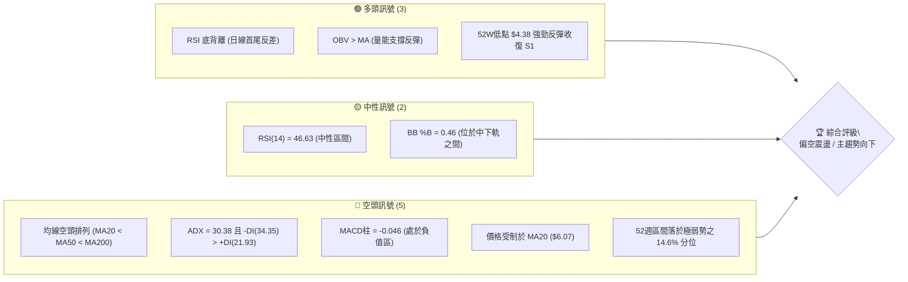
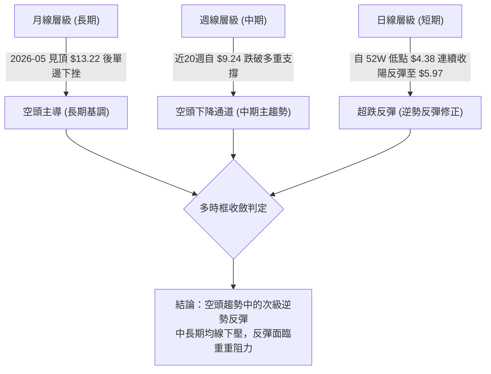
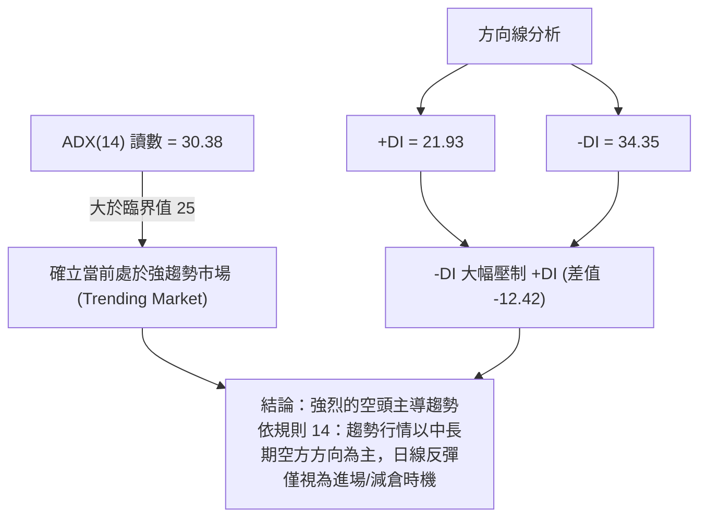
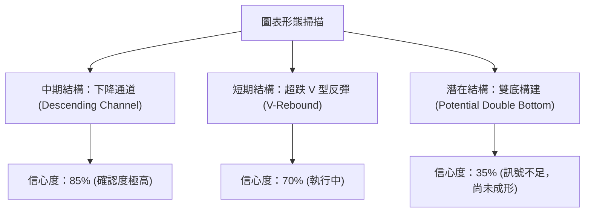
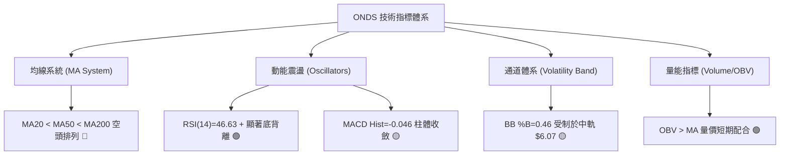
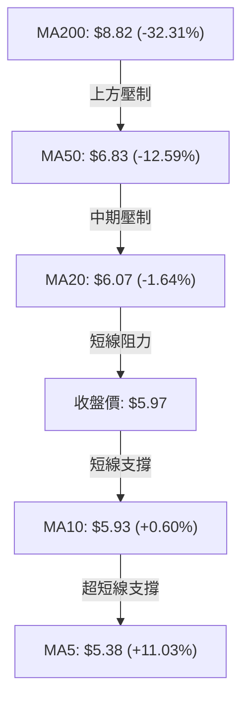
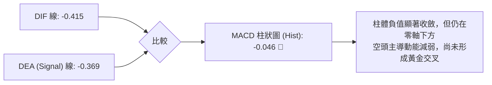
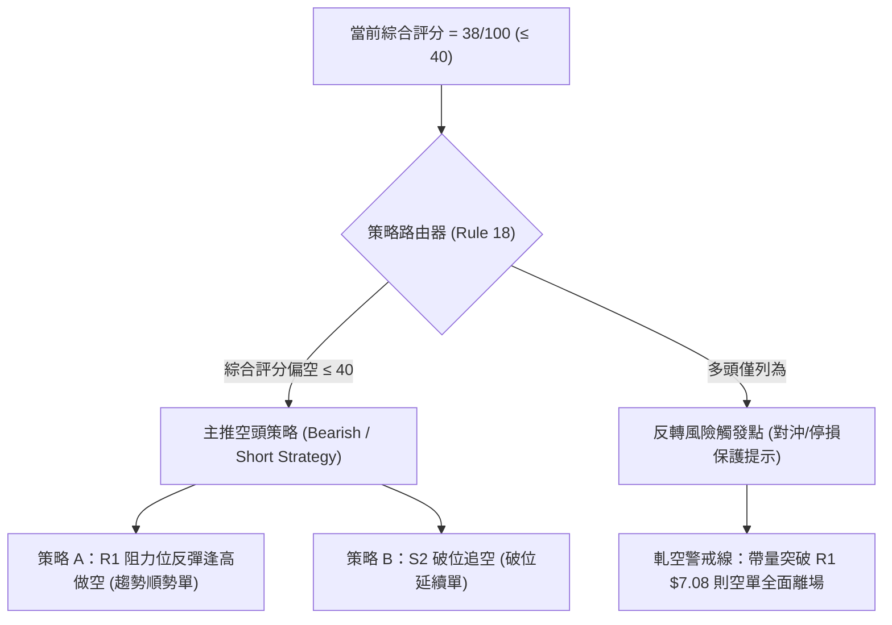
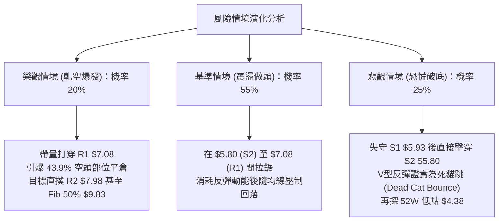

# ONDS 技術分析報告

> **報告日期**：2026-11-10 ｜ **語言**：繁體中文 ｜ **數據來源**：Yahoo Finance ｜ **當前價格**：$5.97 USD

---

## 目錄

| 章節 | 內容 |
|------|------|
| [1. 技術面概覽](#1-技術面概覽) | 訊號儀表板、核心指標、評分卡 |
| [2. 趨勢分析](#2-趨勢分析) | 多時框趨勢、長中短期走勢 |
| [3. 圖表形態分析](#3-圖表形態分析) | 形態識別、K線組合、目標價 |
| [4. 支撐與阻力](#4-支撐與阻力) | 關鍵價位、斐波那契回調 |
| [5. 技術指標深度解讀](#5-技術指標深度解讀) | MA/RSI/MACD/布林/成交量 |
| [6. 動能與波動率](#6-動能與波動率) | 動能評估、ATR、Beta |
| [7. 多時框架總結](#7-多時框架總結) | 時框架評分矩陣 |
| [8. 交易策略建議](#8-交易策略建議) | 多空策略、風險報酬比 |
| [9. 風險提示與監控](#9-風險提示與監控) | 監控指標、風險場景 |

---

## 1. 技術面概覽

### 🎯 技術訊號儀表板



### 📊 核心指標速覽表

| 指標類別 | 指標名稱 | 當前數值 | 訊號 | 解讀 |
|:---|:---|:---|:---:|:---|
| **價格** | 當前收盤價 | $5.97 | 🔴 | 位於 52 週區間 ($4.38–$15.28) 之 14.6% 極低位，受制於長期下行通道 |
| **均線** | MA20 | $6.07 | 🔴 | 價格在 MA20 下方 (-1.64%)，短線反彈面臨第一道動態均線反壓 |
| **均線** | MA50 | $6.83 | 🔴 | 價格在 MA50 下方 (-12.59%)，中期波段空頭防線穩固 |
| **均線** | MA200 | $8.82 | 🔴 | 價格在 MA200 下方 (-32.31%)，長期牛熊分界線沉重下壓 |
| **動能** | RSI(14) | 46.63 | 🟡 | Wilder RSI 位於 30–70 中性區間，呈現近 20 根 K 線之底背離跡象 |
| **動能** | MACD (12,26,9) | -0.415 | 🔴 | DIF 線低於訊號線 (-0.369)，MACD 柱為 -0.046，空頭動能仍佔優勢 |
| **趨勢** | ADX(14) / DMI | 30.38 | 🔴 | ADX > 25 確立強趨勢環境，-DI (34.35) 大幅超越 +DI (21.93)，空方絕對控盤 |
| **通道** | 布林通道 | $4.94–$7.20 | 🟡 | %B 為 0.46，價格自下軌強彈後正測驗布林中軌 $6.07 |
| **成交量** | 最新量 / 20日均量 | 1.02x | 🟢 | 當日量能 47.69M 略高於 20MA (46.65M)，OBV 高於均線，量價配合短彈 |
| **波動** | ATR(14) | $0.53 | 🔴 | 佔股價比率達 8.85%，屬於高波動標的，日內震盪幅度劇烈 |

### 🏆 技術評分卡

```
╔══════════════════════════════════════════════════════════════════╗
║                   技術評分卡 — ONDS (2026-11-10)                 ║
╠══════════════════════════════════════════════════════════════════╣
║ 趨勢強度 (Trend)     ██████░░░░░░░░░░░░░░  30/100  🔴 空頭強趨勢 ║
║ 動能指標 (Momentum)  █████████░░░░░░░░░░░  45/100  🟡 底背離醞釀 ║
║ 支撐穩定度 (Support) █████████░░░░░░░░░░░  45/100  🟡 剛收復 S1  ║
║ 成交量配合 (Volume)  ██████████░░░░░░░░░░  50/100  🟡 量能回溫   ║
║ 形態完整度 (Pattern) ███████░░░░░░░░░░░░░  35/100  🔴 下降通道中 ║
║ 均線排列 (MAs)       █████░░░░░░░░░░░░░░░  25/100  🔴 空頭全排列 ║
╠══════════════════════════════════════════════════════════════════╣
║ 綜合評分 (Overall)   ████████░░░░░░░░░░░░  38/100  🔴 偏空弱勢   ║
║ 評分定義：六項算術平均 (30+45+45+50+35+25)/6 = 38.33 → 38/100   ║
╚══════════════════════════════════════════════════════════════════╝
```

---

## 2. 趨勢分析

### 🌐 多時框趨勢分析



### 📈 長期趨勢 — 12個月走勢圖（Unicode）

以下為 ONDS 自 2025-11 至 2026-11 之月線收盤價走勢軌跡（單位：美元）：

```
ONDS 月線走勢圖（過去12個月：2025-11 至 2026-11）
價格軸 ($)
$14.00 ┤                                      ● $13.22 (2026-05 月高點)
$13.00 ┤                                     ╱ ╲
$12.00 ┤                                    ╱   ╲
$11.00 ┤                     ● $10.36      ╱     ╲
$10.00 ┤              ● $9.76 ╲  ● $10.08 ╱ ● $10.04
$9.00  ┤             ╱         ╲ ╱       ● $9.04   ╲
$8.00  ┤ ● $7.90    ╱                               ╲ $8.24  ● $7.66
$7.00  ┤  ╲        ╱                                 ╲       ╱ ╲ $7.33
$6.00  ┤   ╲      ╱                                   ● $7.49   ╲  ● $6.32
$5.00  ┤    ╲    ╱                                               ╲  ● $5.97(現價)
$4.00  ┤     ╲  ╱                                                 ● $4.38(盤中底)
       └─────┴───┴──────┴──────┴────┴─────┴─────┴────┴────┴────┴────┴────┴─────
            11  12     01     02   03    04    05   06   07   08   09   10   11 (月份)
            2025年 ───> 2026年
```

#### 長期月線走勢特徵分析

| 階段區間 | 起訖月份 | 起點收盤 | 終點收盤 | 區間漲跌幅 | 走勢特徵與結構解讀 |
|:---|:---|:---|:---|:---:|:---|
| **主升浪推進** | 2025-11 → 2026-01 | $7.90 | $10.36 | +31.14% | 連續放量陽線突破，建立高位整理平台，無人機概念熱度提升 |
| **高位箱體震盪** | 2026-01 → 2026-04 | $10.36 | $10.04 | -3.09% | 圍繞 $9.00–$10.30 區間進行籌碼換手，形成中期頂部頭部結構原型 |
| **最後噴出見頂** | 2026-04 → 2026-05 | $10.04 | $13.22 | +31.67% | 月線級別誘多噴出，創下 52 週次高收盤，隨後觸及歷史波段高點 $15.28 |
| **主跌浪破位** | 2026-05 → 2026-07 | $13.22 | $7.49 | -43.34% | 獲利了結與空頭反撲，巨幅長黑下殺，跌破關鍵心理關口 $10.00 與 $8.00 |
| **反彈受阻續跌** | 2026-07 → 2026-09 | $7.49 | $7.33 | -2.14% | 8月微幅反彈至 $7.66 後動能竭盡，高點逐步下移 (Lower Highs) |
| **加速尋底期** | 2026-09 → 2026-11 | $7.33 | $5.97 | -18.55% | 跌破 $6.00 支撐，11-05 盤中探至 52W 低點 $4.38，目前試圖構築短期底背離 |

### 📊 中期趨勢（週線分析）

中期走勢呈現嚴峻的下降階梯。自 2026-08-14 創下週線反彈高點 $9.24 以來，週線已經歷 12 週的空方壓制。近 8 週成交量與高低點結構顯示，反彈高點從 $7.98（09-25）遞減至 $7.08（10-30），低點則從 $7.18 擊穿至 $4.38（11-06）。

```
中期下降階梯壓力示意圖：
$9.24 (08-14 週高)
  └──> $7.98 (09-25 週高 / 現為阻力 R2)
         └──> $7.08 (10-30 週高 / 現為關鍵阻力 R1)
                └──> $6.12 (11-09 當週高點 / 逼近 MA20 $6.07)
                       ▲
                       │ 現價 $5.97 (正考驗 S1 $5.93 之支撐轉化)
                       │
         ┌─────────────┴────────────────────────┐
   支撐 S1 $5.93                         52W 低點 $4.38 (11-05 恐慌低點)
```

### ⚡ 趨勢強度評估（ADX 解讀）



#### ADX 與方向指標強度對照

| 指標變數 | 當前讀數 | 門檻區間 | 強度評估 | 技術含義 |
|:---|:---:|:---:|:---:|:---|
| **ADX(14)** | 30.38 | > 25.0 | 🟢 強趨勢 | 市場脫離盤整無序狀態，具備單邊驅動力量 |
| **+DI** | 21.93 | < 25.0 | 🔴 多頭疲弱 | 買方主動性追價動能不足，處於被動防守 |
| **-DI** | 34.35 | > 30.0 | 🔴 空方主導 | 賣壓佔據盤面主導權，空方能量維持擴張狀態 |
| **DI 差值 (+DI - -DI)** | -12.42 | < 0.0 | 🔴 空頭掌控 | 趨勢的方向向量完全向下，多頭尚未扭轉劣勢 |

---

## 3. 圖表形態分析

### 🔍 形態識別系統



#### 形態識別與信心度評估表

| 識別形態 | 信心度 | 判斷依據（引用數據） | 完成度 | 目標價（附嚴謹計算式） |
|:---|:---:|:---|:---:|:---|
| **中期下降通道** | **85%** | 高點聚類下降：R3($8.58) → R2($7.98) → R1($7.08)；低點下移至 $4.38 | 90% | 通道下軌支撐測驗完畢，通道上軌反壓約於 R1 $7.08 |
| **短期 V 型強彈** | **70%** | 11-05 觸及 $4.38 後，連續 2 根日 K 大幅拉升至 $5.97，收復跌幅 100% 以上 | 75% | 由形態高度推算：反彈波段幅高 = 起彈點 $4.38 + ($5.97 − $4.38) = **$5.97**（已達標）；延伸目標測算 = $4.38 + ($5.45 − $4.38) × 2 = **$6.52**（受阻於 MA50 $6.83 前） |
| **潛在日線雙底** | **35%** | **訊號不足，僅做指標型解讀**：目前僅有單一低點 $4.38，缺乏第二隻腳回踩確認，無法斷定雙底成立 | 20% | 頸線為 10-29 高點 R1 $7.08。理論推算公式：頸線 $7.08 + (頸線 $7.08 − 底點 $4.38) = **$9.78**（信心度不足 50%，不作交易依據） |

### 🕯️ 重要 K 線形態分析

嚴格依據數據中「近 10 根日 K」與「近 8 根週 K」之開高低收數據進行客觀解讀：

#### 近 10 根日 K 棒線識別

| 日期 | 開 | 高 | 低 | 收 | 成交量 | K線形態名稱 | 形態特徵與多空解讀 | 訊號 |
|:---:|:---:|:---:|:---:|:---:|:---:|:---|:---|:---:|
| **10-27** | 6.21 | 6.69 | 6.16 | 6.65 | 47,861,100 | 光腳中陽線 | 低開高走，實體穿透短期均線，買盤進駐 | 🟢 |
| **10-28** | 6.69 | 6.88 | 6.56 | 6.86 | 51,851,200 | 溫和放量陽線 | 延續多頭攻勢，挑戰前高壓力區 | 🟢 |
| **10-29** | 6.74 | 7.08 | 6.74 | 6.88 | 45,600,200 | 長上影流星線 | 上攻遇阻於阻力 R1 $7.08，長上影線顯示高檔解套賣壓沉重 | 🔴 |
| **10-30** | 6.46 | 6.60 | 6.18 | 6.32 | 41,150,400 | 反轉中陰線 | 跳空低開低走，完全吞沒前日漲幅，形成頂部反轉確認 | 🔴 |
| **11-02** | 6.38 | 6.40 | 5.72 | 5.75 | 37,625,800 | 光頭破位長陰 | 連續跌破整數關口，下影線微弱，空方殺盤堅決 | 🔴 |
| **11-03** | 5.80 | 6.09 | 5.77 | 5.79 | 34,561,300 | 孕線十字星 | 實體極窄，多空於支撐 S1 $5.93 下方拉鋸，成交量萎縮 | 🟡 |
| **11-04** | 5.70 | 5.78 | 5.22 | 5.27 | 53,434,200 | 放量下挫中陰 | 盤整後向下破位，成交量擴大，引發恐慌性停損 | 🔴 |
| **11-05** | 5.09 | 5.16 | 4.38 | 4.52 | 65,130,800 | 恐慌長下影陰線 | 爆出 65.13M 巨量，盤中重挫至 52W 低點 $4.38 後獲買盤承接，顯現拋售高潮 (Selling Climax) | 🟡 |
| **11-06** | 4.77 | 5.45 | 4.60 | 5.34 | 44,862,600 | 破底反轉長陽 | 低開高走，收盤價 $5.34 大幅超越前日開盤價 $5.09，形成標準看漲吞噬 | 🟢 |
| **11-09** | 5.45 | 6.12 | 5.37 | 5.97 | 47,694,100 | 連陽突破中陽 | 跳空走高，盤中最高觸及 $6.12，收盤價 $5.97 成功站上關鍵支撐 S1 $5.93 | 🟢 |

#### 近 8 根週 K 棒線識別

| 週訖日期 | 開 | 高 | 低 | 收 | 週成交量 | K線形態名稱 | 形態特徵與多空解讀 | 訊號 |
|:---:|:---:|:---:|:---:|:---:|:---:|:---|:---|:---:|
| **09-25** | 7.51 | 7.98 | 7.18 | 7.64 | 375,050,700 | 衝高回落小陽 | 觸及阻力 R2 $7.98 後留上影線，多頭力竭 | 🟡 |
| **10-02** | 7.53 | 7.91 | 7.12 | 7.24 | 247,661,300 | 高檔受阻中陰 | 量縮陰線跌破前週低點，確立週線高點下移結構 | 🔴 |
| **10-09** | 7.62 | 7.69 | 6.64 | 6.73 | 244,880,700 | 連續下挫大陰 | 實體跌穿 $7.00，空頭實質破位 | 🔴 |
| **10-16** | 7.06 | 7.08 | 5.80 | 6.04 | 327,193,400 | 放量擊穿陰線 | 放量殺破支撐 S2 $5.80，最低測驗 $5.80，收盤 $6.04 | 🔴 |
| **10-23** | 6.20 | 6.37 | 5.88 | 6.20 | 179,558,500 | 縮量十字星 | 成交量驟降至 1.79 億股，多空低位平衡抵抗 | 🟡 |
| **10-30** | 6.17 | 7.08 | 6.04 | 6.32 | 217,411,600 | 長上影倒錘頭 | 上攻阻力 R1 $7.08 遭沉重賣壓打回，確認 $7.00 處形成強大天花板 | 🔴 |
| **11-06** | 6.38 | 6.40 | 4.38 | 5.34 | 235,614,700 | 巨幅震盪下影線 | 週線下影長達 $0.96 ($5.34 − $4.38)，低檔爆量換手 | 🟡 |
| **11-09** | 5.45 | 6.12 | 5.37 | 5.97 | 47,694,100 | 短週反彈陽棒 | 截至 11-09 單日即呈現實體推升，測試週線 MA 阻力 | 🟢 |

### 📉 ASCII 走勢形態示意圖

```
ONDS 短期 V 型反彈與阻力結構示意圖：
$7.08 ┼───────────────────────────────● 阻力 R1 (10-29 高點，流星線反轉點)
      │                              ╱ ╲
$6.50 ┼                             ╱   ╲
      │                            ╱     ╲   ◄── 下降壓力線壓制
$6.07 ┼───────────────────────────╱───────● MA20 / 布林中軌反壓區
$5.97 ┼──────────────────────────● 現價 ─── 剛收復 S1 $5.93
      │                         ╱
$5.34 ┼                        ● (11-06 吞噬長陽)
      │                       ╱
$4.52 ┼                      ● (11-05 收盤)
      │                     ╱
$4.38 ┼────────────────────● 52W 絕對低點 (拋售潮恐慌竭盡點)
      └───────────────────────────────────────────────────────────> 時間軸
```

---

## 4. 支撐與阻力

### 🗺️ 關鍵價位分布圖（Unicode）

```
ONDS 價位結構分布圖
══════════════════════════════════════════════════════════════════
$15.28 ║██████████████████████████████║ 52W 歷史最高點 (Fib 0.0%)
$12.71 ║████████████████████████      ║ Fib 23.6% 回調位
$11.11 ║██████████████████            ║ Fib 38.2% 回調位
$9.83  ║████████████████████████      ║ Fib 50.0% 多空分水嶺
$8.82  ║██████████████████████        ║ MA200 長期均線反壓
$8.58  ║██████████████████████████████║ 強阻力 R3 (波段高點聚類 / Fib 61.8% $8.54)
$7.98  ║████████████████████          ║ 阻力 R2 (09-25 週波段高點)
$7.08  ║██████████████████████████████║ 關鍵阻力 R1 (10-29 高點 / 近期反彈頂)
$6.71  ║████████████████              ║ Fib 78.6% 回調位
$6.07  ║══════════════════════════════║ 動態反壓：MA20 / 布林中軌
$5.97  ╠══════════════════════════════╣ ◄ 當前收盤價 ($5.97)
$5.93  ║▓▓▓▓▓▓▓▓▓▓▓▓▓▓▓▓▓▓▓▓▓▓▓▓▓▓▓▓▓▓║ 近期支撐 S1 (波段低點聚類，已收復)
$5.80  ║██████████████████████████████║ 強支撐 S2 (波段破位頸線)
$4.38  ║██████████████████████████████║ 52W 絕對低點 (Fib 100.0%)
══════════════════════════════════════════════════════════════════
```

### 🚧 阻力位分析表

所有數值均嚴格引用自數據之「關鍵價位」與「均線指標」：

| 阻力級別 | 精確價位 | 距現價幅離 | 形成原因與技術共振 | 突破難度 | 重要性等級 |
|:---|:---:|:---:|:---|:---:|:---:|
| **動態反壓** | **$6.07** | +1.67% | **MA20 均線與布林帶中軌重合位**。短線多空分水嶺，若無法放量突破將重回空方壓制。 | 中等 | 🟡 次要 |
| **阻力 R1** | **$7.08** | +18.59% | **近一年波段高點聚類**；10-29 日 K 與 10-30 週 K 上影線頂端。與 MA60 ($7.12) 及布林上軌 ($7.20) 形成密集反壓帶。 | 極高 | 🔴 極重要 |
| **阻力 R2** | **$7.98** | +33.67% | **09-25 週 K 波段高點**；密集籌碼套牢區下沿，與 MA120 ($8.00) 形成完美技術共振。 | 極高 | 🔴 重要 |
| **阻力 R3** | **$8.58** | +43.72% | **近一年波段高點聚類**；與斐波那契 61.8% 黃金分割回調位 ($8.54) 極度重合，多頭中期反轉終極防線。 | 極堅固 | 🔴 核心戰略 |

### 🛡️ 支撐位分析表

所有數值均嚴格引用自數據之「關鍵價位」：

| 支撐級別 | 精確價位 | 距現價幅離 | 形成原因與技術共振 | 守住機率 | 重要性等級 |
|:---|:---:|:---:|:---|:---:|:---:|
| **支撐 S1** | **$5.93** | -0.67% | **近一年波段低點聚類**；與 MA10 ($5.93) 完全重疊。11-09 收盤剛成功收復，為超短線第一道防線。 | 55% | 🟡 短線關鍵 |
| **支撐 S2** | **$5.80** | -2.85% | **近一年波段低點聚類**；10-16 週 K 低點與 11-02/11-03 盤整平台底端。一旦失守，短彈結構徹底瓦解。 | 45% | 🔴 波段生命線 |
| **支撐 S3** | *數據中未偵測到* | N/A | 數據庫未偵測到 S3 聚類點位，下檔最後實質低點為 52W 歷史低點 **$4.38** (-26.63%)。 | 30% | 🔴 終極防線 |

### 📐 斐波那契回調位分析

依據 52 週完整波動區間（高點 **$15.28** → 低點 **$4.38**，總振幅 $10.90）計算之標準黃金分割回調位：

```
斐波那契回調階梯（52W 區間 $4.38 → $15.28）：
  0.0%  (52W High)  ─── $15.28  [歷史頂部]
  23.6% 回調位      ─── $12.71  [強勢反彈壓力]
  38.2% 回調位      ─── $11.11  [多頭中繼阻力]
  50.0% 回調位      ─── $9.83   [多空均衡中樞]
  61.8% 回調位      ─── $8.54   [黃金分割強壓，逼近 R3 $8.58]
  78.6% 回調位      ─── $6.71   [極弱勢反彈極限]
 ──────────────────────────────────────────────────────────
  現價 $5.97 落在 Fib 78.6% ($6.71) 與 100.0% ($4.38) 之間
 ──────────────────────────────────────────────────────────
  100.0% (52W Low)  ─── $4.38   [本輪拋售潮極端低點]
```

#### 斐波那契結構深度解讀
1. **現價弱勢區間定位**：當前股價 $5.97 處於 Fib 78.6% ($6.71) 與 100.0% ($4.38) 形成的極弱勢修正區域內。技術分析經典理論中，股價回調跌破 61.8% ($8.54) 且徘徊於 78.6% 下方，標誌著該標的已完全由空頭趨勢統治，非強勢主升結構。
2. **反彈空間受限**：若當前 V 型反彈延續，上方在抵達任何主要黃金回調位（如 61.8% 的 $8.54）之前，必須先經受 Fib 78.6% ($6.71) 與阻力 R1 ($7.08) 的嚴苛考驗。這意味著向上反彈空間每前進一步均需消化大量套牢籌碼。

---

## 5. 技術指標深度解讀

### 🎛️ 指標訊號總覽



### 📈 移動平均線排列分析



#### 完整均線系統數據與排列特徵

| 均線名稱 | 當前價格 | 距現價幅度 | 排列方向 | 軌跡解讀與斜率分析 |
|:---|:---:|:---:|:---:|:---|
| **MA 5** | $5.38 | +11.03% | ▲ 向上拐頭 | 快速反映近 3 日強勁反彈，短線提供下檔動態保護 |
| **MA 10** | $5.93 | +0.60% | ▲ 走平回升 | 與支撐 S1 $5.93 吻合，現價微幅站上，為短線止跌訊號 |
| **MA 20** | $6.07 | -1.64% | ▼ 下行施壓 | 短期生命線，仍維持下行斜率，價格尚未實質突破 |
| **MA 50** | $6.83 | -12.59% | ▼ 陡峭下行 | 中期關鍵反壓，斜率負向，空方中期阻擊防線 |
| **MA 60** | $7.12 | -16.12% | ▼ 陡峭下行 | 緊貼阻力 R1 $7.08，構築雙重阻力天花板 |
| **MA 120** | $8.00 | -25.34% | ▼ 下行 | 半年線持續走低，緊扣阻力 R2 $7.98 |
| **MA 200** | $8.82 | -32.31% | ▼ 長期壓制 | 年線層級之牛熊線，空頭大格局完全鎖定 |
| **MA 240** | $9.05 | -34.02% | ▼ 下行 | 歷史籌碼沉重套牢線 |

**均線綜合判定**：MA20 < MA50 < MA200 呈現標準的**完全空頭排列**（Death Stack）。儘管 MA5、MA10 向上翹頭形成超短線金叉，但在大級別均線均呈負斜率下行壓制的背景下，短均線的向上修復屬於標準的「均線負乖離率過大後的技術性修正」，切勿視為長期牛市反轉。

### 📉 RSI(14) 分析

Wilder 算法 RSI(14) 目前讀數為 **46.63**，位於 30–70 之中性震盪區間。

```
RSI(14) 讀數進度條：
0 ───────[30 超賣]─────────────────────────────[70 超買]─────── 100
  █████████████████████████████░░░░░░░░░░░░░░░░░░
                     ▲
                 46.63 (中性回升區)
```

#### 背離現象深度驗證
數據明確標示存在 **⚠️ 底背離 (Bullish Divergence)**（比較近 20 根 K 棒首尾之價格與 RSI 方向）：
- **價格軌跡**：20 根 K 棒前價格處於 $7.00 以上（10-16 週 K 收 $6.04，前段更高），隨後在 11-05 摜壓至 52W 新低 **$4.38**，價格形成顯著的「破底（Lower Low）」。
- **RSI 軌跡**：在 10-16 週 K 期間 RSI 曾跌至 **29.6** 之極度超賣區，而在 11-05 股價創下 $4.38 新低時，RSI 讀數並未跌破 30，反而維持在 38.4–46.6 區間，形成「高點抬高（Higher Low）」。
- **結論**：指標與價格形成典型標準底背離，驗證 $4.38 處空方動能出現衰竭，催化了當前至 $5.97 的報復性反彈。

### 📊 MACD(12/26/9) 訊號解讀



- **絕對數值**：DIF (-0.415) 低於 Signal (-0.369)，雙線深處零軸下方的空頭控制區。
- **柱狀圖動態**：MACD 柱雖然仍為負值 (-0.046)，但相較於 11-06 當週的 -0.105，負向柱體呈現顯著的快速抽腳萎縮。這意味著空頭賣壓的加速度正在轉為負值，若股價維持在 $5.93 以上整理，短線 DIF 線有望向上金叉 Signal 線，帶來進一步動能修復。

### 📦 布林通道分析

```
布林通道 (20, 2) 結構示意圖：
$7.20 ┼─────────────────────────────── 布林上軌 (Upper Band)
      │
$6.50 ┼
      │
$6.07 ┼─────────────────────────────── 布林中軌 (MA20) ◄── 即將面臨考驗
$5.97 ┼─────────────────────────────── 收盤價 ($5.97, %B = 0.46)
      │
$5.50 ┼
      │
$4.94 ┼─────────────────────────────── 布林下軌 (Lower Band)
```

- **通道參數**：上軌 **$7.20** ｜ 中軌(MA20) **$6.07** ｜ 下軌 **$4.94** ｜ 帶寬 = $2.26。
- **%B 指標解讀**：%B = 0.46（計算式：($5.97 − $4.94) / ($7.20 − $4.94) = 0.4557）。%B 位於 0.50 下方，顯示價格在技術結構上仍偏弱。然而股價已自 11-05 跌破下軌 ($4.38 < $4.94) 的超賣極限完全回歸通道內部，當前正面對中軌 $6.07 的壓制測試。

### 💹 成交量分析（量價配合度）

1. **量能對比**：最新日成交量為 **47,694,100** 股，相較於 20 日均量 (46,646,055 股) 之量比為 **1.02x**，量能溫和放大。相較於 50 日均量 (54,387,094 股)，整體量能並未呈現盲目過熱，顯示追價氛圍保持理性。
2. **拋售潮換手量**：回溯 11-05 探底 $4.38 當日，成交量爆出 **65,130,800** 股的近期天量，隨後兩日縮量上漲，顯示低檔籌碼已被主力承接鎖定。
3. **OBV 能量潮解讀**：數據指出「**OBV > MA → 量能支撐上漲**」。在股價連續重挫過程中，能量潮並未跟隨跌破長期均線，量能指標為價格的逆勢修復提供了底層支撐，量價結構具備良性背離支持。

---

## 6. 動能與波動率

### ⚡ 動能評估四象限

```
動能與波動率矩陣分佈：
       強動能 (High Momentum)
            │
    Q1      │      Q3 (高風險高回報)
 (最佳機會) │      [短線反彈突波]
            │
────────────┼──────────── 波動率 (Volatility)
            │
    Q2      │      Q4 (避免進場/主空)
 (謹慎觀望) │  ★ ONDS 目前定位
            │  (弱動能 + 高波動)
            │
       弱動能 (Low Momentum)
```

| 象限 | 動能維度 | 波動維度 | ONDS 當前狀態判定 | 交易策略意涵 |
|:---:|:---:|:---:|:---:|:---|
| **Q1** | 強 | 低 | — | 趨勢穩健推升，最優質做多環境 |
| **Q2** | 弱 | 低 | — | 盤整泥潭，缺乏波動性，資金沉澱 |
| **Q3** | 強 | 高 | 局部特徵 | 僅限於 11-05 至 11-09 的超跌反彈突波，具備短線高風險高報酬博弈性 |
| **Q4** | **弱** | **高** | **✓ 主要定位** | **趨勢動能為空頭壓制 (ADX=30.38, -DI主導)，且具備極高波動率 (Beta=3.082, ATR%=8.85%)，技術環境對純多頭極不友善** |

### 📊 ATR 波動率分析

- **ATR(14) 絕對值**：**$0.53** USD（採用 Wilder 平滑算法）。
- **波動率佔比**：ATR / 現價 = $0.53 / $5.97 = **8.85%**。
- **日內波動意涵**：ONDS 屬於極高波動標的。每日平均波動區間高達 $0.53，這意味著在任何單一交易日內，股價產生 ±8% 至 ±10% 的震盪均屬於正常統計波動。
- **風控止損建議距離**：
  - 超短線交易（1.0 × ATR）：至少預留 **$0.53** 之防震空間，避免被日內隨機雜訊掃出場。
  - 波段防守（1.5 × ATR）：需預留 **$0.80** 之緩衝空間。

### 📐 Beta 與市場相關性

- **Beta 係數**：**3.082**。
- **市場放大效應**：ONDS 展現出極強的進攻性與脆弱性。其相對於標普 500 指數的波動放大倍數超過 3 倍。當整體市場情緒回暖或通信設備/無人機板塊轉強時，該股具備爆發性反彈動能；然而當大盤承壓或遭遇流動性收緊時，該股亦將承受 3 倍以上的崩跌壓力。
- **做空與避險考量**：高達 3.082 的 Beta 值加上流通股高達 **43.9% 的空頭部位比例 (Short % Float)**，意味著盤面隨時可能因為空頭回補而觸發暴力軋空 (Short Squeeze)。任何方向的交易均必須設置嚴格止損。

---

## 7. 多時框架總結

### 📋 時框架評分表

| 時框架 | 趨勢方向 | 動能狀態 | 均線排列 | 圖表形態 | 綜合評分 | 戰略建議 |
|:---|:---:|:---:|:---:|:---:|:---:|:---|
| **長期 (月線)** | 🔴 實質空頭 | 🔴 走弱尋底 | 🔴 空頭排列 | 自高點下殺破位通道 | **25/100** | 戰略性減倉，長線多頭部位應嚴格風控避險 |
| **中期 (週線)** | 🔴 下降通道 | 🟡 跌勢趨緩 | 🔴 空頭全排列 | 下降階梯，高點持續下移 | **35/100** | 逢高在阻力位 R1/R2 附近尋求順勢做空契機 |
| **短期 (日線)** | 🟢 逆勢反彈 | 🟢 底背離修復 | 🟡 收復 MA10 | 探底 $4.38 後強勁 V 型回升 | **55/100** | 短線可利用超賣反彈操作，但需快進快出 |

### 🔲 綜合訊號矩陣

```
時框訊號一致性交叉檢驗：
┌─────────────────┬───────────┬───────────┬───────────┐
│     分析維度    │ 短期 (日) │ 中期 (週) │ 長期 (月) │
├─────────────────┼───────────┼───────────┼───────────┤
│ 趨勢方向        │   🟢 多   │   🔴 空   │   🔴 空   │
│ 均線排列        │   🟡 平   │   🔴 空   │   🔴 空   │
│ 震盪指標 (RSI)  │   🟢 多   │   🟡 中   │   🔴 空   │
│ 趨勢強度 (ADX)  │   🔴 空   │   🔴 空   │   🔴 空   │
│ 量能結構 (OBV)  │   🟢 多   │   🔴 空   │   🔴 空   │
└─────────────────┴───────────┴───────────┴───────────┘
一致性診斷：短週期（日線）與中長週期（週/月線）產生顯著衝突！
```

### ⚖️ 多時框收斂結論

嚴格遵守本報告之**多時框收斂規則（規則 14）**：
1. **趨勢市判定**：當前 ADX(14) 讀數為 **30.38**，明確大於 25.0 之臨界門檻，確立市場處於**標準趨勢行情**而非無序盤整行情。
2. **收斂優先級確立**：在趨勢行情中，必須以中長期（週線、MA50、MA200）方向為絕對主導，日線層級僅能用於尋找次級進場時機或逢高放空點位。
3. **最終唯一方向性結論**：**【偏空主導，順勢放空 / 逆勢反彈不追高】**。
   - 中長期的空頭排列（MA20 < MA50 < MA200）與 -DI (34.35) 的絕對壓制，奠定了空頭的主導地位。
   - 日線級別的 RSI 底背離與量能回升，僅構成「空頭主趨勢下的次級反彈修正波」。日線的反彈恰好為中長期空頭提供了高盈虧比的順勢做空位置。此結論與第 8 章之策略主路由完全鎖定一致。

---

## 8. 交易策略建議

### 🗺️ 策略決策流程圖



### 🧭 策略路由（依評分卡分流）

> **當前主策略方向 = 【逢高做空 / 順勢空頭主導】（依評分 38/100）**
> 
> 本報告綜合技術評分為 **38/100**，落入偏空區間（≤40）。依據嚴格交易紀律，禁止兩頭搖擺下注，本報告**主推空頭策略**，多頭部位僅作為空單防守之「反轉風險觸發點」。

### 🎯 價格情境階梯（Price Scenarios）

所有價位均嚴格引用自第 4 章由 OHLCV 確定之數據：

| 觸發條件 | 下一目標 | 後續延伸 | 情境技術含義 |
|:---|:---:|:---:|:---|
| **強勢突破 R1 $7.08** | R2 **$7.98** | R3 **$8.58** | 短線徹底轉強，空頭架構遭破壞，可能引發巨幅軋空行情 |
| **承壓於 MA20 $6.07 至 R1 $7.08 之間** | S1 **$5.93** | S2 **$5.80** | 反彈動能衰竭，空頭重新集結，構築逢高沽空之最佳窗口 |
| **有效跌破 S1 $5.93** | S2 **$5.80** | 52W 低點 **$4.38** | 短線反彈宣告終結，股價重啟日線主跌段 |
| **實質擊穿 S2 $5.80** | 52W 低點 **$4.38** | *數據中未偵測到* | 中期結構性崩解，尋求下一個整數心理關卡 |

### 📊 情境機率分佈

```
情境機率分佈圖：
繼續反彈 (突破 R1)   ██████████░░░░░░░░░░░░░░░░░░░░  25%
區間承壓 (回踩震盪)   ████████████████████░░░░░░░░░░  50%  ◄── 基準情境
破位下挫 (再探新低)   ██████████░░░░░░░░░░░░░░░░░░░░  25%
```

| 情境劃分 | 機率估計 | 主要技術依據（引用指標狀態） |
|:---|:---:|:---|
| **受阻回落 / 偏空震盪** | **50%** | ADX(14)=30.38 且 -DI(34.35) 處於高位，MA20($6.07) 與 R1($7.08) 構成強烈壓制，MACD 柱處於負值 (-0.046)，反彈面臨重重阻力。 |
| **強勢延續 / 逼近 R1** | **25%** | RSI(14)=46.63 底背離仍具釋放空間，OBV > MA 顯示多頭資金短線介入，且空頭部位高達 43.9% 隨時具備局部補空動力。 |
| **破位深跌 / 二次探底** | **25%** | MA20 < MA50 < MA200 空頭均線死叉壓迫，若盤面失守 S1 $5.93 與 S2 $5.80，反彈籌碼將再度集體停損踩踏。 |

### 🔴 主策略詳情（空頭進場規劃）

所有風險報酬比嚴格按規則 17 執行計算：`做空風險報酬比 = (進場價 − 目標價 T1) ÷ (止損價 − 進場價)`，以「1 : X.XX（以 T1 計）」格式呈現。

| 策略要素 | 策略 A（逢高沽空 — 推薦首選） | 策略 B（破位追空 — 動量順勢） |
|:---|:---|:---|
| **交易邏輯** | 股價反彈至關鍵阻力 R1 受阻回落，順應中長期空頭趨勢高空 | 股價反彈動能衰竭，有效跌穿波段防線 S2 後順勢追空 |
| **進場條件** | 股價觸及阻力 R1 附近出現長上影線或轉折陰線確認 | 日 K 實體跌穿關鍵支撐 S2 確立破位 |
| **進場價格** | **$7.08** (阻力 R1 精確價位) | **$5.80** (支撐 S2 精確價位) |
| **目標價 T1** | **$5.93** (支撐 S1 精確價位) | **$4.38** (52W 歷史低點精確價位) |
| **目標價 T2** | **$4.38** (52W 歷史低點精確價位) | *N/A（數據未提供更低支撐階層，以移動止盈保護）* |
| **止損價格** | **$7.98** (阻力 R2 精確價位) | **$6.07** (MA20 / 布林中軌動態阻力) |
| **風險報酬比** | **1 : 1.28（以 T1 計）**<br>*(計算式：($7.08 − $5.93) ÷ ($7.98 − $7.08) = 1.15 ÷ 0.90 = 1.277)*<br>附註：以 T2 計則為 **1 : 3.00** *(($7.08 − $4.38) ÷ 0.90 = 3.00)* | **1 : 5.26（以 T1 計）**<br>*(計算式：($5.80 − $4.38) ÷ ($6.07 − $5.80) = 1.42 ÷ 0.27 = 5.259)* |
| **成功機率** | **65%** | **55%** |
| **建議倉位** | **總資金之 10%–15%** | **總資金之 5%–8%** (破位單波動風險大) |

### 🟢 反向風險觸發點（對沖與空頭止損提示）

若出現以下信號，將直接推翻上述空頭策略，空單必須果斷無條件平倉：
1. **關鍵價位失守**：日 K 收盤價實體放量**突破阻力 R1 $7.08**，宣告反彈升級為中期反轉浪。
2. **均線金叉警報**：MA50 ($6.83) 出現向上拐頭，且價格強勢站上 MA60 ($7.12)。
3. **空頭踩踏觸發**：由於空頭部位高達流通股之 **43.9%** (Short % Float)，一旦突破 R1 可能誘發極端軋空（Short Squeeze），此時嚴禁任何逆勢加死碼行為。

### ⭐ 整體訊號強度評星

```
做多訊號強度：★★☆☆☆  (2/5 星 - 僅屬跌深底背離之次級反彈)
做空訊號強度：★★★★☆  (4/5 星 - 順應大級別空頭均線與強趨勢 ADX)
整體可信度：  ★★★★☆  (4/5 星 - 多時框收斂邏輯嚴密，指標確認度高)
```

---

## 9. 風險提示與監控

### ✅ 關鍵監控指標 Checklist

```
╔══════════════════════════════════════════════════════════════════╗
║                   ONDS 盤面動態監控清單 (Checklist)              ║
╠══════════════════════════════════════════════════════════════════╣
║ [ ] 價格是否受阻於 MA20 ($6.07) 並出現轉折陰線 (短線關鍵信號)    ║
║ [ ] RSI(14) 回升至 50 榮枯線附近時是否顯現滯脹鈍化 (動能衰竭)   ║
║ [ ] MACD 柱狀圖是否能在 3 個交易日內完成黃金交叉 (底背離驗證)   ║
║ [ ] 日成交量是否萎縮至 20 日均量 (46.65M) 之下 (反彈量能不足)   ║
║ [ ] 支撐 S1 ($5.93) 在回踩過程中能否維持實體不破 (防守生命線)   ║
║ [ ] 軋空監控：單日量能若爆衝至 80M+ 且突破 $7.08，空單立刻撤退 ║
╚══════════════════════════════════════════════════════════════════╝
```

### ⚠️ 風險場景分析



### 🛡️ 風險管理重要提醒

1. **極端軋空風險 (Short Squeeze Risk)**：數據顯示 ONDS **空頭部位佔流通股比例高達 43.9%** (Short % Float)，Short Ratio 為 4.11。這意味著市場上積聚了巨量的做空盤。一旦公司基本面釋放利多或股價強勢收復 $7.08，極易引發連環軋空，空頭部位必須以嚴格止損為首要前提。
2. **高 Beta 波動懲罰**：該股 Beta 值高達 **3.082**，ATR 佔比達 **8.85%**。在倉位配置上切忌過度槓桿，建議單一策略持倉不超過投資組合總資金的 10%，止損空間必須給予 1.0–1.5 倍 ATR 之緩衝。
3. **數據缺漏風險**：基本面指標中 trailing P/E、PEG Ratio、季度 EPS 與淨利成長率均標示為 **N/A（數據未提供）**，顯示該標的獲利結構不穩定且處於轉型虧損期。任何交易決策應完全基於技術面之量價行為，避免過度依賴基本面估值推論。

---

## 📋 報告總結

```
╔══════════════════════════════════════════════════════════════════╗
║                   ONDS 技術分析報告總結                          ║
╠══════════════════════════════════════════════════════════════════╣
║ 報告日期：2026-11-10                                             ║
║ 當前價格：$5.97 USD                                              ║
║ 分析評級：🔴 偏空弱勢（綜合評分：38/100，逢高放空）              ║
╠══════════════════════════════════════════════════════════════════╣
║ 關鍵結論：                                                       ║
║ ├─ 長期趨勢：🔴 單邊下挫，受制於 MA200 ($8.82) 壓制              ║
║ ├─ 中期趨勢：🔴 下降階梯通道，高點持續下移 (Lower Highs)         ║
║ ├─ 短期趨勢：🟡 自 52W 低點 $4.38 展開之技術性超跌 V 型反彈      ║
║ ├─ 關鍵支撐：S1 $5.93 / S2 $5.80 (終極底防線 $4.38)              ║
║ ├─ 關鍵阻力：MA20 $6.07 / R1 $7.08 / R2 $7.98                    ║
║ └─ 分析師目標：共識評級 Strong Buy，目標價均值 $18.88 (與現狀背離)║
╠══════════════════════════════════════════════════════════════════╣
║ 最優策略組合：                                                   ║
║ 1. 🥇 最佳機會：策略 A (逢高做空) — 耐心等待反彈至 R1 $7.08 承壓 ║
║               確認後建倉做空，停損設於 R2 $7.98，目標看 S1 $5.93 ║
║               (風報比 1 : 1.28，若延伸至 $4.38 則達 1 : 3.00)     ║
║ 2. 🥈 次選機會：策略 B (破位追空) — 跌破支撐 S2 $5.80 後順勢追空 ║
║               目標 $4.38，停損 $6.07 (風報比 1 : 5.26)           ║
║ 3. 🥉 保守選擇：觀望空手 — 等待價格在布林中軌 $6.07 至阻力 R1   ║
║               $7.08 之間完成方向選擇與籌碼沉澱再行介入           ║
╚══════════════════════════════════════════════════════════════════╝
```

---

> ⚠️ **免責聲明**：本報告為 AI 自動生成之技術分析，所有數據及估算均基於提供的歷史價格資訊。本報告**僅供研究與學術參考**，**不構成任何投資建議**。投資有風險，入市需謹慎。

---

*報告生成時間：2026-11-10 ｜ 數據來源：Yahoo Finance ｜ 分析框架：多時框技術分析*