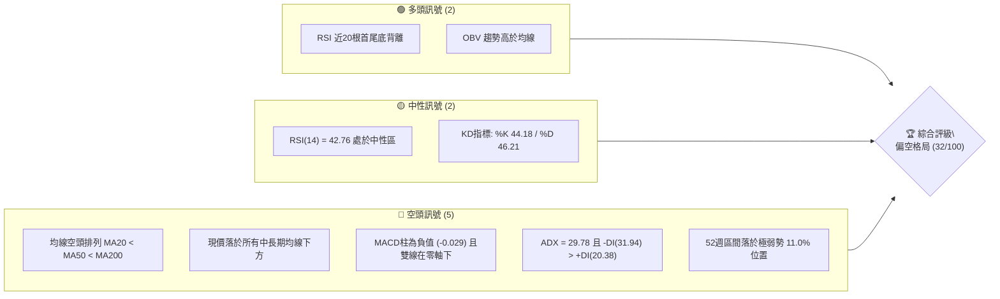
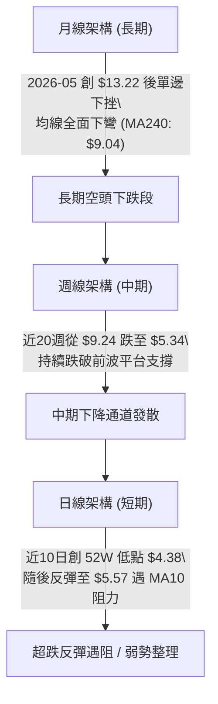
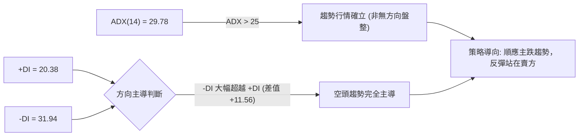
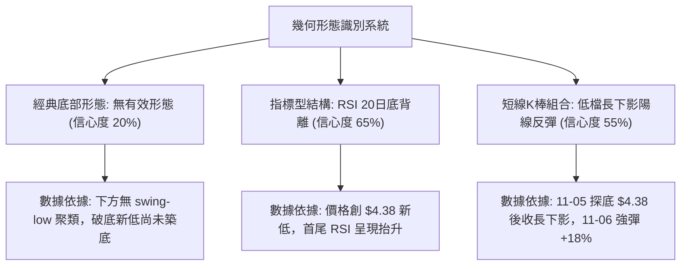
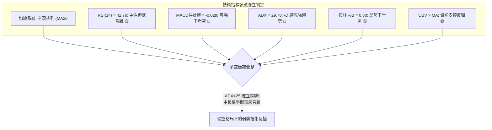
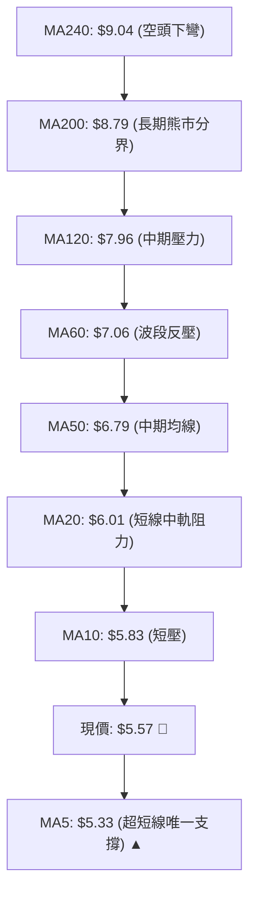
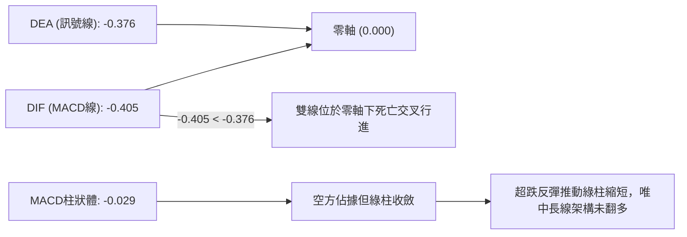
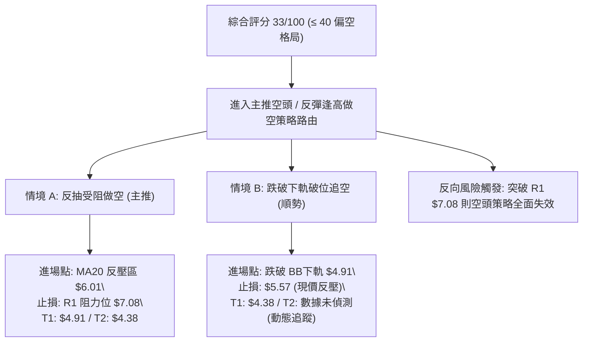
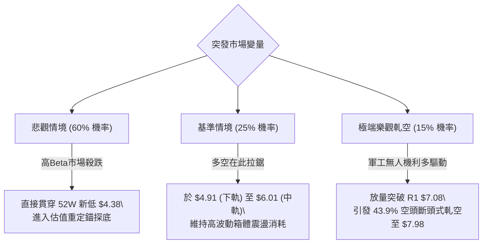

# ONDS 技術分析報告

> **報告日期**：2026-11-11 ｜ **語言**：繁體中文 ｜ **數據來源**：Yahoo Finance ｜ **當前價格**：$5.57

---

## 目錄

| 章節 | 內容 |
|------|------|
| [1. 技術面概覽](#1-技術面概覽) | 訊號儀表板、核心指標、評分卡 |
| [2. 趨勢分析](#2-趨勢分析) | 多時框趨勢、長中短期走勢 |
| [3. 圖表形態分析](#3-圖表形態分析) | 形態識別、K線組合、目標價 |
| [4. 支撐與阻力](#4-支撐與阻力) | 關鍵價位、斐波那契回調 |
| [5. 技術指標深度解讀](#5-技術指標深度解讀) | MA/RSI/MACD/布林/成交量 |
| [6. 動能與波動率](#6-動能與波動率) | 動能評估、ATR、Beta |
| [7. 多時框架總結](#7-多時框架總結) | 時框架評分矩陣 |
| [8. 交易策略建議](#8-交易策略建議) | 多空策略、風險報酬比 |
| [9. 風險提示與監控](#9-風險提示與監控) | 監控指標、風險場景 |

---

## 1. 技術面概覽

### 🎯 技術訊號儀表板



### 📊 核心指標速覽表

| 指標類別 | 指標名稱 | 當前數值 | 訊號 | 解讀 |
|----------|----------|----------|------|------|
| **價格** | 當前收盤價 | $5.57 | 🔴 | 位於 52 週區間 ($4.38 - $15.28) 之 11.0%，空頭絕對壓制 |
| **均線** | MA20 | $6.01 | 🔴 | 現價低於 MA20 達 -7.36%，短中期均線形成重度反壓 |
| **均線** | MA50 | $6.79 | 🔴 | 現價低於 MA50，中期趨勢完全呈現下行發散 |
| **均線** | MA200 | $8.79 | 🔴 | 現價低於 MA200 達 -36.63%，長期架構維持實質熊市 |
| **動能** | RSI(14) | 42.76 | 🟡 | Wilder 數值處於中性區 (30-70)，未落入超賣但底背離浮現 |
| **動能** | MACD(12,26,9) | -0.405 | 🔴 | 快慢線均在零軸之下，柱狀體為 -0.029，空頭動能仍佔優勢 |
| **趨勢** | ADX(14) | 29.78 | 🔴 | ADX > 25 確立強趨勢，-DI(31.94) 大幅領先 +DI(20.38)，屬空頭趨勢 |
| **通道** | 布林 %B | 0.30 | 🟡 | 價格處於下軌 ($4.91) 與中軌 ($6.01) 間，偏向弱勢震盪 |
| **波動** | ATR(14) | $0.53 | 🔴 | 佔價格 9.47%，屬於超高日內波動率，下檔風險防範要求高 |
| **量能** | OBV 趨勢 | OBV > MA | 🟢 | 能量潮高於均線，顯示特定買盤在破底過程中持續吸籌 |

### 🏆 技術評分卡

```
╔══════════════════════════════════════════════════════════════╗
║                技術評分卡 — ONDS (2026-11-11)                ║
╠══════════════════════════════════════════════════════════════╣
║ 趨勢強度      ████████░░░░░░░░░░░░  40/100  🔴 (空頭主導強趨勢)║
║ 動能指標      ████████░░░░░░░░░░░░  40/100  🔴 (MACD負值/背離待確認)║
║ 支撐穩定度    ████░░░░░░░░░░░░░░░░  20/100  🔴 (下方無波段低點聚類)║
║ 成交量配合    ████████████░░░░░░░░  60/100  🟡 (量比0.91x但OBV>MA)║
║ 形態完整度    ████░░░░░░░░░░░░░░░░  20/100  🔴 (缺乏反轉底部幾何形態)║
║ 均線排列      ████░░░░░░░░░░░░░░░░  20/100  🔴 (MA20<MA50<MA200空排)║
╠══════════════════════════════════════════════════════════════╣
║ 綜合評分      ██████░░░░░░░░░░░░░░  33/100  🔴 空頭防守 / 偏空格局 ║
╚══════════════════════════════════════════════════════════════╝
```
*(註：綜合評分由六項子指標算術平均得 (40 + 40 + 20 + 60 + 20 + 20) / 6 = 33.33，四捨五入為 33/100)*

---

## 2. 趨勢分析

### 🌐 多時框趨勢分析



### 📈 長期趨勢 — 12個月走勢圖（Unicode）

```
ONDS 月線收盤走勢圖（2025-12 至 2026-11）
價格軸 ($)
$14.00 ┤                                      
$13.00 ┤                                  ● (2026-05: $13.22)
$12.00 ┤                                 ╱ ╲
$11.00 ┤                   ●             ╱   ╲
$10.00 ┤         ●        ╱ ╲     ●     ╱     ╲
$ 9.00 ┤  ●     ╱ ╲      ╱   ●   ╱ ╲   ╱       ● (2026-06: $8.24)
$ 8.00 ┤   ╲   ╱   ╲    ╱     ╲ ╱   ╲ ╱         ╲   ●
$ 7.00 ┤    ╲ ╱     ●──●       V     V           ●─● ╲   ●
$ 6.00 ┤     V                                        ╲ ╱ ╲
$ 5.00 ┤                                               V   ●←現價 ($5.57)
$ 4.00 ┤
       └─────────────────────────────────────────────────────────────
         12月 01月 02月 03月 04月 05月 06月 07月 08月 09月 10月 11月
         (2025)                      (2026)
```

#### 走勢特徵分析表格

| 階段區間 | 起訖月份 | 收盤區間 | 區間漲跌幅 | 主要走勢特徵與量價架構 |
|----------|----------|----------|------------|------------------------|
| **主升攻擊段** | 2025-12 → 2026-01 | $9.76 → $10.36 | +6.15% | 延續 2025 年下半年爆發動能，價格首度站上雙位數大關 |
| **高檔強勢箱體** | 2026-01 → 2026-04 | $10.36 → $10.04 | -3.09% | 於 $9.04 - $10.36 間寬幅橫盤，籌碼在高檔劇烈換手 |
| **末端誘多創高** | 2026-04 → 2026-05 | $10.04 → $13.22 | +31.67% | 爆量突破衝刺創 52 週高點 ($15.28)，但迅速留下高檔竭盡跡象 |
| **單邊主跌發散** | 2026-05 → 2026-07 | $13.22 → $7.49 | -43.34% | 瀑布式重挫連續失守短期、中期均線，多頭結構全面潰散 |
| **弱勢橫盤破位** | 2026-07 → 2026-10 | $7.49 → $6.32 | -15.62% | 於 $7.30 - $7.90 構築弱勢反彈平台失敗，10月破線下行 |
| **破底探花階段** | 2026-10 → 2026-11 | $6.32 → $5.57 | -11.87% | 日線於 11-05 跌破 $5.00 關卡見 $4.38 新低，當前展開超跌修復 |

### 📊 中期趨勢（週線分析）

週線架構目前處於嚴格的中期空頭下行常態。近 20 週收盤走勢顯示，自 2026-08-14 見到週收盤高點 $9.24 之後，已連續走跌數月。高點沿著 $7.98 (09-25) → $7.08 (10-30) → $6.40 (11-06) 持續下移，形成標準的下降高點 (Lower Highs) 與下降低點 (Lower Lows)。

```
週線級別壓力與空頭推進通道示意圖
價格 ($)
$8.00 ┤  ● (09-25: $7.98)
$7.50 ┤   ╲
$7.00 ┤    ╲          ● (10-30: $7.08)
$6.50 ┤     ╲          ╲
$6.00 ┤      ╲          ╲       ● (11-06: $6.40)
$5.50 ┤       ╲          ╲       ╲   ●現價 $5.57 (遇反彈阻力)
$5.00 ┤        ╲          ╲       ╲ ╱
$4.50 ┤         ╲          ╲       ● (11-05 最低 $4.38)
      └───────────────────────────────────────────────
         09-25      10-16      10-30      11-10
```

### ⚡ 趨勢強度評估（ADX 解讀）



#### ADX 趨勢強度指標對照

| 指標變數 | 當前讀數 | 門檻區間 | 趨勢屬性解讀 |
|----------|----------|----------|--------------|
| **ADX(14)** | **29.78** | > 25.00 (強趨勢) | 市場具備明確趨勢動力，動量並非處於低波動死寂盤整 |
| **+DI** | **20.38** | < 25.00 (多頭衰竭) | 多方缺乏發動單邊連續進攻的能力 |
| **-DI** | **31.94** | > 30.00 (空頭強勢) | 空方擁有強大的下行貫穿力道，壓抑每次日內反彈 |
| **趨勢形態** | **空頭趨勢行進中** | -DI > +DI 且 ADX 上升 | 所有反彈均屬於「空頭趨勢中的技術性乖離修正」 |

---

## 3. 圖表形態分析

### 🔍 形態識別系統

在多維幾何形態上，由於數據中「關鍵價位」顯示下方未偵測到任何近一年波段低點聚類，且價格剛創下 52 週新低 $4.38，因此市場並未完成如「雙底」或「頭肩底」等經典反轉幾何架構。當前盤面主要展現為「指標型底背離」與「急跌後的旗形/楔形整理初胚」。



#### 圖表形態信心度評估表

| 形態名稱 | 信心度 | 判斷依據（引用數據） | 完成度 | 目標價（附計算式） |
|----------|--------|----------------------|--------|--------------------|
| **雙底形態 (W底)** | 20% | 數據中未偵測到波段低點聚類，低點僅見 $4.38 單一波谷，不符雙底定義 | 15% | 訊號不足，僅做指標型解讀，不計算形態目標價 |
| **下降通道整理** | 75% | 週K連續三週高點走低 ($7.08 → $6.40 → $6.12)，低點創 $4.38 | 85% | 由通道上軌推算測幅目標：頸線壓力為近期波段高點 R1 $7.08 |
| **RSI 底背離反彈** | 65% | 數據快照明確標注「RSI底背離 (近20根K棒首尾價格破低但RSI回升)」 | 60% | 由 11-05 低點 $4.38 至 MA20 反壓高度推算：$4.38 + ($6.01 - $4.38) = $6.01 (中軌) |

### 🕯️ 重要K線形態分析

嚴格依據近 10 根日 K 與近 8 根週 K 之開、高、低、收數據進行解讀：

#### 近 10 根日 K 線形態解讀

| 日期 | 開 | 高 | 低 | 收 | 成交量 | K線形態 | 解讀與訊號評估 |
|------|----|----|----|----|--------|---------|----------------|
| **10-28** | 6.69 | 6.88 | 6.56 | 6.86 | 51.85M | 中陽線 | 多頭反抽嘗試攻擊 $7.00 整數關卡 🟡 |
| **10-29** | 6.74 | 7.08 | 6.74 | 6.88 | 45.60M | 上影長陽 | 觸及阻力位 R1 $7.08 後承壓收斂，留下明顯反壓 🔴 |
| **10-30** | 6.46 | 6.60 | 6.18 | 6.32 | 41.15M | 跳空陰線 | 破位下挫，實體跌穿 $6.40 支撐，開啟新一輪下行 🔴 |
| **11-02** | 6.38 | 6.40 | 5.72 | 5.75 | 37.62M | 大陰線 | 實體貫穿 $6.00 關卡，日線空頭趨勢發散加速 🔴 |
| **11-03** | 5.80 | 6.09 | 5.77 | 5.79 | 34.56M | 倒狀十字星 | 上探 $6.09 遭空頭無情壓回，收盤維持低檔弱勢 🔴 |
| **11-04** | 5.70 | 5.78 | 5.22 | 5.27 | 53.43M | 放量長陰 | 放量摜壓破底，空方殺盤湧現，逼近 $5.00 大關 🔴 |
| **11-05** | 5.09 | 5.16 | 4.38 | 4.52 | 65.13M | 探底長下影錘頭 | 創 52 週新低 $4.38，成交量爆出 65.13M，低檔承接盤湧現 🟢 |
| **11-06** | 4.77 | 5.45 | 4.60 | 5.34 | 44.86M | 低開長陽吞噬 | 開低走高長陽線，完全吞噬前日收盤，短線反轉確立 🟢 |
| **11-09** | 5.45 | 6.12 | 5.37 | 5.97 | 47.79M | 衝高小陽線 | 盤中突破 $6.00 觸及 $6.12，但受阻於 MA20 ($6.01) 🟡 |
| **11-10** | 5.84 | 5.91 | 5.45 | 5.57 | 40.92M | 弱勢小陰線 | 高開走低，收盤於 $5.57，成交量縮，短線反彈動能衰竭 🔴 |

#### 近 8 根週 K 線形態解讀

| 週結日期 | 開 | 高 | 低 | 收 | 成交量 | K線形態 | 解讀與訊號評估 |
|----------|----|----|----|----|--------|---------|----------------|
| **09-25** | 7.51 | 7.98 | 7.18 | 7.64 | 375.05M | 高浪震盪線 | 衝刺阻力位 R2 $7.98 失敗，多空分歧巨大 🟡 |
| **10-02** | 7.53 | 7.91 | 7.12 | 7.24 | 247.66M | 帶上影中陰 | 反彈無力，空頭逐步奪回週線主導權 🔴 |
| **10-09** | 7.62 | 7.69 | 6.64 | 6.73 | 244.88M | 破位中長陰 | 摜破 $7.00 週線平台，形成週線空頭突破 🔴 |
| **10-16** | 7.06 | 7.08 | 5.80 | 6.04 | 327.19M | 放量長黑棒 | 觸及阻力位 R1 $7.08 後瀑布式滑落，週跌幅慘重 🔴 |
| **10-23** | 6.20 | 6.37 | 5.88 | 6.20 | 179.55M | 低檔十字星 | 跌勢暫歇，量能大幅萎縮，多空進入觀望 🟡 |
| **10-30** | 6.17 | 7.08 | 6.04 | 6.32 | 217.41M | 長上影紡錘線 | 二度上探 R1 $7.08 遇強大賣壓壓回，上檔套牢沉重 🔴 |
| **11-06** | 6.38 | 6.40 | 4.38 | 5.34 | 235.61M | 巨幅震盪破底錘頭 | 盤中殺出 52W 新低 $4.38 後收回 $5.34，帶有極長下影線 🟢 |
| **11-10** | 5.45 | 6.12 | 5.37 | 5.57 | 88.72M | 弱勢反彈內包線 | 週前半段彈升遇 MA20 反壓，量能不足呈弱勢整理 🔴 |

### 📉 ASCII 走勢形態示意圖

```
日K線超跌反彈遇阻架構（11-04 至 11-10）
價格 ($)
$6.20 ┤                      
$6.00 ┤                     ┌─┐ (11-09 高點 $6.12，碰觸 MA20 $6.01)
$5.80 ┤                     │ │     ┌─┐
$5.60 ┤             ┌─┐     │ │     │ ├─ 現價 $5.57
$5.40 ┤             │ │     │ │     │ │
$5.20 ┤     ┌─┐     │ │     └┬┘     └┬┘
$5.00 ┤     │ │     │ │      │       │
$4.80 ┤     │ │     └┬┘      │       │
$4.60 ┤     │ │      │       │
$4.40 ┤     └┬┘      │ (11-05 最低 $4.38，爆量錘頭)
      └──────┴───────┴───────┴───────┴───────
           11-04   11-05   11-06   11-09   11-10
```

### 🎯 形態目標價計算

根據日線自 11-05 觸及 52 週新低 $4.38 的反彈波段推算：
1. **反彈頸線阻力（MA20 / 中軌）**：$6.01
2. **反彈第 1 階段高點（11-09 實體最高）**：$6.12
3. **短期技術修復目標計算**：
   - 第一目標價 (T1) 由日線布林中軌 MA20 鎖定：**$6.01**
   - 第二目標價 (T2) 由近一年波段高點聚類阻力位 R1 鎖定：**$7.08**

---

## 4. 支撐與阻力

### 🗺️ 關鍵價位分布圖（Unicode）

```
ONDS 價位結構分布圖（嚴格依據 OHLCV 計算）
═══════════════════════════════════════════════════════════════
$15.28 ║████████████████████████████████████████║ 52週最高點 (0.0% Fib)
       ║                                        ║
$ 8.58 ║████████████████████                    ║ 強阻力 R3 (+54.04%)
$ 8.54 ║────────────────────────────────────────║ 61.8% 斐波那契回調位
$ 7.98 ║████████████████                        ║ 阻力位 R2 (+43.27%)
$ 7.08 ║████████████                            ║ 關鍵阻力位 R1 (+27.11%)
$ 6.71 ║────────────────────────────────────────║ 78.6% 斐波那契回調位
$ 6.01 ║┄┄┄┄┄┄┄┄┄┄┄┄┄┄┄┄┄┄┄┄┄┄┄┄┄┄┄┄┄┄┄┄┄┄┄┄┄║ 短線動態壓力 (MA20 / BB中軌)
$ 5.57 ╠════════════════════════════════════════╣ ◄ 當前收盤價 ($5.57)
$ 4.91 ║┄┄┄┄┄┄┄┄┄┄┄┄┄┄┄┄┄┄┄┄┄┄┄┄┄┄┄┄┄┄┄┄┄┄┄┄┄║ 短線動態支撐 (BB下軌)
$ 4.38 ║████████████████████████████████████████║ 52週最低點 (100.0% Fib)
═══════════════════════════════════════════════════════════════
```

### 🚧 阻力位分析表

依據數據「關鍵價位」區塊近一年波段高點聚類嚴格列出：

| 阻力級別 | 價位 | 形成原因 | 突破難度 | 重要性 |
|----------|------|----------|----------|--------|
| **R1** | **$7.08** | 近一年波段高點聚類；10-29日K最高價($7.08)、10-30週K最高價($7.08)三度重疊共振 | 極高 | ★★★★★ (中短期多空生死線) |
| **R2** | **$7.98** | 近一年波段高點聚類；09-25週K最高點($7.98)，前期箱體頂部套牢區 | 極高 | ★★★★☆ (中期反轉關鍵防線) |
| **R3** | **$8.58** | 近一年波段高點聚類；逼近 61.8% 斐波那契位 ($8.54) 與 MA200 ($8.79) | 極度艱難 | ★★★★☆ (長期牛熊分水嶺) |

### 🛡️ 支撐位分析表

依據數據「關鍵價位」區塊與 52 週極值嚴格列出：

| 支撐級別 | 價位 | 形成原因 | 守住機率 | 重要性 |
|----------|------|----------|----------|--------|
| **S1 (動態)** | **$4.91** | 日線布林通道下軌，動態支撐下緣 | 55% | ★★★☆☆ (短線防線) |
| **S2 (極值)** | **$4.38** | 52 週最低點 (100.0% 斐波那契位)；11-05 盤中見底之絕對低點 | 60% | ★★★★★ (不可跌破之底線) |
| **靜態聚類** | **N/A** | 數據明確註明「no swing-low support detected below current price」 | N/A | 現價下方無任何歷史波段低點聚類 |

### 📐 斐波那契回調位分析

依據 52 週區間 **$4.38 → $15.28** 計算之回調位，現價 $5.57 處於 78.6% 回調位 ($6.71) 與 100.0% 底部 ($4.38) 之間的極弱勢超跌區間：

| 斐波那契分位 | 對應價位 | 與現價距離 (%) | 技術意涵解讀 |
|--------------|----------|----------------|--------------|
| **0.0% (52W High)** | **$15.28** | +174.33% | 2026年多頭最高峰，歷史性天花板阻力 |
| **23.6%** | **$12.71** | +128.19% | 強勢回檔極限，跌破後多頭力道全面弱化 |
| **38.2%** | **$11.11** | +99.46% | 原中期多空平衡樞紐 |
| **50.0%** | **$9.83** | +76.48% | 心理整數多空對稱中軸 |
| **61.8%** | **$8.54** | +53.32% | 黃金分割防線，與阻力位 R3 ($8.58) 形成密集共振區 |
| **78.6%** | **$6.71** | +20.47% | 深幅回調最後防線，目前已由支撐轉化為沉重反壓 |
| **100.0% (52W Low)**| **$4.38** | -21.36% | 本波下挫終極低點，52 週區間之絕對底線 |

---

## 5. 技術指標深度解讀

### 🎛️ 指標訊號總覽



### 📈 移動平均線排列分析



#### 各期均線當前數值與乖離率

| 均線名稱 | 當前價格 | 乖離率 (現價 vs MA) | 趨勢斜率與狀態 | 技術解讀 |
|----------|----------|----------------------|----------------|----------|
| **MA5** | $5.33 | +4.44% | 向上翻揚 ▲ | 近 3 日自低點 $4.38 反彈推升短天期微結構 |
| **MA10** | $5.83 | -4.40% | 持續向下 ▼ | 短線反彈第一道天花板，11-10 盤中受阻於此 |
| **MA20** | $6.01 | -7.36% | 下滑發散 ▼ | 月線生命線，亦為布林中軌，反彈關鍵阻力 |
| **MA50** | $6.79 | -17.97% | 穩定下行 ▼ | 季線空頭主導，下壓速率極快 |
| **MA60** | $7.06 | -21.11% | 下行發散 ▼ | 與阻力位 R1 ($7.08) 形成重疊反壓帶 |
| **MA120** | $7.96 | -30.07% | 下行發散 ▼ | 與阻力位 R2 ($7.98) 形成半年線反壓帶 |
| **MA200** | $8.79 | -36.63% | 長期下壓 ▼ | 標誌實質處於技術性大熊市 |
| **MA240** | $9.04 | -38.36% | 走平下彎 ▼ | 年線級別沉重套牢賣壓 |

### 📉 RSI(14) 分析

當前 RSI(14) 讀數為 **42.76** (Wilder計算)。

```
RSI(14) 當前強度位置
0 ──────────── 30 ═══════════ 42.76 ═══════════ 70 ──────────── 100
[   超賣區   ]    [ 弱勢區 ]    ▲   [ 強勢區 ]    [   超買區   ]
```
- **數值進度**：████████░░░░░░░░░░░░ 42.8%
- **背離判斷**：日線存在明確的 **底背離 (Bullish Divergence)**。在近 20 根 K 棒中，價格自 10 月末破位一路殺出 52 週新低 $4.38，但首尾 RSI 數值由低點 29.6（10-16 當週）逐步回升至 42.76，顯示短線下殺動能已出現衰竭竭盡訊號，促成近期自 $4.38 彈升至 $5.57。
- **限制因素**：RSI 尚未突破 50 中軸多空分水嶺，底背離僅能驅動技術性跌深反抽，尚未具備扭轉中期均線空頭排列之實力。

### 📊 MACD(12/26/9) 訊號解讀



- **MACD 線**：-0.405
- **訊號線 (Signal)**：-0.376
- **柱狀圖 (Histogram)**：-0.029 🔴
- **深度分析**：MACD 線與訊號線雙雙深陷零軸以下，為典型的空頭強勢主導市場。雖然柱狀體由上週的 -0.105 顯著收斂至 -0.029，反映 11-05 探底後的反彈修復，但在雙線未金叉並突破零軸前，任何指標收斂皆應視為空頭波段中的弱勢喘息。

### 📦 布林通道分析

```
日線布林通道結構示意圖 (帶寬: $4.91 - $7.12)
價格 ($)
$7.12 ─────────────────────────────── 上軌 (強阻力帶，觸及難度極大)
      │
$6.01 ┄┄┄┄┄┄┄┄┄┄┄┄┄┄┄┄┄┄┄┄┄┄┄┄┄┄┄┄┄ 中軌 (MA20生命線，短線強反壓)
      │      ● 當前收盤價 $5.57 (%B = 0.30)
      │
$4.91 ─────────────────────────────── 下軌 (動態超跌下緣)
```
- **上軌**：$7.12（與 R1 $7.08 形成共振阻力）
- **中軌 (MA20)**：$6.01
- **下軌**：$4.91
- **%B 指標**：0.30（表明價格位於通道偏下緣，略高於下軌，未處於擠壓爆發點，處於超跌反彈遇中軌受阻段）
- **帶寬解讀**：布林帶寬 ($7.12 - $4.91 = $2.21) 佔價格比重達 39.7%，顯示前波破底殺盤使波動通道大幅擴張，短期直接由下軌連續貫穿上軌的機率極低。

### 💹 成交量分析（量價配合度）

- **最新成交量**：40,929,900 股
- **20日均量**：45,164,515 股（量比：0.91x，低於平均水平）
- **50日均量**：54,613,714 股
- **OBV 趨勢**：數據顯示「OBV > MA → 量能支撐上漲」。
- **量價背離與確認特徵**：
  1. **破底爆量**：11-05 跌至 52W 新低 $4.38 時，日成交量放大至 65.13M，為近期最高量，顯示有非散戶籌碼於 $4.50 下方進行恐慌盤承接。
  2. **反彈量縮**：11-09 上衝 $6.12 時成交量為 47.80M，而 11-10 回落 $5.57 時成交量萎縮至 40.93M。這說明反彈過程中追高買盤並不積極，高檔追價意願疲弱，量價配合呈現「空頭回補推升、主動性多頭進攻不足」的典型反抽架構。

---

## 6. 動能與波動率

### ⚡ 動能評估四象限

```
動能與波動率定位矩陣
      高波動率 (High Volatility)
           │
     Q3    │    Q4 (當前位置: ONDS)
           │    ATR = 9.47%, Beta = 3.08
───────────┼─────────────────────────
     Q1    │    Q2
           │    
           │
      低波動率 (Low Volatility)
  低動能 ──┴── 高動能 (Trend Momentum)
```

| 象限 | 狀態特徵 | 標的所屬判斷 | 應對策略導引 |
|------|----------|--------------|--------------|
| **Q1 (低動能/低波動)** | 橫盤死寂 | 否 | 觀望等待放量方向確認 |
| **Q2 (高動能/低波動)** | 穩健單邊牛市 | 否 | 順勢加碼持股 |
| **Q3 (低動能/高波動)** | 無序劇烈震盪 | 否 | 區間極短線來回沖刷 |
| **Q4 (高動能/高波動)** | **單邊破位/超高投機** | **✓ ONDS (符合)** | **嚴禁重倉抄底，嚴設止損，以反彈做空或極低倉位博反彈為主** |

### 📊 ATR 波動率分析

- **ATR(14)**：**$0.53** (佔股價比重 **9.47%**，Wilder 演算法)
- **解讀**：每日股價平均波動範圍超過半元美金，相對於 $5.57 的股價，波動幅度逼近 10%。這意味著任何技術支撐與阻力的測試，都可能伴隨日內 ±$0.50 以上的假突破或毛刺。
- **止損距離建議**：
  - 保守型技術止損：應給予 1.5 倍 ATR = $0.53 × 1.5 = **$0.80** 的安全緩衝。
  - 激進型緊密止損：應給予 1.0 倍 ATR = **$0.53**。

### 📐 Beta 與市場相關性

- **Beta 係數**：**3.082**
- **市場屬性分析**：Beta 超過 3.0，代表該股具備極端的高槓桿市場敏感度，若標普 500 指數波動 1%，ONDS 歷史平均波動達 3.08%。在科技板塊面臨總體經濟或利率擾動時，此類高 Beta 小微盤投機標的會面臨大幅度的流動性抽離風險。
- **空頭部位特徵**：Short % of Float 達到 **43.9%**，Short Ratio 為 4.11。空頭部位極度沉重，這既是下行趨勢的沉重阻礙，同時也隱含一旦突破關鍵反壓（如 R1 $7.08），將引發劇烈空頭軋空 (Short Squeeze) 的尾部風險。

---

## 7. 多時框架總結

### 📋 時框架評分表

| 時框架 | 趨勢方向 | 動能狀態 | 均線排列 | 形態特徵 | 綜合評分 | 建議處置 |
|--------|----------|----------|----------|----------|----------|----------|
| **月線 (長期)** | 🔴 強烈空頭 | 弱勢下探 | 均線全面下彎 (MA240: $9.04) | 自 $13.22 形成單邊下跌長黑 | 20/100 | 長線資金絕對迴避 |
| **週線 (中期)** | 🔴 穩定下行 | MACD綠柱收斂 | 空頭排列 (MA20<MA50) | 下降通道行進，高點下移 | 30/100 | 逢反彈減碼或建立防禦避險 |
| **日線 (短期)** | 🟡 超跌反彈 | RSI底背離 | 空頭排列但價格站上MA5 | 爆量長下影錘頭後反抽受阻 | 45/100 | 僅適短線敏銳交易者博弈 |

### 🔲 綜合訊號矩陣

```
時框架訊號矩陣與收斂校準
═══════════════════════════════════════════════════════════════
時框     趨勢指標(ADX/MA)   動能指標(RSI/MACD)   量價形態(OBV/K線)   權重方向
───────────────────────────────────────────────────────────────
長期(月) 🔴 空頭 (MA200下方) 🔴 MACD死叉發散     🔴 瀑布下挫放量     🔴 壓制
中期(週) 🔴 -DI > +DI       🔴 零軸下死叉        🔴 破位下挫         🔴 壓制
短期(日) 🔴 空頭排列發散     🟢 RSI底背離確認     🟢 探底長下影爆量   🟡 弱勢反彈
═══════════════════════════════════════════════════════════════
多時框最終收斂結論：中長期單邊空頭趨勢壓制下的短期乖離修復反抽
```

### ⚖️ 多時框收斂結論

依據多時框收斂規則第 14 條：
1. **行情屬性判定**：當前 ADX(14) 讀數為 **29.78 > 25**，市場明確處於**趨勢行情**（非無方向盤整），且 -DI (31.94) 遠高於 +DI (20.38)，趨勢方向為**單邊空頭主導**。
2. **優先級收斂**：在趨勢行情下，必須以**中長期（週線、MA50 $6.79、MA200 $8.79）方向為主導**，日線級別的底背離與反彈僅能用作尋找短線反彈賣點或極小倉位超跌反抽，絕對不可逆勢將日線微弱反彈誤判為長期反轉。
3. **最終方向性結論**：**偏空（防守減碼／反彈逢高布空）**。評分卡綜合評分為 **33/100**，全面指向空頭主導。

---

## 8. 交易策略建議

### 🗺️ 策略決策流程圖



### 🧭 策略路由（依評分卡分流）

> **當前主策略方向 = 主推空頭／反彈逢高沽空（依綜合評分 33/100）**
> 
> 依評分卡規定，綜合評分 ≤ 40 必須主推空頭策略。日線雖有 RSI 底背離，但在 ADX > 25 且均線重度空頭排列下，反彈至均線反壓區為絕佳的高盈虧比做空時機。多頭策略僅列為超跌博弈的次級對沖參考。

### 🎯 價格情境階梯（Price Scenarios）

價位嚴格引用自「關鍵價位」與「均線系統」：

| 觸發條件 | 下一目標 | 後續延伸 | 情境含義 |
|----------|----------|----------|----------|
| **向上突破 R1 $7.08** | R2 $7.98 | R3 $8.58 | 空頭結構瓦解，43.9% 空頭部位引發軋空踩踏 |
| **反彈受阻 MA20 $6.01** | 下測下軌 $4.91 | 再探 52W 低點 $4.38 | 反抽結束，回歸中長期單邊主跌浪 |
| **跌破 52W 低點 $4.38** | 數據中未偵測到 | 數據中未偵測到 | 進入無歷史波段低點支撐的自由落體探底 |

### 📊 情境機率分佈

| 情境類別 | 機率預估 | 主要技術指標依據 |
|----------|----------|------------------|
| **反彈遇阻回落 / 再探低 (情境一)** | **60%** | ADX 29.78 空頭主導；均線空頭排列；現價於 MA10、MA20 下方受阻 |
| **布林帶內弱勢震盪 (情境二)** | **25%** | 布林 %B 為 0.30；RSI 位於 42.76 中性區；OBV > MA 存在底層護盤 |
| **強勢突破 R1 反轉 (情境三)** | **15%** | 短線 RSI 底背離；空頭佔比高達 43.9%，潛在 Short Squeeze 觸發 |

### 🔴 主策略詳情（主推空頭策略）

依嚴格要求第 17 條：做空風險報酬比 = (進場價 − 目標價 T1) ÷ (止損價 − 進場價)。所有價位嚴格取自數據數值。

| 策略要素 | 策略 A（反彈受阻阻力位沽空） | 策略 B（下破動態下軌順勢追空） |
|----------|------------------------------|--------------------------------|
| **策略類型** | 順勢逢高布空（主推薦） | 破位追空（突破型） |
| **進場條件** | 反抽觸及 MA20 / 布林中軌滯漲收陰 | 實體跌破布林下軌支撐位 |
| **進場價格** | **$6.01** (MA20 數值) | **$4.91** (BB 下軌數值) |
| **止損價格** | **$7.08** (阻力位 R1 數值) | **$5.57** (當前收盤價位) |
| **目標價 T1** | **$4.91** (BB 下軌數值) | **$4.38** (52週最低點數值) |
| **目標價 T2** | **$4.38** (52週最低點數值) | 數據中未偵測到（需動態移動停利） |
| **風險報酬比** | **1 : 1.03（以 T1 計）**<br>*(計算: (6.01-4.91)/(7.08-6.01) = 1.10/1.07)*<br>註：若以 T2 計則為 1 : 1.52 | **1 : 0.80（以 T1 計）**<br>*(計算: (4.91-4.38)/(5.57-4.91) = 0.53/0.66)* |
| **成功機率** | **65%** | **55%** |
| **建議倉位** | **10% - 15%** (高 Beta 風險控制) | **5% - 8%** |

### 🟢 反向風險觸發點（多頭對沖提示）

- **推翻空頭邏輯之關鍵點位**：**日線收盤價強勢突破阻力位 R1 $7.08**。
- **對沖處置措施**：若日 K 帶量突破 $7.08，所有空頭頭寸必須無條件市價止損離場，並可反手以輕倉追入多單，博弈 43.9% 空頭部位被迫回補所帶來的軋空波段，向上測幅至阻力位 R2 **$7.98** 及 R3 **$8.58**。

### ⭐ 整體訊號強度評星

```
做多訊號強度：★★☆☆☆  (2/5星 — 僅有超跌背離，無結構支撐)
做空訊號強度：★★★★☆  (4/5星 — ADX>25 強勢空頭趨勢確認)
整體可信度：  ★★★★☆  (4/5星 — 數據多時框指向高度一致)
```

---

## 9. 風險提示與監控

### ✅ 關鍵監控指標 Checklist

```
╔══════════════════════════════════════════════════════════════╗
║               交易監控重要指標 CHECKLIST                      ║
╠══════════════════════════════════════════════════════════════╣
║ [ ] 每日收盤是否突破 MA20 ($6.01) — 突破即標誌短空受阻       ║
║ [ ] RSI(14) 是否升破 50 中軸 — 升破則底背離反彈級別擴大      ║
║ [ ] 52週新低 $4.38 是否失守 — 失守則開啟無支撐自由落體       ║
║ [ ] 空頭佔比 Short % Float (43.9%) 是否引發借券費率異常暴增 ║
║ [ ] 日成交量是否顯著超越 50日均量 (54.61M) 呈現異動         ║
║ [ ] MACD 柱狀體是否由負翻正 (金叉突破零軸)                   ║
╚══════════════════════════════════════════════════════════════╝
```

### ⚠️ 風險場景分析



### 🛡️ 風險管理重要提醒

1. **極端高波動率警示**：ONDS 當前 ATR 佔比高達 **9.47%**，且 Beta 值達 **3.082**，每日振幅極其劇烈。交易者嚴禁使用高槓桿，單筆交易的最大資金承擔虧損不得超過總帳戶權益的 **1.0%**。
2. **無波段低點支撐風險**：數據明確揭示，在現價 $5.57 下方**「未偵測到任何波段低點聚類 (no swing-low support detected below current price)」**。這意味著一旦跌破 52 週最低點 $4.38，下方在技術結構上屬於「真空斷崖」，不可盲目猜底建立重倉。
3. **空頭軋空 (Short Squeeze) 雙刃劍**：Short % of Float 高達 **43.9%**，代表市場上累積了大量的空方借券。若公司防務無人機業務突然傳出重大合約催化劑，極易引發日內暴力式軋空拉升，因此做空者必須將止損位嚴格錨定於阻力位 R1 **$7.08**，切忌凹單。

---

## 📋 報告總結

```
╔══════════════════════════════════════════════════════════════╗
║                 ONDS 技術分析報告總結                        ║
╠══════════════════════════════════════════════════════════════╣
║ 報告日期：2026-11-11                                         ║
║ 當前價格：$5.57                                              ║
║ 綜合評級：🔴 空頭主導 / 偏空格局 (技術評分: 33/100)           ║
║                                                              ║
║ 關鍵結論：                                                   ║
║ ├─ 長期趨勢：🔴 熊市結構 (MA200: $8.79 沉重壓制)              ║
║ ├─ 中期趨勢：🔴 下降通道行進中 (ADX=29.78, -DI=31.94)        ║
║ ├─ 短期趨勢：🟡 RSI 底背離推動跌深反抽，但於 MA20 處受阻     ║
║ ├─ 關鍵支撐：動態下軌 $4.91 / 52週極值 $4.38 (下方無波段聚類)║
║ ├─ 關鍵阻力：MA20 $6.01 / R1 $7.08 / R2 $7.98                ║
║ └─ 分析師目標價：均價 $18.88 (共識 Strong Buy，基本面高度分歧)║
║                                                              ║
║ 最優策略組合：                                               ║
║ 1. 🥇 最佳機會：反彈至 MA20 ($6.01) 受阻時順勢布空，止損設 $7.08║
║ 2. 🥈 次選機會：跌破布林下軌 $4.91 後順勢跟進做空，下看 $4.38 ║
║ 3. 🥉 保守選擇：完全空倉觀望，等待日K實體站穩 $7.08 再行評估║
╚══════════════════════════════════════════════════════════════╝
```

---

> ⚠️ **免責聲明**：本報告為 AI 自動生成之技術分析，所有數據及估算均嚴格基於所提供之歷史價格與指標資訊。本報告**僅供研究與學術參考**，**不構成任何形式的投資建議**。高 Beta 與高空頭佔比標的具備極大市場不確定性，投資有風險，入市需謹慎。

---

*報告生成時間：2026-11-11 ｜ 數據來源：Yahoo Finance ｜ 分析框架：多時框技術分析體系*