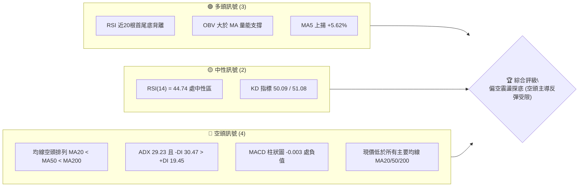
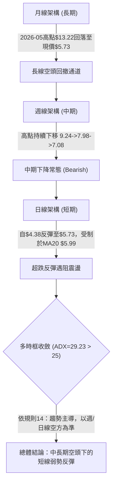
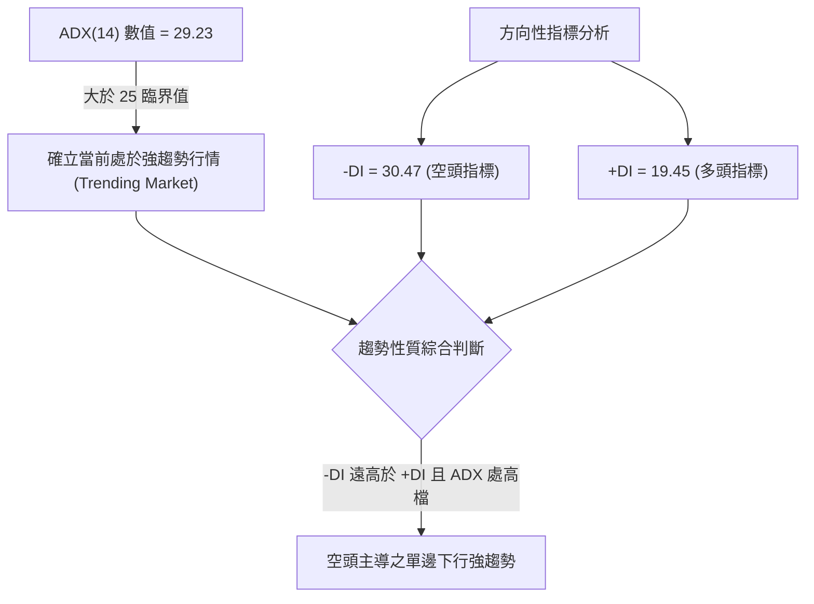
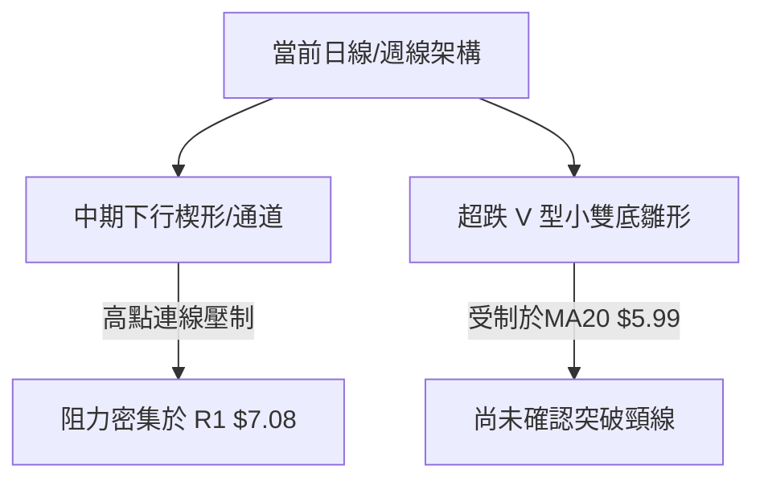
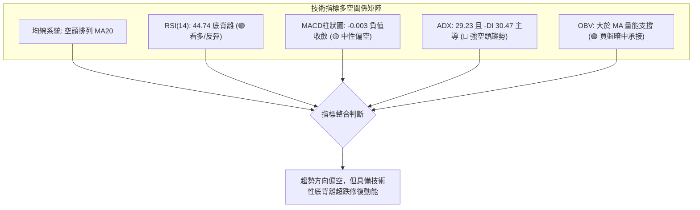
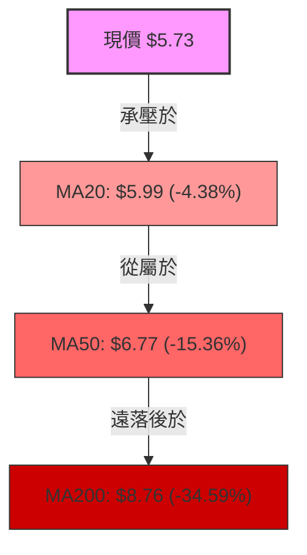
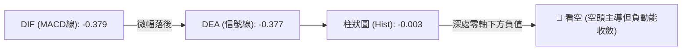
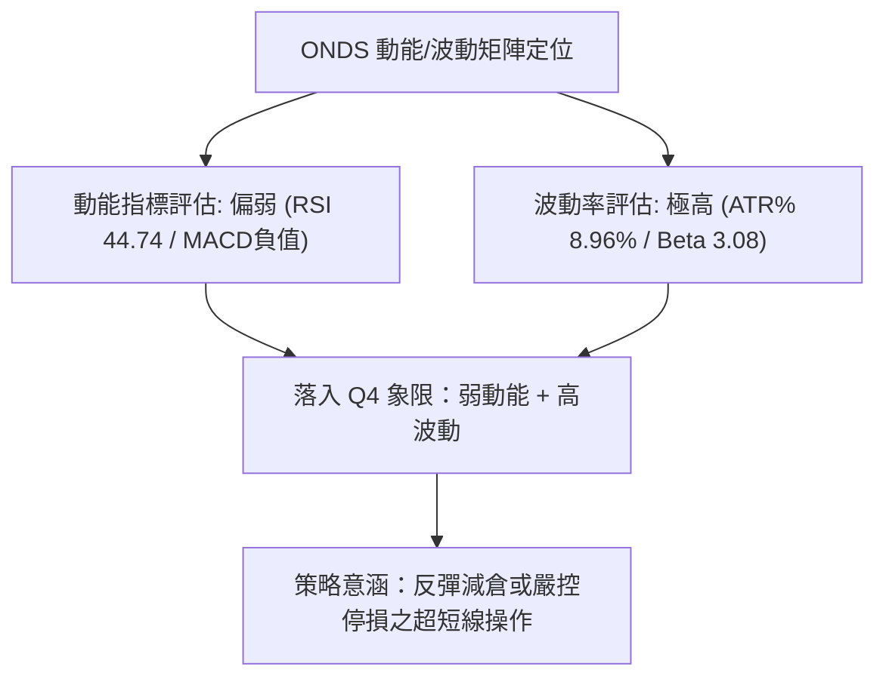
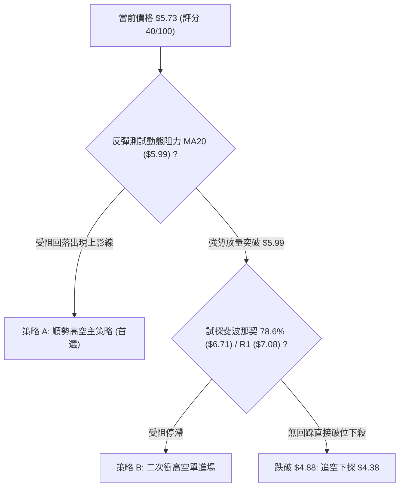
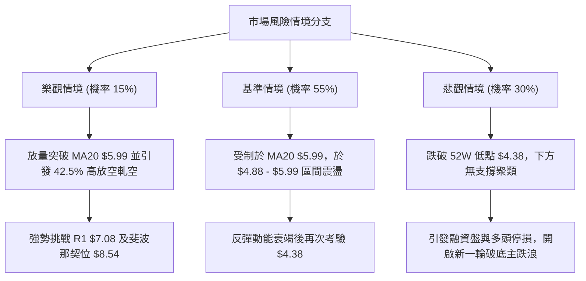

# ONDS 技術分析報告

> **報告日期**：2026-11-12 ｜ **語言**：繁體中文 ｜ **數據來源**：Yahoo Finance ｜ **當前價格**：$5.73

---

## 目錄

| 章節 | 內容 |
|------|------|
| [1. 技術面概覽](#1-技術面概覽) | 訊號儀表板、核心指標、評分卡 |
| [2. 趨勢分析](#2-趨勢分析) | 多時框趨勢、長中短期走勢 |
| [3. 圖表形態分析](#3-圖表形態分析) | 形態識別、K線組合、目標價 |
| [4. 支撐與阻力](#4-支撐與阻力) | 關鍵價位、斐波那契回調 |
| [5. 技術指標深度解讀](#5-技術指標深度解讀) | MA/RSI/MACD/布林/成交量 |
| [6. 動能與波動率](#6-動能與波動率) | 動能評估、ATR、Beta |
| [7. 多時框架總結](#7-多時框架總結) | 時框架評分矩陣 |
| [8. 交易策略建議](#8-交易策略建議) | 多空策略、風險報酬比 |
| [9. 風險提示與監控](#9-風險提示與監控) | 監控指標、風險場景 |

---

## 1. 技術面概覽

### 🎯 技術訊號儀表板



### 📊 核心指標速覽表

| 指標類別 | 指標名稱 | 當前數值 | 訊號 | 解讀 |
|----------|----------|----------|------|------|
| **價格** | 當前價格 | $5.73 | 🔴 | 位於 52 週區間 ($4.38 - $15.28) 之 12.4% 處，處於絕對弱勢低位 |
| **均線** | MA20 | $5.99 | 🔴 | 價格在 MA20 下方 (-4.38%)，短中期下行壓力沉重 |
| **均線** | MA50 | $6.77 | 🔴 | 價格在 MA50 下方 (-15.36%)，中期空頭掌控主導權 |
| **均線** | MA200 | $8.76 | 🔴 | 價格在 MA200 下方 (-34.59%)，長期趨勢嚴重承壓破位 |
| **動能** | RSI(14) | 44.74 | 🟡 | 位於 30-70 中性區間，呈現近 20 根首尾之底背離跡象 |
| **動能** | MACD(12,26,9) | -0.379 / -0.377 | 🔴 | DIF 位於信號線下方，Histogram 為 -0.003，雙線零軸深處走平 |
| **波動** | ATR(14) | $0.51 | 🔴 | 佔股價 8.96%， Wilder 波動度極高，日內持倉風險顯著 |

### 🏆 技術評分卡

```
╔════════════════════════════════════════════════════════════════╗
║             技術評分卡 — ONDS (2026-11-12)                     ║
╠════════════════════════════════════════════════════════════════╣
║ 趨勢強度      ████████░░░░░░░░░░░░  40/100  🔴 空頭強趨勢(-DI主導) ║
║ 動能指標      ██████████░░░░░░░░░░  50/100  🟡 RSI底背離但MACD偏空 ║
║ 支撐穩定度    ██████░░░░░░░░░░░░░░  30/100  🔴 無近一年波段低點聚類 ║
║ 成交量配合    ████████████░░░░░░░░  60/100  🟢 OBV>MA，量比1.18x   ║
║ 形態完整度    ████████░░░░░░░░░░░░  40/100  🟡 低檔收斂，下行通道 ║
║ 均線排列      ████░░░░░░░░░░░░░░░░  20/100  🔴 完美空頭排列       ║
╠════════════════════════════════════════════════════════════════╣
║ 綜合評分      ████████░░░░░░░░░░░░  40/100  🔴 偏空震盪 (規則18)   ║
╚════════════════════════════════════════════════════════════════╝
```
*(註：綜合評分由六項子評分算術平均：(40 + 50 + 30 + 60 + 40 + 20) / 6 = 40.0，依規則 18 取整數為 40/100，落於偏空分界點。)*

---

## 2. 趨勢分析

### 🌐 多時框趨勢分析



### 📈 長期趨勢 — 12個月走勢圖（Unicode）

依據月度歷史收盤數據繪製過去 12 個月走勢圖：
```
ONDS 月線走勢圖（2025-12 至 2026-11）
價格軸 ($)
$14.00 ┤                                  ● $13.22 (2026-05 波段頂部)
$12.00 ┤
$10.00 ┤            ● $10.36  ● $10.08        ● $10.04
$ 8.00 ┤ ● $9.76                    ● $9.04        ● $8.24  ● $7.49  ● $7.66  ● $7.33
$ 6.00 ┤                                                                      ● $6.32  ● $5.73 ←現價
$ 4.00 ┤
       └─────────────────────────────────────────────────────────────────────────────
         12月      01月      02月      03月      04月      05月      06月      07月      08月      09月      10月      11月
         (25)      (26)      (26)      (26)      (26)      (26)      (26)      (26)      (26)      (26)      (26)      (26)
```

#### 走勢特徵分析表格

| 階段 | 期間 | 起點價格 | 終點價格 | 區間漲跌幅 | 結構特徵與技術解讀 |
|------|------|----------|----------|------------|--------------------|
| 頂部盤整期 | 2025-12 ~ 2026-04 | $9.76 | $10.04 | +2.87% | 在 $9.00 - $10.36 間築頂橫盤，多空反覆爭奪 |
| 衝高誘多期 | 2026-04 ~ 2026-05 | $10.04 | $13.22 | +31.67% | 月線級別假突破，創下收盤高點 $13.22（歷史 52W 高點為 $15.28） |
| 主跌宣洩期 | 2026-05 ~ 2026-06 | $13.22 | $8.24 | -37.67% | 巨幅長陰崩跌，一舉跌破 MA20 與 MA50，確立空頭反轉 |
| 中繼陰跌期 | 2026-06 ~ 2026-09 | $8.24 | $7.33 | -11.04% | 於 $7.20 - $7.90 間弱勢中繼整理，反彈無力 |
| 破位探底期 | 2026-09 ~ 2026-11 | $7.33 | $5.73 | -21.83% | 破位下挫，於 2026-11-05 觸及 52W 低點 $4.38，現價弱勢微彈 |

### 📊 中期趨勢（週線分析）

中期走勢呈現典型「高點漸低、低點破底」的下行階梯格局。由近 20 週收盤走勢可見，2026-08-14 創出反彈次高點 $9.24 後，週收盤價一路滑落至 2026-11-06 的 $5.34。

```
近期週線壓力與支撐階梯示意圖
價格軸 ($)
$9.24 ┤  [週頂部 2026-08-14]
$8.58 ┤  ═══════════════════════════════════════ R3 阻力位 ($8.58)
$7.98 ┤  ═══════════════════════════════════════ R2 阻力位 ($7.98, 2026-09-25高點)
$7.08 ┤  ═══════════════════════════════════════ R1 阻力位 ($7.08, 近期聚類頸線)
$5.73 ┤  ◄────── 現價 ($5.73)
$4.38 ┤  ─────────────────────────────────────── 52W 低點支撐 ($4.38, 2026-11-05)
```

### ⚡ 趨勢強度評估（ADX 解讀）



#### ADX 強度對照分析

- **ADX(14) = 29.23**：數值跨越 25.0 門檻，表明當前市場並非橫向無趨勢盤整，而是具備鮮明定向動能的趨勢行情。
- **-DI (30.47) vs +DI (19.45)**：負向定向指標佔據壓倒性優勢，差值高達 11.02，確認市場空頭賣壓沉重，任何日線級別的反彈均屬於強空頭趨勢下的技術性超跌修正。

---

## 3. 圖表形態分析

### 🔍 形態識別系統



#### 形態識別與信心度評估表

| 形態 | 信心度 | 判斷依據（引用數據） | 完成度 | 目標價（附計算式） |
|------|--------|----------------------|--------|--------------------|
| 下行通道 / 旗形中繼 | 75% | 自 2026-08-14 高點 $9.24 以來，週線高點自 $7.98、$7.08 連續下移，現價於軌道下半部 | 85% | 由通道高度推算目標：若跌破 $4.38，下探 $3.70（$4.38 - ($5.73 - $5.05)） |
| 短線超跌雙底雛形 | 45% | 2026-11-05 低點 $4.38 反彈至 $5.45，2026-11-06 回測 $4.60 守穩反彈至現價 $5.73 | 40% | 頸線以 MA20 $5.99 估算：$5.99 + ($5.99 - $4.38) = $7.60；但信心度 < 50%，依規則 15 僅作指標型解讀 |

### 🕯️ 重要K線形態分析

嚴格依據數據中「近 10 根日 K」與「近 8 根週 K」之實際開高低收數據進行客觀解讀：

#### 近 10 根日 K 線形態解讀

| 日期 | 開 | 高 | 低 | 收 | 成交量 | K線形態 | 解讀與訊號 |
|------|----|----|----|----|--------|---------|------------|
| 2026-10-29 | 6.74 | 7.08 | 6.74 | 6.88 | 45,600,200 | 衝高受阻小陽線 | 向上試探 R1 $7.08 承壓回落，長上影暗示阻力沉重 🔴 |
| 2026-10-30 | 6.46 | 6.60 | 6.18 | 6.32 | 41,150,400 | 中陰線 | 跳空低開低走，吞噬前日大部分漲幅，短線轉弱 🔴 |
| 2026-11-02 | 6.38 | 6.40 | 5.72 | 5.75 | 37,625,800 | 光腳大陰線 | 破位下挫，收盤接近全日最低價，賣壓加劇 🔴 |
| 2026-11-03 | 5.80 | 6.09 | 5.77 | 5.79 | 34,561,300 | 窄幅十字小陽 | 於低檔震盪整固，多空暫時均衡 🟡 |
| 2026-11-04 | 5.70 | 5.78 | 5.22 | 5.27 | 53,434,200 | 放量長陰線 | 放量破位下殺，成交量激增，恐慌盤湧出 🔴 |
| 2026-11-05 | 5.09 | 5.16 | 4.38 | 4.52 | 65,130,800 | 放量長下影陰線 | 創 52W 新低 $4.38 後獲逢低買盤拉回，爆量見底特徵 🟢 |
| 2026-11-06 | 4.77 | 5.45 | 4.60 | 5.34 | 44,862,600 | 破底翻大陽線 | 強勢反彈吞噬前日收盤，確立短線低點支撐 🟢 |
| 2026-11-09 | 5.45 | 6.12 | 5.37 | 5.97 | 47,795,000 | 實體中陽線 | 突破 $5.80 壓力，逼近 MA20 ($5.99) 短期多頭發力 🟢 |
| 2026-11-10 | 5.84 | 5.91 | 5.45 | 5.57 | 41,213,000 | 遇阻回落中陰 | 在 MA20 ($5.99) 下方受阻回落，顯露均線壓制 🔴 |
| 2026-11-11 | 5.84 | 5.90 | 5.65 | 5.73 | 52,374,800 | 孕線小陰十字 | 成交量擴大至 52M，窄幅波動，方向選擇在即 🟡 |

#### 近 8 根週 K 線形態解讀

| 日期 | 開 | 高 | 低 | 收 | 週成交量 | K線形態 | 解讀與訊號 |
|------|----|----|----|----|----------|---------|------------|
| 2026-09-25 | 7.51 | 7.98 | 7.18 | 7.64 | 375,050,700 | 長上影小陽線 | 向上試探 R2 $7.98 未果受阻，形成週線次高點 🔴 |
| 2026-10-02 | 7.53 | 7.91 | 7.12 | 7.24 | 247,661,300 | 縮量倒錘中陰 | 多次上衝無力，重心逐步下移 🔴 |
| 2026-10-09 | 7.62 | 7.69 | 6.64 | 6.73 | 244,880,700 | 實體中陰線 | 破位跌穿 $7.00 整數關卡，下行加速 🔴 |
| 2026-10-16 | 7.06 | 7.08 | 5.80 | 6.04 | 327,193,400 | 放量長陰破位 | 暴跌下探 $5.80，週空頭趨勢確立 🔴 |
| 2026-10-23 | 6.20 | 6.37 | 5.88 | 6.20 | 179,558,500 | 縮量低檔十字星 | 殺跌動能暫竭，超跌喘息 🟡 |
| 2026-10-30 | 6.17 | 7.08 | 6.04 | 6.32 | 217,411,600 | 衝高回落長上影 | 試探 R1 $7.08 遭遇空頭強力阻擊 🔴 |
| 2026-11-06 | 6.38 | 6.40 | 4.38 | 5.34 | 235,614,700 | 超長下影大震盪 | 貫穿下殺至 52W 低點 $4.38 後強拉回，形成週線支撐針 🟢 |
| 2026-11-11 | 5.45 | 6.12 | 5.37 | 5.73 | 141,382,800 | 縮量反彈小陽星 | 截至目前維持在下影線上方震盪整理 🟡 |

### 📉 ASCII 走勢形態示意圖

```
日線級別低檔震盪結構圖 (2026-10-29 至 2026-11-11)
價格 ($)
$7.08 ┼   ● (10/29 試探 R1 阻力受挫)
$6.50 ┼      \
$5.99 ┼───────\─────────● (11/09 試探 MA20 $5.99 遇阻)
$5.73 ┼────────\───────/───● (11/11 現價收於 $5.73)
$5.00 ┼         \     /
$4.38 ┼──────────● (11/05 創 52W 新低 $4.38 獲強支撐)
      └─────────────────────────────────────────────────────
         10/29  11/02  11/05  11/06  11/09  11/10  11/11
```

### 🎯 形態目標價計算

依據下行通道結構推算：
- 形態頸線／重要防守壓制位：MA20 即 **$5.99**
- 形態下限基準：52W 低點 **$4.38**
- 測算反彈幅度空間：形態高度 = $5.99 - $4.38 = **$1.61**
- 若向上突破頸線 $5.99，等幅量度目標價 = $5.99 + $1.61 = **$7.60**（此價位介於斐波那契回調位 $6.71 與阻力位 R1 $7.08 / R2 $7.98 之間）。然而，鑑於空頭均線壓制，目前此突破形態尚未完成（完成度僅 40%）。

---

## 4. 支撐與阻力

### 🗺️ 關鍵價位分布圖（Unicode）

```
╔═══════════════════════════════════════════════════════════════════════╗
║                      ONDS 價位結構分布圖                              ║
╠═══════════════════════════════════════════════════════════════════════╣
║ $15.28 ║██████████████████████████████║ 52W 最高點 / 斐波那契 0.0%    ║
║ $12.71 ║████████████████████          ║ 斐波那契 23.6% 回調位         ║
║ $11.11 ║████████████████              ║ 斐波那契 38.2% 回調位         ║
║ $ 9.83 ║██████████████                ║ 斐波那契 50.0% 中軸位         ║
║ $ 8.76 ║██████████████████████████    ║ MA200 長期趨勢防線            ║
║ $ 8.58 ║██████████████████████        ║ 強阻力 R3 (近一年波段高點)    ║
║ $ 8.54 ║████████████████████          ║ 斐波那契 61.8% 黃金分割阻力   ║
║ $ 7.98 ║████████████████              ║ 阻力 R2 (2026-09-25 波段高點) ║
║ $ 7.08 ║████████████████████████      ║ 關鍵阻力 R1 (10-29 高點聚類)  ║
║ $ 6.71 ║████████████                  ║ 斐波那契 78.6% 回調位         ║
║ $ 5.99 ║▓▓▓▓▓▓▓▓▓▓▓▓▓▓▓▓              ║ 短線動態阻力 (MA20 / 布林中軌)║
║ $ 5.73 ╠══════════════════════════════╣ ◄ 當前價格 ($5.73)            ║
║ $ 4.88 ║▓▓▓▓▓▓▓▓▓▓▓▓▓▓▓▓              ║ 短線動態支撐 (布林通道下軌)   ║
║ $ 4.38 ║██████████████████████████████║ 極限強支撐 (52W Low / 100.0%) ║
╚═══════════════════════════════════════════════════════════════════════╝
```

### 🚧 阻力位分析表

阻力位嚴格引用技術數據中「關鍵價位」區塊由 OHLCV 計算之聚類數值：

| 阻力級別 | 價位 | 形成原因 | 突破難度 | 重要性 |
|----------|------|----------|----------|--------|
| **動態壓制** | $5.99 | 日線 MA20 與布林中軌共振處，近兩日多次衝高受阻於此 | 中等 | ⭐⭐⭐☆ |
| **R1** | $7.08 | 近一年波段高點聚類；2026-10-29 與 10-30 當週高點均受阻於此 (+23.56%) | 極高 | ⭐⭐⭐⭐⭐ |
| **R2** | $7.98 | 近一年波段高點聚類；2026-09-25 反彈高點密集套牢區 (+39.27%) | 極高 | ⭐⭐⭐⭐☆ |
| **R3** | $8.58 | 近一年波段高點聚類；接近斐波那契 61.8% ($8.54) 與 MA200 ($8.76) (+49.74%) | 極高 | ⭐⭐⭐⭐☆ |

### 🛡️ 支撐位分析表

數據中明確提示：「*(no swing-low support detected below current price)*」，波段低點聚類未偵測到現價下方的 swing-low，僅有 52 週最低點與通道下軌作為數據基準：

| 支撐級別 | 價位 | 形成原因 | 守住機率 | 重要性 |
|----------|------|----------|----------|--------|
| **S1 (動態)** | $4.88 | 日線布林通道下軌動態支撐位，短線超跌下限 | 65% | ⭐⭐⭐☆☆ |
| **S2 (極限)** | $4.38 | 52 週最低點 (2026-11-05 觸及之 100.0% 斐波那契位)，為全市場多頭最後防線 | 50% | ⭐⭐⭐⭐⭐ |
| **S3 (延伸)** | 數據中未偵測到 | 數據中未偵測到現價下方之其餘波段低點聚類 | N/A | N/A |

### 📐 斐波那契回調位分析

依據 52 週區間 **$4.38 → $15.28** 進行精確對照：

| 回調比例 | 價位 | 技術意涵與解讀 |
|----------|------|----------------|
| **0.0% (52W High)** | $15.28 | 過去一年絕對頂部壓力位 |
| **23.6%** | $12.71 | 長期多頭回調第一承接位（已跌破失效） |
| **38.2%** | $11.11 | 中期多空轉折分水嶺（已跌破失效） |
| **50.0%** | $9.83 | 整個 52 週波動範圍之中軸線（已跌破失效） |
| **61.8%** | $8.54 | 黃金分割強防守位，緊鄰波段高點 R3 $8.58 及 MA200 $8.76 |
| **78.6%** | $6.71 | 深幅調整回撤位，現價上行第一道結構性斐波那契阻力 |
| **當前價格** | **$5.73** | **現價落於 78.6% ($6.71) 與 100.0% ($4.38) 之間，跌幅達 87.6%** |
| **100.0% (52W Low)**| $4.38 | 2026-11-05 創下之 52 週最低點，全額回吐前波所有漲幅 |

**解讀**：現價 $5.73 深陷於 78.6% ($6.71) 至 100.0% ($4.38) 的極度弱勢區。股價未能於 61.8% ($8.54) 或 78.6% ($6.71) 獲得有效承接，顯示此前牛市結構已全數瓦解，目前處於基底重構階段。

---

## 5. 技術指標深度解讀

### 🎛️ 指標訊號總覽



### 📈 移動平均線排列分析



均線系統呈现典型的**空頭排列**（MA5 < MA10 < MA20 < MA60 < MA120 < MA240）：
- **短期均線**：MA5 為 $5.42 (+5.62%)，MA10 為 $5.71 (+0.29%)，現價 $5.73 站上 MA5 與 MA10，觸發短線超跌反抽。
- **中長期均線**：MA20 ($5.99)、MA60 ($7.00)、MA120 ($7.94)、MA240 ($9.03) 全面下行。現價距 MA200 ($8.76) 負乖離高達 -34.59%，強大重力場牽引下雖有反彈動能，但上方層層套牢阻力形成實質「天花板」。

### 📉 RSI(14) 分析

- **RSI(14) 數值**：44.74（Wilder 計算法）
- **RSI 區間評估**：
  ```
  超賣 [0─────────30]    中性偏弱 [30───●─────50]    中性偏強 [50─────────70]    超買 [70────────100]
  進度條：█████████░░░░░░░░░░░  44.74%
  ```
- **背離判斷**：數據明確提示「**⚠️ 底背離 (Bullish Divergence)**（比較近 20 根 K 棒首尾之價格與 RSI 方向）」。
  - **結論**：日 K 線在 11-05 跌破 10 月底低點創下 $4.38 新低，但首尾 RSI 未創新低，形成技術底背離，支撐了 $4.38 至 $5.73 的短線反彈。但此背離尚未獲 MACD 金叉確認，需提防假突破。

### 📊 MACD(12/26/9) 訊號解讀



- **MACD 線**：-0.379
- **MACD Signal 線**：-0.377
- **MACD 柱狀圖 (Histogram)**：-0.003（🔴 看空）
- **背離與交叉解讀**：MACD 雙線深處零軸下方（<-0.37），表明空頭週期未結束。雖然柱狀圖已自前期低檔（週線一度達 -0.148）收斂至 -0.003，具備即將形成「低檔弱勢金叉」的潛力，但在此信號實質觸發前，仍判定為空頭掌控。

### 📦 布林通道分析

```
日線布林通道 (20, 2) 結構圖
價格軸 ($)
$7.10 ┼─────────────────────────────────────── 上軌 (Upper Band) = $7.10
      │
$5.99 ┼┄┄┄┄┄┄┄┄┄┄┄┄┄┄┄┄┄┄┄┄┄┄┄┄┄┄┄┄┄┄┄┄┄┄┄┄┄┄ 中軌 (MA20) = $5.99
$5.73 ┼──────────────────────────────●──────── 現價 = $5.73 (%B = 0.38)
      │
$4.88 ┼─────────────────────────────────────── 下軌 (Lower Band) = $4.88
```

- **布林帶寬度與位置**：帶寬 = $7.10 - $4.88 = $2.22。現價位於 **%B = 0.38**（0 代表下軌，0.5 代表中軌，1 代表上軌），處於中下軌之間的弱勢震盪區間。
- **運行態勢**：11-05 股價跌至 $4.38 時曾短暫跌破下軌 ($4.88) 形成超賣極端，隨後強勢回抽至通道內部。目前股價正向中軌 ($5.99) 發起挑戰，若無法實質站穩 $5.99，將面臨再次回測下軌 $4.88 的風險。

### 💹 成交量分析（量價配合度）

- **最新成交量**：52,374,800 股
- **20 日均量**：44,409,305 股（**量比：1.18x**，放量 18%）
- **50 日均量**：54,291,000 股
- **OBV 趨勢**：數據明確標示「**OBV > MA → 量能支撐上漲**」。
- **量價背離與確認**：
  1. 在 11-05 創 $4.38 新低時，爆出 65,130,800 股的近兩週最大成交量，呈現典型「放量拋售洗盤 (Selling Climax)」。
  2. 隨後反彈過程中，量能維持在 45M - 52M 上方，OBV 線穩健運行於均線上方，顯示低檔有特定機構或短線資金承接籌碼，量價配合出現短期正面訊號。

---

## 6. 動能與波動率

### ⚡ 動能評估四象限

| 象限 | 動能維度 | 波動維度 | 狀態特徵 | 當前匹配 | 評估與策略指引 |
|------|----------|----------|----------|----------|----------------|
| **Q1** | 強 (多頭) | 低波動 | 穩定上升趨勢 | ── | 穩健加碼區 |
| **Q2** | 弱 (空頭) | 低波動 | 窄幅陰跌整理 | ── | 觀望等待催化劑 |
| **Q3** | 強 (多頭) | 高波動 | 暴衝突破行情 | ── | 激進突破跟進 |
| **Q4** | **弱 (空頭)** | **高波動** | **破位劇震探底** | **✓ (ONDS 當前)** | **高風險防守區：空頭佔優、日內振幅巨大，嚴格防範下行踩踏** |



### 📊 ATR 波動率分析

- **ATR(14)**：**$0.51**（Wilder 計算）
- **波動率佔比**：高達股價的 **8.96%**（遠超美股平均 2-3% 基準）。
- **止損與部位管理指引**：
  - 由於日內平均波動即達 $0.51，任何小於 1.0 倍 ATR ($0.51) 的止損極易被市場雜訊無效掃出。
  - **建議安全止損距離**：至少設定為 **1.5 至 2.0 倍 ATR**，即 $0.77 至 $1.02 之防守空間。

### 📐 Beta 與市場相關性

- **Beta 係數**：**3.082**
- **解讀**：ONDS 具備超高彈性與高投機屬性，其波動幅度為標普 500 指數的 3.08 倍。若大盤下挫 1%，該股理論跌幅達 3.08%；反之在大盤強勢時亦具備劇烈脈衝潛力。在多頭均線尚未修復前，高 Beta 特性意味著極高的下行下墜風險。

---

## 7. 多時框架總結

### 📋 時框架評分表

| 時框架 | 趨勢方向 | 動能狀態 | 均線排列 | 形態特徵 | 綜合評分 | 建議指引 |
|--------|----------|----------|----------|----------|----------|----------|
| **長期 (月線)** | 🔴 強空頭 | 疲弱下行 | 空頭壓制 | 自 $13.22 破位下挫 | 25/100 | 長期投資者迴避觀望 |
| **中期 (週線)** | 🔴 下降通道 | -DI 強勢主導 | 順序下行 | 連續 8 週承壓破底 | 35/100 | 反彈逢高減磅 |
| **短期 (日線)** | 🟡 超跌反彈 | RSI 底背離 | MA5/10 金叉、MA20 阻力 | $4.38 低檔弱反抽 | 50/100 | 僅供高風險偏好者超短線博弈 |

### 🔲 綜合訊號矩陣

```
╔══════════════════════════════════════════════════════════════════════╗
║                    ONDS 多時框架訊號矩陣                             ║
╠═════════════════╦══════════════╦══════════════╦══════════════════════╣
║ 分析維度        ║ 短期 (日線)  ║ 中期 (週線)  ║ 長期 (月線)          ║
╠═════════════════╬══════════════╬══════════════╬══════════════════════╣
║ 主導趨勢        ║ 🟡 震盪反抽  ║ 🔴 順勢下行  ║ 🔴 空頭破位          ║
║ ADX 趨勢強度    ║ 🔴 29.23(強) ║ 🔴 空頭主導  ║ 🔴 空頭主導          ║
║ 動能 (RSI/MACD) ║ 🟢 底背離微彈║ 🔴 MACD負值  ║ 🔴 長期走疲          ║
║ 量能 (OBV/VOL)  ║ 🟢 放量承接  ║ 🟡 縮量抵抗  ║ 🔴 出貨回落          ║
║ 均線阻力壓制    ║ 🔴 逼近 MA20 ║ 🔴 受制 MA50 ║ 🔴 遠低於 MA200      ║
╚═════════════════╩══════════════╩══════════════╩══════════════════════╝
```

### ⚖️ 多時框收斂結論

嚴格執行「嚴格要求 14」之收斂規則：
1. **行情性質判定**：當前 ADX(14) 為 **29.23 > 25**，市場明確處於「**趨勢行情**」而非無方向盤整。
2. **主導時框裁決**：依規則，趨勢行情下必須以中長期（週線、MA50 $6.77、MA200 $8.76）方向為主導，日線僅能作為短線尋找精確進場時機的輔助視角。日線之 RSI 底背離及短期陽線反彈，無法推翻週線與月線層級的高位崩跌結構。
3. **唯一方向性結論**：**【偏空主導下的弱勢震盪反彈】**。第 1 章技術評分卡算術平均得分為 **40/100**，精確落入偏空區間邊界（≤40 觸發主空策略）。因此，第 8 章之主交易策略確立為**以反彈逢高放空為主**，多頭僅列為短線反彈超跌博弈。

---

## 8. 交易策略建議

### 🗺️ 策略決策流程圖



### 🧭 策略路由

**當前主策略方向 = 【空頭策略（偏空主導，依技術評分卡 40/100 路由分流）】**

### 🎯 價格情境階梯（Price Scenarios）

價位嚴格引用技術數據中之客觀數值：

| 觸發條件 | 下一目標 | 後續延伸 | 情境含義 |
|----------|----------|----------|----------|
| **反彈受阻於 MA20 $5.99** | 布林下軌 $4.88 | 52W 低點 $4.38 | 短線反彈夭折，重回空頭主跌階梯 |
| **放量突破 R1 $7.08** | R2 $7.98 | R3 $8.58 / MA200 $8.76 | 中期反轉確認，多頭超跌修復擴大 |
| **跌破 52W 低點 $4.38** | 數據中未偵測到下方支撐 | 空頭真空區下行尋底 | 破底崩跌，進入無支撐下探階段 |

### 📊 情境機率分佈

| 情境 | 機率 | 主要依據 |
|------|------|----------|
| **回落再探底 / 順勢走低** | **55%** | 均線空頭排列、ADX 29.23 且 -DI (30.47) 主導、現價處於 MA20 ($5.99) 下方受阻 |
| **區間震盪整理** | **30%** | RSI 底背離提供下檔支撐、OBV > MA 顯現資金低檔護盤、等待財報與催化劑 |
| **強勢連續反彈 / 突破上行** | **15%** | 空頭部位高 (Short Float 42.5%) 具軋空潛力，但受限於上方層層套牢阻力 (R1 $7.08) |

### 🔴 主策略詳情（空頭主導策略）

依規則 17，風險報酬比以 `(進場價 − 目標價 T1) ÷ (止損價 − 進場價)` 計算，呈現為 `1 : X.XX（以 T1 計）`：

| 策略要素 | 策略 A（反彈受阻順勢高空） | 策略 B（突破失敗二次加空） |
|----------|----------------------------|----------------------------|
| **策略類型** | 逢反彈關鍵均線處做空 | 向上誘多回落受阻加空 |
| **進場條件** | 反彈至 MA20 附近受阻滯漲，日 K 出現長上影線 | 衝高試探斐波那契 78.6% 未果，跌回 $6.71 下方 |
| **進場價格** | **$5.99** (MA20 阻力點) | **$6.71** (斐波那契 78.6% 回調位) |
| **目標價 T1** | **$4.88** (布林通道下軌) | **$5.73** (當前價格 / 支撐轉換位) |
| **目標價 T2** | **$4.38** (52 週最低點) | **$4.88** (布林通道下軌) |
| **止損價格** | **$6.46** (10-30 日 K 開盤價，留出 0.92x ATR 緩衝) | **$7.08** (波段阻力 R1 聚類高點) |
| **風險報酬比** | **1 : 2.36（以 T1 計）** <br>*(計算式: (5.99 - 4.88) ÷ (6.46 - 5.99) = 1.11 ÷ 0.47 = 2.36)* | **1 : 2.65（以 T1 計）** <br>*(計算式: (6.71 - 5.73) ÷ (7.08 - 6.71) = 0.98 ÷ 0.37 = 2.65)* |
| **成功機率** | 60% | 55% |
| **建議倉位** | 10% - 15% | 8% - 12% |

*(註：若計算策略 A 至 T2 之風報比：(5.99 - 4.38) ÷ (6.46 - 5.99) = 1.61 ÷ 0.47 = 1 : 3.43（以 T2 計）)*

### 🟢 反向風險觸發點（對沖提示）

若出現以下情境，主空策略必須全面撤銷並執行停損平倉：
1. **突破警訊**：日線收盤價強勢實體突破 **R1 $7.08**，伴隨成交量突破 50 日均量 (54M)，宣告中期下降趨勢被破壞。
2. **軋空爆發**：ONDS 空頭借券佔流通股比高達 **42.5%**（Short Ratio 5.07），若受利多消息刺激誘發軋空（Short Squeeze），一旦漲破 $7.08 易觸發空頭踩踏式回補，不可逆勢抗單。

### ⭐ 整體訊號強度評星

```
做多訊號強度：★★☆☆☆  (2/5 星 - 僅具備超跌底背離與OBV支撐)
做空訊號強度：★★★★☆  (4/5 星 - 順應 ADX 強空頭趨勢與全均線壓制)
整體可信度：  ★★★☆☆  (3/5 星 - 高 Beta 與軋空風險干擾技術純度)
```

---

## 9. 風險提示與監控

### ✅ 關鍵監控指標 Checklist

```
╔════════════════════════════════════════════════════════════════╗
║                   風控與技術監控 Checklist                     ║
╠════════════════════════════════════════════════════════════════╣
║ [ ] 監控 MA20 動態阻力：每日觀察 $5.99 是否有效突破           ║
║ [ ] 監控極限防守位：$4.38 若遭放量跌破，嚴禁任何左側摸底      ║
║ [ ] 監控空頭部位異動：Short % of Float 42.5% 是否出現異常回補 ║
║ [ ] 監控 ADX 數值演變：若 ADX 跌破 25，空頭單邊將轉入震盪     ║
║ [ ] 監控量價配合：日成交量是否異常超越 65M（拋售或軋空標誌）  ║
║ [ ] 監控財報與合約消息：無人機採購合約之基本面催化劑風險      ║
╚════════════════════════════════════════════════════════════════╝
```

### ⚠️ 風險場景分析



### 🛡️ 風險管理重要提醒

1. **極度波動性風險**：
   - ONDS 的 Beta 高達 **3.082**，ATR 佔比達 **8.96%**。極端的價格彈性意味著常規的緊密止損會被頻繁觸發，部位規模必須縮小至常規部位的 1/3 至 1/2。
2. **高放空比軋空風險 (Short Squeeze)**：
   - 空頭比例高達 **42.5%**，Short Ratio 5.07 天。一旦公司有利好消息（如無人機防務大單），可能引發猛烈的軋空脈衝，空頭部位必須嚴設停損（如以 $6.46 或 $7.08 為界），絕對不可進行無止損裸空。
3. **流動性與缺口風險**：
   - 歷史數據顯示該股經常出現跳空開盤（如 10-30 跳空低開），日內流動性在極端行情下可能驟降，隔夜留倉需嚴格控制總曝險比例不超過總資金的 10%。

---

## 📋 報告總結

```
╔══════════════════════════════════════════════════════════════════════╗
║                   ONDS 技術分析報告總結                              ║
╠══════════════════════════════════════════════════════════════════════╣
║ 報告日期：2026-11-12                                                 ║
║ 當前價格：$5.73                                                      ║
║ 分析評級：🔴 偏空震盪探底（技術綜合評分 40/100）                     ║
║                                                                      ║
║ 關鍵結論：                                                           ║
║ ├─ 長期趨勢：🔴 空頭主導，月線自 $13.22 高點回撤達 -56.6%           ║
║ ├─ 中期趨勢：🔴 週線下降通道運行，ADX 29.23 且 -DI 30.47 強勢控制   ║
║ ├─ 短期趨勢：🟡 自 52W 低點 $4.38 出現 RSI 底背離反彈，但受阻 MA20  ║
║ ├─ 關鍵支撐：布林下軌 $4.88 / 52W 最低點 $4.38                      ║
║ ├─ 關鍵阻力：MA20 $5.99 / 聚類阻力 R1 $7.08                          ║
║ └─ 分析師目標：共識均價 $18.88 (低 $13.00 / 高 $25.00，基本面預期)  ║
║                                                                      ║
║ 最優策略組合：                                                       ║
║ 1. 🥇 最佳機會：反彈至 MA20 ($5.99) 受阻順勢放空，下看 $4.88 / $4.38║
║ 2. 🥈 次選機會：突破失敗在斐波那契 78.6% ($6.71) 二次加空            ║
║ 3. 🥉 保守選擇：完全空倉觀望，等待日線有效站穩 R1 $7.08 確立底部     ║
╚══════════════════════════════════════════════════════════════════════╝
```

---

> ⚠️ **免責聲明**：本報告為 AI 自動生成之技術分析，所有數據及估算均基於提供的歷史價格資訊。本報告**僅供研究與學術參考**，**不構成任何投資建議**。投資有風險，入市需謹慎。

---

*報告生成時間：2026-11-12 ｜ 數據來源：Yahoo Finance ｜ 分析框架：多時框技術分析*