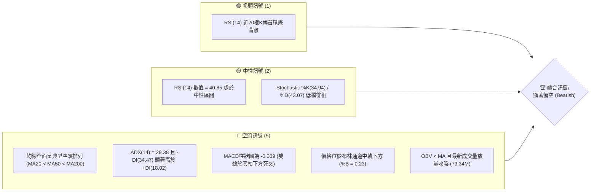
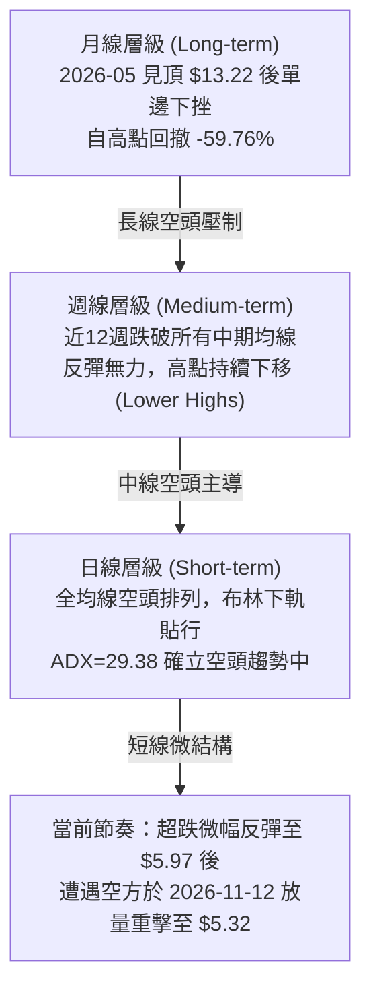
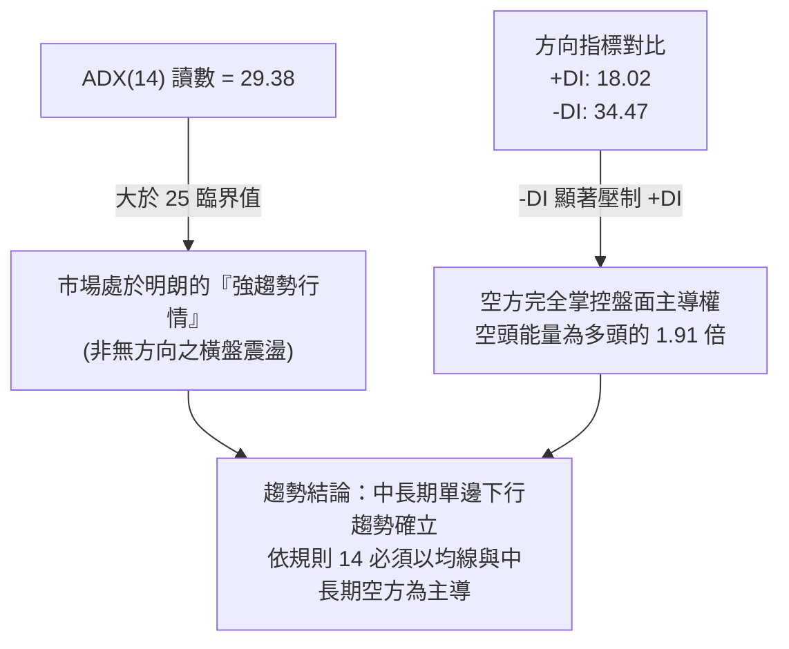
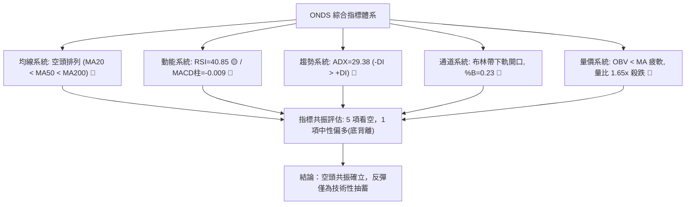
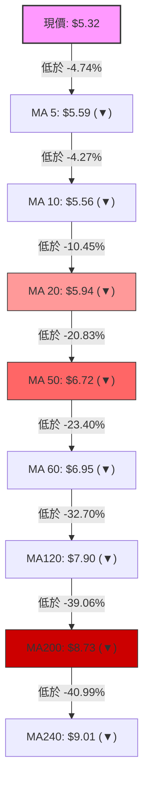
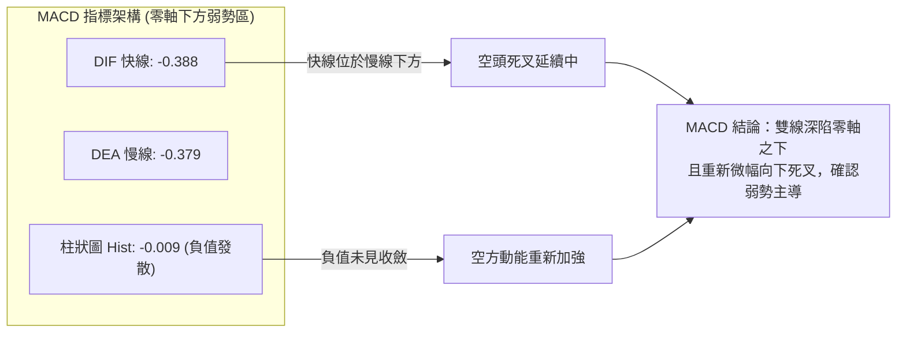
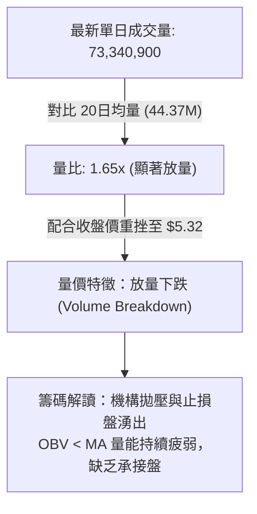
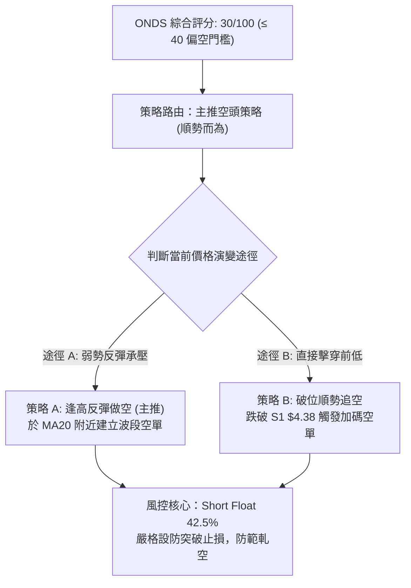
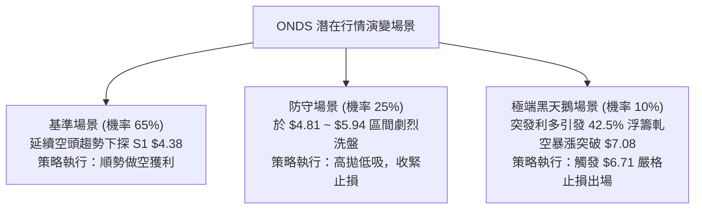

# ONDS 技術分析報告

> **報告日期**：2026-11-13 ｜ **語言**：繁體中文 ｜ **數據來源**：Yahoo Finance ｜ **當前價格**：$5.32

---

## 目錄

| 章節 | 內容 |
|------|------|
| [1. 技術面概覽](#1-技術面概覽) | 訊號儀表板、核心指標、評分卡 |
| [2. 趨勢分析](#2-趨勢分析) | 多時框趨勢、長中短期走勢 |
| [3. 圖表形態分析](#3-圖表形態分析) | 形態識別、K線組合、目標價 |
| [4. 支撐與阻力](#4-支撐與阻力) | 關鍵價位、斐波那契回調 |
| [5. 技術指標深度解讀](#5-技術指標深度解讀) | MA/RSI/MACD/布林/成交量 |
| [6. 動能與波動率](#6-動能與波動率) | 動能評估、ATR、Beta |
| [7. 多時框架總結](#7-多時框架總結) | 時框架評分矩陣 |
| [8. 交易策略建議](#8-交易策略建議) | 多空策略、風險報酬比 |
| [9. 風險提示與監控](#9-風險提示與監控) | 監控指標、風險場景 |

---

## 1. 技術面概覽

### 🎯 技術訊號儀表板



---

### 📊 核心指標速覽表

| 指標類別 | 指標名稱 | 當前數值 | 訊號 | 解讀 |
|:---|:---|:---|:---:|:---|
| **價格** | 當前收盤價 | $5.32 | 🔴 | 位於52週區間下緣 8.7% 處，貼近歷史低檔 |
| **均線** | MA20 (短期) | $5.94 | 🔴 | 現價低於MA20達 -10.45%，短線處於壓制空頭 |
| **均線** | MA50 (中期) | $6.72 | 🔴 | 現價低於MA50達 -20.83%，中期下降趨勢未變 |
| **均線** | MA200 (長期) | $8.73 | 🔴 | 現價低於MA200達 -39.06%，長期結構完全走空 |
| **動能** | RSI(14) | 40.85 | 🟡 | 位於30-70中性區間，呈現超跌但未達絕對超賣 |
| **動能** | MACD柱狀圖 | -0.009 | 🔴 | MACD(-0.388)低於訊號線(-0.379)，空方動能主導 |
| **動能** | ADX(14) | 29.38 | 🔴 | ADX>25確認強趨勢，-DI(34.47)主導強勁空頭趨勢 |
| **通道** | 布林 %B | 0.23 | 🔴 | 價格運行於下軌($4.81)與中軌($5.94)之間弱勢區 |
| **波動** | ATR(14) | $0.51 | 🔴 | 佔股價比達 9.67%，日內波動劇烈，洗盤風險高 |
| **量能** | 量比 (vs 20MA) | 1.65x | 🔴 | 73.34M 放量收跌，OBV疲弱，顯示機構拋壓持續 |

---

### 🏆 技術評分卡

```
╔══════════════════════════════════════════════════════════════════╗
║                   技術評分卡 — ONDS (2026-11-13)                  ║
╠══════════════════════════════════════════════════════════════════╣
║ 趨勢強度 (Trend)     █████░░░░░░░░░░░░░░░  25/100  🔴 空頭強趨勢 ║
║ 動能指標 (Momentum)  █████████░░░░░░░░░░░  45/100  🟡 弱勢底背離 ║
║ 支撐穩定度 (Support) ███████░░░░░░░░░░░░░  35/100  🔴 僅存S1孤立 ║
║ 成交量配合 (Volume)  ██████░░░░░░░░░░░░░░  30/100  🔴 拋售放量   ║
║ 形態完整度 (Pattern) ██████░░░░░░░░░░░░░░  30/100  🔴 下行無底型 ║
║ 均線排列 (MA System) ███░░░░░░░░░░░░░░░░░  15/100  🔴 空頭排列   ║
╠══════════════════════════════════════════════════════════════════╣
║ 綜合評分             ██████░░░░░░░░░░░░░░  30/100  🔴 顯著偏空   ║
║ 評分計算：(25 + 45 + 35 + 30 + 30 + 15) ÷ 6 = 30.0 (規則 18)     ║
╚══════════════════════════════════════════════════════════════════╝
```

---

## 2. 趨勢分析

### 🌐 多時框趨勢分析



---

### 📈 長期趨勢 — 12個月走勢圖（Unicode）

```
ONDS 月線走勢圖（過去12個月：2025-12 至 2026-11）
價格軸 ($)
$14.00 ┤                             ● (2026-05: $13.22 波段天花板)
$13.00 ┤                            ╱ ╲
$12.00 ┤                           ╱   ╲
$11.00 ┤            ●             ╱     ╲
$10.00 ┤    ●      ╱ ╲     ●     ╱       ╲
$9.00  ┤   ╱ ╲    ╱   ╲   ╱ ╲   ╱         ● (2026-06: $8.24 斷崖崩跌)
$8.00  ┤  ╱   ●──●     ●─●   ●─●           ╲     ●
$7.00  ┤ ╱                                  ●───● ╲   ● (2026-09: $7.33)
$6.00  ┤● (2025-11: $7.90)                         ╲ ╱ ╲
$5.00  ┤                                            ●   ●← 當前現價: $5.32
$4.00  ┤                                                (2026-11-05 測 $4.38 低點)
       └─────────────────────────────────────────────────────────────
        12M    11M    10M    9M     8M     7M    6M    5M    4M    3M    2M    當前月
       '25-12 '26-01 '26-02 '26-03 '26-04 '26-05 '26-06 '26-07 '26-08 '26-09 '26-10 '26-11
```

#### 走勢特徵分析表格

| 階段區間 | 起止價格 | 漲跌幅 | 主要走勢特徵 | 成交量與動能配合度 |
|:---|:---|:---:|:---|:---|
| **第一階段：高檔震盪構築**<br>(2025-12 ~ 2026-04) | $9.76 → $10.04 | +2.87% | 於 $9.00~$10.36 形成長達5個月的高檔平台橫盤整理 | 動能出現疲態，高檔換手但未能進一步發動連續攻勢 |
| **第二階段：最後瘋狂衝頂**<br>(2026-04 ~ 2026-05) | $10.04 → $13.22 | +31.67% | 爆發性拉升，創出歷史波段天價 $13.22（月線收盤） | 投機買盤湧入，但迅速引發主力籌碼派發 |
| **第三階段：破位暴跌派發**<br>(2026-05 ~ 2026-06) | $13.22 → $8.24 | -37.67% | 巨陰灌破所有短期均線，呈現無支撐跳水走勢 | 多頭防線全面潰散，資金奪路而逃，形成長期頭部 |
| **第四階段：階梯式陰跌下挫**<br>(2026-06 ~ 2026-10) | $8.24 → $6.32 | -23.30% | 沿下降通道階梯式下滑，多次反彈均受阻於下行均線 | 週線級別反彈成交量顯著萎縮，反彈即為逃命波 |
| **第五階段：加速趕底與低檔震盪**<br>(2026-10 ~ 2026-11) | $6.32 → $5.32 | -15.82% | 摜破 $5.00 關卡見 52週新低 $4.38 後引發劇烈震盪 | 最新單日爆量 73.34M 再次轉弱收陰，空頭仍主導盤面 |

---

### 📊 中期趨勢（週線分析）

```
ONDS 週線阻力與支撐分佈架構
═══════════════════════════════════════════════════════════════════
$8.58  ───────────────────────────────────────────── 強阻力區 R3 (近一年波段高點聚類)
              ▲ (2026-08 反彈高點 $9.24 破位後回撤壓力線)
$7.98  ───────────────────────────────────────────── 次級阻力 R2 (2026-09 波段高點聚類)
              ▲ (週線下降趨勢線上軌)
$7.08  ───────────────────────────────────────────── 關鍵短線阻力 R1 (布林帶上軌 & 2026-10末反彈高點)
              ▲ (目前多頭反撲的第一道銅牆鐵壁)
$5.94  ┄┄┄┄┄┄┄┄┄┄┄┄┄┄┄┄┄┄┄┄┄┄┄┄┄┄┄┄┄┄┄┄┄┄┄┄┄┄┄┄ MA20 / 布林中軌 (短線動態強壓)
$5.32  ═════════════════════════════════════════════ ◄ 當前收盤價
$4.81  ┄┄┄┄┄┄┄┄┄┄┄┄┄┄┄┄┄┄┄┄┄┄┄┄┄┄┄┄┄┄┄┄┄┄┄┄┄┄┄┄ 日線布林下軌動態支撐
$4.38  ───────────────────────────────────────────── 核心關鍵支撐 S1 (52週最低點)
═══════════════════════════════════════════════════════════════════
```

週線層面已連續4個月維持在下降通道中，最近8週之高點從 $7.98 依序遞減至 $7.91、$7.69、$7.08、$6.37、$7.08、$6.40 及 $6.12，高點逐步降低（Lower Highs）的走合格局非常嚴密。

---

### ⚡ 趨勢強度評估（ADX 解讀）



| 參數指標 | 當前數值 | 參考門檻 | 強度狀態 | 交易含義 |
|:---|:---:|:---:|:---:|:---|
| **ADX(14)** | 29.38 | > 25.00 | 🟢 強趨勢確認 | 趨勢動能充足，不可輕易逆勢摸底，任何反彈均屬逆勢修正 |
| **+DI** | 18.02 | — | 🔴 多方極弱 | 買方動能匱乏，無力發起持續性上升波段 |
| **-DI** | 34.47 | — | 🔴 空方極強 | 賣方力量處於主導地位，推動價格持續創低 |
| **DI 差值 (-DI - +DI)** | +16.45 | > 10.00 | 🔴 空頭顯著發散 | 空方壓倒性主導，下行通道斜率依然陡峭 |

---

## 3. 圖表形態分析

### 🔍 形態識別系統


#### 圖表形態評估表

| 形態名稱 | 信心度 | 判斷依據（引用數據） | 完成度 | 目標價（附計算式） |
|:---|:---:|:---|:---:|:---|
| **中期下降通道** | 85% | 週K高點由 $7.98 → $7.08 → $6.12 連續下降；週K低點由 $7.18 → $5.80 → $4.38 連續下探 | 90% | 下軌支撐指向 52W 低點 S1 **$4.38**；通道上軌壓力於 R1 **$7.08** |
| **潛在日線雙底** | 35% | 僅於 2026-11-05 測得單一低點 $4.38，近幾日低點為 $5.20，尚未形成二次探底確認 | 20% | 訊號不足，僅做指標型解讀（頸線未建立，不可視為雙底完成） |
| **布林帶跌破反抽** | 80% | 2026-11-05 跌破下軌後回抽至中軌 MA20 ($5.94) 遇阻，11-12 再次轉弱 | 100% | 形態已完成受阻確認，短線回測下軌目標價 **$4.81** |

---

### 🕯️ 重要K線形態分析

根據規則 19，以下嚴格採用「近10根日K」與「近8根週K」之實際數據進行微觀解讀：

#### 近10根日K形態精解

| 日期 | 開盤價 | 最高價 | 最低價 | 收盤價 | 成交量 | K線形態 | 深度解讀與訊號 |
|:---|:---:|:---:|:---:|:---:|:---:|:---:|:---|
| **10-30** | $6.46 | $6.60 | $6.18 | $6.32 | 41,150,400 | 帶上下影陰線 | 空方反撲，多頭上攻 $6.60 未果，收盤失守開盤價 🔴 |
| **11-02** | $6.38 | $6.40 | $5.72 | $5.75 | 37,625,800 | 光頭中長陰線 | 開盤即最高，實體下殺近 10%，顯示無抵抗拋售 🔴 |
| **11-03** | $5.80 | $6.09 | $5.77 | $5.79 | 34,561,300 | 倒狀十字星 | 多方盤中反抗上探 $6.09 受阻回落，收盤幾乎平盤 🟡 |
| **11-04** | $5.70 | $5.78 | $5.22 | $5.27 | 53,434,200 | 放量下挫中陰線 | 成交量急增至 53.43M，跌破 $5.50 關鍵整數關卡 🔴 |
| **11-05** | $5.09 | $5.16 | $4.38 | $4.52 | 65,130,800 | 長下影恐慌倒錘線 | 爆量65.13M創52週新低$4.38，下影線長$0.14，主力進場低吸 🟡 |
| **11-06** | $4.77 | $5.45 | $4.60 | $5.34 | 44,862,600 | 穿頭破腳大陽線 | 強勢反彈，收盤包覆前一日實體，確認 $4.38 支撐買盤 🟢 |
| **11-09** | $5.45 | $6.12 | $5.37 | $5.97 | 47,795,000 | 帶長上影長陽線 | 盤中衝擊 $6.12 測試 MA20 壓力，受阻回落，多頭顯現疲態 🟡 |
| **11-10** | $5.84 | $5.91 | $5.45 | $5.57 | 41,213,000 | 下跌中陰線 | 吞食前一日部分漲幅，顯示反彈動能衰竭 🔴 |
| **11-11** | $5.84 | $5.90 | $5.65 | $5.73 | 52,788,200 | 窄幅十字小陽星 | 多空在 MA20 關前激烈博弈，成交量放大至 52.79M 🟡 |
| **11-12** | $5.42 | $5.66 | $5.20 | $5.32 | 73,340,900 | 爆量破位中陰線 | 單日爆出73.34M近10日最大量，收跌至$5.32，確認反彈結束 🔴 |

#### 近8根週K形態精解

| 日期 | 開盤價 | 最高價 | 最低價 | 收盤價 | 週成交量 | K線形態 | 深度解讀與訊號 |
|:---|:---:|:---:|:---:|:---:|:---:|:---:|:---|
| **09-25** | $7.51 | $7.98 | $7.18 | $7.64 | 375,050,700 | 長上影紡錘陽線 | 上測 R2 ($7.98) 遭巨量解套盤砸回 🟡 |
| **10-02** | $7.53 | $7.91 | $7.12 | $7.24 | 247,661,300 | 帶上影受阻陰線 | 二次嘗試衝擊 $7.91 失敗，週線形成雙頭壓制 🔴 |
| **10-09** | $7.62 | $7.69 | $6.64 | $6.73 | 244,880,700 | 中長實體陰線 | 貫穿 $7.00 關卡，空頭加速破位 🔴 |
| **10-16** | $7.06 | $7.08 | $5.80 | $6.04 | 327,193,400 | 放量下挫大陰線 | 單週暴跌，直逼 $6.00 大關，成交量擴大至 327M 🔴 |
| **10-23** | $6.20 | $6.37 | $5.88 | $6.20 | 179,558,500 | 縮量十字星 | 空方暫緩進攻，多空於 $6.00 附近縮量僵持 🟡 |
| **10-30** | $6.17 | $7.08 | $6.04 | $6.32 | 217,411,600 | 巨量長上影陽線 | 試圖向上回補缺口摸 $7.08，但收盤回吐絕大部分漲幅 🔴 |
| **11-06** | $6.38 | $6.40 | $4.38 | $5.34 | 235,614,700 | 極長下影恐慌錘頭 | 單週打出 52週新低 $4.38 後強烈抽回，爆發恐慌拋售 🟡 |
| **11-12** | $5.45 | $6.12 | $5.20 | $5.32 | 215,137,100 | 上衝受阻弱勢陰線 | 上攻 $6.12 乏力，再次跌回 $5.32，週線結構依舊疲軟 🔴 |

---

### 📉 ASCII 走勢形態示意圖

```
ONDS 近兩週走勢微觀形態（日K線層次）
價格 ($)
$6.20 ┤                     
$6.00 ┤                     ● (11-09 高點 $6.12 遇 MA20 $5.94 強壓)
$5.80 ┤                    ╱ ╲
$5.60 ┤                   ╱   ●──● (11-10 ~ 11-11 窄幅盤整滯漲)
$5.40 ┤           ●      ╱         ╲
$5.20 ┤          ╱ ╲    ╱           ●← 現價 $5.32 (11-12 爆量長陰摜壓)
$5.00 ┤         ╱   ●──●             
$4.80 ┤        ╱ (11-06 報復性反彈)
$4.60 ┤       ╱
$4.40 ┤      ● (11-05 恐慌低點 $4.38)
       └─────────────────────────────────────────────────────────────
        11-04  11-05  11-06  11-09  11-10  11-11  11-12
```

---

### 🎯 形態目標價計算

依據幾何形態學與布林軌道波幅，進行推算（依規則 13 附計算式）：

1. **短期反彈受阻下測目標價**：
   - 形態基礎：由 2026-11-09 高點 $6.12 受阻於 MA20 ($5.94) 並於 11-12 跌破前兩日低點，確認短線反彈終結。
   - 計算公式：短線支撐目標 = 數據中既有之 52週最低點 **S1 = $4.38**。
2. **極端破位形態測算目標價**：
   - 形態基礎：若未來有效跌破 S1 ($4.38)，依據 2026-11-06 至 2026-11-09 之短線箱體振幅高度（高點 $6.12 − 低點 $4.38 = $1.74）進行等距下行測算。
   - 計算公式：$4.38 − $1.74 = **$2.64**（註：此價位為依形態高度公式推算之極端目標，數據庫內未有該水平歷史聚類）。

---

## 4. 支撐與阻力

### 🗺️ 關鍵價位分布圖（Unicode）

```
ONDS 價位結構分佈圖 (數據嚴格鎖定)
═══════════════════════════════════════════════════════════════════
$15.28 ║████████████████████████████████████║ 52週最高點 (0.0% 斐波那契)
$12.71 ║████████████████████                ║ 23.6% 斐波那契回調位
$11.11 ║████████████████                    ║ 38.2% 斐波那契回調位
$9.83  ║██████████████████████              ║ 50.0% 斐波那契中軸分水嶺
$8.58  ║████████████████████████████████    ║ 強阻力 R3 (近一年波段高點聚類)
$7.98  ║████████████████████████            ║ 阻力 R2 (近一年波段高點聚類)
$7.08  ║████████████████████████████████    ║ 關鍵阻力 R1 (布林上軌 & 高點聚類)
$6.71  ║████████████                        ║ 78.6% 斐波那契深幅回調位
$5.94  ║┄┄┄┄┄┄┄┄┄┄┄┄┄┄┄┄┄┄┄┄┄┄┄┄┄┄┄┄┄┄    ║ 動態阻力 (MA20 / 布林中軌)
$5.32  ╠════════════════════════════════════╣ ◄ 當前收盤價 ($5.32)
$4.81  ║┄┄┄┄┄┄┄┄┄┄┄┄┄┄┄┄┄┄┄┄┄┄┄┄┄┄┄┄┄┄    ║ 動態支撐 (日線布林下軌)
$4.38  ║████████████████████████████████████║ 關鍵支撐 S1 (52週最低點 / 100.0% 斐波)
═══════════════════════════════════════════════════════════════════
```

---

### 🚧 阻力位分析表

所有阻力數值均直接引用「關鍵價位（由 OHLCV 計算）」區塊：

| 阻力級別 | 價位 | 距現價幅標 | 形成原因與籌碼分析 | 突破難度 | 重要性 |
|:---|:---:|:---:|:---|:---:|:---:|
| **動態阻力** | $5.94 | +11.65% | 20日移動平均線 (MA20) 與布林中軌重合，短線空方防禦中樞 | 中等 | ★★★☆☆ |
| **阻力 R1** | $7.08 | +33.08% | 近一年波段高點聚類，且與布林通道日線上軌共振 | 極高 | ★★★★★ |
| **阻力 R2** | $7.98 | +50.00% | 2026年9月週線波段反彈頂部聚類，週線趨勢線壓制 | 極高 | ★★★★☆ |
| **阻力 R3** | $8.58 | +61.28% | 近一年強阻力聚類，緊鄰 61.8% 斐波那契回調位 ($8.54) | 銅牆鐵壁 | ★★★★★ |

---

### 🛡️ 支撐位分析表

嚴格遵循數據紀律，數據中僅計算出一個波段低點聚類 S1：

| 支撐級別 | 價位 | 距現價幅標 | 形成原因與籌碼分析 | 守住機率 | 重要性 |
|:---|:---:|:---:|:---|:---:|:---:|
| **動態支撐** | $4.81 | -9.59% | 日線布林通道下軌，短線恐慌下殺的緩衝墊 | 55% | ★★☆☆☆ |
| **核心支撐 S1** | $4.38 | -17.76% | 52週絕對最低點（2026-11-05 觸及），最後多頭防線 | 40% | ★★★★★ |
| **次級支撐 S2** | N/A | N/A | *數據中未偵測到此層級數據（規則 13/16）* | N/A | N/A |
| **極端支撐 S3** | N/A | N/A | *數據中未偵測到此層級數據（規則 13/16）* | N/A | N/A |

---

### 📐 斐波那契回調位分析

依據 52週區間最低點 **$4.38** 至最高點 **$15.28**（波幅高達 $10.90）所繪製之斐波那契回調序列：

| 回調比例 | 斐波那契價位 | 空間位置關係 | 深度解讀 |
|:---:|:---:|:---|:---|
| **0.0%** | $15.28 | 52週最高點 | 歷史天花板，中期難以企及之派發終點 |
| **23.6%** | $12.71 | 上方極遠處 | 強勢多頭回檔極限，5月跌破後多頭結構崩壞 |
| **38.2%** | $11.11 | 上方極遠處 | 弱勢反彈警戒線，跌破後確認由牛轉熊 |
| **50.0%** | $9.83 | 心理中軸線 | 均衡價值中樞，此位置以下空方擁有絕對控制權 |
| **61.8%** | $8.54 | 緊鄰阻力 R3 ($8.58) | 黃金分割防守位，反彈至此將遭遇海量歷史套牢盤 |
| **78.6%** | $6.71 | 現價上方重要阻力 | 多頭深幅回撤的最後耐受位，失守後已滑向深淵 |
| **100.0%** | $4.38 | 52週最低點 (S1) | 完整回吐過去一整年全部漲幅，基底支撐點 |

> 📌 **位置判斷**：當前現價 **$5.32** 嚴格運行於 **78.6% ($6.71)** 與 **100.0% ($4.38)** 之間。這表明股價已經完全回吐了自低點發動的絕大部分漲幅，處於深跌尋底的極端空頭週期。若 $4.38 再次失守，下方將呈現無歷史成交密集區的「技術真空狀態」。

---

## 5. 技術指標深度解讀

### 🎛️ 指標訊號總覽



---

### 📈 移動平均線排列分析



#### 均線參數矩陣

| 均線名稱 | 當前價格 | 距現價差距 (%) | 走勢方向 | 排列狀態與評估 |
|:---|:---:|:---:|:---:|:---|
| **MA 5** | $5.59 | -4.74% | ▼ 下行 | 短期扣高走低，5日線壓制現價 |
| **MA 10** | $5.56 | -4.27% | ▼ 下行 | 走平後再度微幅下拐，短均黏合向下發散 |
| **MA 20** | $5.94 | -10.45% | ▼ 下行 | **月均線**，下傾角度陡峭，為第一道動態死線 |
| **MA 50** | $6.72 | -20.83% | ▼ 下行 | **季線**，中期多空分水嶺，呈現完美下行姿態 |
| **MA 60** | $6.95 | -23.40% | ▼ 下行 | 中期空頭趨勢確認線，加速下滑中 |
| **MA 120** | $7.90 | -32.70% | ▼ 下行 | 半年線，長期持股者已全數處於深幅虧損 |
| **MA 200** | $8.73 | -39.06% | ▼ 下行 | **年線 (牛熊分界線)**，確立長期熊市格局 |
| **MA 240** | $9.01 | -40.99% | ▼ 下行 | 長期均線完全順向空頭排列 |

---

### 📉 RSI(14) 分析

```
RSI(14) 數值儀表板
0      10     20     30     40     50     60     70     80     90    100
├──────┼──────┼──────┼──────┼──────┼──────┼──────┼──────┼──────┼──────┤
[   極度超賣區   ]   ▲ (40.85)  [        中性震盪區        ]  [   極度超買區   ]
████████████████████░░░░░░░░░░░░░░░░░░░░░░░░░░░░░ 40.85% (中性偏弱)
```

- **背離形態判斷**：系統檢測顯示**底背離 (Bullish Divergence)**。
  - *背離特徵*：在近20根K棒首尾對比中，2026-11-05 股價打出 52週新低 $4.38，但 RSI 數值並未同步創下新低（維持在 38~40 附近），呈現「價格破底、動能指標拒絕破底」的底背離訊號。
  - *背離有效性評估*：該背離在 11-06 至 11-09 引發了短暫的技術性抽蓄，價格反彈至 $5.97；然而，由於中長期均線（MA20）死死壓制，加上 11-12 大陰線重新下殺，**此底背離的反彈能量已被迅速消耗**，在強 ADX 空頭趨勢下，背離往往以「以盤代跌」或「短命抽蓄」告終，切忌盲目視為趨勢反轉。

---

### 📊 MACD(12/26/9) 訊號解讀



- **DIF 線**：-0.388
- **DEA (Signal) 線**：-0.379
- **MACD 柱狀圖 (Histogram)**：-0.009 🔴
- **量化深度解析**：MACD 全線在遠低於零軸的負值區域運行，代表長期趨勢極弱。雖然前幾天反彈促使負柱狀圖收斂至接近零軸，但在 2026-11-12 股價重挫後，柱狀圖再度翻黑擴大至 -0.009，確認多頭反撲受阻，空方重新取得短期動能主導權。

---

### 📦 布林通道分析

```
ONDS 日線布林通道 (Bollinger Bands, 20, 2)
價格 ($)
$7.08 ┤════════════════════════════════════════════════════ 上軌 ($7.08)
$6.50 ┤
$5.94 ┤┄┄┄┄┄┄┄┄┄┄┄┄┄┄┄┄┄┄┄┄┄┄┄┄┄┄┄┄┄┄┄┄┄┄┄┄┄┄┄┄ 中軌 / MA20 ($5.94)
$5.32 ┤              ▲ 現價: $5.32 (%B = 0.23，弱勢區間)
$4.81 ┤════════════════════════════════════════════════════ 下軌 ($4.81)
       └─────────────────────────────────────────────────────────────
```

- **帶寬與位置特徵**：
  - 布林帶上軌：**$7.08**
  - 布林帶中軌 (MA20)：**$5.94**
  - 布林帶下軌：**$4.81**
  - **%B 指標**：**0.23**（%B = (現價 − 下軌) ÷ (上軌 − 下軌) = (5.32 − 4.81) ÷ (7.08 − 4.81) = 0.51 ÷ 2.27 ≈ 0.2247，取 0.23）。
- **結構意義**：%B 遠低於 0.50，表明價格受到中軌顯著壓制，持續在通道下半部弱勢運行。當前帶寬達 $2.27，通道向下傾斜，未見收口走平跡象，代表波動率依舊受空方驅動。

---

### 💹 成交量分析（量價配合度）



- **量比 (Volume Ratio)**：最新成交量 73.34M 相比於 20日均量 44.37M 達到 **1.65倍**，相較 50日均量 54.17M 亦顯著擴大。
- **價量關係**：11-06 至 11-09 的反彈過程中，日均量僅約 44M~47M，呈現「縮量反彈」；而在 11-12 出現大跌收陰時，成交量猛增至 73.34M，呈現典型的「放量下挫、縮量反抽」的熊市價量空頭配合。
- **OBV (能量潮)**：數據明確標示 **OBV < MA**，代表資產整體處於資金淨流出週期，累積能量線下行，顯示市場聰明錢（Smart Money）並無建倉跡象。

---

## 6. 動能與波動率

### ⚡ 動能評估四象限

```
動能與波動率象限分析矩陣
     高波動率 (High Volatility)
           │
   Q3      │      Q4 [當前 ONDS 所在象限]
 (強多動能) │    (空頭主導 / 高波動高風險)
           │     ● ATR%=9.67%, Beta=3.082, ADX=29.38
───────────┼─────────────────────────────────
   Q1      │      Q2
 (穩定上行) │    (低迷陰跌)
           │
     低波動率 (Low Volatility)
 ──── 多頭動能 ────────────── 空頭動能 ────
```

| 象限標籤 | 動能狀態 | 波動水平 | ONDS 契合點 | 戰術評估 |
|:---:|:---:|:---:|:---:|:---|
| **Q1** | 強多頭 | 低波動 | — | 最佳波段做多機會（未符合） |
| **Q2** | 弱動能 | 低波動 | — | 橫盤死水，無操作價值（未符合） |
| **Q3** | 強多頭 | 高波動 | — | 突破暴利期，高風險高回報（未符合） |
| **Q4** | **強空頭** | **極高波動** | **✓ 完全吻合** | **高危險下行區間，嚴禁左側抄底，以反彈做空為核心** |

---

### 📊 ATR 波動率分析

- **ATR(14)** 絕對數值：**$0.51**
- **波動佔比 (ATR % of Price)**：$0.51 ÷ $5.32 = **9.67%**
- **波動風險評估**：
  - 每日平均潛在波幅接近 10%，顯示該標的具備極高的投機性與尾部風險。
  - **止損距離設定建議**：
    - 日內交易：至少需設定 1.0 × ATR ($0.51)。
    - 波段波段交易：需設定 1.5 ~ 2.0 × ATR (**$0.77 ~ $1.02**)，否則極易在正常的盤中雜訊震盪中被洗出場。

---

### 📐 Beta 與市場相關性

- **Beta 係數**：**3.082**
  - ONDS 展現出相對於大盤（標普500）超過 3 倍的極端敏感度。在大盤微幅回調時，該股極易引發放大倍數的恐慌拋售。
- **放空比例 (Short Interest) 與潛在軋空風險**：
  - **Short % of Float**：**42.5%**（空頭部位極度沉重）。
  - **Short Ratio (Days to Cover)**：**5.07 天**。
  - **技術隱患**：超過 40% 的流通股被做空，這意味著該股具備極高的高波動「軋空（Short Squeeze）」潛能。若有利多消息或技術位暴力反彈，一旦突破關鍵阻力（如 R1 $7.08），空頭踩踏回補可能引發極端爆發性暴漲；但在突破前，龐大的做空力量依然是向下打壓股價的元兇。

---

## 7. 多時框架總結

### 📋 時框架評分表

| 時框架 | 趨勢方向 | 動能狀態 | 均線排列 | 圖表形態 | 綜合評分 | 操作建議 |
|:---|:---:|:---:|:---:|:---:|:---:|:---|
| **長期 (月線)** | 🔴 單邊空頭 | 極度耗損 | 空頭下行 | 自 $13.22 破位下挫 | 20/100 | 長期投資者觀望，嚴禁定投摸底 |
| **中期 (週線)** | 🔴 下降通道 | 弱勢反撲遭拒 | 空頭發散 | 連續 8 週 Lower Highs | 25/100 | 逢反彈至通道上軌堅決減碼或建空 |
| **短期 (日線)** | 🔴 跌勢重啟 | RSI底背離耗盡 | MA20 壓制 | 測 $5.97 失敗爆量收陰 | 35/100 | 短線順勢做空，或等待破位追空 |

---

### 🔲 綜合訊號矩陣

```
時框維度協同性評估
┌─────────────────┬───────────┬───────────┬───────────┐
│ 分析維度        │ 長期 (月) │ 中期 (週) │ 短期 (日) │
├─────────────────┼───────────┼───────────┼───────────┤
│ 趨勢方向        │    🔴     │    🔴     │    🔴     │
│ 均線架構        │    🔴     │    🔴     │    🔴     │
│ 動能強度 (ADX)  │    🔴     │    🔴     │    🔴     │
│ 量能配合        │    🔴     │    🔴     │    🔴     │
│ 反轉訊號        │    ⚪ 無  │    ⚪ 無  │    🟡 弱背離│
└─────────────────┴───────────┴───────────┴───────────┘
一致性結論：長、中、短三維度呈現高度共振看空，僅日線存在邊際背離雜訊。
```

---

### ⚖️ 多時框收斂結論

依據本報告設定之**「多時框收斂規則（規則 14）」**：
1. **當前行情性質**：ADX(14) 讀數為 **29.38 (> 25)**，確認當前市場處於**單邊趨勢行情**，而非無方向的盤整震盪行情。
2. **優先級收斂原則**：在強趨勢行情下，**必須以中長期（週線、MA50 $6.72、MA200 $8.73）的空頭方向為主導**，日線級別的指標背離僅能作為極短線尋找反彈耗盡、逢高建立空單的進場時機，嚴禁日線雜訊干擾總體判斷。
3. **收斂結論**：**唯一方向性結論為【強烈偏空】**。此結論與第 1 章技術評分卡（30/100）、第 2 章多時框走勢及第 5 章指標共振完全吻合，第 8 章之交易策略將**完全主推空頭策略**。

---

## 8. 交易策略建議

### 🗺️ 策略決策流程圖



---

### 🧭 策略路由（依評分卡分流，不得兩頭下注）

> 🚨 **當前主策略方向 = 【逢高做空 / 破位追空（空頭主推）】（依技術評分卡：30/100 評級確定）**
> 
> 依據嚴格規則，綜合評分 30/100 ≤ 40，嚴禁兩頭下注。本章全力推薦做空佈局，多頭僅作為逆向風險預警與止損對沖提示。

---

### 🎯 價格情境階梯（Price Scenarios）

所有關鍵節點均嚴格引用第 4 章由 OHLCV 計算之價位數據：

| 觸發條件 | 下一目標 | 後續延伸 | 情境含義與操作指引 |
|:---|:---:|:---:|:---|
| **上破 R1 $7.08** | R2 $7.98 | R3 $8.58 | 空頭結構被徹底破壞，引發 42.5% 空頭恐慌踐踏回補（軋空情境） |
| **反彈受阻 MA20 $5.94** | 現價 $5.32 | S1 $4.38 | 標準弱勢反抽確認，空頭增持加碼點 |
| **跌破 S1 $4.38** | $2.64 (形態推算) | N/A | 52週歷史底部失守，進入技術真空斷崖下挫（破位加速情境） |

---

### 📊 情境機率分佈

| 價格情境劇本 | 發生機率 | 主要技術依據 |
|:---|:---:|:---|
| **情境一：震盪走低 / 再次探底 (主推劇本)** | **65%** | 均線完美空頭排列，MACD負值死叉，11-12放量大陰線顯示空方重新發力 |
| **情境二：箱體弱勢震盪 ($4.81 ~ $5.94)** | **25%** | 布林通道下軌動態支撐，RSI底背離仍具殘餘緩衝，短期消化賣壓 |
| **情境三：暴力軋空反轉 (小概率風險劇本)** | **10%** | 空頭佔流通盤高達 42.5%，若有未預期利多促成突破 R1 ($7.08) 引發軋空 |

---

### 🟢 主策略詳情（空頭交易策略）

各項參數與風險報酬比嚴格遵守規則 17 定義：
- 做空風險報酬比公式 = **(進場價 − 目標價 T1) ÷ (止損價 − 進場價)**

| 策略要素 | 策略 A（反彈承壓做空 — 穩健型） | 策略 B（破位順勢追空 — 激進型） |
|:---|:---|:---|
| **策略類型** | 順應中長空頭，反彈受阻放空 | 關鍵支撐破位，動能追空 |
| **進場條件** | 價格反抽至 MA20 附近受阻收陰 | 價格實體跌穿 52週最低點 S1 ($4.38) |
| **進場價格** | **$5.94**（引用MA20 / 布林中軌精確值） | **$4.38**（引用S1破位觸發點） |
| **止損價格** | **$6.71**（引用78.6%斐波那契回調位） | **$5.20**（引用11-12日K實體低點轉壓力） |
| **目標價 T1** | **$4.38**（引用52週最低點 S1） | **$2.64**（由形態高度 $1.74 推算：$4.38 − $1.74） |
| **目標價 T2** | **$2.64**（由形態高度推算） | N/A（數據中未偵測到更低歷史價位） |
| **風險報酬比** | **1 : 2.03（以 T1 計）**<br>計算式：($5.94 − $4.38) ÷ ($6.71 − $5.94) = 1.56 ÷ 0.77 = 2.0259 | **1 : 2.12（以 T1 計）**<br>計算式：($4.38 − $2.64) ÷ ($5.20 − $4.38) = 1.74 ÷ 0.82 = 2.1219 |
| **勝率估計** | 65% | 55% |
| **建議倉位** | 10% ~ 15% 總資金倉位 | 5% ~ 8% 總資金倉位 |

---

### 🔴 反向風險觸發點（對沖提示）

若出現以下任何技術異動，必須**無條件推翻上述空頭策略**並進行空單止損或對沖：
1. **價格強勢收復 $6.71 (78.6% 斐波那契位)**：代表空方防線失守，日線級別底背離被放大為趨勢反轉。
2. **日K線實體有效突破 R1 ($7.08)**：伴隨單日成交量突破 1 億股，確認 42.5% 空頭部位發生全面性擠壓（Short Squeeze），此時必須立即平倉所有空頭部位。

---

### ⭐ 整體訊號強度評星

```
╔══════════════════════════════════════════════════════════════╗
║ 做多訊號強度：★☆☆☆☆  (1.0/5星 — 僅存日線微弱底背離，逆勢高危) ║
║ 做空訊號強度：★★★★☆  (4.0/5星 — 均線與趨勢共振，量價空頭主導) ║
║ 整體可信度：  ★★★★☆  (4.0/5星 — 多時框收斂一致，數據充分)   ║
╚══════════════════════════════════════════════════════════════╝
```

---

## 9. 風險提示與監控

### ✅ 關鍵監控指標 Checklist

```
╔══════════════════════════════════════════════════════════════════╗
║                     每日技術風控 Checklist                       ║
╠══════════════════════════════════════════════════════════════════╣
║ [ ] 監控收盤是否跌破 $4.38 (S1)：若跌破將觸發加速拋售          ║
║ [ ] 監控 MA20 動態位置 ($5.94)：反彈未突破前堅決維持空頭思維    ║
║ [ ] 監控單日成交量是否異常超越 80M：爆量長陽為軋空起手式        ║
║ [ ] 監控 MACD 柱狀圖是否持續負值發散：確認空頭動能是否衰減      ║
║ [ ] 監控空頭未平倉比率 (Short % Float)：42.5% 的籌碼流向變化    ║
╚══════════════════════════════════════════════════════════════════╝
```

---

### ⚠️ 風險場景分析



---

### 🛡️ 風險管理重要提醒

1. **極高 Beta 與波動控制**：
   - 本股 Beta 高達 **3.082**，且日波幅 (ATR) 佔比達 **9.67%**，屬於極度高風險的小型投機標的。任何單一策略的持倉部位**絕對不宜超過總投資組合的 15%**。
2. **防範極端軋空（Short Squeeze）**：
   - 由於空頭流通盤佔比高達 **42.5%**，天數指標（Short Ratio）達 **5.07天**。在美股市場中，超過 40% 的高做空比率意味著標的極度脆弱，極易成為散戶或游資發動軋空狂潮的目標。建立空頭倉位時，**止損單必須為硬性條件單（Hard Stop-Loss）**，切不可抱持僥倖心態進行抗單。

---

## 📋 報告總結

```
╔══════════════════════════════════════════════════════════════════╗
║                   ONDS 技術分析報告總結                          ║
╠══════════════════════════════════════════════════════════════════╣
║ 報告日期：2026-11-13                                             ║
║ 當前價格：$5.32                                                  ║
║ 分析評級：🔴 強烈看空 (Bearish) ｜ 綜合評分：30/100              ║
║                                                                  ║
║ 關鍵結論：                                                       ║
║ ├─ 長期趨勢：🔴 單邊下挫，距歷史高點回撤近 60%                   ║
║ ├─ 中期趨勢：🔴 週線級別下降通道運行，高點持續下移               ║
║ ├─ 短期趨勢：🔴 弱勢反彈於 MA20 ($5.94) 遇阻，爆量收陰重挫       ║
║ ├─ 關鍵支撐：S1: $4.38 (52週最低點)                              ║
║ ├─ 關鍵阻力：R1: $7.08 (布林上軌與高點聚類) / MA20: $5.94       ║
║ └─ 分析師目標：共識評級 Strong Buy，平均目標價 $18.88 (基本面)   ║
║                                                                  ║
║ 最優策略組合：                                                   ║
║ 1. 🥇 最佳機會：策略 A (反彈至 $5.94 放空，止損 $6.71，T1 $4.38) ║
║ 2. 🥈 次選機會：策略 B (跌破 $4.38 追空，止損 $5.20，T1 $2.64)  ║
║ 3. 🥉 防守對策：若強勢站上 $6.71 立即空單離場觀望               ║
╚══════════════════════════════════════════════════════════════════╝
```

---

> ⚠️ **免責聲明**：本報告為 AI 自動生成之技術分析，所有數據及估算均基於提供的歷史價格資訊。本報告**僅供研究與學術參考**，**不構成任何投資建議**。投資有風險，入市需謹慎。

---

*報告生成時間：2026-11-13 ｜ 數據來源：Yahoo Finance ｜ 分析框架：多時框技術分析*