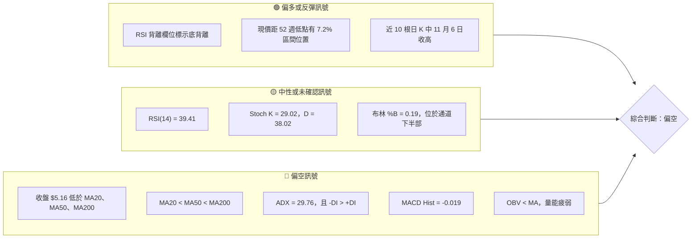
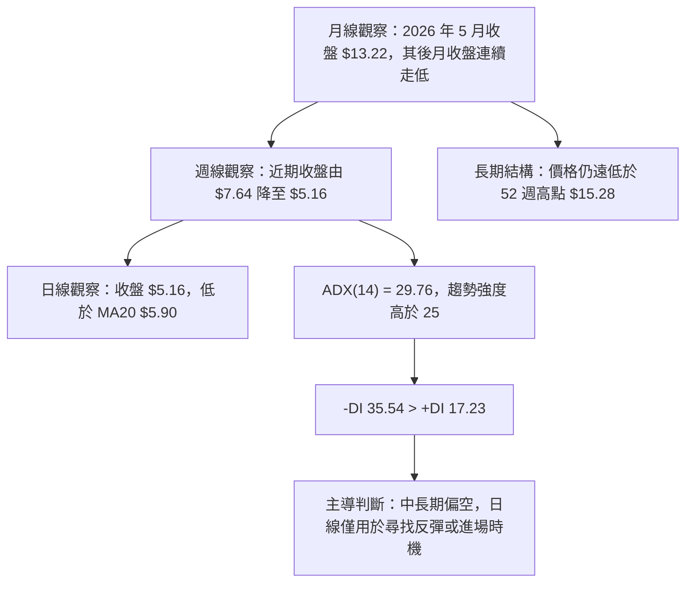
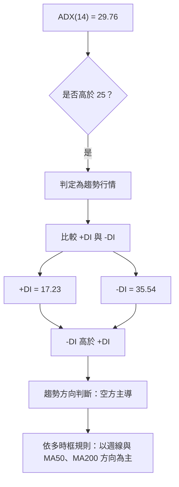
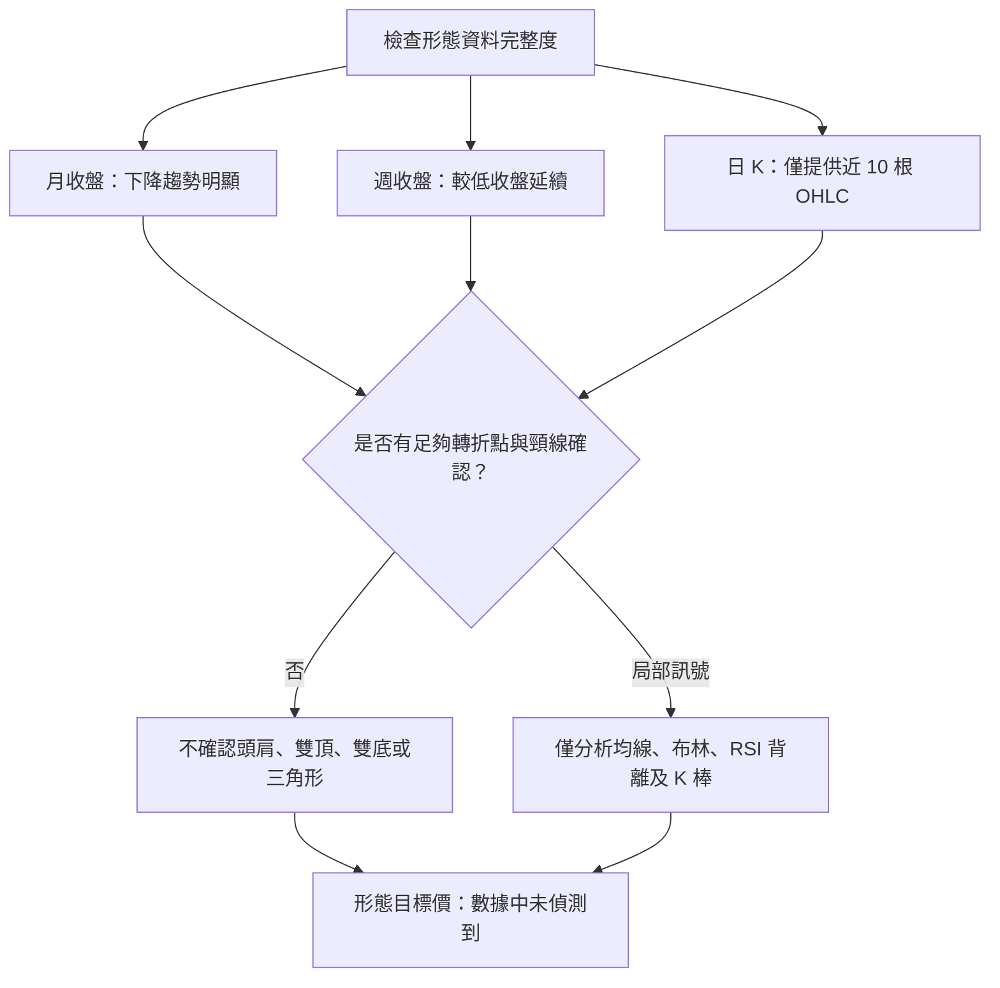
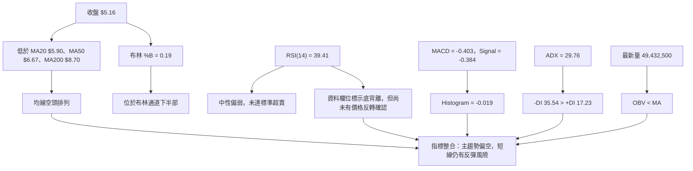
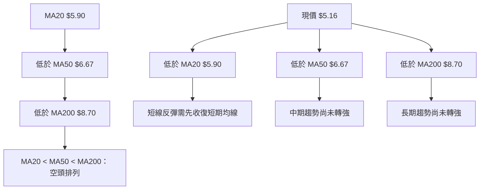
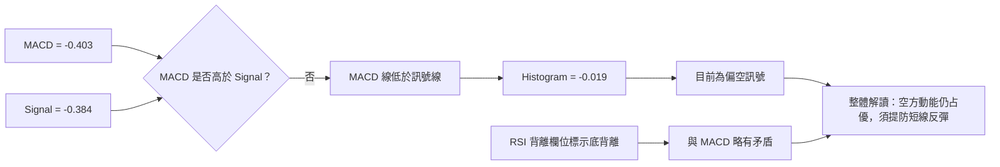
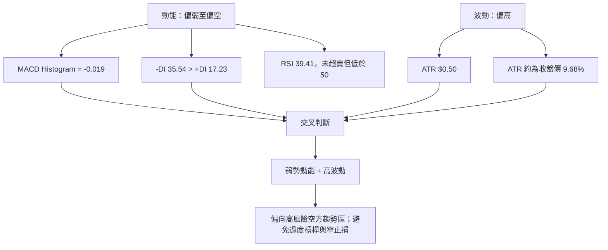
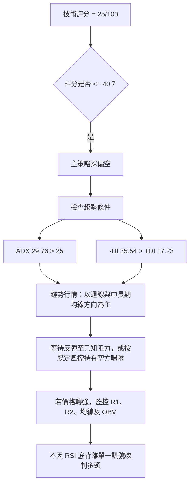
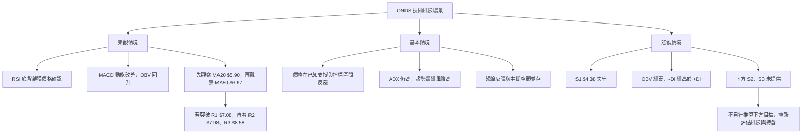

# ONDS 技術分析報告

> **報告日期**：2026-11-14 ｜ **語言**：繁體中文 ｜ **數據來源**：使用者提供之 Yahoo Finance 技術數據 ｜ **當前價格**：**$5.16**

> **數據紀律說明**：報告中的支撐、阻力與斐波那契價位，均引用所提供的「關鍵價位（由 OHLCV 計算）」區塊。未提供的 S2、S3 及低於 S1 的技術目標均標示為 **N/A（數據未提供）**。市場價格圖以月收盤價資料繪製，不代表月內最高／最低價。

---

## 目錄

| 章節 | 內容 |
|------|------|
| [1. 技術面概覽](#1-技術面概覽) | 訊號儀表板、核心指標、評分卡 |
| [2. 趨勢分析](#2-趨勢分析) | 多時框趨勢、長中短期走勢 |
| [3. 圖表形態分析](#3-圖表形態分析) | 形態識別、K線組合、目標價 |
| [4. 支撐與阻力](#4-支撐與阻力) | 關鍵價位、斐波那契回調 |
| [5. 技術指標深度解讀](#5-技術指標深度解讀) | MA／RSI／MACD／布林／成交量 |
| [6. 動能與波動率](#6-動能與波動率) | 動能評估、ATR、Beta |
| [7. 多時框架總結](#7-多時框架總結) | 時框架評分矩陣 |
| [8. 交易策略建議](#8-交易策略建議) | 主策略、進出場、風險報酬比 |
| [9. 風險提示與監控](#9-風險提示與監控) | 監控指標、風險場景 |
| [報告總結](#報告總結) | 核心結論與摘要 |

---

## 1. 技術面概覽

### 🎯 技術訊號儀表板

當前訊號呈現「中長期偏空、短線接近低位但尚未轉強」的組合。RSI 的底背離標記提供反彈警訊，但趨勢指標、均線排列、MACD 與 OBV 仍偏空；因此底背離目前較適合視為**可能的減速訊號**，而不是已確認的反轉訊號。



### 📊 核心指標速覽表

| 指標類別 | 指標名稱 | 當前數值 | 訊號 | 解讀 |
|----------|----------|----------|------|------|
| **價格** | 當前收盤價 | **$5.16** | 🔴 | 報價低於 MA20、MA50、MA200，並接近 52 週區間低端 |
| **價格** | 52 週高／低 | $15.28／$4.38 | 🔴 | 現價在 52 週區間約 7.2% 位置，距高點約 -66.2% |
| **均線** | MA20 | $5.90 | 🔴 | 收盤低於短期趨勢均線 |
| **均線** | MA50 | $6.67 | 🔴 | 收盤低於中期均線 |
| **均線** | MA200 | $8.70 | 🔴 | 收盤低於長期均線 |
| **均線** | 均線排列 | MA20 < MA50 < MA200 | 🔴 | 空頭排列，趨勢結構尚未反轉 |
| **動能** | RSI(14) | 39.41 | 🟡 | 中性偏弱，未進入標準超賣區 |
| **動能** | MACD Histogram | -0.019 | 🔴 | 負值，略偏空；MACD 線仍低於訊號線 |
| **趨勢** | ADX(14) | 29.76 | 🔴 | 趨勢強度高於 25，且 DI 結構偏空 |
| **波動** | ATR(14) | $0.50 | 🔴 | 約為收盤價 9.68%，單日波動風險高 |
| **量能** | 量比 | 1.10 倍 | 🟡 | 略高於 20 日均量，但 OBV 低於其均線 |
| **量能** | OBV | OBV < MA | 🔴 | 量能趨勢未確認價格反彈 |

### 🧭 訊號強度條

| 技術維度 | 強度與方向 | 評估 |
|---|---|---|
| 趨勢方向 | `████████░░` 80% 空方 | 🔴 趨勢與 DI 均偏空 |
| 動能方向 | `██████░░░░` 60% 空方 | 🔴 MACD 偏空，RSI 背離形成反向牽制 |
| 均線結構 | `█████████░` 90% 空方 | 🔴 價格低於三條主要均線 |
| 量能確認 | `██████░░░░` 60% 空方 | 🔴 OBV 未確認反彈 |
| 短線反彈風險 | `████░░░░░░` 40% 多方 | 🟡 RSI 背離、短期低位反彈可能性存在 |

### 🏆 技術評分卡

以下採 0–100 分制，分數越高代表該技術維度越有利於多頭。綜合評分依六項子評分的算術平均計算：

\[
(20+40+30+30+20+10)\div 6 = 25
\]

```text
技術評分卡 — ONDS (2026-11-14)
╔══════════════════════════════════════════════════════════════╗
║ 趨勢強度      ████░░░░░░░░░░░░░░░░  20/100  🔴              ║
║ 動能指標      ████████░░░░░░░░░░░░  40/100  🔴              ║
║ 支撐穩定度    ██████░░░░░░░░░░░░░░  30/100  🔴              ║
║ 成交量配合    ██████░░░░░░░░░░░░░░  30/100  🔴              ║
║ 形態完整度    ████░░░░░░░░░░░░░░░░  20/100  🔴              ║
║ 均線排列      ██░░░░░░░░░░░░░░░░░░  10/100  🔴              ║
╠══════════════════════════════════════════════════════════════╣
║ 綜合評分      █████░░░░░░░░░░░░░░░  25/100  偏空            ║
║ 六項子評分算術平均；第 7、8 章沿用此分數與方向。              ║
╚══════════════════════════════════════════════════════════════╝
```

**評分依據：**

- **趨勢強度 20/100**：ADX 29.76 表示趨勢具強度，且 -DI 35.54 高於 +DI 17.23；價格也低於 MA20、MA50、MA200。
- **動能指標 40/100**：MACD Histogram 為負，但 RSI 39.41 尚未跌入超賣區，且資料欄位標示 RSI 底背離，保留反彈可能。
- **支撐穩定度 30/100**：目前只提供一個近一年低點聚類支撐 S1 $4.38；缺少 S2、S3，支撐層次較單薄。
- **成交量配合 30/100**：最新量略高於 20 日均量，但低於 50 日均量，且 OBV < MA。
- **形態完整度 20/100**：資料不足以確認高信心幾何圖形；有短線反彈 K 線訊號，但尚未構成完整反轉形態。
- **均線排列 10/100**：MA20 < MA50 < MA200，收盤價低於三條均線。

---

## 2. 趨勢分析

### 🌐 多時框趨勢分析



### 📈 長期趨勢 — 12 個月走勢圖

以下使用 2025 年 12 月至 2026 年 11 月的月收盤價。圖中每格約為示意位置；精確數值列於表格，並非日內 OHLC 價格圖。

```text
ONDS 月線收盤走勢圖（2025-12 至 2026-11）
價格軸（美元）

$14 ┤                 ● 2026-05 $13.22（區間月收盤高點）
$12 ┤                 │
$10 ┤ ●2025-12 $9.76 ─ ●2026-01 $10.36 ─ ●2026-02 $10.08
 $9 ┤                                            ●2026-03 $9.04
 $8 ┤                                                  ●2026-04 $10.04
 $7 ┤                                                       ●2026-06 $8.24
 $6 ┤                                                            ●2026-07 $7.49
 $5 ┤                                                                  ●2026-08 $7.66
    ┤                                                                      ●2026-09 $7.33
    ┤                                                                          ●2026-10 $6.32
    ┤                                                                              ●2026-11 $5.16 ← 現價
    └─────────────────────────────────────────────────────────────────────────────
      12/25  01/26  02/26  03/26  04/26  05/26  06/26  07/26  08/26  09/26  10/26  11/26

12 個月月收盤最高：2026-05 $13.22
12 個月月收盤最低：2026-11 $5.16
52 週 OHLC 區間高／低：$15.28／$4.38（與月收盤高低並非同一口徑）
```

#### 12 個月月收盤變化表

| 月份 | 月收盤 | 月度變化 | 技術特徵 |
|------|--------:|---------:|----------|
| 2025-12 | $9.76 | — | 月線資料起點 |
| 2026-01 | $10.36 | +6.15% | 月收盤上升 |
| 2026-02 | $10.08 | -2.70% | 小幅回落 |
| 2026-03 | $9.04 | -10.32% | 回落延續 |
| 2026-04 | $10.04 | +11.06% | 月收盤反彈 |
| 2026-05 | $13.22 | +31.67% | 期間月收盤高點 |
| 2026-06 | $8.24 | -37.67% | 大幅回落，趨勢轉弱 |
| 2026-07 | $7.49 | -9.10% | 延續下跌 |
| 2026-08 | $7.66 | +2.27% | 小幅反彈 |
| 2026-09 | $7.33 | -4.31% | 回落 |
| 2026-10 | $6.32 | -13.78% | 下跌加速 |
| 2026-11 | $5.16 | -18.35% | 月度仍在進行中，月收盤資料截至 11 月 13 日 |

從 2026 年 5 月月收盤 $13.22 到 2026 年 11 月收盤 $5.16，回落約 **61.0%**。此計算以所提供月收盤價作比較，不等同高點至低點的日內跌幅。

#### 走勢階段概覽

| 階段 | 價格變化 | 特徵 |
|------|----------|------|
| 2025-12 至 2026-02 | $9.76 至 $10.08，先升後微幅回吐 | 高位區間震盪 |
| 2026-03 至 2026-05 | $9.04 升至 $13.22 | 明顯上升段，5 月為 12 個月月收盤高點 |
| 2026-06 至 2026-07 | $13.22 降至 $7.49 | 急速回落，月線結構由強轉弱 |
| 2026-08 至 2026-09 | $7.66 降至 $7.33 | 低位反彈幅度有限，未扭轉趨勢 |
| 2026-10 至 2026-11 | $6.32 降至 $5.16 | 下降趨勢延續，現價接近 52 週低位區間 |

### 📊 中期趨勢（週線分析）

近 20 週收盤資料顯示，週收盤由 2026-08-14 的 $9.24 降至 2026-11-13 的 $5.16，累計約下跌 **44.2%**。期間曾於 2026-09-25 收於 $7.64、2026-10-30 收於 $6.32，但反彈均未使週線價格回到更高區間。

```text
ONDS 近期週線結構示意（依週收盤資料）
$9.24 ┤ ● 2026-08-14
$8.71 ┤    ● 2026-08-21
$7.90 ┤       ● 2026-08-28
$7.64 ┤          ● 2026-09-25
$7.24 ┤             ● 2026-10-02
$6.73 ┤                ● 2026-10-09
$6.04 ┤                   ● 2026-10-16
$6.32 ┤                      ● 2026-10-30
$5.34 ┤                         ● 2026-11-06
$5.16 ┤                            ● 2026-11-13 ← 現價
      └──────────────────────────────────────────
       週收盤向下；反彈未能改變較低高點與較低收盤結構
```

週線的中短期 RSI 於 2026-10-16 曾降至 29.6，之後一度回升至 42.4，再於 2026-11-06 降至 38.4，最新為 39.4。這表示週線動能仍弱，但並非所有週期都持續單向加速下跌。

### ⚡ 趨勢強度評估（ADX 解讀）

| 指標 | 數值 | 解讀 |
|------|------:|------|
| ADX(14) | 29.76 | 高於 25，屬有方向性的趨勢行情，而非典型低趨勢盤整 |
| +DI | 17.23 | 買方方向性力量較弱 |
| -DI | 35.54 | 賣方方向性力量高於買方 |
| DI 差值 | -DI 高於 +DI 18.31 | 空方主導明確 |
| 綜合判讀 | 趨勢偏空 | 多時框收斂時，採中長期偏空作主方向 |



#### ADX 強度參考

| ADX 區間 | 常見解讀 | ONDS 對照 |
|----------|----------|----------|
| <20 | 趨勢弱，常見於盤整 | 不符合 |
| 20–25 | 趨勢形成或方向不明 | 不符合 |
| >25 | 趨勢強度提高 | **29.76，符合** |
| >40 | 非常強的趨勢 | 目前未達此區間 |

**趨勢結論：**ADX 數值不是方向指標；方向須結合 DI。此處 ADX 高於 25，且 -DI 明顯高於 +DI，故應視為**空方趨勢行情**。若短線出現反彈，優先看作下降趨勢中的反彈，除非價格與指標形成更多確認訊號。

---

## 3. 圖表形態分析

### 🔍 形態識別系統

現有資料包含月收盤、近 20 週收盤、近 10 根日 K 與近 8 根週 K，足以觀察趨勢方向與局部波動，但不足以高信心認定頭肩、雙底、三角形或旗形等幾何形態。依數據紀律，未確認的幾何圖形不列為既定形態。



### 📋 形態信心度表

| 形態／訊號 | 信心度 | 判斷依據（引用數據） | 完成度 | 目標價 |
|------|------:|----------------------|------|--------|
| 長期下降趨勢 | 85% | 2026-05 月收盤 $13.22，至 2026-11 $5.16；MA20 < MA50 < MA200 | 趨勢型結構持續，非幾何形態 | 不以形態測幅；目標價 N/A（數據未提供） |
| 週線較低收盤結構 | 75% | 週收盤由 2026-08-14 的 $9.24 降至 2026-11-13 的 $5.16；中途反彈未改變大方向 | 尚未反轉 | 形態高度未提供，目標價 N/A（數據未提供） |
| 雙底 | 低於 50% | 近 10 根日 K 中 2026-11-05 最低 $4.38；缺乏可確認的第二個等價低點與頸線突破 | 未確認 | 訊號不足，不計算 |
| 頭肩頂／底 | 低於 50% | 轉折點數量與頸線證據不足 | 未確認 | 訊號不足，不計算 |
| 三角形／旗形 | 低於 50% | 目前價格呈下降結構，未提供足以確認收斂或旗桿整理的完整形態資料 | 未確認 | 訊號不足，不計算 |
| RSI 底背離 | 以資料欄位標示；幾何信心度不適用 | 輸入資料明確標示底背離，並註明只比較近 20 根 K 棒首尾方向 | 尚未獲價格反轉確認 | 不由背離直接推算目標價 |

**注意：**RSI 背離資料欄位提供的是結論，沒有提供構成背離的兩個價格低點與兩個 RSI 讀數，因此無法獨立驗證背離的幾何細節。依規則，將其視為已提供的指標訊號，但不據此推導價格目標。

### 🕯️ 重要 K 線形態分析

以下僅使用指定「近 10 根日 K」與「近 8 根週 K」OHLC 資料。表中的形態名稱以實際開、高、低、收關係判斷；單根 K 棒訊號不代表趨勢反轉已確認。

| 日期（日 K） | 開 | 高 | 低 | 收 | K 線形態 | 解讀 | 訊號 |
|------|----:|----:|----:|----:|------|------|------|
| 2026-11-02 | $6.38 | $6.40 | $5.72 | $5.75 | 偏空實體 K，收盤接近低位 | 開盤後走低，當日賣方占優 | 🔴 |
| 2026-11-03 | $5.80 | $6.09 | $5.77 | $5.79 | 小實體近十字型 | 開收接近，方向決定性低 | 🟡 |
| 2026-11-04 | $5.70 | $5.78 | $5.22 | $5.27 | 偏空實體 K | 收盤低於開盤，弱勢延續 | 🔴 |
| 2026-11-05 | $5.09 | $5.16 | $4.38 | $4.52 | 長下影、偏空實體 | 低位有買盤反應，但收盤仍低於開盤 | 🟡 |
| 2026-11-06 | $4.77 | $5.45 | $4.60 | $5.34 | 看多實體吞噬前一根實體 | 本根實體涵蓋前一根實體區間，短線反彈訊號；需後續確認 | 🟢 |
| 2026-11-09 | $5.45 | $6.12 | $5.37 | $5.97 | 看多實體 K | 收盤高於開盤，延續反彈 | 🟢 |
| 2026-11-10 | $5.84 | $5.91 | $5.45 | $5.57 | 偏空實體 K | 反彈後回落 | 🔴 |
| 2026-11-11 | $5.84 | $5.90 | $5.65 | $5.73 | 偏空實體 K | 收盤低於開盤，反彈延續性減弱 | 🔴 |
| 2026-11-12 | $5.42 | $5.66 | $5.20 | $5.32 | 偏空實體 K | 收盤走低，賣壓仍在 | 🔴 |
| 2026-11-13 | $5.32 | $5.32 | $5.02 | $5.16 | 無上影線、帶下影線的偏空 K | 開盤即為當日高點，收盤低於開盤，空方略占優 | 🔴 |

| 日期（週 K） | 開 | 高 | 低 | 收 | K 線形態 | 解讀 | 訊號 |
|------|----:|----:|----:|----:|------|------|------|
| 2026-09-25 | $7.51 | $7.98 | $7.18 | $7.64 | 看多實體、上下影線 | 當週收高，但尚不足以扭轉較長趨勢 | 🟡 |
| 2026-10-02 | $7.53 | $7.91 | $7.12 | $7.24 | 偏空實體 K | 收低，反映區間上方遭遇賣壓 | 🔴 |
| 2026-10-09 | $7.62 | $7.69 | $6.64 | $6.73 | 偏空實體 K | 收盤接近低區，賣壓延續 | 🔴 |
| 2026-10-16 | $7.06 | $7.08 | $5.80 | $6.04 | 長下影、偏空實體 | 低位有承接，但週收仍低於開盤 | 🔴 |
| 2026-10-23 | $6.20 | $6.37 | $5.88 | $6.20 | 小實體 K | 開收相同，方向性有限 | 🟡 |
| 2026-10-30 | $6.17 | $7.08 | $6.04 | $6.32 | 看多實體，上影較長 | 有反彈，但上方供給造成壓力 | 🟡 |
| 2026-11-06 | $6.38 | $6.40 | $4.38 | $5.34 | 長下影、偏空實體 | 曾跌至 $4.38，低位有反應，但週收仍偏弱 | 🔴 |
| 2026-11-13 | $5.45 | $6.12 | $5.02 | $5.16 | 長上影、偏空實體 | 高點反彈後回吐，賣壓仍未消失 | 🔴 |

#### K 線訊號整合

- 2026-11-05 出現長下影，次日 2026-11-06 出現看多實體吞噬，並於 2026-11-09 收於 $5.97，形成短線反彈序列。
- 但 2026-11-10 至 2026-11-13 再度走弱；近兩根週 K 的收盤為 $5.34、$5.16，週線反彈確認不足。
- 因此，日 K 反彈形態與週線空頭趨勢存在衝突。依多時框規則，**以中長期週線／均線趨勢為主，日線反彈只視作交易時機訊號**。

### 📉 ASCII 走勢形態示意圖

下圖為近期收盤方向示意，不表示精確的每根 K 棒幾何形態：

```text
價格
$9 ┤ ●
$8 ┤   ● ●
$7 ┤       ●  ●
$6 ┤           ● ●  ● ●
$5 ┤                    ● ● ← $5.16
   └──────────────────────────────
     8月       9月       10月   11月

下降趨勢示意：高位反彈幅度逐步減弱，近期收盤向下
關鍵可引用價格：R1 $7.08 / R2 $7.98 / R3 $8.58
關鍵支撐：S1 $4.38
```

### 🎯 形態目標價計算

常見形態目標價需要兩項資料：形態的有效頸線／邊界，以及形態高低點構成的垂直高度。現有資料未提供可可靠確認的雙底、頭肩或三角形，因此：

- **形態高度：N/A（數據未提供）**
- **頸線：N/A（數據未提供）**
- **由形態高度推算之目標價：N/A（數據未提供）**
- 本報告不以任意取點方式製造目標價。

---

## 4. 支撐與阻力

### 🗺️ 關鍵價位分布圖

以下只繪製已提供的 R1–R3、S1 及現價。沒有資料的 S2、S3 不以圖形補造。

```text
ONDS 價位結構分布圖（美元）
══════════════════════════════════════════════════════════════
$8.58 ║████████████████████████║ R3：近一年波段高點聚類
$7.98 ║████████████████████    ║ R2：近一年波段高點聚類
$7.08 ║████████████████████████║ R1：近一年波段高點聚類
$6.71 ║------------------------║ 78.6% 斐波那契回調位
$5.90 ║························║ 布林中軌／MA20（指標值，不列為關鍵阻力）
$5.16 ╠════════════════════════╣ ◄ 現價（2026-11-13 收盤）
$4.71 ║························║ 布林下軌（指標值，不是已列支撐聚類）
$4.38 ║▓▓▓▓▓▓▓▓▓▓▓▓▓▓▓▓▓▓▓▓▓▓║ S1：近一年波段低點聚類／52 週低點
$N/A ║                        ║ S2、S3：N/A（數據未提供）
══════════════════════════════════════════════════════════════
```

### 🚧 阻力位分析表

| 阻力級別 | 價位 | 形成原因 | 突破難度 | 重要性 |
|----------|------:|----------|----------|--------|
| R1 | **$7.08** | 近一年波段高點聚類；亦與所提供布林上軌數值相同，但兩者來源定義不同 | 中高 | 高；現價需上升約 37.2% 才到達 |
| R2 | **$7.98** | 近一年波段高點聚類 | 高 | 高；週 K 高點資料亦曾出現 $7.98 |
| R3 | **$8.58** | 近一年波段高點聚類 | 高 | 中高；進一步反彈的上方技術區域 |
| MA20 | $5.90 | 均線指標，不屬於「關鍵價位」聚類清單 | — | 短線均線門檻；若收復可改善短線結構 |

> R1、R2、R3 價格均依關鍵價位區塊引用。MA20 僅作為指標觀察，不將其另行宣稱為支撐／阻力聚類位。

### 🛡️ 支撐位分析表

| 支撐級別 | 價位 | 形成原因 | 守住機率評估 | 重要性 |
|----------|------:|----------|--------------|--------|
| S1 | **$4.38** | 近一年波段低點聚類，亦為 52 週低點 | 無法僅靠現有資料量化機率；跌破將削弱現有支撐結構 | 高 |
| S2 | **N/A（數據未提供）** | 關鍵價位區塊未提供 | N/A（數據未提供） | N/A |
| S3 | **N/A（數據未提供）** | 關鍵價位區塊未提供 | N/A（數據未提供） | N/A |

現價 $5.16 高於 S1 $4.38，兩者相差 $0.78，約為現價的 15.1%。但 ATR 為 $0.50，代表這段距離約為 1.56 倍 ATR，並非可忽略的日常波動空間。

### 📐 斐波那契回調位分析

以下直接引用已提供數值，不重新計算。

| 斐波那契位置 | 價位 | 相對現價位置 |
|--------------|------:|--------------|
| 0.0%（52 週高） | $15.28 | 現價之上 |
| 23.6% | $12.71 | 現價之上 |
| 38.2% | $11.11 | 現價之上 |
| 50.0% | $9.83 | 現價之上 |
| 61.8% | $8.54 | 現價之上 |
| 78.6% | $6.71 | 現價之上 |
| 100.0%（52 週低） | $4.38 | 現價之下 |

**現價位置：**$5.16 位於 **78.6% 回調位 $6.71 與 100% 回調位 $4.38 之間**，且距離 52 週低點 $4.38 尚有下行空間。此位置意味著價格已回吐大部分高點至低點區間，技術上靠近區間低端，但「接近低位」本身不代表底部已確認。

```text
斐波那契區間位置（由高至低）
$15.28 ─ 0.0%
$12.71 ─ 23.6%
$11.11 ─ 38.2%
 $9.83 ─ 50.0%
 $8.54 ─ 61.8%
 $6.71 ─ 78.6%
 $5.16 ─ 現價
 $4.38 ─ 100.0%（52 週低）
```

---

## 5. 技術指標深度解讀

### 🎛️ 指標訊號總覽



### 📈 移動平均線排列分析



| 均線 | 價位 | 現價相對位置 | 均線走勢資料 | 解讀 |
|------|------:|--------------|--------------|------|
| MA20 | $5.90 | 收盤低於均線 $0.74 | 近期下行 | 短線壓力，反彈需要先改善 |
| MA50 | $6.67 | 收盤低於均線 $1.51 | 中期均線下行 | 中期趨勢偏弱 |
| MA200 | $8.70 | 收盤低於均線 $3.54 | 長期均線下行 | 長期趨勢尚未呈現轉強 |
| MA20／50／200 | 5.90／6.67／8.70 | 依序高於現價 | MA20 < MA50 < MA200 | 均線空頭排列 |

MA 走勢資料亦顯示 MA20、MA60、MA120、MA240 均處於下行狀態；MA240 約 $9.00，與 MA200 的期間不同，不應混為同一條均線。各均線斜率資訊均支持下降趨勢判斷。

### 📉 RSI(14) 分析

```text
RSI(14) 強度條
0         20        30              50              70        100
|----------|---------|---------------|---------------|----------|
           超賣線    ▲ 39.41          中性            超買線

目前：▓▓▓▓░░░░░░ 39.41／100
區間：中性偏弱；未進入 RSI < 30 的標準超賣範圍
```

- **RSI 數值：39.41**，低於中性區域中點 50，但高於常用超賣參考值 30。
- **RSI 背離：資料欄位標示底背離。**該欄位註明僅比較近 20 根 K 棒首尾的價格與 RSI 方向，未提供完整比較低點的 RSI 數值，因此不宜把背離強度誇大。
- **背離判斷：**依提供資料，判定為**有底背離訊號**；但價格尚未收復 MA20，且 MACD、OBV、ADX 的方向仍偏空。這種背離目前較像賣壓可能減速的提示，並非反轉已確認。
- **多空確認條件：**若要提高底背離的可信度，需觀察價格是否能改善短線結構、MACD 柱體是否轉正、OBV 是否由弱轉強；以上均未在目前快照中確認。

### 📊 MACD(12/26/9) 訊號解讀

| 指標 | 數值 | 判斷 |
|------|------:|------|
| MACD | -0.403 | 負值 |
| Signal | -0.384 | 負值 |
| Histogram | -0.019 | 負值，MACD 低於訊號線 |
| 訊號方向 | 偏空 | 動能仍未轉為正向 |



MACD Histogram 只有 -0.019，數值接近零，顯示最新柱狀動能的負值幅度不大；但單一快照無法證明柱體已連續收斂。故不能把它直接解讀為即將金叉或趨勢反轉。

### 📦 布林通道分析

```text
布林通道示意（美元；位置依提供指標數值）
$7.08 ─ 上軌
         │
         │        現價 $5.16 位於通道下半部
$5.90 ─ 中軌／MA20
         │
         │   ● 現價 $5.16
$4.71 ─ 下軌
```

| 布林指標 | 數值 | 解讀 |
|----------|------:|------|
| 上軌 | $7.08 | 上行時的通道邊界指標 |
| 中軌／MA20 | $5.90 | 現價低於中軌 |
| 下軌 | $4.71 | 現價高於下軌 |
| %B | 0.19 | 位於下軌至中軌區間的偏低位置 |

現價的 %B 為 0.19，表示價格位於布林通道下半部、靠近下軌方向，但尚未跌至通道下軌以下。由於 ADX 為 29.76，市場不是典型低趨勢盤整，因此不宜只按「下軌買入、中軌賣出」的區間思維操作；布林下軌在此作為波動區間參考，不可替代已提供的 S1 支撐位。

### 💹 成交量分析（量價配合度）

| 成交量項目 | 數值 | 解讀 |
|------------|------:|------|
| 最新日成交量 | 49,432,500 股 | 近期有相當成交量，但需看方向配合 |
| 20 日均量 | 44,871,500 股 | 最新量約為 1.10 倍 |
| 50 日均量 | 53,701,836 股 | 最新量低於 50 日均量 |
| 最新週成交量 | 264,845,200 股 | 對照上一週 235,614,700 股，高於前一週 |
| OBV 趨勢 | OBV < MA | 量能趨勢仍偏弱 |

最新日成交量高於 20 日均量，但低於 50 日均量；最新週量比前一週增加，然而股價週收盤仍由 $5.34 降至 $5.16。這代表增加的成交量未能轉化成收盤價改善，尚不足以確認買盤吸收賣壓。OBV < MA 進一步表示量能未提供反彈確認。

**量價結論：**成交量數值略高於短期均量，不等同多頭量能確認；在價格走低、OBV 偏弱的背景下，量價組合仍偏空。

---

## 6. 動能與波動率

### ⚡ 動能評估四象限

| 象限 | 動能 | 波動 | 當前狀態 | 評估 |
|------|------|------|----------|------|
| Q1 | 強 | 低 | — | 若出現，通常較利於趨勢型交易 |
| Q2 | 弱 | 低 | — | 方向性交易效率可能偏低 |
| Q3 | 強 | 高 | — | 高風險、高機會；需嚴格控制倉位 |
| Q4 | 弱或偏空 | 高 | **ONDS 當前較接近此象限** | 方向偏空、波動高，追價風險與反彈風險並存 |



### 📊 動能強度條

| 指標 | 數值／狀態 | 強度條 | 結論 |
|------|------------|--------|------|
| RSI | 39.41 | `████░░░░░░` | 中性偏弱 |
| MACD Histogram | -0.019 | `██████░░░░` 空方 | 偏空，但柱值接近零 |
| ADX | 29.76 | `██████░░░░` 趨勢強度 | 趨勢存在，需看 DI 判斷方向 |
| -DI 相對 +DI | 35.54 對 17.23 | `████████░░` 空方 | 空方方向性力量較強 |

### 📊 ATR 波動率分析

- **ATR(14)：$0.50**
- **ATR／收盤價：9.68%**
- **收盤價：$5.16**
- 僅以 ATR 衡量，單日典型波動尺度約為現價的近一成。這是高波動個股，若用非常窄的固定百分比停損，可能受到正常波動干擾。
- ATR 只代表近期平均真實波動幅度，不保證價格每日都在該範圍內，也不構成支撐或阻力位。
- 風控上應先決定可承受的帳戶損失，再依交易方向、技術失效位及部位大小調整；不可單純把止損距離設為某個 ATR 倍數，並把結果誤稱為數據提供的支撐價。

### 📐 Beta 與市場相關性

| 指標 | 數值 | 解讀 |
|------|------:|------|
| Beta | 3.082 | 歷史波動敏感度較高，對市場變動可能有較大幅度反應 |
| 52 週價格區間 | $4.38–$15.28 | 價格區間寬，與高波動特徵一致 |
| ATR 比率 | 9.68% | 單日波動尺度相對股價偏高 |

Beta 不能直接等同於股票與大盤的相關係數，也不能由此推定 ONDS 每日必然以大盤的 3.082 倍方向移動。現有資料未提供與大盤指數的相關係數、回歸區間或相關性統計，因此**相關係數：N/A（數據未提供）**。實務上可把高 Beta 視為市場風險放大可能較高，而不是市場相關性方向的精確量化。

---

## 7. 多時框架總結

### 📋 時框架評分表

以下時框架評分為技術方向判斷，不取代第 1 章六項評分的綜合分數。第 1 章唯一綜合評分仍為 **25/100**。

| 時框架 | 趨勢方向 | 動能 | 均線排列 | 形態 | 綜合評分 | 建議 |
|--------|----------|------|----------|------|----------|------|
| 月線 | 🔴 偏空 | 🔴 月收盤由 2026-05 高點回落 | 🔴 長期均線下行資訊偏弱 | 下降趨勢可辨，幾何形態未確認 | 偏空 | 不以低位推定反轉 |
| 週線 | 🔴 偏空 | 🔴 週收盤下降，MACD 週柱最新仍為負 | 🔴 中期走勢偏弱 | 反彈未能改變較低收盤結構 | 偏空 | 中期方向以空方趨勢為主 |
| 日線 | 🔴 偏空、短線反彈後再走弱 | 🟡 RSI 39.41；底背離欄位訊號與 MACD 相反 | 🔴 收盤低於 MA20、MA50、MA200 | 11/06 看多吞噬後，後續走勢未持續 | 偏空但有反彈風險 | 只用於調整進場時機 |
| 多時框合併 | **🔴 偏空** | 空方主導，反彈訊號尚未確認 | 空頭排列 | 幾何形態未確認 | **25/100** | 以風險控制為先 |

### 🔲 綜合訊號矩陣

| 維度 | 短期（日線） | 中期（週線） | 長期（月線／長均線） | 一致性 |
|------|--------------|--------------|----------------------|--------|
| 價格趨勢 | 🔴 偏空；近期收盤回落 | 🔴 週收盤持續降低 | 🔴 由 2026-05 月收盤高點回落 | 高度偏空 |
| 均線 | 🔴 低於 MA20 | 🔴 週線結構偏弱 | 🔴 MA200、MA240 下行資訊偏弱 | 高度偏空 |
| 動能 | 🟡 RSI 底背離欄位，但 MACD 偏空 | 🔴 週 RSI 未顯示持續強勢 | 🔴 月收盤方向下行 | 部分衝突 |
| 成交量 | 🟡 最新量略高於 20 日均量 | 🔴 OBV < MA、週收盤下降 | N/A（未提供月量趨勢判讀） | 偏空 |
| 趨勢強度 | — | ADX 29.76，-DI 主導 | — | 趨勢方向偏空 |

### ⚖️ 多時框收斂結論

1. **行情分類：**ADX(14) = 29.76，高於 25，判定為趨勢行情，不是以盤整區間作主要框架。
2. **方向判定：**-DI 35.54 高於 +DI 17.23；收盤低於 MA20、MA50、MA200；週線和月線價格結構均偏弱。
3. **時框優先級：**在 ADX > 25 的情況下，以中長期週線／MA50、MA200 方向為主，日線用於尋找進場時機。
4. **日線衝突處理：**RSI 底背離標記與 11 月 6 日看多實體吞噬提供反彈可能；但後續收盤未持續走強，且 MACD、OBV 與均線未確認反轉，因此不推翻中長期空方主趨勢。
5. **唯一方向性結論：****偏空**。此結論與第 2 章、第 5 章及第 8 章的主策略方向一致。

---

## 8. 交易策略建議

> **當前主策略方向 = 偏空（依技術評分 25/100）**

策略屬條件式技術情境，不代表必然成交或獲利。支撐、阻力及目標只採用已提供的價位；資料未提供的延伸目標明確列為 N/A。

### 🗺️ 策略決策流程圖



### 🧭 策略路由說明

- 綜合評分 **25/100 ≤ 40**，按規則主推空頭方向。
- 空頭趨勢證據：均線空頭排列、ADX 趨勢強度高於 25、-DI 高於 +DI、MACD Histogram 為負、OBV < MA。
- 反向風險：RSI 資料標示底背離；近期曾有日 K 看多吞噬，故不宜在急跌後忽略反彈風險。
- 不同策略均依輸入資料提供的價位計算風險報酬；**T2 無有效價位時明確標示 N/A**，不自行製作下方目標。

### 🎯 價格情境階梯

| 觸發條件 | 下一目標 | 後續延伸 | 情境含義 |
|----------|----------|----------|----------|
| 突破 R1 **$7.08** | R2 **$7.98** | R3 **$8.58** | 若能持續站上 R1，短中線空方結構可能緩解；需觀察週線收盤及量能 |
| 維持在現有指標區域 | — | — | 價格可在布林通道位置波動；因 ADX >25，不把盤整當作主情境 |
| 跌破 S1 **$4.38** | N/A（數據未提供） | N/A（數據未提供） | 52 週低點支撐失守，趨勢風險升高；下方技術聚類位未提供，不推算目標 |

### 📊 情境機率分佈

這是基於目前快照的主觀技術情境權重，不是統計模型輸出；三項合計 100%。

| 情境 | 機率 | 主要依據 |
|------|------:|----------|
| 繼續上行／反彈 | 20% | RSI 底背離欄位、近 10 根日 K 曾出現看多吞噬；但 MACD、均線與 OBV 尚未確認 |
| 區間震盪／反覆 | 20% | RSI 39.41、Stoch K 29.02，且現價處於布林通道下半部；但 ADX 高於 25，使純盤整情境權重不宜過高 |
| 回落／再探底 | 60% | ADX 29.76、-DI 高於 +DI、空頭排列、週線收盤下降、OBV < MA；S1 $4.38 為已知支撐 |

### 📊 主策略詳情

方向採偏空。兩個策略是**不同的執行情境**，不是要求同時進場；策略 A 以現價為計算示例，策略 B 等待反彈至已提供阻力再考慮。風險報酬比按「目標價至進場價的有利距離 ÷ 進場價至止損價的風險距離」計算。

| 策略要素 | 策略 A：現價附近空方風險示例 | 策略 B：反彈至 R1 後偏空 |
|----------|-------------------------------|--------------------------|
| 進場條件 | 僅在交易者已有空方計畫且接受高波動時；現價下方支撐距離有限，並非追空推薦 | 價格反彈至 R1，且出現空方轉弱訊號後才考慮；條件未觸發前不進場 |
| 進場價格 | **$5.16**（使用最後收盤價） | **$7.08**（R1） |
| 目標價 T1 | **$4.38**（S1） | **$5.16**（報告當前收盤價，僅作策略計算參考） |
| 目標價 T2 | **N/A（數據未提供）** | **$4.38**（S1） |
| 止損價格 | **$6.71**（已提供 78.6% 斐波那契位；用作策略失效風險參考，不是保證成交價） | **$7.98**（R2） |
| 進場價計算 | 單一價格 $5.16 | 單一價格 $7.08 |
| 風險報酬比 | **1 : 0.50（以 T1 計）**；計算：($5.16-$4.38) ÷ ($6.71-$5.16) = $0.78 ÷ $1.55 = 0.50 | **1 : 2.13（以 T1 計）**；計算：($7.08-$5.16) ÷ ($7.98-$7.08) = $1.92 ÷ $0.90 = 2.13 |
| 風險報酬比（T2） | N/A（T2 未提供） | **1 : 3.00（以 T2 計）**；計算：($7.08-$4.38) ÷ ($7.98-$7.08) = $2.70 ÷ $0.90 = 3.00 |
| 成功機率估計 | 低至中；現價距已知支撐有限，且有 RSI 背離反彈風險 | 條件式、未觸發前不評估成敗；若抵達 R1 並出現空方確認，策略的技術條件優於追空 |
| 建議倉位 | 保守；實際百分比依帳戶風險承受度決定，數據未提供帳戶規模，故不指定百分比 | 只使用可承受止損的倉位；帳戶資料未提供，故不指定百分比 |

#### 風險報酬計算核對

- 策略 A：空方風險為 $6.71 − $5.16 = **$1.55**；T1 報酬為 $5.16 − $4.38 = **$0.78**。  
  因此風險報酬比為風險對報酬 **1 : 0.50**。
- 策略 B：空方風險為 $7.98 − $7.08 = **$0.90**；T1 報酬為 $7.08 − $5.16 = **$1.92**；T2 報酬為 $7.08 − $4.38 = **$2.70**。  
  因此 T1 為 **1 : 2.13**，T2 為 **1 : 3.00**。

策略 A 的 T1 風險報酬偏低，且價格已接近已知支撐，不適合視為優選追空位置。策略 B 的報酬比看似較佳，但其前提是價格反彈至 R1，並不代表價格必然到達該價位，也不代表 R1 必然形成有效反轉點。

### 🔴 反向風險觸發點（對沖提示）

以下是空方主策略可能失效或需要重新評估的訊號，不構成多頭交易策略：

1. 價格有效突破 R1 **$7.08**，並進一步站上 R2 **$7.98**。
2. 收盤重新站回 MA20 **$5.90**、MA50 **$6.67**，且均線斜率改善。
3. MACD 線轉至 Signal 線上方、Histogram 轉正；目前此訊號未出現。
4. OBV 由低於均線轉為高於均線，並有成交量配合。
5. RSI 背離之後出現連續價格確認，而非單一反彈日。

### ⭐ 整體訊號強度評星

```text
做多訊號強度：★★☆☆☆  (2/5 星)
做空訊號強度：★★★★☆  (4/5 星)
整體可信度：  ★★★☆☆  (3/5 星)

可信度未評至最高的原因：
・RSI 資料欄位標示底背離，存在短線反彈風險
・Beta 3.082、ATR 佔股價 9.68%，波動高
・現有支撐只提供 S1，缺乏下方 S2、S3 價位
・週線／月線方向偏空，但日 K 曾出現反彈訊號
```

---

## 9. 風險提示與監控

### ✅ 關鍵監控指標 Checklist

```text
╔══════════════════════════════════════════════════════════════╗
║ ONDS 監控清單 — 技術面                                     ║
╠══════════════════════════════════════════════════════════════╣
║ 趨勢方向                                                     ║
║ [ ] ADX 是否仍高於 25                                        ║
║ [ ] -DI 是否仍高於 +DI（目前 35.54 > 17.23）                ║
║ [ ] 週收盤是否延續低於近期週收盤                             ║
╠══════════════════════════════════════════════════════════════╣
║ 均線與價格                                                   ║
║ [ ] 收盤是否改善並挑戰 MA20 $5.90                             ║
║ [ ] 是否進一步站上 MA50 $6.67                                ║
║ [ ] 是否有效突破 R1 $7.08                                    ║
║ [ ] 若接近 R2 $7.98 或 R3 $8.58，觀察是否遭遇賣壓             ║
╠══════════════════════════════════════════════════════════════╣
║ 支撐與波動                                                   ║
║ [ ] S1 $4.38 是否守住                                         ║
║ [ ] ATR 是否相對收盤價維持高波動（目前 $0.50／9.68%）         ║
║ [ ] 不把布林下軌 $4.71 誤當成已確認的支撐聚類                 ║
╠══════════════════════════════════════════════════════════════╣
║ 動能與量能                                                   ║
║ [ ] MACD Histogram 是否由負轉正                               ║
║ [ ] RSI 底背離是否有價格反轉確認                              ║
║ [ ] OBV 是否由低於均線轉為高於均線                            ║
║ [ ] 上漲時成交量是否具延續性，而非只有單日放量                 ║
╚══════════════════════════════════════════════════════════════╝
```

### ⚠️ 風險場景分析



### 🛡️ 風險管理重要提醒

1. **高波動風險：**ATR 約佔收盤價 9.68%，且 Beta 為 3.082，股價可能出現顯著波動。倉位大小應以可承受的最大損失反推，而非因看空評分高就提高槓桿。
2. **近支撐追空風險：**現價 $5.16 高於已知 S1 $4.38，但只提供一個支撐聚類位。若在接近支撐時追空，可能面臨反彈造成的風險報酬惡化。
3. **反彈風險：**RSI 底背離欄位與 2026-11-06 看多實體吞噬，不足以確認趨勢反轉，但足以提醒空方避免忽視短線急彈。
4. **止損執行風險：**止損價是策略規劃價，不保證成交於該價位；高波動、跳空或流動性變化均可能造成實際成交價格偏離。
5. **目標價資料限制：**已提供的下方波段支撐只有 S1 $4.38；S2、S3 與支撐下方的技術目標均為 N/A（數據未提供）。跌破 S1 後不應把未經資料支持的數字當成目標。
6. **訊號衝突管理：**若短線反彈與中長期趨勢相反，依 ADX >25 的多時框規則，以中長期趨勢為主；日線訊號用於交易時機與風控，而非單獨推翻週線／均線判斷。
7. **分析師目標價限制：**分析師共識目標均值 $17.38、低值 $13.00、高值 $25.00，屬分析師預測資料，不是本技術分析所確認的支撐、阻力或形態目標，不納入技術交易目標計算。
8. **市場與公司事件風險：**重大消息、財報、指引變動或產業消息可能令價格跳空，技術指標在事件期間可能失效。提供的新聞摘要指出營收快速成長與虧損／毛利壓力等議題，但本報告不以基本面新聞替代價格訊號。

---

## 報告總結

```text
ONDS 技術分析報告總結
════════════════════════════════════════════════════════════════
報告日期：2026-11-14
當前價格：$5.16
分析評級：🔴 偏空；綜合技術評分 25/100

關鍵結論：
├─ 長期趨勢：🔴 2026 年 5 月月收盤 $13.22 後大幅回落
├─ 中期趨勢：🔴 週線收盤下降，ADX 顯示趨勢強度高
├─ 短期趨勢：🔴 低於 MA20／MA50／MA200；底背離帶來反彈風險
├─ 關鍵支撐：$4.38（S1；S2、S3 為 N/A）
├─ 關鍵阻力：$7.08（R1）；其上為 $7.98、$8.58
├─ 斐波那契位置：現價 $5.16 位於 $6.71 與 $4.38 之間
├─ ADX 判斷：29.76 > 25；-DI 35.54 > +DI 17.23，趨勢偏空
├─ 量能判斷：OBV < MA，成交量未確認反彈
└─ 分析師目標：共識均值 $17.38（非技術目標，未納入策略價位）

最優策略組合：
1. 🥇 最佳機會：等待反彈至 R1 $7.08，觀察空方確認後再評估；
   以 R2 $7.98 作策略止損參考，T1 $5.16、T2 $4.38。
2. 🥈 次選機會：已有空方部位者以 S1 $4.38、RSI 背離及高 ATR
   作為風險監控重點，避免在支撐附近無條件擴大空方部位。
3. 🥉 保守選擇：等待價格與 MACD、OBV、均線出現一致改善，
   或等待 S1 $4.38 的支撐狀態更明確後再重新評估。
════════════════════════════════════════════════════════════════
```

> ⚠️ **免責聲明**：本報告依使用者提供的技術數據進行分析，僅供研究與學術參考，不構成投資、買賣或持倉建議。技術指標與情境機率不保證未來價格走勢；高波動股票可能出現跳空及止損滑價。投資有風險，入市需謹慎。

---

*報告生成時間：2026-11-14 ｜ 數據來源：使用者提供之 Yahoo Finance 數據 ｜ 分析框架：多時框技術分析*