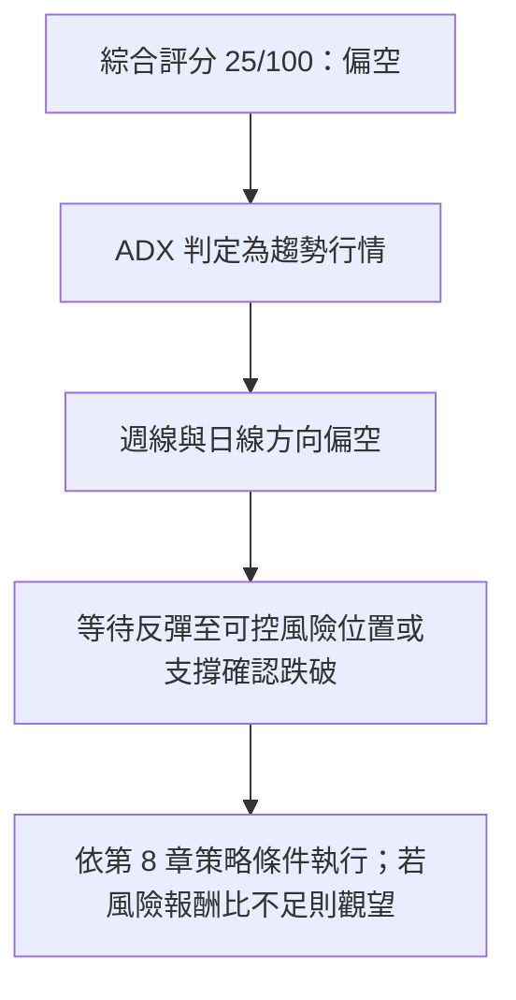

# ONDS 技術分析報告

> **報告日期**：2026-11-25 ｜ **語言**：繁體中文 ｜ **數據來源**：Yahoo Finance ｜ **當前價格**：$3.89（2026-11-24 收盤）

---

## 目錄

| 章節 | 內容 |
|------|------|
| [1. 技術面概覽](#1-技術面概覽) | 核心指標速覽、評分卡 |
| [2. 趨勢分析](#2-趨勢分析) | 長中短期走勢、ADX |
| [3. 圖表形態分析](#3-圖表形態分析) | 形態、K線、缺口 |
| [4. 支撐與阻力](#4-支撐與阻力) | 關鍵價位、斐波那契 |
| [5. 技術指標深度解讀](#5-技術指標深度解讀) | MA/RSI/MACD/布林/成交量/進階指標 |
| [6. 動能與波動率](#6-動能與波動率) | ATR、Beta、相對強度 |
| [7. 多時框架總結](#7-多時框架總結) | 時框架評分矩陣 |
| [8. 交易策略建議](#8-交易策略建議) | 歷史基準、策略、風險報酬比 |
| [9. 風險提示與監控](#9-風險提示與監控) | 監控指標、風險場景 |

---

## 1. 技術面概覽

ONDS 目前的技術方向偏空，核心依據是日、週線方向均偏空，且股價低於主要趨勢均線。趨勢強度指標顯示空方趨勢具延續性，量價指標也未提供明確止跌確認。最大反向風險是短線動能已接近超賣區，若低檔出現買盤回補，可能先形成急速反彈。

### 📊 核心指標速覽表

| 指標類別 | 指標名稱 | 當前數值 | 訊號 | 解讀 |
|----------|----------|----------|------|------|
| **價格** | 當前價格 | $3.89 | 🔴 | 位於 52 週區間低檔，短線仍承受賣壓。 |
| **均線** | MA20 / MA50 / MA200 | 見第 5 章 | 🔴 | 價格低於三條均線，均線排列偏空。 |
| **動能** | RSI(14)（日線） | 見第 5 章 | 🟡 | 靠近超賣區，但尚不足以單獨確認反轉。 |
| **動能** | MACD 柱（日線） | 見第 5 章 | 🔴 | 空方動能仍占優勢。 |
| **趨勢** | ADX(14) | 見第 2 章 | 🔴 | 趨勢強度達趨勢行情門檻，且空方主導。 |
| **波動** | ATR(14) | 見第 6 章 | 🔴 | 單日波動幅度相對價格偏大，部位宜保守。 |
| **多時框** | 一致性 | 見第 7 章 | 🔴 | 日、週線偏空，月線中性，整體偏空。 |

### 🏆 技術評分卡

綜合評分按六項子評分的算術平均計算，取整數後為 **25/100**，技術面屬偏空。

| 維度 | 評分（0–100） | 訊號 | 主要依據（引用數值所在章節） |
|------|---------------|------|------------------------------|
| 趨勢強度 | 27 | 🔴 | 趨勢強度偏高、空方主導，見第 2 章。 |
| 動能指標 | 32 | 🔴 | MACD 偏空、隨機指標超賣，RSI 接近超賣區，見第 5 章。 |
| 支撐穩定度 | 28 | 🔴 | 價格接近區間低位，近期下跌尚未形成明確止跌確認，見第 4 章。 |
| 成交量配合 | 30 | 🔴 | OBV 偏弱，A/D 線與價格同向下行，見第 5 章。 |
| 形態完整度 | 20 | 🔴 | 暫無可靠幾何反轉形態，見第 3 章。 |
| 均線排列 | 15 | 🔴 | 短、中、長期均線呈空頭排列，見第 5 章。 |
| **綜合評分** | **25** | **偏空** | 六項平均：152 ÷ 6，四捨五入。 |

---

## 2. 趨勢分析

### 📈 長期趨勢（近 12 個月）

長期走勢先在年初高位附近震盪，春季後推進至階段高點，隨後回落；近三個月跌勢顯著加速，長期趨勢已轉弱。

| 期間 | 起訖月收盤 | 漲跌幅 | 特徵 |
|------|------------|--------|------|
| 2025-12 至 2026-03 | $9.76 → $9.04 | -7.38% | 高位回落，反彈延續性有限。 |
| 2026-04 至 2026-05 | $10.04 → $13.22 | +31.67% | 階段性上漲，推升至期間高位。 |
| 2026-06 至 2026-08 | $8.24 → $7.66 | -7.04% | 高位回落後進入整理，反彈未能恢復前高。 |
| 2026-09 至 2026-11 | $7.33 → 最新月收盤見標題列 | -46.93% | 下跌加速，月收盤走勢呈明顯轉弱。 |

上述分段漲跌幅依各期間起訖月收盤計算；近月下跌段具有明顯的價格弱勢特徵。長期分析採用月線收盤資料，不將日線指標誤作月線訊號。

### 📊 中期趨勢（週線）

週線方向偏空，週收盤低於週趨勢均線，週 RSI 位於 50 以下，週 MACD 柱為負值。近 20 週走勢從夏季高位逐步回落，近期下跌幅度加大，尚未看到週線指標轉強的確認訊號。

| 週線觀察 | 數值／狀態 | 解讀 |
|----------|------------|------|
| 週趨勢均線 | MA20：$6.87；收盤在其下方 | 中期趨勢偏空。 |
| 週 RSI(14) | 31.47 | 動能偏弱，接近超賣但未構成反轉確認。 |
| 週 MACD 柱 | -0.338 | 週線空方動能仍在。 |
| 近 20 週收盤路徑 | 夏季走高後轉為逐週回落，近週再度加速下跌 | 週線反彈未能扭轉中期弱勢。 |

### ⚡ 趨勢強度（ADX）

ADX 高於趨勢行情門檻，且負向 DI 明顯高於正向 DI，判定目前是**空頭趨勢行情，而非一般盤整行情**。依多時框收斂規則，應以週線及中長期均線方向為主，日線只用來安排進場時機；不宜把短線超賣直接解讀為趨勢反轉。

| 指標 | 數值 | 解讀 |
|------|------:|------|
| ADX(14) | 36.93 | 高於 25，顯示趨勢強度偏高。 |
| +DI | 13.96 | 多方方向性力量較弱。 |
| −DI | 40.36 | 空方主導，與週線偏空方向互相確認。 |

---

## 3. 圖表形態分析

### 🔍 形態識別

近端資料不足以確認具有完整幾何結構的頭肩、雙底或旗形。價格與動能指標反映的是趨勢性下跌，並非可據以宣稱反轉形態的充足證據。

| 形態 | 信心度 | 判斷依據 | 完成度 | 目標價（附計算式） |
|------|--------|----------|--------|--------------------|
| 可確認的幾何反轉形態 | 低 | 近端價格持續走低，沒有可辨識且已完成的頸線、雙底或旗形結構。 | 訊號不足，僅做指標型解讀。 | N/A（數據未提供；未確認形態，不推算形態目標。） |
| 布林通道下緣附近的弱勢 | 中 | 價格靠近日線布林下軌，與均線空頭排列、負 MACD 柱相互呼應。 | 屬指標型訊號，不能視為已完成的底部形態。 | 不適用；非幾何形態目標。 |

### 🕯️ 重要 K 線形態與缺口

近端 K 棒整體以收低、低點下移為主；僅依所列 K 棒的開、高、低、收判讀，不把區塊以外日期描述成特定 K 線形態。

| 日期（日K／週K） | 開 | 高 | 低 | 收 | K線形態 | 解讀 | 訊號 |
|------|----:|----:|----:|----:|---------|------|------|
| 2026-11-16（日K） | $4.89 | $4.89 | $4.69 | $4.71 | 開收同為當日高位，收盤靠近低位 | 當日價格下移，與下方列示的未回補向下缺口同日，賣方占優。 | 🔴 |
| 2026-11-18（日K） | $4.43 | $4.67 | $4.34 | $4.42 | 實體偏小、上影較明顯 | 盤中反彈未能維持，缺乏明確反轉確認。 | 🔴 |
| 2026-11-20（日K） | $4.10 | $4.20 | $3.73 | $3.76 | 收盤靠近當日低位 | 當日賣壓較重，但單根 K 棒不足以確認趨勢反轉。 | 🔴 |
| 2026-11-24（週K，未完週） | $4.34 | $4.43 | $3.80 | $3.89 | 收盤低於開盤，週內反彈幅度有限 | 未完週 K 棒仍偏弱；不應單憑當週未完形態定論。 | 🔴 |

市場脈絡中列出的缺口如下。未回補缺口可作為上方潛在供給區，但不代表價格必然回補。

| 日期 | 方向 | 缺口區間 | 回補狀態 | 技術含義 |
|------|------|----------|----------|----------|
| 2026-11-16 | 向下跳空 | $4.89–$5.02 | 未回補 | 上方供給區；反彈至缺口範圍可能遇賣壓。 |
| 2026-11-05 | 向下跳空 | $5.16–$5.22 | 已回補 | 缺口已回補，不作為未回補缺口阻力。 |
| 2026-10-30 | 向下跳空 | $6.60–$6.74 | 未回補 | 較遠上方供給區，與中期弱勢一致。 |
| 2026-09-01 | 向下跳空 | $7.45–$7.65 | 已回補 | 缺口已回補，不作為未回補缺口阻力。 |

---

## 4. 支撐與阻力

### 🚧 阻力位分析表

阻力位採近一年波段高點聚類。現價與第一阻力間距較大，代表若價格反彈，需先評估反彈能否突破上方供給區，而非假設可直接回升。

| 阻力級別 | 價位 | 形成原因 | 突破難度 | 重要性 |
|----------|------:|----------|----------|--------|
| R1 | $7.08 | 近一年波段高點聚類；並與下方一目雲層、價值區附近壓力相呼應。 | 高 | 首要中期反彈確認位。 |
| R2 | $7.98 | 近一年波段高點聚類，並與較高價位供給區重疊。 | 高 | 中期趨勢若反轉，需觀察能否有效站上。 |
| R3 | $8.58 | 近一年波段高點聚類，接近更長期均線壓力帶。 | 高 | 長期反轉確認的較高門檻。 |

### 🛡️ 支撐位分析表

支撐位採近兩年波段低點聚類。現價接近 52 週低位區，若主要支撐失守，下一層支撐距離較遠，可能提高下跌延伸風險；這是價位結構判讀，不代表支撐必然失守。

| 支撐級別 | 價位 | 形成原因 | 守住可能性 | 重要性 |
|----------|------:|----------|--------------|--------|
| S1 | $3.20 | 近兩年波段低點聚類，為近期價格下方首要波段支撐。 | 中低 | 失守將令短線價格結構進一步轉弱。 |
| S2 | $1.82 | 近兩年波段低點聚類；與現價間距較大。 | 低 | S1 失守後的下一層歷史支撐參考。 |
| S3 | $1.78 | 近兩年波段低點聚類，與 S2 相距有限。 | 低 | 深度下行時的另一層歷史支撐參考。 |

波段支撐與阻力均有多個層級，因此本章不以樞軸公式值補充替代波段價位。

### 📐 斐波那契回調位分析

斐波那契數值以 52 週區間 $3.73 至 $15.28 計算，直接採用程式列示的價位。收盤位於 **78.6% 回調位 $6.20 與 100.0% 回調位 $3.73 之間**，靠近區間低端，反映此前升幅已大幅回吐。

| 回調比例 | 價位 | 技術解讀 |
|----------|-----:|----------|
| 23.6% | $12.55 | 若出現趨勢性反彈，較遠處的回升參考。 |
| 38.2% | $10.87 | 中期反彈的較高參考位。 |
| 50.0% | $9.50 | 區間中位參考。 |
| 61.8% | $8.14 | 常見回調參考位，現階段仍在上方。 |
| 78.6% | $6.20 | 價格已下破此位，反映回吐幅度深。 |
| 100.0% | $3.73 | 52 週低位；若有效失守，須留意支撐延伸風險。 |

---

## 5. 技術指標深度解讀

### 📈 均線、RSI、MACD、布林通道

| 指標 | 數值 | 訊號 | 解讀 |
|------|------|------|------|
| MA20 / MA50 / MA200 與排列 | MA20 $5.20；MA50 $6.23；MA200 $8.49；MA20 < MA50 < MA200 | 🔴 | 價格位於三條均線下方，短中長期均線呈空頭排列，均線尚未提供止跌證據。 |
| RSI(14)（日線）與背離 | 31.99；數據標示無明顯背離 | 🟡 | 靠近超賣區但仍未低於 30。以近 20 根 K 棒首尾比較，未見明顯 RSI 頂背離或底背離；背離結論為無。 |
| MACD 線 / Signal / 柱 | MACD -0.665；Signal -0.556；柱 -0.109 | 🔴 | MACD 低於 Signal 且柱為負，日線動能偏空。 |
| 布林上軌 / 中軌 / 下軌 / %B | $7.06 / $5.20 / $3.33；%B 0.15 | 🔴 | 價格處於通道下半部、接近下軌；在 ADX 顯示趨勢行情的背景下，不能把接近下軌直接等同於反彈訊號。 |

均線、MACD 與布林位置彼此確認偏空；RSI 接近超賣與 Stoch 超賣則提示短線可能有反彈或波動放大的風險，但目前沒有 RSI 背離或均線翻多作為確認。因此，短線反彈風險與中期下跌趨勢並存，方向判斷仍由趨勢訊號主導。

### 💹 成交量（量價配合度）

成交量訊號整體未確認價格止跌。最新量比略低於 20 日均量，OBV 低於其均線，表示累積量能偏疲弱；A/D 線走勢與價格同向下行，則與價格弱勢互相確認。

| 量能指標 | 數值／狀態 | 解讀 |
|----------|------------|------|
| 最新成交量 | 45,609,200 股 | 與短期均量比較，未見明確放量止跌訊號。 |
| 20 日均量與量比 | 47,105,085 股；0.97x | 略低於 20 日均量，量能未出現強力反轉確認。 |
| 50 日均量 | 51,829,214 股 | 最新成交量低於中期均量。 |
| OBV | OBV < MA | 量能疲弱，尚未確認價格止跌。 |
| A/D 線（近 20 根） | 不高於 20 日均值；A/D 下降、價格下跌 | 與價格同向，確認近期賣壓方向。 |

### 🧭 進階指標

| 指標 | 數值 | 收盤相對位置 | 解讀 |
|------|------|--------------|------|
| 一目均衡表（轉換線／基準線／雲層） | 轉換線 $4.69；基準線 $5.40；先行帶 A $6.72、B $7.89；前方 26 根雲層 A $5.05、B $5.86 | 收盤位於雲層下方；轉換線低於基準線；前方 A 低於 B | 一目均衡表偏空，與均線排列、MACD 及 RSI 未確認反轉的結論一致。 |
| 成交量分布（POC／價值區） | POC $7.34；價值區 $7.10–$10.95 | 收盤位於價值區下方 | 價格低於主要成交量集中區，若反彈至價值區附近，可能遇到套牢或供給壓力；與均線偏空結論一致。 |
| 錨定 VWAP（自 52 週高點／低點） | 自 2026-01-12 高點起 $9.21；自 2026-11-20 低點起 $3.98 | 收盤低於兩條錨定 VWAP | 價格仍在兩個錨定平均成本下方；近低點錨定 VWAP 距離較近，短線需觀察能否收復。 |
| A/D 線 | 近 20 根不高於其 20 日均值；A/D 下降、價格下跌 | — | A/D 與價格同向下行，與 OBV 偏弱、MACD 看空相互確認。 |

---

## 6. 動能與波動率

### 📊 ATR 波動率分析

ATR 顯示 ONDS 的日常價格波動相對股價偏大。若以 ATR 的倍數作為風險距離參考，較寬鬆的波動緩衝會對應較大的停損距離；實際策略停損仍應使用第 8 章列出的具體價位，不以 ATR 推算或替代關鍵價位。

| 項目 | 數值 | 解讀 |
|------|------:|------|
| ATR(14) | $0.48 | 單日平均真實波幅參考。 |
| ATR 佔價格比例 | 12.25% | 相對波動偏高，容易出現快速反向波動。 |
| 1.5 倍 ATR 參考距離 | $0.72 | 可用於理解一般波動緩衝尺度；不是本報告額外設定的停損價。 |
| 2 倍 ATR 參考距離 | $0.96 | 較寬的波動緩衝尺度；倉位需相應縮小。 |

### 📐 Beta 與相對強度

相對強度以市場脈絡列示的 VTI 價格報酬為準。各期間本股均落後大盤，且比值趨勢相對走弱，對偏空主策略提供方向支持，而非抵銷訊號。

| 期間 | 本股報酬 | VTI 報酬 | 超額報酬 |
|------|---------:|---------:|---------:|
| 1 個月 | -35.0% | -4.8% | -30.2% |
| 3 個月 | -51.1% | -6.1% | -45.0% |
| 6 個月 | -58.8% | -3.8% | -54.9% |

| 指標 | 數值／狀態 | 解讀 |
|------|------------|------|
| Beta | 3.082 | 對市場波動的歷史敏感度偏高，短線反向波動也可能放大。 |
| 比值趨勢 | 相對走弱；比值低於其 50 日均值 | 本股持續落後 VTI，支持偏空方向判讀。 |

---

## 7. 多時框架總結

### 📋 時框架評分表

下表依多時框指標列示各時框數值與方向，不以日線指標代替週線或月線訊號。

| 時框架 | 趨勢方向 | RSI(14) | MACD 柱 | 收盤 vs 趨勢均線 | 形態 | 建議 |
|--------|----------|---------|---------|------------------|------|------|
| 日線 | 偏空 | 31.99 | -0.109 | MA50 $6.23；收盤在下方 | 均線空頭排列，尚無明確反轉確認 | 順勢為主，短線超賣僅作風險提示。 |
| 週線 | 偏空 | 31.47 | -0.338 | MA20 $6.87；收盤在下方 | 中期收盤走勢偏弱 | 中期方向偏空，等日線反彈改善風險報酬後再執行。 |
| 月線 | 中性 | 53.82 | N/A（數據未提供） | MA10 $8.33；收盤在下方 | 月 RSI 高於 50，但仍低於月趨勢均線 | 月線未確認偏多，宜以日、週線偏空訊號為主。 |

**多時框一致性：2/3 偏空。**

### ⚖️ 多時框收斂結論

目前 ADX 判定為趨勢行情，依規則以週線與中長期均線方向優先；週線偏空、日線偏空，月線中性並未形成偏多確認。日線短線超賣訊號只用於避免追空及尋找較佳進場時機，不推翻中期方向。**唯一方向性結論：偏空。**

---

## 8. 交易策略建議

**當前主策略方向 = 偏空（依綜合評分 25/100）。** 由於趨勢強度偏高且週線方向偏空，採順勢偏空路由；不另行強力推薦多頭策略。

### 📊 歷史基準機率

今日狀態定義為 RSI(14) 位於 30–50 且收盤低於 MA200。歷史樣本期間為 2020-12-04 至 2026-11-24，共 1,500 個交易日；相同狀態的交易日連續出現且持有期互相重疊，段數較接近獨立事件數。

| 持有期 | 相同狀態樣本（段數） | 上漲比例 | 中位數報酬 | 25%–75% 分位 | 全部交易日上漲比例／中位數 |
|--------|----------------------:|---------:|-----------:|--------------|----------------------------|
| 5 日 | 546（70 段） | 42% | -2.3% | -9.3% 至 +7.0% | 44%／-2.0% |
| 20 日 | 534（68 段） | 40% | -6.4% | -20.8% 至 +8.6% | 43%／-4.4% |
| 60 日 | 496（66 段） | 47% | -4.0% | -35.1% 至 +35.8% | 42%／-11.3% |

短期與中期持有期的相同狀態上漲比例低於全部交易日的對照值；較長持有期的上漲比例略高於全部交易日，但中位數仍為負，且分布範圍寬。這些是歷史頻率，不是預測；樣本的段數有限，連續交易日並非獨立事件。整體歷史資料對偏空主策略略有支持，但不構成單獨交易理由。

### 🎯 價格情境階梯（Price Scenarios）

以下可能性以高／中／低表示，不是自估機率。價位引用第 4 章的支撐、阻力標籤。

| 觸發條件 | 下一目標 | 後續延伸 | 可能性 | 依據 |
|----------|----------|----------|--------|------|
| 有效突破 R1 | R2 | R3 | 低 | 需先扭轉日、週線偏空及量能疲弱；目前尚無趨勢反轉確認。 |
| 價格守住現有低檔區、且日線動能改善 | — | — | 中低 | 接近區間低端且短線動能偏弱，可能反彈；但 RSI 無明顯底背離、OBV 未確認。 |
| 有效跌破 S1 | S2 | S3 | 中 | 趨勢與相對強度均偏弱；下行目標仍須以支撐位為參考，並留意急速反彈風險。 |

### 🟢 主策略詳情（偏空）

策略須等觸發條件成立後才執行。以下兩組均以空頭風險報酬公式計算，且以 T1 計的風險報酬比達到最低門檻；若實際成交偏離所列價位，須重新計算，不應照搬比值。

| 策略要素 | 策略 A：跌破 52 週低位後跟進 | 策略 B：跌破 S1 後跟進 |
|----------|-----------------------------|------------------------|
| 進場條件 | 價格向下跌破 52 週低位，且未立即收復；避免在未確認時預先追空。 | 價格有效跌破 S1，並以收盤或後續交易確認未快速收復。 |
| 進場價格 | $3.73 | $3.20 |
| 目標價 T1 | $3.20 | $1.82 |
| 目標價 T2 | $1.82 | $1.78 |
| 止損價格 | $3.89 | $3.73 |
| 風險報酬比 | 1 : 3.31（以 T1 計；計算：($3.73−$3.20)÷($3.89−$3.73)） | 1 : 2.60（以 T1 計；計算：($3.20−$1.82)÷($3.73−$3.20)） |
| 風險報酬比（以 T2 計） | 1 : 11.94 | 1 : 2.68 |
| 把握度 | 低：空頭趨勢支持方向，但價格已接近低檔，且短線超賣使假跌破風險偏高。 | 低：若支撐失守，結構偏空；但支撐下方可能出現快速反彈，須等待確認。 |
| 建議倉位 | 以帳戶資金風險額控制，不超過一般單筆風險預算的 0.5%。 | 以帳戶資金風險額控制，不超過一般單筆風險預算的 0.5%。 |

上述策略的停損、進場與目標價均採用已列示的支撐或 52 週價位。這類高波動標的可能跳空穿越停損價，故計算所得風險報酬比不代表實際成交結果。

### 🔴 反向風險觸發點（對沖提示）

| 反向風險訊號 | 風控含義 |
|--------------|----------|
| 價格重新站回缺口 $4.89–$5.02 並穩定持有 | 賣方優勢可能減弱；停止新增空單，重新檢查跌破策略有效性。 |
| 日線收復布林中軌，且 MACD 柱轉正 | 短線動能轉強，空頭策略需縮減風險或等待再確認。 |
| 週線方向轉為偏多，且價格站回週趨勢均線 | 中期偏空假設受到挑戰，應重新評估策略方向。 |

---

## 9. 風險提示與監控

### ✅ 關鍵監控指標

| 監控項目 | 參考價位／事件 | 觸發後動作 |
|----------|----------------|------------|
| 近期波段支撐 | S1，見第 4 章 | 跌破須等待確認，不以單一盤中刺穿直接追空。 |
| 深一層支撐 | S2、S3，見第 4 章 | 僅作下行目標與風險管理參考，注意價格接近支撐時可能反彈。 |
| 未回補向下缺口 | $4.89–$5.02；$6.60–$6.74 | 反彈至缺口區域時，觀察賣壓及是否回補，不預設必然回補。 |
| 動能與量能 | 日線 MACD、RSI、OBV、A/D | 若動能改善但量能未確認，避免將短線反彈誤判成趨勢反轉。 |
| 多時框趨勢 | 日、週、月方向見第 7 章 | 若週線方向或主要均線結構改變，重新檢視主策略。 |
| 下次財報日 | N/A（數據未提供） | 財報日期及距最新收盤日的日曆天數均為 N/A（數據未提供）；下單前應另行核對公司公告。 |

### ⚠️ 風險場景

| 情境 | 觸發條件 | 參考價位 | 可能性 | 應對 |
|------|----------|----------|--------|------|
| 樂觀：短線技術反彈 | 日線動能轉強並收復上方未回補缺口 | 缺口 $4.89–$5.02；較遠阻力見 R1 | 低 | 空頭部位停止加碼；如價格持續收復供給區，重新評估空頭假設。 |
| 基本：弱勢延續 | 反彈受阻，價格仍低於週趨勢均線，日線動能未改善 | S1 為首要下方觀察位 | 中 | 僅在策略觸發條件成立且風險報酬比達標時執行；避免預先追空。 |
| 悲觀：支撐失守、下跌延伸 | 有效跌破 S1，且後續未快速收復 | S2、S3 | 中 | 依預設停損與目標分段管理；若波動放大，降低持倉而非放寬停損。 |

### 🛡️ 風險管理提醒

1. ONDS 的 Beta 與 ATR 均顯示波動風險偏高，應先設定最大可承受損失，再反推倉位。
2. 只在策略觸發條件成立後考慮進場；若實際成交價使以 T1 計的風險報酬比低於最低門檻，取消交易。
3. 停損是風險管理指令，不保證在跳空或流動性急變時按指定價格成交。
4. 短線超賣可能引發急速反彈；不要因趨勢偏空而在支撐附近無條件加碼。
5. 財報日期目前為 N/A（數據未提供）；在未核實公司公告前，避免持有未評估事件風險的部位。

---

## 📋 報告總結

| 項目 | 結論 |
|------|------|
| 報告日期 | 2026-11-25 |
| 當前價格 | 見標題列；2026-11-24 收盤 |
| 綜合評分 / 方向 | 25/100，偏空 |
| 長期 / 中期 / 短期趨勢 | 🔴 長期走勢走弱；🔴 週線偏空；🟡 日線接近超賣但未確認反轉。 |
| 關鍵支撐 / 關鍵阻力 | 支撐 S1、S2、S3；阻力 R1、R2、R3，價位見第 4 章。 |
| 🥇 最佳機會 | 等待策略 A 或策略 B 的觸發條件成立；若未觸發或成交價使風險報酬比不達標，觀望。 |
| 最大風險 | 趨勢偏空但價格接近低檔，短線可能出現急速反彈；高波動亦可能令停損成交價偏離預設。 |

> ⚠️ **免責聲明**：本報告為 AI 自動生成之技術分析，所有數據及估算均基於價格歷史資訊。本報告**僅供研究與學術參考**，**不構成任何投資建議**。投資有風險，入市需謹慎。

---

## 資料與來源

| 項目 | 內容 |
|------|------|
| 價格 | 3.89 USD，2026-11-24 收盤（Yahoo Finance 日線） |
| K 棒 | 501 根日線，2024-11-25 至 2026-11-24（Yahoo Finance）；較長期間的價位與基準機率取自價格資料庫 |
| 關鍵價位回溯期間 | 阻力 近一年、支撐 近兩年 |
| 有回應的資料來源 | Yahoo Finance、Finviz、StockAnalysis、Roic.ai |
| 由程式計算 | 所有指標、R1–S3 與斐波那契價位、多時框方向、相對強度、缺口、歷史基準機率、綜合評分 |
| 撰寫模型 | openai / gpt-6-luna |

> 本區塊由產生報告的程式依實際取得的資料填寫，非模型撰寫。「由程式計算」的數字不是模型的估計；其餘判斷（評分、情境、策略）是模型的分析。
