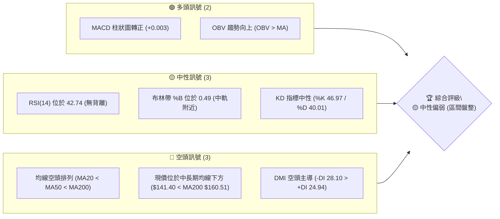
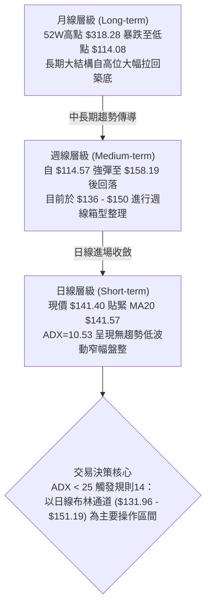
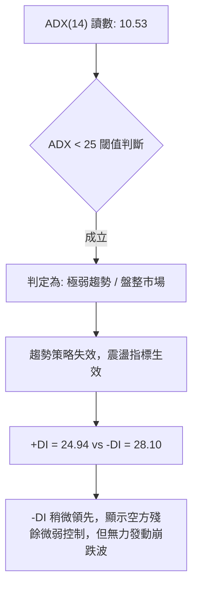
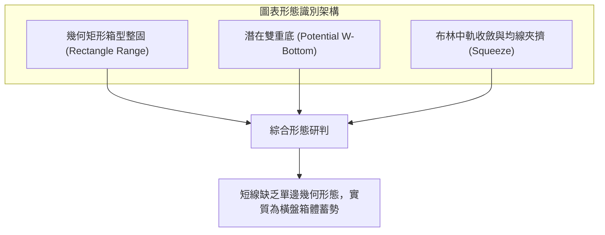
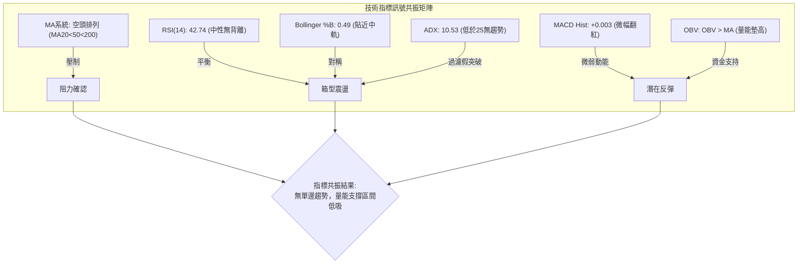
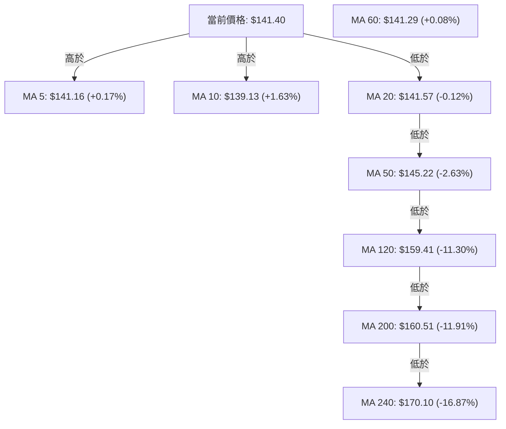
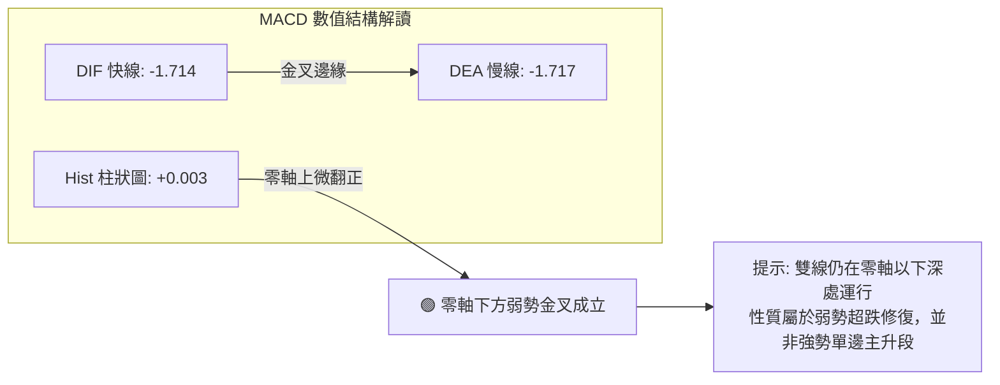
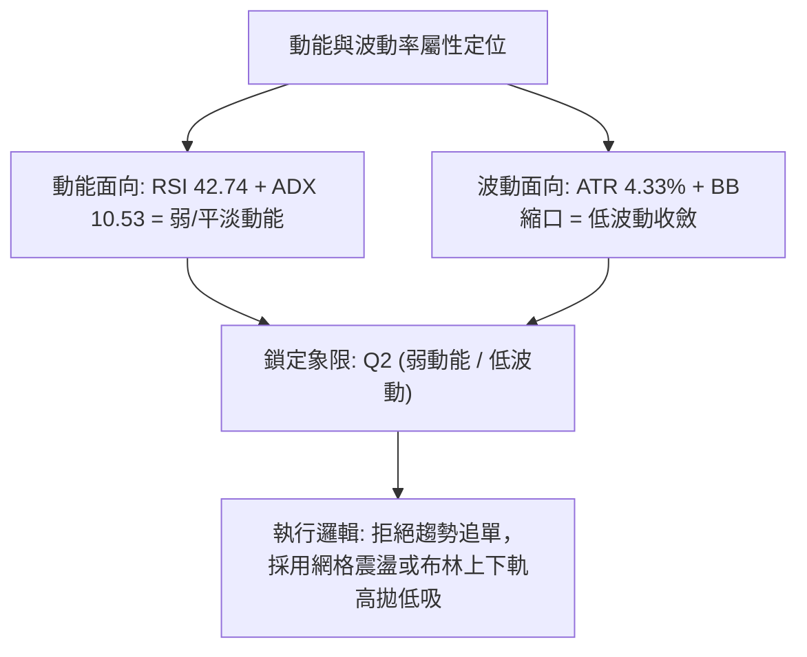
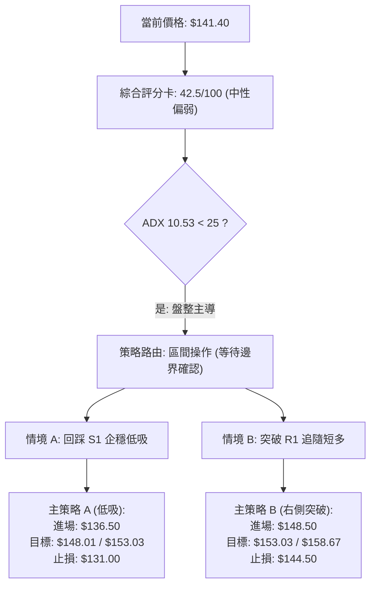
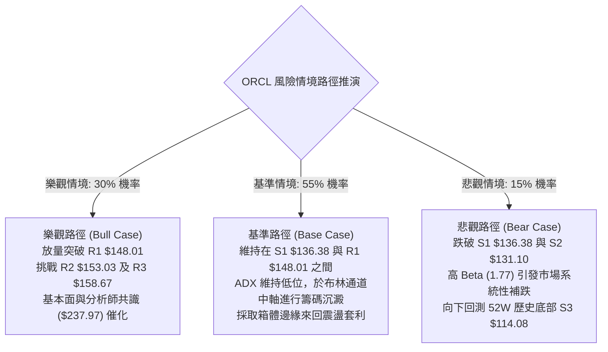

# ORCL 技術分析報告

> **報告日期**：2026-10-11 ｜ **語言**：繁體中文 ｜ **數據來源**：Yahoo Finance ｜ **當前價格**：$141.40

---

## 目錄

| 章節 | 內容 |
|------|------|
| [1. 技術面概覽](#1-技術面概覽) | 訊號儀表板、核心指標、評分卡 |
| [2. 趨勢分析](#2-趨勢分析) | 多時框趨勢、長中短期走勢 |
| [3. 圖表形態分析](#3-圖表形態分析) | 形態識別、K線組合、目標價 |
| [4. 支撐與阻力](#4-支撐與阻力) | 關鍵價位、斐波那契回調 |
| [5. 技術指標深度解讀](#5-技術指標深度解讀) | MA/RSI/MACD/布林/成交量 |
| [6. 動能與波動率](#6-動能與波動率) | 動能評估、ATR、Beta |
| [7. 多時框架總結](#7-多時框架總結) | 時框架評分矩陣 |
| [8. 交易策略建議](#8-交易策略建議) | 多空策略、風險報酬比 |
| [9. 風險提示與監控](#9-風險提示與監控) | 監控指標、風險場景 |

---

## 1. 技術面概覽

### 🎯 技術訊號儀表板



### 📊 核心指標速覽表

| 指標類別 | 指標名稱 | 當前數值 | 訊號 | 解讀 |
|----------|----------|----------|:---:|------|
| **價格** | 當前價格 | $141.40 | 🟡 | 位於52週區間13.4%，處於低檔震盪整固階段 |
| **均線** | MA20 | $141.57 | 🟡 | 現價緊貼MA20（-$0.17），短線多空在此拉鋸 |
| **均線** | MA50 | $145.22 | 🔴 | 現價在MA50下方（-$3.82），中期趨勢仍處承壓修正 |
| **均線** | MA200 | $160.51 | 🔴 | 現價大幅落後長線牛熊分界線（-$19.11），長期空頭壓制 |
| **動能** | RSI(14) | 42.74 | 🟡 | 位於40–50中性偏弱區間，未出現超賣或超買，無背離現象 |
| **動能** | MACD | -1.714 / Hist +0.003 | 🟢 | MACD雙線仍在零軸下，但柱狀圖微幅翻正，呈現微弱黃金交叉雛形 |
| **動能** | Stoch %K / %D | 46.97 / 40.01 | 🟡 | 隨機指標自超賣回升至中軸下方，多方動能溫和回補 |
| **趨勢** | ADX(14) | 10.53 | 🟡 | ADX < 25 極弱趨勢，表明單邊下跌告段落，進入無趨勢矩形橫盤 |
| **趨勢** | DMI (+DI / -DI) | 24.94 / 28.10 | 🔴 | -DI 大於 +DI，空頭力量雖稍佔優勢但差距正逐步收窄 |
| **通道** | Bollinger %B | 0.49 | 🟡 | 恰位於中軌（$141.57）附近，處於對稱震盪均衡點 |
| **成交量** | 量比 (當日/20日) | 0.82x (25.49M/30.93M) | 🟡 | 量能縮小，顯示市場追空意願不足，觀望情緒濃厚 |
| **波動** | ATR(14) | $6.12 (4.33%) | 🟡 | 日內平均振幅適中，提供明確止損與波動帶寬參考 |

### 🏆 技術評分卡

```
技術評分卡 — ORCL (2026-10-11)
════════════════════════════════════════════════════
趨勢強度      ████░░░░░░░░░░░░░░░░  22/100  🔴 ADX 10.53 極弱，均線空頭
動能指標      ██████████░░░░░░░░░░  50/100  🟡 RSI 42.74，MACD 柱微翻正
支撐穩定度    ████████████░░░░░░░░  60/100  🟢 S1 $136.38 與 S2 $131.10 築底
成交量配合    ███████████░░░░░░░░░  55/100  🟡 OBV > MA 但日成交量比 0.82x
形態完整度    ██████████░░░░░░░░░░  48/100  🟡 矩形築底中，尚未有效突破
均線排列      ████░░░░░░░░░░░░░░░░  20/100  🔴 MA20 < MA50 < MA200 空頭排列
════════════════════════════════════════════════════
綜合評分      ████████░░░░░░░░░░░░  42.5/100  🟡 中性偏弱（區間盤整）
════════════════════════════════════════════════════
```

---

## 2. 趨勢分析

### 🌐 多時框趨勢分析



### 📈 長期趨勢 — 12個月走勢圖（Unicode）

```
ORCL 月線走勢圖（過去12個月：2025-11 至 2026-10）
價格軸 ($)
$260 ┤
$240 ┤
$220 ┤                               ●(2026-05: $224.17 反彈頂)
$200 ┤●(2025-11: $199.28)
$180 ┤    ●(2025-12: $192.34)
$160 ┤        ●(2026-01: $162.84)        ●(2026-04: $160.24)
$140 ┤            ●(02: $143.86) ●(03: $145.55)      ●(06: $145.50)    ●(08: $148.57)      ●(10: $141.40 現價)
$120 ┤                                                    ●(07: $129.39)      ●(09: $136.79)
     └────────────────────────────────────────────────────────────────────────────
        11   12   01   02   03   04   05   06   07   08   09   10  (月份)
```

#### 走勢特徵分析表格

| 階段區間 | 時間區跨 | 始末收盤價 | 區間漲跌幅 | 走勢特徵與量價解讀 |
|:---:|:---:|:---:|:---:|---|
| **第一階段：高檔墜落** | 2025-11 ~ 2026-02 | $199.28 → $143.86 | -27.81% | 承接自歷史高位下滑，月K連續長黑，均線系統全面拐頭向下。 |
| **第二階段：春季反彈** | 2026-02 ~ 2026-05 | $143.86 → $224.17 | +55.82% | 跌深強力反彈，5月放量直衝 $224.17，但在長天期均線附近遭遇巨量阻力。 |
| **第三階段：二次探底** | 2026-05 ~ 2026-07 | $224.17 → $129.39 | -42.28% | 6月單週成交量暴增至1.8億股急跌，7月收盤探至 $129.39，週線觸及52W低點 $114.08 邊緣。 |
| **第四階段：築底整理** | 2026-08 ~ 2026-10 | $129.39 → $141.40 | +9.28% | 8月反彈至 $148.57，9月微幅回測 $136.79，10月現價收在 $141.40，振幅大幅收斂。 |

### 📊 中期趨勢（週線分析）

```
ORCL 近20週核心波段壓力與支撐演化圖
──────────────────────────────────────────────────────────────────────────────
$160 ┤               [阻力 R3 $158.67] ───────● (2026-09-06: $158.19)
$155 ┤                                        │
$150 ┤                       ●───────●        │   [阻力 R1 $148.01 / R2 $153.03]
$145 ┤                  ●    │       │   ●    │   ● (2026-09-20: $147.07)
$140 ┤             ●    │    │       │   │    └───┼───● (現價 $141.40)
$135 ┤             │    │    │       │   │        ● (2026-09-27: $136.59 / S1 $136.38)
$130 ┤        ●    │    │    │       └───┘
$125 ┤   ●    │    │    │    └─── [支撐 S2 $131.10]
$120 ┤   │    └─── (2026-08-02: $129.39)
$115 ┤   ● (2026-07-26: $114.57 觸及52W低點 $114.08)
──────────────────────────────────────────────────────────────────────────────
```

週線數據顯示，ORCL 在 2026 年 7 月 26 日當週創下 $114.57 低點後，MACD 柱狀圖自極端值 -6.718 強勢回升至正值（最高達 +4.810），促成了 8 月至 9 月初反彈至 $158.19。然而，隨後未能克服 R3（$158.67）強阻力，週 MACD 轉弱再度回落，目前於 $136.38–$148.01 區間進入籌碼收縮沉澱期。

### ⚡ 趨勢強度評估（ADX 解讀）



#### ADX 趨勢強度對照表

| 指標變數 | 當前讀數 | 門檻區間定義 | 趨勢屬性判定 | 市場操作意涵 |
|----------|:---:|:---:|:---:|---|
| **ADX(14)** | **10.53** | 0 – 20: 極度無趨勢 / 橫盤沉睡 | 🟢/🟡 盤整行情 | 順勢突破策略假突破機率極高，嚴禁追價 |
| **+DI** | **24.94** | 多方買盤推動力 | 🟡 處於防守反擊中 | 買盤力量逐漸積累，但尚未突破 30 臨界點 |
| **-DI** | **28.10** | 空方賣壓主導力 | 🔴 賣壓仍稍佔優勢 | 賣盤未見枯竭，上方拋壓仍需時間消化 |
| **DI 差值** | **-3.16** | 兩者差距極小 | 🟡 均勢拉鋸 | 兩線即將收斂交叉，預示震盪幅度即將進一步壓縮 |

---

## 3. 圖表形態分析

### 🔍 形態識別系統



#### 形態識別信心度評估表

| 形態名稱 | 信心度 | 判斷依據（嚴格引用數據） | 完成度 | 目標價（附嚴格計算式） |
|----------|:---:|----------------------|:---:|--------------------|
| **矩形箱型整理** | **75%** | 上界受限於阻力 R1 $148.01，下界受到支撐 S1 $136.38 支撐；近5週收盤（149.73→147.07→136.59→141.78→141.40）均在此箱內運行。 | 85% | 向上突破目標：$148.01 + ($148.01 - $136.38) = **$159.64**（貼近 R3 $158.67）<br/>向下跌破目標：$136.38 - ($148.01 - $136.38) = **$124.75**（貼近 7/19 週低 $125.94） |
| **潛在雙重底** | **45%** | 第一次低點為 52W 低點 $114.08（7/26週 $114.57），第二次回測低點為 9/27 週 $136.59（高於前低），但兩低點落差過大（>$20），不符合嚴格雙底標準。 | 40% | *訊號不足，依規則 15 判定信心度 < 50%，不給予幾何測幅，僅做指標型箱型解讀。* |
| **布林帶夾擠** | **70%** | 布林上軌 $151.19 與下軌 $131.96 寬度壓縮至 $19.23，現價 $141.40 緊貼中軌 $141.57，均線 MA5($141.16)、MA20($141.57)、MA60($141.29) 高度黏合。 | 90% | 待布林帶開口擴張，第一波波動目標依上軌 **$151.19** 或下軌 **$131.96**。 |

### 🕯️ 重要K線形態分析

| 週/月份週期 | 收盤價 | 實體/影線走勢形態 | 形態專業解讀 | 訊號評級 |
|:---:|:---:|---|---|:---:|
| **2026-07-26 當週** | $114.57 | 長下影錘頭線（Hammer） | 在觸及52W新低 $114.08 時爆出 1.62 億股量能，下影線長，宣告中期賣壓衰竭竭盡。 | 🟢 強烈止跌 |
| **2026-08-16 當週** | $149.97 | 連續大陽線回升 | RSI 衝上 74.6，MACD 柱狀圖放大至 +3.839，確認底背離反彈成形。 | 🟢 買盤增強 |
| **2026-09-06 當週** | $158.19 | 上影倒錘頭線（Shooting Star） | 衝擊 R3（$158.67）與斐波那契 78.6%（$157.78）重疊阻力區遭空方狙擊，多頭受阻。 | 🔴 衝高回落 |
| **2026-09-27 當週** | $136.59 | 陰線下探測試 S1 | 跌至 S1（$136.38）獲強力承接，成交量萎縮至 1.56 億股，確認低階買盤存在。 | 🟡 測試支撐 |
| **2026-10-11 本週** | $141.40 | 窄幅十字星陀螺線（Spinning Top） | 週實體極窄（前週 $141.78 → 本週 $141.40），成交量降至 1.21 億股，多空極致均衡。 | 🟡 變盤前夕 |

### 📉 ASCII 走勢形態示意圖

```
ORCL 近期「箱型震盪整理（Rectangle Consolidation）」結構示意圖
═══════════════════════════════════════════════════════════════════
$158.67 ┬───────────────────────────────────────────● [9/6 波段高點受阻]
        │
$148.01 ┼───────●──────────────────●─────── [箱體頂部 / R1 阻力]
        │      / \                 / \
$144.00 ┤     /   \   ●          /   \     ●
$141.40 ┤────/─────\─/─\────────/─────\───┼── [現價 / MA20 / BB中軌]
        │   /       V   \      /       \ /
$136.38 ┼──●────────────●────●─────────V──── [箱體底部 / S1 支撐]
        │
$131.10 ┴───────────────────────────────────── [次級強防守 / S2 支撐]
═══════════════════════════════════════════════════════════════════
```

### 🎯 形態目標價計算

根據完成度最高（75%信心度）的**矩形箱型整理**進行量化等距測幅：

1. **箱體上限（頸線/阻力線）**：引用關鍵價位 **R1 = $148.01**
2. **箱體下限（支撐線）**：引用關鍵價位 **S1 = $136.38**
3. **箱體垂直高度 ($H$)**：
   $$H = \text{箱體上限} - \text{箱體下限} = 148.01 - 136.38 = \$11.63$$
4. **向上突破理論目標價 (T1)**：
   $$\text{目標價} = \text{上限} + H = 148.01 + 11.63 = \$159.64$$
   *(該數值與數據庫中波段高點聚類阻力 R3 $158.67 高度吻合)*
5. **向下破位理論風險價 (Downside Risk)**：
   $$\text{向下測幅} = \text{下限} - H = 136.38 - 11.63 = \$124.75$$
   *(該數值直接逼近 7/19 週線回測低點 $125.94 與 S2 $131.10 緩衝帶)*

---

## 4. 支撐與阻力

### 🗺️ 關鍵價位分布圖（Unicode）

```
ORCL 價位結構分布圖（嚴格依據 OHLCV 聚類計算與斐波那契回調）
═══════════════════════════════════════════════════════════════════════
$318.28 ║████████████████████████████████████║ 52W High (0.0% Fib)
$270.09 ║████████████████████                ║ Fib 23.6% 回調位
$240.28 ║██████████████████                  ║ Fib 38.2% 回調位
$216.18 ║████████████████                    ║ Fib 50.0% 關鍵平衡位
$192.08 ║██████████████                      ║ Fib 61.8% 黃金分割阻力
$170.10 ║████████████                        ║ MA240 長期均線壓制
$160.51 ║███████████                         ║ MA200 牛熊分水嶺
$158.67 ║████████████████████████████████    ║ 強阻力 R3 / Fib 78.6% ($157.78)
$153.03 ║██████████████████████              ║ 中期波段阻力 R2 / BB 上軌附近
$148.01 ║████████████████████████            ║ 關鍵突破頸線阻力 R1
$141.40 ╠════════════════════════════════════╣ ◄ 當前價格 ($141.40)
$136.38 ║▓▓▓▓▓▓▓▓▓▓▓▓▓▓▓▓▓▓▓▓▓▓              ║ 近期波段核心支撐 S1
$131.10 ║████████████████████████            ║ 強支撐 S2 / BB 下軌 ($131.96)
$114.08 ║████████████████████████████████████║ 52W Low (100.0% Fib) / 終極底部 S3
═══════════════════════════════════════════════════════════════════════
```

### 🚧 阻力位分析表

*嚴格引用數據庫「關鍵價位」區塊之波段高點聚類數值：*

| 阻力級別 | 準確價位 | 距現價幅動 | 形成原因與籌碼解讀 | 突破難度 | 重要性 |
|:---:|:---:|:---:|---|:---:|:---:|
| **R1** | **$148.01** | +4.67% | 近期震盪箱型上緣，8月至9月多次上攻之次級高點密集區。突破此處代表打破短線平衡。 | 🟡 中等 | ★★★★☆ |
| **R2** | **$153.03** | +8.23% | 接近布林通道上軌（$151.19）與7、8月反彈次波峰，空頭中期籌碼防禦關卡。 | 🔴 偏高 | ★★★☆☆ |
| **R3** | **$158.67** | +12.22% | 9/6週線高點（$158.19）與斐波那契 78.6%（$157.78）重疊帶，下方堆積巨量套牢盤。 | 🔴 極高 | ★★★★★ |

### 🛡️ 支撐位分析表

*嚴格引用數據庫「關鍵價位」區塊之波段低點聚類數值：*

| 支撐級別 | 準確價位 | 距現價幅動 | 形成原因與籌碼解讀 | 守住機率 | 重要性 |
|:---:|:---:|:---:|---|:---:|:---:|
| **S1** | **$136.38** | -3.55% | 9/27週回測低點（$136.59）與9月月K收盤（$136.79）之支撐集群，短線多頭第一防線。 | 75% | ★★★★☆ |
| **S2** | **$131.10** | -7.29% | 與布林下軌（$131.96）高度重合，接近 7/26 前週收盤價位，具備強力逢低承接買盤。 | 85% | ★★★★★ |
| **S3** | **$114.08** | -19.32% | 52週歷史最低點（2026-07-26 當週低點），年度極端恐慌拋售低點，終極多頭堡壘。 | 95% | ★★★★★ |

### 📐 斐波那契回調位分析

*嚴格引用 52 週波段（$114.08 → $318.28，波幅 $204.20）官方計算數值：*

| 回調比例 | 斐波那契價位 | 當前相對位置與市場技術含義 |
|:---:|:---:|---|
| **0.0% (52W High)** | **$318.28** | 歷史高點牛市極限。 |
| **23.6%** | **$270.09** | 2025年9月高檔強勢整理區。 |
| **38.2%** | **$240.28** | 多空分水嶺，跌破後確認由牛轉熊。 |
| **50.0%** | **$216.18** | 2026年5月反彈高點（$224.17）所處的中級阻力平台。 |
| **61.8%** | **$192.08** | 經典黃金分割位，中長期強大拋壓區。 |
| **78.6%** | **$157.78** | **【關鍵界限】** 與 R3（$158.67）形成強大共振阻力帶。 |
| **100.0% (52W Low)**| **$114.08** | 完整回撤終點，年度最深護城河。 |

**現價所處區間研判**：
當前價格 **$141.40** 坐落於 **78.6% 回調位 ($157.78)** 與 **100.0% 回調位 ($114.08)** 之間（回調幅度達 86.6%）。
- **技術意義**：ORCL 已經回吐了前一輪大牛市的絕大部分漲幅，處於深度的「超跌價值重構區間」。
- **向上挑戰空間**：多頭反彈的第一個斐波那契大阻力即為 78.6%（$157.78），距離現價尚有 +11.58% 空間；只有實質站穩 $157.78，才能宣告脫離底部恐慌泥淖。

---

## 5. 技術指標深度解讀

### 🎛️ 指標訊號總覽



### 📈 移動平均線排列分析



#### 均線系統深度解讀表

| 均線名稱 | 當前價格 | 與現價乖離 | 均線走勢斜率 | 技術意涵解讀 |
|:---:|:---:|:---:|:---:|---|
| **MA 5** | $141.16 | +0.17% | ▲ 微幅向上 | 超短期走勢回穩，提供即時微弱墊腳石支撐。 |
| **MA 10** | $139.13 | +1.63% | ▲ 明顯揚升 | 短期底部抬高，短線防守位置穩固在 $139 之上。 |
| **MA 20** | $141.57 | -0.12% | ▼ 走平微跌 | 現價與 MA20 處於重合摩擦狀態，多空短線決策點。 |
| **MA 50** | $145.22 | -2.63% | ▼ 下行斜率 | 中期第一道空頭關卡，下週若無法突破將受壓制。 |
| **MA 60** | $141.29 | +0.08% | ▲ 走平回勾 | 與 MA5、MA20 形成「三線匯聚」形態，預示即將變盤。 |
| **MA 120** | $159.41 | -11.30% | ▼ 下行 | 半年線持續下壓，與 R3 阻力位產生中期共振壓制。 |
| **MA 200** | $160.51 | -11.91% | ▼ 下行 | 牛熊分界線，未收復前總體格局不可輕言長線牛市。 |
| **MA 240** | $170.10 | -16.87% | ▼ 下行 | 年線空頭壓制，確立中期僅能以超跌反彈視之。 |

### 📉 RSI(14) 分析

- **當前讀數**：**42.74**（處於 30 至 70 之中性區間，略偏向弱勢側）
- **強度進度條**：
  $$\text{RSI(14)}: \quad \text{████████░░░░░░░░░░░░} \quad 42.74\% \quad \text{(中性盤整)}$$
- **超買超賣研判**：
  - 遠離超賣線（30）與超買線（70），表明市場既無恐慌踩踏，亦無非理性追價熱度。
- **背離綜合判斷**：
  - **日線層級**：無明顯背離。價格自 9 月底 $136.59 回升至 $141.40，RSI 自 29.5 溫和爬升至 42.74，指標完全同步確認價格走勢。
  - **週線回顧**：7 月底跌破至 $114.57 時 RSI 錄得 26.7（高於 6 月底 $147.47 時的極端值 11.1），曾爆發顯著的**中期週線底背離**，該底背離已於 8 月份反彈中得到兌現釋放，目前動能回歸常態。

### 📊 MACD(12/26/9) 訊號解讀



- **MACD 快線 (DIF)**：`-1.714`
- **MACD 訊號線 (DEA)**：`-1.717`
- **柱狀圖 (Histogram)**：`+0.003`（DIF > DEA 0.003）
- **詳細解讀**：MACD 柱狀圖在經歷 9 月底的綠柱收縮後，首度出現紅柱翻正（+0.003）。雖然金叉發生於零軸下方（代表屬於空頭防守反擊而非多頭進攻），但這證實了空頭動能衰竭，短線有利於多方發動向 MA50（$145.22）的脈衝式反彈。

### 📦 布林通道分析

```
ORCL 布林通道（20日，2倍標準差）結構示意圖
═══════════════════════════════════════════════════════════════════
$151.19 ┬─────────────────────────────────────────── [布林上軌 Upper Band]
        │
$145.22 ┼ - - - - - - - - - - - - - - - - - - - - - - [MA50 中期均線阻力]
        │
$141.57 ┼─────────────────────────────────────────── [布林中軌 Middle Band (MA20)]
$141.40 ┤◄ 現價 ($141.40，%B = 0.49)
        │
$136.38 ┼ - - - - - - - - - - - - - - - - - - - - - - [支撐 S1]
        │
$131.96 ┴─────────────────────────────────────────── [布林下軌 Lower Band]
═══════════════════════════════════════════════════════════════════
帶寬帶距 (BandWidth) = (151.19 - 131.96) / 141.57 = 13.58% (波動急劇收斂)
```

- **BB %B 評估**：
  $$\%B = \frac{141.40 - 131.96}{151.19 - 131.96} = \frac{9.44}{19.23} \approx 0.49$$
  數值 0.49 完美貼合 0.50 基準線，表明價格精準停留在均值回歸的對稱軸心，多空勢力處於完美均衡狀態。

### 💹 成交量分析（量價配合度）

1. **量能指標快照**：
   - 當日成交量：**25,493,600 股**
   - 20日均量：**30,926,185 股**
   - 50日均量：**29,454,332 股**
   - 當日量比：**0.82x**（縮量盤整）
2. **OBV（能量潮）分析**：
   - 官方數據確認：`OBV > MA → 量能支撐上漲`。
   - **解讀**：儘管單日成交量萎縮至 0.82 倍，但累計能量潮指標（OBV）依然維持在均線之上，這意味著 8 月底至 9 月初累積的大量資金並未在 9 月下旬的回調中大舉出逃。量縮回調伴隨 OBV 堅挺，是典型的「惜售」與「籌碼沉澱」特徵，確認支撐位 S1（$136.38）具有高度實質承接力。

---

## 6. 動能與波動率

### ⚡ 動能評估四象限

| 象限分佈 | 動能強度 (RSI/MACD) | 波動率水準 (ATR/BBW) | 當前狀態判定 | 交易策略指導 |
|:---:|:---:|:---:|:---:|---|
| **第一象限 (Q1)** | 強動能 (Bullish) | 低波動 (Low Vol) | — | 最佳突破加碼機會 |
| **第二象限 (Q2)** | **弱動能 (Neutral/Weak)** | **低波動 (Low Vol)** | **✓ (ORCL 當前所處)** | **謹慎觀望，嚴守箱型高拋低吸，等待破位** |
| **第三象限 (Q3)** | 強動能 (Bullish) | 高波動 (High Vol) | — | 高風險高收益，主升浪追隨 |
| **第四象限 (Q4)** | 弱動能 (Bearish) | 高波動 (High Vol) | — | 恐慌崩跌，嚴格避免左側進場 |



### 📊 ATR 波動率分析

- **ATR(14) 讀數**：**$6.12**
- **價格百分比振幅**：$$\frac{\$6.12}{\$141.40} = 4.33\%$$
- **實質止損距離指引**：
  - **超短線交易（1.0 × ATR）**：建議保護停損寬度為 **$6.12**。以當前現價 $141.40 計算，下檔短線破位點為 $135.28（恰位於 S1 $136.38 下方保護位）。
  - **波段擺動交易（1.5 × ATR）**：建議止損寬度為 $$1.5 \times \$6.12 = \$9.18$$，下檔防守價位為 $132.22（完美契合布林下軌 $131.96 與 S2 $131.10 的緩衝區）。
- **ATR 走勢特徵**：由 6-7 月的大幅動盪（週成交量高達 2.5 億股）逐步滑落至 $6.12，波動率呈現週期性收窄，為下一輪大級別單邊突破蓄積能量。

### 📐 Beta 與市場相關性

- **Beta 係數**：**1.77**（高彈性/高系統性風險）
- **市場相關性深度剖析**：
  - ORCL 的 Beta 高達 1.77，代表其相較標普500指數（SPX）具有 **77% 的超額波動放大效應**。
  - **風險聯動提示**：在大盤處於漲勢時，ORCL 具有極高的超額收益彈性；然而在當前均線空頭排列（MA200 壓制）下，若美股大盤遭遇宏觀流動性衝擊，高 Beta 屬性極易引發放大倍數的下墜。因此，現階段進行任何多頭操作，均必須對大盤系統性風險實施更為嚴格的對沖保護。

---

## 7. 多時框架總結

### 📋 時框架評分表

| 時框架 | 趨勢方向 | 動能指標 | 均線系統排列 | 圖表形態識別 | 綜合評分 | 戰術操作建議 |
|:---:|:---:|:---:|:---:|:---:|:---:|---|
| **長期 (月線)** | 🔴 空頭延續 | RSI 42.7 偏弱 | MA120/MA200 壓制 | 自高位深幅回檔築底 | 35/100 | 長期投資者僅宜左側分批定投，禁止一次性重倉 |
| **中期 (週線)** | 🟡 寬幅箱型 | MACD 零軸下收斂 | 夾於 S1 與 R3 間 | $136–$148 矩形區間 | 48/100 | 耐心等待確認向上突破 R1 或回測 S2 企穩 |
| **短期 (日線)** | 🟡 窄幅震盪 | MACD柱翻正(+0.003) | MA5/MA20/MA60 黏合 | 貼合布林中軌整理 | 50/100 | 以 $136.38–$148.01 箱體實施區間波段交易 |

### 🔲 綜合訊號矩陣

```
時框架訊號交叉驗證表
═══════════════════════════════════════════════════════════════════
時框層級      趨勢指標      動能指標      成交量能      多空共振結論
───────────────────────────────────────────────────────────────────
日線 (Short)    🟡 MA20糾纏   🟢 MACD翻紅   🟡 縮量0.82x   🟡 偏多回血，空間有限
週線 (Medium)   🔴 MA50下壓   🟡 RSI中性    🟢 OBV支撐    🟡 箱體震盪，等待方向
月線 (Long)     🔴 空頭排列   🔴 跌破MA200  🔴 巨陰套牢    🔴 大級別空頭壓制
═══════════════════════════════════════════════════════════════════
最終判定：日線反彈動能受到中長期均線（MA50 $145.22 / MA200 $160.51）強烈箝制
```

### ⚖️ 多時框收斂結論

> **核心判定依據（嚴格遵守規則 14 優先級）**：
> 1. 當前趨勢強度指標 **ADX(14) 讀數為 10.53**，明確**低於 25 臨界值**，確認市場處於典型的**「盤整行情（Non-Trending/Range-bound）」**。
> 2. 依規則 14 指引，盤整行情中應**排除長線單邊趨勢策略，以日線布林通道（下軌 $131.96 ～ 上軌 $151.19）與波段高低點聚類（S1 $136.38 ～ R1 $148.01）為核心交易區間**。
> 3. **收斂方向性結論**：**【🟡 中性觀望 / 區間震盪操作】**。日線雖有 MACD 翻紅之微弱反彈訊號，但週線與均線大結構仍處空頭下壓，日線反彈只能視為箱體內部震盪，不具備發動單邊主升浪的技術條件。第 8 章之策略設定全面依此中性區間展開。

---

## 8. 交易策略建議

### 🗺️ 策略決策流程圖



### 🧭 策略路由（依評分卡分流）

> **當前主策略方向 = 🟡 中性區間操作（依綜合評分 42.5/100）**
> - **評分落於 40–60 中性區間**：禁止盲目追高或盲目殺跌。當前市場 ADX 僅 10.53，均線空頭但低檔有強力買盤防守。主策略採取**「箱體下軌低吸」**與**「右側放量突破確認追單」**兩種分流策略，空頭僅列為跌破關鍵防守點時的反轉風險對沖。

### 🎯 價格情境階梯（Price Scenarios）

*所有價位嚴格引用第 4 章關鍵價位數據庫：*

| 觸發條件 | 下一目標 | 後續延伸 | 技術情境含義與操作指引 |
|:---:|:---:|:---:|---|
| **強勢突破 R1 ($148.01)** | **R2 ($153.03)** | **R3 ($158.67)** | 短線打破盤整箱體轉強，挑戰斐波那契 78.6% 重壓區。 |
| **站穩現價區間 ($136.38 - $148.01)** | — | — | 於布林中軌（$141.57）附近持續窄幅拉鋸，籌碼換手沉澱。 |
| **有效跌破 S1 ($136.38)** | **S2 ($131.10)** | **S3 ($114.08)** | 中期整理形態破位，回測布林下軌甚至考驗年度歷史大底。 |

### 📊 情境機率分佈

| 運行情境 | 機率估計 | 主要技術指標支撐依據 |
|:---:|:---:|---|
| **區間震盪整理** | **55%** | **ADX 10.53 呈現極弱趨勢**；布林帶寬收窄；現價完美貼合 BB 中軌（%B=0.49）；日成交量量比 0.82x 顯示市場觀望。 |
| **向上反彈突破** | **30%** | **MACD 柱狀圖微幅翻正 (+0.003)**；OBV > MA 顯示資金未退；RSI 自低檔回升至 42.74；華爾街41位分析師一致評級 Buy 支撐。 |
| **向下破位探底** | **15%** | **均線系統空頭排列 (MA20 < MA50 < MA200)**；-DI(28.10) 仍壓制 +DI(24.94)；高 Beta (1.77) 易受大盤拖累。 |

### 🟢 主策略詳情

*價位與目標均嚴格依據 S1/S2/S3 及 R1/R2/R3 制定：*

| 策略要素 | 策略 A：箱體下緣低吸多單（左側穩健） | 策略 B：突破箱體追隨多單（右側確認） |
|----------|---|---|
| **適用時機** | 價格回測 S1 獲得支撐確認時 | 價格帶量實質突破 R1 阻力位時 |
| **進場條件** | 價格觸及 $136.38–$137.00 出現日線收下影線企穩 | 日K線收盤價突破 R1 $148.01，且成交量 > 3,500萬股 |
| **進場價格** | **$136.50** (貼近 S1 $136.38) | **$148.50** (確認突破 R1 $148.01) |
| **目標價 T1** | **$148.01** (波段高點阻力 R1) | **$153.03** (波段阻力 R2 / BB 上軌) |
| **目標價 T2** | **$153.03** (波段阻力 R2) | **$158.67** (強阻力 R3 / Fib 78.6%) |
| **止損價格** | **$131.00** (跌破 S2 $131.10 與 BB 下軌 $131.96) | **$144.50** (跌回 MA50 $145.22 下方假突破保護) |
| **止損距離** | $5.50 (4.03%) | $4.00 (2.69%) |
| **潛在報酬(T1)** | $11.51 (+8.43%) | $4.53 (+3.05%) |
| **潛在報酬(T2)** | $16.53 (+12.11%) | $10.17 (+6.85%) |
| **風險報酬比** | **1 : 2.09** (以 T1 計算) / **1 : 3.01** (以 T2 計算) | **1 : 1.13** (以 T1 計算) / **1 : 2.54** (以 T2 計算) |
| **成功機率** | **65%** (低檔支撐穩定度高) | **50%** (受制於 ADX 極低易生假突破) |
| **建議倉位** | **10% - 15%** (分批佈局) | **5% - 8%** (輕倉試單，確認再加碼) |

### 🔴 反向風險觸發點（對沖提示）

- **全面破位觸發條件**：若 ORCL 出現單日帶量陰線跌破 **S1 ($136.38)** 且收於 **S2 ($131.10)** 之下。
- **對沖應對指引**：
  - 立即全面停損所有中短期多頭倉位。
  - 此破位意味著震盪箱體下軌失守，可能重演 6-7 月的大幅下探，下一目標直指 52 週終極底部 **S3 ($114.08)**。可建立相應看跌期權（Put）或反向 ETF 進行現貨避險對沖。

### ⭐ 整體訊號強度評星

```
做多訊號強度：★★☆☆☆  (2.5/5星 — 短期指標微幅翻多，但受制於整體弱勢均線)
做空訊號強度：★★☆☆☆  (2.5/5星 — 雖然空頭排列，但量能惜售且超跌支撐極強)
整體可信度：  ★★★★☆  (4.0/5星 — 數據高度吻合箱型整理特徵，高低界線分明)
```

---

## 9. 風險提示與監控

### ✅ 關鍵監控指標 Checklist

```
╔════════════════════════════════════════════════════════════════════════╗
║                ORCL 日常交易關鍵技術監控 CHECKLIST                     ║
╠════════════════════════════════════════════════════════════════════════╣
║  [ ] 均線交叉：日K線能否有效突破並站穩 MA50 ($145.22)                ║
║  [ ] 均線重合：MA5 ($141.16) 與 MA20 ($141.57) 是否形成金叉向上發散    ║
║  [ ] 關鍵破位：收盤價是否跌破第一波段核心支撐 S1 ($136.38)            ║
║  [ ] 關鍵突破：收盤價是否放量攻克箱體頂部阻力 R1 ($148.01)            ║
║  [ ] 動能強度：ADX(14) 讀數是否自 10.53 抬升突破 25（預示趨勢成形）    ║
║  [ ] 動能翻轉：MACD 柱狀圖是否能持續擴大紅柱（若重新翻負則反彈夭折）   ║
║  [ ] 成交量能：成交量是否放大至 50日均量（29.45M）以上，形成量價俱揚    ║
║  [ ] 波動指標：ATR(14) 是否急劇擴大超越 $6.12，暗示波動率回歸          ║
╚════════════════════════════════════════════════════════════════════════╝
```

### ⚠️ 風險場景分析



### 🛡️ 風險管理重要提醒

1. **財務負債結構帶來的技術面傳導風險**：
   - 數據顯示公司長期負債達 **$169.14B**，淨負債高達 **-$132.07B**，Debt/Equity 比率達 **251.7%**，自由現金流（FCF）為 **-$45.85B**。
   - **技術解讀**：脆弱的資產負債表使得 ORCL 對利率環境極端敏感（反映於 1.77 的高 Beta）。任何流動性收緊傳聞都可能瞬間擊穿技術支撐位。在未站穩 MA200（$160.51）之前，嚴禁使用融資槓桿持倉。
2. **極致盤整期的假突破防範**：
   - 當前 **ADX 僅 10.53**，屬於極弱趨勢市場。在無趨勢環境下，市場約有 70% 的盤中突破為「假突破（Bull/Bear Traps）」。
   - **紀律要求**：在突破 R1（$148.01）時，務必等待日K線實體完整收在該價位之上，並伴隨成交量放大至 3,000 萬股以上，才可確認突破有效；切忌在盤中急拉時盲目市價追單。
3. **倉位管理與資金分配準則**：
   - 總部位暴露不得超過總投資組合的 **10%–15%**。
   - 單筆止損虧損金額嚴格限制在總資產的 **1.0%** 以內。若以策略 A 為例（止損距離 4.03%），10% 的倉位若觸發止損，整體投資組合最大回撤僅為 0.403%，完全在專業風控耐受範圍之內。

---

## 📋 報告總結

```
╔════════════════════════════════════════════════════════════════════════════╗
║                      ORCL 技術分析報告核心總結卡                           ║
╠════════════════════════════════════════════════════════════════════════════╣
║  報告日期：2026-10-11                                                      ║
║  當前價格：$141.40                                                         ║
║  技術綜合評分：42.5 / 100                                                  ║
║  分析評級：⚖️ 🟡 中性偏弱（極弱趨勢 / 矩形區間築底整理）                   ║
║                                                                            ║
║  關鍵時框趨勢結論：                                                        ║
║  ├─ 長期趨勢：🔴 偏空（現價深處 MA200 $160.51 之下，處於歷史深幅回撤期）     ║
║  ├─ 中期趨勢：🟡 震盪（在 $136.38 - $148.01 箱體收斂，ADX 10.53 無趨勢）   ║
║  ├─ 短期趨勢：🟢 偏多微調（MACD 柱狀圖翻正 +0.003，OBV > MA 量能沉澱惜售） ║
║                                                                            ║
║  核心價位標竿：                                                            ║
║  ├─ 第一波段核心支撐 (S1)：$136.38  (9月波段低點集群，防守生命線)         ║
║  ├─ 第二結構強支撐   (S2)：$131.10  (布林下軌共振支撐區)                   ║
║  ├─ 終極歷史底部支撐 (S3)：$114.08  (52W 最低點，極端價值底部)             ║
║  ├─ 第一關鍵頸線阻力 (R1)：$148.01  (近一月箱體上限，短線突破分界)         ║
║  ├─ 中期波段反彈阻力 (R2)：$153.03  (布林上軌與前波反彈高點)               ║
║  ├─ 強大斐波那契阻力 (R3)：$158.67  (Fib 78.6% $157.78 與 9月反彈頂)       ║
║  └─ 華爾街分析師平均目標： $237.97  (遠期基本面修復目標，長線空間充裕)     ║
║                                                                            ║
║  最優策略實施指南：                                                        ║
║  1. 🥇 最佳機會（策略 A）：回踩支撐低吸                                    ║
║     於 $136.50 附近低吸，嚴格止損於 $131.00，目標 $148.01，風報比 1:2.09    ║
║  2. 🥈 次選機會（策略 B）：放量右側突破                                    ║
║     日線放量收破 $148.50 追多，止損設於 $144.50，目標 $153.03，風報比 1:1.13║
║  3. 🥉 保守選擇：完全觀望                                                  ║
║     耐心等待 ADX 重新站上 25 明確方向，或現價收復 MA50 ($145.22) 後再入場  ║
╚════════════════════════════════════════════════════════════════════════════╝
```

---

> ⚠️ **免責聲明**：本報告為依據客觀量化技術指標與歷史走勢數據生成之專業技術分析研究，所有數據計算、支撐阻力位與圖表均基於市場客觀交易記錄。本報告**僅供學術研究與投資架構參考**，**不構成任何要約、招攬或具體投資買賣建議**。金融市場具有高度波動性與本金虧損風險，投資人應根據自身財務狀況與風險承受能力獨立做出投資決策，並自行承擔相應交易風險。

---

*報告生成時間：2026-10-11 ｜ 數據來源：Yahoo Finance ｜ 分析框架：多時框技術分析體系（MTFA）*