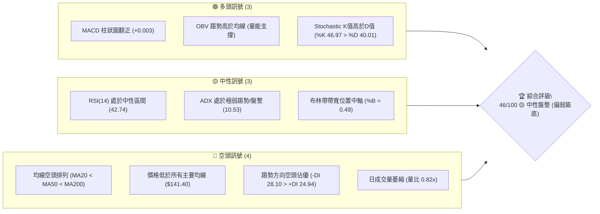
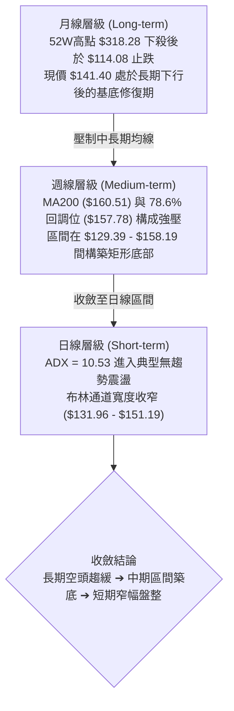
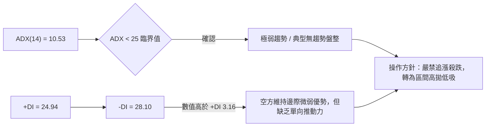
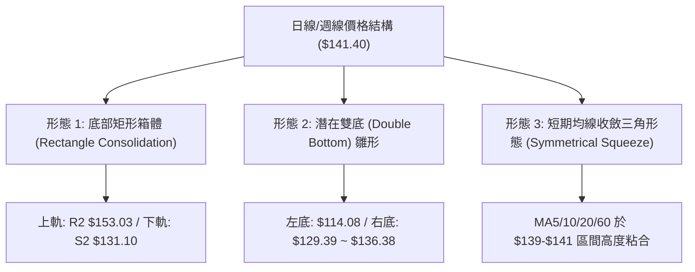
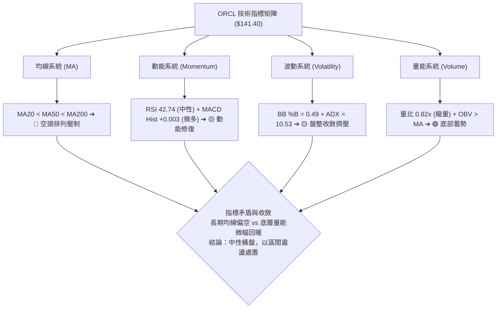
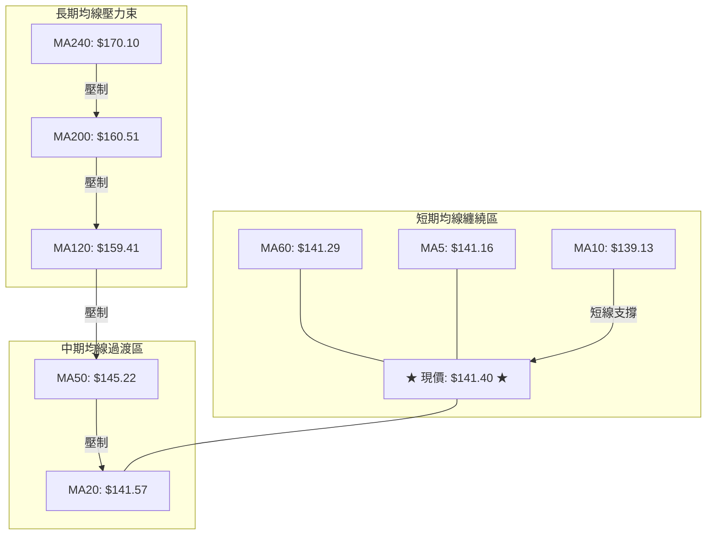
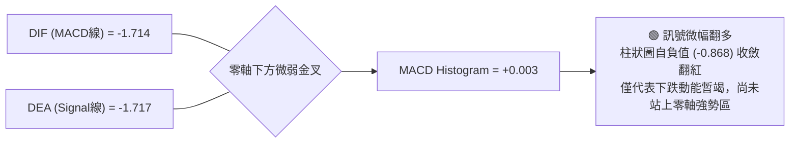
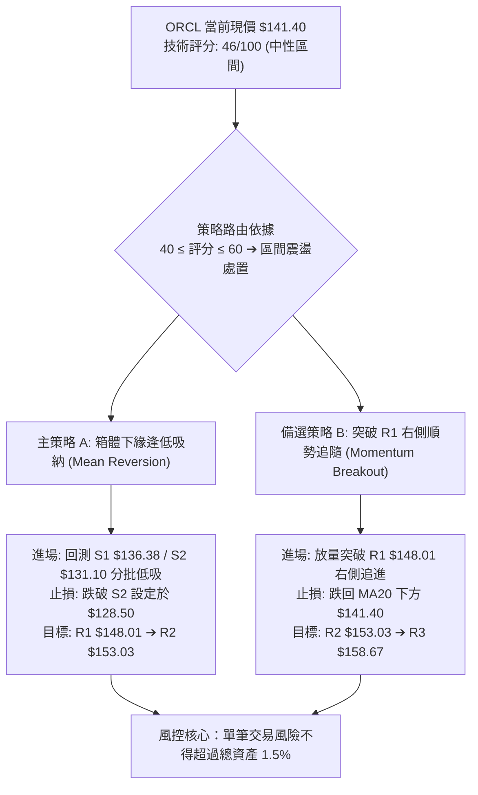
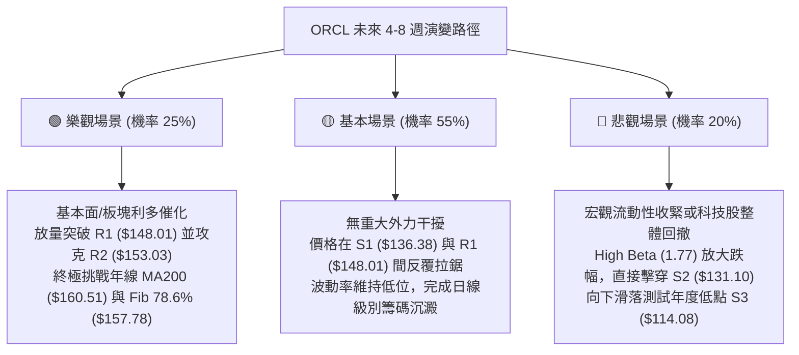

# ORCL 技術分析報告

> **報告日期**：2026-10-12 ｜ **語言**：繁體中文 ｜ **數據來源**：Yahoo Finance ｜ **當前價格**：$141.40

---

## 目錄

| 章節 | 內容 |
|------|------|
| [1. 技術面概覽](#1-技術面概覽) | 訊號儀表板、核心指標、評分卡 |
| [2. 趨勢分析](#2-趨勢分析) | 多時框趨勢、長中短期走勢、ADX解讀 |
| [3. 圖表形態分析](#3-圖表形態分析) | 形態識別、K線組合、形態目標價 |
| [4. 支撐與阻力](#4-支撐與阻力) | 關鍵價位、斐波那契回調結構 |
| [5. 技術指標深度解讀](#5-技術指標深度解讀) | MA/RSI/MACD/布林/成交量量價關係 |
| [6. 動能與波動率](#6-動能與波動率) | 動能象限、ATR波動度、Beta敏銳度 |
| [7. 多時框架總結](#7-多時框架總結) | 時框架評分矩陣、收斂規則與結論 |
| [8. 交易策略建議](#8-交易策略建議) | 策略路由、價格情境、主策略風報比 |
| [9. 風險提示與監控](#9-風險提示與監控) | 監控清單、情境分析、資金控管 |
| [📋 報告總結](#-報告總結) | 核心結論與最優策略總結 |

---

## 1. 技術面概覽

### 🎯 技術訊號儀表板



### 📊 核心指標速覽表

| 指標類別 | 指標名稱 | 當前數值 | 訊號 | 解讀 |
|----------|----------|----------|------|------|
| **價格** | 當前收盤價 | $141.40 | 🟡 | 位於52週區間13.4%低檔，短線尋求底部支撐 |
| **均線** | MA20 (短均) | $141.57 | 🔴 | 現價略低於MA20 (-$0.17)，短線爭奪中軌 |
| **均線** | MA50 (中均) | $145.22 | 🔴 | 現價低於MA50 (-2.63%)，中期反彈壓制明顯 |
| **均線** | MA200 (長均) | $160.51 | 🔴 | 現價低於年線 (-11.91%)，長期趨勢受壓 |
| **動能** | RSI(14) | 42.74 | 🟡 | 位於40-50中性格局，無超買超賣，動能平淡 |
| **動能** | MACD (12,26,9) | -1.714 / -1.717 | 🟢 | MACD微幅上穿Signal線，柱狀圖轉正(+0.003)微弱看多 |
| **動能** | 隨機指標 %K/%D | 46.97 / 40.01 | 🟢 | %K自低檔穿越%D向上，具備微弱低檔反彈意向 |
| **趨勢** | ADX (14) | 10.53 | 🟡 | 數值遠低於25，代表無單向趨勢，行情陷入箱體盤整 |
| **通道** | 布林通道 | $131.96 - $151.19 | 🟡 | 現價緊貼中軌($141.57)，%B=0.49，波動收斂中 |
| **量能** | 成交量 / 20日均量 | 25.50M / 30.93M | 🔴 | 量比0.82x，買盤追價意願不足，呈現觀望格局 |
| **量能** | OBV 指標 | OBV > MA | 🟢 | 量能底背離向上，資金在低檔具備防守承接跡象 |
| **波動** | ATR(14) | $6.12 (4.33%) | 🟡 | 日內波幅溫和，提供明確的止損保護緩衝寬度 |

### 🏆 技術評分卡

```
╔══════════════════════════════════════════════════════════════╗
║                 技術評分卡 — ORCL (2026-10-12)               ║
╠══════════════════════════════════════════════════════════════╣
║ 趨勢強度 (Trend)     ███████░░░░░░░░░░░░░  35/100  🔴 空頭壓制║
║ 動能指標 (Momentum)  ██████████░░░░░░░░░░  50/100  🟡 中性平緩║
║ 支撐穩定度 (Support) ████████████░░░░░░░░  60/100  🟢 區間防守║
║ 成交量配合 (Volume)  ██████████░░░░░░░░░░  48/100  🟡 縮量觀望║
║ 形態完整度 (Pattern) █████████░░░░░░░░░░░  45/100  🟡 箱體初現║
║ 均線架構 (Moving Avg)██████░░░░░░░░░░░░░░  38/100  🔴 空頭排列║
╠══════════════════════════════════════════════════════════════╣
║ 綜合技術評分         █████████░░░░░░░░░░░  46/100  🟡 中性盤整║
╚══════════════════════════════════════════════════════════════╝
```

---

## 2. 趨勢分析

### 🌐 多時框趨勢分析



### 📈 長期趨勢 — 12個月走勢圖（Unicode）

```
ORCL 月線收盤走勢圖（過去12個月：2025-11 至 2026-10）
價格軸 ($)
$240 ┤                          
$220 ┤                      ● (2026-05: $224.17)
$200 ┤  ● (2025-11: $199.28)  
$180 ┤    ●                  
$160 ┤      ●         ●        
$140 ┤        ●──●        ●──●──●  ●←現價 $141.40
$120 ┤                      ● (2026-07: $129.39)
     └────────────────────────────────────────────►
       11  12  01  02  03  04  05  06  07  08  09  10 (月份)
```

#### 走勢特徵分析表格

| 階段區間 | 起止價位 | 累計漲跌 | 量價與趨勢特徵 | 技術含義 |
|----------|----------|----------|----------------|----------|
| **第1階段：下行尋底**<br>(2025-11 ~ 2026-02) | $199.28 → $143.86 | -27.81% | 連續4個月下行，跌破MA120與MA200，賣壓集中釋放 | 長期上升波段宣告終結，轉入中期空頭走勢 |
| **第2階段：強勢反抽**<br>(2026-02 ~ 2026-05) | $143.86 → $224.17 | +55.83% | 月線級別巨幅反彈，週成交量高達91.4M，遭遇強壓衝高回落 | 形成次級高點($224.17)，多頭能量過度消耗形成假突破 |
| **第3階段：崩跌洗盤**<br>(2026-05 ~ 2026-07) | $224.17 → $129.39 | -42.28% | 週量放大至252.5M（2026-07-19週），快速打落至52W低點$114.08上方 | 恐慌盤湧現，但低檔出現大量承接，完成流動性出清 |
| **第4階段：低檔橫盤**<br>(2026-07 ~ 2026-10) | $129.39 → $141.40 | +9.28% | 連續3個月在$136.38 - $148.57區間窄幅震盪，成交量萎縮 | 拋壓枯竭，指標進入低波動平緩期，構築矩形底部基座 |

### 📊 中期趨勢（週線分析）

中期走勢聚焦於近20週的價量與指標變化：
- **量能結構**：在2026-07-19見低點時，週成交量暴增至 252,579,100 股，隨後於2026-07-26週收在 $114.57 附近並回升。此巨量換手標誌著中級賣壓竭盡。
- **反彈高點受限**：2026-09-06週反彈至 $158.19，剛好受阻於斐波那契78.6%位（$157.78）及阻力位R3（$158.67），隨後回落至 $136.59（2026-09-27週）。
- **當前位置**：最近三週收盤價分別為 $136.59、$141.78、$141.40，價格緊貼 $141 軸心橫盤，週線MACD柱由負轉微正（+0.003），顯示中期下跌動能已完全停滯。

```
週線近期主要壓力與支撐架構：
$158.67 ────────────────────────────── 中期強壓力位 (R3 / Fib 78.6%)
$148.01 ────────────────────────────── 近端波段阻力 (R1 / 近期反彈頂)
$141.40 ══════════════════════════════ [現價震盪中軸]
$136.38 ────────────────────────────── 近端波段支撐 (S1 / 近期週線收盤低)
$131.10 ────────────────────────────── 中期強支撐位 (S2 / 布林下軌附近)
```

### ⚡ 趨勢強度評估（ADX 解讀）



#### ADX 趨勢強度對照表

| 指標變數 | 當前數值 | 門檻區間 | 趨勢判定 | 實戰策略意義 |
|----------|----------|----------|----------|--------------|
| **ADX** | 10.53 | < 20 (極弱) | 無趨勢 / 箱體震盪 | 趨勢跟隨指標失效，振盪器（Stoch/BB）效能最高 |
| **+DI** | 24.94 | 20 ~ 30 | 多頭進攻乏力 | 多方動能無法形成單邊突破波段 |
| **-DI** | 28.10 | 25 ~ 30 | 空頭略占上風 | 空方雖領先但無強烈下殺動能，僅為慣性壓制 |
| **DI差值** | -3.16 | 近乎持平 | 多空勢均力敵 | 價格極易在中軌附近反覆纏繞穿梭 |

---

## 3. 圖表形態分析

### 🔍 形態識別系統



#### 形態信心度與目標價評估

| 識別形態 | 信心度 | 判斷依據（引用數據） | 完成度 | 形態目標價推算（附精確計算式） |
|----------|--------|----------------------|--------|--------------------------------|
| **水平矩形震盪箱體** | 78% | 價格在近三個月收盤於 S2($131.10) 至 R2($153.03) 之間往返震盪，ADX=10.53 佐證 | 85% | **箱體高度** = $153.03 - $131.10 = $21.93<br>• **向上突破目標** = $153.03 + $21.93 = **$174.96**<br>• **向下跌破目標** = $131.10 - $21.93 = **$109.17** |
| **大級別雙底 (W底) 雛形** | 42% | 2026-07見52W低點 $114.08，9月底回測低點 $136.38 守住；但頸線 R3($158.67) 尚未突破 | 35% | *信號不足，僅做參考*。<br>**頸線高度** = $158.67 - $114.08 = $44.59<br>• **理論突破目標** = $158.67 + $44.59 = **$203.26** |
| **布林通道擠壓 (Squeeze)** | 82% | BB上軌 $151.19 與下軌 $131.96 帶寬收窄，%B=0.49，現價緊貼MA20($141.57) | 90% | 通道邊界界定短線波動極限：<br>• **上軌邊界** = **$151.19**<br>• **下軌邊界** = **$131.96** |

### 🕯️ 重要K線形態分析

| 週期/月份 | 收盤價 | K線形態特徵 | 量價解讀 | 訊號 |
|-----------|--------|-------------|----------|------|
| **2026-06** | $145.50 | 長黑實體大陰線 | 自 $224.17 斷崖式跳水，跌破所有均線支撐，放量下瀉 | 🔴 極度空頭 |
| **2026-07** | $129.39 | 長下影錘頭十字線 | 觸及 52W 低點 $114.08 後爆出單週 252.5M 巨量反彈，出現主力承接盤 | 🟢 止跌企穩 |
| **2026-08** | $148.57 | 中陽線反彈吞噬 | 收盤回升至 $148.57，週線 RSI 自 11.1 極端超賣拉回至 70+ 水平 | 🟢 報復性反彈 |
| **2026-09** | $136.79 | 回踩小陰線 | 上攻 R3($158.67) 未果，回測 S1($136.38) 支撐，量能收縮至 156M | 🟡 二次探底確認 |
| **2026-10 (當前)** | $141.40 | 窄幅孕線 (Inside Bar) | 當前在 $141 窄幅整理，波動率大幅收縮，等待均線抉擇 | 🟡 蓄勢待變 |

### 📉 ASCII 走勢形態示意圖

```
ORCL 日/週線底部矩形箱體與均線粘合結構示意圖
價格 ($)
$158.67 ┤─────────────────────────────── 中期強阻力 R3 (頸線位)
$153.03 ┤┌─────────────────────────────┐ 箱體頂部 R2
$148.01 ┤│               ▲             │ 近端阻力 R1
        ││              ╱ ╲            │
$141.57 ┤┼──────●───────●───●──────────┼ BB中軌 / MA20 (現價 $141.40)
        ││     ╱ ╲     ╱     ╲         │
$136.38 ┤│    ●   ●───●       ●        │ 近端支撐 S1
$131.10 ┤└─────────────────────────────┘ 箱體底部 S2
$114.08 ┤═══════════════════════════════ 52週極限低點 S3 (左底基座)
         ─────────────────────────────► 時間維度
```

### 🎯 形態目標價計算

根據高置信度（78%）的「水平矩形震盪箱體」計算邊界與突破測算：
1. **箱體上限（Resistance Pivot）**：引用關鍵阻力 R2 = **$153.03**
2. **箱體下限（Support Pivot）**：引用關鍵支撐 S2 = **$131.10**
3. **箱體垂直跨度（Pattern Height, H）**：
   $$H = 153.03 - 131.10 = 21.93$$
4. **向上突破滿足點（Bullish Target）**：
   $$\text{Target}_{\text{Bull}} = R2 + H = 153.03 + 21.93 = \$174.96$$
   *(該目標價略高於 MA240 $170.10，符合強多頭修復滿足位)*
5. **向下跌破滿足點（Bearish Target）**：
   $$\text{Target}_{\text{Bear}} = S2 - H = 131.10 - 21.93 = \$109.17$$
   *(該目標價貼近華爾街分析師最低預期 $110.00 及 52W 低點 $114.08 破位區間)*

---

## 4. 支撐與阻力

### 🗺️ 關鍵價位分布圖（Unicode）

```
ORCL 價位結構分布圖（技術數據精確對齊）
═════════════════════════════════════════════════════════════════
$170.10 ║██████████████████████████████║ 超長期均線壓制 MA240
$160.51 ║████████████████████████████  ║ 長期年線阻力 MA200
$158.67 ║████████████████████████      ║ 強阻力 R3 (波段高點/Fib 78.6% $157.78)
$153.03 ║██████████████████            ║ 阻力 R2 (箱體上緣)
$151.19 ║██████████████                ║ 布林通道上軌
$148.01 ║████████████                  ║ 關鍵阻力 R1 (+4.67%)
════════╬══════════════════════════════╬ ◄ 當前市價 $141.40 (BB中軌 $141.57)
$136.38 ║▓▓▓▓▓▓▓▓▓▓                    ║ 近期支撐 S1 (-3.55%)
$131.96 ║▓▓▓▓▓▓▓▓▓▓▓▓▓▓                ║ 布林通道下軌
$131.10 ║▓▓▓▓▓▓▓▓▓▓▓▓▓▓▓▓              ║ 強支撐 S2 (-7.29% / 箱體下緣)
$114.08 ║██████████████████████████████║ 核心底線 S3 (-19.32% / 52W Low)
═════════════════════════════════════════════════════════════════
```

### 🚧 阻力位分析表

所有數值均嚴格依據 OHLCV 波段高點聚類提取：

| 阻力級別 | 精確價位 | 距現價空間 | 形成技術原因 | 突破難度 | 重要性權重 |
|----------|----------|------------|--------------|----------|------------|
| **R1** | **$148.01** | +4.67% | 近期多次衝高遇阻點、MA50 ($145.22) 上方緩衝區、9月高點回撤頸線 | 🟡 中等 (需日量>30M配合) | ★★★☆☆ |
| **R2** | **$153.03** | +8.23% | 箱體震盪區間頂部、布林上軌 ($151.19) 動態壓制區 | 🔴 較高 (密集套牢盤壓制) | ★★★★☆ |
| **R3** | **$158.67** | +12.22% | 斐波那契 78.6% 回調位 ($157.78) 重疊區、MA120 ($159.41) 與 MA200 ($160.51) 密集共振阻力帶 | 🔴 極高 (長期趨勢多空分水嶺) | ★★★★★ |

### 🛡️ 支撐位分析表

所有數值均嚴格依據 OHLCV 波段低點聚類提取：

| 支撐級別 | 精確價位 | 距現價空間 | 形成技術原因 | 守住機率 | 重要性權重 |
|----------|----------|------------|--------------|----------|------------|
| **S1** | **$136.38** | -3.55% | 2026年9月最後一週收盤回測低點、短期上升趨勢防守點 | 🟢 70% (短期震盪下邊界) | ★★★☆☆ |
| **S2** | **$131.10** | -7.29% | 2026年7月收盤基座 ($129.39) 共振區、布林下軌 ($131.96) 護城河 | 🟢 85% (中期矩形強支撐) | ★★★★☆ |
| **S3** | **$114.08** | -19.32% | 52週絕對最低價 (2026-07-26週觸底 $114.57 形成)、爆出 2.52 億股天量的歷史換手底座 | 🟢 95% (年度生死防線) | ★★★★★ |

### 📐 斐波那契回調位分析

依據 52 週完整極端區間（高點 **$318.28** → 低點 **$114.08**，垂直落差 $204.20）計算：

| 斐波那契層級 | 精確價位 | 相對現價 ($141.40) 關係 | 技術層面意義解讀 |
|--------------|----------|-------------------------|------------------|
| **0.0% (52W High)** | **$318.28** | +125.09% | 歷史級別週期頂部，長期估值極限位 |
| **23.6%** | **$270.09** | +91.01% | 2025年9-10月高檔盤整平台 |
| **38.2%** | **$240.28** | +69.93% | 接近分析師目標均價 ($237.97)，中長線強反彈目標 |
| **50.0% (中位分水嶺)**| **$216.18** | +52.89% | 2026-05 反彈波段頂部 ($224.17) 所在區域 |
| **61.8% (黃金分割)** | **$192.08** | +35.84% | 2025年12月崩跌前最後整理平台 |
| **78.6% (深次回調)** | **$157.78** | +11.58% | **現價上方最強骨幹阻力**，與 R3 ($158.67) 完美重疊 |
| **100.0% (52W Low)**| **$114.08** | -19.32% | **年度最終防線**，跌破則打開未知的下行深淵 |

> **位置判定**：當前價格 **$141.40** 處於 **78.6% ($157.78)** 與 **100.0% ($114.08)** 之間的極深回撤底部區域（已回吐前期牛市漲幅逾 86%）。在此區間，空頭邊際動能顯著遞減，任何向上修復的第一道重大結構障礙均為 $157.78。

---

## 5. 技術指標深度解讀

### 🎛️ 指標訊號總覽



### 📈 移動平均線排列分析



#### 各期均線明細數據分析

| 均線名稱 | 數值 | 價格相對位置 | 日變動率 | 均線運行狀態與斜率解讀 |
|----------|------|--------------|----------|------------------------|
| **MA5** | $141.16 | +0.17% (上方) | +0.17% ▲ | 短線微幅走揚，提供極短線日內下影線支撐 |
| **MA10** | $139.13 | +1.63% (上方) | +1.63% ▲ | 短線抬角上行，構成 $139 附近的防守平台 |
| **MA20** | $141.57 | -0.12% (下方) | -0.12% ▼ | 走平微跌，與現價重疊，為布林通道中軌所在 |
| **MA50** | $145.22 | -2.63% (下方) | 下行中 ▼ | 中期重要阻力，反彈初級壓制點 |
| **MA60** | $141.29 | +0.08% (上方) | +0.08% ▲ | 與現價、MA5、MA20 形成多線匯聚「糾纏點」 |
| **MA120**| $159.41 | -11.30% (下方)| -11.30% ▼| 半年線持續下墜，構成中期反彈難以逾越的高牆 |
| **MA200**| $160.51 | -11.91% (下方)| 下行中 ▼ | 牛熊分界線，空頭排列格局核心特徵 |
| **MA240**| $170.10 | -16.87% (下方)| -16.87% ▼| 長期下行趨勢壓制線 |

> **均線系統總結**：超短期均線（MA5、MA10、MA60）在現價周圍出現向上拐頭與粘合，但大週期均線（MA50、MA120、MA200、MA240）呈現標準**空頭排列**。此結構表明：**當前無單邊上攻條件，向上反彈將隨時遭遇各層下沉均線的沉重解套拋壓。**

### 📉 RSI(14) 分析

- **當前 RSI(14) 數值**：**42.74**
- **強度進度條**：
  ```
  超賣 [0] ────────── [30] ────●───── [50] ────────── [70] ────────── [100] 超買
  RSI(14) = 42.74 : ▓▓▓▓▓▓▓▓▓▓▓▓▓▓▓▓█░░░░░░░░░░░░░░░░░░░░░░░░  (42.74%)
  ```
- **超買超賣判定**：數值位於 40–50 偏弱中性區間。既非超賣（<30），亦非超買（>70），反映市場自 2026 年 7 月份的恐慌拋售極值（週線 RSI 曾跌至 11.1）恢復後，動能進入冷卻與平靜期。
- **背離診斷**：
  - 價格在 9 月下旬低點 $136.59，高於 7 月低點 $114.08；
  - 當時日線/週線 RSI 自極低值顯著回升至 40 區間以上；
  - 但近兩週價格在 $141 橫盤，RSI 自 47.3 微跌至 42.74，**當前無顯著頂背離或底背離**，屬於典型的指標隨價格收斂特徵。

### 📊 MACD(12,26,9) 訊號解讀



- **絕對數值分析**：MACD (-1.714) 與 Signal (-1.717) 均深處於**零軸下方**，代表大背景仍處於空頭控盤市場。
- **交叉狀態**：MACD 線以極微弱優勢（+0.003）上穿 Signal 線，柱狀圖剛剛由負翻正。這表明近兩週在 $141 附近的橫盤已止住了先前下跌慣性，但因柱狀圖數值極小（僅 +0.003），隨時可能因微小波動再次打平，**不可視為單邊暴漲發起信號，僅能視為築底止跌信號**。

### 📦 布林通道分析

```
ORCL 布林通道（20日參數 / 2倍標準差）結構示意圖
價格 ($)
$151.19 ┤──────────────────────────────── 上軌 (Upper Band)
        │
$145.00 ┤
        │
$141.57 ┤──────────────────────────────── 中軌 (MA20)
$141.40 ┤  ● ◄ 現價 ($141.40, %B = 0.49)
        │
$135.00 ┤
        │
$131.96 ┤──────────────────────────────── 下軌 (Lower Band)
```

- **軌道邊界**：
  - 上軌：**$151.19**
  - 中軌（MA20）：**$141.57**
  - 下軌：**$131.96**
- **當前位置 %B 分析**：
  $$\%B = \frac{141.40 - 131.96}{151.19 - 131.96} = \frac{9.44}{19.23} = 0.49$$
  現價近乎完美錨定在布林通道的正正中點（%B=0.49，非常接近0.50）。
- **通道帶寬與形態**：帶寬（Bandwidth = $(151.19 - 131.96) / 141.57 = 13.58\%$）呈現收縮狀態，上下軌向中軌靠攏，顯示市場正在經歷典型的**波動率壓縮（Volatility Squeeze）**。在無新外力介入下，通道上下軌（$131.96 與 $151.19）將構成短期天然的震盪箱體上下界。

### 💹 成交量分析（量價配合度）

```
成交量對比柱狀圖 (股數)
最新量 (25.50M): ██████████████████░░░░░  (25,493,600)
20日均量 (30.93M): ██████████████████████  (30,926,185)  [量比: 0.82x]
50日均量 (29.45M): █████████████████████   (29,454,332)
```

- **量價配合診斷**：
  - 當前日成交量 25.50M，較 20 日均量萎縮約 18%（量比 0.82x）。在價格盤整時量能萎縮，屬於正常的「量縮整理」形態，顯示市場拋壓已大幅減輕。
- **OBV (能量潮指標) 走勢解讀**：
  - 技術數據顯示：`OBV趨勢: OBV > MA → 量能支撐上漲`。
  - 這是一個極關鍵的領先訊號：儘管近幾個月價格總體在低位徘徊，但 OBV 指標線運行在其均線之上，說明在下跌過程中並未出現恐慌性持續拋售，反而有聰明資金在低檔逐步進行吸收與換手。量能底背離為後續中長期的估值修復奠定了基礎。

---

## 6. 動能與波動率

### ⚡ 動能評估四象限

```
動能與波動率四象限矩陣分析：
          高動能 (Momentum)
                │
     Q3 (進攻)  │  Q1 (主升)
   高波動/強動能 │ 低波動/強動能
                │
────────────────┼──────────────── 高波動 (Volatility)
                │
     Q4 (高危)  │  Q2 (蓄勢盤整)  ◄── 【ORCL 當前所處位置】
   高波動/弱動能 │ 低波動/弱動能
                │
          低動能 (Momentum)
```

#### 動能評估四象限定位表

| 象限 | 動能狀態 | 波動率狀態 | 當前匹配 | 特徵與策略應對方針 |
|------|----------|------------|----------|--------------------|
| **Q1** | 強動能 | 低波動 | — | 穩定單邊趨勢，最佳加碼與順勢持股環境 |
| **Q2** | **弱動能** | **低波動** | **✓ (ORCL)** | **ADX=10.53 + ATR=$6.12 + 布林收縮。市場成交意願低，觀望氣氛濃，適合網格交易或耐心等待突破** |
| **Q3** | 強動能 | 高波動 | — | 突破噴發期，高風險高收益，需嚴設移動止損 |
| **Q4** | 弱動能 | 高波動 | — | 恐慌崩跌或洗盤期，極易雙向被巴，應嚴格空倉防禦 |

### 📊 ATR 波動率分析

- **ATR(14) 絕對值**：**$6.12**
- **波動百分比**：**4.33%** of price ($141.40)
- **ATR 應用與止損空間設置建議**：
  由於 ORCL 目前日內平均震盪幅度達 $6.12，任何過於緊密的止損（如 < $3.00）極易被日常隨機雜訊掃出場。必須依據 ATR 乘數設定科學風控：
  - **極短線日內噪音緩衝（1.0x ATR）**：$6.12 空間
  - **波段交易標準止損（1.5x ATR）**：$6.12 × 1.5 = **$9.18**
  - **防守型寬幅止損（2.0x ATR）**：$6.12 × 2.0 = **$12.24**

### 📐 Beta 與市場相關性

- **Beta 係數**：**1.77**（高敏感度成長/科技股特徵）
- **市場敏感度解讀**：
  - ORCL 的 Beta 高達 1.77，表示其相較標普500指數（S&P 500）具有 77% 的超額波動放大效應。
  - 當大盤科技板塊（如 QQQ、XLK）上漲 1% 時，ORCL 理論上具備上漲 1.77% 的彈性；反之，若大盤面臨流動性收緊或回檔，ORCL 的下殺動能亦將放大。
  - 當前 ORCL 自身技術面處於低波動蓄勢期（ADX=10.53），高 Beta 意味著一旦宏觀外力或板塊趨勢發動，ORCL 極易打破低波動平衡，演變為劇烈的單邊脈衝行情。

---

## 7. 多時框架總結

### 📋 時框架評分表

| 時框架 | 趨勢方向 | 動能狀態 | 均線排列 | 形態特徵 | 綜合評分 | 操作指導建議 |
|--------|----------|----------|----------|----------|----------|--------------|
| **月線層級** (長期) | 🔴 下行修復 | 🟡 跌勢止住 | 🔴 空頭排列 (低於MA200) | 52W區間13.4%低檔長線築底 | 40/100 | 長期投資者僅適合定投分批，不宜重倉 |
| **週線層級** (中期) | 🟡 寬幅箱體 | 🟢 柱狀翻紅 | 🔴 MA50下方震盪 | 矩形橫盤 ($131.10 - $153.03) | 50/100 | 箱體邊緣操作，近下軌低吸、近上軌減碼 |
| **日線層級** (短期) | 🟡 窄幅收斂 | 🟡 中性平緩 | 🟡 短均粘合纏繞 | 布林通道擠壓 (%B=0.49) | 48/100 | 嚴格防守 $136.38，上望 $148.01 阻力 |

### 🔲 綜合訊號矩陣

```
ORCL 多維度訊號交叉驗證矩陣：
┌─────────────────┬──────────┬──────────┬──────────┬──────────────┐
│ 技術維度         │ 看多 (Bull)│ 中性(Range)│ 看空 (Bear)│ 最終維度收斂   │
├─────────────────┼──────────┼──────────┼──────────┼──────────────┤
│ 均線系統 (Trend) │          │          │    ●     │ 🔴 壓制主導  │
│ 震盪指標 (Osc)   │          │    ●     │          │ 🟡 中性平衡  │
│ 趨勢強度 (ADX)   │          │    ●     │          │ 🟡 盤整無方向│
│ 通道邊界 (BB)    │          │    ●     │          │ 🟡 軌道限制  │
│ 成交動能 (Volume)│    ●     │          │          │ 🟢 底部背離  │
│ 形態幾何 (Chart) │          │    ●     │          │ 🟡 箱體拘束  │
└─────────────────┴──────────┴──────────┴──────────┴──────────────┘
```

### ⚖️ 多時框收斂結論

> **依「多時框收斂規則」判定：**
> 1. **趨勢/盤整判定**：當前日線 **ADX(14) = 10.53**，遠低於臨界門檻 25，明確判定當前為**典型盤整行情（Non-Trending / Ranging Regime）**。
> 2. **主導維度取捨**：依規則，盤整行情中中長期的趨勢追隨均線失效，**日線布林通道上下軌（$131.96 - $151.19）及波段聚類支撐阻力（S2 $131.10 - R2 $153.03）成為支配市場定價的最高優先級**。
> 3. **唯一方向性結論**：**中性區間震盪（Neutral Range-Bound）**。
>    市場短期既缺乏向下擊穿 S2 ($131.10) 的賣壓（OBV 底背離且量能縮至 0.82x），亦缺乏直接逆轉向上攻克 MA200 ($160.51) 的推動力。策略上必須放棄單邊突破幻想，以**箱體內部的邊界高拋低吸與等待突破確認**為核心方針。

---

## 8. 交易策略建議

### 🗺️ 策略決策流程圖



### 🧭 策略路由（依評分卡分流）

**當前主策略方向 = 中性區間震盪操作（依綜合評分 46/100）**
- 因綜合技術評分落於 40–60 分之內，嚴禁單向強烈下注單邊多空。
- 策略核心為：**在布林帶與波段箱體下軌尋找多頭勝率邊際，在箱體上軌果斷獲利了結；嚴格設立跌破 S2 的硬止損。**

### 🎯 價格情境階梯（Price Scenarios）

價位完全嚴格引用數據中計算確認之阻力與支撐值：

| 觸發條件 | 目標位階 1 | 目標位階 2 | 情境技術含義與應對 |
|----------|------------|------------|--------------------|
| **向上放量突破 R1 ($148.01)** | R2: **$153.03** | R3: **$158.67** | 短線擺脫均線糾纏，挑戰箱體頂部，順勢加碼多單 |
| **維持於現價 ($141.40) 震盪** | BB上軌: **$151.19**| BB下軌: **$131.96**| 均線持續壓縮，維持中性網格操作，高拋低吸 |
| **向下跌破 S1 ($136.38)** | S2: **$131.10** | S3: **$114.08** | 短線轉弱，測試箱體底座；若破 S2 則全面停損並轉為防禦 |

### 📊 情境機率分佈

| 運行情境 | 評估機率 | 主要技術依據 |
|----------|----------|--------------|
| **情境一：區間震盪整理** | **55%** | ADX=10.53 極度低迷、布林帶寬收窄、均線高度纏繞糾結，無宏觀催化劑下慣性橫盤 |
| **情境二：向上反彈修復** | **25%** | OBV > MA 量能底背離、MACD 柱轉正 (+0.003)、分析師目標均價 $237.97 具備長線安全邊際 |
| **情境三：向下破位探底** | **20%** | 大週期均線 (MA200 $160.51) 空頭排列、-DI (28.10) 仍壓制 +DI (24.94)，市場情緒脆弱 |

### 🟢 主策略詳情（方向：區間操作與突破應對）

所有點位嚴格依據 ATR($6.12) 與已確認之支撐/阻力數據精密計算：

| 策略要素 | 策略 A：箱體下緣低吸（主策略） | 策略 B：突破 R1 右側追隨（次選） |
|----------|--------------------------------|----------------------------------|
| **策略類型** | 均值回歸（逢低承接） | 動量突破（右側順勢） |
| **進場條件** | 價格回測 S1 企穩，或於 $136.38 - $138.00 區間縮量收十字星 | 日K線實體收盤價突破 R1 ($148.01)，且日成交量 > 31M (放大) |
| **進場價格** | **$136.38** (支撐 S1 處) | **$148.01** (突破 R1 後回踩確認) |
| **目標價 T1** | **$148.01** (阻力 R1，獲利空間 +8.53%) | **$153.03** (阻力 R2，獲利空間 +3.39%) |
| **目標價 T2** | **$153.03** (阻力 R2，獲利空間 +12.21%)| **$158.67** (阻力 R3，獲利空間 +7.20%) |
| **止損價格** | **$131.10** (跌破強支撐 S2 出局，約 0.86x ATR) | **$141.57** (跌破 MA20/布林中軌出局，約 1.05x ATR) |
| **止損空間** | -$5.28 (-3.87%) | -$6.44 (-4.35%) |
| **風險報酬比** | **2.20 : 1** (以T1計算) / **3.15 : 1** (以T2計算) | **1.65 : 1** (以T2計算) |
| **預估勝率** | 60% | 45% |
| **建議倉位** | **15% ~ 20%** (分批建倉) | **10%** (輕倉試單) |

### 🔴 反向風險觸發點（對沖與風控提示）

若發生下列技術破位事件，將**徹底推翻**上述做多與區間低吸邏輯，必須無條件執行風控：
1. **硬止損觸發點**：日線收盤價**跌破 S2 ($131.10)**。此意味著箱體震盪失敗，空頭單邊波段重啟，後續將直接考驗 S3 ($114.08) 甚至形態推算目標價 $109.17。此時多頭必須全數止損離場。
2. **動能惡化觸發點**：-DI 向上衝破 35，且 ADX 拐頭超越 25，伴隨日成交量大於 40M 之長黑陰線。
3. **空頭對沖建議**：一旦跌破 $131.10，激進交易者可反手建立空頭部位，目標下看 S3 ($114.08)，止損設於 $136.38（原支撐轉壓力位）。

### ⭐ 整體訊號強度評星

```
做多訊號強度：★★☆☆☆  (2.5/5星 — 僅限底部支撐低吸，缺乏單邊動能)
做空訊號強度：★★☆☆☆  (2.5/5星 — 長期雖空，但低檔賣壓耗竭且有量能背離)
整體可信度：  ★★★★☆  (4.0/5星 — 數據結構清晰，箱體邊界界定極其明確)
```

---

## 9. 風險提示與監控

### ✅ 關鍵監控指標 Checklist

```
╔══════════════════════════════════════════════════════════════╗
║               ORCL 每日關鍵技術風控監控清單                  ║
╠══════════════════════════════════════════════════════════════╣
║ [ ] 價格防守線：收盤價是否跌破支撐 S1 ($136.38)？            ║
║ [ ] 終極生命線：收盤價是否失守強支撐 S2 ($131.10)？          ║
║ [ ] 動能突破點：MACD柱狀圖能否持續擴大於零軸上方 (>+0.05)？  ║
║ [ ] 均線挑戰位：能否放量實體站穩 MA50 ($145.22)？            ║
║ [ ] 趨勢警報器：ADX(14) 是否自 10.53 抬頭並突破 25？         ║
║ [ ] 量能異動度：日成交量是否異常放大至 45M 以上（異動換手）？║
║ [ ] 通道極限值：價格是否觸及布林上下軌 ($131.96 / $151.19)？  ║
╚══════════════════════════════════════════════════════════════╝
```

### ⚠️ 風險場景分析



### 🛡️ 風險管理重要提醒

1. **基本面財務槓桿的潛在技術傳導**：
   - 數據顯示 ORCL 負債權益比（Debt/Equity）達 251.72，自由現金流（FCF Yield）為 -10.70%（FCF 為 -$45.85B），淨負債達 -$132.07B。此類高槓桿資產對利率環境極度敏感。
   - 若市場利率預期出現波動，高 Beta (1.77) 特性將迅速在技術圖表上引發價格劇烈波動，因此**萬不可因當前 ADX=10.53 處於低波動期而放鬆風控警惕**。
2. **倉位管理紀律**：
   - 在均線系統未完成黃金交叉（MA20 上穿 MA50）之前，任何操作均定義為「防禦型試探倉」，總持倉上限嚴格控制在總投資組合之 **15% - 20%** 以內。
   - 採用分批建倉原則，在 S1 ($136.38) 布局 1/2，若回測 S2 ($131.10) 守住再補 1/2，嚴禁一次性市價單滿倉進場。

---

## 📋 報告總結

```
╔══════════════════════════════════════════════════════════════════╗
║                    ORCL 技術分析報告總結                         ║
╠══════════════════════════════════════════════════════════════════╣
║ 報告日期：2026-10-12            當前價格：$141.40                ║
║ 技術評級：46/100 🟡 中性盤整（低波動蓄勢築底）                   ║
║                                                                  ║
║ 關鍵結論：                                                       ║
║ ├─ 長期趨勢：🔴 弱勢修復（價格遠處於年線 MA200 $160.51 下方）    ║
║ ├─ 中期趨勢：🟡 箱體築底（受拘束於 $131.10 至 $153.03 區間）    ║
║ ├─ 短期趨勢：🟡 均線收斂（ADX 10.53 進入極弱波動整理）          ║
║ ├─ 關鍵支撐：S1: $136.38  ｜  S2: $131.10  ｜  S3: $114.08      ║
║ ├─ 關鍵阻力：R1: $148.01  ｜  R2: $153.03  ｜  R3: $158.67      ║
║ └─ 機構共識：買入 (41位分析師，平均目標價 $237.97)              ║
║                                                                  ║
║ 最優策略組合：                                                   ║
║ 1. 🥇 最佳機會：箱體下緣低吸（於 S1 $136.38 逢低布局，止損設於   ║
║                 S2 $131.10，目標上看 R1 $148.01，風報比 2.2:1）  ║
║ 2. 🥈 次選機會：右側突破追隨（等待帶量突破 R1 $148.01 追進，     ║
║                 停損設於中軌 $141.57，目標看 R2 $153.03）        ║
║ 3. 🥉 保守選擇：空倉觀望（等待 ADX > 25 且明確突破箱體後再行介入）║
╚══════════════════════════════════════════════════════════════════╝
```

---

> ⚠️ **免責聲明**：本報告為技術分析專題研究成果，所有數據、圖表及推算均基於歷史量價數據與量化指標。本報告**僅供研究與學術參考**，**不構成任何要約、招攬或具體投資建議**。市場有風險，交易需依個人風險承受能力嚴格執行風控。

---

*報告生成時間：2026-10-12 ｜ 數據來源：Yahoo Finance ｜ 分析框架：多時框技術分析體系*