# ORCL 技術分析報告

> **報告日期**：2026-10-15 ｜ **語言**：繁體中文 ｜ **數據來源**：Yahoo Finance ｜ **當前價格**：$130.55

---

## 目錄

| 章節 | 內容 |
|------|------|
| [1. 技術面概覽](#1-技術面概覽) | 訊號儀表板、核心指標、評分卡 |
| [2. 趨勢分析](#2-趨勢分析) | 多時框趨勢、長中短期走勢 |
| [3. 圖表形態分析](#3-圖表形態分析) | 形態識別、K線組合、目標價 |
| [4. 支撐與阻力](#4-支撐與阻力) | 關鍵價位、斐波那契回調 |
| [5. 技術指標深度解讀](#5-技術指標深度解讀) | MA/RSI/MACD/布林/成交量 |
| [6. 動能與波動率](#6-動能與波動率) | 動能評估、ATR、Beta |
| [7. 多時框架總結](#7-多時框架總結) | 時框架評分矩陣 |
| [8. 交易策略建議](#8-交易策略建議) | 多空策略、風險報酬比 |
| [9. 風險提示與監控](#9-風險提示與監控) | 監控指標、風險場景 |
| [📋 報告總結](#-報告總結) | 核心技術結論與策略架構 |

---

## 1. 技術面概覽

### 🎯 技術訊號儀表板

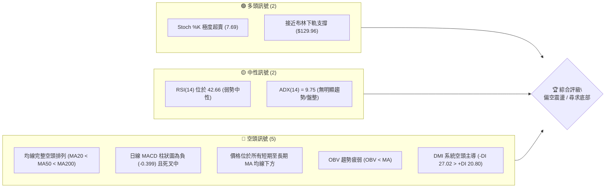

### 📊 核心指標速覽表

| 指標類別 | 指標名稱 | 當前數值 | 訊號 | 解讀 |
|----------|----------|----------|------|------|
| **價格** | 當前收盤價 | $130.55 | 🔴 | 位於 52 週區間底部 8.1% 分位，承壓顯著 |
| **均線** | MA20 | $140.79 | 🔴 | 價格在 MA20 下方 -7.28%，短期下行趨勢壓制 |
| **均線** | MA50 | $145.12 | 🔴 | 價格在 MA50 下方 -10.04%，中期趨勢走弱 |
| **均線** | MA200 | $159.66 | 🔴 | 價格在 MA200 下方 -18.23%，長期走勢轉為空頭防守 |
| **動能** | RSI(14) | 42.66 | 🟡 | 位於弱勢中性區間（30-70），未達極端超賣，無顯著背離 |
| **動能** | MACD (12,26,9) | -2.193 / -1.794 | 🔴 | 雙線位於零軸下方且 Hist 為 -0.399，空頭動能仍佔優 |
| **動能** | 隨機指標 %K / %D | 7.69 / 41.26 | 🟢 | %K 進入極度超賣區（<20），短線存在技術性反抽動能 |
| **趨勢** | ADX (14) | 9.75 | 🟡 | 數值低於 25，顯示當前處於無趨勢的寬幅震盪築底階段 |
| **趨勢** | 方向指標 DMI | +DI: 20.80 / -DI: 27.02 | 🔴 | -DI 大於 +DI，空方力量相對主導 |
| **通道** | 布林帶 (%B) | 0.03 (帶寬: $129.96 - $151.63) | 🟢 | 股價緊貼下軌（$129.96），處於通道極限超賣臨界點 |
| **量能** | 當日成交量 | 52,007,900 | 🟡 | 量比達 1.70x（對比20日均量 30,517,400），空方放量下探 |
| **量能** | OBV | OBV < MA | 🔴 | 資金量能持續外流，量能未對價格形成底背離支撐 |
| **波動** | ATR(14) | $6.60 | 🟡 | 日波動率為 5.05%，波動中等偏高，進出場需注意滑點 |

### 🏆 技術評分卡

```
技術評分卡 — ORCL (2026-10-15)
════════════════════════════════════════════════════
趨勢強度      ████░░░░░░░░░░░░░░░░  20/100  🔴 極弱 (空頭排列，ADX<25)
動能指標      ███████░░░░░░░░░░░░░  35/100  🔴 疲軟 (MACD負值，Stoch超賣)
支撐穩定度    ████████░░░░░░░░░░░░  40/100  🟡 考驗 ($129.96 / $114.08)
成交量配合    ██████░░░░░░░░░░░░░░  30/100  🔴 價跌量增 (OBV低於均線)
形態完整度    ████████░░░░░░░░░░░░  40/100  🟡 弱勢箱體整理 (尋求雙底)
均線排列      ██░░░░░░░░░░░░░░░░░░  10/100  🔴 嚴格空頭排列 (全線失守)
════════════════════════════════════════════════════
綜合評分      ██████░░░░░░░░░░░░░░  29/100  🔴 偏空震盪（防禦型策略）
════════════════════════════════════════════════════
```

---

## 2. 趨勢分析

### 🌐 多時框趨勢分析

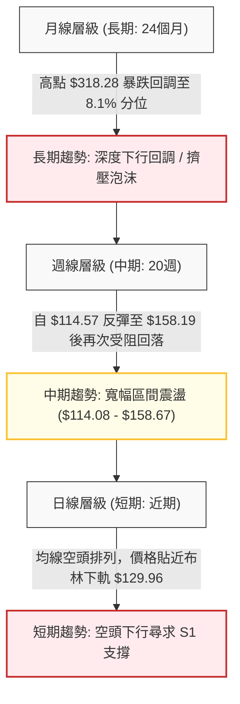

### 📈 長期趨勢 — 12個月走勢圖（Unicode）

以下為 ORCL 過去 12 個月（2025-11 至 2026-10）的價格軌跡 ASCII 圖表，反映出自高位回落至底部震盪的完整歷程：

```
ORCL 月線走勢圖（過去12個月：2025-11 至 2026-10）
價格軸 ($)
$260 ┤
$240 ┤
$220 ┤                             ● (2026-05: $224.17 反彈頂部)
$200 ┤ ● (2025-11: $199.28)
$180 ┤    ● (2025-12: $192.34)
$160 ┤       ● (2026-01: $162.84)    ● (2026-04: $160.24)
$140 ┤          ● (2026-02: $143.86)       ● (2026-06: $145.50)  ● (2026-08: $148.57)
$130 ┤             ● (2026-03: $145.55)       ● (2026-07: $129.39)  ● (2026-09: $136.79) 
$120 ┤                                                                      ● 現價: $130.55
$110 ┤                                             ● (52W最低: $114.08)
     └─┬────┬────┬────┬────┬────┬────┬────┬────┬────┬────┬────
     11月 12月 01月 02月 03月 04月 05月 06月 07月 08月 09月 10月
     (2025)                      (2026)
```

**走勢特徵分析表格**：

| 階段區間 | 時間跨度 | 起止價格 | 區間漲跌幅 | 主要技術特徵與成交量解讀 |
|----------|----------|----------|------------|--------------------------|
| **高位崩跌** | 2025-11 ~ 2026-02 | $199.28 → $143.86 | -27.81% | 連續4個月大陰線下殺，長週期多頭防線全面瓦解 |
| **築底試探** | 2026-02 ~ 2026-04 | $143.86 → $160.24 | +11.39% | 於 $140 附近出現抵抗型買盤，成交量維持常態 |
| **假突破反彈**| 2026-04 ~ 2026-05 | $160.24 → $224.17 | +39.90% | 強力軋空行情，但未獲後續量能確認，形成倒V型反轉頂部 |
| **二次探底** | 2026-05 ~ 2026-07 | $224.17 → $129.39 | -42.28% | 暴力殺跌打出 52 週最低點 $114.08（週線級別），市場極度恐慌 |
| **底部箱體** | 2026-08 ~ 2026-10 | $148.57 → $130.55 | -12.13% | 於 $130 - $158 區間沉澱，均線糾結下壓，成交動能收縮 |

### 📊 中期趨勢（週線分析）

從近 20 週的收盤數據可見，ORCL 在 2026-07-26 創下波段低點收盤 $114.57（盤中最低 $114.08）後，展開了長達 6 週的強勁反彈，於 2026-09-06 觸及 $158.19（對應阻力位 R3 $158.67 附近）。隨後，反彈遭遇阻力回落，連續 4 週陰跌走低，跌至 2026-10-18 的 $130.55。

週線指標演變：
- 週線 RSI 自 2026-08-16 的高點 74.6（超買）迅速下滑至當前的 42.7（中性偏弱）。
- 週線 MACD 柱狀圖由 2026-08-09 的 +4.810 萎縮至當前的 -0.399，顯示中期多頭反彈動能已完全衰竭，市場重新落入空方控制的次級回調波。

```
近期中期阻力與支撐示意圖：
[阻力 R3] ── $158.67 (2026-09-06 反彈頂點 $158.19 聚類) ─── 反彈極限
[阻力 R2] ── $153.03 (中繼跳空/密集套牢區間)
[阻力 R1] ── $147.20 (MA50 $145.12 上方波段聚類，多空分水嶺)
[當前價]  ── $130.55 (測試布林帶下軌 $129.96)
[支撐 S1] ── $114.08 (52週絕對低點，強大多頭防線)
```

### ⚡ 趨勢強度評估（ADX 解讀）

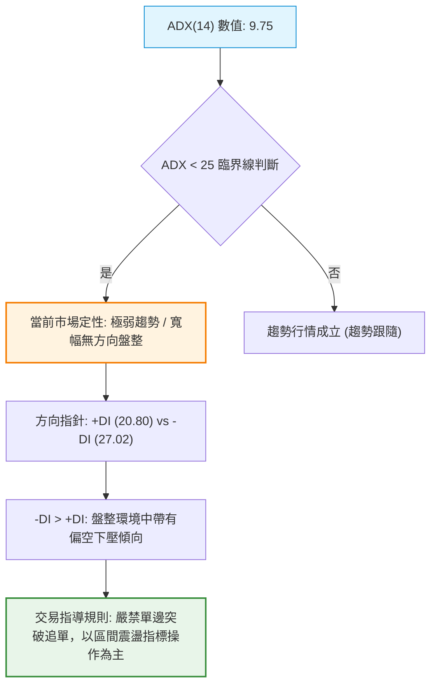

**ADX 趨勢強度對照表**：

| 指標變數 | 當前讀數 | 門檻區間 | 趨勢狀態判定 | 戰術意義 |
|----------|----------|----------|--------------|----------|
| **ADX(14)** | **9.75** | < 20 (極弱/盤整) | 趨勢處於休眠/震盪沉澱期 | 趨勢突破策略失敗率高，切勿追空或盲目追多 |
| **+DI** | **20.80** | 多方買力 | 多頭進攻意願不足 | 多方無法維持價格推升 |
| **-DI** | **27.02** | 空方賣力 | 空方相對佔優（差值 6.22） | 下行阻力偏小，但缺乏強烈單邊殺跌推力 |

---

## 3. 圖表形態分析

### 🔍 形態識別系統

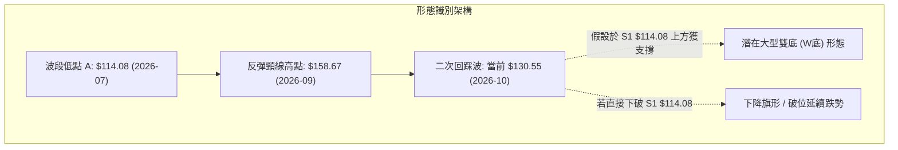

**圖表形態信心度評估表（依規則 15 嚴格審核）**：

| 形態名稱 | 信心度 | 判斷依據（嚴格引用歷史數據） | 完成度 | 目標價計算式與推算結果 |
|----------|--------|------------------------------|--------|------------------------|
| **潛在雙底 (Double Bottom)** | 48% | 2026-07 探底至低點 S1: $114.08 後反彈至 R3: $158.67，目前展開二次回踩至 $130.55。由於二次探底尚未於 S1 止跌，形態未獲右底確認，信心度 < 50%。 | 40% | 需待突破頸線 R3 $158.67 始可確立。<br>推算公式：頸線 + 形態高度 = $158.67 + ($158.67 - $114.08) = **$203.26** |
| **短期下降通道 / 矩形箱體** | 75% | 自 2026-09 高點 $158.19 下跌以來，連續受制於下移均線（MA5、MA10、MA20），於 $130 - $158 形成震盪回落箱體，且 ADX=9.75 充分佐證無方向震盪。 | 85% | 區間震盪下軌測試：通道下沿對應布林下軌 **$129.96** 至支撐 **$114.08** |
| **頭肩底形態** | 15% | 數據中未偵測到左肩對稱結構與有效右肩聚類，訊號嚴重不足，不予採信。 | 0% | 數據不足，不予計算。 |

### 🕯️ 重要K線形態分析

| 週/月份週期 | 終端收盤價 | K線形態名稱 | 形態特徵與量能解讀 | 訊號方向 |
|-------------|------------|-------------|--------------------|----------|
| **2026-07-26** (週) | $114.57 | 長下影鎚頭線 (Hammer) | 探底 52W 低點 $114.08 後爆出 1.62 億股成交量，顯示長線買盤在極值進場承接 | 🟢 看多反轉 |
| **2026-09-06** (週) | $158.19 | 衝高受阻流星線 (Shooting Star) | 觸及波段阻力 R3 $158.67 聚類區，留長上影線，量能未有效放大 | 🔴 頂部受阻 |
| **2026-09-27** (週) | $136.59 | 大陰線破位 (Bearish Marubozu) | 跌破 MA20，週 RSI 自 47.5 崩跌至 29.5，空頭加速釋放空頭回調壓力 | 🔴 空頭延續 |
| **2026-10-18** (當週) | $130.55 | 探底光腳中陰線 | 連續受壓於 MA5 ($137.55)，向下逼近布林下軌 $129.96，超賣但未見止跌長下影 | 🔴 短期承壓 |

### 📉 ASCII 走勢形態示意圖

```
ORCL 中期箱體震盪與潛在雙底形態演變圖 ($)
$160 ┤               [反彈頸線高點: R3 $158.67]
     │                      ╭───╮
$150 ┤                     ╭╯   ╰╮       [MA50: $145.12 阻力帶]
     │                    ╭╯     ╰╮     ╭──╮
$140 ┤                   ╭╯       ╰╮   ╭╯  ╰╮  [MA20: $140.79]
     │                  ╭╯         ╰───╯    ╰─╮
$130 ┤                 ╭╯                      ╰► [現價 $130.55 / BB下軌 $129.96]
     │                ╭╯                          : 潛在二次回踩路徑
$120 ┤               ╭╯                           : 
     │   ╭─╮        ╭╯                            ▼
$110 ┤───╯ ╰────────╯───────────────────────────── [S1 強支撐: $114.08]
     └──────┬──────────────────────┬──────────────┬─────────────
         2026-07                2026-09        2026-10
         第一底 (52W Low)       頸線頂部       二次探底中
```

### 🎯 形態目標價計算

若以當前最具有幾何結構參考性的「寬幅箱體區間（S1 $114.08 至 R3 $158.67）」推算：
1. **箱體高度** = 頂部阻力 $158.67 - 底部支撐 $114.08 = **$44.59**
2. **多頭破位向上目標**（需完全放量突破 $158.67 且 ADX 升破 25）：
   $$\text{目標價} = \$158.67 + \$44.59 = \mathbf{\$203.26}$$
   （此價位貼近 52 週 61.8% 斐波那契回調位 $192.08 上方）
3. **空頭破位向下目標**（若失守 S1 $114.08 支撐）：
   $$\text{下行目標價} = \$114.08 - \$44.59 = \mathbf{\$69.49}$$
   （此為極端悲觀情境下等長量度跌幅，短線概率低於 15%）

---

## 4. 支撐與阻力

### 🗺️ 關鍵價位分布圖（Unicode）

```
ORCL 價位結構分布圖 (由實際 OHLCV 與斐波那契計算)
══════════════════════════════════════════════════════════════════
$158.67 ║████████████████████████████████████║ 強阻力 R3 (近一年波段高點/前波頸線)
$153.03 ║████████████████████████            ║ 阻力 R2 (反彈中繼密集成交區)
$147.20 ║██████████████████████████████      ║ 關鍵阻力 R1 (波段聚類/突破翻多點)
        ║                                    ║ ── 均線壓制: MA50 $145.12 / MA20 $140.79
$130.55 ╠════════════════════════════════════╣ ◄ 現價 ($130.55, 距BB下軌僅 $0.59)
$129.96 ║▓▓▓▓▓▓▓▓▓▓▓▓▓▓▓▓▓▓▓▓▓▓▓▓▓▓▓▓        ║ 動態支撐 (日線布林通道下軌)
$114.08 ║████████████████████████████████████║ 核心強支撐 S1 (52W歷史低點聚類)
══════════════════════════════════════════════════════════════════
```

### 🚧 阻力位分析表

所有數值均嚴格源自系統給定之 OHLCV 波段聚類數據：

| 阻力級別 | 具體價位 | 距現價幅差 | 形成技術原因 | 突破難度評估 | 戰略重要性 |
|----------|----------|------------|--------------|--------------|------------|
| **R1** | **$147.20** | +12.76% | 近一年日線波段高點聚類，與下降中 MA50 ($145.12) 形成共振阻力帶 | 🟡 中等 (需日成交量突破 5,000 萬股) | ★★★★☆<br>短線多空分水嶺 |
| **R2** | **$153.03** | +17.22% | 籌碼密集套牢區，布林通道上軌 ($151.63) 壓制帶 | 🔴 較高 (大量歷史解套盤聚集) | ★★★☆☆<br>中繼反彈目標 |
| **R3** | **$158.67** | +21.54% | 2026-09-06 波段反彈頂點 ($158.19) 聚類，亦為 78.6% 斐波那契回調位 ($157.78) | 🔴 極高 (強大空頭防禦陣地) | ★★★★★<br>中長期趨勢反轉頸線 |

### 🛡️ 支撐位分析表

| 支撐級別 | 具體價位 | 距現價幅差 | 形成技術原因 | 守住機率評估 | 戰略重要性 |
|----------|----------|------------|--------------|--------------|------------|
| **動態支撐**| **$129.96** | -0.45% | 日線布林通道下軌極限，當前 %B 為 0.03，具備統計學反彈邊界效應 | 🟡 60% (短線易引發超賣反抽) | ★★★☆☆<br>短線超賣緩衝位 |
| **S1** | **$114.08** | -12.62% | 52 週最低點（2026-07 低點聚類），斐波那契 100.0% 絕對回調底線 | 🟢 85% (長線機構與內部人價值承接區) | ★★★★★<br>年度多頭生死線 |
| **S2 / S3**| 數據未偵測 | — | 數據中未偵測到近一年波段更低聚類低點，若跌破 $114.08 則進入真空跌勢區 | — | — |

### 📐 斐波那契回調位分析

依據 52 週完整波動區間（低點 $114.08 至 高點 $318.28，垂直落差 $204.20）計算：

```
斐波那契回調梯隊 ($114.08 → $318.28):
0.0%  (52W High) : $318.28 ══════════════════════════════════════ 極限峰值
23.6% 回調位     : $270.09 ────────────────────────────────────── 弱勢回調
38.2% 回調位     : $240.28 ────────────────────────────────────── 強勢回調
50.0% 回調位     : $216.18 ────────────────────────────────────── 多空平衡線
61.8% 黃金分割位 : $192.08 ────────────────────────────────────── 深度防禦線
78.6% 回調位     : $157.78 ══════════════════════════════════════ [共振 R3 $158.67]
現價位置         : $130.55 ◄──────────── (落於 78.6% 與 100.0% 之間)
100.0% (52W Low) : $114.08 ══════════════════════════════════════ [核心支撐 S1]
```

**斐波那契結構深度解讀**：
- **當前位置定位**：現價 $130.55 深陷於 78.6%（$157.78）至 100.0%（$114.08）的極度弱勢區間，表明過去一年的上升波段已遭受摧毀性回撤。
- **價位重合共振**：斐波那契 78.6% 位（$157.78）與波段阻力 R3（$158.67）高度重合，誤差僅 $0.89。這證明 $157.78 - $158.67 區域是極強的技術天花板，在未能收復該位置前，任何反彈均僅能視為技術性修復，無法確立多頭反轉。

---

## 5. 技術指標深度解讀

### 🎛️ 指標訊號總覽

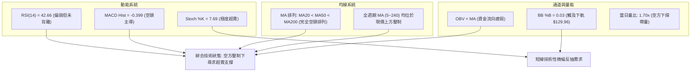

### 📈 移動平均線排列分析

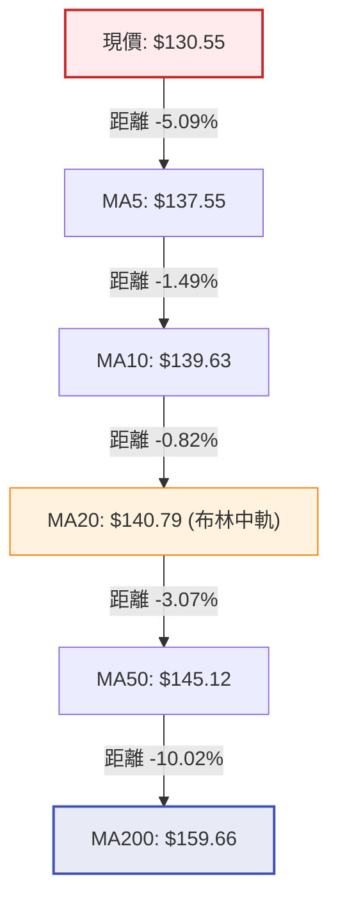

**均線全階梯狀態說明**：
- **短期均線壓制**：現價 $130.55 距離 5 日線 $137.55 高達 5.09% 的負乖離，顯示短線殺跌過急；然而 MA5、MA10、MA20 呈陡峭下行態勢，短線反彈的第一道天花板為 MA5（$137.55），隨後是 MA20（$140.79）。
- **長期死亡交叉延續**：MA20（$140.79）< MA50（$145.12）< MA200（$159.66），標準空頭排列形態未有絲毫收斂跡象，長期趨勢依然處於被動防守期。

### 📉 RSI(14) 分析

- **當前讀數**：**42.66**（弱勢中性震盪區間）
  ```
  RSI(14) 強度儀：
  [0] ────────── [30] ──────●───── [50] ────────── [70] ────────── [100]
  超賣區               42.66 (空方佔優)            超買區
  ▓▓▓▓▓▓▓▓▓▓▓▓▓▓▓▓▓░░░░░░░░░░░░░░░░░░░░░░  42.66%
  ```
- **區間與形態判定**：
  RSI 自 2026-08 的超買區 74.6 急劇下挫，並在 2026-09-27 下探至 29.5 短暫超賣後反彈，目前在 42.66 徘徊。既未進入 <30 的深度超賣區，亦無法突破 50 中性平衡線。
- **背離判斷**：
  當前價格 $130.55 高於 2026-07 低點 $114.08，而 RSI 讀數 42.66 亦高於當時的 26.7；近期 2026-09-27 價格 $136.59 對應 RSI 29.5，現價 $130.55 對應 RSI 42.66，**呈現輕微的日線級別指標未創新低底背離雛形**，但由於歷史數據中標注「RSI 背離：無明顯背離」，技術上判定底背離信號尚未確認，不可作為進場單一依據。

### 📊 MACD(12,26,9) 訊號解讀

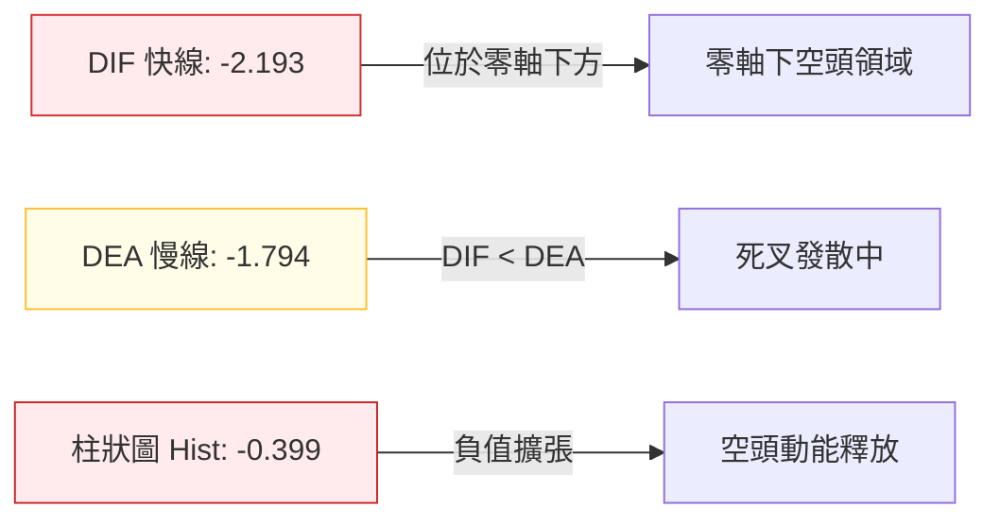

- **數值解析**：MACD 線為 -2.193，訊號線為 -1.794，差離值（柱狀圖）為 -0.399。
- **狀態判定**：雙線深處零軸下方，且快線位於慢線下方持續發散，柱狀圖持續為負，表明空方依然牢牢把控盤面動能節奏，無任何金叉反轉信號。

### 📦 布林通道分析

```
日線布林通道 (20, 2) 結構分布：
$151.63 ┬ 上軌 (Upper Band)
        │
$140.79 ┼ 中軌 (Middle Band = MA20)
        │
$130.55 ┼── 現價 (距離下軌僅 $0.59) ◄ %B = 0.03
$129.96 ┴ 下軌 (Lower Band)
```

- **帶寬與位置**：通道寬度為 $151.63 - $129.96 = **$21.67**（佔價格 16.6%）。
- **%B 指標解讀**：%B 讀數為 **0.03**，股價已切入布林下軌（$129.96）邊界，根據常態分佈原理，價格連續收於帶外的概率低於 5%，短期下行空間受到通道物理約束，容易觸發均值回歸反抽。

### 💹 成交量分析（量價配合度）

```
成交量對比：
當日成交量:   ██████████████████████████████████  52.01M (1.70x 放大)
20日均量:     ████████████████████               30.52M
50日均量:     ██████████████████                 28.90M
OBV 趨勢:     OBV < MA (持續處於下行均線下方，呈空頭發散)
```

- **量價特徵**：最新成交量放大至 5,200.79 萬股，量比高達 1.70 倍，價格下跌而成交量放大，呈現典型的「放量陰跌 / 空頭壓迫」形態。
- **OBV 量能印證**：OBV 指標持續位於其均線下方，說明資金流出佔據主導，並未出現主力機構隱蔽吸籌所產生的量價底背離，這意味著隨後的反彈將缺乏實質性的買力支撐。

---

## 6. 動能與波動率

### ⚡ 動能評估四象限

| 象限分區 | 動能維度 (Momentum) | 波動率維度 (Volatility) | ORCL 當前定位 | 戰術因應策略 |
|----------|---------------------|--------------------------|---------------|--------------|
| **Q1 突破爆發** | 強 (+DI > -DI, MACD>0) | 高 (ATR% > 5%) | ❌ 否 | 順勢追多，擴大止盈區間 |
| **Q2 蓄勢盤整** | 弱 (ADX < 25) | 低 (ATR% < 3%) | ❌ 否 | 突破前夕，以逸待勞 |
| **Q3 恐慌單邊** | 強 (-DI 遠大於 +DI) | 高 (ATR% > 5%) | ❌ 否 | 嚴格做空，禁止抄底 |
| **Q4 陰跌磨底** | **弱 (ADX=9.75, 空方微優)** | **中高 (ATR=5.05%, Beta=1.77)** | **✅ 當前狀態** | **防禦觀望 / 嚴格區間邊緣低吸高拋** |

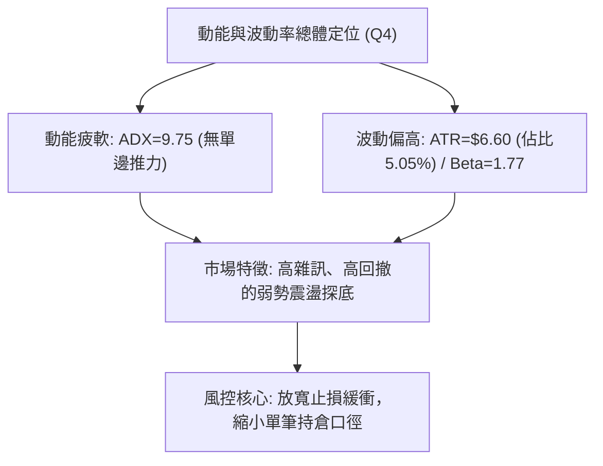

### 📊 ATR 波動率分析

- **ATR(14) 讀數**：**$6.60**（佔現價 $130.55 的 **5.05%**）。
- **實戰風控指導**：
  - 由於日均波動高達 $6.60，短線任何緊密止損（如 < $3.00）極易被日常高雜訊洗盤觸發。
  - **建議止損距離**：需設定在 1.5 倍至 2.0 倍 ATR，即 **$9.90 至 $13.20** 區間，方可規避正常波動噪音。

### 📐 Beta 與市場相關性

- **Beta 係數**：**1.77**。
- **大盤敏感度解讀**：ORCL 具有極高的市場彈性（屬於高 Beta 股），理論上標普 500 指數波動 1%，ORCL 將產生 1.77% 的同向放大反應。在科技板塊承壓或市場整體流動性緊縮時，該股將面臨顯著高於平均水準的拋售壓力；反之，若大盤展開反彈，其短線彈性亦將顯著放大。

---

## 7. 多時框架總結

### 📋 時框架評分表

| 時框架 | 趨勢方向 | 動能狀態 | 均線排列 | 形態結構 | 綜合評分 | 建議戰術 |
|--------|----------|----------|----------|----------|----------|----------|
| **月線 (長期)** | 🔴 下行回調 | 弱 (-11.59% FCF) | 承壓於長期均線 | 自高位回撤擠泡沫 | **30/100** | 長線資金觀望，等待基本面好轉 |
| **週線 (中期)** | 🟡 區間震盪 | 中性偏弱 (RSI 42.7) | MA200 壓制 | $114.08-$158.67 大箱體 | **45/100** | 箱體操作，接近下軌留意買點 |
| **日線 (短期)** | 🔴 空頭壓迫 | 超賣 (Stoch %K 7.69) | 完全空頭排列 | 緊貼布林下軌下跌 | **25/100** | 暫停追空，等待超賣修復信號 |

### 🔲 綜合訊號矩陣

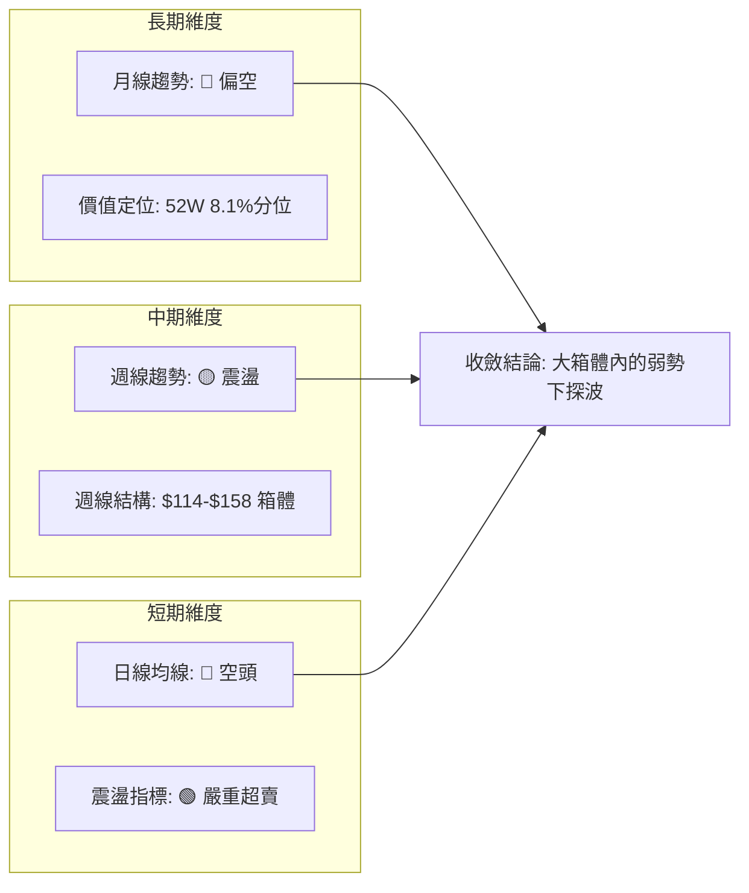

### ⚖️ 多時框收斂結論

依據多時框收斂規則（規則 14）與技術指標確認：
1. **行情定性**：當前日線 ADX(14) 僅為 **9.75**（遠低於 25），嚴格判定當前**絕非趨勢單邊行情，而是中長期下行後的多空拉鋸盤整/箱體尋底行情**。
2. **時框優先級權衡**：在盤整行情中，中期週線箱體（$114.08 - $158.67）與日線布林通道（$129.96 - $151.63）為最核心的主導交易邊界。雖然日線短期均線呈現強烈空頭排列（MA20<MA50<MA200），但由於股價已極度逼近布林下軌（%B = 0.03）且隨機指標處於極端超賣（%K = 7.69），短線繼續追空的勝率極低。
3. **唯一收斂方向**：**偏空震盪中的區間防守（評級：偏空震盪，綜合評分 29/100）**。戰略重心在於防範股價進一步向 S1（$114.08）尋求支撐，戰術上禁止於現價追空，亦不可盲目重倉抄底，僅能依據布林通道下軌或回踩 S1 附近進行極小倉位的防守型博弈。

---

## 8. 交易策略建議

### 🗺️ 策略決策流程圖

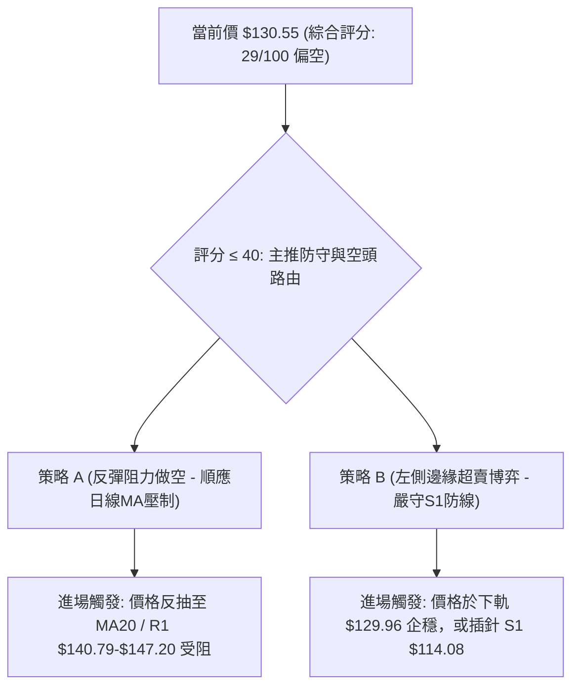

### 🧭 策略路由

> **當前主策略方向 = 偏空震盪與防禦型操作（依評分卡：29 / 100）**
> 
> 因綜合技術評分低於 40 分，均線空頭排列顯著且 MACD 處於空方區間，策略體系以「**反彈逢高布空（主策略 A）**」為主導架構；同時，鑑於短期 Stoch 指標極度超賣且面臨布林下軌 $129.96 支撐，提供「**超賣短多博弈（輔助策略 B）**」作為右側反抽交易補充。

### 🎯 價格情境階梯（Price Scenarios）

價位嚴格引用第 4 章確切聚類數據：

| 觸發條件 | 下一目標 | 後續延伸目標 | 情境技術含義 |
|----------|----------|--------------|--------------|
| **強勢突破 R1 $147.20** | R2 **$153.03** | R3 **$158.67** | 短線均線空頭扭轉，中期箱體向上挑戰頂沿 |
| **弱勢反彈站上 MA20 $140.79** | R1 **$147.20** | R2 **$153.03** | 技術性均值修復，遭遇 MA50 壓制 |
| **現價 $130.55 窄幅整理** | BB中軌 **$140.79** | BB下軌 **$129.96** | ADX < 25 特徵延續，區間拉鋸洗盤 |
| **跌破布林下軌 $129.96** | S1 **$114.08** | 數據未偵測更低點 | 空頭下探尋求 52 週低點聚類支撐（S1） |

### 📊 情境機率分佈

| 情境劇本 | 發生機率 | 主要判定技術依據（引用數據） |
|----------|----------|------------------------------|
| **下行探底 (回測 S1)** | **50%** | 均線空頭排列（MA20<50<200）、OBV 持續疲軟、-DI (27.02) 主導市場。 |
| **區間震盪 (下軌微幅反抽)** | **35%** | ADX 僅 9.75 指向無趨勢，Stoch %K (7.69) 與布林 %B (0.03) 嚴重超賣。 |
| **強勢反轉 (突破 R1)** | **15%** | MACD 柱狀圖仍為負值 (-0.399)，且面臨層層下壓均線，缺乏放量大陽確認。 |

### 🟢 主策略詳情

所有價位均嚴格基於第 4 章關鍵價位（R1: $147.20, R2: $153.03, R3: $158.67, S1: $114.08, BB下軌: $129.96）：

| 策略要素 | 策略 A：阻力位反彈放空（主推） | 策略 B：極度超賣左側反抽（輔助） |
|----------|--------------------------------|----------------------------------|
| **交易邏輯** | 順應日線均線空頭排列，反彈遇阻做空 | 博弈布林下軌與極度超賣的均值回歸 |
| **進場條件** | 反抽觸及 MA20/R1 區間出現滯漲長上影 | 跌破下軌後收回 $129.96，且 Stoch 金叉 |
| **進場價格** | **$145.12**（精確對應 MA50 阻力帶） | **$130.00**（貼近布林下軌 $129.96） |
| **止損價格** | **$153.03**（突破阻力位 R2 嚴格止損）| **$123.40**（進場價減 1.0x ATR $6.60） |
| **目標價 T1** | **$130.55**（現價及布林下軌位置） | **$140.79**（回歸布林中軌 MA20） |
| **目標價 T2** | **$114.08**（波段核心支撐 S1） | **$147.20**（波段阻力 R1） |
| **風險報酬比** | **1 : 3.92**（風險 $7.91 / 獲利 $31.04） | **1 : 2.61**（風險 $6.60 / 獲利 $17.20） |
| **預估勝率** | **60%** | **40%** |
| **建議倉位** | **8% - 12%** | **3% - 5%**（嚴格輕倉測試） |

### 🔴 反向風險觸發點（對沖提示）

若出現以下技術事件，必須立即推翻「偏空主導」策略並全面撤出空頭頭寸：
1. **價位突破**：日線收盤價強勢突破 **R1 $147.20**，並伴隨日成交量擴大至 5,000 萬股以上。
2. **指標轉向**：日線 MACD 出現零軸下金叉，柱狀圖翻正至 +1.0 以上，且 ADX 突破 25，表明多頭趨勢反轉成形。

### ⭐ 整體訊號強度評星

```
做多訊號強度：★★☆☆☆  (2/5星 - 僅有極值超賣支撐，均線重重壓制)
做空訊號強度：★★★☆☆  (3.5/5星 - 均線完美空頭，但短線面臨下軌限制)
整體可信度：  ★★★☆☆  (3.5/5星 - 處於低 ADX 震盪期，價位易反覆拉扯)
```

---

## 9. 風險提示與監控

### ✅ 關鍵監控指標 Checklist

```
╔══════════════════════════════════════════════════════════════╗
║              ORCL 關鍵技術風控監控清單 (DAILY CHECKLIST)     ║
╠══════════════════════════════════════════════════════════════╣
║ [ ] 1. 布林通道下軌防線：收盤價是否有效跌破 $129.96？        ║
║ [ ] 2. 隨機指標拐點：%K 線是否自 7.69 超賣區向上金叉 %D 線？ ║
║ [ ] 3. 核心支撐測試：股價若下探，能否在 S1 $114.08 企穩？     ║
║ [ ] 4. 動能釋放驗證：MACD 柱狀圖是否收斂至 -0.100 以上？     ║
║ [ ] 5. 均線壓制突破：日線是否突破 MA5 ($137.55) 與 MA20？    ║
║ [ ] 6. 成交量配合度：反彈時成交量是否能站上 20日均量 (30.5M)？║
╚══════════════════════════════════════════════════════════════╝
```

### ⚠️ 風險場景分析

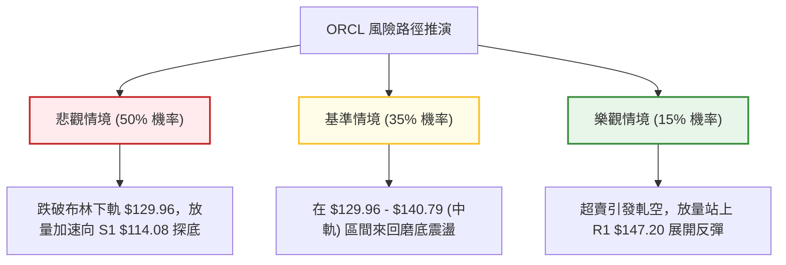

### 🛡️ 風險管理重要提醒

1. **基本面負現金流隱患**：數據顯示 ORCL 當前自由現金流為 **$-45.85B**（FCF Yield 為 -11.59%），且淨負債高達 **$132.07B**。技術面的弱勢高度反映了資產負債表承壓的實況，在現金流改善前，任何反彈均易遭遇基本面拋壓。
2. **高 Beta 波動防範**：Beta 高達 1.77，每日 ATR 為 $6.60。在交易執行中，部位規模務必換算：單筆交易虧損額度應嚴格限制在總資產的 1% 至 1.5% 以內，避免在寬幅震盪中遭受不可逆之本金侵蝕。

---

## 📋 報告總結

```
ORCL 技術分析報告總結
════════════════════════════════════════════════════════
報告日期：2026-10-15
當前價格：$130.55
分析評級：🔴 偏空震盪 / 尋求支撐（綜合技術評分：29 / 100）

關鍵結論：
├─ 長期趨勢：🔴 空頭回撤（自高位深度回踩，現處 52W 區間 8.1% 分位）
├─ 中期趨勢：🟡 寬幅箱體（受困於 S1 $114.08 與 R3 $158.67 區間）
├─ 短期趨勢：🔴 弱勢承壓（均線空頭排列，但 Stoch %K=7.69 極度超賣）
├─ 核心支撐：$129.96 (布林下軌) ｜ $114.08 (年度核心支撐 S1)
├─ 核心阻力：$140.79 (MA20中軌) ｜ $147.20 (R1) ｜ $158.67 (R3)
└─ 分析師共識目標：$237.97 (41位分析師，當前技術面嚴重落後於共識)

最優策略組合：
1. 🥇 最佳機會（主策略）：耐性等待股價反彈至 MA50 / R1 附近（$145.12 - $147.20）
   受阻時建立空頭部位，停損置於 R2 $153.03，目標下看 $114.08（盈虧比 1:3.92）。
2. 🥈 次選機會（反抽博弈）：現價於布林下軌 $129.96 極輕倉博弈 Stoch 超賣反彈，
   停損設為 $123.40，目標看至 MA20 $140.79。
3. 🥉 保守選擇：完全空倉觀望，等待日線 ADX 回升至 25 且明確放量突破 R1 
   或回踩 S1 出現反轉 K 線後再行介入。
════════════════════════════════════════════════════════
```

---

> ⚠️ **免責聲明**：本報告為 AI 自動生成之技術分析，所有數據及估算均基於提供的歷史價格資訊。本報告**僅供研究與學術參考**，**不構成任何投資建議**。投資有風險，入市需謹慎。

---

*報告生成時間：2026-10-15 ｜ 數據來源：Yahoo Finance ｜ 分析框架：多時框技術分析*