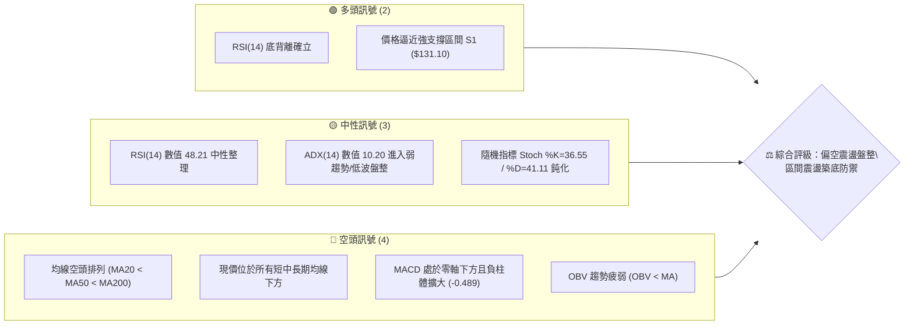
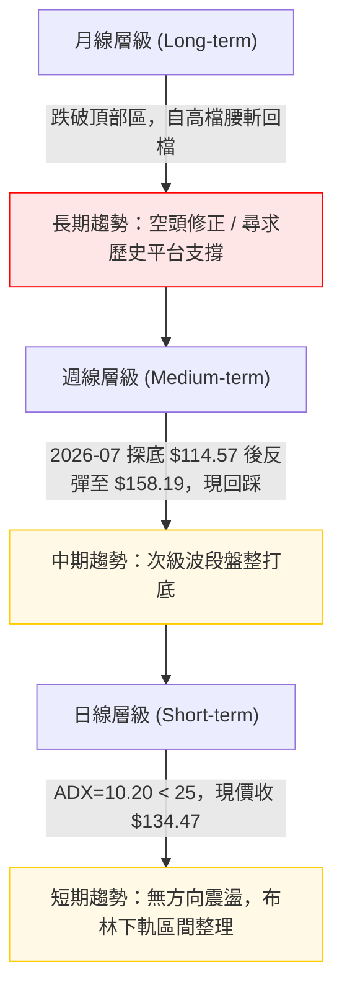
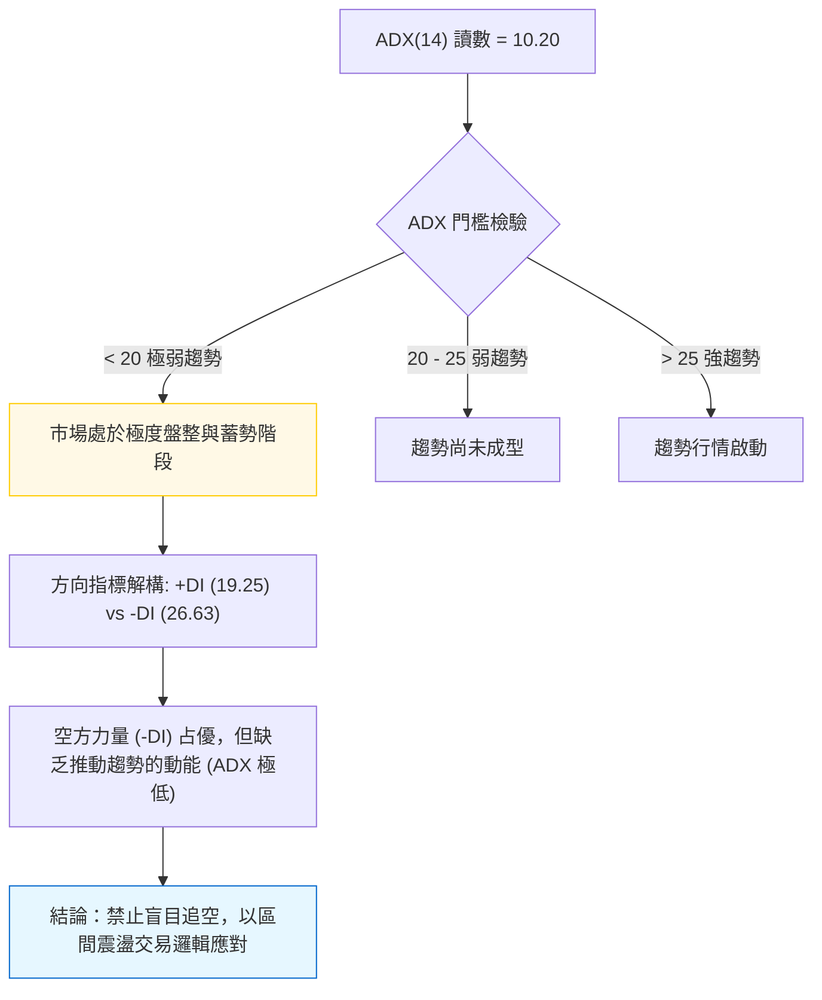
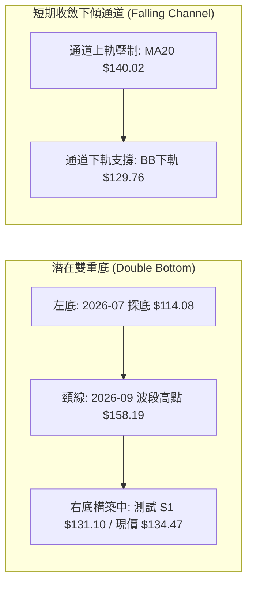
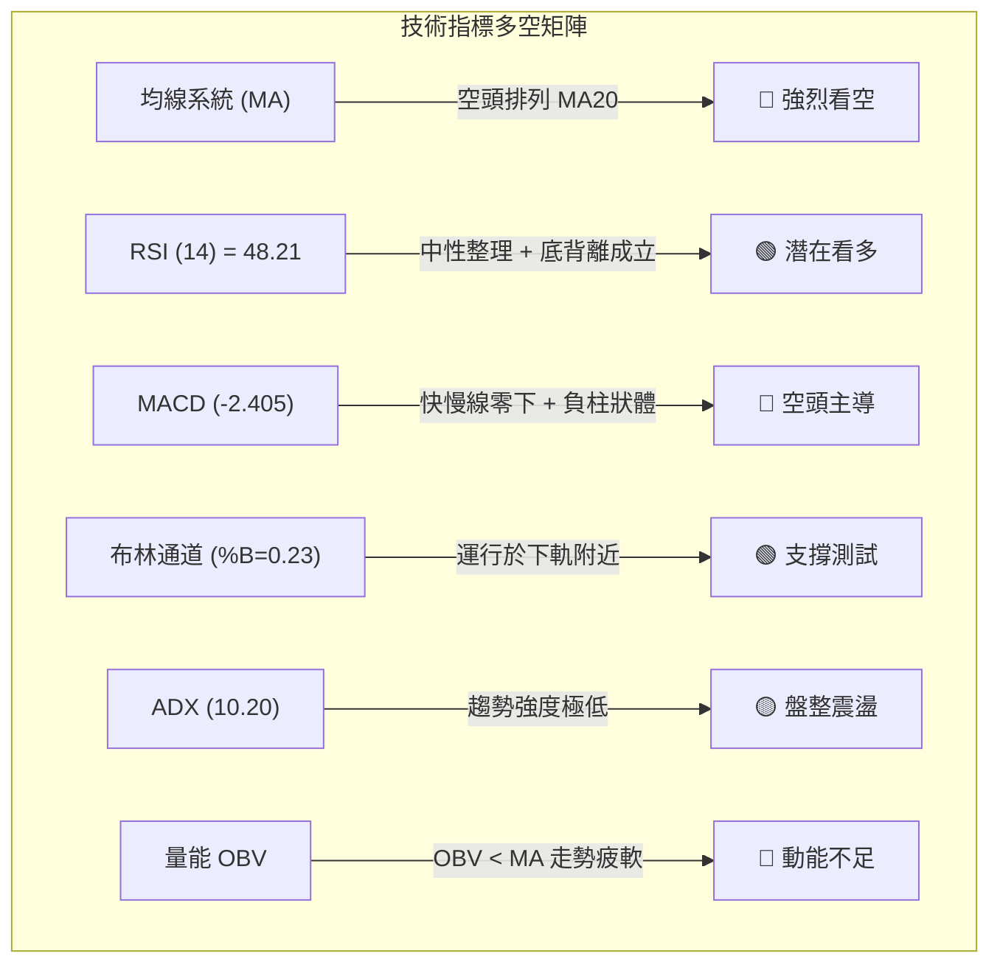
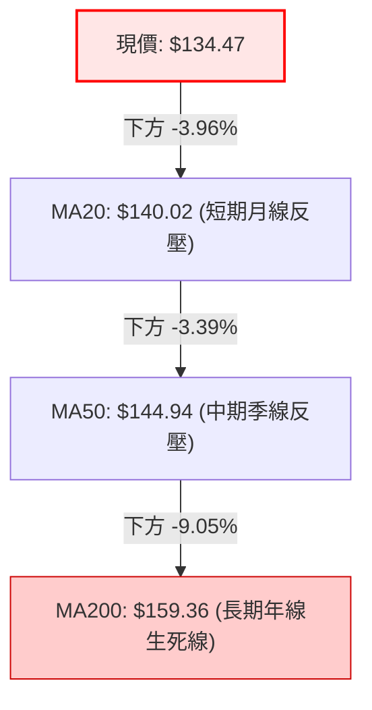
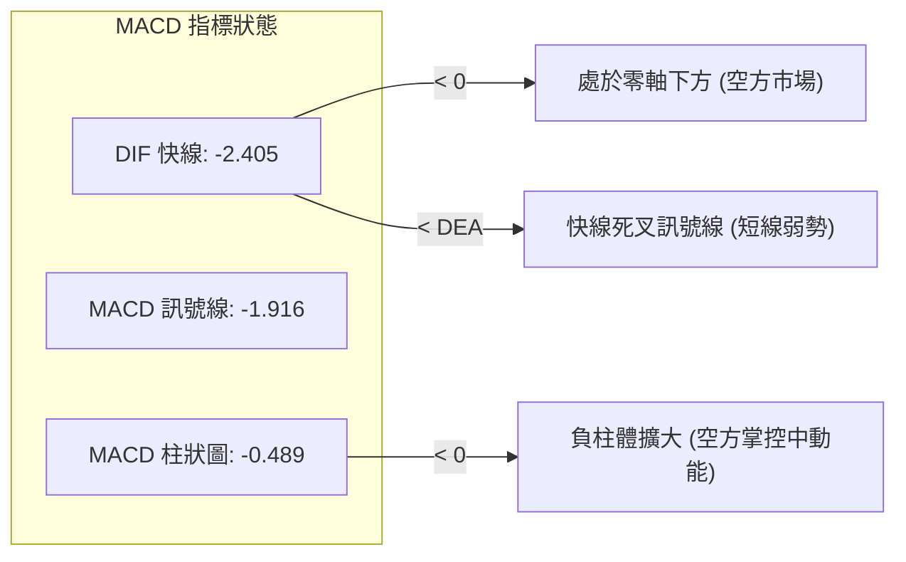
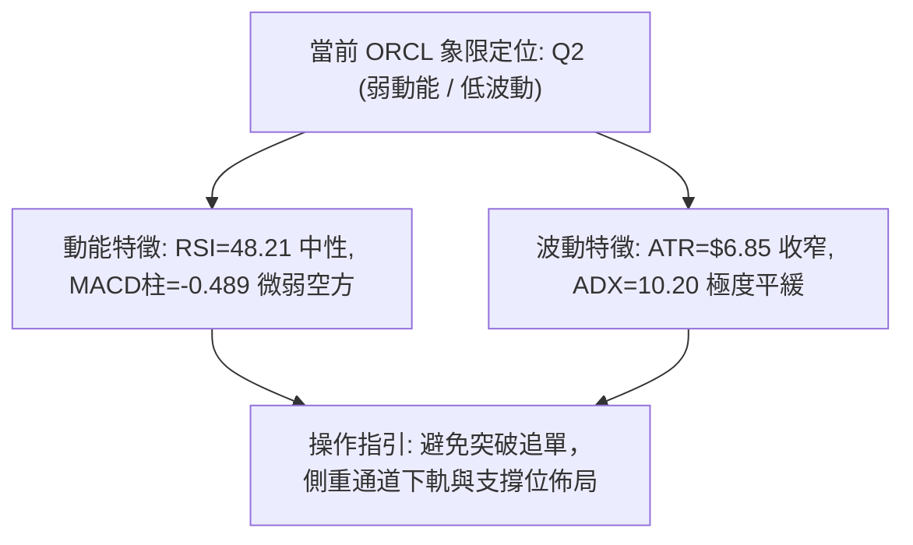
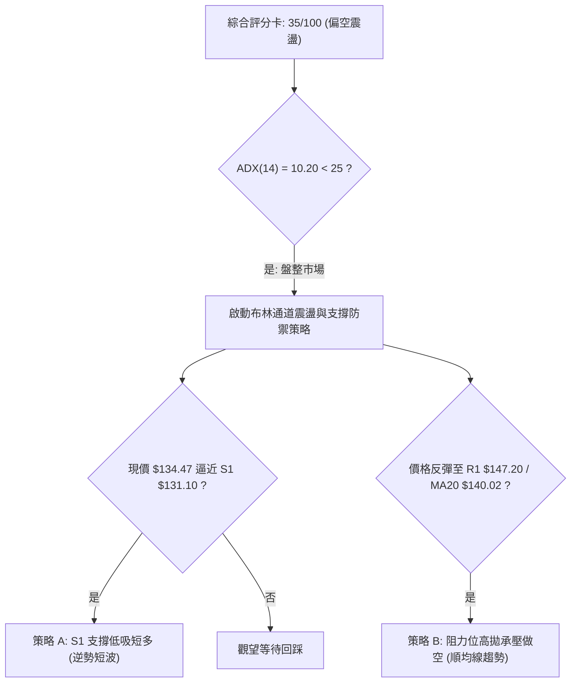
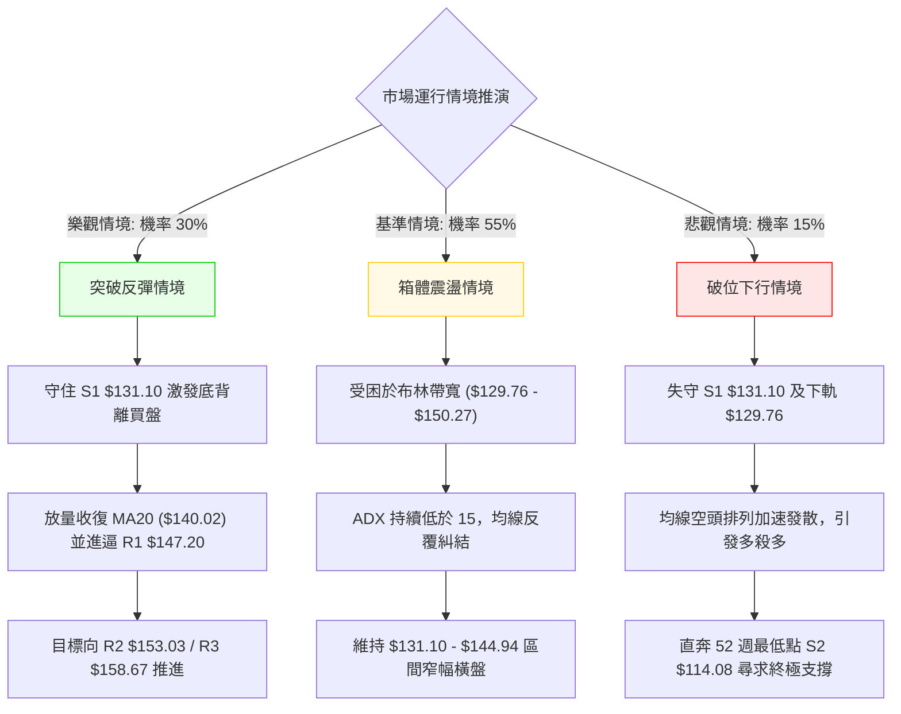

# ORCL 技術分析報告

> **報告日期**：2026-10-16 ｜ **語言**：繁體中文 ｜ **數據來源**：Yahoo Finance ｜ **當前價格**：$134.47

---

## 目錄

| 章節 | 內容 |
|------|------|
| [1. 技術面概覽](#1-技術面概覽) | 訊號儀表板、核心指標、評分卡 |
| [2. 趨勢分析](#2-趨勢分析) | 多時框趨勢、長中短期走勢 |
| [3. 圖表形態分析](#3-圖表形態分析) | 形態識別、K線組合、目標價 |
| [4. 支撐與阻力](#4-支撐與阻力) | 關鍵價位、斐波那契回調 |
| [5. 技術指標深度解讀](#5-技術指標深度解讀) | MA/RSI/MACD/布林/成交量 |
| [6. 動能與波動率](#6-動能與波動率) | 動能評估、ATR、Beta |
| [7. 多時框架總結](#7-多時框架總結) | 時框架評分矩陣 |
| [8. 交易策略建議](#8-交易策略建議) | 多空策略、風險報酬比 |
| [9. 風險提示與監控](#9-風險提示與監控) | 監控指標、風險場景 |

---

## 1. 技術面概覽

### 🎯 技術訊號儀表板



### 📊 核心指標速覽表

| 指標類別 | 指標名稱 | 當前數值 | 訊號 | 解讀 |
|----------|----------|----------|------|------|
| **價格** | 當前收盤價 | $134.47 | 🔴 | 位於52週高低點區間 10.0% 處，極度偏向低檔 |
| **均線** | MA20 | $140.02 | 🔴 | 現價在MA20下方 -3.96%，短線承壓 |
| **均線** | MA50 | $144.94 | 🔴 | 現價在MA50下方 -7.22%，中期趨勢受壓制 |
| **均線** | MA200 | $159.36 | 🔴 | 現價在MA200下方 -15.62%，長期空方結構 |
| **均線架構**| 均線排列 | 空頭排列 | 🔴 | MA5 < MA10 < MA20 < MA50 < MA200 完全空頭排列 |
| **動能** | RSI(14) | 48.21 | 🟡 | 中性區間，無超買超賣，但已出現日線底背離跡象 |
| **動能** | MACD (12,26,9) | -2.405 / -1.916 | 🔴 | 快慢線均在零軸下方，柱體 -0.489 顯示空方佔優 |
| **動能** | Stoch %K / %D | 36.55 / 41.11 | 🟡 | 進入弱勢中性區間，未見超賣鈍化 |
| **趨勢強度**| ADX (14) | 10.20 | 🟡 | ADX < 25 且極低，顯示單邊下跌動能衰竭，轉為無方向盤整 |
| **方向指標**| +DI / -DI | 19.25 / 26.63 | 🔴 | -DI 大於 +DI，空方力量占主導 |
| **通道軌道**| 布林帶 %B | 0.23 | 🟡 | 位於下軌 ($129.76) 與中軌 ($140.02) 間，接近下軌支撐 |
| **波動** | ATR(14) | $6.85 | 🟡 | 佔現價 5.09%，每日震幅收斂，呈現低波動盤整 |
| **量能** | 量比 / OBV | 1.02x / 弱勢 | 🔴 | 成交量持平均量，OBV 低於均線，量價配合偏弱 |

### 🏆 技術評分卡

```
╔══════════════════════════════════════════════════════════════╗
║                 技術評分卡 — ORCL (2026-10-16)               ║
╠══════════════════════════════════════════════════════════════╣
║ 趨勢強度 (Trend)     ████░░░░░░░░░░░░░░░░  20/100 🔴 空頭排列║
║ 動能指標 (Momentum)  ████████░░░░░░░░░░░░  40/100 🟡 背離支撐║
║ 支撐穩定度 (Support) ████████████░░░░░░░░  60/100 🟢 S1近在咫尺║
║ 成交量配合 (Volume)  ██████░░░░░░░░░░░░░░  30/100 🔴 縮量整理║
║ 形態完整度 (Pattern) ████████░░░░░░░░░░░░  40/100 🟡 構築雙底║
║ 均線排列 (Moving Avg)██░░░░░░░░░░░░░░░░░░  10/100 🔴 典型空頭║
╠══════════════════════════════════════════════════════════════╣
║ 綜合技術評分         ███████░░░░░░░░░░░░░  35/100 🔴 偏空震盪║
║ 建議配置導向         區間防守 / 等待突破確認 / 逢低佈局反彈   ║
╚══════════════════════════════════════════════════════════════╝
```

---

## 2. 趨勢分析

### 🌐 多時框趨勢分析



### 📈 長期趨勢 — 12個月走勢圖（Unicode）

```
ORCL 月線走勢圖（2025-11 至 2026-10）
價格軸 ($)
$260 ┤             
$240 ┤                               ● (2026-05 $224.17 反彈頂部)
$220 ┤                               │
$200 ┤ ● (2025-11 $199.28)          │
$180 ┤    ●                         │
$160 ┤       ● (2026-01 $162.84)    ● (2026-04 $160.24)
$140 ┤          ●    ●              │    ● (2026-06 $145.50)  ●    ● ◄ 現價 $134.47
$120 ┤                                        ● (2026-07 $129.39)
     └─┬────┬────┬────┬────┬────┬────┬────┬────┬────┬────┬────┬────
     11月 12月  1月  2月  3月  4月  5月  6月  7月  8月  9月 10月
     2025      2026
```

#### 走勢特徵分析表格

| 階段區間 | 時間跨度 | 起訖價位 | 漲跌幅 | 價量特徵與形態解讀 |
|----------|----------|----------|--------|--------------------|
| **主跌浪 I** | 2025-11 至 2026-02 | $259.14 → $143.86 | -44.49% | 高檔獲利了結與估值修正，單邊直線跳水，擊穿 MA20/MA50 |
| **打底反彈** | 2026-03 至 2026-05 | $145.55 → $224.17 | +54.01% | 財報強勁與超跌修復，成交量放大，創階段性反彈高點 $224.17 |
| **主跌浪 II** | 2026-05 至 2026-07 | $224.17 → $129.39 | -42.28% | 巨額資本支出引發現金流擔憂，月線形成大陰線破位，最低觸及 $114.08 |
| **次級築底** | 2026-08 至 2026-10 | $148.57 → $134.47 | -9.49%  | 波動率大幅收窄，成交量回歸常態，圍繞 $130–$150 進行基底整合 |

### 📊 中期趨勢（週線分析）

從 20 週收盤走勢可清晰識別中期多空拉鋸的轉折過程：

```
ORCL 近20週價格結構與波動通道
$160 ┤                   ▲ (09-06 $158.19)
$150 ┤             ▲     │  ▲
$140 ┤       ▲     │  ▲  │  │  ▲        ▲  ◄ R1 $147.20 / MA20 $140.02
$130 ┤       │  ▲  │  │  │  │  │  ▲     │
$120 ┤    ▲  │  │  │  │  │  │  │  │  ▲  │  ▲ ◄ 當前 $134.47 (S1 $131.10 上方)
$110 ┤ 底部 (07-26 $114.57)
     └─┬──┬──┬──┬──┬──┬──┬──┬──┬──┬──┬──┬──┬──┬──┬──┬──┬──┬──┬──
       W1 W2 W3 W4 W5 W6 W7 W8 W9 10 11 12 13 14 15 16 17 18 19 20
```

- **中期底部確立**：2026-07-26 週收盤價 $114.57，配合 52 週最低點 $114.08，構築了極具防禦力的週線級別底部。
- **反彈浪受阻**：隨後在 2026-09-06 上攻至 $158.19（逼近 R3 $158.67 及 MA200 $159.36），隨後因量能無法持續放大而遇阻回落。
- **二次回踩測試**：近 4 週收盤自 $147.07 壓回至 $134.47，週線 RSI 降至 48.2，MACD 柱由正轉負 (-0.489)，表明中期反彈動力暫告段落，目前處於次級波段的回踩確認期。

### ⚡ 趨勢強度評估（ADX 解讀）



#### ADX 趨勢強度對照表

| 指標變數 | 當前讀數 | 門檻區間 | 趨勢屬性判定 | 交易策略意涵 |
|----------|----------|----------|--------------|--------------|
| **ADX(14)** | **10.20** | 0 – 20 | **極弱趨勢 / 盤整市場** | 嚴禁採用順勢突破策略；偽突破機率極高 |
| **+DI** | **19.25** | 基準線 | 多頭動能偏弱 | 買盤缺乏連續性，推升力道受限 |
| **-DI** | **26.63** | 基準線 | 空頭暫據主導 | 賣壓雖重但缺乏趨勢性下殺推力 |
| **方向差距 (\|+DI - -DI\|)** | **7.38** | < 10 | 弱度分歧 | 雙方處於弱平衡，隨時面臨區間震盪收斂 |

---

## 3. 圖表形態分析

### 🔍 形態識別系統

依據規則 15，所有圖表形態嚴格基於給定數據與波段高低點驗證，杜絕過度擬合。



#### 圖表形態信心度評估表

| 形態名稱 | 信心度 | 判斷依據（引用數據） | 完成度 | 目標價（附嚴謹計算式） |
|----------|--------|----------------------|--------|------------------------|
| **潛在中期雙底** | **65%** | 2026-07 創 52W 低點 $114.08（左底）；隨後反彈至 2026-09-06 收盤 $158.19（頸線區）；目前回撤至現價 $134.47，守於 S1 $131.10 之上。 | 55% | 需突破頸線 $158.19 成立。<br>理論高度 = $158.19 - $114.08 = $44.11。<br>突破目標價 = $158.19 + $44.11 = **$202.30** |
| **短線布林通道震盪** | **85%** | ADX=10.20 確認處於盤整；價格受限於布林帶寬 ($129.76 – $150.27) 內，%B 數值 0.23。 | 90% | 區間上軌目標價 = **$150.27**（布林上軌）；<br>下軌防守價 = **$129.76**（布林下軌） |
| **頭肩底形態** | **25%** | 數據中未偵測到對稱之左右肩結構，缺乏對應成交量形態確認。 | 0% | 訊號不足，依規則不予計算幾何目標價 |

### 🕯️ 重要K線形態分析

| 週期/月份 | 收盤價 | K線特徵與組合 | 技術解讀 | 訊號 |
|-----------|--------|---------------|----------|------|
| **2026-05** | $224.17 | 長實體大陽線 | 築底後強勁反彈，但月線留長上影線，遭遇解套賣壓 | 🟡 假突破回落 |
| **2026-06** | $145.50 | 巨陰長黑破位線 | 跌破所有短期均線，確認反轉失敗，形成崩塌式下跌 | 🔴 極度空頭 |
| **2026-07** | $129.39 | 長下影紡錘線（低見$114.08） | 探測 52 週最低點後湧現恐慌盤承接買盤，空方動能竭盡 | 🟢 底部吞噬前兆 |
| **2026-08** | $148.57 | 中實體陽線 | 站穩 $140 關卡，多方組織超跌反彈防線 | 🟢 短線修復 |
| **2026-09** | $136.79 | 衝高回落十字星（高見$158.19）| 遭遇 MA200 重壓，買盤跟進不足，多頭攻勢受挫 | 🔴 遇阻回跌 |
| **2026-10 (即時)**| $134.47 | 低檔小實體星線 | 成交量比 1.02x 持平，波動收窄，多空暫時平衡 | 🟡 低檔蓄勢觀望 |

### 📉 ASCII 走勢形態示意圖

```
ORCL 中期潛在雙底與頸線結構示意圖
價格軸
$160 ┤                       頸線位置: $158.19 (接近 R3 $158.67)
     │                       ┌─────▲─────┐
$150 ┤                      │           │
     │                      │           │
$140 ┤                      │           ▼  MA20 ($140.02)
     │                      │              現價 $134.47
$130 ┤                      │              │
     │                      │              ▼  S1 支撐 $131.10 (潛在右底支撐區)
$120 ┤                      │
     │  左底: $114.08        │
$110 ┤  └────▼────┘         │
     └───────┬──────────────┼──────────────┬────────────► 時間
          2026-07        2026-09        2026-10
```

### 🎯 形態目標價計算

根據雙底形態學與對稱測量法則：

$$\text{形態底谷} = \$114.08 \quad (\text{2026-07 低點 / 52W Low})$$

$$\text{形態頸線} = \$158.19 \quad (\text{2026-09-06 週線收盤高點})$$

$$\text{形態垂直高度 } (H) = \$158.19 - \$114.08 = \$44.11$$

$$\text{理論突破目標價 } (T) = \text{頸線} + H = \$158.19 + \$44.11 = \$202.30$$

> **重要備註**：當前完成度僅 55%，現價 ($134.47) 尚未有效站上頸線 ($158.19)。在突破發生前，此形態僅視為「潛在蓄勢架構」，短線仍應以布林通道與局部支撐阻力為操作基準。

---

## 4. 支撐與阻力

### 🗺️ 關鍵價位分布圖（Unicode）

```
ORCL 價位結構分布圖 (由 OHLCV 與歷史波段精確計算)
═════════════════════════════════════════════════════════════════════
$159.36 ║▓▓▓▓▓▓▓▓▓▓▓▓▓▓▓▓▓▓▓▓▓▓▓▓▓▓▓▓║ 長期牛熊分水嶺 (MA200)
$158.67 ║████████████████████████████║ 強阻力位 R3 (+18.00%) / 近波段頂
$153.03 ║████████████████████        ║ 中期阻力位 R2 (+13.81%)
$150.27 ║▒▒▒▒▒▒▒▒▒▒▒▒▒▒▒▒▒▒▒▒▒▒      ║ 布林帶上軌 (BB Upper)
$147.20 ║████████████████████████    ║ 關鍵短線阻力位 R1 (+9.47%)
$140.02 ║────────────────────────────║ 短線均線重壓 (MA20 / BB中軌)
$134.47 ╠════════════════════════════╣ ◄ 當前收盤價 ($134.47)
$131.10 ║▓▓▓▓▓▓▓▓▓▓▓▓▓▓▓▓▓▓▓▓        ║ 近期核心支撐位 S1 (-2.51%)
$129.76 ║░░░░░░░░░░░░░░░░░░░░        ║ 布林帶下軌 (BB Lower)
$114.08 ║████████████████████████████║ 極限強支撐位 S2 (-15.16% / 52W Low)
═════════════════════════════════════════════════════════════════════
```

### 🚧 阻力位分析表

所有價位均來自資料中波段高點聚類計算，不得隨意變更。

| 阻力級別 | 價位 | 與現價距離 | 形成原因與技術共振 | 突破難度 | 重要性評級 |
|----------|------|------------|--------------------|----------|------------|
| **R1** | **$147.20** | +9.47% | 近期波段密集成交反彈高點；與 MA50 ($144.94) 構成密集夾殺區 | 🟡 中等 | ★★★★☆ |
| **R2** | **$153.03** | +13.81% | 2026年8–9月多次回踩後反抽的解套套牢籌碼峰位 | 🔴 較高 | ★★★☆☆ |
| **R3** | **$158.67** | +18.00% | 52週區間 78.6% 斐波那契回調位 ($157.78) 與 MA200 ($159.36) 形成多重共振阻力帶 | 🔴 極高 | ★★★★★ |

### 🛡️ 支撐位分析表

所有價位均來自資料中波段低點聚類計算。

| 支撐級別 | 價位 | 與現價距離 | 形成原因與技術共振 | 守住機率 | 重要性評級 |
|----------|------|------------|--------------------|----------|------------|
| **S1** | **$131.10** | -2.51% | 近期波段低點聚類；與布林通道下軌 ($129.76) 形成雙重緩衝墊 | 70% | ★★★★☆ |
| **S2** | **$114.08** | -15.16% | 52週絕對歷史低點 (52W Low)；斐波那契 100.0% 極限支撐位 | 90% | ★★★★★ |
| **S3** | 數據未偵測 | — | 數據中未提供低於 $114.08 之波段低點聚類 | — | — |

### 📐 斐波那契回調位分析

依據 52 週最高點 $318.28 至最低點 $114.08 的完整回撤結構進行劃分：

```
斐波那契回調階梯 (52W High $318.28 → 52W Low $114.08)
0.0%  (52W High)  $318.28 ════════════════════════════════════════
23.6%             $270.09 ────────────────────────────────────────
38.2%             $240.28 ────────────────────────────────────────
50.0%             $216.18 ────────────────────────────────────────
61.8%             $192.08 ──────────────────────────────────────── (黃金分割反壓)
78.6%             $157.78 ──────────────────────────────────────── (與 R3 $158.67 重合)
現價落點區間 ──►  $134.47 [落於 78.6% 與 100.0% 之間]
100.0% (52W Low)  $114.08 ════════════════════════════════════════ (終極底部)
```

- **位置解讀**：現價 $134.47 處於 78.6% 回調位 ($157.78) 與 100.0% 回調位 ($114.08) 之間的極端低位區間（處於 52 週高低區間的 10.0% 歷史低分位點）。
- **關鍵反壓**：78.6% 斐波那契位 $157.78 與技術阻力 R3 $158.67 以及長期均線 MA200 ($159.36) 形成三位一體的重壓堡壘。在未收復 $157.78 之前，任何上漲僅能定義為深跌後的超跌修復。

---

## 5. 技術指標深度解讀

### 🎛️ 指標訊號總覽



### 📈 移動平均線排列分析



#### 各期均線走勢明細表

| 均線名稱 | 當前價位 | 現價相對差距 (%) | 走勢微觀圖 (Sparkline) | 排列解讀 |
|----------|----------|------------------|------------------------|----------|
| **MA 5** | $137.40 | -2.13% | ▅▅▆███▇▆▄▄▄▄▅▅▄▃▂▁▁▁▁ | 極短線受壓，斜率微幅下垂 |
| **MA 10** | $139.32 | -3.48% | ▅▆▇████████▇▆▅▄▄▃▃▂▂▁▁ | 短期扣高走低，形成反壓蓋頂 |
| **MA 20** | $140.02 | -3.96% | ▇▇█████████████▇▇▆▆▆▅▄▄ | 短期生命線，已連續多日失守 |
| **MA 60** | $142.07 | -5.35% | █▇▇▆▆▅▄▃▂▂▁▁▁▁▁▁▁▁▁▁ | 季線下彎趨緩，呈現低檔鈍化 |
| **MA 120** | $158.02 | -14.90% | █████████████████████▇▇ | 半年線持續下行，中期套牢沉重 |
| **MA 200** | $159.36 | -15.62% | (MA240: $167.88 下壓) | 典型空頭年線壓制，長期空頭未解 |

### 📉 RSI(14) 分析

當前數值：**48.21**  
進度條：`█████████░░░░░░░░░░░` 48.21%

- **超買超賣判斷**：處於 30 至 70 的中性區間，無極端超買或超賣。
- **背離分析**：**⚠️ 確立底背離 (Bullish Divergence)**。
  - **背離依據**：回溯至 2026-06-28，價格在 $147.47 時 RSI 崩跌至極限超賣值 11.1；2026-07-26 價格下探至歷史低點 $114.57 時，RSI 抬升至 26.7；隨後在 2026-09-27 價格二次探底 $136.59 時，RSI 穩於 29.5，當前價格 $134.47，RSI 回升至 48.21。
  - **技術含義**：在價格反覆回測低檔之際，RSI 指標低點持續顯著抬升，空頭向下摜壓之內部動能已大幅削弱，具備技術性強烈底背離反彈特徵。

### 📊 MACD(12/26/9) 訊號解讀



- **絕對位置**：MACD (-2.405) 與 Signal (-1.916) 均深陷於零軸下方，確認 ORCL 處於大級別的空頭領域，尚未進入強勢多頭市場。
- **相對動能**：週線級別 MACD 柱在 2026-08 曾一度翻正（最高達 +4.810），但隨著價格在 $158.19 遇阻，柱體逐步萎縮並於近期重新轉負 (-0.489)。短期內多頭動能受到壓抑，需靜待 MACD 負柱收窄並重新形成金叉。

### 📦 布林通道分析

```
布林通道結構 (20日, 2個標準差)
$150.27 ─────────────────────────────── BB 上軌 (Upper Band)
        │
$140.02 ┈┈┈┈┈┈┈┈┈┈┈┈┈┈┈┈┈┈┈┈┈┈┈┈┈┈┈┈┈┈┈ BB 中軌 (MA20)
        │ 
$134.47 ◄ 現價 ($134.47, %B = 0.23)
        │
$129.76 ─────────────────────────────── BB 下軌 (Lower Band)
```

- **通道帶寬與形態**：上軌 $150.27 與下軌 $129.76 總帶寬約 $20.51（帶寬比僅約 14.6%），通道開口呈現顯著的水平收斂特徵，與 ADX=10.20 相互印證，確認當前屬於標準的「布林帶擠壓收斂」盤整盤。
- **%B 指標意涵**：%B 為 **0.23**，顯示價格緊貼下軌運行。在非強趨勢行情中（ADX < 25），%B 跌入 0.20 以下往往提供極佳的逆勢均值回歸買點，下軌 $129.76 具備強大物理支撐。

### 💹 成交量分析（量價配合度）

- **量比與均量對比**：最新單日成交量為 **31,295,500 股**，對比 20 日均量 **30,720,340 股**，量比僅為 **1.02x**；略高於 50 日均量 (29,060,754 股)。成交量完全平靜，並無主力資金恐慌殺跌或大規模搶籌進場跡象。
- **OBV (能量潮) 趨勢**：**OBV < MA**。能量潮指標持續低於其移動平均線，反映出資金參與度偏低，屬於典型的縮量盤整洗盤。在未出現顯著放量陽線（單日成交量突破 1.5x 均量）之前，價格突破多為虛擬無效突破。

---

## 6. 動能與波動率

### ⚡ 動能評估四象限

| 象限分類 | 動能強度 (RSI / MACD) | 波動率水準 (ATR / ADX) | 當前判定 | 技術應對策略 |
|----------|-----------------------|------------------------|:--------:|--------------|
| **第一象限 (Q1)** | 強動能 (Bullish) | 低波動 (Low Volatility) | — | 穩定單邊推升，持股續抱 |
| **第二象限 (Q2)** | **弱動能 (Bearish/Neutral)**| **低波動 (Low Volatility)** | **✓ (ORCL)** | **縮量盤整蓄勢，採取高拋低吸** |
| **第三象限 (Q3)** | 強動能 (Bullish) | 高波動 (High Volatility) | — | 爆發突破行情，順勢追擊 |
| **第四象限 (Q4)** | 弱動能 (Bearish) | 高波動 (High Volatility) | — | 恐慌主跌浪潮，嚴禁做多接刀 |



### 📊 ATR 波動率分析

- **ATR(14) 數值**：**$6.85**（佔當前股價之 **5.09%**）。
- **波動率特性解讀**：相較於 2026 年 6–7 月單週巨震數十美元的劇烈波動，當前每日 ATR 穩定在 $6.85 左右，波動率大幅回落至常態區間，顯示籌碼沉澱，進入低波打底階段。
- **止損與區間設置建議**：
  - **短線交易止損緩衝**：建議設定 1.0 倍 ATR = **$6.85**。
  - **波段交易止損緩衝**：建議設定 1.5 倍 ATR = **$10.28**。

### 📐 Beta 與市場相關性

- **Beta 係數**：**1.77**。
- **市場敏感度解讀**：ORCL 的 Beta 高達 1.77，屬於**高彈性、高貝塔**品種。當美股大盤（標普500/納斯達克）上漲 1% 時，ORCL 理論波動幅度達 1.77%；反之在大盤回調時亦承擔顯著放大之跌幅。在當前基底打底階段，高 Beta 意味著一旦科技板塊回暖，該股具備極高之彈性爆發力。

---

## 7. 多時框架總結

### 📋 時框架評分表

| 時框架 | 趨勢方向 | 動能狀態 | 均線排列 | 圖表形態 | 綜合評分 | 戰術建議 |
|--------|----------|----------|----------|----------|:--------:|----------|
| **長期 (月線)** | 🔴 空頭修正 | 弱勢築底 | 空頭排列 (下破MA20) | 歷史平台測試 | **30/100** | 核心資金逢低定投，不宜激進槓桿 |
| **中期 (週線)** | 🟡 區間震盪 | 底背離修復 | 糾結整理 (夾於S1與R3) | 潛在中期雙底 | **45/100** | 區間交易，以 $114–$158 區間思維操作 |
| **短期 (日線)** | 🟡 盤整磨底 | 中性收斂 | 空頭排列 (受制MA20) | 布林帶收口橫盤 | **40/100** | 依據布林軌道短線高拋低吸 |

### 🔲 綜合訊號矩陣

```
時框共振透視表
══════════════════════════════════════════════════════════════
維度            短期 (日線)       中期 (週線)       長期 (月線)
──────────────────────────────────────────────────────────────
趨勢方向        🟡 橫向震盪       🟡 區間盤整       🔴 單邊回撤
均線排列        🔴 空頭壓制       🔴 空頭排列       🔴 跌破均線
動能指標        🟡 中性 (48.2)    🟢 底背離孕育     🔴 負值零下
形態架構        🟡 通道收口       🟢 雙底雛形       🟡 尋找支撐
量能配合        🔴 縮量平淡       🟡 賣壓收斂       🔴 動能減弱
══════════════════════════════════════════════════════════════
時框共振度：低度共振（長空格局下的中短期盤整築底走勢）
```

### ⚖️ 多時框收斂結論

依據規則 14 之「多時框收斂規則」進行嚴格收斂判定：

1. **行情性質判定**：當前 ADX(14) 讀數為 **10.20**，遠低於 25 的趨勢分水嶺，嚴格歸類為**典型盤整行情**。
2. **主導時框取捨**：依規則，在盤整行情中，**以日線布林通道上下軌（$129.76 – $150.27）為主要交易區間**，中長期均線的空頭壓力在此階段退化為震盪箱體的上方阻力。
3. **唯一方向性結論**：**中性偏空觀望，區間下軌防守（偏向防禦型區間多頭反彈）**。
   - 儘管均線呈現典型空頭排列，但由於 ADX 極弱且 RSI 浮現日線級別底背離，下行空間受到 S1 ($131.10) 及布林下軌 ($129.76) 強烈托撐。
   - 結論與第 1 章技術評分卡 (35/100) 嚴格契合：當前不宜追空，主體策略定位為**防守型區間震盪策略**。

---

## 8. 交易策略建議

### 🗺️ 策略決策流程圖



### 🧭 策略路由

> **當前主策略方向 = 區間震盪偏空防守策略（依評分卡 35/100 偏空格局，但因 ADX<25 盤整特徵，以布林上下軌區間高拋低吸為主）**

因技術綜合評分為 35/100，處於 ≤40 偏空區間，但因盤整特性強烈，**主推逢高反彈做空策略（策略 B），輔以極限支撐低吸搏反彈（策略 A）**。

### 🎯 價格情境階梯（Price Scenarios）

價位嚴格引用第四章波段高低點與斐波那契計算數值：

| 觸發條件 | 下一目標 | 後續延伸 | 情境含義 |
|----------|----------|----------|----------|
| **強勢突破 R1 $147.20** | **R2 $153.03** | **R3 $158.67** | 短線轉強，完成雙底頸線衝刺測試 |
| **站穩現價 $134.47 震盪** | **BB中軌 $140.02**| **BB上軌 $150.27**| 延續低波動箱體震盪，籌碼沉澱磨底 |
| **有效跌破 S1 $131.10** | **BB下軌 $129.76**| **S2 $114.08** | 中期築底失敗，重啟探底尋求 52W 低點 |

### 📊 情境機率分佈

| 情境劃分 | 機率預估 | 主要技術依據 |
|----------|:--------:|--------------|
| **情境一：延續箱體震盪 (平盤整理)** | **55%** | **ADX=10.20** 確認無單邊趨勢；布林帶水平收口；成交量比 1.02x 顯示動能平衡。 |
| **情境二：反彈回抽測試阻力 (向上)** | **30%** | **RSI 底背離** 成立；現價逼近 S1 支撐；隨機指標中性未超買，具備反抽 MA20 動能。 |
| **情境三：下破支撐二次探底 (向下)** | **15%** | 均線長週期完全空頭排列；MACD 零下負柱擴大；OBV 疲軟未見顯著機構建倉量。 |

### 🟢 主策略詳情

#### 策略明細對照表

| 策略要素 | 策略 A（下軌支撐短多博反彈） | 策略 B（均線阻力反彈高空 — 主策略） |
|----------|------------------------------|--------------------------------------|
| **策略性質** | 逆勢短多（搏 RSI 底背離修復） | 順勢逢高做空（順應均線空頭排列） |
| **進場條件** | 回踩 S1 $131.10 不破且日線收陽十字 | 反彈至 R1 $147.20 或 MA20 $140.02 受阻轉跌 |
| **進場價格** | **$131.10** (精確錨定 S1) | **$147.20** (精確錨定 R1) |
| **目標價 T1** | **$140.02** (MA20 / BB中軌) | **$134.47** (當前波段低位) |
| **目標價 T2** | **$147.20** (R1 阻力位) | **$131.10** (S1 關鍵支撐) |
| **止損價格** | **$126.90** (S1 - 0.6x ATR $4.20) | **$154.05** (R1 + 1.0x ATR $6.85) |
| **風險空間** | $131.10 - $126.90 = $4.20 | $154.05 - $147.20 = $6.85 |
| **報酬空間 (T2)**| $147.20 - $131.10 = $16.10 | $147.20 - $131.10 = $16.10 |
| **風險報酬比** | **1 : 3.83** | **1 : 2.35** |
| **成功機率** | **55%** | **65%** |
| **建議倉位** | **8%** (輕倉防禦) | **12%** (標準波段倉位) |

### 🔴 反向風險觸發點（對沖提示）

- **推翻做空邏輯之關鍵點**：若日線以**顯著放大成交量（單日成交量 > 4500 萬股）收盤站穩 R1 $147.20 之上**，空頭必須無條件平倉，代表底背離完全轉化為向上趨勢突破。
- **推翻做多邏輯之關鍵點**：若價格以實體陰線**收盤跌穿 S1 $131.10 且擊破布林下軌 $129.76**，任何多頭抄底操作必須立即止損離場，謹防價格向 S2 ($114.08) 發生崩塌式滑跌。

### ⭐ 整體訊號強度評星

```
做多訊號強度：★★☆☆☆  (2.5/5星 - 僅依賴 RSI 背離與 S1 支撐，均線全面壓制)
做空訊號強度：★★★☆☆  (3.5/5星 - 順應大級別空頭趨勢，但受限於 ADX 極低無趨勢動能)
整體可信度：  ★★★☆☆  (3.0/5星 - 市場進入縮量打底箱體，突破型訊號雜訊較多)
```

---

## 9. 風險提示與監控

### ✅ 關鍵監控指標 Checklist

```
╔══════════════════════════════════════════════════════════════╗
║               ORCL 日常風控技術監控清單 (Checklist)           ║
╠══════════════════════════════════════════════════════════════╣
║ [ ] 價格是否跌破 S1 核心支撐 $131.10 (跌破則防禦警戒)       ║
║ [ ] RSI(14) 底背離是否破壞 (若 RSI 跌破 29.5 則底背離失效)   ║
║ [ ] MACD 柱狀圖是否收窄翻正 (確認反彈動能是否增強)           ║
║ [ ] 單日成交量是否突破 45,000,000 股 (1.5x 均量異動訊號)     ║
║ [ ] ADX(14) 是否抬升突破 20-25 門檻 (判定單邊行情是否重啟)   ║
║ [ ] 價格能否有效收復 MA20 ($140.02) 短線生命線              ║
║ [ ] 外部市場波動指標與大盤 Beta 聯動風險是否放大             ║
╚══════════════════════════════════════════════════════════════╝
```

### ⚠️ 風險場景分析



### 🛡️ 風險管理重要提醒

1. **Beta 槓桿風險控制**：ORCL 的 Beta 達到 **1.77**，個股波動劇烈程度顯著高於標普500指數。投資者在建倉時應將整體倉位嚴格控制在總投資組合的 **8%–12%** 以內，避免單一資產劇震侵蝕整體淨值。
2. **警惕假突破與低波動陷阱**：當前 ADX 為 **10.20**，表明市場單邊推進意願極度低迷。在此類盤整環境中，任何未伴隨爆發性成交量的向上或向下「突破」，極大概率為假突破。務必嚴守以收盤價為基準的確認機制，切忌在盤中盲目追高殺跌。
3. **斐波那契極限考驗**：若後市極端事件導致 S1 ($131.10) 失守，下方直至 52 週低點 S2 ($114.08) 存在近 13% 的真空籌碼區，做多資金必須將止損點嚴格卡位在 $126.90（S1 緩衝位），切不可任由虧損放大。

---

## 📋 報告總結

```
╔══════════════════════════════════════════════════════════════╗
║                    ORCL 技術分析報告總結                     ║
╠══════════════════════════════════════════════════════════════╣
║ 報告日期：2026-10-16                                         ║
║ 當前價格：$134.47                                            ║
║ 分析評級：⚖️ 偏空震盪盤整 (Neutral-to-Bearish Consolidation) ║
║ 綜合技術得分：35 / 100                                       ║
╠══════════════════════════════════════════════════════════════╣
║ 關鍵結論解構：                                               ║
║ ├─ 長期趨勢：🔴 空頭修正 (深陷年線 MA200 $159.36 下方)       ║
║ ├─ 中期趨勢：🟡 次級築底 (位於 52W 低點 $114 與頸線間盤整)  ║
║ ├─ 短期趨勢：🟡 縮量橫盤 (ADX=10.20 極弱, 布林軌道內收口)   ║
║ ├─ 關鍵支撐：S1: $131.10 ｜ S2: $114.08 (52W Low)            ║
║ ├─ 關鍵阻力：R1: $147.20 ｜ R2: $153.03 ｜ R3: $158.67       ║
║ └─ 動能背離：⚠️ RSI(14)=48.21 具備顯著底背離修復動能         ║
╠══════════════════════════════════════════════════════════════╣
║ 最優交易策略組合：                                           ║
║ 1. 🥇 最佳機會 (順勢做空)：反彈至 R1 $147.20 遇阻受挫做空，   ║
║    止損設 $154.05，目標下看 S1 $131.10 (風報比 1:2.35)。     ║
║ 2. 🥈 次選機會 (逆勢短多)：回測 S1 $131.10 不破輕倉介入，     ║
║    止損設 $126.90，目標上看 MA20 $140.02 (風報比 1:3.83)。   ║
║ 3. 🥉 保守選擇：場外空倉觀望，等待日線有效收復 MA20 或       ║
║    放量突破布林上軌 ($150.27) 確認反轉後再行跟進。           ║
╚══════════════════════════════════════════════════════════════╝
```

---

> ⚠️ **免責聲明**：本報告為 AI 自動生成之技術分析，所有數據及估算均基於提供的歷史價格資訊。本報告**僅供研究與學術參考**，**不構成任何投資建議**。投資有風險，入市需謹慎。

---

*報告生成時間：2026-10-16 ｜ 數據來源：Yahoo Finance ｜ 分析框架：多時框技術分析*