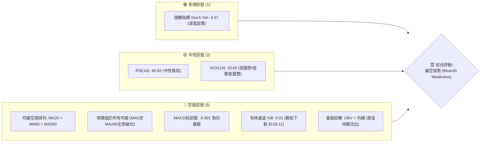
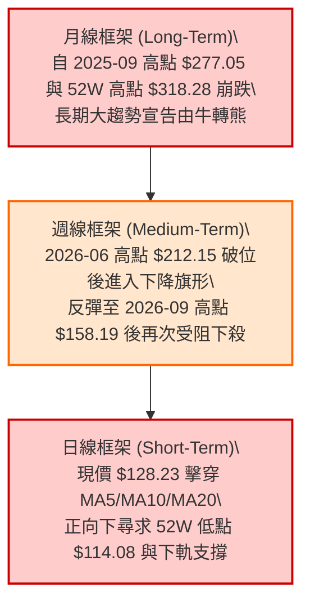
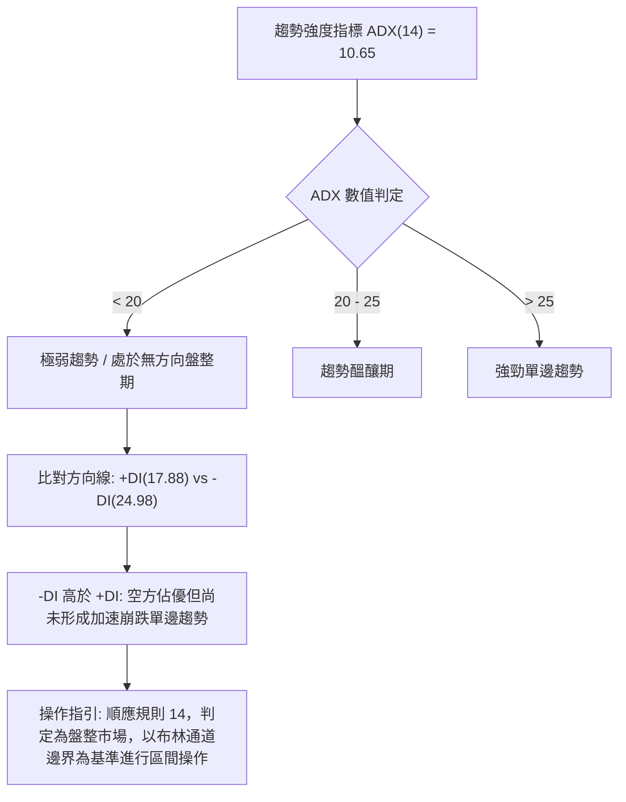
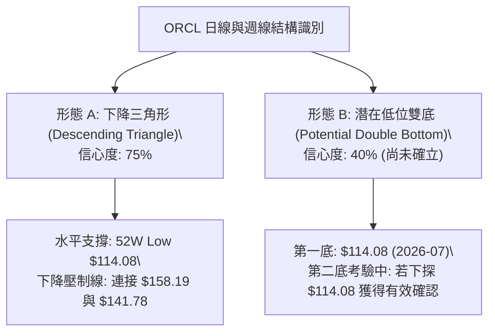
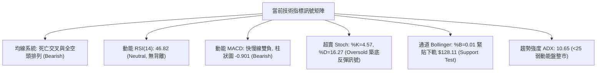
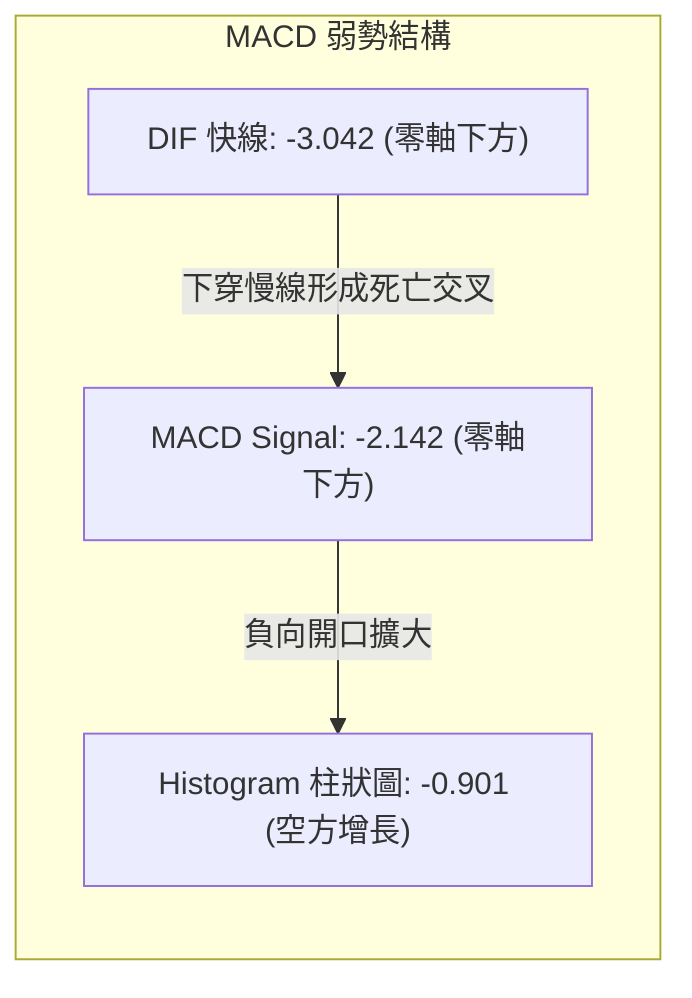
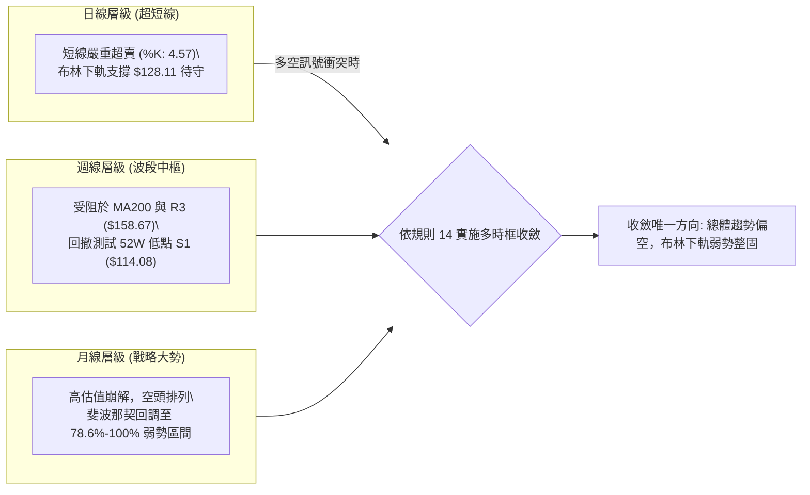
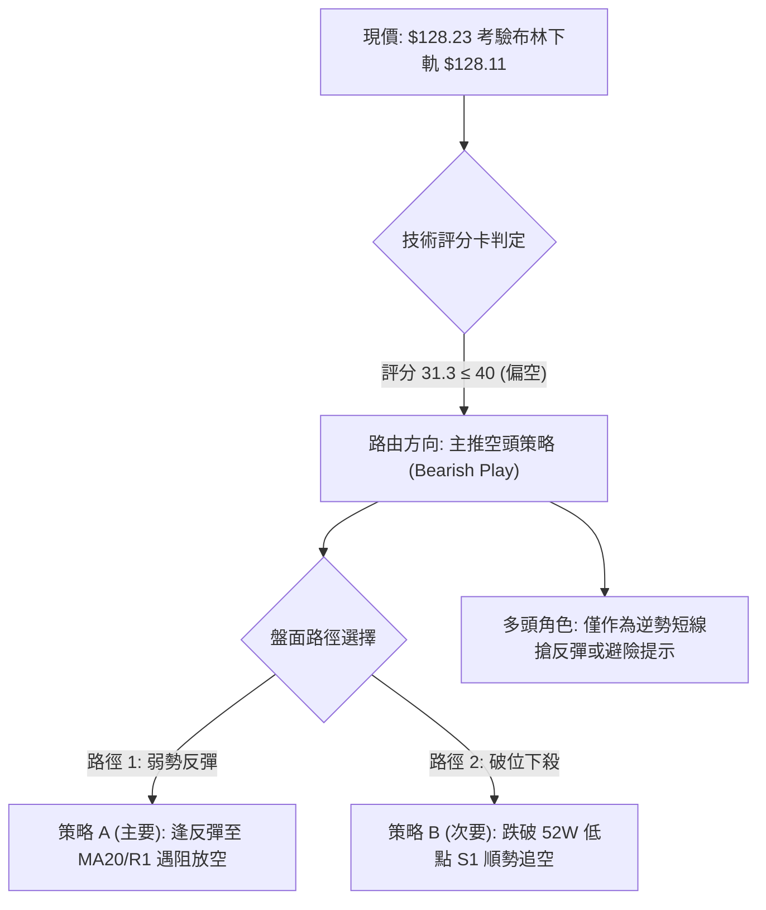
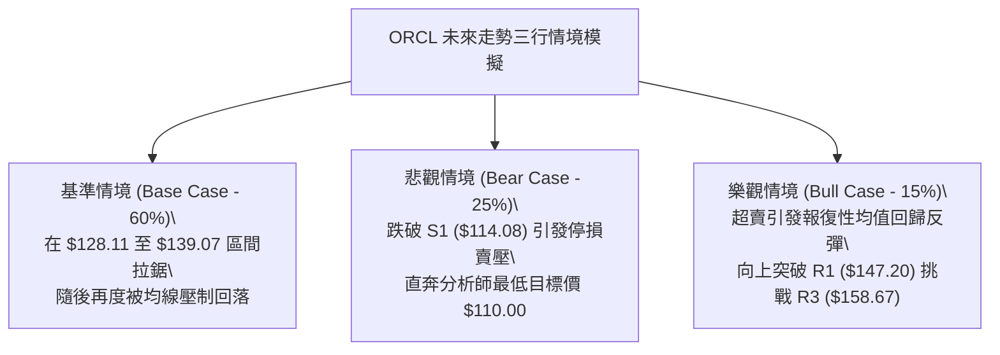

# ORCL 技術分析報告

> **報告日期**：2026-10-17 ｜ **語言**：繁體中文 ｜ **數據來源**：Yahoo Finance ｜ **當前價格**：$128.23

---

## 目錄

| 章節 | 內容 |
|------|------|
| [1. 技術面概覽](#1-技術面概覽) | 訊號儀表板、核心指標、評分卡 |
| [2. 趨勢分析](#2-趨勢分析) | 多時框趨勢、長中短期走勢、12個月走勢圖 |
| [3. 圖表形態分析](#3-圖表形態分析) | 形態識別、K線組合、形態目標價推算 |
| [4. 支撐與阻力](#4-支撐與阻力) | 關鍵價位分布、阻力/支撐分析、斐波那契回調 |
| [5. 技術指標深度解讀](#5-技術指標深度解讀) | 均線系統、RSI、MACD、布林通道、成交量與OBV |
| [6. 動能與波動率](#6-動能與波動率) | 動能四象限、ATR波動分析、Beta與相關性 |
| [7. 多時框架總結](#7-多時框架總結) | 時框架評分矩陣、多時框收斂結論 |
| [8. 交易策略建議](#8-交易策略建議) | 策略路由、價格情境階梯、主策略與避險規劃 |
| [9. 風險提示與監控](#9-風險提示與監控) | 監控指標Checklist、風險場景模擬、倉位風控 |
| [10. 報告總結](#10-報告總結) | 核心結論與最佳策略配置儀表板 |

---

## 1. 技術面概覽

### 🎯 技術訊號儀表板

ORCL 當前收盤價為 **$128.23**，處於 52 週價格區間（$114.08 – $318.28）的 **6.9%** 極低分位，整體技術架構呈現顯著的中長期空頭壓制與短線極度超賣並存的格局。



---

### 📊 核心指標速覽表

| 指標類別 | 指標名稱 | 當前數值 | 訊號 | 專業解讀 |
|:---|:---|:---:|:---:|:---|
| **價格基準** | 當前收盤價 | $128.23 | 🔴 | 位於52W低點區間，距年內高點 $318.28 回撤達 -59.71% |
| **短期均線** | MA20 (布林中軌) | $139.07 | 🔴 | 現價折價 -7.80%，短線受制於 20 日線動態反壓 |
| **中期均線** | MA50 | $144.64 | 🔴 | 現價折價 -11.35%，中期多空分水嶺下彎 |
| **長期均線** | MA200 | $159.03 | 🔴 | 現價折價 -19.37%，長期牛熊線已宣告失守 |
| **動能指標** | RSI(14) | 46.82 | 🟡 | 位於中性偏弱區，無顯著背離，反映跌勢暫歇性盤整 |
| **趨勢指標** | MACD (12,26,9) | -3.042 / -2.142 | 🔴 | 快慢線均在零軸下方運行，柱狀圖 -0.901 空方主導 |
| **超買超賣** | Stoch %K / %D | 4.57 / 16.27 | 🟢 | %K 跌破 10 進入極度超賣鈍化區，隨時具技術性反彈修復需求 |
| **通道指標** | Bollinger Bands | 下軌 $128.11 / %B 0.01 | 🔴 | 價格緊貼下軌邊界壓迫運行，通道向下開口有擴張跡象 |
| **趨勢強度** | ADX(14) / ±DI | 10.65 / -DI:24.98 | 🟡 | ADX < 25 表明處於盤整與動能衰竭期，-DI 主導但攻擊力不足 |
| **波動指標** | ATR(14) | $6.96 | 🔴 | 佔股價 5.43%，單日震幅擴大，持有敞口風險較高 |
| **量能指標** | OBV 與量比 | 1.18x (35.99M vs 30.56M) | 🔴 | OBV 低於均線，週五帶量壓低跌破整數關卡，量能偏空 |

---

### 🏆 技術評分卡

```
╔══════════════════════════════════════════════════════════════════╗
║                ORCL 技術評分卡 (2026-10-17)                      ║
╠══════════════════════════════════════════════════════════════════╣
║ 趨勢強度 (Trend)     ▓▓▓▓░░░░░░░░░░░░░░░░  22/100 🔴 空頭壓制    ║
║ 動能指標 (Momentum)  ▓▓▓▓▓▓▓░░░░░░░░░░░░░  36/100 🔴 負向擴散    ║
║ 支撐穩定度 (Support) ▓▓▓▓▓▓▓▓░░░░░░░░░░░░  42/100 🟡 近年低位    ║
║ 成交量配合 (Volume)  ▓▓▓▓▓▓░░░░░░░░░░░░░░  32/100 🔴 籌碼鬆動    ║
║ 形態結構 (Pattern)   ▓▓▓▓▓▓▓░░░░░░░░░░░░░  38/100 🟡 下降通道    ║
║ 均線系統 (MA Align)  ▓▓▓░░░░░░░░░░░░░░░░░  18/100 🔴 絕對空頭    ║
╠══════════════════════════════════════════════════════════════════╣
║ 綜合技術評分         ▓▓▓▓▓▓░░░░░░░░░░░░░░  31.3/100 🔴 強烈偏空  ║
╚══════════════════════════════════════════════════════════════════╝
```

---

## 2. 趨勢分析

### 🌐 多時框趨勢分析



---

### 📈 長期趨勢 — 12個月走勢圖（Unicode）

以下為 ORCL 過去 12 個月（2025-11 至 2026-10）收盤價歷史走勢圖：

```
ORCL 月線收盤走勢圖 (2025-11 至 2026-10)
價格軸 ($)
$240 ┤
$220 ┤                             ● $224.17 (2026-05 反彈頂部)
$200 ┤ ● $199.28 (2025-11)
$180 ┤     ● $192.34
$160 ┤         ● $162.84       ● $160.24
$140 ┤             ● $143.86       ● $145.50           ● $148.57
$120 ┤                 ● $145.55       ● $129.39   ● $136.79   ● $128.23 (現價)
$100 ┤                                     └─ 52W Low: $114.08
     └─┬──────┬──────┬──────┬──────┬──────┬──────┬──────┬──────┬──────┬──────┬──────┬──
     11/25  12/25  01/26  02/26  03/26  04/26  05/26  06/26  07/26  08/26  09/26  10/26
```

#### 走勢特徵分析表格

| 階段區間 | 起止價位 | 漲跌幅 | 趨勢性質 | 結構特徵分析 |
|:---|:---:|:---:|:---:|:---|
| **主跌第一浪** (2025.11-2026.02) | $199.28 → $143.86 | -27.81% | 激進空頭 | 獲利了結與高估值修正，月線連續四連陰 |
| **築底弱反彈** (2026.02-2026.05) | $143.86 → $224.17 | +55.82% | 軋空反彈 | 形成次級反彈高點 $224.17，但未能挑戰 52W 高點 $318.28 |
| **主跌第二浪** (2026.05-2026.07) | $224.17 → $129.39 | -42.28% | 崩跌破位 | 帶量長黑摜破 MA200，最低探至 52W 低點 $114.08（2026-07-26 週線） |
| **低位箱體磨底** (2026.08-2026.10) | $129.39 → $128.23 | -0.90% | 弱勢震盪 | 反彈高點逐次降低（$158.19 → $148.57 → $141.78），重回破位邊緣 |

---

### 📊 中期趨勢（週線分析）

```
ORCL 近期週線結構與關鍵動態壓力示意圖
$160 ┤                    ▲ 2026-09-06 高點 ($158.19) ── [R3: $158.67 / MA200: $159.03]
$150 ┤          ▲ 08-16 ($149.97)        ▲ 09-13 ($149.73) ── [R1: $147.20 / R2: $153.03]
$140 ┤     ▲ 08-09 ($146.48)                   ▲ 10-04 ($141.78) ── [MA20: $139.07]
$130 ┤                                                    ▼ 現價: $128.23 [布林下軌 $128.11]
$120 ┤
$110 ┤ ── 52W 最低點支撐: $114.08 (2026-07-26 週線長下影線) ── [S1: $114.08]
     └─────────────────────────────────────────────────────────────
```

---

### ⚡ 趨勢強度評估（ADX 解讀）



| 評估維度 | 指標數據 | 參考區間 | 狀態評估 | 實戰交易含義 |
|:---|:---:|:---:|:---:|:---|
| **趨勢量度 (ADX)** | **10.65** | < 25 (無趨勢) | 弱動能盤整 | 趨勢攻擊力度衰竭，避免在支撐處盲目追空，易生假突破 |
| **多方動能 (+DI)** | **17.88** | 0 – 100 | 多頭孱弱 | 買盤缺乏連續性推升力量，多頭僅為零星抵抗 |
| **空方動能 (-DI)** | **24.98** | 0 – 100 | 空方主控 | 空方佔據優勢，價格反彈均為均線反壓所阻 |
| **方向確認度** | -DI > +DI | 差值: 7.10 | 空方壓制 | 整體結構為偏空架構下的低波幅箱體收斂 |

---

## 3. 圖表形態分析

### 🔍 形態識別系統



#### 形態識別信心度與量化依據表（嚴格依據真實數據）

| 識別形態 | 信心度 (%) | 數據判斷依據（引用真實點位） | 完成度 (%) | 形態目標價與推算式 |
|:---|:---:|:---|:---:|:---|
| **下降三角形** | **75%** | 底部水平支撐錨定 52W 低點 **$114.08**；上方高點不斷下移（09-06 的 **$158.19**、09-20 的 **$147.07**、10-04 的 **$141.78**），反壓線清晰 | 80% | **破位目標**：若實體跌破 $114.08，依三角形高度（$158.19 - $114.08 = $44.11）推算理論空頭目標為：`$114.08 - $44.11 = $69.97`（數據未有相應聚類支撐，僅供極端測幅參考） |
| **潛在雙重底** | **40%** | 左底為 2026-07-26 之 **$114.08**，中間頸線為 2026-09-06 高點 **$158.19**。但當前價格為 $128.23，尚未確認築出右底 | 30% | **訊號不足**：因信心度低於 50%，未獲突破頸線確認前不預設多頭成型，維持指標型與邊界震盪解讀 |

---

### 🕯️ 重要K線形態分析

| 週期/月份 | 收盤價 | K線形態 | 技術解讀 | 訊號強度 |
|:---|:---:|:---|:---|:---:|
| **2026-07 週線** | $114.57 | 長下影錘子線 (Hammer) | 單週下探 52W 低點 $114.08 後爆出 2.52 億股巨量拉升，顯示有長線逢低承接買盤介入 | 🟢 轉折多 |
| **2026-09 週線** | $158.19 | 流星倒錘線 (Shooting Star) | 價格向上測試 MA200 ($159.03) 及 R3 ($158.67) 未果，上影線長達 $8.46，確認強阻力有效 | 🔴 頂部壓制 |
| **2026-10-18 (即時)** | $128.23 | 中陰線下破貼軌 | 連續兩週陰線貫穿 MA5 ($134.77) 與 MA20 ($139.07)，直逼布林下軌 $128.11，空頭動能佔優 | 🔴 空方延續 |

---

### 📉 ASCII 走勢形態示意圖

```
ORCL 下降三角形收斂走勢 (週線層級)
價格 ($)
$160 ┤      ● 高點 1 ($158.19)
$155 ┤        \
$150 ┤         \          ● 高點 2 ($147.07)
$145 ┤          \           \
$140 ┤           \           \          ● 高點 3 ($141.78)
$135 ┤            \           \           \
$130 ┤             \           \           \        ● 現價: $128.23
$125 ┤              \           \           \      /
$120 ┤               \           \           \    /  (通道下軌壓縮)
$114 ┼────────────────●───────────────────────●────┴── 水平關鍵頸線/支撐: S1 ($114.08)
     └─────────────────────────────────────────────────────────────
```

---

## 4. 支撐與阻力

### 🗺️ 關鍵價位分布圖（Unicode）

```
ORCL 價位結構分布圖 (由 OHLCV 與歷史波段嚴格計算)
══════════════════════════════════════════════════════════════════
$159.03 ║████████████████████████████████║ MA200 牛熊分水嶺
$158.67 ║████████████████████████████████║ 強阻力 R3 (波段高點聚類)
$157.78 ║▓▓▓▓▓▓▓▓▓▓▓▓▓▓▓▓▓▓▓▓▓▓▓▓▓▓▓▓▓▓▓▓║ 斐波那契 78.6% 回調位
$153.03 ║████████████████████████        ║ 阻力 R2 (反彈次高點)
$147.20 ║████████████████████████████    ║ 關鍵阻力 R1 (9月密集成交區頂部)
$139.07 ║════════════════════════════════║ MA20 (布林中軌動態壓力)
$128.23 ╠════════════════════════════════╣ ◄ 當前市價 (Current Price)
$128.11 ║░░░░░░░░░░░░░░░░░░░░░░░░░░░░░░░░║ 布林下軌 (極短線通道動態支撐)
$114.08 ║████████████████████████████████║ 核心強支撐 S1 (52W 最低點/斐波100%)
══════════════════════════════════════════════════════════════════
```

---

### 🚧 阻力位分析表

所有價位均嚴格取自數據提供的波段高點聚類與移動平均值：

| 阻力級別 | 精確價位 | 形成依據與技術意義 | 突破難度 | 技術重要性 |
|:---|:---:|:---|:---:|:---:|
| **動態反壓** | **$139.07** | **MA20 均線 / 布林中軌**：短期均線下行反壓，短線多空分水嶺 | 🟡 中等 | 短線轉強第一道門檻 |
| **阻力 R1** | **$147.20** | **波段高點聚類**：與 2026-09-20 週線高點 $147.07 形成共振重合 | 🔴 高 | 中期反轉確認點 |
| **阻力 R2** | **$153.03** | **波段反彈次高點**：2026 年 8 月底至 9 月初盤整密集套牢區間中軸 | 🔴 很高 | 籌碼密集套牢沉重阻力 |
| **強阻力 R3** | **$158.67** | **歷史波段高點聚類**：與 MA200 ($159.03) 及斐波那契 78.6% ($157.78) 共振 | 🔴 極高 | 多空牛熊轉換核心大關 |

---

### 🛡️ 支撐位分析表

| 支撐級別 | 精確價位 | 形成依據與技術意義 | 守住機率 | 技術重要性 |
|:---|:---:|:---|:---:|:---:|
| **超短線動態支撐** | **$128.11** | **布林下軌 (BB Lower)**：%B 為 0.01，短線極限超賣乖離下軌支撐 | 🟡 50% | 決定是否引發均值回歸反彈 |
| **強支撐 S1** | **$114.08** | **52週最低點聚類 / 斐波那契 100% 基準點**：2026-07 探底回升關鍵支撐 | 🟢 70% | 年度終極多頭防線（破位將開展無支撐真空） |
| **次級支撐** | *數據中未偵測到* | 現有 OHLCV 歷史數據聚類中無介於 $114.08 至 $0 之間的已驗證聚類點 | — | 若跌破 $114.08 將形成創年內新低之單邊加速走勢 |

---

### 📐 斐波那契回調位分析

依據 52 週極端區間（高點 **$318.28** 至低點 **$114.08**，垂直落差達 **$204.20**）計算所得之關鍵回調位如下：

| 斐波那契比例 | 精確對應價位 | 當前相對位置與技術狀態 | 實戰指導意義 |
|:---:|:---:|:---|:---|
| **0.0% (52W High)** | **$318.28** | 上方遠端極限點 (+148.21%) | 長期牛市極致泡沫峰值 |
| **23.6%** | **$270.09** | 上方極遠阻力 | 2025 年 9 月高位震盪平臺 |
| **38.2%** | **$240.28** | 上方阻力 | 中期主要波段多空折返位 |
| **50.0%** | **$216.18** | 上方阻力 (2026-05 反彈高點 $224.17 附近) | 牛熊分界折返中樞 |
| **61.8%** | **$192.08** | 上方阻力 (2025-12 收盤 $192.34 附近) | 黃金分割重要分割線 |
| **78.6%** | **$157.78** | 上方重要阻力區 (與 R3 $158.67 / MA200 $159.03 密集成合) | **多頭反轉的絕對生命線** |
| **當前現價** | **$128.23** | **落在 78.6% ($157.78) 與 100.0% ($114.08) 之間** | **處於重度回調超跌區間** |
| **100.0% (52W Low)**| **$114.08** | 下方關鍵支撐 (距現價 -11.04%) | **年度底線，破位宣告長期結構崩潰** |

---

## 5. 技術指標深度解讀

### 🎛️ 指標訊號總覽



---

### 📈 移動平均線排列分析

```mermaid
graph TD
    subgraph MA_SYSTEM ["均線空頭梯隊 (全向下發散)"]
        M240["MA240: $167.33 (-23.37%)"] --> M200["MA200: $159.03 (-19.37%)"]
        M200 --> M120["MA120: $157.66 (-18.66%)"]
        M120 --> M50["MA50: $144.64 (-11.35%)"]
        M50 --> M60["MA60: $142.21 (-9.83%)"]
        M60 --> M20["MA20: $139.07 (-7.80%)"]
        M20 --> M10["MA10: $137.97 (-7.06%)"]
        M10 --> M5["MA5: $134.77 (-4.85%)"]
        M5 --> CP["現價: $128.23"]
    end
    style CP fill:#ff9999,stroke:#cc0000,stroke-width:3px;
```



*   **均線排列定性**：全週期均線體系（MA5 至 MA240）呈現標準的「瀑布狀空頭排列」（Bearish Alignment）。
*   **均線斜率**：MA5 變化率為 -4.85%，MA10 為 -7.06%，MA20 為 -7.80%，均線下行速率加劇，顯示空方完全掌握定價權，反彈若未能帶量收復 MA20 ($139.07)，均視為技術性弱勢抵抗。

---

### 📉 RSI(14) 分析

*   **當前數值**：**46.82**（日線中性偏弱）
*   **區間評估進度條**：
```
超賣區 (0-30)           中性過渡區 (30-70)                 超買區 (70-100)
├──────────────┼──────────────────────────────┼──────────────┤
░░░░░░░░░░░░░░  ████████████████░░░░░░░░░░░░░░  ░░░░░░░░░░░░░░
0             30             46.82            70            100
```
*   **背離分析**：檢視 2026-07-26 週線低點 $114.57（RSI 26.7）至目前現價 $128.23（週線 RSI 46.8，日線 RSI 46.82），價格高於 7 月低點，RSI 亦同步處於中位，**未出現明確的日線/週線底背離或頂背離結構**。該走勢僅表徵價格在下跌趨勢中的暫歇性修整。

---

### 📊 MACD(12,26,9) 訊號解讀



*   **快慢線位置**：DIF (-3.042) 與 Signal (-2.142) 雙雙深陷零軸以下，確立大環境處於弱勢空頭市。
*   **柱狀圖動能**：柱狀體為 **-0.901**，相較前一交易日呈現進一步負向拉長，空方動能微幅增強，暫無死叉收斂轉金叉的拐點訊號。

---

### 📦 布林通道分析

```
ORCL 日線布林通道 (Bollinger Bands 20, 2) 結構圖
$152 ┤
$150 ┼─────────────────────── 上軌 (Upper Band): $150.04
$145 ┤                       /
$140 ┤                      / 
$139 ┼─────────────────────●── 中軌 (MA20): $139.07 (反彈強阻力)
$135 ┤                    /
$130 ┤                   /
$128.23 ┼───────────────●──── ◄ 現價 ($128.23，貼軌)
$128.11 ┼───────────────┴──── 下軌 (Lower Band): $128.11 (%B = 0.01)
$125 ┤
```

*   **通道寬度**：上軌 $150.04 與下軌 $128.11 帶寬為 $21.93 (帶寬率 15.77%)。
*   **通道位置 (%B)**：**%B = 0.01**（0 代表下軌，1 代表上軌），表示現價已極限逼近並考驗下軌支撐。
*   **隨機指標共振**：配合 **Stoch %K: 4.57 / %D: 16.27** 的深度超賣態勢，布林下軌 $128.11 通常會引發價格的均值回歸，短線容易出現向中軌 $139.07 靠攏的反彈走勢。

---

### 💹 成交量分析（量價配合度）

*   **量能對比**：最新單日成交量為 **35,996,500 股**，高於 20 日均量（30,558,250 股），量比為 **1.18x**；高於 50 日均量（29,320,950 股）。
*   **OBV 能量潮**：當前 **OBV < OBV均線**，能量潮呈現向下發散。在股價連日破位下行的過程中，成交量放量放大，形成典型的「**價跌量增**」（Volume Expansion on Decline）的弱勢空頭放量特徵，說明籌碼持續處於淨流出階段。

---

## 6. 動能與波動率

### ⚡ 動能評估四象限

```
動能與波動率狀態分佈
  波動率 (Volatility - ATR/Beta)
    ▲
 高 │      Q3: 高風險高收益            Q4: 避免進場 (高波弱勢)
 5% │      (強動能 / 高波動)          [★ ORCL 當前位置: ATR 5.43% / Beta 1.77]
    │
 低 │      Q1: 最佳多頭機會            Q2: 謹慎觀望 (低波整固)
 2% │      (強動能 / 低波動)           (弱動能 / 低波動)
    └────────────────────────────────────────────────────────►
       弱 (MACD < 0 / -DI 領先)   中性   強 (MACD > 0 / +DI 領先)
                               動能強度 (Momentum)
```

| 象限標記 | 動能維度 | 波動維度 | ORCL 歸屬狀態 | 核心操作評估 |
|:---:|:---:|:---:|:---:|:---|
| **Q1** | 強 | 低 | — | 趨勢穩健上行，回調做多 |
| **Q2** | 弱 | 低 | — | 盤整築底蓄勢，區間高拋低吸 |
| **Q3** | 強 | 高 | — | 爆發型單邊行情，順勢追單 |
| **Q4** | **弱** | **高** | **✓ (ORCL 當前歸屬)** | **高波動空頭壓制區，嚴控多頭倉位，順勢逢高偏空防守** |

---

### 📊 ATR 波動率分析

*   **當前 ATR(14)**：**$6.96**
*   **ATR 相對價格比**：`$6.96 / $128.23 = 5.43%`（屬於極高波動水準）。
*   **止損邊界量化設定**：
    *   **短線保護性止損（1.0 × ATR）**：波幅空間約 **$6.96**。
    *   **波段防守性止損（1.5 × ATR）**：波幅空間約 **$10.44**。
    *   **實戰指引**：由於日均真實波幅接近 $7.00，在制定任何交易策略時，止損距離不得小於 $6.96，否則極易被單日正常市場雜訊洗盤出場。

---

### 📐 Beta 與市場相關性

*   **Beta 係數**：**1.77**（高彈性、高系統性風險曝險標的）。
*   **技術意涵**：ORCL 的波動幅度約為 S&P 500 指數的 1.77 倍。在整體美股大盤處於調整或風險厭惡環境下，ORCL 將承擔放大的下行 beta 風險；反之，若大盤展開軋空反彈，其超跌彈性亦較為可觀。

---

## 7. 多時框架總結

### 📋 時框架評分表

| 時框架 | 趨勢方向 | 動能狀態 | 均線排列 | 圖表形態 | 綜合評分 | 戰術建議 |
|:---|:---:|:---:|:---:|:---:|:---:|:---|
| **短期 (日線)** | 偏空 🔴 | Stoch 超賣/MACD 偏空 🟡 | 瀑布下發散 🔴 | 貼軌測試 $128.11 🟡 | **34/100** | 考驗布林下軌，防範摜破引發多殺多 |
| **中期 (週線)** | 空頭 🔴 | MACD 零軸下/RSI 中性 🔴 | MA20 < MA50 🔴 | 下降三角形收斂 🔴 | **28/100** | 逢反彈均線反壓建立空頭或減碼 |
| **長期 (月線)** | 崩跌重挫 🔴| 跌破年線/長期回調 🔴 | 價格遠離 MA200 🔴 | 高位崩跌主跌浪 🔴 | **22/100** | 距 52W 高點折價近六成，不可盲目長線抄底 |

---

### 🔲 綜合訊號矩陣



---

### ⚖️ 多時框收斂結論

依據多時框收斂原則（嚴格要求 14）：
1.  **市場屬性判定**：當前 **ADX(14) 為 10.65 (< 25)**，嚴格定義為「**無單邊趨勢之低動能盤整行情**」（非高動能趨勢行情）。
2.  **交易主導邊界**：以**日線布林通道（下軌 $128.11 至上軌 $150.04）作為主要震盪區間**。
3.  **時框衝突收斂**：日線隨機指標（Stoch %K: 4.57）發出強烈超賣修復訊號，但週線與月線均線呈現全面空頭排列。依收斂規則，**超賣僅代表跌勢暫緩或帶來微幅反彈，絕不可視為反轉做多的依據**。
4.  **唯一方向性結論**：**【偏空觀望 / 逢反彈布林中軌偏空處置】**。現價已貼近下軌邊界，策略應避免在現價盲目追空，而應重點鎖定「**反彈測試動態壓力遇阻放空**」或「**跌破強支撐順勢空**」作為唯一核心主線。

---

## 8. 交易策略建議

### 🗺️ 策略決策流程圖



---

### 🧭 策略路由說明

> **當前主策略方向 = 【主推空頭策略（偏空逢高放空）】（依技術評分卡綜合得分 31.3 / 100 判定）**

*   **路由依據**：整體均線空頭排列，MACD 負向放大，OBV 疲軟，綜合評分僅 31.3 分（≤ 40 區間）。依照規範，本報告**主推空頭策略**；多頭邏輯僅作為超賣修復的風險對沖參考，嚴禁兩頭盲目下注。

---

### 🎯 價格情境階梯（Price Scenarios）

價位嚴格引用第 4 章及關鍵數據表之聚類數值：

| 觸發條件 (Trigger) | 下一目標 (Target 1) | 後續延伸 (Target 2) | 情境技術含義 |
|:---|:---:|:---:|:---|
| **向上反彈突破 MA20 ($139.07)** | **R1 ($147.20)** | **R2 ($153.03)** | 短線超賣修正，挑戰 9 月密集套牢區 |
| **受阻於 MA20 ($139.07) 下跌** | **下軌 ($128.11)** | **S1 ($114.08)** | 弱勢震盪整固，反彈結束重回尋底通道 |
| **有效跌破 S1 ($114.08)** | **$110.00 (分析師極端下限)** | *數據中未偵測到* | 創 52 週新低，宣告第二輪單邊主跌浪啟動 |

---

### 📊 情境機率分佈

| 情境劇本 | 估計機率 | 主要技術依據 |
|:---|:---:|:---|
| **情境一：弱勢反抽後下探 (主劇本)** | **55%** | Stoch %K(4.57) 超賣引發微幅反抽，但受制於 MA20 ($139.07) 均線壓制，再度轉向考驗 S1 ($114.08) |
| **情境二：直接跌破下軌加速探底** | **30%** | OBV 持續流出，量比 1.18x 放量壓低，現價 $128.23 貫穿下軌 $128.11 後直接下探 52W 低點 S1 ($114.08) |
| **情境三：強勢反轉站上 MA50** | **15%** | 需帶量長紅克服 R1 ($147.20) 與 R3 ($158.67/MA200)，當前無大級別底背離配合，發生機率極低 |

---

### 🔴 主策略詳情（空頭交易策略）

所有價位均嚴格基於數據聚類點位計算（禁止捏造）：

| 策略要素 | 策略 A：反彈遇阻做空（主推優選） | 策略 B：跌破 52W 低點順勢做空（突破空） |
|:---|:---:|:---:|
| **操作性質** | 順大勢逆小勢，右側逢高佈空 | 順大勢破位追空，動能確認單 |
| **進場觸發條件** | 價格反彈至布林中軌/MA20 遇阻回落 | 價格跌破 52W 最低點 S1 且收盤確認 |
| **精確進場價格** | **$139.07** (MA20 附近) | **$114.08** (S1 破位處) |
| **止損價格** | **$147.20** (R1 阻力位上方) | **$121.04** (即 $114.08 + 1.0×ATR $6.96) |
| **第一目標價 (T1)** | **$128.11** (布林下軌) | **$110.00** (分析師目標價下限) |
| **第二目標價 (T2)** | **$114.08** (核心強支撐 S1) | *數據中未偵測到（需以動態移動止盈保護）* |
| **承擔風險 (Risk)** | $147.20 - $139.07 = $8.13 | $121.04 - $114.08 = $6.96 |
| **預期報酬 (Reward)** | T2: $139.07 - $114.08 = $24.99 | T1: $114.08 - $110.00 = $4.08 |
| **風險報酬比 (R:R)** | **1 : 3.07** (極佳) | **1 : 0.59** (盈虧比較差，僅供極端破位參考) |
| **成功預估機率** | **65%** | **45%** |
| **建議配置倉位** | **10% - 15%** (總資金敞口) | **5%** (嚴格控制追空部位) |

---

### 🟢 反向風險觸發點（多頭對沖提示）

若出現以下訊號，空頭主策略宣告失效，應全面平倉離場並切換至觀望/對沖模式：
*   **關鍵價格觸發**：若日線收盤價強勢突破並站穩 **R1 ($147.20)**。
*   **均線結構轉變**：價格帶量重返 MA50 (**$144.64**) 之上，使短期均線金叉向上扭轉。
*   **動能指標反轉**：MACD 柱狀圖由負轉正，且 DIF 快線突破零軸上方。

---

### ⭐ 整體訊號強度評星

```
做多訊號強度：★☆☆☆☆  (1.0/5星) ── 僅有超賣支撐，順勢做多條件完全不具備
做空訊號強度：★★★★☆  (4.0/5星) ── 均線瀑布發散，中期趨勢高度偏空
整體架構可信度：★★★☆☆  (3.5/5星) ── 處於 ADX<25 盤整期，需防範下軌假摔反抽
```

---

## 9. 風險提示與監控

### ✅ 關鍵監控指標 Checklist

```
╔══════════════════════════════════════════════════════════════════╗
║                ORCL 交易風控監控清單 (Checklist)                 ║
╠══════════════════════════════════════════════════════════════════╣
║ [ ] 監控布林下軌 $128.11 是否失守，收盤脫離軌道即視為超跌反抽   ║
║ [ ] 每日收盤檢查 MA20 ($139.07) 之動態壓制有效性                ║
║ [ ] 警惕 Stoch %K(4.57) 低位金叉 %D(16.27) 觸發的軋空雜訊       ║
║ [ ] 緊盯 52 週最低點 S1 ($114.08) 的多頭最後生命線防守力道       ║
║ [ ] 觀察單日量能是否超越 20 日均量 (30.56M)，辨識主力資金意圖    ║
║ [ ] 單筆交易停損嚴格錨定 ATR ($6.96)，嚴禁無止損扛單            ║
╚══════════════════════════════════════════════════════════════════╝
```

---

### ⚠️ 風險場景分析



---

### 🛡️ 風險管理重要提醒

1.  **波動性與槓桿控制**：ORCL 的 Beta 高達 **1.77**，且 ATR 達 **$6.96**（單日震幅 5.43%）。在空頭或弱勢盤整格局下，此類高彈性股票極易因市場情緒或財報雜音而出現單日極端跳空，整體持倉部位建議嚴格限制在總資產的 **10% 以內**。
2.  **估值與基本面背離風險**：雖然 ORCL 營收年增達 29.6%、淨利年增 54.5%，且分析師共識平均目標價高達 **$237.36**（買入評級佔多數），但技術面上股價正處於 52 週最低位並維持典型空頭排列。**技術交易者必須恪守「技術走勢優先於基本面願景」之紀律**，切忌因基本面看好而在技術下行趨勢中逆勢加碼摸底。
3.  **自由現金流為負之警訊**：自由現金流（FCF Yield 為 -11.80%，FCF 為 -$45.85B）與高負債（淨負債 -$132.07B）在當前高利率環境下將持續壓制估值修復上限，為中長期技術阻力位提供了基本面基本面的反壓邏輯。

---

## 10. 報告總結

```
╔══════════════════════════════════════════════════════════════════╗
║                    ORCL 技術分析報告總結                         ║
╠══════════════════════════════════════════════════════════════════╣
║ 報告日期：2026-10-17                                            ║
║ 當前價格：$128.23  (52W 區間分位: 6.9%)                         ║
║ 分析評級：🔴 偏空弱勢 (Bearish Underperformance)                 ║
╠══════════════════════════════════════════════════════════════════╣
║ 關鍵結論：                                                       ║
║ ├─ 長期趨勢：🔴 空頭主導 (自高點 $318.28 大幅折價，跌破年線)    ║
║ ├─ 中期趨勢：🔴 弱勢收斂 (下降三角形運行中，受阻於 R3 $158.67)  ║
║ ├─ 短期趨勢：🟡 極度超賣 (Stoch 4.57，布林下軌 $128.11 待測)    ║
║ ├─ 關鍵支撐：S1: $114.08 (52W 最低點防線)                       ║
║ ├─ 關鍵阻力：MA20: $139.07 / R1: $147.20 / R3: $158.67           ║
║ └─ 市場共識：41 位分析師平均目標 $237.36，最低目標 $110.00       ║
╠══════════════════════════════════════════════════════════════════╣
║ 最優策略組合：                                                   ║
║ 1. 🥇 最佳機會：逢反彈至 MA20 ($139.07) 遇阻放空，停損設 $147.20 ║
║                 目標下看 S1 ($114.08)，盈虧比達 1:3.07          ║
║ 2. 🥈 次選機會：破位空，若帶量摜破 S1 ($114.08) 順勢短空至 $110  ║
║ 3. 🥉 保守選擇：空手觀望，靜待日線級別底背離或帶量收復 MA50 再行 ║
╚══════════════════════════════════════════════════════════════════╝
```

---

> ⚠️ **免責聲明**：本報告為依據標準技術分析模型與歷史量價數據所產出之研究內容，所有數據（OHLCV、均線、斐波那契回調位及指標參數）均以客觀數據推導。本報告**僅供學術研究與投資參考**，**不構成任何要約、招攬或具體投資買賣建議**。金融市場瞬息萬變，投資人應獨立評估風險並自負盈虧。

---
*報告生成時間：2026-10-17 ｜ 數據來源：Yahoo Finance ｜ 分析框架：多時框技術分析體系*