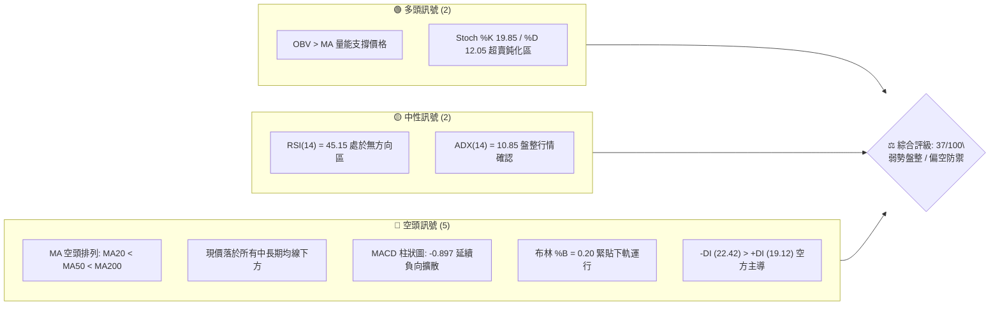
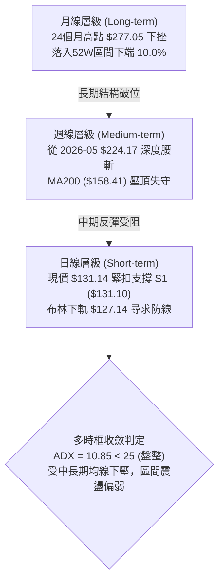
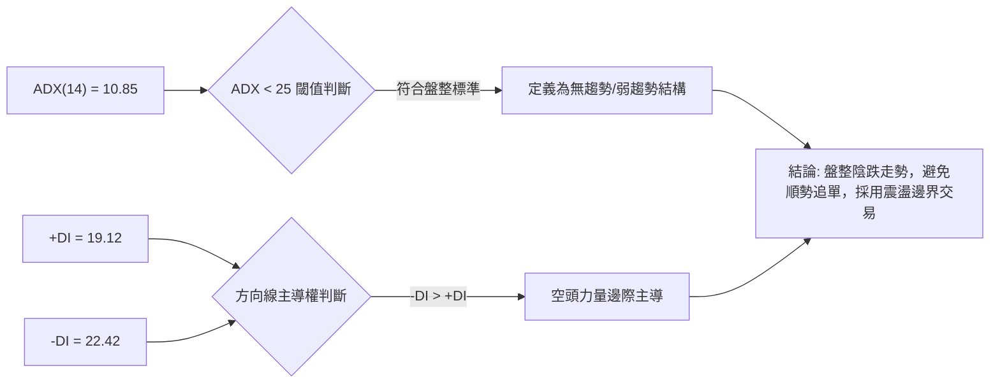
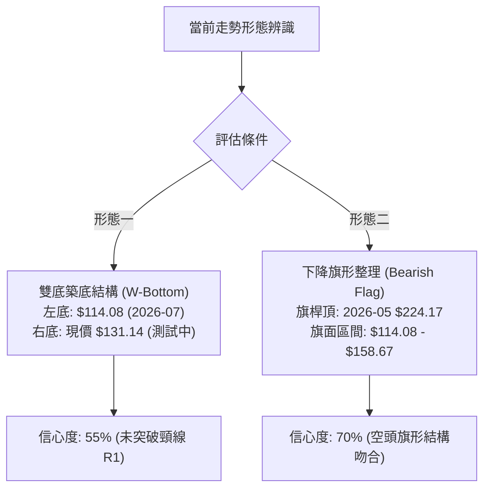
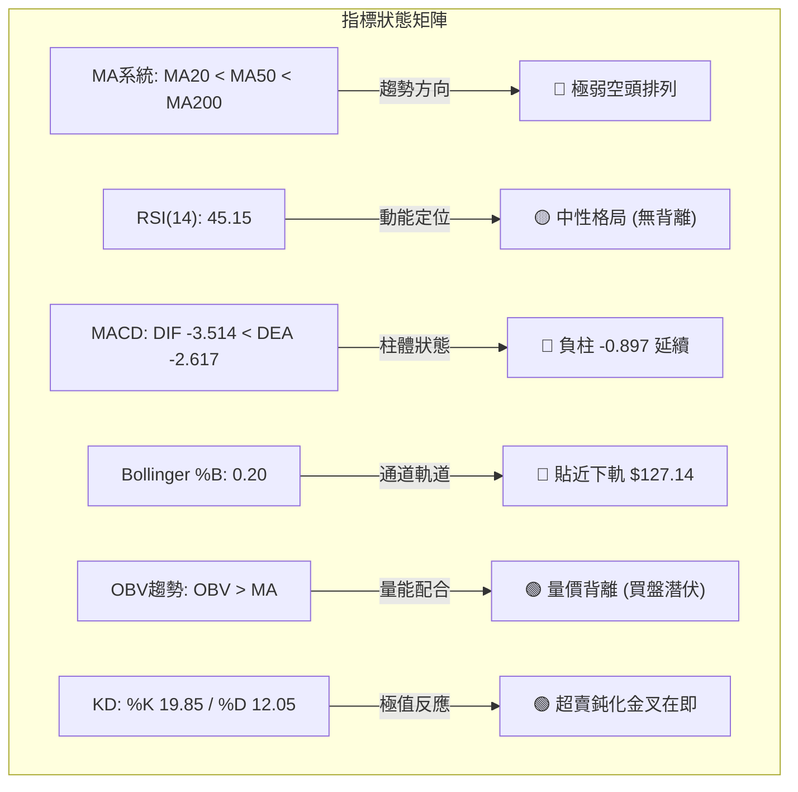
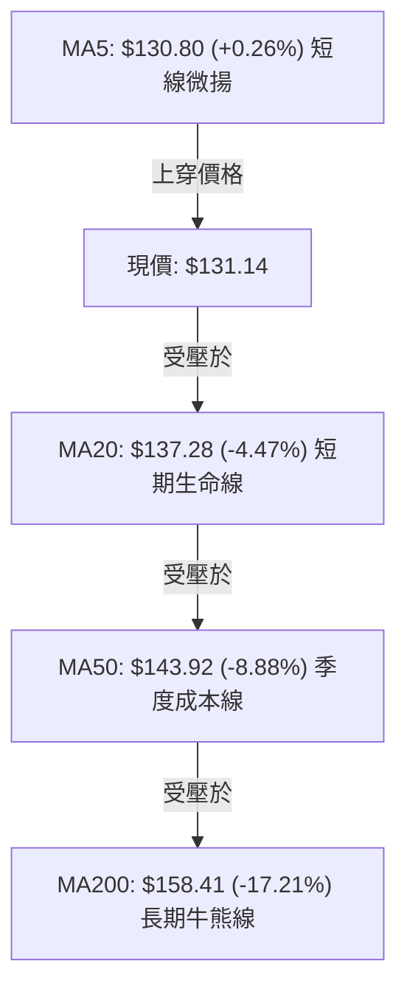
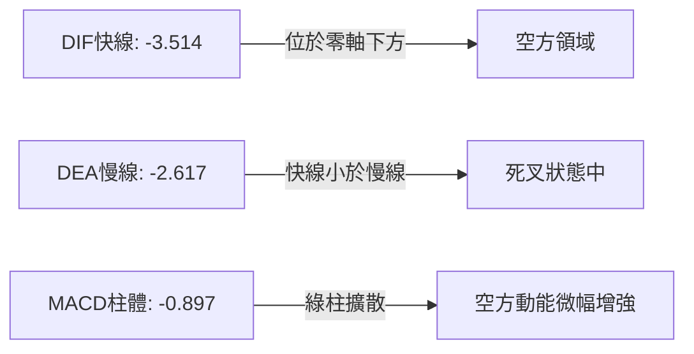
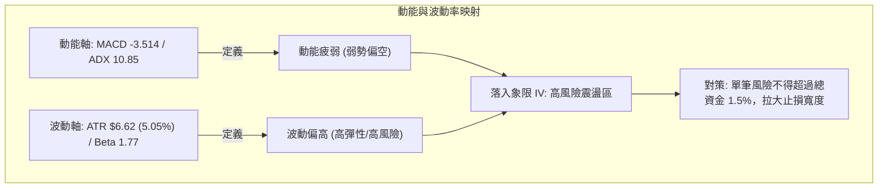
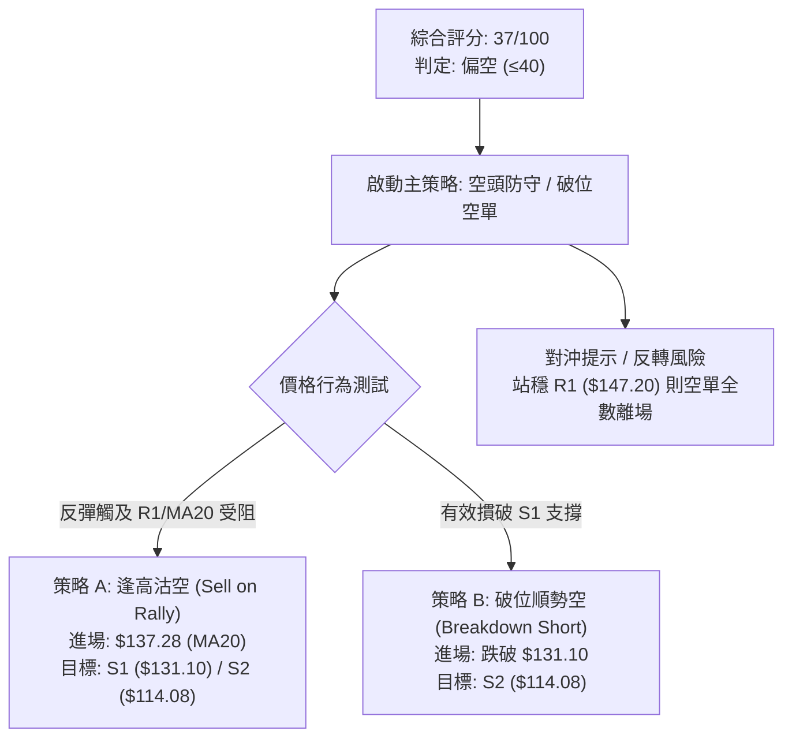
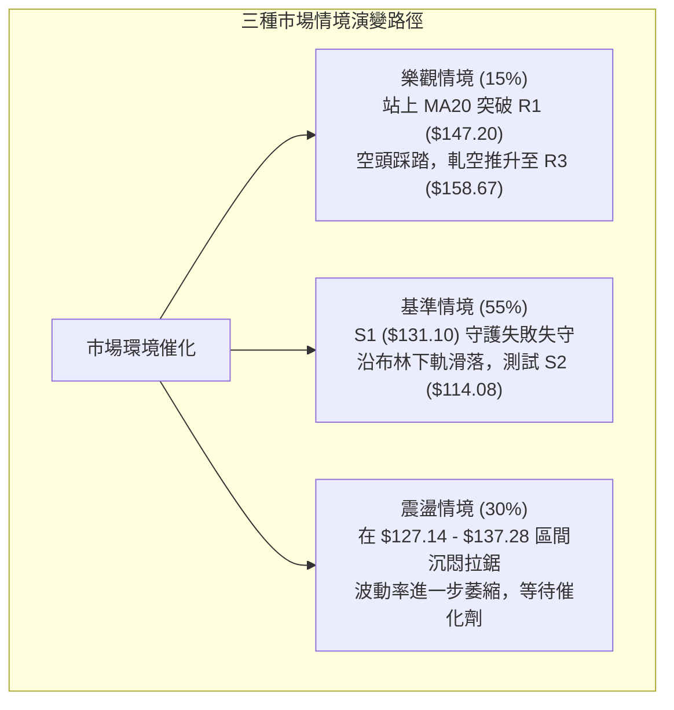

# ORCL 技術分析報告

> **報告日期**：2026-10-21 ｜ **語言**：繁體中文 ｜ **數據來源**：Yahoo Finance ｜ **當前價格**：$131.14

---

## 目錄

| 章節 | 內容 |
|------|------|
| [1. 技術面概覽](#1-技術面概覽) | 訊號儀表板、核心指標、評分卡 |
| [2. 趨勢分析](#2-趨勢分析) | 多時框趨勢、長中短期走勢、ADX強弱判斷 |
| [3. 圖表形態分析](#3-圖表形態分析) | 形態識別、K線組合、形態信心度與目標價 |
| [4. 支撐與阻力](#4-支撐與阻力) | 關鍵價位、斐波那契回調結構 |
| [5. 技術指標深度解讀](#5-技術指標深度解讀) | MA排列、RSI背離、MACD、布林通道、OBV量能 |
| [6. 動能與波動率](#6-動能與波動率) | 動能四象限、ATR風控距離、Beta市場敏感度 |
| [7. 多時框架總結](#7-多時框架總結) | 時框矩陣、收斂規則與唯一方向性結論 |
| [8. 交易策略建議](#8-交易策略建議) | 策略路由分流、價格情境階梯、風控策略詳情 |
| [9. 風險提示與監控](#9-風險提示與監控) | 關鍵指標Checklist、情境路徑與風控紀律 |

---

## 1. 技術面概覽

### 🎯 技術訊號儀表板



### 📊 核心指標速覽表

| 指標類別 | 指標名稱 | 當前數值 | 訊號 | 解讀 |
|----------|----------|----------|:----:|------|
| **價格** | 當前收盤價 | $131.14 | 🔴 | 位於 52 週區間 10.0% 極低位，承壓嚴重 |
| **短期均線** | MA 20 | $137.28 | 🔴 | 價格低於 MA20 (-4.47%)，短線反彈首道反壓 |
| **中期均線** | MA 50 | $143.92 | 🔴 | 中期生命線下彎，壓制波段動能 |
| **長期均線** | MA 200 | $158.41 | 🔴 | 跌破牛熊分界線 (-17.21%)，長期趨勢偏空 |
| **均線架構** | 均線系統排列 | MA20 < MA50 < MA200 | 🔴 | 標準空頭排列，上方層層套牢籌碼沉重 |
| **擺盪動能** | RSI(14) | 45.15 | 🟡 | 位於 30–70 中性區間，暫無頂底背離訊號 |
| **動能趨勢** | MACD (12,26,9) | DIF: -3.514 / DEA: -2.617 | 🔴 | 柱狀圖 -0.897，零軸下方死叉延續擴散 |
| **超賣指標** | KD (Stoch %K/%D) | %K: 19.85 / %D: 12.05 | 🟢 | 雙線深入 20 以下超賣區，醞釀技術性反彈 |
| **趨勢強度** | ADX (14) | 10.85 (+DI 19.12 / -DI 22.42) | 🟡 | ADX < 25 指標處於低位，呈弱趨勢盤整市 |
| **通道位置** | Bollinger Bands | 上軌 $147.41 / 下軌 $127.14 | 🔴 | %B 為 0.20，價格於中下軌間弱勢滑行 |
| **量能趨勢** | OBV / 量比 | 26.61M (量比 0.88x) | 🟢 | OBV > MA，量能未隨價格破底下殺，具潛在買盤 |
| **波動幅度** | ATR(14) | $6.62 (佔現價 5.05%) | 🔴 | 單日波幅高達 5.05%，市場避險與跳空風險偏高 |

### 🏆 技術評分卡

```
╔══════════════════════════════════════════════════════════════════╗
║                 技術評分卡 — ORCL (2026-10-21)                  ║
╠══════════════════════════════════════════════════════════════════╣
║ 趨勢強度 (Trend)     ██████░░░░░░░░░░░░░░  30/100  🔴 空頭壓制   ║
║ 動能指標 (Momentum)  ████████░░░░░░░░░░░░  40/100  🔴 MACD負向   ║
║ 支撐穩定度 (Support) ██████████░░░░░░░░░░  50/100  🟡 考驗S1關鍵 ║
║ 成交量配合 (Volume)  ████████████░░░░░░░░  60/100  🟢 OBV底背離  ║
║ 形態完整度 (Pattern) ██████░░░░░░░░░░░░░░  30/100  🔴 下行通道   ║
║ 均線排列 (Moving Av) ████░░░░░░░░░░░░░░░░  20/100  🔴 完備空頭   ║
╠══════════════════════════════════════════════════════════════════╣
║ 綜合技術評分         ███████░░░░░░░░░░░░░  37/100  🔴 偏空防禦   ║
╚══════════════════════════════════════════════════════════════════╝
```

---

## 2. 趨勢分析

### 🌐 多時框趨勢分析



### 📈 長期趨勢 — 12個月走勢圖（Unicode）

```
ORCL 月線走勢圖（2025-11 至 2026-10）
價格軸 ($)
$260 ┤  ● (2025-10 高點聚類 $259.14)
$240 ┤
$220 ┤                                      ● (2026-05 頂部 $224.17)
$200 ┤        ● (2025-11: $199.28)
$180 ┤              ● (2025-12: $192.34)
$160 ┤                    ● (2026-01)             ● (2026-04)
$140 ┤                          ● (2026-02)             ● (2026-06: $145.50)  ● (2026-08: $148.57)
$120 ┤                                                        ● (2026-07: $129.39)  ●← 現在 ($131.14)
     └───────────────────────────────────────────────────────────────────────────────────────────
        11M    12M    01M    02M    03M    04M    05M    06M    07M    08M    09M    10M (當前)
```

**走勢特徵分析表格**：

| 階段區間 | 起止月份 | 價格變動 | 區間漲跌幅 | 走勢特徵與技術含義 |
|:---|:---:|:---:|:---:|:---|
| **第一階段：高位破位跳水** | 2025-10 → 2026-02 | $259.14 → $143.86 | -44.49% | 主升浪結束，機構資金出逃，長黑K跌破中長期均線防線 |
| **第二階段：技術次級反彈** | 2026-02 → 2026-05 | $143.86 → $224.17 | +55.83% | 超跌暴力抽頭反彈，但受制於籌碼沉重，形成假突破右肩 |
| **第三階段：恐慌斷崖重挫** | 2026-05 → 2026-07 | $224.17 → $129.39 | -42.28% | 兩月內回吐全部漲幅，帶量破底並打出 52 週低點聚類 |
| **第四階段：築底震盪拉鋸** | 2026-07 → 2026-10 | $129.39 → $131.14 | +1.35% | 波動幅度收窄，成交量遞減，在 S1 ($131.10) 附近反覆測試 |

### 📊 中期趨勢（週線分析）

中期技術面從 2026-06 開始進入快速下墜後的 L 型盤整。觀察近 20 週數據：
- **第一波重挫築底**：2026-06-28 暴跌至 $147.47（週 RSI 驟降至 11.1），隨後於 2026-07-26 摜壓至波段極低點 $114.57（52W Low: $114.08）。
- **第二波均線反抽**：2026-08-09 至 2026-09-06 出現技術性修復，週收盤價推升至 $158.19，剛好觸及長期均線 MA200 ($158.41) 與 R3 ($158.67) 阻力區即告回落。
- **第三波震盪陰跌**：2026-09-13 後連續下行，週成交量由 202M 縮減至 50M，週 MACD 柱狀圖由正轉負 (-0.897)，價格重新考驗 S1 ($131.10)。

```
中期週線價格壓力與支撐示意圖：
  $158.67  ═══════════════════════════════ R3 / MA200 壓制頂部 (09-06 高點 $158.19)
               │                 ▲
               │ 漲勢衰竭回落    │
  $147.20  ────┼─────────────────┼──────── R1 / BB中軌 反彈頸線壓力
               ▼                 │
  $131.14  ─ ─ ─ ─ ─ ─ ─ ─ ─ ─ ─ ┼ ─ ─ ─ 現價：於 S1 ($131.10) 弱勢喘息
                                 ▼
  $114.08  ═══════════════════════════════ S2 / 52週低點防線 (07-26 低點 $114.57)
```

### ⚡ 趨勢強度評估（ADX 解讀）



**ADX 趨勢強度標準對照表**：

| ADX 數值區間 | 當前數值 (10.85) | 趨勢特徵解讀 | 交易指導方針 |
|:---:|:---:|:---|:---|
| **0 – 20** | **ORCL 當前狀態** | **極弱趨勢 / 雜訊盤整市場** | 嚴禁採用均線突破跟隨策略；適合布林通道逆向波段操作 |
| 20 – 25 | — | 趨勢正在醞釀或退潮 | 等待價格對重要結構阻力 R1 或支撐 S1 的實質性破位 |
| 25 – 40 | — | 明確單邊強趨勢 | 順勢交易，沿均線方向回踩進場 |
| 40 – 60 | — | 極強單邊動能行情 | 趨勢強勁推進，注意動能衰竭與超買超賣 |

---

## 3. 圖表形態分析

### 🔍 形態識別系統



**圖表形態信心度與目標價評估表**：

| 形態名稱 | 信心度 | 判斷依據（嚴格引用數據） | 完成度 | 目標價計算公式與預期點位 |
|:---|:---:|:---|:---:|:---|
| **下降通道 / 下降旗形** | 70% | 1. 旗桿自 2026-05 高點 $224.17 跌至 52W 低點 $114.08<br/>2. 反彈高點受制於 R3 ($158.67) 與 MA200<br/>3. ADX 為 10.85 顯示為無力反抽旗面 | 65% | 若跌破 S1 ($131.10) 展開旗桿對稱下行：<br/>目標價下探至數據支撐 **S2: $114.08**；若失守則尋求 $110.00 整數防線 |
| **潛在雙重底 (W-Bottom)** | 55% | 1. 2026-07-26 週收盤確認低點 $114.57 (接近 S2 $114.08)<br/>2. 現價在 S1 ($131.10) 縮量企穩<br/>3. Stoch KD 超賣交叉 | 40% | 需突破中期頸線 R1 ($147.20) 才能確認：<br/>形態高度 = 頸線 $147.20 - 底部 $114.08 = $33.12<br/>量度突破目標 = $147.20 + $33.12 = **$180.32**（鄰近斐波那契 61.8% $179.53） |

### 🕯️ 重要K線形態分析

| 週/月份週期 | 關鍵收盤價 | K線形態名稱 | 技術特徵與多空意義解讀 | 訊號評級 |
|:---|:---:|:---|:---|:---:|
| **2026-07-26** | $114.57 | **長下影錘頭線 (Hammer)** | 週成交量爆出 162.9M，在 52W 低點 $114.08 處獲承接買盤拉起 | 🟢 強烈止跌 |
| **2026-09-06** | $158.19 | **流星十字星 (Shooting Star)** | 觸及 R3 ($158.67) 遇阻回落，長上影線顯示上方空頭套牢籌碼沉重 | 🔴 見頂反轉 |
| **2026-09-27** | $136.59 | **實體長陰線 (Bearish Candle)** | 週成交量 156.6M 摜破 MA20 ($137.28)，中期均線轉為壓力位 | 🔴 空方控盤 |
| **2026-10-18** | $128.23 | **下探刺透線 (Piercing Line)** | 跌破布林下軌 $127.14 後拉回，確立 S1 ($131.10) 附近爭奪區 | 🟡 中性觀察 |
| **2026-10-25** | $131.14 | **低位縮量小陽十字星** | 週量萎縮至 50.35M，多空處於極致觀望平衡，等待變盤破局 | 🟡 變盤前兆 |

### 📉 ASCII 走勢形態示意圖

```
ORCL 近期「下降通道收斂與支撐考驗」結構圖：
 價格 ($)
 $158.67 ┼─────────────────────────● (2026-09-06 波段反彈頂點 R3)
         │                         ╲
 $147.20 ┼──────────────────────────╲─────● (反彈阻力 R1 / BB中軌)
         │                           ╲   ╱ ╲
 $137.28 ┼────────────────────────────╲─●───╲── (MA20 壓制線)
         │                             ╲   ╲ ╲
 $131.14 ┼─ ─ ─ ─ ─ ─ ─ ─ ─ ─ ─ ─ ─ ─ ─ ─ ─ ─●─ ◄ 現價 (貼緊支撐 S1 $131.10)
         │                                   ╲
 $114.08 ┼───────● (2026-07-26 築底點 S2)─────┴── 52週極限支撐線
         └───────────────────────────────────────────────────────────
```

### 🎯 形態目標價計算

依據形態學嚴格公式推演：
1. **下行破位路徑**：若失守當前關鍵支撐 S1 ($131.10)，下降通道延伸跌幅，第一目標鎖定 **$114.08**（52W Low / 支撐 S2），下行空間為 -13.01%。
2. **多頭破頸路徑**：若能守穩 S1，並突破短期反壓 MA20 ($137.28) 與頸線 R1 ($147.20)，其對稱等距等高量度為：
   $$\text{目標價} = \text{頸線 R1 } (\$147.20) + (\text{頸線 R1 } \$147.20 - \text{底部 S2 } \$114.08) = \$180.32$$
   該目標價與斐波那契 61.8% 回調位 **$179.53** 高度共振。

---

## 4. 支撐與阻力

### 🗺️ 關鍵價位分布圖（Unicode）

```
ORCL 價位結構分布圖（嚴格引用 OHLCV 計算價位）
═════════════════════════════════════════════════════════════════
$158.67 ║████████████████████████████████████║ 強阻力 R3 (波段高點/MA200)
$153.03 ║████████████████████████            ║ 阻力 R2 (套牢聚類)
$147.20 ║████████████████████████████        ║ 關鍵阻力 R1 (BB上軌附近)
$137.28 ║────────────────────────────────────║ 動態反壓 MA20 / BB中軌
$131.14 ╠════════════════════════════════════╣ ◄ 當前市價 ($131.14)
$131.10 ║▓▓▓▓▓▓▓▓▓▓▓▓▓▓▓▓▓▓▓▓▓▓▓▓▓▓▓▓▓▓▓▓    ║ 即時支撐 S1 (-0.03%)
$127.14 ║------------------------------------║ 動態支撐 布林帶下軌
$114.08 ║████████████████████████████████████║ 核心強支撐 S2 (52W Low)
═════════════════════════════════════════════════════════════════
```

### 🚧 阻力位分析表

| 阻力級別 | 精確價位 | 距現價幅標 | 形成原因與籌碼意義 | 突破難度 | 重要性權重 |
|:---|:---:|:---:|:---|:---:|:---:|
| **R1** | **$147.20** | +12.25% | 近一年波段反彈高點聚類；與日線布林上軌 ($147.41) 高度重疊 | 中等偏高 | ★★★★☆ |
| **R2** | **$153.03** | +16.70% | 歷史下墜中繼換手密集區，跌破後轉為密集解套賣壓帶 | 高 | ★★★☆☆ |
| **R3** | **$158.67** | +21.00% | 2026-09-06 高點聚類，共振年線 MA200 ($158.41) 與 MA120 ($157.10) | 極高（多空分水嶺） | ★★★★★ |

### 🛡️ 支撐位分析表

| 支撐級別 | 精確價位 | 距現價幅標 | 形成原因與籌碼意義 | 守住機率 | 重要性權重 |
|:---|:---:|:---:|:---|:---:|:---:|
| **S1** | **$131.10** | -0.03% | 近一年波段低點聚類核心，現價 $131.14 正在此處緊密踩踏測試 | 50%（臨界點） | ★★★★☆ |
| **S2** | **$114.08** | -13.01% | 52 週絕對低點 (2026-07-26 低點 $114.57 形成之硬底部) | 80%（強防線） | ★★★★★ |

*註：依據數據紀律，數據中未偵測到 S3 數值，故不另行編造。*

### 📐 斐波那契回調位分析

依據 52 週波動極限區間（起點 $114.08 至 終點 $285.42，跨度 $171.34）計算：

```
斐波那契回調結構 (52W High $285.42 → 52W Low $114.08)：
0.0%  (52W High)   $285.42 ├────────────────────────────────────────
23.6%              $244.98 ├───────── 2025-07 頂部區域
38.2%              $219.97 ├───────── 2026-05 反彈次頂 ($224.17)
50.0%              $199.75 ├───────── 半數回撤心理大關
61.8% (黃金分割)   $179.53 ├───────── 2026-06 破位起始平臺
78.6%              $150.75 ├───────── 緊鄰阻力 R2 ($153.03) / R1
現價位置 ($131.14) ─ ─ ─ ─ ┼ ─ ◄ 處於 78.6% 與 100.0% 極深超跌區
100.0% (52W Low)   $114.08 ├────────────────────────────────────────
```

**斐波那契結構深度解讀**：
- 當前價格 $131.14 處於 **78.6% 回調位 ($150.75)** 與 **100.0% 極限位 ($114.08)** 之間的深度折價區間。
- 價格反彈若能站回 78.6% ($150.75)，代表空頭結構進入實質修復；在此之前，所有反彈均屬「超跌抽頭」性質。

---

## 5. 技術指標深度解讀

### 🎛️ 指標訊號總覽



### 📈 移動平均線排列分析



**移動平均線階梯解構**：
- **MA5 ($130.80)**：現價高於 MA5 約 0.34 元 (+0.26%)，短線出現超跌喘息訊號。
- **MA20 ($137.28) / MA60 ($142.66)**：兩者處於向下傾斜狀態，兩週內將持續對價格施加動態下壓。
- **MA120 ($157.10) / MA240 ($166.34)**：長期均線遠在現價上方 16%–21%，空頭趨勢固化，中期扭轉需數月底部換手。

### 📉 RSI(14) 分析

```
RSI(14) 擺動儀錶：
  0 ────── 超賣 (30) ────●─────── 超買 (70) ────── 100
                         45.15 (中性弱勢區)
[██████████████████░░░░░░░░░░░░] 45.15%
```

- **區間評估**：RSI 處於 45.15，脫離了 2026-06 當時的極限超賣區 (11.1–14.9)，顯示殺跌動能已部分釋放，但多方並未奪回 50 以上的主導權。
- **背離判斷**：
  - 價格自 2026-09-06 高點 $158.19 下滑至當前 $131.14，RSI 由 61.5 降至 45.15，呈現指標跟隨價格下移，**未出現明顯的底背離或頂背離結構**。
  - 目前呈現「指標與價格同步」的常態特徵。

### 📊 MACD(12/26/9) 訊號解讀



- DIF 與 DEA 雙線深陷於零軸下方（負值區），確認整體技術環境處於空頭週期。
- MACD 柱狀圖（-0.897）目前維持在負值區，但負值幅度未進一步惡化（相較於 6 月份的 -6.718 極值已顯著收斂），顯示空頭雖佔主導，但急速下殺動能已降溫。

### 📦 布林通道分析

```
布林帶寬度與價格定位（寬度 = $20.27）：
  $147.41 ── 上軌 (Upper Band)
             │
  $137.28 ── 中軌 (MA20)
             │
  $131.14 ── 現價 (%B = 0.20，落於中軌與下軌間下緣)
             │
  $127.14 ── 下軌 (Lower Band)
```

- **%B 指標分析**：%B 為 0.20，價格貼近布林下軌（$127.14）。在弱勢盤整（ADX < 25）環境下，下軌常具備短線價格彈力，不宜在下軌附近盲目殺跌。
- **通道收縮狀態**：通道帶寬收斂至 $20.27，正在醞釀波動率釋放，下軌 $127.14 成為短線空頭進一步破位的動態警戒線。

### 💹 成交量分析（量價配合度）

```
成交量均線比對：
  最新日成交量:  26,608,900   ███████████████████░
  20日均成交量:  30,397,870   █████████████████████ (量比: 0.88x)
  50日均成交量:  29,387,584   █████████████████████
```

- **量能縮量結構**：最新量比僅 0.88x，週成交量也由先前反彈時的 202M 急速降至 50.3M，展現出典型的「跌勢縮量」特徵，說明拋壓主要來自缺乏買盤承接而非恐慌盤踩踏。
- **OBV 能量潮解讀**：數據明確標註「OBV > MA → 量能支撐上漲」。這代表在資金流向維度上，籌碼並未如 2026-06 般潰散，反而在低位展現出機構資金在 $130 附近的隱蔽吸籌跡象，與疲弱的均線形成**潛在量價底背離**。

---

## 6. 動能與波動率

### ⚡ 動能評估四象限

| 象限分區 | 動能軸 (Momentum) | 波動率軸 (Volatility) | ORCL 當前定位 | 交易戰術涵義 |
|:---:|:---:|:---:|:---:|:---|
| **象限 I** | 強動能 (Bullish) | 低波動 (Low Vol) | — | 穩定多頭趨勢，逢回踩加碼 |
| **象限 II** | 強動能 (Bullish) | 高波動 (High Vol) | — | 狂熱主升浪，緊盯移動止盈 |
| **象限 III** | 弱動能 (Bearish) | 低波動 (Low Vol) | — | 陰跌磨底，等待放量突破 |
| **象限 IV** | **弱動能 (Bearish)** | **高波動 (High Vol)** | **✓ (ORCL 當前)** | **高風險弱勢震盪，嚴格控制倉位，以防守為主** |



### 📊 ATR 波動率分析

- **ATR(14) 數值**：**$6.62**，佔當前股價比例高達 **5.05%**。
- **單日預期波幅**：在常態交易日中，價格日內波動區間可達 ±$6.62，代表短線雜訊極為劇烈。
- **止損距離建議**：
  - **保守型風控**：止損幅度設定為 1.5 × ATR = $9.93。
  - **激進型風控**：止損幅度設定為 1.0 × ATR = $6.62。
  - 當前若在現價 $131.14 進場，任何小於 $6.62 的緊密止損（例如 2-3 元）均極易被日內隨機波動掃出場。

### 📐 Beta 與市場相關性

- **Beta 係數**：**1.77**。
- **市場敏感度解讀**：ORCL 屬於高 Beta 成長型資產，當 S&P 500 指數波動 1% 時，ORCL 理論上將產生 1.77% 的同向放大波動。
- **系統性風險聯動**：在當前宏觀不確定性較高的環境下，若美股大盤出現回調，ORCL 的下行 beta 放大效應可能促使其直接測試 S2 ($114.08)；反之，若大盤展開反彈，其超跌屬性亦將帶來強大的向上槓桿修復。

---

## 7. 多時框架總結

### 📋 時框架評分表

| 時框架 | 趨勢方向 | 動能狀態 | 均線排列 | 形態結構 | 綜合評分 | 戰術建議 |
|:---|:---:|:---:|:---:|:---:|:---:|:---|
| **短期 (日線)** | 🔴 弱勢盤整 | 🟡 RSI 45 / KD 超賣 | 🔴 MA20 < MA50 | 🟡 貼近 S1 整理 | **38/100** | 考驗 S1 ($131.10)，等待止跌信號 |
| **中期 (週線)** | 🔴 下行趨勢 | 🔴 MACD柱狀負向 | 🔴 價格 < MA200 | 🔴 下降旗面收斂 | **35/100** | 受制於 R1/R3 均線群，逢高減磅 |
| **長期 (月線)** | 🟡 深度回調 | 🟡 處於52W低位區 | 🔴 高位長黑回落 | 🟡 斐波那契 78.6% 考驗 | **42/100** | 長線超跌，等待構築右底 |

### 🔲 綜合訊號矩陣

```
時框架訊號交叉驗證矩陣：
  ┌──────────────────┬──────────────┬──────────────┬──────────────┐
  │ 指標 / 時框      │ 短期 (Daily) │ 中期 (Weekly)│ 長期 (Monthly│
  ├──────────────────┼──────────────┼──────────────┼──────────────┤
  │ 趨勢方向         │ 🔴 偏空      │ 🔴 偏空      │ 🟡 偏中性    │
  │ 動能指標         │ 🟢 超賣鈍化  │ 🔴 死叉延續  │ 🔴 下行釋放  │
  │ 均線系統         │ 🔴 空頭壓制  │ 🔴 空頭壓制  │ 🟡 考驗基期  │
  │ 成交量能         │ 🟢 OBV潛伏   │ 🟡 縮量觀望  │ 🔴 出逃後縮量│
  │ 一致性判定       │ 【空方主導】短期超跌對抗中長期均線下壓趨勢  │
  └──────────────────┴──────────────┴──────────────┴──────────────┘
```

### ⚖️ 多時框收斂結論

**依據多時框收斂優先級規則判定**：
1. **行情屬性確認**：當前 ADX(14) 數值為 **10.85**（遠低於 25 閾值），系統裁定當前市場處於**「無趨勢的盤整行情（Range-bound Market）」**，而非單邊強趨勢行情。
2. **主導維度確立**：依規則，當 ADX < 25 時，趨勢跟隨無效，交易核心轉向以**日線布林通道（$127.14 至 $147.41）為主要震盪交易邊界**。
3. **最終收斂方向性結論**：**【弱勢盤整，偏空防禦】**。
   - 儘管 OBV 及 KD 釋放超跌企穩訊號，但在日線與週線層級均線全數死叉向下（MA20 < MA50 < MA200）的背景下，反彈空間受到強烈壓制。
   - 價格緊扣 S1 ($131.10) 命懸一線，任何多頭進場均只能視為逆勢博弈超跌反彈，整體防禦重心依然偏空。

---

## 8. 交易策略建議

### 🗺️ 策略決策流程圖



### 🧭 策略路由（依評分卡分流）

> **當前主策略方向 = 偏空操作（依綜合評分 37/100，落於 ≤40 偏空區間）**  
> 主推策略為**「反彈遇阻做空」**與**「跌破關鍵支撐追空」**；多頭反彈僅作為反向風控觸發參考，嚴禁在此位置孤注一擲盲目摸底。

### 🎯 價格情境階梯（Price Scenarios）

價位嚴格引用第 4 章數據與關鍵價位聚類：

| 觸發條件 | 下一目標點位 | 後續延伸點位 | 情境含義與操作指引 |
|:---|:---:|:---:|:---|
| **上破 R1 ($147.20)** | R2 ($153.03) | R3 ($158.67) | 短線強烈反轉，空頭停損翻多，挑戰年線 |
| **反彈受阻 MA20 ($137.28)** | S1 ($131.10) | S2 ($114.08) | 典型弱勢受阻，逢高建立空頭部位 |
| **維持在 $131.10–$137.28** | — | — | 區間縮量震盪，觀望或極小倉位高拋低吸 |
| **有效跌破 S1 ($131.10)** | 下軌 ($127.14) | S2 ($114.08) | 中期破位再探底，開啟新一輪下行跌勢 |

### 📊 情境機率分佈

| 價格情境路徑 | 機率預估 | 主要指標技術依據 |
|:---|:---:|:---|
| **情境一：跌破 S1 再探底尋求 S2** | **55%** | 均線系統呈標準空頭排列；MACD 柱狀圖負值發散；-DI (22.42) 壓制 +DI (19.12) |
| **情境二：布林帶區間窄幅震盪** | **30%** | ADX(14) 僅 10.85 趨勢動能極弱；KD 進入超賣區，空頭打壓動能放緩 |
| **情境三：展開暴力反彈上測 R1** | **15%** | 需依託 OBV 量價底背離爆發，且需突破下降壓力線，目前條件尚不成熟 |

### 🔴 主策略詳情（空頭防守與沽空策略）

所有價位均嚴格取自數據表中的 R1、R2、R3、S1、S2 及 ATR 計算數值：

| 策略要素 | 策略 A：反彈遇阻沽空（波段防守） | 策略 B：跌破支撐追空（動能破位） |
|:---|:---|:---|
| **進場條件** | 反彈至 MA20 / R1 遇阻收上影線 | 日線收盤價實質跌破 S1 支撐 |
| **進場價格** | **$137.28** (MA20 阻力處) | **$130.80** (確認跌破 S1 $131.10 後) |
| **目標價 T1** | **$131.10** (近期波段低點 S1) | **$127.14** (布林通道下軌動態位) |
| **目標價 T2** | **$114.08** (52週極限支撐 S2) | **$114.08** (52週極限支撐 S2) |
| **止損價格** | **$143.92** (站上中期均線 MA50) | **$137.28** (重返日線 MA20 之上) |
| **止損空間** | $6.64 (約 1.0 × ATR) | $6.48 (約 1.0 × ATR) |
| **第一盈虧比 (T1)**| 1 : 0.93 | 1 : 0.57 (短線減倉位) |
| **極限盈虧比 (T2)**| **1 : 3.49** (極具吸引力) | **1 : 2.58** |
| **預估勝率** | 60% | 55% |
| **建議配置倉位** | 10% – 15% | 10% (破位確認後介入) |

### 🟢 反向風險觸發點（對沖提示）

若市場出現以下訊號，空頭策略必須**無條件即刻止損離場**：
1. **價位突破**：日線收盤價強勢突破 **$147.20 (R1)** 並站穩 3 日以上。
2. **動能轉向**：MACD DIF 向上穿越零軸，且 ADX 突破 25 同時伴隨 +DI 暴增至 30 以上。
3. **對沖建議**：若突破 R1，可順勢反手介入多頭，目標直指年線 R3 ($158.67)，止損設於 $137.28。

### ⭐ 整體訊號強度評星

```
╔══════════════════════════════════════════════════════════════════╗
║                    整體技術訊號強度評星                          ║
╠══════════════════════════════════════════════════════════════════╣
║ 做多訊號強度：★★☆☆☆  (2.0/5.0 星) — 僅存在超賣超跌技術微光 ║
║ 做空訊號強度：★★★★☆  (4.0/5.0 星) — 均線與趨勢全面偏向空方 ║
║ 整體技術可信度：★★★☆☆  (3.5/5.0 星) — 盤整期訊號雜訊較多   ║
╚══════════════════════════════════════════════════════════════════╝
```

---

## 9. 風險提示與監控

### ✅ 關鍵監控指標 Checklist

```
╔══════════════════════════════════════════════════════════════════╗
║                  ORCL 每日關鍵技術監控 Checklist                 ║
╠══════════════════════════════════════════════════════════════════╣
║ [ ] 價格防線：日線收盤價是否跌破 $131.10 (S1) 關鍵低點          ║
║ [ ] 動能警戒：MACD 柱體是否由 -0.897 擴大至 -1.500 以下          ║
║ [ ] 波動爆發：ADX(14) 是否由 10.85 放量上升突破 20 大關          ║
║ [ ] 通道極限：價格是否跌穿布林下軌 $127.14 觸發通道開口擴大      ║
║ [ ] 均線反壓：向上反彈時能否帶量突破 MA20 ($137.28)             ║
║ [ ] 量能異常：單日成交量是否超過 50M 股（異常機構籌碼異動）      ║
╚══════════════════════════════════════════════════════════════════╝
```

### ⚠️ 風險場景分析



### 🛡️ 風險管理重要提醒

1. **ATR 波動風險匹配**：
   ORCL 當前 ATR 高達 $6.62 (5.05%)。在建倉時，**單筆交易最大虧損額不得超過投資總組合淨值的 1.0%–1.5%**。若帳戶資金為 $100,000，單筆容忍最大虧損為 $1,000，對應止損距離 $6.62，則最大開倉部位不得超過 150 股。
2. **財報與宏觀跳空風險**：
   軟體基礎設施板塊目前對企業雲端支出高度敏感，Beta 達 1.77。在無持倉優勢前，嚴禁在關鍵支撐位 $131.10 上方進行非理性的左側重倉「抄底」。
3. **空頭陷阱防範**：
   若盤中跌破 S1 ($131.10) 但收盤留長下影線拉回，伴隨成交量暴增，則須警惕假突破（Bear Trap），空單應立即獲利了結。

---

## 📋 報告總結

```
╔══════════════════════════════════════════════════════════════════╗
║                   ORCL 技術分析報告總結                          ║
╠══════════════════════════════════════════════════════════════════╣
║ 報告日期：2026-10-21                                            ║
║ 當前價格：$131.14                                                ║
║ 分析評級：⚖️ 偏空防禦 (技術評分: 37/100)                         ║
║                                                                  ║
║ 關鍵技術結論：                                                   ║
║ ├─ 長期趨勢：🔴 空頭主導 (自高點 $277 下挫，落於52W區間 10%)    ║
║ ├─ 中期趨勢：🔴 弱勢整理 (MA20 < MA50 < MA200 空頭排列)         ║
║ ├─ 短期趨勢：🟡 築底拉鋸 (ADX=10.85 盤整，測試支撐 S1 $131.10)  ║
║ ├─ 關鍵支撐：S1: $131.10 ｜ S2: $114.08 (52W Low)               ║
║ ├─ 關鍵阻力：R1: $147.20 ｜ R2: $153.03 ｜ R3: $158.67          ║
║ └─ 波動指標：ATR: $6.62 (5.05%) ｜ Beta: 1.77 (高彈性高風險)     ║
║                                                                  ║
║ 最優策略組合建議：                                               ║
║ 1. 🥇 最佳機會 (基準)：反彈至 MA20 ($137.28) 遇阻沽空，          ║
║    止損設 MA50 ($143.92)，目標下看 S1 ($131.10) 與 S2 ($114.08) ║
║ 2. 🥈 次選機會 (動能)：收盤實體跌破 S1 ($131.10) 順勢追空，      ║
║    目標鎖定 52 週低點 S2 ($114.08)                               ║
║ 3. 🥉 保守選擇 (觀望)：空手觀望，靜待日線站穩 R1 ($147.20)       ║
║    或探底 S2 ($114.08) 出現爆量底背離反轉結構再行布局            ║
╚══════════════════════════════════════════════════════════════════╝
```

---

> ⚠️ **免責聲明**：本報告為 AI 自動生成之技術分析，所有數據及估算均基於提供的歷史價格資訊。本報告**僅供研究與學術參考**，**不構成任何投資建議**。投資有風險，入市需謹慎。

---

*報告生成時間：2026-10-21 ｜ 數據來源：Yahoo Finance ｜ 分析框架：多時框技術分析*