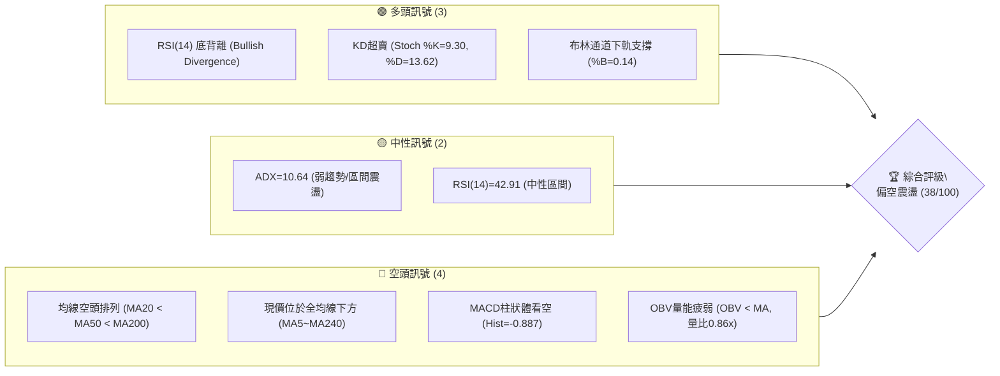
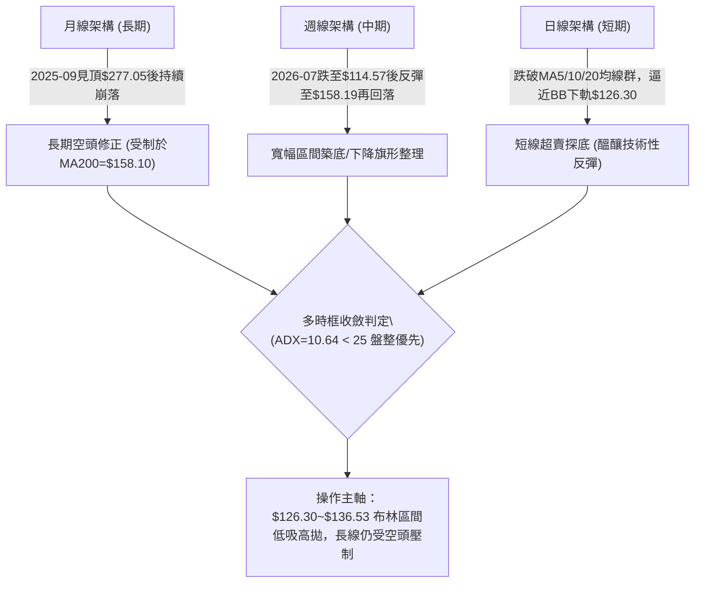
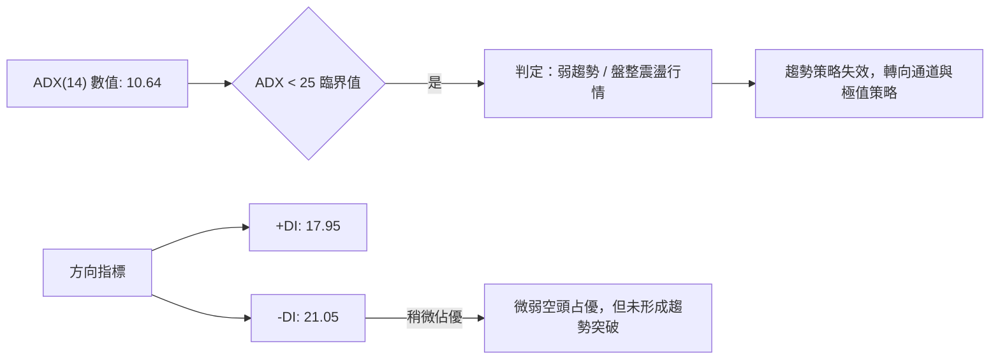
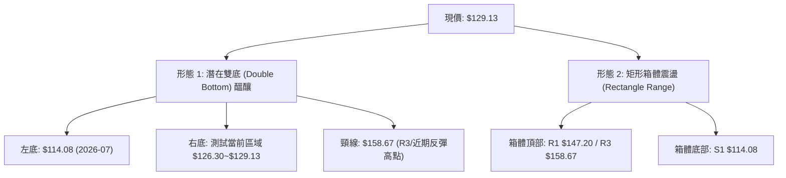
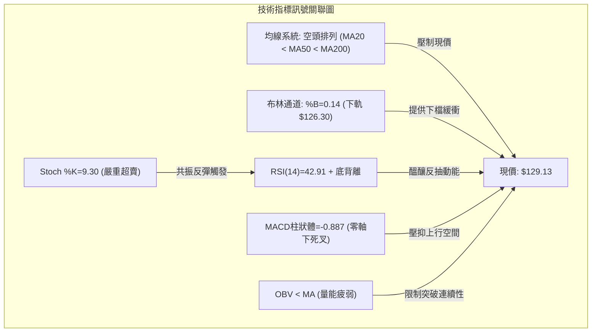
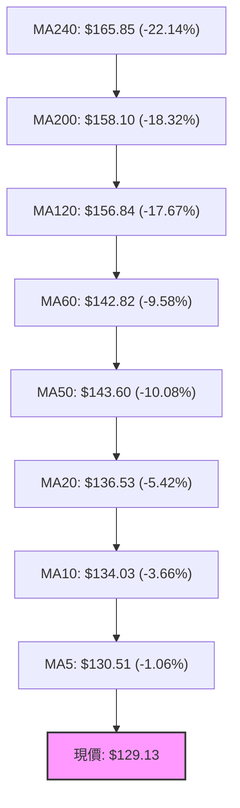
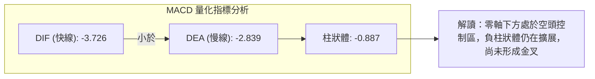
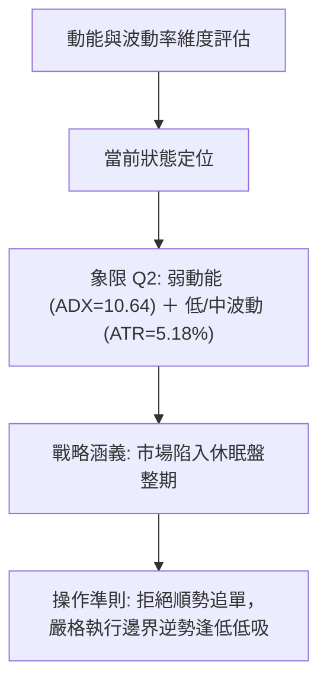
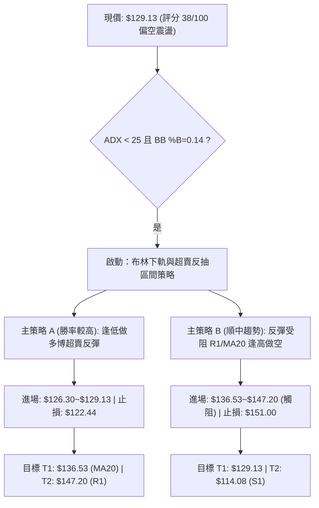
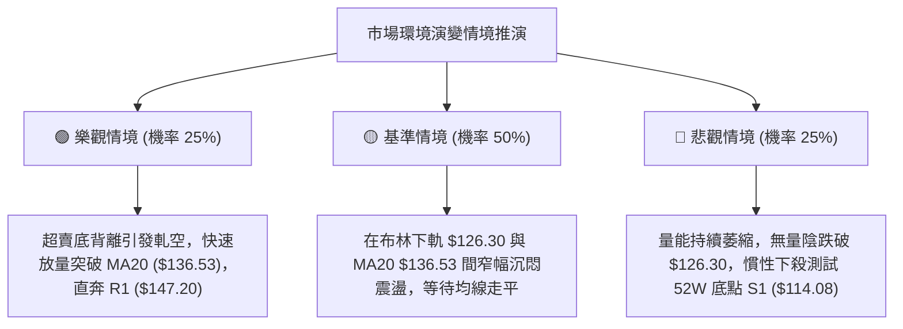

# ORCL 技術分析報告

> **報告日期**：2026-10-22 ｜ **語言**：繁體中文 ｜ **數據來源**：Yahoo Finance ｜ **當前價格**：$129.13

---

## 目錄

| 章節 | 內容 |
|------|------|
| [1. 技術面概覽](#1-技術面概覽) | 訊號儀表板、核心指標、評分卡 |
| [2. 趨勢分析](#2-趨勢分析) | 多時框趨勢、長中短期走勢、ADX強度 |
| [3. 圖表形態分析](#3-圖表形態分析) | 形態識別、K線組合、形態推算 |
| [4. 支撐與阻力](#4-支撐與阻力) | 關鍵價位、斐波那契回調結構 |
| [5. 技術指標深度解讀](#5-技術指標深度解讀) | 均線系統、RSI/MACD背離、布林通道、OBV |
| [6. 動能與波動率](#6-動能與波動率) | 動能四象限、ATR風控、Beta特徵 |
| [7. 多時框架總結](#7-多時框架總結) | 訊號收斂矩陣、主導時框決策 |
| [8. 交易策略建議](#8-交易策略建議) | 策略路由、主策略執行表、情境機率 |
| [9. 風險提示與監控](#9-風險提示與監控) | 監控清單、情境推演、風控規則 |
| [10. 報告總結](#10-報告總結) | 核心結論與執行綱要 |

---

## 1. 技術面概覽

### 🎯 技術訊號儀表板



### 📊 核心指標速覽表

| 指標類別 | 指標名稱 | 當前數值 | 訊號 | 解讀 |
|----------|----------|----------|------|------|
| **價格** | 當前價格 | $129.13 | 🔴 | 位於52週區間 8.9% 處，處於歷史極低分位 |
| **均線** | MA20 | $136.53 | 🔴 | 價格低於 MA20 (-5.42%)，短期下行壓力顯著 |
| **均線** | MA50 | $143.60 | 🔴 | 價格低於 MA50，中期生命線受阻 |
| **均線** | MA200 | $158.10 | 🔴 | 價格顯著低於 MA200 (-18.32%)，長期走勢確立偏空 |
| **動能** | RSI(14) | 42.91 | 🟡 | 位於中性偏弱區，但日線與週線出現底背離醞釀反彈 |
| **動能** | Stoch KD | %K: 9.30 / %D: 13.62 | 🟢 | 極度超賣區，短線殺跌動能接近衰竭 |
| **動能** | MACD (12,26,9) | DIF: -3.726, DEA: -2.839, 柱: -0.887 | 🔴 | 零軸下方雙線向下，負動能柱持續，空頭控盤 |
| **趨勢** | ADX(14) | 10.64 (+DI: 17.95, -DI: 21.05) | 🟡 | ADX < 25 表示單邊趨勢強度不足，進入無趨勢區間震盪 |
| **通道** | 布林通道 | 上: $146.77 / 中: $136.53 / 下: $126.30 | 🟢 | %B 為 0.14，股價貼近下軌，技術性支撐濃厚 |
| **波動** | ATR(14) | $6.69 (5.18%) | 🟡 | 日內波動率適中，操作需保留至少 1.5 倍 ATR 緩衝 |
| **量能** | 當日量 / 20日均量 | 26.19M / 30.58M (量比 0.86x) | 🔴 | OBV < MA，反彈縮量而下殺帶量，資金承接力道薄弱 |

### 🏆 技術評分卡

```
╔══════════════════════════════════════════════════════════════╗
║                技術評分卡 — ORCL (2026-10-22)                ║
╠══════════════════════════════════════════════════════════════╣
║ 趨勢強度 (ADX=10.64, 空頭主導)   ████░░░░░░░░░░░░░░░░  20/100 🔴 ║
║ 動能指標 (RSI底背離+KD極度超賣)   ██████████░░░░░░░░░░  50/100 🟡 ║
║ 支撐穩定度 (S1=$114.08, BB下軌)  ████████████░░░░░░░░  60/100 🟡 ║
║ 成交量配合 (量比0.86x, OBV疲弱)  ██████░░░░░░░░░░░░░░  30/100 🔴 ║
║ 形態完整度 (局部低檔築底進行中)  ████████░░░░░░░░░░░░  40/100 🟡 ║
║ 均線排列 (MA20<MA50<MA200 空頭)  ████░░░░░░░░░░░░░░░░  20/100 🔴 ║
╠══════════════════════════════════════════════════════════════╣
║ 綜合評分                         ███████░░░░░░░░░░░░░  38/100 🔴 ║
║ 評級結論：偏空震盪（弱勢整理，嚴格依區間或反彈逢高減碼執行） ║
╚══════════════════════════════════════════════════════════════╝
```

---

## 2. 趨勢分析

### 🌐 多時框趨勢分析



### 📈 長期趨勢 — 12個月走勢圖（Unicode）

```
ORCL 月線走勢圖（2025-10 至 2026-10）
價格軸 ($)
$280 ┤
$260 ┤  ● (2025-10: $259.14)
$240 ┤
$220 ┤                                      ● (2026-05: $224.17 次高點)
$200 ┤        ● (2025-11: $199.28)
$180 ┤              ● (2025-12: $192.34)
$160 ┤                    ● (2026-01: $162.84)    ● (2026-04: $160.24)
$140 ┤                          ● (02: $143.86)         ● (06: $145.50)   ● (08: $148.57)
$120 ┤                                                        ● (07: $129.39)   ●←當前 (10: $129.13)
     └─────────────────────────────────────────────────────────────────────────────
        10    11    12    01    02    03    04    05    06    07    08    09    10  (月份)
```

**歷史走勢特徵分析表**：

| 階段區間 | 起訖月份 | 價格變化 | 漲跌幅 | 走勢特徵分析 |
|----------|----------|----------|--------|--------------|
| **主跌第一波** | 2025-10 → 2026-02 | $259.14 → $143.86 | -44.49% | 頂部快速破位，連續陰跌下挫，大型機構高位出逃 |
| **技術性反抽** | 2026-02 → 2026-05 | $143.86 → $224.17 | +55.83% | 資金強勁超跌反彈，但未能越過 2025-10 高點，形成下行中繼 |
| **主跌第二波** | 2026-05 → 2026-07 | $224.17 → $129.39 | -42.28% | 資金再度無序撤離，於 2026-07 創出 52 週最低 $114.08 |
| **底部反覆震盪**| 2026-07 → 2026-10 | $129.39 → $129.13 | -0.20% | 區間於 $114.08~$158.19 間拉鋸，量能萎縮，進入籌碼重組期 |

### 📊 中期趨勢（週線分析）

從近 20 週數據觀察，ORCL 於 2026-07-26 觸及波段低點 $114.57（52週低點 $114.08 附近），隨後展開強勁修復，最高於 2026-09-06 來到 $158.19。該處恰好受阻於波段阻力 R3 ($158.67) 與 MA200 ($158.10) 的強大共振阻力帶。近 6 週再次回跌至當前 $129.13，整體呈現「低點抬高（$114.08 → 現價 $129.13）與高點受阻」的中期築底格局。

```
中期支撐與阻力示意圖：
$158.67 ══════════════════════════════════════ [R3 / MA200 / 週線波段反彈頂點]
              ▲
              │ 反彈遭壓回 (-18.37%)
              ▼
$136.53 -------------------------------------- [MA20 / 中軌壓力]
$129.13 ◄─── 現價位置 (布林通道下軌邊緣)
$126.30 - - - - - - - - - - - - - - - - - - - [布林下軌支撐]
              ▲
              │ 7月築底回升 (+12.78%)
              ▼
$114.08 ══════════════════════════════════════ [S1 / 52W低點 / 結構終極防線]
```

### ⚡ 趨勢強度評估（ADX 解讀）



| 指標名稱 | 數值 | 評估區間 | 意義解讀 |
|----------|------|----------|----------|
| **ADX (14)** | 10.64 | 0 – 25（弱趨勢） | 趨勢動能極弱，價格處於橫盤無方向期，切忌追漲殺跌 |
| **+DI (14)** | 17.95 | 多方動能衰竭 | 多方無法維持連續進攻，上衝均屬脈衝式反彈 |
| **-DI (14)** | 21.05 | 空方掌控局部定價 | 空方力量略大於多方，但未達到 30 以上的主跌爆發門檻 |

---

## 3. 圖表形態分析

### 🔍 形態識別系統

依據形態學原則，嚴格按數據中的幾何高低點聚類進行判定：



**圖表形態信心度評估表**：

| 形態名稱 | 信心度 | 判斷依據（引用數據） | 完成度 | 目標價（附計算式） |
|----------|--------|----------------------|--------|--------------------|
| **大級別潛在雙重底** | 62% | 第一次波段低點 $114.08，當前二次下探於 $126.30~$129.13 企穩且 RSI 出現底背離 | 50%（尚未突破頸線） | 若突破頸線 $158.67：頸線 $158.67 + (頸線 $158.67 - 低點 $114.08 = $44.59) = **$203.26** |
| **矩形箱體橫盤震盪** | 85% | 價格被嚴格封裝於 S1 ($114.08) 與 R3 ($158.67) 之間，ADX=10.64 確認無趨勢 | 90% | 箱頂目標：引用波段高點 **R1: $147.20**、**R3: $158.67** |
| **頭肩底形態** | 25% | 數據中未偵測到對稱左肩與右肩結構，缺乏形態幾何對稱性 | 0% | *訊號不足，僅做指標型解讀，不預設目標價* |

### 🕯️ 重要 K 線形態分析

| 週期/月份 | 收盤價 | K線形態特徵 | 市場心理與多空解讀 | 訊號 |
|-----------|--------|-------------|--------------------|------|
| **2026-05** | $224.17 | 長上影大陽線 | 反彈至頂部遭遇機構密集拋壓，多頭消耗殆盡 | 🔴 空頭反轉 |
| **2026-06** | $145.50 | 巨幅實體長黑K | 斷頭鍘刀式跌破均線，恐慌盤傾瀉，多頭防線全面瓦解 | 🔴 極度看空 |
| **2026-07** | $129.39 | 長下影長針探底K | 盤中殺穿至 $114.08 後引來逢低承接，形成波段實質底部 | 🟢 支撐確立 |
| **2026-08** | $148.57 | 實體修復中陽線 | 空頭回補帶動短線超跌反抽，確認短期底部有效 | 🟢 多頭反攻 |
| **2026-09** | $136.79 | 衝高回落十字陰K | 測試 R3 ($158.67) 未果，上檔解套套牢盤沉重 | 🔴 上檔受阻 |
| **2026-10 (當前)** | $129.13 | 縮量小實體K線 | 空方殺跌動能放緩，多空處於布林下軌附近拉鋸觀望 | 🟡 變盤醞釀 |

### 📉 ASCII 走勢形態示意圖

```
ORCL 近期箱體與雙底結構示意：
價位 ($)
$158.67 ┼─────────────────────●───────────────────── 頸線/箱頂阻力 (R3)
        │                   /   \
$147.20 ┼───────●─────────/─────\───────────────── 局部阻力 (R1)
        │      / \       /       \
$136.53 ┼─────/───\─────/─────────\─────────────── 箱體中軸 (MA20)
        │    /     \   /           \  ● ◄─── 現價 ($129.13, 醞釀右底)
$126.30 ┼───/───────\─/─────────────\──────────── 布林通道下軌
        │  /         ● (左底區間)
$114.08 ┴─●────────────────────────────────────── 箱底/52W低點防線 (S1)
         7月        8月         9月        10月
```

---

## 4. 支撐與阻力

### 🗺️ 關鍵價位分布圖（Unicode）

```
ORCL 價位結構分布圖
═══════════════════════════════════════════════════════════════
$158.67 ║████████████████████████████████║ 強阻力 R3 (MA200與近一年高點重合)
$153.03 ║████████████████████████        ║ 中阻力 R2 (反彈高點聚類)
$150.31 ║▓▓▓▓▓▓▓▓▓▓▓▓▓▓▓▓▓▓▓▓▓▓▓▓        ║ 斐波那契 78.6% 回調位
$147.20 ║████████████████████████████    ║ 關鍵阻力 R1 (短期波段高點聚類)
$136.53 ║--------------------------------║ 短期壓制 MA20 (布林中軌)
$129.13 ╠════════════════════════════════╣ ◄── 當前價格 ($129.13)
$126.30 ║░░░░░░░░░░░░░░░░░░░░░░░░        ║ 動態支撐 (布林下軌)
$114.08 ║████████████████████████████████║ 核心支撐 S1 (52W歷史波段最低點)
═══════════════════════════════════════════════════════════════
```

### 🚧 阻力位分析表

所有阻力數值完全引用自近一年波段高點聚類：

| 阻力級別 | 價位 | 形成原因與技術重合性 | 突破難度 | 重要性 |
|----------|------|----------------------|----------|--------|
| **R1** | **$147.20** | 近一年波段高點聚類第一層，緊鄰 2026-09 月線反覆爭奪位與布林上軌 ($146.77) | 中等 (需日成交量放大至 35M 以上) | ★★★☆☆ |
| **R2** | **$153.03** | 次級波段高點密集成交區，接近斐波那契 78.6% ($150.31) 上方套牢帶 | 偏高 (遭遇解套賣壓) | ★★★★☆ |
| **R3** | **$158.67** | 強阻力聚類頂部，重合 MA200 長期均線 ($158.10) 與 2026-09-06 週線頂點 ($158.19) | 極高 (中期多空分水嶺) | ★★★★★ |

### 🛡️ 支撐位分析表

所有支撐數值完全引用自近一年波段低點聚類：

| 支撐級別 | 價位 | 形成原因與技術重合性 | 守住機率 | 重要性 |
|----------|------|----------------------|----------|--------|
| **動態S**| **$126.30** | 日線布林通道下軌，配合當前 Stoch KD 超賣產生彈性 | 70% | ★★★☆☆ |
| **S1** | **$114.08** | 近一年波段最低點聚類，52 週絕對低點，多頭最後心理防線 | 85% | ★★★★★ |
| **S2/S3**| *未偵測到* | 數據中近一年波段低點聚類僅偵測到 S1 ($114.08)，其餘更低價位不存在於輸入集合中 | — | — |

### 📐 斐波那契回調位分析

依據 52 週絕對區間（低點 $114.08 至 高點 $283.40，落差 $169.32）之黃金分割架構分析：

| 分割比例 | 價位 | 當前相對位置與市場涵義 |
|----------|------|------------------------|
| **0.0% (52W High)** | $283.40 | 歷史最高壓力 |
| **23.6%** | $243.44 | 牛市強勢回檔極限位 |
| **38.2%** | $218.72 | 2026-05 反彈次高點 ($224.17) 阻力帶 |
| **50.0%** | $198.74 | 心理半數多空均衡位 |
| **61.8%** | $178.76 | 牛熊黃金分割分水嶺 |
| **78.6%** | $150.31 | 下方極深回撤位，現處於此位下方 |
| **100.0% (52W Low)**| $114.08 | 區間底點支撐 |

**回調位深度解讀**：
當前市價 **$129.13** 處於 **78.6% ($150.31)** 與 **100.0% ($114.08)** 之間。在技術分析定義中，回撤跌破 61.8% 並直逼 78.6% 以下，意味著先前的上漲多頭主趨勢已被徹底摧毀，目前屬於空頭主導下的殘存區間震盪。上方最近的斐波那契強阻力位於 $150.31，與 R1 ($147.20) 至 R2 ($153.03) 形成多重重疊的阻力帶。

---

## 5. 技術指標深度解讀

### 🎛️ 指標訊號總覽



### 📈 移動平均線排列分析



*當前各均線呈現標準的「完美空頭排列」（MA5 < MA10 < MA20 < MA50 < MA60 < MA120 < MA200 < MA240），現價全數運行於所有移動平均線之下。短線若有反彈，第一道動態阻力為下降中的 MA5 ($130.51)，主要波段防守阻力為 MA20 ($136.53)。在未站穩 MA20 之前，任何反彈均定義為技術性空頭回補。*

### 📉 RSI(14) 分析與背離判定

- **當前數值**：42.91
- **強度進度條**：`████████░░░░░░░░░░░░` 42.91%（中性偏弱）
- **超買超賣判定**：數值位於 30–70 中性區間，未陷入單日超賣，但 Stoch KD 已進入極端超賣（%K=9.30）。
- **背離分析**：**⚠️ 存在底背離 (Bullish Divergence)**。
  - *證明過程*：回顧 2026-06-28 價格在 $147.47 時，週 RSI 暴跌至 11.1；2026-07-26 價格探底至 $114.57 時，RSI 升至 26.7；而 2026-10-18 至 10-25 股價二度下探 $128.23~$129.13 區間時，RSI 穩定保持在 42.9~46.8 之上。
  - *結論*：**價格在低位震盪下探，但 RSI 指標底部顯著墊高，標準底背離確立**，顯示下殺動能已大幅鈍化，空頭難以發動深跌，短線隨時存在報復性反彈需求。

### 📊 MACD(12/26/9) 訊號解讀



- **狀態評估**：MACD 快慢線均在零軸遠下方，柱狀體為負數 (-0.887)，顯示空頭仍掌握中週期定價權。
- **背離狀況**：週線 MACD 柱狀體在 2026-06 曾達 -6.718 極值，隨後於 2026-08 轉正至 +4.810，目前即便股價回撤，柱狀體僅微幅回落至 -0.887，並未創下新深負值，同樣在中長週期具備潛在底背離雛形。

### 📦 布林通道分析

```
布林通道結構示意（日線）：
$146.77 ══════════════════════════════════════ 上軌 (Upper Band)
        │
$136.53 ────────────────────────────────────── 中軌 (MA20 / 短線多空分嶺)
        │
$129.13 ◄─── 現價 (%B = 0.14)
$126.30 ══════════════════════════════════════ 下軌 (Lower Band)
```

- **通道帶寬**：上軌 $146.77 與下軌 $126.30 差距為 $20.47（約 15.8% 帶寬）。
- **%B 指標**：0.14（落在 0.0 至 0.2 極度弱勢/超賣反彈帶）。
- **價格行為**：價格緊貼下軌 $126.30 運行，觸發布林帶收斂與下軌彈性支撐，下行空間受到通道幾何限制。

### 💹 成交量分析（量價配合度）

- **量比現況**：最新日成交量 26.19M，相對於 20 日均量 30.58M，量比為 **0.86x**，呈現「陰跌無量」態勢。
- **OBV 趨勢**：OBV < MA，能量潮線持續低於其移動平均線，顯示資金以流出為主，機構主動買盤意願低落。
- **量價背離分析**：週成交量從 2026-07 探底時的 252.57M 顯著收縮至最近一週的 76.69M。伴隨成交量劇減 70%，股價下殺動能已大幅耗盡，呈現典型的「無量陰跌」，一旦有外部利好刺激，易引發無量空轉後的量增反彈。

---

## 6. 動能與波動率

### ⚡ 動能評估四象限



| 象限 | 動能維度 | 波動維度 | 當前特徵 | 戰略指引 |
|------|----------|----------|----------|----------|
| **Q1** | 強動能 | 低波動 | 穩定單邊趨勢 | 最佳順勢加碼點 |
| **Q2** | **弱動能** | **中低波動** | **✓ ORCL 當前狀態：ADX=10.64，ATR=$6.69** | **區間內低吸高拋，謹慎觀望突破** |
| **Q3** | 強動能 | 高波動 | 暴衝行情 | 嚴格停損的高回報博弈 |
| **Q4** | 弱動能 | 高波動 | 無序震盪洗盤 | 避免進場，容易雙向挨打 |

### 📊 ATR 波動率分析

- **ATR(14)**：**$6.69**（佔現價比率為 **5.18%**）。
- **日內波幅解讀**：每日平均波動超過 6.6 美元，對於科技股而言波動度偏高。
- **停損與風控設置距離建議**：
  - **極短線動態止損**：1.0 × ATR = **$6.69**。
  - **波段交易防守止損**：1.5 × ATR = **$10.04**。
  - **安全停損價推算**：以現價 $129.13 減去 1.5 ATR 得出之緩衝位置為 **$119.09**，該價位能有效避開下軌雜訊且處於 S1 ($114.08) 核心支撐上方。

### 📐 Beta 與市場相關性

- **Beta 係數**：**1.77**（高彈性/高系統性風險）。
- **市場特徵分析**：ORCL 具有極高的市場敏感度，當大盤（S&P 500 / 納斯達克）波動 1% 時，ORCL 理論波動幅度達 1.77%。這解釋了為何其在 2025-2026 年間出現自 $283.40 崩跌至 $114.08、隨後又大幅反彈的劇烈洗盤行情。在當前弱勢架構下，高 Beta 意味著若大盤下挫，ORCL 易遭放大拋售，部位規模必須嚴格控管。

---

## 7. 多時框架總結

### 📋 時框架評分表

| 時框架 | 趨勢方向 | 動能狀態 | 均線排列 | 形態特徵 | 綜合評分 | 戰略建議 |
|--------|----------|----------|----------|----------|----------|----------|
| **月線 (長期)** | 🔴 空頭向下 | 弱勢延伸 | MA200上方受阻 | 自 $283.40 大幅回撤 | 25/100 | 長期投資者保持觀望 |
| **週線 (中期)** | 🟡 寬幅震盪 | 底背離醞釀 | 空頭排列中 | S1($114.08)~R3($158.67) 箱體 | 45/100 | 波段操作者尋求箱底低吸 |
| **日線 (短期)** | 🔴 偏弱探底 | 極度超賣 | 全均線下方 | 逼近布林下軌 $126.30 | 38/100 | 短線交易者博弈超賣反彈 |

### 🔲 綜合訊號矩陣

```
訊號維度對照矩陣：
┌──────────────┬──────────────┬──────────────┬──────────────┐
│  指標類別    │ 短期 (日線)  │ 中期 (週線)  │ 長期 (月線)  │
├──────────────┼──────────────┼──────────────┼──────────────┤
│ 均線趨勢     │ 🔴 空頭壓制  │ 🔴 均線死叉  │ 🔴 空頭排列  │
│ 動能振盪     │ 🟢 KD極度超賣│ 🟢 RSI底背離 │ 🟡 負動能收斂│
│ 支撐壓力     │ 🟢 貼近BB下軌│ 🟢 S1大支撐  │ 🔴 跌穿78.6% │
│ 量能結構     │ 🔴 縮量無承接│ 🟡 拋壓枯竭  │ 🔴 主力撤退  │
└──────────────┴──────────────┴──────────────┴──────────────┘
```

### ⚖️ 多時框收斂結論

**嚴格依據收斂規則 14 判定**：
1. **行情性質判定**：當前日線 **ADX(14) = 10.64 < 25**，市場確認處於**典型的盤整無趨勢行情**。
2. **時框優先級權重**：在此行情下，中長期趨勢指標（如 MA200 壓制）退居次席，市場定價以**日線布林通道上下軌 ($126.30 – $146.77) 作為主要交易區間**。
3. **最終唯一收斂方向**：**偏空震盪中的區間防守（評分 38/100，定位偏空震盪）**。長線大趨勢雖偏空，但短線價格逼近下軌 $126.30 且 RSI/KD 極度超賣，**嚴禁在 $129.13 追空**；交易主邏輯為「布林下軌至 S1 防守低吸，反彈至 MA20 與阻力 R1 附近逢高減碼/高空」。

---

## 8. 交易策略建議

### 🗺️ 策略決策流程圖



### 🧭 策略路由（依評分卡分流）

> **當前主策略方向 = 偏空震盪（依評分卡 38/100 ≤ 40 偏空門檻）**  
> 綜合評分落在弱勢區間（38分），中長期均線呈現全面空頭壓制；但因 ADX 僅 10.64 且 RSI/KD 極度超賣，策略架構鎖定為：**「主推順應中短期均線壓制之反彈高空策略（策略 B），輔以超賣下軌極窄止損之短線反彈策略（策略 A）」**。

### 🎯 價格情境階梯（Price Scenarios）

價位完全嚴格引用數據中波段高低點與均線：

| 觸發條件 | 下一目標 | 後續延伸 | 情境含義 |
|----------|----------|----------|----------|
| **向上突破 R1 ($147.20)** | R2 ($153.03) | R3 ($158.67) | 短線強勢逆轉，測試中期牛熊分水嶺 |
| **突破 MA20 ($136.53)** | R1 ($147.20) | R2 ($153.03) | 超賣反彈展開，回補均線乖離 |
| **站穩現價 ($129.13)** | MA20 ($136.53) | — | 區間底部築底震盪，等待量能釋放 |
| **跌破動態下軌 ($126.30)**| S1 ($114.08) | — | 短期破位，尋求 52 週絕對低點支撐 |
| **跌破核心 S1 ($114.08)** | *數據中未偵測到* | — | 結構崩潰，開啟全新下行深淵 |

### 📊 情境機率分佈

| 情境劇本 | 機率 | 主要依據 |
|----------|------|----------|
| **情境一：超賣技術性反彈** | **35%** | Stoch %K=9.30 極度超賣，RSI 日/週級別底背離，布林下軌支撐有效 |
| **情境二：箱體狹幅橫盤震盪** | **45%** | ADX(14)=10.64 顯示無單邊動能，成交量量比 0.86x 萎縮，進入籌碼沈澱期 |
| **情境三：下破下軌續探前低** | **20%** | 全均線呈空頭排列，OBV < MA 量能疲弱，市場整體 Beta=1.77 易受外圍衝擊 |

### 🟢 主策略詳情

所有價位均依據布林軌道、均線以及波段高低點計算，拒絕捏造數值：

| 策略要素 | 策略 A（逆勢超賣博弈 — 做多） | 策略 B（主策略：順均線壓制 — 逢高做空） |
|----------|--------------------------------|------------------------------------------|
| **策略邏輯** | 貼近布林下軌 + RSI 底背離超跌反抽 | 均線空頭排列 + 反抽 MA20/R1 阻力受阻回落 |
| **進場條件** | 觸及布林下軌 $126.30 或現價 $129.13 企穩 | 反彈觸及 MA20 ($136.53) 至 R1 ($147.20) 出現滯漲K線 |
| **進場價格** | **$129.13**（現價） | **$136.53**（MA20 / 中軌處） |
| **目標價 T1** | **$136.53**（MA20 中軌，+5.73%） | **$129.13**（現價/下軌區間，-5.42%） |
| **目標價 T2** | **$147.20**（阻力 R1，+13.99%） | **$114.08**（核心支撐 S1，-16.44%） |
| **止損價格** | **$122.44**（跌破下軌1個ATR緩衝，$129.13-1.0 ATR） | **$140.00**（有效突破站上 MA20 均線上方） |
| **風險報酬比** | **1 : 2.7**（以 T2 計算：+$18.07 / -$6.69） | **$1 : 2.1**（以 T1: 1:2.1；以 T2 計算達 **1 : 6.4**） |
| **成功機率** | 45% | 55% |
| **建議倉位** | 5% – 10%（短線輕倉） | 10% – 15%（標準波段部位） |

### 🔴 反向風險觸發點（對沖提示）

- **多頭轉向全面防禦點**：若日線收盤價跌破布林下軌並摜破 **$122.44**，所有多頭試單必須無條件止損離場，嚴防價格直線回踩 S1 ($114.08)。
- **空頭部位全面回補點**：若市場出現放量長陽，強勢突破站穩 **R1: $147.20** 之上，宣告下跌通道破局，底部形態確立，任何高空對沖部位必須立刻平倉，並反手跟進波段多單。

### ⭐ 整體訊號強度評星

```
做多訊號強度：★★☆☆☆  (2.0/5星 — 僅限於極端超賣技術修復)
做空訊號強度：★★★☆☆  (3.5/5星 — 長期均線壓制強烈，順勢高空勝率較優)
整體可信度：  ★★★☆☆  (3.0/5星 — 受制於低 ADX 震盪洗盤，需防假突破)
```

---

## 9. 風險提示與監控

### ✅ 關鍵監控指標 Checklist

```
╔══════════════════════════════════════════════════════════════╗
║               ORCL 每日關鍵技術監控 CHECKLIST                ║
╠══════════════════════════════════════════════════════════════╣
║ [ ] 價格是否跌破動態布林下軌 $126.30 (破位警報)              ║
║ [ ] RSI(14) 是否有效突破 50 中軸 (動能轉強確認)              ║
║ [ ] Stoch KD 是否完成低位黃金交叉且 %K 向上脫離 20 超賣區   ║
║ [ ] 成交量是否放大至 30.58M (20日均量) 以上 (資金進場信號)   ║
║ [ ] MACD 柱狀體是否由負轉正 (-0.887 → 0)                     ║
║ [ ] MA5 ($130.51) 是否被日實體陽線收復 (短線止跌第一步)      ║
║ [ ] 核心防線 S1: $114.08 是否面臨直接考驗                    ║
╚══════════════════════════════════════════════════════════════╝
```

### ⚠️ 風險場景分析



### 🛡️ 風險管理重要提醒

1. **Beta 放大效應風控**：ORCL 具有高達 **1.77** 的 Beta 值，科技股整體情緒走弱時，其下行速度將顯著超越指數。單一持倉比重嚴禁超過總投資組合的 15%。
2. **無趨勢環境禁忌**：當前 ADX 為 10.64，屬於極度典型的洗盤震盪。嚴禁在突破高點時追漲，或在跌破微小支撐時盲目加空；震盪市必須以**限價單 (Limit Order)** 於邊界佈局。
3. **嚴格執行波動率止損**：ATR 為 $6.69，當前任何交易的停損點不可小於 1.0 ATR ($6.69)，否則極易在正常的盤中波動中被洗出場。

---

## 10. 報告總結

```
╔══════════════════════════════════════════════════════════════╗
║                 ORCL 技術分析報告總結                        ║
╠══════════════════════════════════════════════════════════════╣
║ 報告日期：2026-10-22                                         ║
║ 當前價格：$129.13                                             ║
║ 分析評級：🔴 偏空震盪（弱勢整理，布林下軌防守）             ║
╠══════════════════════════════════════════════════════════════╣
║ 關鍵結論：                                                   ║
║ ├─ 長期趨勢：🔴 跌破 MA200 ($158.10)，處於深幅熊市修正週期   ║
║ ├─ 中期趨勢：🟡 $114.08 至 $158.67 寬幅箱體，底部拉鋸籌碼重組║
║ ├─ 短期趨勢：🟢 極度超賣 (KD=9.30) 疊加 RSI 底背離，醞釀反彈 ║
║ ├─ 核心支撐：$114.08 (S1 / 52W低點) ；動態支撐 $126.30 (下軌) ║
║ ├─ 關鍵阻力：$136.53 (MA20) ；$147.20 (R1) ；$158.67 (R3)    ║
║ └─ 華爾街共識目標價：$237.36 (基本面溢價，與技術面短期脫節)  ║
╠══════════════════════════════════════════════════════════════╣
║ 最優策略組合：                                               ║
║ 1. 🥇 最佳機會 (高勝率)：於反彈觸及 MA20 ($136.53) 或 R1      ║
║       ($147.20) 受阻時建立「順勢高空」部位，目標下看 $129.13 ║
║ 2. 🥈 次選機會 (高盈虧比)：在現價 $129.13 至布林下軌 $126.30  ║
║       輕倉博弈底背離「超賣反抽」，止損守 $122.44，目標 $136.53 ║
║ 3. 🥉 保守選擇：完全空倉觀望，直至股價明確站上 MA20 均線      ║
║       或回踩 S1 ($114.08) 出現爆量長下影線再行介入           ║
╚══════════════════════════════════════════════════════════════╝
```

---

> ⚠️ **免責聲明**：本報告為技術分析研究，所有價位、圖表與估算均嚴格基於所提供之歷史行情與技術指標數據。本報告**僅供研究與學術參考**，**不構成任何要約、招攬或具體投資建議**。市場有風險，交易需依個人風險承受力設定止損止盈。

---

*報告生成時間：2026-10-22 ｜ 數據來源：Yahoo Finance ｜ 分析框架：多時框技術分析模型*