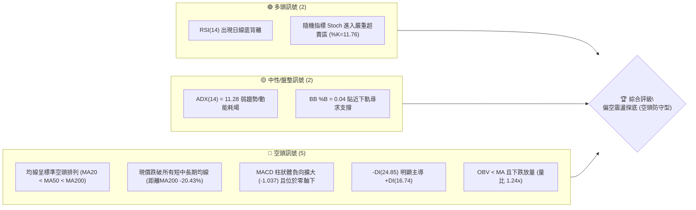
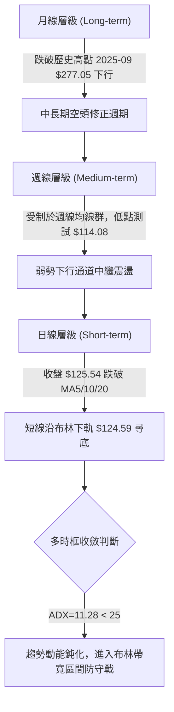
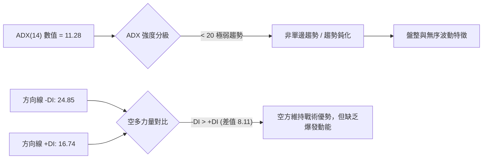
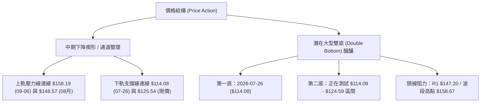
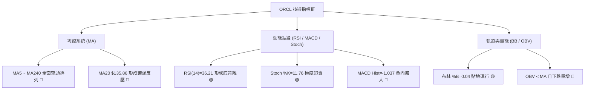
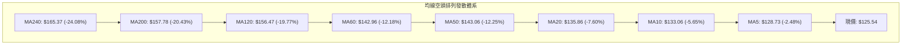
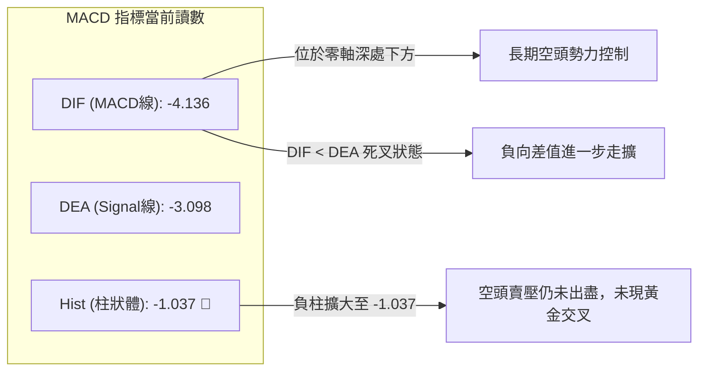
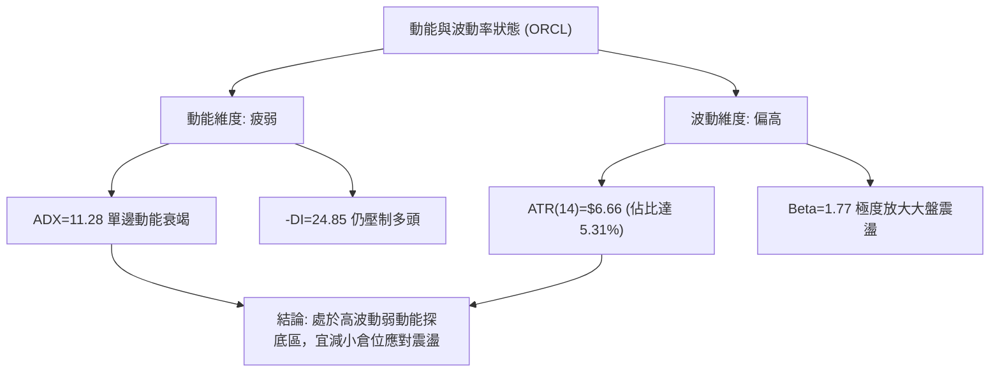
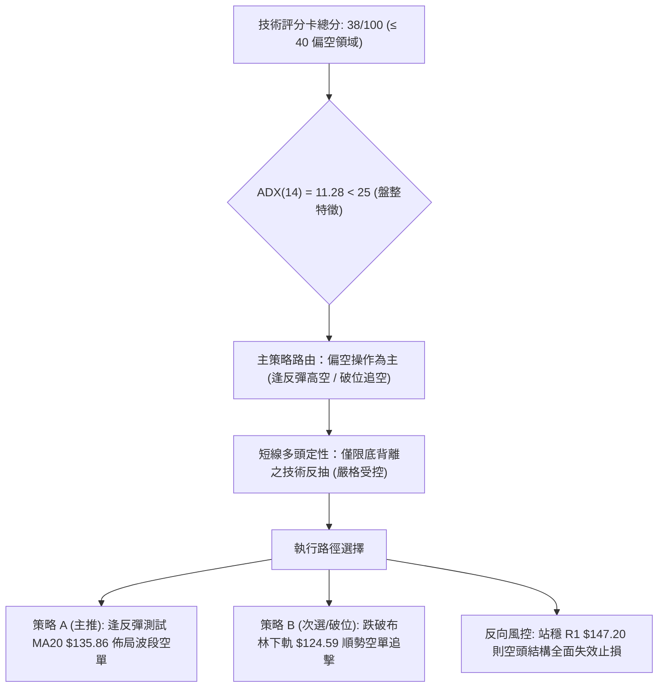
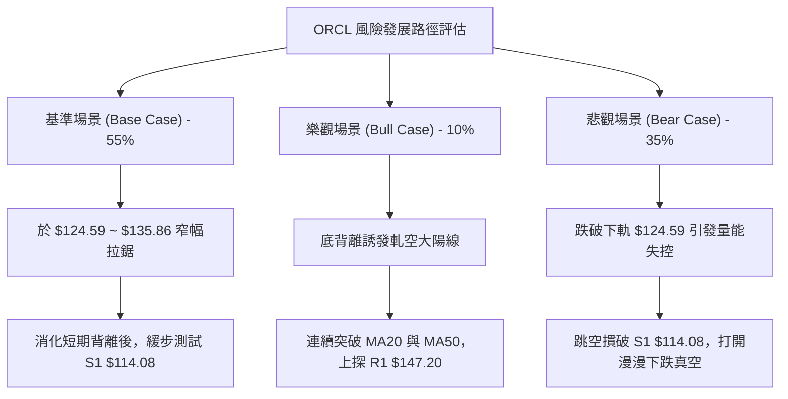

# ORCL 技術分析報告

> **報告日期**：2026-10-23 ｜ **語言**：繁體中文 ｜ **數據來源**：Yahoo Finance ｜ **當前價格**：$125.54

---

## 目錄

| 章節 | 內容 |
|------|------|
| [1. 技術面概覽](#1-技術面概覽) | 訊號儀表板、核心指標、評分卡 |
| [2. 趨勢分析](#2-趨勢分析) | 多時框趨勢、長中短期走勢、ADX解讀 |
| [3. 圖表形態分析](#3-圖表形態分析) | 形態識別、信心度評估、K線組合、形態目標價 |
| [4. 支撐與阻力](#4-支撐與阻力) | 關鍵價位分布圖、阻力/支撐分析、斐波那契回調 |
| [5. 技術指標深度解讀](#5-技術指標深度解讀) | 均線系統、RSI背離、MACD、布林通道、OBV量價 |
| [6. 動能與波動率](#6-動能與波動率) | 動能四象限、ATR波動度、Beta市場敏感度 |
| [7. 多時框架總結](#7-多時框架總結) | 時框架評分矩陣、多時框收斂結論 |
| [8. 交易策略建議](#8-交易策略建議) | 策略路由、主策略規劃、價格情境階梯、風控點位 |
| [9. 風險提示與監控](#9-風險提示與監控) | 監控指標Checklist、情境路徑、倉位控管準則 |

---

## 1. 技術面概覽

### 🎯 技術訊號儀表板



---

### 📊 核心指標速覽表

| 指標類別 | 指標名稱 | 當前數值 | 訊號 | 技術解讀 |
|:---|:---|:---:|:---:|:---|
| **價格** | 當前價格 | $125.54 | 🔴 | 位於52週區間 6.8% 極低位，空方主導壓制 |
| **均線** | MA20 (月線) | $135.86 | 🔴 | 現價低於MA20達 -7.60%，短線反彈首要動態阻力 |
| **均線** | MA50 (季線) | $143.06 | 🔴 | 中期下行壓力線，與近期盤整中軸重合 |
| **均線** | MA200 (年線) | $157.78 | 🔴 | 長期牛熊分界線，現價大幅折價 -20.43% |
| **動能** | RSI(14) | 36.21 | 🟡 | 弱勢偏空區間，但已浮現技術性「底背離」訊號 |
| **動能** | MACD (12,26,9) | -4.136 | 🔴 | 快慢線處於零軸下方深度負值，柱狀體為 -1.037 |
| **動能** | Stoch %K / %D | 11.76 / 13.64 | 🟢 | 深度超賣區（<20），短線存在均值回歸反抽動能 |
| **趨勢** | ADX(14) | 11.28 | 🟡 | 數值低於25，代表單邊趨勢動能耗竭，轉為區間弱勢震盪 |
| **方向** | +DI / -DI | 16.74 / 24.85 | 🔴 | -DI 大於 +DI，空頭力量依然掌握盤面主控權 |
| **通道** | 布林通道 (BB) | 下軌 $124.59 | 🟡 | %B僅為0.04，價格緊貼下軌，處於技術性邊界極值 |
| **量能** | 當日量 vs 均量 | 36.57M / 29.58M | 🔴 | 量比 1.24x，下行伴隨放量，OBV走勢疲弱且低於均線 |
| **波動** | ATR(14) | $6.66 | 🔴 | 佔股價 5.31%，日內波幅偏大，風險溢價較高 |

---

### 🏆 技術評分卡

```
╔══════════════════════════════════════════════════════════════════╗
║                   技術評分卡 — ORCL (2026-10-23)                 ║
╠══════════════════════════════════════════════════════════════════╣
║ 趨勢強度 (Trend)     ████░░░░░░░░░░░░░░░░  20/100 🔴 空頭排列下行 ║
║ 動能指標 (Momentum)  ████████░░░░░░░░░░░░  40/100 🟡 底背離超賣   ║
║ 支撐穩定度 (Support) ██████████░░░░░░░░░░  50/100 🟡 考驗S1前低   ║
║ 成交量配合 (Volume)  ██████░░░░░░░░░░░░░░  30/100 🔴 價跌量增疲軟 ║
║ 形態完整度 (Pattern) ████████░░░░░░░░░░░░  40/100 🟡 下降通道探底 ║
║ 均線排列 (MAs)       ██░░░░░░░░░░░░░░░░░░  12/100 🔴 極度空頭發散 ║
╠══════════════════════════════════════════════════════════════════╣
║ 綜合技術評分         ████████░░░░░░░░░░░░  38/100 🔴 偏空主導     ║
║ 戰略評級             空頭主導 / 逢高反彈放空 (防守型)             ║
╚══════════════════════════════════════════════════════════════════╝
```

---

## 2. 趨勢分析

### 🌐 多時框趨勢分析



---

### 📈 長期趨勢 — 12個月走勢圖（Unicode）

以下為 ORCL 過去 12 個月（2025-11 至 2026-10）之月線收盤價走勢軌跡。ORCL 自 2025 年秋季見頂後展開深幅回調，目前處於長期下行波段的低位震盪尋底期：

```
ORCL 月線走勢圖（過去12個月：2025-11 至 2026-10）
價格軸 ($)
$260 ┤
$230 ┤                                      ● ($224.17，2026-05 反彈次高)
$200 ┤● ($199.28)
$170 ┤      ● ($192.34)               ● ($160.24)
$140 ┤            ● ($162.84)   ● ($145.55)       ● ($145.50)   ● ($148.57)
$110 ┤                  ● ($143.86)                     ● ($129.39)   ● ($125.54，現價)
     └─────────────────────────────────────────────────────────────────────────────
       11M   12M    01M   02M   03M   04M   05M   06M   07M   08M   09M   10M
      (2025)       (2026)                                               (當前)
```

#### 走勢特徵分析表格

| 階段週期 | 時間區間 | 起訖價位 | 漲跌幅 | 結構特徵與量價行為 |
|:---|:---:|:---:|:---:|:---|
| **主跌浪 I** | 2025-10 → 2026-02 | $259.14 → $143.86 | -44.49% | 自高位形成大陰線跳水，均線接連失守，高位套牢籌碼沉重 |
| **技術反抽** | 2026-02 → 2026-05 | $143.86 → $224.17 | +55.82% | 築雙底後展開強勁軋空反彈，但未能越過斐波那契 23.6% ($243.44) |
| **主跌浪 II** | 2026-05 → 2026-07 | $224.17 → $129.39 | -42.28% | 2026-06 出現斷崖式下跌（單月從 $224 挫至 $145.50），下殺放量 |
| **底部拉鋸** | 2026-07 → 2026-10 | $129.39 → $125.54 | -2.98% | 於 52W 低點 $114.08 上方進行微幅縮量拉鋸，反彈高點受阻於 $148.57 |

---

### 📊 中期趨勢（週線分析）

從近 20 週收盤走勢觀察，ORCL 於 2026-07-26 週觸及 52 週低點 **$114.57**（盤中低點為 **$114.08**）後，曾於 8 月至 9 月初發動一波反彈，最高收於 2026-09-06 週的 **$158.19**，逼近年線阻力區（MA200 $157.78 與 R3 $158.67）。然而，反彈未能持續站穩，隨後展開次級下行波段，連跌 3 週至當前 **$125.54**。

```
ORCL 近期週線壓力與支撐階梯示意圖
價格軸 ($)
$160.00 ┼─────────────────────── [R3: $158.67 / 09-06週收盤: $158.19] ─ 強力阻力壁壘
        │                     ▲ (反彈極限)
$147.20 ┼─────────────── [R1: $147.20 / BB上軌: $147.13] ───────── 中期動態頸線
        │               ▲
$135.86 ┼────────── [MA20: $135.86 / 週線中軸] ────────────────── 關鍵反壓位
        │
$125.54 ┼──── [當前價格: $125.54 / BB下軌: $124.59] ◄── 現價測試下軌支撐
        │
$114.08 ┼─────────────────────────────────────────────────── [S1: $114.08 / 52W低點] ─ 年度生死防線
```

---

### ⚡ 趨勢強度評估（ADX 解讀）



#### ADX 指標深度對照矩陣

| 指標變量 | 當前數值 | 參考臨界值 | 狀態評估 | 實戰交易含義 |
|:---|:---:|:---:|:---:|:---|
| **ADX(14)** | **11.28** | 25.00 | 弱趨勢 / 盤整市場 | 當前不具備單邊持續爆發條件，切忌盲目追高或深幅追空 |
| **+DI** | **16.74** | 20.00 | 多頭進攻動能不足 | 多方無法發動有效攻擊，反彈多為超跌引發的技術修復 |
| **-DI** | **24.85** | 20.00 | 空頭佔據相對主導 | 空方主控盤面，但因 ADX 走平下行，未見恐慌性加速暴跌 |
| **趨勢形態結論** | — | — | **低動能弱勢震盪** | 依據「多時框收斂規則」，ADX < 25 應採用**布林通道軌道交易法** |

---

## 3. 圖表形態分析

### 🔍 形態識別系統



#### 形態識別與信心度評估表

| 形態名稱 | 信心度 | 判斷依據（引用數據） | 完成度 | 目標價（附嚴謹計算式） |
|:---|:---:|:---|:---:|:---|
| **下降收斂通道** | **70%** | 週線高點自 09-06 週 $158.19、09-20 週 $147.07、10-11 週 $141.40 逐級降低；低點在 $114.08 至 $124.59 獲得緩衝。 | 75% | 通道下軌支撐測算：約在 **S1 $114.08**；若向下破位則轉入真空走勢。 |
| **潛在次級雙底 (W底)** | **45%** | 第一底於 2026-07 探至 $114.08；現價 $125.54 處於回踩測試階段。信心度 < 50% 主因：頸線 $147.20 尚未突破，僅為假想結構。 | 35% | 計算式：頸線 R1 $147.20 + (頸線 $147.20 - 前低 S1 $114.08) = $147.20 + $33.12 = **$180.32**（接近 Fib 61.8% $178.76）。 |
| **均線死叉空頭排列** | **95%** | MA5 ($128.73) < MA10 ($133.06) < MA20 ($135.86) < MA50 ($143.06) < MA200 ($157.78)，呈標準指標型態空頭發散。 | 100% | 指標型態，無幾何高度目標，代表上方層層均線反壓沉重。 |

---

### 🕯️ 重要K線形態分析

| 週期/月份 | 收盤價 | 實體結構與型態 | 技術解讀 | 訊號方向 |
|:---:|:---:|:---|:---|:---:|
| **2026-05** | $224.17 | 長陽反彈頂部假突破 | 上攻至 $224 後動能衰竭，月線留下長上影線，形成波段見頂信號 | 🔴 強烈看空 |
| **2026-06** | $145.50 | 斷崖式長陰破位線 | 單月重挫 -35.09%，直接摜破各級均線支撐，主力資金大規模出逃 | 🔴 極度看空 |
| **2026-07** | $129.39 | 探底長下影錘頭型態 | 月線收出下影線，盤中下探 52W 低點 $114.08 後見抄底買盤，形成波段低點 | 🟢 觸底反彈 |
| **2026-08** | $148.57 | 修復性中陽線 | 配合週線反彈，收復 140 關口，但受阻於季線與月線均線密集帶 | 🟡 中性反抽 |
| **2026-09** | $136.79 | 滯漲倒轉錘頭/衝高回落 | 上旬衝刺 $158.19 後快速回吐，多頭無力守住漲幅，月線實體轉陰 | 🔴 空方反撲 |
| **2026-10 (當前)** | $125.54 | 下行延伸中陰線 | 跌破 8 月與 9 月低點支撐，直逼布林下軌 $124.59，弱勢探底延續 | 🔴 空方佔優 |

---

### 📉 ASCII 走勢形態示意圖

```
ORCL 中期下降通道與關鍵形態演變圖
價格 ($)
$160.00 ┤                     ● [09-06 週高點 $158.19 / 形態高點 R3]
        │                    / \
$148.00 ┤                   /   ● [09-20 週高點 $147.07 / 頸線 R1 $147.20]
        │                  /     \
$136.00 ┤        ●        /       \       ● [10-04 週反彈 $141.78]
        │       / \      /         \     / \
$124.00 ┤      /   \    /           ▼   /   ▼──► 現價 $125.54 (貼近BB下軌 $124.59)
        │     /     \  /             ● [09-27 週低點 $136.59]
$114.00 ┤    ●       ● [07-26 週低點 $114.57 / 52W低點 S1: $114.08]
        └────┴───────┴───────────────┴─────────────────────────────► 時間 (週線進展)
             底 1 (07月)              底 2 考驗中 (10月)
```

---

### 🎯 形態目標價計算

若以當前低位形成的潛在**「雙底結構（Double Bottom）」**假設進行壓力推算：
*   **左底低點 (S1)**：$114.08（2026-07 創出之 52 週最低點）
*   **右底測試區**：現價 $125.54 正在嘗試形成次級抬高底部（Higher Low），若守穩於 S1 之上，則形態基底確立。
*   **形態頸線 (Neckline)**：取聚類阻力位 **R1: $147.20**（同時為 2026-09-20 週收盤高點 $147.07 與布林上軌 $147.13 聚合區）。
*   **形態理論垂直高度 ($H$)**：
    $$H = \text{頸線 } R1 - \text{第一底 } S1 = \$147.20 - \$114.08 = \$33.12$$
*   **等距向上突破測幅目標價 ($T_1$)**：
    $$T_1 = \text{頸線 } R1 + H = \$147.20 + \$33.12 = \$180.32$$
    *(註：該價位高度吻合斐波那契 61.8% 回調位 **$178.76** 及 2026-06 破位前的平台收盤價 $182.82)*。

> **風險提示**：若價格未能於下軌止跌，而是直接摜破 S1 **$114.08**，則雙底預期完全破裂，形態轉化為**「下降中繼旗形」**破位，將向下展開無支撐真空測試。

---

## 4. 支撐與阻力

### 🗺️ 關鍵價位分布圖（Unicode）

```
ORCL 價位結構分布圖（嚴格依據 OHLCV 聚類計算數據）
══════════════════════════════════════════════════════════════════
$158.67 ║████████████████████████║ 強阻力 R3（波段反彈極限 / MA200群聚）
$153.03 ║████████████████████    ║ 次級阻力 R2（近一年波段密集成交反壓）
$147.20 ║████████████████████████║ 關鍵阻力 R1（形態頸線 / 布林上軌 $147.13）
        ║                        ║
$135.86 ║────────────────────────║ 短線動態反壓（MA20 / 布林中軌）
        ║                        ║
$125.54 ╠════════════════════════╣ ◄ 現價位置（距離布林下軌僅 $0.95）
$124.59 ║▒▒▒▒▒▒▒▒▒▒▒▒▒▒▒▒▒▒▒▒▒▒▒▒║ 動態通道下軌支撐（BB Lower）
        ║                        ║
$114.08 ║████████████████████████║ 核心防守底線 S1（52週最低點 / 波段低點）
══════════════════════════════════════════════════════════════════
```

---

### 🚧 阻力位分析表

依據數據包所列波段高點聚類數值：

| 阻力級別 | 精確價位 | 距現價空間 | 形成原因與技術共振 | 突破難度 | 重要性權重 |
|:---:|:---:|:---:|:---|:---:|:---:|
| **R1** | **$147.20** | +17.26% | 近一年波段高點聚類、BB上軌 ($147.13)、2026-09 下跌前橫盤平台 | ★★★★☆ | 🟢 關鍵多空分水嶺 |
| **R2** | **$153.03** | +21.90% | 近一年密集解套套牢盤成交帶、斐波那契 78.6% 回調位 ($150.31) 上緣 | ★★★★☆ | 🟡 波段擴展阻力 |
| **R3** | **$158.67** | +26.39% | 09-06 週反彈波段頂點 ($158.19)、年線 MA200 ($157.78) 共振壓制帶 | ★★★★★ | 🔴 長期牛熊轉換壁壘 |

---

### 🛡️ 支撐位分析表

依據數據包「關鍵價位」區塊，波段低點聚類偵測結果如下：

| 支撐級別 | 精確價位 | 距現價空間 | 形成原因與技術共振 | 守住機率 | 重要性權重 |
|:---:|:---:|:---:|:---|:---:|:---:|
| **動態支撐** | **$124.59** | -0.76% | 日線布林通道下軌極限，當前 %B = 0.04 之緩衝邊界 | 55% | 🟡 極短線通道護欄 |
| **S1** | **$114.08** | -9.13% | 52 週最低點（2026-07 探底形成）、斐波那契 100.0% 終極支撐點 | 65% | 🔴 年度生命線（唯一強支撐） |
| **S2 / S3** | **數據中未偵測到** | — | 數據源波段低點聚類僅識別出 S1 $114.08；若 $114.08 失守，下方進入歷史真空區 | — | ⚠️ 嚴禁憑空捏造點位 |

---

### 📐 斐波那契回調位分析

依據 52 週完整波動區間（高點 **$283.40** 至 低點 **$114.08**，垂直落差達 **$169.32**）計算之精確回調位：

```
斐波那契回調結構階梯 (52W High $283.40 ──► 52W Low $114.08)
0.0%  (52W High) ├──────────────────────────────────────── $283.40 (歷史峰值)
23.6%            ├────────────────────────── $243.44
38.2%            ├──────────────── $218.72 (2026-05 反彈頂部 $224.17 處此帶)
50.0%            ├─────────── $198.74 (半數回吐分界線)
61.8%            ├────── $178.76 (黃金分割反壓位)
78.6%            ├─── $150.31 (共振壓制區：介於 R1 $147.20 與 R2 $153.03)
================= 當前現價 $125.54 (落於 78.6% 至 100.0% 之間) =================
100.0% (52W Low) └── $114.08 (全數回吐低點 / S1 強支撐)
```

#### 斐波那契區間深度解讀
1.  **現價所處區間**：當前價格 **$125.54** 處於 **78.6% ($150.31)** 與 **100.0% ($114.08)** 之間的深度回調尾端。該區間通常代表「資產價值嚴重受挫，但下行斜率趨緩」的熊市末期或長期築底階段。
2.  **上方空間反壓**：78.6% 回調位 **$150.31** 與聚類阻力 **R1 ($147.20)** 及 **R2 ($153.03)** 緊密嵌合，形成一道難以踰越的強反壓區。任何未突破 $150.31 的行情，在斐波那契架構下均只能定義為「弱勢技術抽頭」。

---

## 5. 技術指標深度解讀

### 🎛️ 指標訊號總覽



---

### 📈 移動平均線排列分析



#### 均線系統監控數據

| 週期均線 | 當前價格位 | 與現價乖離 | 均線斜率狀態 | 短中期趨勢意義 |
|:---:|:---:|:---:|:---:|:---|
| **MA5** | $128.73 | -2.48% | 陡峭向下 ▁▁▁ | 超短期空頭牽引，壓制每日反彈高點 |
| **MA10** | $133.06 | -5.65% | 順勢下行 ▁▁▁ | 短期防守線，突破此線方能暫緩連跌格局 |
| **MA20** | $135.86 | -7.60% | 穩定下行 ▁▁▁ | 月線級生命線，亦為布林通道中軌，反彈關鍵考驗位 |
| **MA50** | $143.06 | -12.25% | 走平微跌 █▇▅ | 季線阻力，空頭波段中期成本防線 |
| **MA200** | $157.78 | -20.43% | 下行態勢 █▇▆ | 年線分水嶺，現價呈現深度負乖離（超過 -20%） |

---

### 📉 RSI(14) 分析與背離判定

```
RSI(14) 當前數值：36.21 🟡 (處於偏空弱勢區間)
0       10      20      30      40      50      60      70      80      90     100
├───────┼───────┼───────┼───────┼───────┼───────┼───────┼───────┼───────┼───────┤
████████████████████████░░░░░░░░░░░░░░░░░░░░░░░░░░░░░░░░░░░░░░░░░░░░░░░░░░░░░░░░
                        ▲ [36.21]
```

#### ⚠️ 背離判斷結論：明確日線「底背離 (Bullish Divergence)」
*   **價格走勢**：ORCL 股價自 2026-09-27 週收盤 $136.59，一路下挫至當前 $125.54，價格創出近 2 個月以來新低。
*   **指標走勢**：RSI(14) 於 2026-09-27 探至 **29.5** 低點，而在當前價格跌至 $125.54 之際，RSI 卻維持在 **36.21**，未創出新低。
*   **背離結論**：價格與 RSI 形成標準的**底背離**。這意味著空方推低價格的內部邊際動能正在衰退，賣壓出現耗竭跡象，短線隨時可能引發技術性跌深反抽。

---

### 📊 MACD(12/26/9) 訊號解讀



*   **指標狀態**：DIF (-4.136) 位於 DEA (-3.098) 下方，MACD 柱狀體為 **-1.037**。雖然週線層級歷史數據曾在 8 月短暫轉正，但 10 月以來日線級別 MACD 重新向下發散，確認短線主導權仍在空方手中，尚未形成可確認右側買訊的「零下金叉」。

---

### 📦 布林通道分析

```
ORCL 日線布林通道 (Bollinger Bands 20, 2) 結構圖
價格 ($)
$147.13 ┼──────────────────────────────────────────────── 布林上軌 (Upper Band)
        │
$135.86 ┼─────────────────┬────────────────────────────── 布林中軌 (MA20)
        │                 │
$125.54 ┼─────────────── 現價 ◄── %B = 0.04 (嚴重偏離下軌邊界)
$124.59 ┼─────────────────┴────────────────────────────── 布林下軌 (Lower Band)
```

*   **通道帶寬分析**：帶寬目前為 $\$147.13 - \$124.59 = \$22.54$（佔中軌約 16.59%），呈現中度收斂後的向下擴軌走勢。
*   **%B 指標解讀**：$\%B = 0.04$。價格距離下軌僅 $0.95，技術上處於通道的統計學「2倍標準差下邊界」。歷史統計顯示，當 %B 跌入 < 0.05 區域且伴隨 RSI 底背離時，價格極易在 1–3 個交易日內迎來向中軌的均值回歸修復。

---

### 💹 成交量分析（量價配合度）

```
當日成交量：36.57M  █████████████████████████▍ (量比: 1.24x)
20日均量：  29.58M  ████████████████████▍
50日均量：  29.20M  ████████████████████▏
```

*   **量價關係判定**：當日成交量達 **36,565,200 股**，超越 20 日均量（29.58M）約 **23.6%**（量比 1.24x）。在價格收跌測試下軌之際呈現「下跌放量」，說明市場在低位存在被迫平倉或恐慌拋盤。
*   **OBV (能量潮指標)**：數據明確標示 **`OBV < MA → 量能疲弱`**。這表明過去數週的資金流動呈現持續淨流出態勢，買方資金以被動承接為主，尚未出現主力資金積極進場建倉的「價漲量激增」健康配合。

---

## 6. 動能與波動率

### ⚡ 動能評估四象限

ORCL 目前在「動能強度」與「市場波動」兩大維度下的座標定位：

| 象限分區 | 動能軸 (Momentum) | 波動軸 (Volatility) | 當前歸屬 | 戰術意涵與應對策略 |
|:---:|:---:|:---:|:---:|:---|
| **第一象限 (Q1)** | 強動能 (Bullish) | 低波動 (Low Vol) | — | 穩定多頭主升段（不符合） |
| **第二象限 (Q2)** | 弱動能 (Bearish) | 低波動 (Low Vol) | — | 陰跌盤整市（不符合） |
| **第三象限 (Q3)** | 強動能 (Bullish) | 高波動 (High Vol) | — | 劇烈突破行情（不符合） |
| **第四象限 (Q4)** | **弱動能 (Bearish)** | **高波動 (High Vol)** | **✓ (ORCL)** | **空方宣洩期：高 Beta 帶動下行，伴隨超跌反彈雜音，需嚴格風控** |



---

### 📊 ATR 波動率分析

*   **ATR(14) 數值**：**$6.66**。
*   **相對波動比率**：ATR / 現價 = $\$6.66 / \$125.54 = \mathbf{5.31\%}$。這表明 ORCL 每日平均單日波動空間高達 $6.66，日內隨機雜訊較大。
*   **止損與風控設置準則**：
    *   **短線交易止損距離 (1.0x ATR)**：$\$6.66$。
    *   **中線擺動交易止損距離 (1.5x ATR)**：$\$6.66 \times 1.5 = \mathbf{\$9.99} \approx \$10.00$。
    *   **寬鬆趨勢防守距離 (2.0x ATR)**：$\$6.66 \times 2.0 = \mathbf{\$13.32}$。

---

### 📐 Beta 與市場相關性

*   **Beta 係數**：**1.77**。
*   **市場敏感度解讀**：ORCL 的波動幅度約為標普 500 指數的 **1.77 倍**。在市場整體調整時，ORCL 的下行跌幅顯著加劇；同理，若美股大盤迎來整體反彈，ORCL 也具備大幅彈升的槓桿效應。高 Beta 特性決定了當前左側抄底的下行風險極高，必須配合大盤環境進行風控。

---

## 7. 多時框架總結

### 📋 時框架評分表

| 時框架 | 趨勢方向 | 動能狀態 | 均線系統 | 形態結構 | 綜合評分 | 操作建議 |
|:---:|:---:|:---:|:---:|:---:|:---:|:---|
| **月線層級** | 🔴 空頭下行 | 弱動能下降 | 跌破多數均線 | 自 $259 高位回撤後尋底 | 30/100 | 長線資金觀望，靜待築底完成 |
| **週線層級** | 🔴 弱勢震盪 | MACD柱微負 | 壓制於MA20週 | 受阻於 $158.19 下降收斂 | 40/100 | 中線逢反彈至阻力區減碼 |
| **日線層級** | 🟡 超跌反彈蓄勢 | RSI底背離/超賣 | 空頭排列發散 | 貼近布林下軌 $124.59 | 45/100 | 短線交易者可博弈均值回歸 |

---

### 🔲 綜合訊號矩陣

```
╔══════════════════════════════════════════════════════════════════╗
║                   ORCL 多時框架訊號交叉驗證矩陣                  ║
╠═════════════════╦══════════════╦══════════════╦══════════════════╣
║ 分析維度        ║ 短期 (日線)  ║ 中期 (週線)  ║ 長期 (月線)      ║
╠═════════════════╬══════════════╬══════════════╬══════════════════╣
║ 趨勢方向        ║ 🔴 下行破位  ║ 🔴 弱勢盤跌  ║ 🔴 主跌修正      ║
║ 均線架構        ║ 🔴 空頭發散  ║ 🔴 均線反壓  ║ 🟡 測試年線下方  ║
║ 動能指標        ║ 🟢 底背離超賣║ 🔴 零軸下震盪║ 🔴 動能走弱      ║
║ 形態位置        ║ 🟡 下軌支撐  ║ 🟡 通道下緣  ║ 🔴 深幅回吐      ║
║ 量價配合        ║ 🔴 放量下行  ║ 🔴 縮量拉鋸  ║ 🔴 主力出脫      ║
╠═════════════════╬══════════════╬══════════════╬══════════════════╣
║ 時框綜合偏向    ║ 🟡 跌深反彈  ║ 🔴 偏空壓制  ║ 🔴 空方主導      ║
╚═════════════════╩══════════════╩══════════════╩══════════════════╝
```

---

### ⚖️ 多時框收斂結論

依據技術分析規範（規則 14 優先級收斂原則）：
1.  **趨勢強度定性**：當前 **ADX(14) 讀數為 11.28**，遠低於 25 的趨勢門檻。這確立了當前行情**並非強單邊推動浪**，而是屬於「中長期空頭架構下的低動能盤整與超跌探底行情」。
2.  **時框衝突收斂取捨**：日線層級雖出現「RSI 底背離」與「Stoch 超賣」，預示超跌反彈；但中期與長期均線系統（MA20 $135.86、MA50 $143.06、MA200 $157.78）呈現嚴格空頭排列，且 OBV 量能持續萎縮。依據規則，**盤整以布林帶為邊界，中長期方向壓制短線**。
3.  **唯一方向性結論**：**【偏空主導下的區間震盪探底（逢高放空為主，反彈謹慎試多為輔）】**。本結論嚴格收斂並指導第 8 章之主策略設計。

---

## 8. 交易策略建議

### 🗺️ 策略決策流程圖



---

### 🧭 策略路由說明

> **當前主策略方向 = 【偏空防守型 — 逢高反彈佈空（依技術綜合評分 38/100）】**

依評分卡分流標準，綜合評分 ≤ 40 必須**主推空頭策略**。鑑於 ADX < 25，切忌在下軌極值盲目追空，而應採取「等待反抽阻力受阻後佈空」之高勝率邏輯；多頭交易僅列為「超跌對沖與短線反抽警示」。

---

### 🎯 價格情境階梯（Price Scenarios）

所有引用點位均嚴格來自技術數據包：

| 觸發條件 | 轉折點位 | 下一目標點位 | 後續延伸測試 | 情境技術含義與應對 |
|:---|:---:|:---:|:---:|:---|
| **上行突破 R1** | 站穩 **$147.20** | **$153.03** (R2) | **$158.67** (R3) | 短線強勢逆轉，雙底雛形確立，全面平空翻多 |
| **反彈受阻中軌** | 觸及 **$135.86** | **$124.59** (BB下軌)| **$114.08** (S1) | 標準反彈受阻，空頭再次發力下探，最佳加空點 |
| **現價區間拉鋸** | 徘徊 **$125.54** | **$133.06** (MA10) | **$124.59** (下軌) | 盤整消耗時間，指標底背離修復中，觀望為主 |
| **擊穿核心防線** | 跌破 **$114.08** | 數據未偵測S2 | 進入真空拋售區 | 52週新低破位，長期下行通道失守，恐慌加速 |

---

### 📊 情境機率分佈

```
情境機率估計圓餅圖
區間弱勢震盪 / 探底 S1 (55%) ███████████████████████████░░░░░░░░░░░
反彈測試 MA20 阻力 (35%)     █████████████████░░░░░░░░░░░░░░░░░░░
向上逆轉突破 R1 (10%)       █████░░░░░░░░░░░░░░░░░░░░░░░░░░░░░░░
```

| 未來情境預測 | 機率評估 | 主要技術指標支撐依據 |
|:---|:---:|:---|
| **情境一：弱勢探底測試 S1** | **55%** | 均線呈強烈空頭排列，OBV 疲軟，成交量呈下行放量，-DI (24.85) 明顯主導盤面。 |
| **情境二：修復性反抽 MA20** | **35%** | RSI 出現底背離，Stoch 深度超賣（%K=11.76），價格貼近布林下軌（%B=0.04）引發均值回歸。 |
| **情境三：強勢向上反轉** | **10%** | 需連續帶量突破 MA20 ($135.86) 及 R1 ($147.20)，目前量能嚴重不足，機率極低。 |

---

### 🟢 主策略詳情（空頭主導策略）

嚴格依據數據包價位規劃策略點位與風控參數：

| 策略要素 | 策略 A：反彈受阻放空（勝率最高） | 策略 B：破位下軌順勢追空（動能型） |
|:---|:---|:---|
| **交易邏輯** | 趁日線底背離引發超跌反抽，於均線密集反壓區逢高佈空 | 當現價跌破布林下軌 $124.59，確認弱勢下軌支撐失效 |
| **進場條件** | 價格反彈至 MA20 附近，出現 1-4 小時級別衝高回落十字星 | 日線明確收盤跌破布林下軌 **$124.59**，放量下殺時進場 |
| **進場價格** | **$135.86**（精確對齊 MA20 / 布林中軌） | **$124.00**（跌破下軌 $124.59 確認位） |
| **止損價格** | **$143.06**（精確對齊 MA50 阻力位，虧損空間 $7.20） | **$128.73**（精確對齊 MA5 動態均線，虧損空間 $4.73） |
| **目標價 T1** | **$125.54**（回測現價水平，獲利空間 $10.32） | **$114.08**（核心支撐位 S1 / 前低，獲利空間 $9.92） |
| **目標價 T2** | **$114.08**（測試 52W 低點 S1，獲利空間 $21.78） | 若跌破 $114.08，啟動 1.5x ATR 動態移動保本止盈 |
| **風險報酬比 (R:R)**| **1 : 3.03**（以 T2 計算：$21.78 / $7.20） | **1 : 2.10**（以 T1 計算：$9.92 / $4.73） |
| **估計成功率** | **65%** | **52%** |
| **建議倉位** | **總資金之 8% - 10%** | **總資金之 4% - 5%（輕倉試探）** |

---

### 🔴 反向風險觸發點（多頭反轉對沖提示）

若持有多頭倉位或空頭尋求平倉對沖，請緊盯以下翻轉訊號：
1.  **左側激進博弈點（超跌反彈）**：當前價 $125.54 緊貼下軌，若盤中出現長下影線且 RSI 站回 40 之上，僅允許**以不超過 3% 的極輕倉位**博弈向 MA20 ($135.86) 的反抽，**嚴格止損置於今日低點或跌破 $123.00 無條件離場**。
2.  **空頭必須停損警訊**：若日線級別收盤價強勢突破並站穩 **R1 ($147.20)** 與斐波那契 78.6% (**$150.31**)，說明中級下降通道被向上突破，多頭雙底形態確立，所有空頭頭寸必須**無條件全部止損出場**。

---

### ⭐ 整體訊號強度評星

```
╔══════════════════════════════════════════════════════════════════╗
║                    技術訊號強度多空綜合評星                      ║
╠══════════════════════════════════════════════════════════════════╣
║ 做多訊號強度：★★☆☆☆  (2/5星 - 僅存超跌與背離支撐，阻力重重)   ║
║ 做空訊號強度：★★★★☆  (4/5星 - 均線全面壓制，趨勢與量能偏空)   ║
║ 整體可信度：  ★★★★☆  (4/5星 - 數據指標高度吻合，方向明確)     ║
╚══════════════════════════════════════════════════════════════════╝
```

---

## 9. 風險提示與監控

### ✅ 關鍵監控指標 Checklist

```
╔══════════════════════════════════════════════════════════════════╗
║                     ORCL 實盤風控每日監控清單                    ║
╠══════════════════════════════════════════════════════════════════╣
║ [ ] 價格能否守住布林下軌 $124.59？若持續破位防範加速殺跌          ║
║ [ ] RSI(14) 數值是否守住 30 之上？背離是否被放量大陰線破壞？    ║
║ [ ] 每日成交量是否超越 29.58M (20日均量)？放量下跌為危險訊號      ║
║ [ ] 反彈時能否收復 MA5 ($128.73) 與 MA10 ($133.06) 短期反壓？    ║
║ [ ] ADX(14) 是否從 11.28 調頭向上突破 20？警惕單邊趨勢突然爆發  ║
║ [ ] 52週核心低點 S1: $114.08 是否面臨直接衝擊考驗？              ║
╚══════════════════════════════════════════════════════════════════╝
```

---

### ⚠️ 風險場景分析



---

### 🛡️ 風險管理重要提醒

1.  **高 Beta 與高 ATR 疊加風險**：ORCL 的 Beta 高達 **1.77**，且日 ATR 高達 **$6.66 (5.31%)**。這意味著如果市場整體波動加劇，ORCL 單日出現 5%–8% 的震盪屬於常規現象。操作上切忌使用過高槓桿，**單筆交易最大實質虧損額度必須嚴格控制在總投資帳戶本金的 1.0%–1.5% 以內**。
2.  **避免在盤整末期追價**：當前 ADX 僅為 **11.28**，顯示當前處於低動能的整理結構，價格在下軌附近極易出現「假破位後迅速拉回」或「假反彈後迅速再破底」的雙向洗盤現象。最安全的做法是嚴格等待價格反彈至均線壓制位（如 **MA20: $135.86**）出現右側滯漲信號時再行進場。
3.  **單一強支撐依賴風險**：下方波段低點聚類僅有 **S1 $114.08**，數據源未偵測到更近的中繼支撐（S2/S3 不存在）。一旦 $114.08 在未來受到衝擊並失守，下方缺乏任何歷史籌碼支撐，容易形成自由落體式恐慌性拋售，屆時所有多頭部位必須無條件離場觀望。

---

## 📋 報告總結

```
╔══════════════════════════════════════════════════════════════════╗
║                   ORCL 技術分析報告總結 (2026-10-23)             ║
╠══════════════════════════════════════════════════════════════════╣
║ 當前價格：$125.54        52W 區間位置：6.8% (低位)               ║
║ 技術評分：38/100         綜合評級：🔴 偏空主導 / 逢高佈空防守     ║
╠══════════════════════════════════════════════════════════════════╣
║ 關鍵結論：                                                       ║
║ ├─ 長期趨勢：🔴 自歷史峰值深幅回檔，年線 MA200 ($157.78) 沉重反壓 ║
║ ├─ 中期趨勢：🔴 弱勢收斂通道下行，反彈受阻於 $158.19 波段高點   ║
║ ├─ 短期趨勢：🟡 跌破均線緊貼布林下軌 $124.59，出現 RSI 底背離   ║
║ ├─ 關鍵支撐：S1: $114.08 (52週最低點，核心防線；無S2/S3數據)     ║
║ ├─ 關鍵阻力：R1: $147.20 / R2: $153.03 / R3: $158.67            ║
║ └─ 機構共識：分析師評級 Buy (41位)，平均目標價 $237.36 (遠期指引) ║
╠══════════════════════════════════════════════════════════════════╣
║ 最優策略組合：                                                   ║
║ 1. 🥇 最佳機會：等待超跌反抽至 MA20 ($135.86) 受阻佈空，博弈 $114║
║ 2. 🥈 次選機會：若日線放量摜破下軌 $124.59，輕倉追空下看 $114.08║
║ 3. 🥉 保守選擇：完全空倉觀望，靜待股價回踩 $114.08 構築確認雙底 ║
╚══════════════════════════════════════════════════════════════════╝
```

---

> ⚠️ **免責聲明**：本報告為 AI 自動生成之技術分析，所有數據及估算均嚴格基於所提供的歷史價格與指標數據。本報告**僅供研究與學術參考**，**不構成任何形式的投資建議或要約**。金融市場瞬息萬變，技術指標存在滯後性與失效風險，投資人應獨立評估風險並自負盈虧。

---

*報告生成時間：2026-10-23 ｜ 數據來源：Yahoo Finance ｜ 分析框架：多時框技術分析模型*