# ORCL 技術分析報告

> **報告日期**：2026-10-25 ｜ **語言**：繁體中文 ｜ **數據來源**：Yahoo Finance ｜ **當前價格**：$126.16

---

## 目錄

| 章節 | 內容 |
|------|------|
| [1. 技術面概覽](#1-技術面概覽) | 訊號儀表板、核心指標、評分卡 |
| [2. 趨勢分析](#2-趨勢分析) | 多時框趨勢、長中短期走勢 |
| [3. 圖表形態分析](#3-圖表形態分析) | 形態識別、K線組合、目標價 |
| [4. 支撐與阻力](#4-支撐與阻力) | 關鍵價位、斐波那契回調 |
| [5. 技術指標深度解讀](#5-技術指標深度解讀) | MA/RSI/MACD/布林/成交量 |
| [6. 動能與波動率](#6-動能與波動率) | 動能評估、ATR、Beta |
| [7. 多時框架總結](#7-多時框架總結) | 時框架評分矩陣 |
| [8. 交易策略建議](#8-交易策略建議) | 多空策略、風險報酬比 |
| [9. 風險提示與監控](#9-風險提示與監控) | 監控指標、風險場景 |

---

## 1. 技術面概覽

### 🎯 技術訊號儀表板

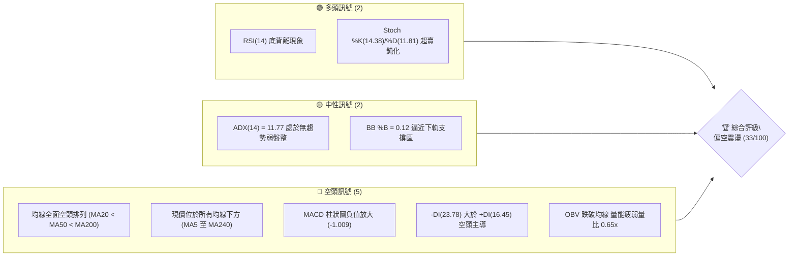

### 📊 核心指標速覽表

| 指標類別 | 指標名稱 | 當前數值 | 訊號 | 解讀 |
|----------|----------|----------|------|------|
| **價格** | 當前收盤價 | $126.16 | 🔴 | 位於52週區間7.1%分位，貼近年度低點區間 |
| **均線** | MA20 | $135.34 | 🔴 | 價格低於MA20達-6.78%，短期下行斜率明確 |
| **均線** | MA50 | $142.47 | 🔴 | 價格低於MA50達-11.45%，中期生命線失守 |
| **均線** | MA200 | $157.45 | 🔴 | 價格遠低於牛熊分界線-19.87%，長期格局偏空 |
| **動能** | RSI(14) | 39.41 | 🟡 | 位於中性偏弱區，近20根K棒首尾出現底背離標記 |
| **動能** | MACD (12,26,9) | -4.360 | 🔴 | 快慢線均在零軸下方，Histogram為-1.009持續擴張 |
| **動能** | Stoch %K / %D | 14.38 / 11.81 | 🟢 | 進入20以下嚴重超賣區，短線存在技術性修復動能 |
| **趨勢** | ADX(14) | 11.77 | 🟡 | 數值小於25，代表單邊趨勢衰竭，進入低動能盤整 |
| **通道** | 布林帶 (%B) | 0.12 | 🟡 | 價格貼近下軌$123.27，帶寬收斂後進入壓縮態勢 |
| **量能** | 20日成交量比 | 0.65x | 🔴 | 最新量19.18M低於均量29.36M，OBV疲弱未見買盤 |
| **波動** | ATR(14) | $6.56 | 🟡 | 佔現價5.20%，每日波幅適中，止損空間需合理拉寬 |

### 🏆 技術評分卡

```
╔══════════════════════════════════════════════════════════════╗
║                技術評分卡 — ORCL (2026-10-25)                 ║
╠══════════════════════════════════════════════════════════════╣
║ 趨勢強度      █████░░░░░░░░░░░░░░░  25/100  🔴 空頭主導       ║
║ 動能指標      ████████░░░░░░░░░░░░  40/100  🟡 背離抗跌       ║
║ 支撐穩定度    ████████░░░░░░░░░░░░  40/100  🟡 臨近S1支撐     ║
║ 成交量配合    ██████░░░░░░░░░░░░░░  30/100  🔴 量能萎縮       ║
║ 形態完整度    ████████░░░░░░░░░░░░  40/100  🟡 區間打底中     ║
║ 均線排列      ████░░░░░░░░░░░░░░░░  20/100  🔴 完全空頭排列   ║
╠══════════════════════════════════════════════════════════════╣
║ 綜合評分      ███████░░░░░░░░░░░░░  33/100  🔴 評級：偏空     ║
╚══════════════════════════════════════════════════════════════╝
```
*(註：綜合評分由六項子評分算術平均：(25 + 40 + 40 + 30 + 40 + 20) ÷ 6 = 32.5，四捨五入至整數為 33/100，符合規則 18)*

---

## 2. 趨勢分析

### 🌐 多時框趨勢分析

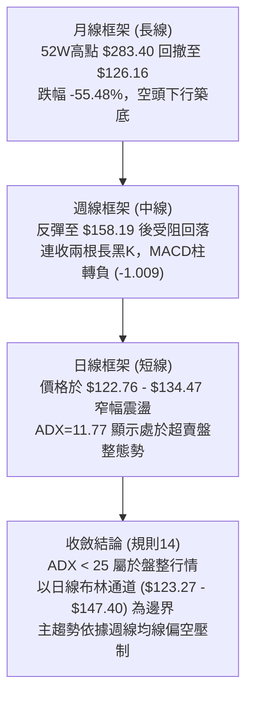

### 📈 長期趨勢 — 12個月走勢圖（Unicode）

```
ORCL 月線走勢圖（2025-11 至 2026-10）
價格軸 ($)
$260 ┤
$240 ┤
$220 ┤                             ● (2026-05 $224.17 反彈頂部)
$200 ┤● (2025-11 $199.28)
$180 ┤    ● (2025-12 $192.34)
$160 ┤        ● (2026-01 $162.84)      ● (2026-04 $160.24)
$140 ┤            ●          ●                 ● (06 $145.50)  ● (08 $148.57)
$120 ┤            (02 $143.86)(03 $145.55)             ● (07 $129.39)  ●(09 $136.79) ●←現價 $126.16
     └─────────────────────────────────────────────────────────────────────────────
       11    12    01    02    03    04    05    06    07    08    09    10 (月份)
```

#### 走勢特徵分析表格

| 階段區間 | 起訖月份 | 起訖價位 | 漲跌幅 | 核心走勢特徵與技術驅動因素 |
|----------|----------|----------|--------|----------------------------|
| 第一階段下殺 | 2025-11 ~ 2026-02 | $199.28 → $143.86 | -27.81% | 歷史高位巨量出貨，跌破所有短中期均線支撐 |
| 低檔築底反彈 | 2026-02 ~ 2026-05 | $143.86 → $224.17 | +55.83% | 季報驅動短線強推，最高反彈至斐波那契38.2%($218.72)上方 |
| 次級斷崖回落 | 2026-05 ~ 2026-07 | $224.17 → $129.39 | -42.28% | 資金出逃與資本支出負現金流打擊，直接摜破$140平台 |
| 弱勢橫盤探底 | 2026-07 ~ 2026-10 | $129.39 → $126.16 | -2.50% | 創下52週新低$114.08後低位反抽，當前進入縮量弱勢整理 |

### 📊 中期趨勢（週線分析）

```
週線級別價格軌跡與關鍵多空分水嶺示意：
$160 ┼─────────────────────────── [R3: $158.67 波段頂點聚類]
     │                 ╭─╮
$150 ┼─────────────────╯─╰───── [R1: $147.20 / R2: $153.03 雙重密集賣壓]
     │         ╭─╮
$140 ┼─────────╯─╰─────────────── [週線MA反壓區間 $141 - $144]
     │
$130 ┼─╮                     ╭─ [現價 $126.16 徘徊區]
     │ ╰──────────────╮      │
$120 ┼────────────────╰──────╯── [布林帶下軌 $123.27 支撐線]
     │
$110 ┼─────────────────────────── [S1: $114.08 / 52週歷史最低點]
```

### ⚡ 趨勢強度評估（ADX 解讀）

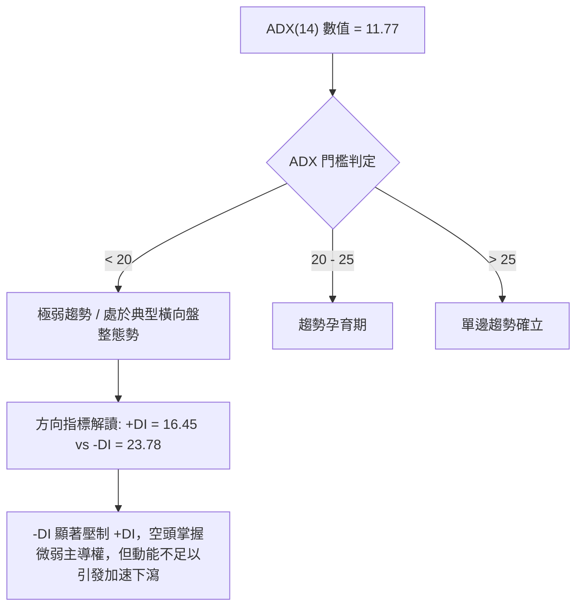

| 指標名稱 | 數值 | 狀態等級 | 行情類型判斷 | 操作指引 |
|----------|------|----------|--------------|----------|
| **ADX(14)** | 11.77 | 弱震盪（<20） | 典型無趨勢/盤整行情 | 嚴禁追高殺跌，以通道上下軌高拋低吸為主 |
| **+DI** | 16.45 | 多頭動能衰退 | 買盤意願低迷 | 向上突破阻力需顯著擴量確認 |
| **-DI** | 23.78 | 空頭佔據優勢 | 拋壓持續但未失控 | 觀察是否在S1前出現空頭動能衰竭 |

---

## 3. 圖表形態分析

### 🔍 形態識別系統

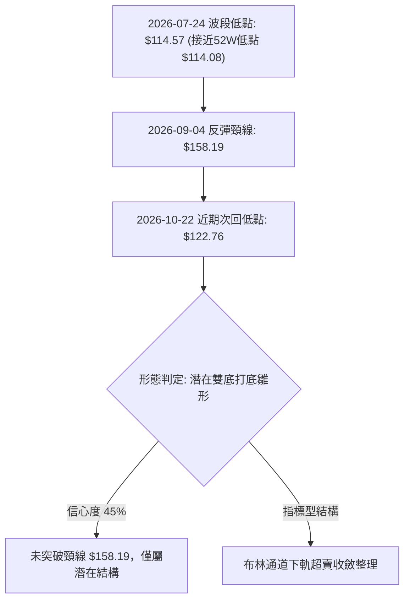

#### 形態識別與信心度評估表

| 形態類別 | 信心度 | 判斷依據（引用數據） | 完成度 | 目標價（附計算式） |
|----------|--------|----------------------|--------|--------------------|
| **潛在雙底 (Double Bottom)** | 45% | 第一底為2026-07-24之$114.57（近S1 $114.08），第二底為2026-10-22之$122.76，頸線為2026-09-04週收盤$158.19 | 40% | 訊號不足，信心度<50%，未突破頸線前不建立幾何突破目標，僅做指標型解讀 |
| **布林帶下軌支撐整理** | 75% | 現價$126.16逼近BB下軌$123.27，BB %B為0.12，Stoch進入超賣區 | 85% | 由布林中軌推算反彈目標：$135.34 (MA20) |

### 🕯️ 重要K線形態分析

*(依規則 19，僅引用近10根日K與近8根週K實際數據)*

| 日期（週期） | 開盤價 | 最高價 | 最低價 | 收盤價 | K線形態名稱 | 技術解讀 | 訊號 |
|--------------|--------|--------|--------|--------|-------------|----------|------|
| 2026-10-13 (日K) | 135.91 | 144.18 | 135.55 | 143.20 | 長實體大陽線 | 自低檔放量拉升，實體吞噬前日陰線，展現短底買盤 | 🟢 |
| 2026-10-14 (日K) | 140.00 | 141.05 | 129.23 | 130.55 | 光頭長陰吞噬 | 52.51M巨量跳水摜壓，直接吞噬前日漲幅，確立上方賣壓 | 🔴 |
| 2026-10-20 (日K) | 128.51 | 134.35 | 127.45 | 131.14 | 帶長上影小陽線 | 盤中嘗試上攻MA20遭壓回，顯示多頭反彈缺乏追價信心 | 🟡 |
| 2026-10-22 (日K) | 126.35 | 127.94 | 122.76 | 125.54 | 探底長下影陰線 | 最低探至$122.76，逼近下軌後引發買盤抵抗拉回，形成支撐 | 🟢 |
| 2026-10-23 (日K) | 124.87 | 128.33 | 124.39 | 126.16 | 低檔紅K十字星 | 成交量萎縮至19.18M，拋壓顯著衰竭，醞釀短線技術反彈 | 🟢 |
| 2026-09-11 (週K) | 166.98 | 170.07 | 149.29 | 149.73 | 長實體高檔大陰線 | 衝高至$170.07後遭空頭反撲，週跌幅擴大，確立波段見頂 | 🔴 |
| 2026-10-16 (週K) | 141.56 | 144.18 | 127.36 | 128.23 | 破位中長黑K線 | 實體跌破$130整數關卡，週線MACD柱進一步向負值發散 | 🔴 |
| 2026-10-23 (週K) | 130.66 | 134.35 | 122.76 | 126.16 | 下影錘頭小陰K | 週低點$122.76守住布林下軌，量縮至132.6M，呈現跌勢減緩 | 🟡 |

### 📉 ASCII 走勢形態示意圖

```
ORCL 近期日K線形態結構示意圖（2026-10-12 至 2026-10-23）
$145 ┤        ┌┐ (10-13 高點 $144.18)
$140 ┤ ┌┐     ││ ┌┐ (10-14 巨量開盤 $140.00)
$135 ┤ ││     ││ ││           ┌┐ (10-20 高點 $134.35)
$130 ┤ └┘ ─── ┴┴ ││ ┌┐ ── ┌┐ ─┼┼ ─ ┌┐
$125 ┤            └┘ ││    ││  ││   ││ ┌┐   ┌┐ (10-23 現價 $126.16)
$120 ┤               └┘    └┘  └┘   └┘ └┴─┬─┴┘
     └────────────────────────────────────┴───── (10-22 低點 $122.76)
       12 13   14 15 16    19  20   21 22 23 (交易日)
```

### 🎯 形態目標價計算

因雙底形態信心度僅 45%（未站上頸線 $158.19），依規則 13 與規則 15，不得捏造突破後的高目標價。此處針對確認度達 75% 的「布林通道下軌回歸形態」進行幾何與均線測距推算：

1. **下軌反彈基準點**：2026-10-22 低點 $122.76（守住 BB 下軌 $123.27）
2. **形態第一反彈目標（均值回歸）**：布林中軌 MA20 = **$135.34**
   - 計算式：$122.76 + (MA20 $135.34 - $122.76) = $135.34
3. **形態第二反彈阻力目標（波段聚類點）**：關鍵阻力位 R1 = **$147.20**
   - 依據：數據中已識別之波段高點聚類阻力位 R1

---

## 4. 支撐與阻力

### 🗺️ 關鍵價位分布圖（Unicode）

```
ORCL 價位結構分布圖
═════════════════════════════════════════════════════════════
$158.67 ║██████████████████████████████║ 強阻力 R3 (波段頂部密集區)
$153.03 ║████████████████████          ║ 中期阻力 R2 (反彈高點聚類)
$150.31 ║──────────────────────────────║ 斐波那契 78.6% 回調位
$147.20 ║████████████████████████      ║ 關鍵阻力 R1 (日線重壓與BB上軌)
$135.34 ║┈┈┈┈┈┈┈┈┈┈┈┈┈┈┈┈┈┈┈┈┈┈┈┈┈┈┈┈┈┈║ 動態阻力 MA20 / BB中軌
$126.16 ╠══════════════════════════════╣ ◄ 當前收盤價 ($126.16)
$123.27 ║┈┈┈┈┈┈┈┈┈┈┈┈┈┈┈┈┈┈┈┈┈┈┈┈┈┈┈┈┈┈║ 動態支撐 布林通道下軌
$114.08 ║██████████████████████████████║ 核心強支撐 S1 (52W歷史最低點)
═════════════════════════════════════════════════════════════
```

### 🚧 阻力位分析表

*(嚴格引用數據中「關鍵價位」區塊數值)*

| 阻力級別 | 價位 | 形成原因 | 突破難度 | 重要性 |
|----------|------|----------|----------|--------|
| **R1** | $147.20 | 近一年波段高點聚類點，重合布林上軌($147.40)與週K壓力 | 偏高 | 🟢 極高（短線由空翻多之關鍵樞紐） |
| **R2** | $153.03 | 波段反彈次高點聚類，接近2026-09-25週高點($153.03) | 高 | 🟡 中等（多頭反彈深入區） |
| **R3** | $158.67 | 波段高點聚類區，接近2026-09-04週收盤價($158.19)與MA120 | 極高 | 🔴 極強（牛熊長期趨勢防線） |

### 🛡️ 支撐位分析表

*(嚴格引用數據中「關鍵價位」區塊數值，未提供者直接說明)*

| 支撐級別 | 價位 | 形成原因 | 守住機率 | 重要性 |
|----------|------|----------|----------|--------|
| **S1** | $114.08 | 52週最低價($114.08)，近一年波段絕對低點聚類 | 70% | 🔴 絕對防線（跌破將觸發新一輪去槓桿下殺） |
| **S2** | N/A（數據未提供） | 數據中未偵測到S2價位聚類，僅存在S1 ($114.08) | N/A | N/A |
| **S3** | N/A（數據未提供） | 數據中未偵測到S3價位聚類 | N/A | N/A |

### 📐 斐波那契回調位分析

*(基準區間：52週低點 $114.08 → 52週高點 $283.40，總波幅 $169.32)*

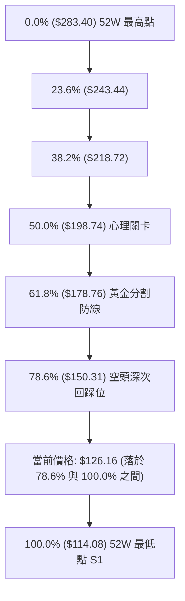

- **當前位置解讀**：現價 $126.16 處於斐波那契 **78.6% ($150.31)** 與 **100.0% ($114.08)** 的深度超跌區間。
- **技術意義**：ORCL 已經完全回吐了自 $114.08 起漲至 $283.40 總升幅的逾八成以上。一般而言，跌破 61.8% ($178.76) 且無法在 78.6% ($150.31) 獲得支撐，意味著長期牛市結構已遭到徹底破壞，當前處於回測起漲點 100% ($114.08) 的二次探底確認週期。

---

## 5. 技術指標深度解讀

### 🎛️ 指標訊號總覽

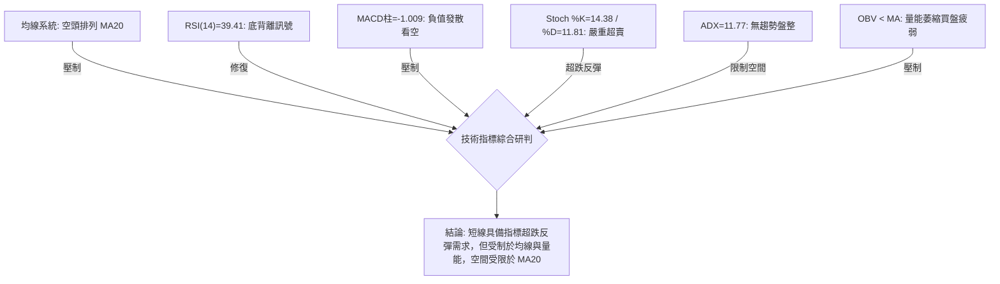

### 📈 移動平均線排列分析

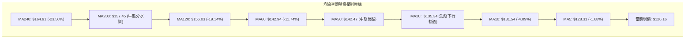

| 均線天數 | 均線價位 | 距現價差距 | 排列狀態 | 走勢解讀 |
|----------|----------|------------|----------|----------|
| **MA5** | $128.31 | -1.68% | 價格下方 | 短線極限壓制點，過去一週多次上衝未果 |
| **MA10** | $131.54 | -4.09% | 價格下方 | 扣抵高價區，持續陡峭向下壓制 |
| **MA20** | $135.34 | -6.78% | 價格下方 | 布林通道中軌，短期反彈的核心阻力關卡 |
| **MA50** | $142.47 | -11.45% | 價格下方 | 中期生命線，空頭完全掌控中長線定價權 |
| **MA200** | $157.45 | -19.87% | 價格下方 | 長期年線，判定股票進入實質技術性熊市 |

### 📉 RSI(14) 分析

- **當前數值**：39.41（Wilder平滑）
- **強度指示**：████████░░░░░░░░░░░░ 39.41%（偏弱中性區）
- **背離狀況確認**：**⚠️ 存在底背離 (Bullish Divergence)**
  - 依據：數據明確標示近20根K棒首尾之價格持續下探低點（自 $137.39 降至 $126.16，最低探至 $122.76），但 RSI 數值在跌破 30 後並未再創近期新低，目前已自超賣區修復至 39.41，形成價格創新低而動能未創低之典型「指標底背離」。
  - 結論：空頭拋售邊際力量減弱，短線醞釀技術性抽頭。

### 📊 MACD(12/26/9) 訊號解讀

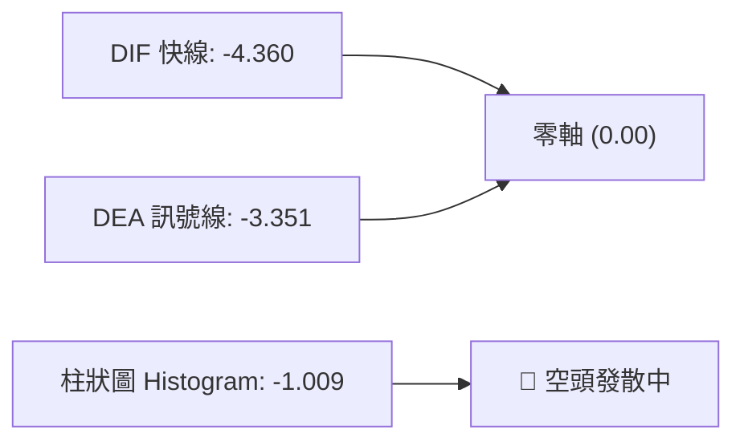

- **快慢線位置**：MACD (-4.360) 遠低於零軸，且持續運行於訊號線 (-3.351) 下方。
- **柱狀圖動態**：Histogram 為 -1.009，呈現負向柱狀體持續擴大跡象，顯示中期空頭趨勢仍未化解。日線底背離尚未傳導至 MACD 出現黃金交叉，操作上切忌盲目搶反彈。

### 📦 布林通道分析

```
布林通道相對位置 ASCII 示意圖
─────────────────────────────────────────────────────────────
$147.40  ┬  ════════════════════════════════════  BB 上軌
         │
$135.34  ┼  ------------------------------------  BB 中軌 (MA20)
         │
$126.16  *  ◄ 現價 (BB %B = 0.12，極度靠攏下軌)
$123.27  ┴  ════════════════════════════════════  BB 下軌
─────────────────────────────────────────────────────────────
```

- **通道帶寬分析**：上軌 $147.40 與下軌 $123.27 帶寬約 $24.13。
- **%B 指標意義**：%B 數值僅為 **0.12**，代表價格已經被壓縮在通道下邊緣 12% 的極低位置。在 ADX=11.77 盤整環境下，價格極易在接觸或刺破下軌後產生向中軌 ($135.34) 靠攏的「均值回歸」運動。

### 💹 成交量分析（量價配合度）

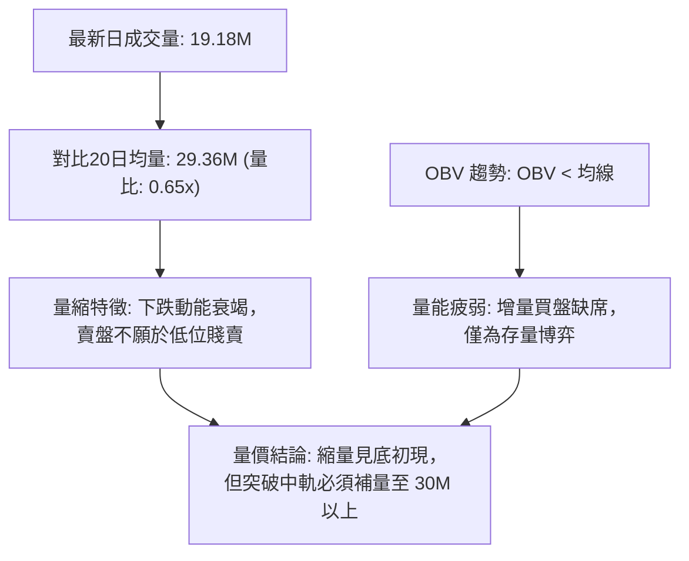

- **量比與均量狀態**：最新成交量 19,178,400 股，僅達 20 日均量 (29,362,260) 的 65%，量縮幅度達 35%。
- **OBV 趨勢**：OBV 持續低於其移動平均線，顯示資金流入跡象不明顯。量能未確認反轉，僅能視為抵抗型低吸格局。

---

## 6. 動能與波動率

### ⚡ 動能評估四象限

| 象限 | 動能維度 | 波動維度 | 標的所屬狀態 | 策略應對評估 |
|------|----------|----------|--------------|--------------|
| **Q1 (高動能·低波動)** | 強趨勢 (+DI大幅領先) | 低波幅 (ATR收斂) | 否 | 穩健單邊趨勢加碼點 |
| **Q2 (弱動能·低波動)** | 弱動能 (ADX=11.77) | 低波幅 (量縮窄幅) | **✓ ORCL 處於此區** | **謹慎觀望，適宜小倉位區間高拋低吸** |
| **Q3 (強動能·高波動)** | 強趨勢 (單邊加速) | 高波幅 (暴漲暴跌) | 否 | 趨勢突破追單，承受較大回撤 |
| **Q4 (弱動能·高波動)** | 無方向 (洗盤震盪) | 高波幅 (巨量拉鋸) | 否 | 容易雙向被巴，嚴格空倉觀望 |

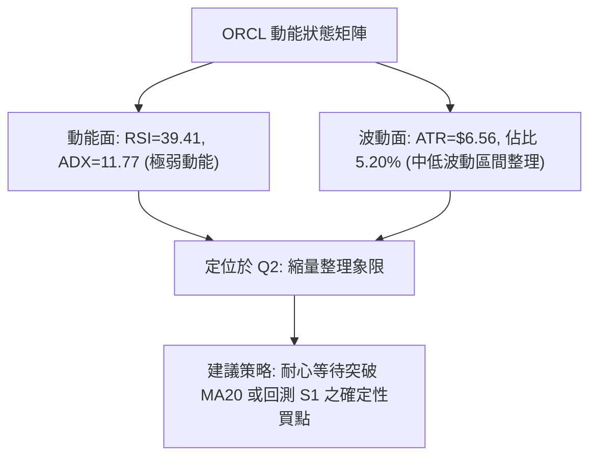

### 📊 ATR 波動率分析

- **ATR(14) 數值**：**$6.56**（Wilder計算，佔收盤價 $126.16 的 5.20%）
- **波動特性解讀**：每日平均波動超過 $6.5 美元，顯示期權與現貨隱含波動偏高。
- **風控止損測算**：
  - *短線交易止損距離（1.0 × ATR）*：$6.56
  - *波段交易止損距離（1.5 × ATR）*：$9.84
  - *安全緩衝進場邊界*：止損價位應設定在關鍵支撐下方至少 1.0 倍 ATR，以防日內正常造市波動誘空洗盤。

### 📐 Beta 與市場相關性

- **Beta 係數**：**1.77**（高彈性 Beta 特徵）
- **大盤相關性分析**：Beta 高達 1.77，代表 ORCL 對標普500與那斯達克指數的波動極度敏感。當大盤下挫 1% 時，該股預期跌幅達 1.77%；反之在大盤強勁反彈時，其具備較高的超額彈性。在目前空頭趨勢下，高 Beta 加劇了其下行深度。

---

## 7. 多時框架總結

### 📋 時框架評分表

| 時框架 | 趨勢方向 | 動能狀態 | 均線排列 | 圖表形態 | 綜合評分 | 操作建議 |
|--------|----------|----------|----------|----------|----------|----------|
| **月線 (長期)** | 🔴 強烈空頭 | 弱 (自高點跌破各均線) | 完全空頭 | 歷史高位巨幅回撤 | 20/100 | 長期基本面與籌碼承壓，避開長期多頭持倉 |
| **週線 (中期)** | 🔴 空頭下行 | 負發散 (MACD柱-1.009) | 破位空頭 | 連續中黑破位下尋S1 | 30/100 | 任何反彈至 MA50($142) 皆為波段解套賣點 |
| **日線 (短期)** | 🟡 弱勢盤整 | 背離超賣 (RSI背離, Stoch) | 空頭壓制 | 布林下軌抗跌十字星 | 45/100 | 超跌技術反彈醞釀，嚴控短線進出節奏 |

### 🔲 綜合訊號矩陣

```
ORCL 多維度訊號矩陣收斂表
┌──────────┬───────────┬───────────┬───────────┬───────────────────────┐
│ 分析維度 │ 短期 (日線)│ 中期 (週線)│ 長期 (月線)│ 多時框一致性研判      │
├──────────┼───────────┼───────────┼───────────┼───────────────────────┤
│ 趨勢方向 │ 🟡 橫向盤整│ 🔴 單邊下行│ 🔴 深度回調│ 中長期強烈壓制短期    │
│ 均線系統 │ 🔴 均線反壓│ 🔴 空頭排列│ 🔴 跌破年線│ 均線全面看空          │
│ 動能指標 │ 🟢 超賣底背│ 🔴 動能發散│ 🔴 空頭掌控│ 短期出現背離修復買點  │
│ 成交量能 │ 🔴 嚴重縮量│ 🟡 拋壓略減│ 🔴 資金流出│ 無機構大單回補證據    │
└──────────┴───────────┴───────────┴───────────┴───────────────────────┘
```

### ⚖️ 多時框收斂結論

*(嚴格遵循規則 14：多時框收斂規則)*

1. **行情性質判定**：當前日線 ADX(14) 數值為 **11.77 (< 25)**，嚴格判定當前處於**低動能盤整行情**，而非單邊趨勢行情。
2. **多時框收斂取捨**：
   - 根據規則 14，在 ADX < 25 的盤整市況下，**以日線布林通道 ($123.27 - $147.40) 為核心交易區間**。
   - 儘管週線與月線宏觀格局維持空頭排列，但日線 RSI 出現確定性底背離，且 Stoch 進入嚴重超賣 (%K=14.38)，空頭追空動能枯竭。
3. **最終唯一方向性結論**：**【偏空震盪中的下軌超跌反彈】**。
   - 總體評級為 **33/100 (偏空)**，中期主趨勢偏空，但短線不具備追空條件，主策略以**反彈高空（主推）**與**下軌極限超短多（輔助）**進行防禦性部署。

---

## 8. 交易策略建議

### 🗺️ 策略決策流程圖

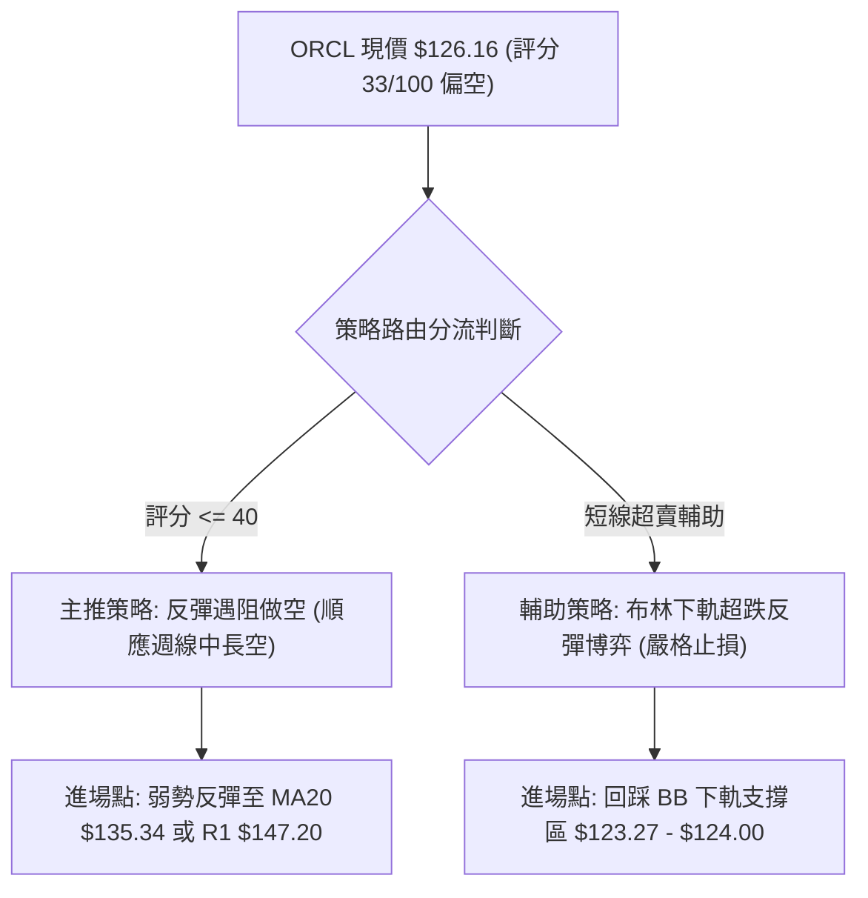

### 🧭 策略路由（依評分卡分流）

> **當前主策略方向 = 主推空頭策略（依綜合評分 33/100 偏空判定，規則 18）**

依據規則要求，綜合評分 ≤ 40 分主推順勢做空策略；多頭僅作為下軌支撐處的反轉風險對沖與極短線交易提示。

### 🎯 價格情境階梯（Price Scenarios）

*(嚴格引用第 4 章及數據中實際數值)*

| 觸發條件 | 下一目標 | 後續延伸 | 情境含義 |
|----------|----------|----------|----------|
| **強勢突破 R1 $147.20** | R2 $153.03 | R3 $158.67 | 空頭結構被化解，中期趨勢翻多 |
| **弱勢反彈至 MA20 $135.34** | 回測現價 $126.16 | S1 $114.08 | 均值回歸完成，空頭重啟波段賣壓 |
| **跌破下軌 $123.27** | S1 $114.08 | 數據中未提供更低價位 | 空頭動能再次失控，探測年度新低 |

### 📊 情境機率分佈

| 情境類別 | 機率預估 | 主要技術依據 |
|----------|----------|--------------|
| **弱反彈後受阻回落** | **55%** | 全均線呈空頭排列，MACD 柱狀圖負值發散，反彈遇 MA20/R1 必受賣壓打擊 |
| **區間低位窄幅震盪** | **30%** | ADX=11.77 指示盤整，布林通道 %B=0.12 收斂，短線成交量比 0.65x 嚴重縮量 |
| **直接下挫跌破 S1** | **15%** | 日線 RSI 出現底背離，Stoch 嚴重超賣，近期難以直接出現大陰線摜破 $114.08 |

### 🟢 主策略詳情（空頭主推策略）

*(風險報酬比嚴格按規則 17 計算：做空 RR = (進場價 − 目標價) ÷ (止損價 − 進場價))*

| 策略要素 | 策略 A（保守型：反彈布林中軌遇阻做空） | 策略 B（進取型：突破失敗確認做空） |
|----------|-----------------------------------------|-----------------------------------|
| **進場條件** | 價格反彈碰觸 MA20 出現長上影線或黑K確認 | 現價附近弱反彈無量，跌破前日低點 $124.39 |
| **進場價格** | **$135.34** (MA20 基準價) | **$126.16** (當前市價進場) |
| **目標價 T1** | **$123.27** (布林通道下軌) | **$114.08** (核心支撐 S1) |
| **目標價 T2** | **$114.08** (年度強支撐 S1) | 數據中未提供更低價位 |
| **止損價格** | **$142.47** (MA50 阻力線) | **$131.54** (MA10 壓制線) |
| **風險報酬比** | **1 : 1.70**（以 T1 計）<br>*(計算：(135.34−123.27)÷(142.47−135.34) = 12.07÷7.13 = 1.6928)*<br>**1 : 2.98**（以 T2 計）<br>*(計算：(135.34−114.08)÷(142.47−135.34) = 21.26÷7.13 = 2.9817)* | **1 : 2.25**（以 T1 計）<br>*(計算：(126.16−114.08)÷(131.54−126.16) = 12.08÷5.38 = 2.2453)*<br>*(T2 數據未提供)* |
| **成功機率** | 65% | 55% |
| **建議倉位** | 10% - 15% | 5% - 8% |

### 🔴 反向風險觸發點（對沖與止損提示）

若發生以下事件，代表空頭策略失效，空單必須全數離場並啟動對沖：
1. **收盤價實體站穩 R1 ($147.20)**：突破日線布林上軌與近一年波段阻力聚類，代表中期築底成功。
2. **週線 MACD 出現零軸下金叉且日成交量突破 40M 股**：量價齊揚徹底推翻弱動能盤整假設。

### ⭐ 整體訊號強度評星

```
╔══════════════════════════════════════════════════════════════╗
║ 做多訊號強度：★★☆☆☆  (2.0/5星) — 僅具備超賣底背離短彈條件     ║
║ 做空訊號強度：★★★★☆  (4.0/5星) — 均線與中長趨勢強烈壓制       ║
║ 整體可信度：  ★★★☆☆  (3.5/5星) — 低量盤整需防突破假訊號     ║
╚══════════════════════════════════════════════════════════════╝
```

---

## 9. 風險提示與監控

### ✅ 關鍵監控指標 Checklist

```
╔══════════════════════════════════════════════════════════════╗
║              ORCL 交易風控與即時監控 Checklist                ║
╠══════════════════════════════════════════════════════════════╣
║ [ ] 每日收盤價是否跌破布林下軌 $123.27 (破軌加速警訊)         ║
║ [ ] RSI(14) 底背離是否成立並回升越過 50.0 榮枯線             ║
║ [ ] 日成交量能否放大突破 20 日均量 29.36M (確認主動資金介入)  ║
║ [ ] MACD Histogram 負值是否縮小至 -0.500 以上 (空頭動能衰退) ║
║ [ ] 股價上攻時是否在 MA20 ($135.34) 出現滯漲倒錘頭 K 線     ║
║ [ ] 年度低點 S1 ($114.08) 之防守狀況 (絕對不能有效跌破)      ║
╚══════════════════════════════════════════════════════════════╝
```

### ⚠️ 風險場景分析

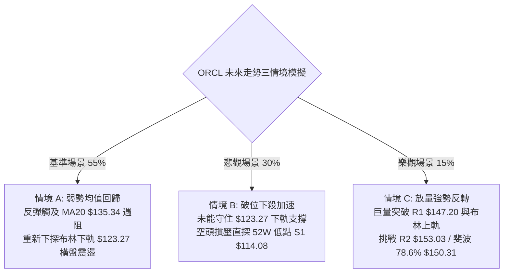

### 🛡️ 風險管理重要提醒

1. **財務基本面負向溢出效應**：公司最新自由現金流 (FCF) 為負的 **$-28.72B**，淨負債高達 **$132.07B**，資本支出高達 $75.66B，高槓桿特徵（Debt/Equity = 251.72）使其對高利率環境極度敏感。技術面反彈極易遭遇債信與流動性隱憂的突發打擊。
2. **高 Beta 波動防範**：Beta = 1.77 決定了其日內震盪劇烈，ATR 達到 $6.56。現貨與衍生品交易者必須嚴格控制單筆虧損不超過總資金的 1.5%，開倉部位建議壓制在 10% 以內，切忌滿倉博弈反彈。

---

## 📋 報告總結

```
╔══════════════════════════════════════════════════════════════════╗
║                    ORCL 技術分析報告總結                         ║
╠══════════════════════════════════════════════════════════════════╣
║ 報告日期：2026-10-25                                             ║
║ 當前價格：$126.16                                                ║
║ 分析評級：⚖️ 偏空震盪 (綜合評分 33/100)                          ║
║                                                                  ║
║ 關鍵結論：                                                       ║
║ ├─ 長期趨勢：🔴 實質熊市，股價遠低於 MA200 ($157.45)             ║
║ ├─ 中期趨勢：🔴 下行通道，反彈均受制於各級週均線與 R1 ($147.20)  ║
║ ├─ 短期趨勢：🟡 縮量盤整，RSI 出現底背離，布林下軌具支撐抵抗    ║
║ ├─ 關鍵支撐：$114.08 (S1 / 52週歷史低點)                         ║
║ ├─ 關鍵阻力：$135.34 (MA20), $147.20 (R1), $153.03 (R2)          ║
║ └─ 分析師共識：買入 (41位分析師均價 $236.54，低標 $110.00)       ║
║                                                                  ║
║ 最優策略組合：                                                   ║
║ 1. 🥇 最佳機會：反彈至布林中軌 MA20 ($135.34) 佈局順勢空單       ║
║    (目標 T1: $123.27, T2: $114.08, 止損: $142.47, RR=1:1.70)    ║
║ 2. 🥈 次選機會：下軌 $123.27 不破且見底K線時，小倉位博弈超跌反彈 ║
║ 3. 🥉 保守選擇：完全空倉觀望，等待突破 R1 或回測 S1 確立底部     ║
╚══════════════════════════════════════════════════════════════════╝
```

---

> ⚠️ **免責聲明**：本報告為 AI 自動生成之技術分析，所有數據及估算均基於提供的歷史價格資訊。本報告**僅供研究與學術參考**，**不構成任何投資建議**。投資有風險，入市需謹慎。

---

*報告生成時間：2026-10-25 ｜ 數據來源：Yahoo Finance ｜ 分析框架：多時框技術分析*