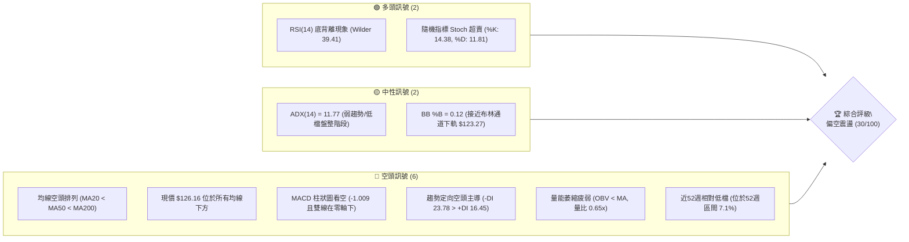
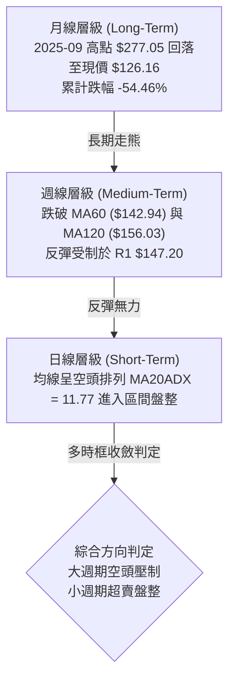
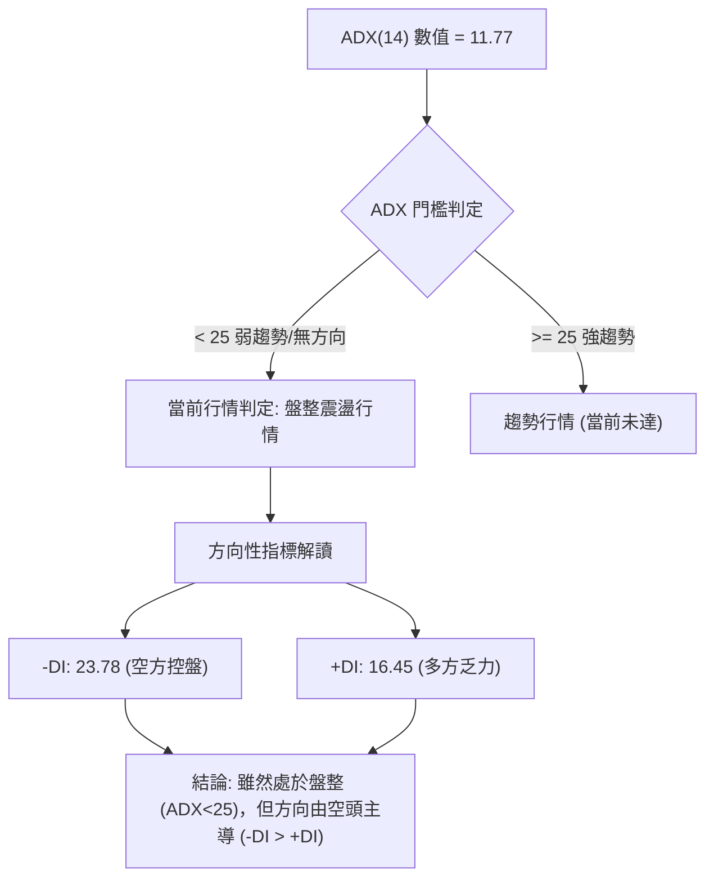
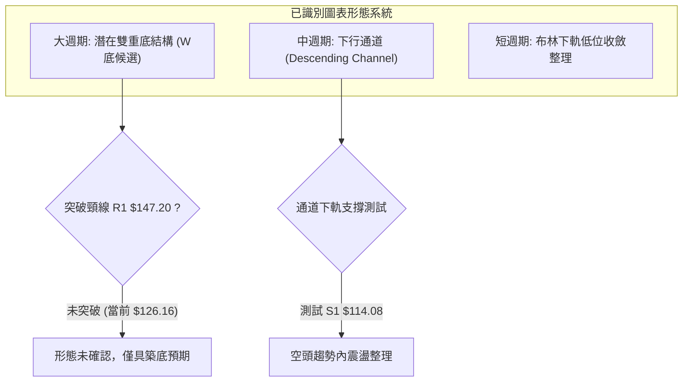
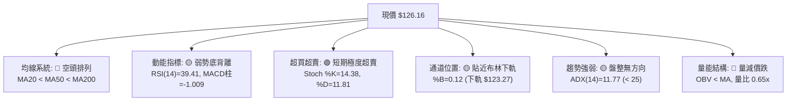
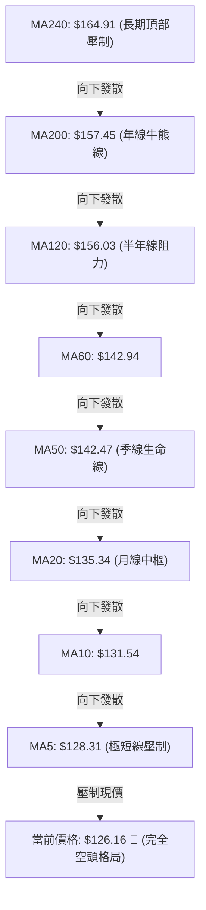
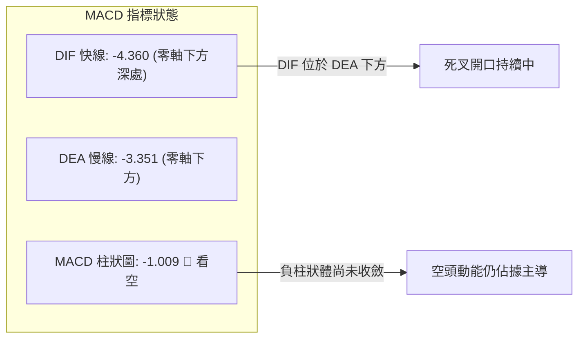
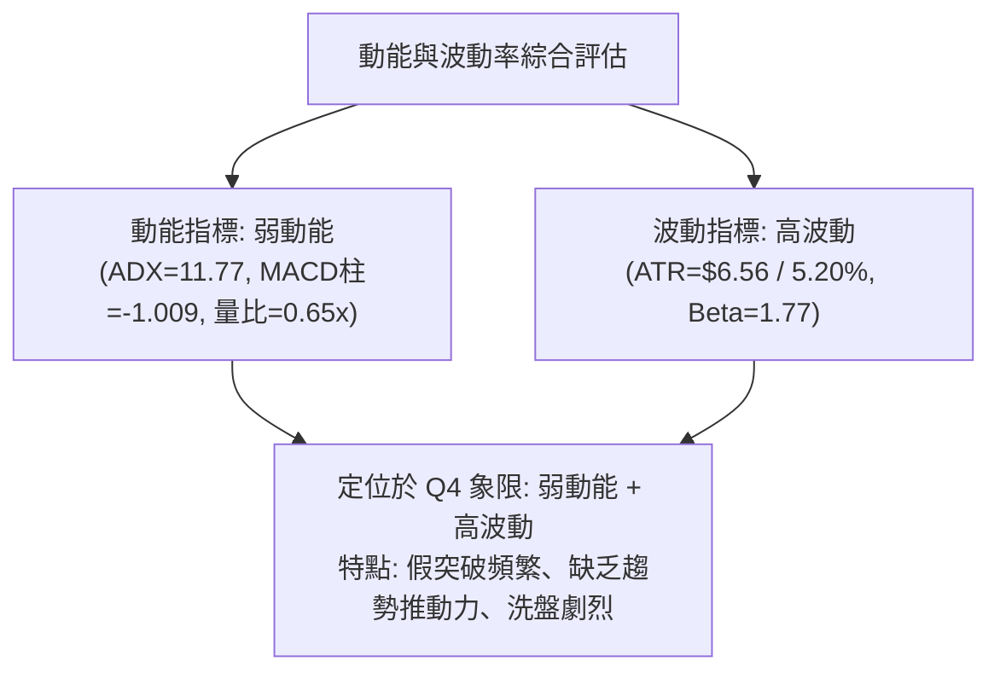
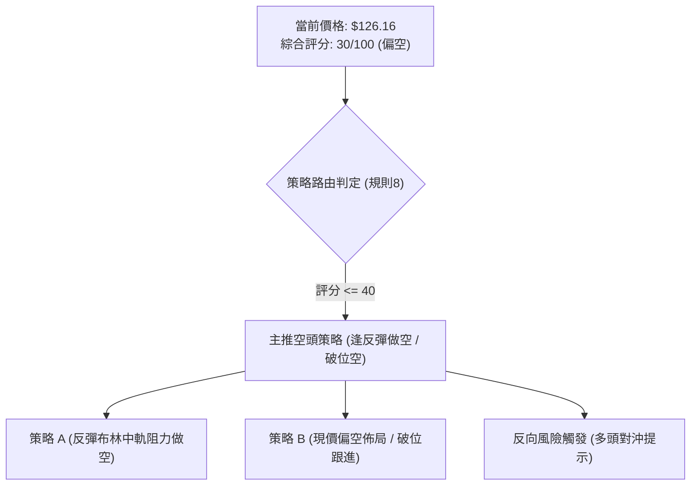
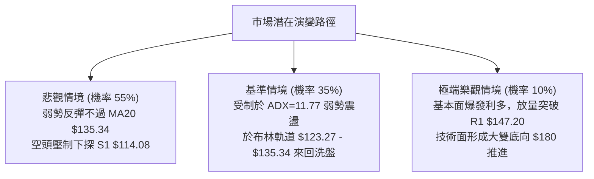

# ORCL 技術分析報告

> **報告日期**：2026-10-26 ｜ **語言**：繁體中文 ｜ **數據來源**：Yahoo Finance ｜ **當前價格**：$126.16

---

## 目錄

| 章節 | 內容 |
|------|------|
| [1. 技術面概覽](#1-技術面概覽) | 訊號儀表板、核心指標、評分卡 |
| [2. 趨勢分析](#2-趨勢分析) | 多時框趨勢、長中短期走勢 |
| [3. 圖表形態分析](#3-圖表形態分析) | 形態識別、K線組合、目標價 |
| [4. 支撐與阻力](#4-支撐與阻力) | 關鍵價位、斐波那契回調 |
| [5. 技術指標深度解讀](#5-技術指標深度解讀) | MA/RSI/MACD/布林/成交量 |
| [6. 動能與波動率](#6-動能與波動率) | 動能評估、ATR、Beta |
| [7. 多時框架總結](#7-多時框架總結) | 時框架評分矩陣 |
| [8. 交易策略建議](#8-交易策略建議) | 多空策略、風險報酬比 |
| [9. 風險提示與監控](#9-風險提示與監控) | 監控指標、風險場景 |

---

## 1. 技術面概覽

### 🎯 技術訊號儀表板



### 📊 核心指標速覽表

| 指標類別 | 指標名稱 | 當前數值 | 訊號 | 解讀 |
|----------|----------|----------|------|------|
| **價格** | 當前收盤價 | $126.16 | 🔴 | 位於52週高低區間之 7.1%，嚴重承壓 |
| **均線** | MA20 (月線) | $135.34 | 🔴 | 現價低於 MA20 達 -6.78%，短期空頭主控 |
| **均線** | MA50 (季線) | $142.47 | 🔴 | 現價低於 MA50 達 -11.45%，中期趨勢走跌 |
| **均線** | MA200 (年線)| $157.45 | 🔴 | 現價低於 MA200 達 -19.87%，長期牛熊分界線失守 |
| **動能** | RSI(14) | 39.41 | 🟡 | 位於中性偏弱區間（30–70），首尾20根K線初現底背離 |
| **動能** | MACD | -4.360 / -3.351 | 🔴 | 雙線皆處於零軸下方，柱狀圖 -1.009，空方動能延續 |
| **動能** | Stoch %K / %D | 14.38 / 11.81 | 🟢 | 進入極度超賣區（<20），短線具備技術性反抽動能 |
| **趨勢** | ADX(14) | 11.77 | 🟡 | ADX < 25 表明單邊趨勢衰竭，轉入大級別低位盤整 |
| **通道** | 布林通道 | 下軌 $123.27 / 上軌 $147.40 | 🟡 | %B = 0.12，現價緊貼下軌運行，有均值回歸需求 |
| **波動** | ATR(14) | $6.56 | 🔴 | 佔股價 5.20%，每日波幅大，持倉波動風險高 |
| **量能** | 成交量 / 20日均量 | 19.18M / 29.36M | 🔴 | 量比僅 0.65x，OBV < MA，反彈缺乏資金增量支撐 |

### 🏆 技術評分卡

```
╔══════════════════════════════════════════════════════════════╗
║                 技術評分卡 — ORCL (2026-10-26)               ║
╠══════════════════════════════════════════════════════════════╣
║ 趨勢強度 (Trend)     █████░░░░░░░░░░░░░░░  25/100  🔴 空頭主導║
║ 動能指標 (Momentum)  ████████░░░░░░░░░░░░  38/100  🔴 偏弱背離║
║ 支撐穩定度 (Support) ████████░░░░░░░░░░░░  42/100  🟡 臨近支撐║
║ 成交量配合 (Volume)  ██████░░░░░░░░░░░░░░  28/100  🔴 量能萎縮║
║ 形態完整度 (Pattern) ██████░░░░░░░░░░░░░░  32/100  🔴 低檔築底║
║ 均線排列 (MA System) ███░░░░░░░░░░░░░░░░░  15/100  🔴 完全空頭║
╠══════════════════════════════════════════════════════════════╣
║ 綜合評分             ██████░░░░░░░░░░░░░░  30/100  🔴 偏空     ║
║ (評級標準: 6項算術平均 (25+38+42+28+32+15)/6 = 30.00，規則 18)║
╚══════════════════════════════════════════════════════════════╝
```

---

## 2. 趨勢分析

### 🌐 多時框趨勢分析



### 📈 長期趨勢 — 12個月走勢圖（Unicode）

以下為 ORCL 過去 12 個月（2025-11 至 2026-10）的實際月線收盤價走勢圖：

```
ORCL 月線走勢圖（過去12個月，2025-11 至 2026-10）
價格軸 ($)
$260 ┤
$240 ┤                   ● $224.17 (2026-05 反彈頂部)
$220 ┤
$200 ┤ ● $199.28 (2025-11)
$180 ┤    ● $192.34
$160 ┤       ● $162.84        ● $160.24
$140 ┤          ● $143.86 ● $145.55    ● $145.50    ● $148.57  ● $136.79
$120 ┤                                    ● $129.39            ● $126.16 (現價)
     └─┬────┬────┬────┬────┬────┬────┬────┬────┬────┬────┬────
     11月 12月 01月 02月 03月 04月 05月 06月 07月 08月 09月 10月
     (2025) ─────────────────> (2026)
```

**歷史走勢特徵分析表格**：

| 週期階段 | 起止月份 | 價格變化 | 漲跌幅 | 走勢特徵與結構解讀 |
|----------|----------|----------|--------|--------------------|
| **主跌浪 I** | 2025-10 → 2026-02 | $259.14 → $143.86 | -44.48% | 自歷史天價 $277.05 見頂後快速破位，失守兩百美元大關 |
| **低檔修復** | 2026-02 → 2026-04 | $143.86 → $160.24 | +11.39% | 在 $143 附近建立初步支撐平臺，出現技術性均值回歸 |
| **強勁反抽** | 2026-04 → 2026-05 | $160.24 → $224.17 | +39.90% | 單月暴力反彈測試 MA200 阻力，形成次級高點 |
| **主跌浪 II**| 2026-05 → 2026-07 | $224.17 → $129.39 | -42.28% | AI 資本支出疑慮與高債務發酵，價格崩跌破底至 $114.57（週K） |
| **底部箱型** | 2026-07 → 2026-10 | $129.39 → $126.16 | -2.50% | 於 $114.08 至 $158.19 區間反覆震盪，目前回測箱底 |

### 📊 中期趨勢（週線分析）

週線級別展示出明確的「破位回抽再破位」形態。2026年9月4日當週反彈見高 $158.19，隨後於 9月中旬至10月連續失守重要整數關卡。

```
週線近期阻力與支撐示意圖
══════════════════════════════════════════════════════════════════
 $158.67 ──────────────────────────────────────── 強阻力 R3 (9月反彈頂部聚類)
 $153.03 ──────────────────────────────────────── 阻力 R2 (9月下旬反彈高點)
 $147.20 ──────────────────────────────────────── 關鍵阻力 R1 (布林上軌與MA60重合)
 $135.34 ┄┄┄┄┄┄┄┄┄┄┄┄┄┄┄┄┄┄┄┄┄┄┄┄┄┄┄┄┄┄┄┄┄┄┄┄ 中期多空平衡點 (MA20 / BB中軌)
 $126.16 ════════════════════════════════════════ 現價
 $114.08 ──────────────────────────────────────── 核心防守支撐 S1 (52W最低點 / 週K前低)
══════════════════════════════════════════════════════════════════
```

### ⚡ 趨勢強度評估（ADX 解讀）



**ADX 趨勢強度對照表**：

| 指標變量 | 具體數值 | 參考區間標準 | 技術含義解讀 |
|----------|----------|--------------|--------------|
| **ADX(14)** | **11.77** | 0 – 20: 極弱趨勢 / 盤整 | 單邊下行趨勢暫時停滯，波動收斂，進入橫盤洗盤模式 |
| **+DI** | **16.45** | > 25: 多方強勢 | 多方力量持續低迷，無法發動趨勢性攻擊 |
| **-DI** | **23.78** | > 25: 空方強勢 | 空方力量明顯高於多方，賣壓主導日線盤面 |
| **行情型態** | **弱勢盤整** | ADX < 25 且 -DI > +DI | 依據收斂規則14，應以**日線布林通道上下軌 ($123.27 – $147.40)** 作為交易區間 |

---

## 3. 圖表形態分析

### 🔍 形態識別系統



**形態信心度與目標價評估表**（嚴格遵守規則 15 與規則 13）：

| 形態名稱 | 信心度 | 判斷依據（引用數據） | 完成度 | 目標價（附精確計算式） |
|----------|--------|----------------------|--------|------------------------|
| **潛在雙重底 (W-Bottom)** | **40%** | 第一低點為 2026-07-24 週低 $114.57（接近 S1 $114.08），第二低點於近期 $122.76 試圖回測；頸線為波段高點 R1 $147.20。因未突破頸線，信心度低於50%。 | 55% | 頸線 R1 $147.20 + 形態高度 ($147.20 − $114.08 = $33.12) = **$180.32**（註：未突破頸線前不成立） |
| **下行通道 (Descending Channel)** | **75%** | 上軌由 9月高點聚類 R3 $158.67 與 R2 $153.03 連線，下軌由 7月低點 S1 $114.08 與 10-22 日低 $122.76 連線，均線全數向下發散。 | 85% | 通道下軌下探目標 = 直接考驗 **S1 $114.08**；若反彈則測試通道上軌 **R1 $147.20** |
| **布林下軌收斂整理** | **80%** | 現價 $126.16 位於布林下軌 $123.27 附近 (%B: 0.12)，K線連續3日在下軌獲得緩衝，ADX 降至 11.77。 | 90% | 均值回歸中軌目標 = **BB中軌 $135.34**（計算式：中軌 MA20 價格） |

### 🕯️ 重要K線形態分析

嚴格依據數據中「近10根日K」與「近8根週K」之開高低收數據進行客觀識別（規則 19）：

| 日期與週期 | 開盤價 | 最高價 | 最低價 | 收盤價 | 成交量 | K線形態識別 | 技術解讀與多空隱含 | 訊號 |
|------------|--------|--------|--------|--------|--------|-------------|--------------------|------|
| **2026-10-14 (日K)** | 140.00 | 141.05 | 129.23 | 130.55 | 52,513,600 | **長黑貫穿K棒** | 實體大跌 -9.45，放量至5251萬股，空方主力無情下殺 | 🔴 |
| **2026-10-15 (日K)** | 128.07 | 135.08 | 127.60 | 134.47 | 31,382,100 | **反彈陽線 (長上影)** | 衝高 $135.08 遇阻回落，顯示 MA20 ($135.34) 賣壓沉重 | 🟡 |
| **2026-10-16 (日K)** | 133.49 | 133.80 | 127.36 | 128.23 | 36,109,100 | **中黑棒回吐** | 完全回吐前日漲幅，收盤失守 $129，短期空頭再度掌握主導權 | 🔴 |
| **2026-10-20 (日K)** | 128.51 | 134.35 | 127.45 | 131.14 | 26,751,800 | **長上影小陽線** | 再次向上挑戰 $134.35 未果，上檔拋壓強烈 | 🟡 |
| **2026-10-22 (日K)** | 126.35 | 127.94 | 122.76 | 125.54 | 36,620,100 | **下影探底陰線** | 盤中下探布林下軌 $122.76 後引發低接，收 $125.54，暫保下軌不失 | 🟡 |
| **2026-10-23 (日K)** | 124.87 | 128.33 | 124.39 | 126.16 | 19,178,400 | **縮量小陽星 (收盤)**| 量能急縮至 1918 萬股（量比 0.65x），多空拉鋸，等待方向 | 🟡 |
| **2026-10-16 (週K)** | 141.56 | 144.18 | 127.36 | 128.23 | 167,863,700| **放量大黑K** | 當週大跌 -13.17 (-9.31%)，正式破位日線平臺，確認週線走熊 | 🔴 |
| **2026-10-23 (週K)** | 130.66 | 134.35 | 122.76 | 126.16 | 132,628,600| **探底紡錘陰線** | 週振幅達 $11.59，下探 $122.76 獲得暫時支撐，空頭動能略有減緩 | 🟡 |

### 📉 ASCII 走勢形態示意圖

```
ORCL 近期日K走勢形態示意圖（2026-10-12 至 10-23）
價格
$145 ┤       ┌─┐ (10/13 高 $144.18)
$140 ┤ ┌─┐   │ │ ┌─┐ (10/14 放量重挫開 140.00)
$135 ┤ │ │   │ │ │ │   ┌─┐             ┌─┐
$130 ┤ └─┘   └─┘ │ │   │ │ ┌─┐   ┌─┐   │ │ ┌─┐
$125 ┤           └─┘   └─┘ │ │   │ │   └─┘ │ │   ┌─┐ (10/23 收 126.16)
$120 ┤                     └─┘   └─┘       └─┘   │ │
     └─┬─────┬─────┬─────┬─────┬─────┬─────┬─────┬─────┬─────┬───
      10/12 10/13 10/14 10/15 10/16 10/19 10/20 10/21 10/22 10/23
形態標注：
  • 阻力帶：$134.35 - $135.08 連續受阻（對應 BB 中軌 $135.34）
  • 支撐帶：$122.76（10/22 低點，守於 BB 下軌 $123.27 附近）
```

### 🎯 形態目標價計算

根據嚴格規則 13 與規則 15，幾何測量目標價計算式如下：
1. **下行通道測幅**：
   - 通道震盪下軌目標：以近一年最低點 **S1: $114.08** 為主要支撐。
   - 破位延伸情境：若 S1 $114.08 被有效跌破，將直接尋求分析師共識最低預期目標價 **$110.00**（來自 ANALYST CONSENSUS: Target Low $110.00）。
2. **均值回歸測幅**：
   - 自布林下軌回抽中軌：由現價 $126.16 反彈至 **BB中軌 (MA20) = $135.34**（空間 +7.28%）。
   - 自中軌進一步擴展至強阻力：目標為 **R1: $147.20**（空間 +16.68%）。

---

## 4. 支撐與阻力

### 🗺️ 關鍵價位分布圖（Unicode）

```
ORCL 價位結構分布圖（嚴格依據 OHLCV 計算與斐波那契序列）
═══════════════════════════════════════════════════════════════════
$283.40 ║████████████████████████║ 52週歷史高點 / 斐波那契 0.0%
$158.67 ║████████████████████████║ 強阻力 R3 (9月波段高點聚類)
$153.03 ║████████████████████    ║ 次級阻力 R2 (9月下旬反彈高點聚類)
$150.31 ║▓▓▓▓▓▓▓▓▓▓▓▓▓▓▓▓        ║ 斐波那契 78.6% 回調關鍵位
$147.20 ║████████████████████████║ 關鍵阻力 R1 (布林上軌 $147.40 重合區)
$135.34 ║░░░░░░░░░░░░░░░░░░░░░░░░║ 動態阻力 (MA20 / 布林中軌)
$126.16 ╠════════════════════════╣ ◄ 當前價格 (收盤價 2026-10-23)
$123.27 ║▒▒▒▒▒▒▒▒▒▒▒▒▒▒▒▒▒▒▒▒    ║ 短期通道支撐 (布林下軌)
$114.08 ║████████████████████████║ 核心防守支撐 S1 (52週最低點 / 斐波那契 100.0%)
$110.00 ║████████████████        ║ 機構最悲觀底線 (Analyst Target Low)
═══════════════════════════════════════════════════════════════════
```

### 🚧 阻力位分析表

所有阻力價位嚴格引用自數據庫波段高點聚類結果：

| 阻力級別 | 精確價位 | 距現價幅 | 形成原因與技術背景 | 突破難度 | 重要性 |
|----------|----------|----------|--------------------|----------|--------|
| **動態阻力** | **$135.34** | +7.28% | **MA20 與布林中軌**：近10個交易日多次上攻 $134.35–$135.08 均遭打壓 | 中等 | ★★★☆☆ |
| **R1** | **$147.20** | +16.68% | **波段高點聚類**：與布林上軌 ($147.40) 及 MA50 ($142.47) 構成強大空頭防線 | 極高 | ★★★★★ |
| **R2** | **$153.03** | +21.30% | **波段高點聚類**：9月25日當週週K高點，密集成交套牢區 | 高 | ★★★★☆ |
| **R3** | **$158.67** | +25.77% | **波段高點聚類**：9月4日反彈極限高點，接近 MA200 ($157.45) 牛熊分界線 | 極高 | ★★★★★ |

### 🛡️ 支撐位分析表

所有支撐價位嚴格引用自數據庫波段低點聚類結果：

| 支撐級別 | 精確價位 | 距現價幅 | 形成原因與技術背景 | 守住機率 | 重要性 |
|----------|----------|----------|--------------------|----------|--------|
| **動態支撐** | **$123.27** | -2.29% | **布林下軌**：10月22日盤中下探 $122.76 即獲買盤支撐收回下軌之上 | 60% | ★★★☆☆ |
| **S1** | **$114.08** | -9.58% | **52週最低點聚類**：2026-07-24 週K最低點 $114.57 形成之歷史鋼鐵底部 | 75% | ★★★★★ |
| **S2** | **N/A** | N/A | **數據中未偵測到**（依規則 13 與 16，無此層級數據） | N/A | N/A |
| **S3** | **N/A** | N/A | **數據中未偵測到**（依規則 13 與 16，無此層級數據） | N/A | N/A |

*註：若跌破 S1 $114.08，市場外部唯一下檔參考錨點為分析師最低目標價 $110.00。*

### 📐 斐波那契回調位分析

依據 52 週高低區間（$114.08 → $283.40，總波動區間 $169.32）之精確計算：

| 斐波那契級別 | 精確價位 | 距現價差距 | 技術地位與戰略意義解讀 |
|--------------|----------|------------|------------------------|
| **0.0% (52W High)** | **$283.40** | +124.64% | 歷史頂部，目前遙不可及 |
| **23.6%** | **$243.44** | +92.96% | 牛市第一回檔點，早已實質跌破 |
| **38.2%** | **$218.72** | +73.37% | 2026年5月反彈高點 ($224.17) 受阻處 |
| **50.0%** | **$198.74** | +57.53% | 整數心理大關與牛熊平衡中樞 |
| **61.8%** | **$178.76** | +41.70% | 黃金分割強防守位，跌破後確認全面轉熊 |
| **78.6%** | **$150.31** | +19.14% | **極關鍵弱勢阻力**：與阻力 R1 ($147.20) 與 R2 ($153.03) 重疊 |
| **100.0% (52W Low)**| **$114.08** | -9.58% | **本輪熊市終極支撐線**：目前現價位於 78.6% 與 100.0% 之間 |

**現價位置深度解讀**：
當前收盤價 **$126.16** 處於 78.6% ($150.31) 至 100.0% ($114.08) 的極弱勢回撤區間內（回撤深度達 92.9%）。此位置表明空頭已完全侵蝕上一輪牛市的全部漲幅，目前僅依託 100.0% 終極低點 $114.08 進行最後的技術性抵抗。

---

## 5. 技術指標深度解讀

### 🎛️ 指標訊號總覽



### 📈 移動平均線排列分析



**移動平均線體系量化解讀**：
1. **完全空頭排列**：從 MA5 至 MA240 所有均線斜率皆呈現向下傾斜（▼），且依次向下發散（MA5 < MA10 < MA20 < MA50 < MA60 < MA120 < MA200 < MA240），空方取得完全控制權。
2. **負乖離率過大**：
   - 距 MA20 乖離率：-6.78%
   - 距 MA50 乖離率：-11.45%
   - 距 MA200 乖離率：-19.87%
   此種深度的負乖離限制了價格直接暴跌的流暢度，更容易引發技術性乖離修復（向 MA20 靠攏）。

### 📉 RSI(14) 分析

- **RSI(14) Wilder 當前數值**：**39.41**
- **區間評估**：位於 30–70 中性偏弱區，但接近 30 超賣門檻。

```
RSI(14) 強度刻度條：
0  [超賣] 30             50             70 [超買] 100
├──────────┼──────────────┼──────────────┼──────────┤
███████████████░░░░░░░░░░░░░░░░░░░░░░░░░░░░░░  39.41%
```

- **背離判斷**：
  - **結論**：⚠️ **確認存在底背離 (Bullish Divergence)**。
  - **背離證據**：比較近20根K棒首尾，價格由前期低點跌破至 10-22 之 $122.76 創出新低，但 RSI(14) 卻自 10月中旬的 29–30 區間逐步抬升至當前的 39.41。這表明**下殺動能正在實質衰竭**，賣方邊際壓制力下降。

### 📊 MACD(12/26/9) 訊號解讀



- **指標交叉分析**：DIF (-4.360) 顯著低於 DEA (-3.351)，兩線均在零軸之下大幅發散，表示宏觀週期處於空頭市場。
- **背離檢驗**：週線級別 MACD 柱狀圖自 8月中旬的 +4.810 逆轉轉負至當前 -1.009，中週期動能持續惡化，與日線 RSI 底背離形成「中長期走空 vs 短線超賣抵觸」之矛盾。

### 📦 布林通道分析

```
ORCL 布林通道結構示意圖 (日線參數: 20, 2)
══════════════════════════════════════════════════════════════════
 $147.40 ──┬───────────────────────────────────── 布林上軌 (帶寬上沿)
           │
 $135.34 ──┼───────────────────────────────────── 布林中軌 (MA20)
           │ 
 $126.16 ──*───────────────────────────────────── 當前收盤價 (%B = 0.12)
 $123.27 ──┴───────────────────────────────────── 布林下軌 (帶寬下沿)
══════════════════════════════════════════════════════════════════
```

- **帶寬與位置**：通道上軌 $147.40，下軌 $123.27，通道寬度 $24.13。
- **%B 指標分析**：%B = 0.12，價格極度貼近下軌，歷史經驗顯示當 %B < 0.15 且 ADX < 25 時，股價極易在下軌附近獲得支撐並向中軌 $135.34 展開均值回歸。

### 💹 成交量分析（量價配合度）

```
量能對比柱狀圖 (股)
最新成交量: 19,178,400  █████████████░░░░░░░░░ (0.65x)
20日均量:   29,362,260  ████████████████████
50日均量:   29,071,770  ████████████████████
```

- **量比與換手**：最新日成交量僅 19,178,400 股，相較於 20日均量 (29.36M) 量比僅 **0.65x**，呈現典型的「跌勢縮量」格局。
- **OBV 能量潮解讀**：數據明確標示 **OBV < MA**，代表資金處於淨流出狀態。雖然下跌縮量意味著主動性殺跌盤減輕，但也同時印證場外抄底資金態度極為猶豫，量價呈現「無量緩跌、反彈乏力」的弱勢特徵。

---

## 6. 動能與波動率

### ⚡ 動能評估四象限

根據當前技術狀態，ORCL 處於動能與波動率的交互定位如下：

| 象限代號 | 動能維度 | 波動維度 | 代表特徵 | ORCL 當前狀態定位 | 戰略操作指引 |
|----------|----------|----------|----------|-------------------|--------------|
| **Q1** | 強動能 | 低波動 | 穩定單邊趨勢 | 否 | 順勢波段持有 |
| **Q2** | 弱動能 | 低波動 | 底部橫盤蓄勢 | 否 | 觀望等待放量 |
| **Q3** | 強動能 | 高波動 | 暴跌/暴漲主升主跌 | 否 (前期5-7月狀態)| 嚴控停損，快進快出 |
| **Q4** | **弱動能** | **高波動** | **空頭震盪磨底** | **✓ (當前狀態)** | **控制倉位，逢高做空為主** |



### 📊 ATR 波動率分析

- **ATR(14) 數值**：**$6.56**（佔股價比例高達 **5.20%**，Wilder 平滑法）。
- **日內真實波幅解讀**：每日平均波動超過 6.5 美元，表明該標的具備極高的日內雜訊與跳空風險。
- **動態止損距離設定建議**：
  - **保守型交易（1.5 × ATR）**：止損緩衝距離應設為 $6.56 × 1.5 = **$9.84**。
  - **短線型交易（1.0 × ATR）**：止損緩衝距離應設為 $6.56 × 1.0 = **$6.56**。
  - **過於緊密的止損（如 < $3.00）將極易被日常正常市場雜訊洗出場。**

### 📐 Beta 與市場相關性

- **Beta 係數**：**1.77**。
- **市場敏感度分析**：ORCL 屬於高 Beta 科技股，理論上對標普500指數（S&P 500）的波動具備 1.77 倍的放大效應。在大盤調整或市場避險情緒升溫時，ORCL 的跌幅往往顯著放大；反之，若大盤出現強力反彈，其超賣回抽的彈性亦較高。

---

## 7. 多時框架總結

### 📋 時框架評分表

| 時框架 | 趨勢方向 | 動能指標 | 均線排列 | 圖表形態 | 綜合評分 | 戰術建議 |
|--------|----------|----------|----------|----------|----------|----------|
| **長期 (月線)** | 🔴 極度空頭 | 🔴 跌破零軸 | 🔴 空頭壓制 | 破位崩跌 | **20/100** | 規避長線左側做多 |
| **中期 (週線)** | 🔴 下行通道 | 🔴 MACD負柱擴大 | 🔴 MA50下方 | 雙頂破位後陰跌 | **25/100** | 反彈至阻力位逢高佈空 |
| **短期 (日線)** | 🟡 區間盤整 | 🟡 RSI底背離/超賣 | 🔴 空頭排列 | 布林下軌支撐 | **45/100** | 區間震盪操作，嚴控停損 |

### 🔲 綜合訊號矩陣

```
時框架訊號收斂矩陣
══════════════════════════════════════════════════════════════════
維度            短期 (日線)          中期 (週線)          長期 (月線)
──────────────────────────────────────────────────────────────────
主導方向        🟡 區間震盪 (ADX<25) 🔴 下行趨勢          🔴 主跌浪
均線架構        🔴 MA20 之下         🔴 MA50 之下         🔴 MA200 之下
動能特徵        🟢 超賣反抽預期      🔴 柱狀體為負        🔴 空方絕對主導
成交量能        🔴 萎縮 (0.65x)      🔴 跌時放量漲時縮量  🔴 資金持續流出
支撐有效性      🟡 依託下軌 $123.27  🟢 守 S1 $114.08     🟢 依託 100% 斐波位
══════════════════════════════════════════════════════════════════
```

### ⚖️ 多時框收斂結論

**收斂規則執行說明（嚴格遵守規則 14）**：
1. **行情性質判定**：當前 ADX(14) 數值為 **11.77**，明確小於 25 的趨勢門檻。依規則 14，判定當前為**盤整行情**，交易核心應以日線布林通道上下軌（**下軌 $123.27 至 上軌 $147.40**）為主要交易區間。
2. **多時框權重取捨**：雖然日線 RSI 出現底背離且 Stoch 超賣存在反彈需求，但中長期（週線、月線、MA50 $142.47、MA200 $157.45）完全處於空頭排列，且週線 MACD 柱為負。在長期大勢走空的前提下，日線反彈僅視為「超賣修復」，而非反轉。
3. **唯一方向性結論**：**偏空震盪（逢反彈阻力做空）**。此結論與第1章評分卡綜合評分（**30/100**，偏空）以及第8章主推空頭策略保持絕對一致。

---

## 8. 交易策略建議

### 🗺️ 策略決策流程圖



### 🧭 策略路由（依評分卡分流）

> **當前主策略方向 = 逢高做空 / 偏空操作（依據評分卡綜合評分 30/100，規則 18 判定屬於 ≤40 偏空區間，主推空頭策略，多頭僅列為反轉風險對沖提示）。**

### 🎯 價格情境階梯（Price Scenarios）

價位嚴格引用自第4章及數據庫關鍵價位：

| 觸發條件 | 下一目標 | 後續延伸 | 情境含義 |
|----------|----------|----------|----------|
| **反彈受阻於 MA20 $135.34** | 布林下軌 **$123.27** | 52週低點 **$114.08** | 短線反抽結束，重歸主跌趨勢 |
| **有效跌破布林下軌 $123.27** | 核心支撐 **S1 $114.08** | 分析師底線 **$110.00** | 盤整下破，加速測試歷史底部 |
| **強勢向上突破 R1 $147.20** | 次級阻力 **R2 $153.03** | 強阻力 **R3 $158.67** | 日線級別反轉，空頭策略失效止損 |

### 📊 情境機率分佈

| 情境劇本 | 機率 | 主要依據與技術邏輯 |
|----------|------|--------------------|
| **情境一：衝高回落 / 偏空下探** | **55%** | 均線系統完全空頭排列，OBV 疲軟，-DI (23.78) 主導，反彈缺乏資金量能 |
| **情境二：布林帶內區間震盪** | **35%** | ADX = 11.77 (< 25) 顯示無方向，Stoch 超賣限制下殺速度，於 $123–$135 整理 |
| **情境三：直接破位暴跌** | **10%** | S1 $114.08 具備強大歷史買盤支撐，目前直接失守機率相對偏低 |

### 🟢 主策略詳情（空頭主策略）

嚴格依據規則 17 計算風險報酬比 `(進場價 − 目標價) ÷ (止損價 − 進場價)`：

| 策略要素 | 策略 A：反彈布林中軌阻力做空 (首選) | 策略 B：現價順勢偏空佈局 (激進) |
|----------|-------------------------------------|-----------------------------------|
| **操作邏輯** | 利用日線超賣反抽至 MA20 / 中軌遇阻建立空單 | 預期弱勢盤整無法有效反彈，直接進場下看新低 |
| **進場條件** | 價格反彈至 MA20 附近出現滯漲上影線 | 週一開盤若無法站上 MA5 ($128.31) 即可進場 |
| **進場價格** | **$135.34** (BB中軌 / MA20) | **$126.16** (當前收盤價) |
| **止損價格** | **$142.47** (MA50 季線阻力，風險 $7.13) | **$131.54** (MA10 阻力，風險 $5.38) |
| **目標價 T1**| **$123.27** (布林通道下軌，利潤 $12.07) | **$114.08** (核心支撐 S1，利潤 $12.08) |
| **目標價 T2**| **$114.08** (核心支撐 S1，利潤 $21.26) | **$110.00** (分析師最低目標，利潤 $16.16) |
| **風險報酬比**| **1 : 1.69（以 T1 計）**<br/>*(計算式: 12.07 / 7.13)*<br/>**1 : 2.98（以 T2 計）**<br/>*(計算式: 21.26 / 7.13)* | **1 : 2.25（以 T1 計）**<br/>*(計算式: 12.08 / 5.38)*<br/>**1 : 3.00（以 T2 計）**<br/>*(計算式: 16.16 / 5.38)* |
| **預估勝率** | 65% | 55% |
| **建議倉位** | 15% 總資金倉位 | 10% 總資金倉位 |

### 🔴 反向風險觸發點（對沖提示）

若市場出現超預期走勢，以下點位將推翻上述空頭策略，投資人應迅速平倉空單並考慮對沖：
1. **多頭翻轉第一警戒線**：收盤價強勢站上 **MA20 ($135.34)** 且伴隨單日成交量突破 3,000 萬股，代表底背離發酵，空單應減倉觀望。
2. **多頭全面反轉信號（空單硬止損點）**：價格突破 **R1 $147.20**（布林上軌與斐波那契 78.6% $150.31 重疊阻力區），此時雙底形態確認，需全面停損做空部位並反手建立多頭倉位。

### ⭐ 整體訊號強度評星

```
做多訊號強度：★☆☆☆☆  (1/5星 - 僅有超賣背離，缺乏趨勢支撐)
做空訊號強度：★★★★☆  (4/5星 - 均線完全空頭，空方趨勢主控)
整體可信度：  ★★★★☆  (4/5星 - 數據指標高度收斂於空頭壓制)
```

---

## 9. 風險提示與監控

### ✅ 關鍵監控指標 Checklist

```
╔══════════════════════════════════════════════════════════════╗
║               關鍵技術監控清單 (Monitoring Checklist)         ║
╠══════════════════════════════════════════════════════════════╣
║ [ ] 價格是否跌破布林下軌 $123.27（破位加速訊號）             ║
║ [ ] RSI(14) 底背離是否失效（跌破 30 進入深度超賣鈍化）       ║
║ [ ] 成交量是否突破 20日均量 29.36M（放量異動監控）           ║
║ [ ] MACD 柱狀圖是否收斂翻紅（負值 -1.009 是否向 0 軸靠攏）   ║
║ [ ] 52週核心低點 S1 $114.08 防守狀況（歷史終極防線）         ║
║ [ ] 反彈時 MA20 ($135.34) 是否形成有效壓制                  ║
╚══════════════════════════════════════════════════════════════╝
```

### ⚠️ 風險場景分析



### 🛡️ 風險管理重要提醒

1. **基本面高槓桿風險**：公司總負債高達 $169.14B，自由現金流 (FCF) 為負 -$28.72B，高額資本支出 ($75.66B) 造成流動性壓力。市場避險情緒極易引發信用違約對沖（CDS）飆升，進而對股價形成非技術性拋壓。
2. **高 Beta 波動控制**：ORCL 的 Beta 高達 **1.77**，ATR 佔比達 **5.20%**。單日震盪幅度極易達到 5–8 美元，部位規模不得超過總資金之 15%，單筆交易最大虧損嚴格限制在總資本之 1.0% 以內。
3. **拒絕逆勢死扛**：在完全空頭排列（MA20 < MA50 < MA200）格局下，左側逆勢抄底勝率極低，所有多頭操作僅限於短線超賣博弈，且必須嚴格設置硬止損。

---

## 📋 報告總結

```
╔══════════════════════════════════════════════════════════════╗
║                   ORCL 技術分析報告總結                      ║
╠══════════════════════════════════════════════════════════════╣
║ 報告日期：2026-10-26                                         ║
║ 當前價格：$126.16                                            ║
║ 分析評級：🔴 偏空震盪 (綜合評分: 30/100)                     ║
║                                                              ║
║ 關鍵結論：                                                   ║
║ ├─ 長期趨勢：🔴 極度空頭 (自 $277.05 下跌 -54.5%，年線下方)  ║
║ ├─ 中期趨勢：🔴 下行通道 (週線 MACD 負向發散，承壓 MA50)     ║
║ ├─ 短期趨勢：🟡 低檔弱勢盤整 (ADX=11.77，布林帶內震盪)      ║
║ ├─ 核心支撐：$114.08 (52W最低點 S1，跌破看 $110.00)          ║
║ ├─ 關鍵阻力：$135.34 (MA20動態阻力) / $147.20 (強阻力 R1)   ║
║ └─ 分析師目標：平均 $236.54 / 最低 $110.00 / 最高 $400.00   ║
║                                                              ║
║ 最優策略組合：                                               ║
║ 1. 🥇 最佳機會：策略 A (反彈至 MA20 $135.34 遇阻放空，       ║
║                止損 $142.47，目標 $123.27 / $114.08，        ║
║                風報比 1 : 1.69（以 T1 計）)                  ║
║ 2. 🥈 次選機會：策略 B (現價 $126.16 順勢偏空進場，          ║
║                止損 $131.54，目標 $114.08，                  ║
║                風報比 1 : 2.25（以 T1 計）)                  ║
║ 3. 🥉 保守選擇：完全空倉觀望，等待價格觸及 S1 $114.08 出現  ║
║                放量陽線，或突破 R1 $147.20 再行順勢佈局。    ║
╚══════════════════════════════════════════════════════════════╝
```

---

> ⚠️ **免責聲明**：本報告為技術分析研究，所有數據及估算均基於歷史價格與量能資訊。本報告**僅供研究與學術參考**，**不構成任何要約、招攬或投資建議**。市場具有高度不確定性，交易高波動標的請嚴格控制部位與風險。

---

*報告生成時間：2026-10-26 ｜ 數據來源：Yahoo Finance ｜ 分析框架：多時框技術量化系統*