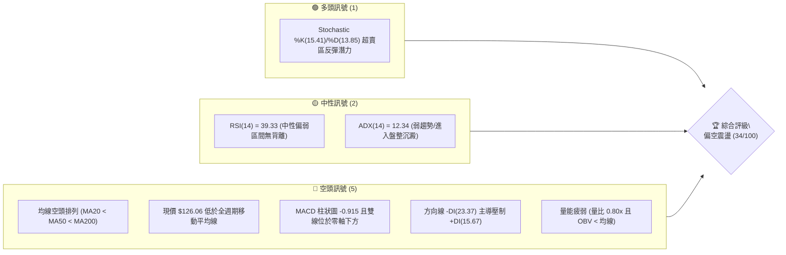
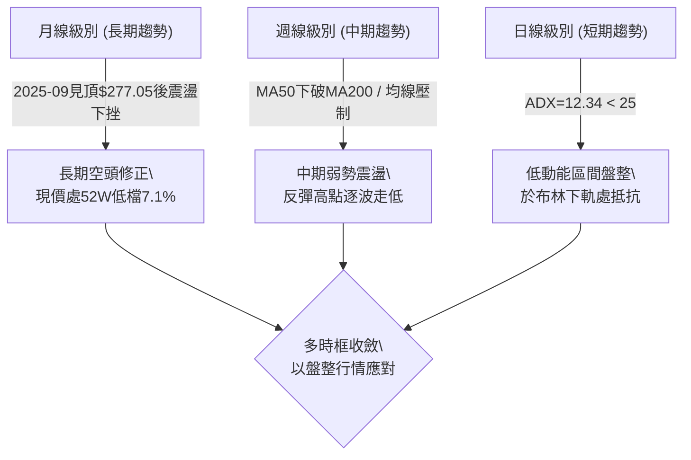
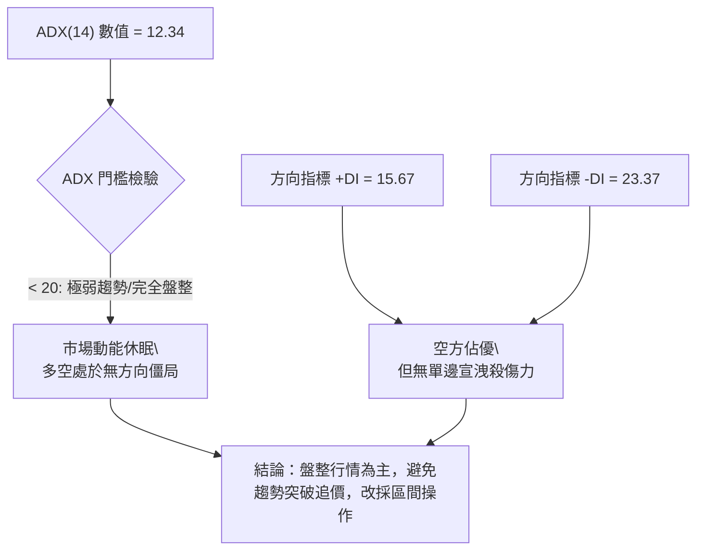
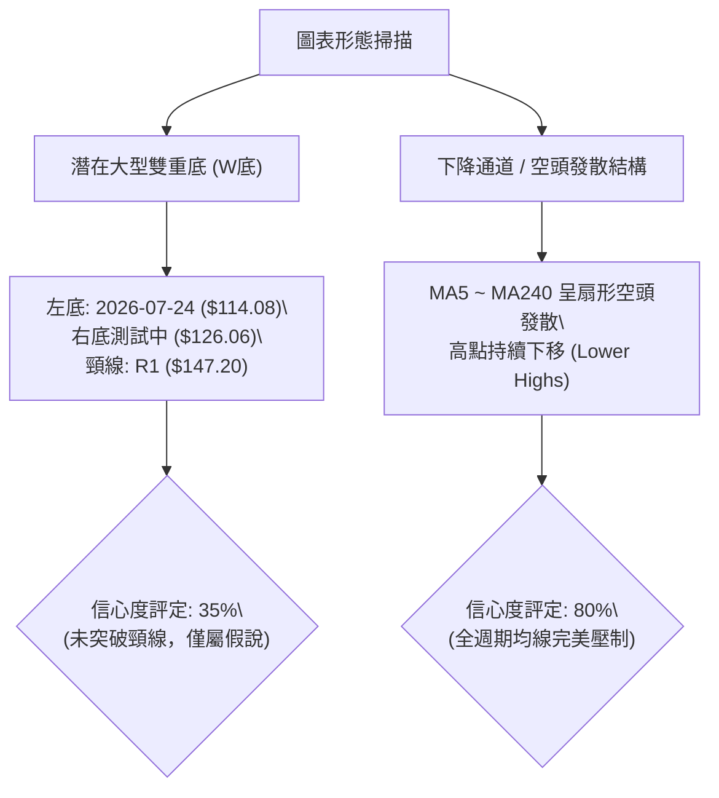
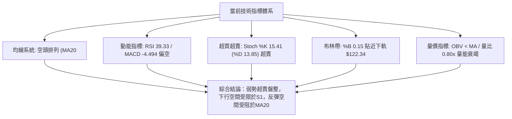
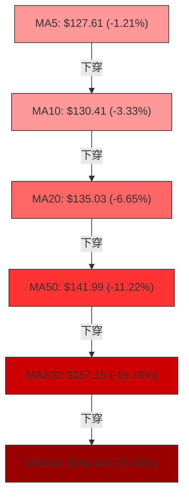
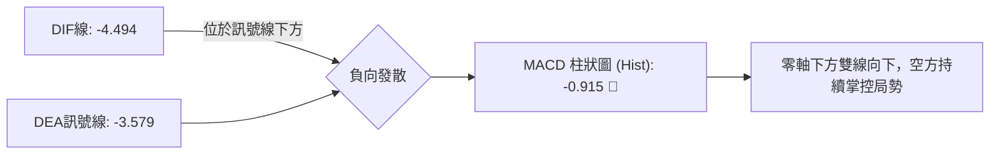
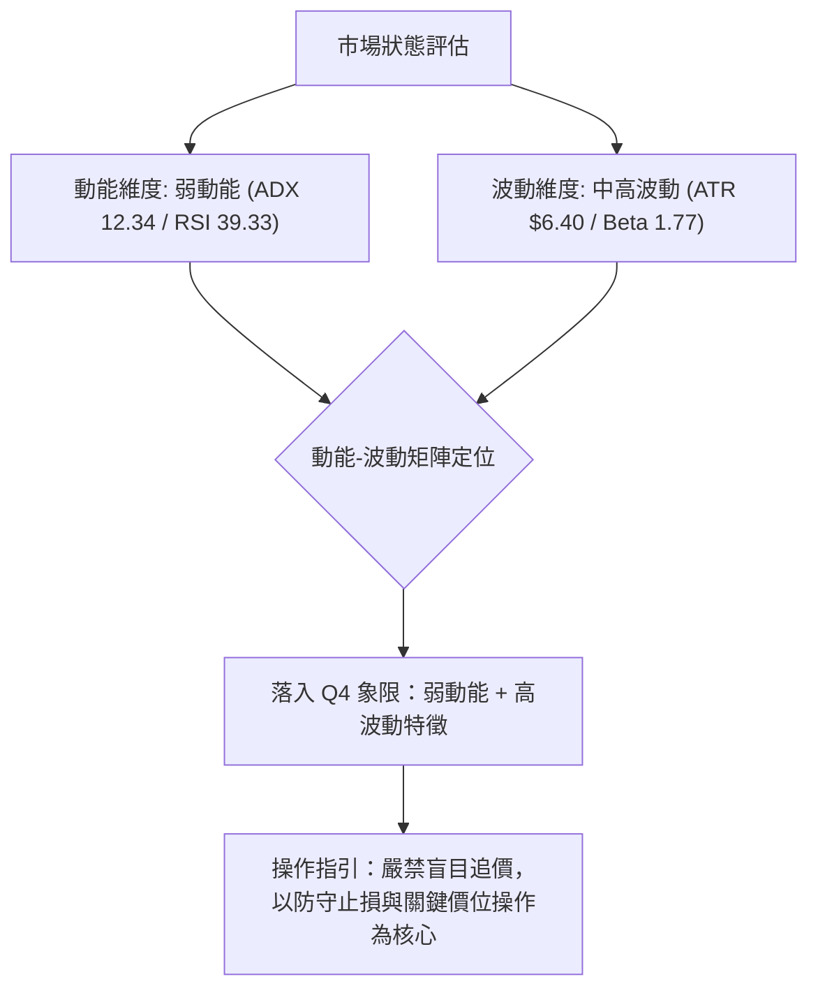
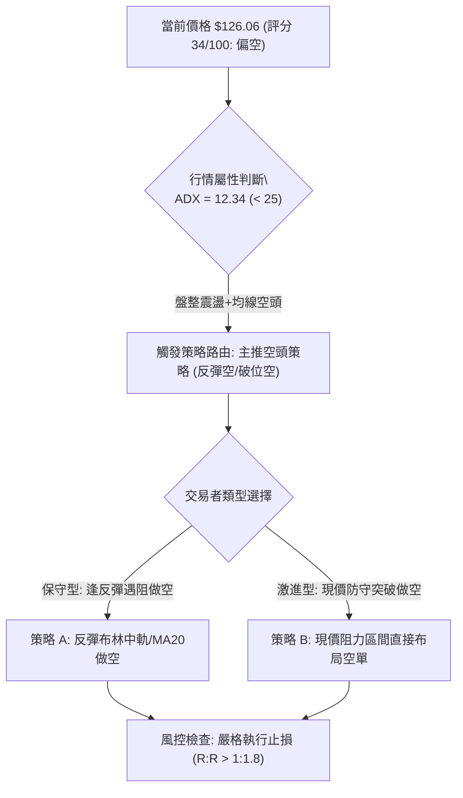
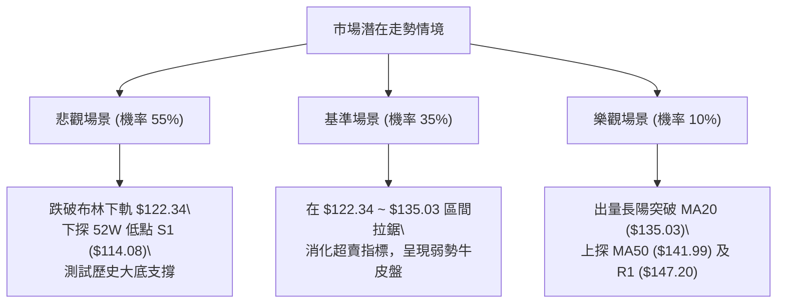

# ORCL 技術分析報告

> **報告日期**：2026-10-27 ｜ **語言**：繁體中文 ｜ **數據來源**：Yahoo Finance ｜ **當前價格**：$126.06

---

## 目錄

| 章節 | 內容 |
|------|------|
| [1. 技術面概覽](#1-技術面概覽) | 訊號儀表板、核心指標、評分卡 |
| [2. 趨勢分析](#2-趨勢分析) | 多時框趨勢、長中短期走勢 |
| [3. 圖表形態分析](#3-圖表形態分析) | 形態識別、K線組合、目標價 |
| [4. 支撐與阻力](#4-支撐與阻力) | 關鍵價位、斐波那契回調 |
| [5. 技術指標深度解讀](#5-技術指標深度解讀) | MA/RSI/MACD/布林/成交量 |
| [6. 動能與波動率](#6-動能與波動率) | 動能評估、ATR、Beta |
| [7. 多時框架總結](#7-多時框架總結) | 時框架評分矩陣 |
| [8. 交易策略建議](#8-交易策略建議) | 多空策略、風險報酬比 |
| [9. 風險提示與監控](#9-風險提示與監控) | 監控指標、風險場景 |

---

## 1. 技術面概覽

### 🎯 技術訊號儀表板



### 📊 核心指標速覽表

| 指標類別 | 指標名稱 | 當前數值 | 訊號 | 解讀 |
|:---|:---|:---|:---:|:---|
| **價格** | 當前收盤價 | $126.06 | 🔴 | 位於52週區間 7.1% 低檔，距52W高點回撤 -55.52% |
| **均線** | MA20 | $135.03 | 🔴 | 價格在MA20下方 -6.65%，短線下行承壓 |
| **均線** | MA50 | $141.99 | 🔴 | 價格在MA50下方 -11.22%，中期趨勢向下 |
| **均線** | MA200 | $157.15 | 🔴 | 價格在MA200下方 -19.78%，長期牛熊分水嶺失守 |
| **動能** | RSI(14) | 39.33 | 🟡 | 處於 30-70 中性偏弱區間，近20根K棒無背離跡象 |
| **動能** | MACD(12,26,9) | -4.494 | 🔴 | DIF < DEA (-3.579)，Hist -0.915 持續為負，空方控盤 |
| **動能** | Stochastic(14) | %K 15.41 / %D 13.85 | 🟢 | 雙線進入 <20 嚴重超賣區，短線具備技術性抽腳反彈契機 |
| **趨勢** | ADX(14) | 12.34 | 🟡 | 數值 <25，屬極弱趨勢/低動能盤整行情，非單邊暴跌 |
| **方向** | +DI / -DI | 15.67 / 23.37 | 🔴 | -DI 大於 +DI，空頭力量占據市場主導地位 |
| **通道** | 布林帶 (20,2) | %B 0.15 | 🔴 | 現價貼近下軌 $122.34，受壓於中軌 $135.03 |
| **成交量** | 當日成交量 | 22,937,700 | 🔴 | 20日均量比 0.80x，量能萎縮且 OBV < MA，追價意願低 |
| **波動** | ATR(14) | $6.40 | 🟡 | 佔股價 5.07%，每日正常波動範圍介於 $5.50 - $7.00 |

### 🏆 技術評分卡

```
技術評分卡 — ORCL (2026-10-27)
════════════════════════════════════════════════════
趨勢強度      ██████░░░░░░░░░░░░░░  30/100  🔴 空頭主導/ADX極低
動能指標      ███████░░░░░░░░░░░░░  35/100  🔴 MACD負向/KD超賣
支撐穩定度    █████████░░░░░░░░░░░  45/100  🟡 逼近52W低點S1支撐
成交量配合    ███████░░░░░░░░░░░░░  35/100  🔴 量縮整理/OBV低迷
形態完整度    ███████░░░░░░░░░░░░░  35/100  🔴 底部形態尚未構築完成
均線排列      █████░░░░░░░░░░░░░░░  24/100  🔴 典型空頭發散排列
════════════════════════════════════════════════════
綜合評分      ███████░░░░░░░░░░░░░  34/100  偏空弱勢（依規則18算術平均）
════════════════════════════════════════════════════
```

---

## 2. 趨勢分析

### 🌐 多時框趨勢分析



### 📈 長期趨勢 — 12個月走勢圖（Unicode）

```
ORCL 月線走勢圖（過去12個月：2025-11 至 2026-10）
價格軸 ($)
$260 ┤
$240 ┤
$220 ┤                                      ● (2026-05: $224.17 反彈頂)
$200 ┤● (2025-11: $199.28)
$180 ┤    ● (2025-12: $192.34)
$160 ┤        ● (2026-01: $162.84)      ● (2026-04: $160.24)
$140 ┤            ● (02: $143.86)           ● (06: $145.50)   ● (08: $148.57)
$120 ┤                ● (03: $145.55)           ● (07: $129.39)   ● (09: $136.79) ●←現價 $126.06
     └─────────────────────────────────────────────────────────────────────────────
       11    12    01    02    03    04    05    06    07    08    09    10 (月份)
```

**走勢特徵分析表格**：

| 階段時間 | 起訖收盤價 ($) | 漲跌幅 (%) | 走勢特徵與結構解讀 |
|:---|:---|:---:|:---|
| 2025-11 ~ 2026-03 | $199.28 → $145.55 | -26.96% | 主跌浪湧現，自高檔快速滑落，於 $140 附近形成首波喘息段。 |
| 2026-04 ~ 2026-05 | $160.24 → $224.17 | +39.90% | 強勁中繼反彈波（季報與AI題材推動），但未突破歷史高點 $283.40。 |
| 2026-06 ~ 2026-07 | $145.50 → $129.39 | -42.28% | 巨量殺跌浪，連跌破多道技術均線，創下波段低點 $114.08。 |
| 2026-08 ~ 2026-10 | $148.57 → $126.06 | -15.15% | 反彈觸及阻力後動能竭盡，呈現階梯式陰跌，目前收於全段低位。 |

### 📊 中期趨勢（週線分析）

從近20週數據觀察，ORCL 於 2026-07-24 觸及波段最低收盤價 $114.57（盤中低點即52W低點 $114.08），隨後在 2026-08 至 2026-09 發動反彈，最高於 2026-09-04 達到週收盤價 $158.19。隨後四週量能無法持續放大，價格再度跌破 MA20（$135.03），週線 MACD 柱狀圖自正值（+4.810）持續收斂並重新轉負（當前週線 MACD Hist -0.915），顯示中期反彈已宣告失敗，走勢重回尋底週期。

```
近期壓力與支撐示意圖（週線視角）
$158.67 ────────────────────────────── R3 強阻力（2026-09 反彈高點聚類）
$147.20 ────────────────────────────── R1 關鍵頸線阻力（近10週密集成交頂部）
$135.03 - - - - - - - - - - - - - - - - MA20 / 布林中軌動態壓力線
$126.06 ◄═════════════════════════════ 【當前收盤價】
$122.34 - - - - - - - - - - - - - - - - 布林下軌支撐
$114.08 ══════════════════════════════ S1 52週波段低點（年度多頭底線）
```

### ⚡ 趨勢強度評估（ADX 解讀）



**ADX 強度對照表**：

| 指標名稱 | 當前讀數 | 標準臨界值 | 市場狀態解讀 |
|:---|:---:|:---:|:---|
| **ADX(14)** | **12.34** | < 20 (極弱) | 目前市場無明確趨勢，處於低波動整理階段，單邊動能已鈍化。 |
| **+DI(14)** | **15.67** | — | 多頭推進意願低迷，市場缺乏買盤積極介入。 |
| **-DI(14)** | **23.37** | — | 空頭力道高於多頭（-DI > +DI），整體維持偏空格局。 |
| **趨勢判定** | 盤整行情 | 臨界線 25 | **非趨勢行情**；嚴格執行規則14，以布林通道與區間價位為主導。 |

---

## 3. 圖表形態分析

### 🔍 形態識別系統



**形態信心度與目標價計算表**（依規則 15）：

| 形態名稱 | 信心度 | 判斷依據（引用數據） | 完成度 | 目標價（附嚴謹計算式） |
|:---|:---:|:---|:---:|:---|
| **中線下降通道** | **80%** | 日K連續跌破 MA5($127.61) 至 MA200($157.15)；高點由 09-04 $158.19 降至 10-13 $144.18。 | 85% | 維持空頭指向通道下緣；支撐目標為 S1 **$114.08**。 |
| **雙底形態 (W底)** | **35%** | 2026-07-24 出現低點 $114.08，當前跌勢若於 $114.08 上方止跌方能成形。 | 35% | 若突破頸線 R1($147.20)：<br>形態高 = $147.20 - $114.08 = $33.12<br>目標 = $147.20 + $33.12 = **$180.32**（信心度不足50%，僅供推算） |
| **布林下軌收斂整理** | **70%** | 日線 %B 為 0.15，現價收於 $126.06 逼近下軌 $122.34，日K連三日收窄。 | 75% | 布林帶寬壓縮後均值回歸；目標為中軌 MA20 **$135.03**。 |

### 🕯️ 重要K線形態分析

依規則 19，僅使用數據庫中「近10根日K」與「近8根週K」實際成交數據進行判讀：

#### 1. 近10根日K線形態分析表

| 日期 | 開 | 高 | 低 | 收 | K線形態名稱 | 解讀與量能配合 | 訊號 |
|:---|:---:|:---:|:---:|:---:|:---|:---|:---:|
| 2026-10-13 | 143.20 區間突破 | 144.18 | 135.55 | 143.20 | 長實體陽線 | 開盤135.91後拉升，收於當日高位，形成短線反彈頂點。 | 🟢 |
| 2026-10-14 | 140.00 | 141.05 | 129.23 | 130.55 | 長黑吞噬線 | 成交量爆量至5,251萬股，一舉吞噬前一日漲幅，主力出貨。 | 🔴 |
| 2026-10-15 | 128.07 | 135.08 | 127.60 | 134.47 | 低開高走中陽線 | 下探127.60後買盤湧入收復134，屬超跌技術性反抽。 | 🟡 |
| 2026-10-16 | 133.49 | 133.80 | 127.36 | 128.23 | 破位陰線 | 沖高回落，收盤跌破前日低點，反彈宣告結束。 | 🔴 |
| 2026-10-19 | 130.66 | 131.40 | 129.12 | 129.59 | 窄幅十字小陰線 | 量能萎縮至2,374萬股，多空在此陷入暫時觀望。 | 🟡 |
| 2026-10-20 | 128.51 | 134.35 | 127.45 | 131.14 | 長上影紡錘線 | 盤中上衝134.35遭遇MA10解套賣壓，收盤回落。 | 🔴 |
| 2026-10-21 | 133.12 | 133.52 | 127.70 | 129.13 | 陰線切入 | 連續三次在133-134區域承壓，多頭反攻無力。 | 🔴 |
| 2026-10-22 | 126.35 | 127.94 | 122.76 | 125.54 | 長下影探底陰線 | 最低見122.76逼近布林下軌($122.34)，浮現抄底承接盤。 | 🟡 |
| 2026-10-23 | 124.87 | 128.33 | 124.39 | 126.16 | 低開回升小陽線 | 量縮至1,922萬股（極限低量），賣壓減緩，形成弱支撐。 | 🟡 |
| 2026-10-26 | 126.06 | 127.99 | 123.75 | 126.06 | 墓碑/十字星線 | 開盤與收盤皆為126.06，多空在52週低檔極度僵持。 | 🟡 |

#### 2. 近8根週K線形態分析表

| 日期 (週結) | 開 | 高 | 低 | 收 | 週K形態 | 解讀與中期意涵 | 訊號 |
|:---|:---:|:---:|:---:|:---:|:---|:---|:---:|
| 2026-09-11 | 166.98 | 170.07 | 149.29 | 149.73 | 巨量倒錘大陰線 | 爆量2.02億股，衝擊170遇阻大幅下挫，中期見頂信號。 | 🔴 |
| 2026-09-18 | 140.90 | 151.44 | 138.49 | 147.07 | 震盪反抽陽線 | 反彈未能突破前週實體高點，成交量退潮至1.75億股。 | 🟡 |
| 2026-09-25 | 148.38 | 153.03 | 132.99 | 136.59 | 破位中長黑K | 帶量跌破140關卡，收盤收在136.59，確立中期跌勢延續。 | 🔴 |
| 2026-10-02 | 132.24 | 144.33 | 131.10 | 141.78 | 探底長陽線 | 於131.10獲得短暫支撐，向上抽腳修復技術指標。 | 🟢 |
| 2026-10-09 | 142.00 | 146.40 | 134.16 | 141.40 | 高檔十字星 | 挑戰頸線R1失敗，成交量大幅萎縮至1.21億股。 | 🔴 |
| 2026-10-16 | 141.56 | 144.18 | 127.36 | 128.23 | 下殺破位大陰線 | 帶量1.67億股跌破130整數關卡，週線空頭主導。 | 🔴 |
| 2026-10-23 | 130.66 | 134.35 | 122.76 | 126.16 | 下影小實體陰線 | 下探122.76後受到低接買盤微幅支撐，下跌趨勢放緩。 | 🟡 |
| 2026-10-26 | 126.06 | 127.99 | 123.75 | 126.06 | 單日週初十字星 | 短期波動受限於ATR $6.40 範圍，呈現弱勢平衡。 | 🟡 |

### 📉 ASCII 走勢形態示意圖

```
ORCL 近期日K線形態收斂結構示意圖
價格
$144.18 ┬─┐ (10-13 高點)
$140.00 ┤ │┌┐ (10-14 爆量長黑下殺)
$135.00 ┤ └┘│  ┌┐ (10-15 反抽)
$130.00 ┤   └┐ ││┌┐ (10-16 ~ 10-21 密集震盪平台，受制於MA10 $130.41)
$125.00 ┤    └─┘└┘└┐   ┌┐   ┌─┐
$122.76 ┤           └┐  ││   │ │ ◄ (10-22 探底 $122.76，獲布林下軌 $122.34 支撐)
        └─────────────┴──┴┴───┴─┴──────
         13 14 15 16 19 20 21 22 23 26 (10月交易日)
```

### 🎯 形態目標價計算

當前市場並未完成高信心度的底部反轉形態。若依據「下降通道中繼整理」形態推算：
*   **上軌壓力測試點**：以 MA20（$135.03）與日K整理平台高點聚類為短線反彈上限。
*   **通道下軌測幅底點**：以 52W 低點支撐位 S1（$114.08）為終極測試目標。
*   **幾何跌幅滿足點**：
    *   突破點（10-14跌破頸線）：$135.55
    *   前波震盪高點（10-13）：$144.18
    *   形態高度 $H = 144.18 - 135.55 = 8.63$
    *   向下等幅測算點 = $135.55 - 8.63 = \$126.92$（現價 $126.06 已達成此短線測幅滿足點，進入超賣低位鈍化階段）。

---

## 4. 支撐與阻力

### 🗺️ 關鍵價位分布圖（Unicode）

```
ORCL 價位結構分布圖（OHLCV 實際計算聚類）
═══════════════════════════════════════════════════════════════════
$158.67 ║██████████████████████████████║ 強阻力 R3 (2026-09波段高點聚類)
$153.03 ║████████████████████          ║ 阻力 R2 (密集套牢波段高點)
$150.31 ║▓▓▓▓▓▓▓▓▓▓▓▓▓▓▓▓▓▓▓▓          ║ 斐波那契 78.6% 回調位
$147.20 ║██████████████████████████████║ 關鍵阻力 R1 (日線/週線頸線高點)
$141.99 ║──────────────────────────────║ 中期生命線 MA50 壓力
$135.03 ║- - - - - - - - - - - - - - - ║ 短期生命線 MA20 / 布林中軌
$126.06 ╠══════════════════════════════╣ ◄ 當前收盤價 ($126.06)
$122.34 ║░░░░░░░░░░░░░░░░              ║ 布林通道下軌動態支撐
$114.08 ║██████████████████████████████║ 核心強支撐 S1 (52W最低價 / 斐波那契 100%)
[數據缺] ║                              ║ S2 / S3 (數據中未偵測到獨立低點聚類)
═══════════════════════════════════════════════════════════════════
```

### 🚧 阻力位分析表

價位嚴格引用自數據庫波段高點聚類數值：

| 阻力級別 | 價位 | 形成原因 | 突破難度 | 重要性 |
|:---|:---:|:---|:---:|:---:|
| **R1** | **$147.20** | 近一年波段高點聚類，近8週兩度反彈止步處（+16.77%） | 🔴 極高 | ★★★★★<br>多空反轉核心頸線 |
| **R2** | **$153.03** | 近一年波段次高密集區，2026-09-25 週K反彈高點（+21.40%） | 🔴 極高 | ★★★★☆<br>空頭深水區阻力 |
| **R3** | **$158.67** | 2026-09-04 波段起跌頂點聚類，強烈套牢盤（+25.87%） | 🔴 極高 | ★★★★☆<br>波段牛熊分界點 |

### 🛡️ 支撐位分析表

價位嚴格引用自數據庫波段低點聚類數值：

| 支撐級別 | 價位 | 形成原因 | 守住機率 | 重要性 |
|:---|:---:|:---|:---:|:---:|
| **S1** | **$114.08** | 近一年波段低點聚類（52W Low / 2026-07-24 最低點）（-9.50%） | 🟡 60% | ★★★★★<br>年度絕對底部防線 |
| **S2** | N/A | **數據中未偵測到**獨立波段聚類，下方依斐波那契即為S1 | N/A | N/A |
| **S3** | N/A | **數據中未偵測到**更低波段聚類 | N/A | N/A |

### 📐 斐波那契回調位分析

依據 52 週完整波段高點 $283.40 至 52 週波段低點 $114.08 進行黃金分割回調測算：

| 斐波那契比例 | 價位 ($) | 當前價格相對位置與技術意義解讀 |
|:---|:---:|:---|
| **0.0% (52W High)** | **$283.40** | 歷史峰值，本輪超級牛市高點。 |
| **23.6%** | **$243.44** | 高檔強勢防守位（已徹底失守）。 |
| **38.2%** | **$218.72** | 2026-05 反彈頂點 $224.17 附近之多頭阻力位。 |
| **50.0%** | **$198.74** | 2025-11 破位前之多空平衡中軸。 |
| **61.8%** | **$178.76** | 黃金分割強防守位（失守後宣告長期趨勢轉空）。 |
| **78.6%** | **$150.31** | **重要上方壓力**：與 R1 ($147.20) 構成強力壓力密集帶。 |
| **當前現價** | **$126.06** | **現價落於 78.6% ($150.31) 與 100.0% ($114.08) 之間，深度回撤區。** |
| **100.0% (52W Low)**| **$114.08** | **重要下方支撐 S1**：距現價尚有 -9.50% 緩衝空間，為最終支撐基石。 |

---

## 5. 技術指標深度解讀

### 🎛️ 指標訊號總覽



### 📈 移動平均線排列分析



均線系統呈现最標準的**空頭發散排列（Bearish Alignment）**：
1.  **全面倒掛**：$MA5 < MA10 < MA20 < MA50 < MA60 < MA120 < MA200 < MA240$。所有週期均線全部向下傾斜，未見任何黃金交叉走平跡象。
2.  **乖離率（Bias）**：現價 $126.06 相對於 MA20 負乖離率達 -6.65%，相對於 MA200 負乖離達 -19.78%。雖然深度負乖離限制了進一步暴跌的速度，但在均線系統扭轉前，任何反彈均屬「均線回抽確認阻力」。

### 📉 RSI(14) 分析

*   **RSI(14) 當前讀數**：`39.33`（Wilder 計算）
*   **數值視覺化進度條**：
    `[0] ░░░░░░░░░░░░░░░░░░░░░░░░ [30] ███████░░░░░░░░░░░░░░░░░░ [70] ░░░░░░░░░░░░░░░░░░░░ [100]`
    `RSI 39.33: ▓▓▓▓▓▓▓▓▓▓░░░░░░░░░░ 39.33% (弱勢整理區)`
*   **超買超賣判定**：數值介於 30 至 70 之間，尚未跌破 30 進入技術極度超賣區，代表空頭拋壓雖沉重但未達恐慌竭盡狀態。
*   **背離分析**：
    *   **頂背離**：無。
    *   **底背離**：**無明顯背離**（比對近20根K棒首尾價格與RSI走向：價格自 10-13 高點 $144.18 震盪走低至 $126.06，RSI 由 48 附近同步下滑至 39.33，兩者趨勢完全同步同向，無底背離確認訊號）。

### 📊 MACD(12,26,9) 訊號解讀



*   **MACD 線**：-4.494
*   **訊號線 (Signal Line)**：-3.579
*   **柱狀圖 (Histogram)**：-0.915
*   **解讀**：MACD 雙線深陷零軸下方（零軸為 -4.00 以下），且柱狀圖維持負值 -0.915，未出現縮頭翻紅現象。這表明空方控盤動能依然強勢，尚未進入左側反轉買點。

### 📦 布林通道分析

```
ORCL 日線布林通道 (20, 2) 結構圖
$147.73 ┬─────────────────────────────── 上軌 (強阻力 / 觸軌機率低)
        │
$135.03 ┼ - - - - - - - - - - - - - - - 中軌 (MA20 生命線 / 反彈首要阻力)
        │
$126.06 ┼───────────● 現價 ($126.06，%B = 0.15)
$122.34 ┴─────────────────────────────── 下軌 (技術性支撐帶)
```

*   **通道參數**：上軌 $147.73 ｜ 中軌 $135.03 ｜ 下軌 $122.34 ｜ 帶寬 $25.39
*   **%B 指標分析**：目前 `%B = 0.15`。當 %B < 0.20 時，代表股價已進入布林下軌極度超賣反彈帶。10-22 盤中低點 $122.76 精準打在下軌 $122.34 獲得支撐回彈，印證布林下軌具備顯著的短線動態承接力。

### 💹 成交量分析（量價配合度）

1.  **量能萎縮**：最新單日成交量為 22,937,700 股，相較於 20日均量 28,708,390 股，**量比僅為 0.80x**；相較於 50日均量 29,093,314 股亦呈現明顯量縮。
2.  **OBV（能量潮）分析**：數據顯示 `OBV < MA`，代表量能走勢疲弱，資金淨流出趨勢尚未逆轉。
3.  **量價配合狀態**：下行過程成交量未見恐慌性爆量拋售（如 10-14 爆出 5,251 萬股長黑後量能迅速萎縮），呈現「陰跌量縮」特徵。量能萎縮意味著低檔殺跌動能衰竭，但在買盤增量介入前，難以發動突破性攻勢。

---

## 6. 動能與波動率

### ⚡ 動能評估



**動能評估四象限狀態表**：

| 象限 | 動能維度 | 波動維度 | 當前狀態標註 | 操作意涵與策略指引 |
|:---:|:---:|:---:|:---:|:---|
| **Q1** | 強動能 | 低波動 | — | 穩定單邊趨勢，最佳順勢加碼環境。 |
| **Q2** | 弱動能 | 低波動 | — | 窄幅無方向牛皮盤整，宜耐心觀望。 |
| **Q3** | 強動能 | 高波動 | — | 主升/主跌爆發浪，高風險高回報。 |
| **Q4** | **弱動能** | **高波動** | **✓ (ORCL 當前定位)** | **動能不足但股性波動偏大，容易引發假突破與雙向洗盤。嚴禁追單，需恪守嚴格止損。** |

### 📊 ATR 波動率分析

*   **ATR(14) 絕對值**：**$6.40**（Wilder 計算法）
*   **波動比率**：佔當前股價 $126.06 的 **5.07%**，顯示 ORCL 單日具備超過 5% 的常態價格擺動幅度。
*   **交易風控與止損設定應用**：
    *   **短線日內交易緩衝**：以 $0.5 \times ATR = \$3.20$ 作為最小日內雜訊過濾區間。
    *   **波段防守止損距離**：依標準波段交易法則，應設定為 $1.5 \times ATR 至 2.0 \times ATR$：
        *   $1.5 \times ATR = \$9.60$
        *   $2.0 \times ATR = \$12.80$
    *   若以現價 $126.06 建立反彈放空單，向上反抽止損至少需容忍 $126.06 + \$6.40 = \$132.46$ 以上之波動，恰與 MA10（$130.41）及 MA20（$135.03）形成嚴格的技術屏障重疊。

### 📐 Beta 與市場相關性

*   **Beta 係數**：**1.77**
*   **解讀**：ORCL 具有極高的市場敏感度（屬於高 Beta 成長型/科技權值股）。當標普500指數波動 1.0% 時，ORCL 理論上將同向放大波動約 1.77%。當前美股大盤若處於弱勢或震盪，ORCL 將承受放大的下行回撤壓力。

---

## 7. 多時框架總結

### 📋 時框架評分表

| 時框架 | 趨勢方向 | 動能指標狀態 | 均線排列特徵 | 形態完成度 | 綜合評分 | 建議方向 |
|:---|:---:|:---|:---|:---|:---:|:---:|
| **月線 (長期)** | 🔴 偏空修正 | RSI 下行，高檔回撤逾50% | MA200 失守，均線下壓 | 頂部大型箱體破位 | 30/100 | 減碼觀望 |
| **週線 (中期)** | 🔴 空頭掌控 | MACD Hist -0.915 走弱 | 均線空頭排列形成阻力 | 09-04反彈見頂回落 | 32/100 | 逢高放空 |
| **日線 (短期)** | 🟡 弱勢盤整 | RSI 39.33 / KD 超賣 | 均線全線壓制 ($MA5~MA200$) | 布林下軌獲得支撐 | 38/100 | 區間震盪 |

### 🔲 綜合訊號矩陣

```
綜合訊號一致性檢定矩陣
═══════════════════════════════════════════════════════════════════
時框維度      均線趨勢     動能狀態     量價配合     支撐阻力結構   訊號方向
───────────────────────────────────────────────────────────────────
短期 (日線)    🔴 空頭      🟢 超賣      🔴 量能萎縮   🟡 貼近下軌    🟡 偏空整理
中期 (週線)    🔴 空頭      🔴 弱勢      🔴 OBV疲軟    🔴 遠離阻力    🔴 偏空下行
長期 (月線)    🔴 空頭      🔴 修正      🔴 增量下跌   🟡 臨近S1      🔴 深度回撤
═══════════════════════════════════════════════════════════════════
整體技術共振結論：【高度一致偏空】（僅日線出現短線嚴重超賣鈍化）
```

### ⚖️ 多時框收斂結論

嚴格遵循多時框收斂規則（規則 14）：
1.  **行情屬性判定**：當前日線指標 **ADX(14) 為 12.34，數值顯著小於 25**，明確定義當前處於**「弱趨勢／低動能盤整行情」**。
2.  **交易主導時框**：在 ADX < 25 的盤整結構中，日線布林通道上下軌（**下軌 $122.34 至 上軌 $147.73**）成為主導價格運動的核心邊界，輔以中軌 MA20（$135.03）作為多空強弱分界嶺。
3.  **方向收斂取捨**：雖然日線 Stochastic 進入超賣且貼近布林下軌具備技術反抽需求，但長期與中期均線呈現全週期空頭發散。因此，**反彈並非反轉**，短線反彈僅視為優化空頭進場點位的機會。
4.  **唯一方向性結論**：**【偏空觀望，逢反彈阻力位逢高布局空單】**。該結論完全收斂第 1 章（技術評分 34/100 偏空）與第 2、5 章之空頭均線架構。

---

## 8. 交易策略建議

### 🗺️ 策略決策流程圖



### 🧭 策略路由（依評分卡分流）

依規則 18 與評分路由機制：第 1 章綜合技術評分為 **34/100（≤ 40 區間）**。
先用一句話點名：**當前主策略方向 = 反彈阻力逢高放空（依評分 34/100）**。

### 🎯 價格情境階梯（Price Scenarios）

價位嚴格引用自數據庫波段高點/低點聚類與技術均線：

| 觸發條件 | 下一目標 | 後續延伸 | 情境含義 |
|:---|:---|:---|:---|
| **向上突破 MA20 ($135.03)** | MA50 ($141.99) | R1 ($147.20) | 超跌強反抽，空單必須止損離場，測試強阻力。 |
| **受阻於 MA10 ($130.41) ~ MA20 ($135.03)** | 現價區間 ($126.06) | 布林下軌 ($122.34) | 標準空頭回抽確認，反彈動能衰竭，主跌延續。 |
| **跌破布林下軌 ($122.34)** | S1 ($114.08) | N/A (數據未提供) | 空頭向下開口破位，直奔 52 週最低點 S1 尋求支撐。 |

### 📊 情境機率分佈

| 情境類別 | 機率預測 | 主要依據（指標狀態） |
|:---|:---:|:---|
| **情境一：弱勢震盪後回落再探底** | **55%** | 全週期均線空頭發散，MACD 負向發散 (-0.915)，-DI (23.37) 壓制 +DI。 |
| **情境二：布林帶內區間橫盤** | **35%** | ADX 僅 12.34 顯示單邊動能不足，KD 超賣提供下軌 $122.34 局部支撐。 |
| **情境三：強勁反轉向上突破** | **10%** | 成交量萎縮（量比 0.80x）且 OBV < MA，無巨量機構資金推動反轉。 |

### 🟢 主策略詳情（方向：空頭交易）

依規則 17，風險報酬比公式為：$\text{風險報酬比} = (\text{進場價} - \text{目標價 T1}) \div (\text{止損價} - \text{進場價})$。所有價位嚴格引用技術數據：

| 策略要素 | 策略 A（保守型：反彈布林中軌受阻放空） | 策略 B（激進型：現價阻力區間直接做空） |
|:---|:---|:---|
| **進場條件** | 價格反抽至布林中軌 MA20 承壓回落時進場 | 現價 $126.06 附近受制於 MA5/MA10 直接進場 |
| **進場價格** | **$135.03**（精確對應 MA20 / 布林中軌） | **$126.06**（當前精確收盤價） |
| **目標價 T1** | **$122.34**（布林通道下軌） | **$114.08**（核心支撐位 S1 / 52W Low） |
| **目標價 T2** | **$114.08**（核心支撐位 S1 / 52W Low） | N/A（數據未提供更低波段支撐） |
| **止損價格** | **$141.99**（有效突破 MA50 壓力線止損） | **$130.41**（有效突破 MA10 短期阻力止損） |
| **風險報酬比** | **1 : 1.82（以 T1 計）**<br>計算式：$(135.03 - 122.34) \div (141.99 - 135.03) = 12.69 \div 6.96 = 1.82$<br>*另至 T2 為 1 : 3.01（以 T2 計）* | **1 : 2.75（以 T1 計）**<br>計算式：$(126.06 - 114.08) \div (130.41 - 126.06) = 11.98 \div 4.35 = 2.75$ |
| **成功機率** | 65% | 55% |
| **建議倉位** | 10% 總資金倉位 | 5% 輕倉防守試單 |

### 🔴 反向風險觸發點（對沖與風控提示）

若出現以下訊號，主推空頭邏輯即刻失效，空單必須立即無條件止損，轉為觀望：
1.  **收盤價強勢突破 MA50（$141.99）**：意味著中期空頭結構被破壞，反彈升級為波段回升。
2.  **成交量暴增至 5,000 萬股以上且收復 R1（$147.20）**：觸發大型雙底反轉頸線突破訊號。
3.  **日線 MACD 出現零軸下金叉且 Hist 連續三日翻紅放大**。

### ⭐ 整體訊號強度評星

```
做多訊號強度：★☆☆☆☆  (1/5星 - 僅存KD超賣與下軌支撐，無右側買訊)
做空訊號強度：★★★★☆  (4/5星 - 均線空頭排列，趨勢向下共振)
整體可信度：  ★★★★☆  (4/5星 - 數據完整，價位結構極度清晰)
```

---

## 9. 風險提示與監控

### ✅ 關鍵監控指標 Checklist

```
╔══════════════════════════════════════════════════════════════╗
║              ORCL 關鍵技術防線監控清單 (Checklist)           ║
╠══════════════════════════════════════════════════════════════╣
║ [ ] 核心多頭防線 S1：$114.08 (若失守將引發無支撐真空跌勢)   ║
║ [ ] 動態下軌支撐：$122.34 (跌破代表超賣單邊加速)            ║
║ [ ] 現價多空爭奪：$126.06 (觀察能否守住今日收盤價)          ║
║ [ ] 短線反彈警戒：$130.41 (MA10 壓制線)                     ║
║ [ ] 空頭生命線：$135.03 (MA20 / 布林中軌，空單防守樞紐)     ║
║ [ ] 中期牛熊線：$141.99 (MA50 壓力位，突破則空頭全面退場)   ║
║ [ ] 關鍵頸線阻力：$147.20 (R1 強阻力區)                     ║
║ [ ] 成交量警戒線：單日 > 29,000,000 股 (判斷是否具備攻擊量)  ║
╚══════════════════════════════════════════════════════════════╝
```

### ⚠️ 風險場景分析



### 🛡️ 風險管理重要提醒

1.  **高 Beta 與高槓桿風險**：ORCL 的 Beta 達 **1.77**，總負債高達 $169.14B，自由現金流（FCF TTM）為 $-28.72B。這意味著一旦宏觀流動性收緊或科技板塊殺估值，其股價波動會顯著放大，禁止使用過高財務槓桿參與。
2.  **單筆交易最大虧損原則**：單筆策略（如策略 A 或策略 B）的實際虧損金額嚴格限制在總投資組合淨值的 **1.0% - 1.5%** 之內。
3.  **無特定形態前拒絕左側重倉摸底**：目前 RSI=39.33 且無底背離，ADX=12.34 顯示買盤意願微弱，切忌因「跌幅已深」而盲目進場大額抄底。

---

## 📋 報告總結

```
ORCL 技術分析報告總結
═══════════════════════════════════════════════════════════════════
報告日期：2026-10-27
當前價格：$126.06
分析評級：🔴 偏空震盪（技術綜合評分：34/100）

關鍵結論：
├─ 長期趨勢：🔴 空頭修正（距52W高點回撤逾55%，長均線全面下行）
├─ 中期趨勢：🔴 偏空弱勢（反彈受阻於 R1 $147.20，高點逐波降低）
├─ 短期趨勢：🟡 低動能盤整（ADX=12.34，受壓於布林中軌 $135.03）
├─ 關鍵支撐：S1: $114.08（52週波段最低點，下方無更低聚類）
├─ 關鍵阻力：R1: $147.20 ｜ R2: $153.03 ｜ R3: $158.67
└─ 分析師目標：共識買入 (41位) ｜ 均價 $235.80 ｜ 最低 $110.00

最優策略組合：
1. 🥇 最佳機會：策略 A — 反彈至布林中軌 MA20 ($135.03) 遇阻放空，
              止損設 MA50 ($141.99)，目標下軌 $122.34 (風報比 1:1.82)。
2. 🥈 次選機會：策略 B — 現價 $126.06 輕倉順勢做空，
              止損設 MA10 ($130.41)，目標 S1 $114.08 (風報比 1:2.75)。
3. 🥉 保守選擇：空倉觀望，等待日線有效跌破 $122.34 或強勢站上 $135.03 
              確立方向後再行介入。
═══════════════════════════════════════════════════════════════════
```

---

> ⚠️ **免責聲明**：本報告為技術分析研究，所有數據及估算均嚴格基於所提供之歷史價格與市場資訊。本報告**僅供研究與學術參考**，**不構成任何形式之投資建議、招攬或邀約**。金融市場瞬息萬變，技術指標具備滯後性與不確定性，投資人應獨立評估風險並自負盈虧。

---

*報告生成時間：2026-10-27 ｜ 數據來源：Yahoo Finance ｜ 分析框架：多時框技術分析體系*