# ORCL 技術分析報告

> **報告日期**：2026-10-28 ｜ **語言**：繁體中文 ｜ **數據來源**：Yahoo Finance ｜ **當前價格**：$130.53

---

## 目錄

| 章節 | 內容 |
|------|------|
| [1. 技術面概覽](#1-技術面概覽) | 訊號儀表板、核心指標、評分卡 |
| [2. 趨勢分析](#2-趨勢分析) | 多時框趨勢、長中短期走勢、ADX解讀 |
| [3. 圖表形態分析](#3-圖表形態分析) | 形態識別、K線組合、目標價推算 |
| [4. 支撐與阻力](#4-支撐與阻力) | 關鍵價位、斐波那契回調結構 |
| [5. 技術指標深度解讀](#5-技術指標深度解讀) | 均線系統、RSI、MACD、布林通道、成交量 |
| [6. 動能與波動率](#6-動能與波動率) | 動能四象限、ATR波動度、Beta分析 |
| [7. 多時框架總結](#7-多時框架總結) | 時框架矩陣、多時框收斂結論 |
| [8. 交易策略建議](#8-交易策略建議) | 策略路由、主策略詳情、情境階梯、風報比 |
| [9. 風險提示與監控](#9-風險提示與監控) | 監控清單、風險情境、資金管理 |

---

## 1. 技術面概覽

### 🎯 技術訊號儀表板

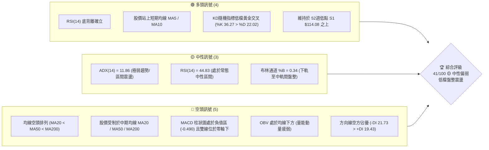

---

### 📊 核心指標速覽表

| 指標類別 | 指標名稱 | 當前數值 | 訊號 | 專業解讀 |
|:---|:---|:---|:---:|:---|
| **價格** | 當前收盤價 | $130.53 | 🟡 | 位於52週區間 9.7% 低檔水位，具備估值修正後的防守支撐 |
| **短期均線** | MA5 / MA10 | $127.48 / $129.14 | 🟢 | 現價站上5日與10日均線，短期出現築底回彈跡象 |
| **生命線** | MA20 (月線) | $134.70 | 🔴 | 現價低於MA20 (-3.09%)，布林中軌壓制尚未化解 |
| **中期均線** | MA50 (季線) | $141.68 | 🔴 | 現價低於MA50，中期下降趨勢線依然形成壓制 |
| **長期均線** | MA200 (年線) | $156.82 | 🔴 | 遠低於MA200 (-16.76%)，長線格局處於空頭壓制修復期 |
| **均線架構** | 均線排列 | MA20 < MA50 < MA200 | 🔴 | 標準空頭發散排列，任何反彈均需留意解套賣壓 |
| **動能指標** | RSI(14) | 44.83 | 🟢 | 脫離超賣區，近20根K棒呈現明顯底背離，下行動能枯竭 |
| **趨勢動能** | MACD (12,26,9) | DIF: -4.191 / DEA: -3.702 | 🔴 | 柱狀圖為 -0.490，雙線在零軸下方運行，空頭力道收斂中 |
| **擺盪指標** | Stoch KD (14,3) | %K: 36.27 / %D: 22.02 | 🟢 | %K 由下往上穿越 %D，形成低檔反彈黃金交叉訊號 |
| **趨勢強度** | ADX(14) | 11.86 | 🟡 | ADX < 25 表示單邊趨勢停滯，市場進入無趨勢相位的箱體震盪 |
| **通道指標** | 布林通道 | 上軌 $147.50 / 下軌 $121.90 | 🟡 | %B 為 0.34，價格由下軌反彈向中軌推進，通道呈現橫向收斂 |
| **量能指標** | 成交量 / OBV | 25,962,200 (量比 0.94x) | 🔴 | 成交量低於20日均量，OBV 低於均線，量能未出現突破性放大 |
| **波動風險** | ATR(14) | $6.39 (4.89%) | 🟡 | 波動率處於中等水平，單日正常震盪幅度約 $6.39 |

---

### 🏆 技術評分卡

```
技術評分卡 — ORCL (2026-10-28)
══════════════════════════════════════════════════════════════════════
趨勢強度      ██████░░░░░░░░░░░░░░  32/100  🔴 (ADX 11.86 處於極弱態，方向線空方佔優)
動能指標      █████████░░░░░░░░░░░  48/100  🟡 (RSI 底背離、KD 黃金交叉、MACD 負柱收窄)
支撐穩定度    ██████████░░░░░░░░░░  52/100  🟡 (52W 低點 S1 $114.08 及布林下軌支撐明確)
成交量配合    ███████░░░░░░░░░░░░░  38/100  🔴 (量比 0.94x 低於均量，OBV 疲軟未見增量攻擊)
形態完整度    █████████░░░░░░░░░░░  48/100  🟡 (低檔區間構築箱體，具備潛在雙底打底特徵)
均線排列      █████░░░░░░░░░░░░░░░  28/100  🔴 (MA20 < MA50 < MA200 空頭排列重壓)
══════════════════════════════════════════════════════════════════════
綜合評分      ████████░░░░░░░░░░░░  41/100  🟡 中性偏弱（區間操作評級）
══════════════════════════════════════════════════════════════════════
※ 依規則 18 計算：(32 + 48 + 52 + 38 + 48 + 28) ÷ 6 = 41.0 分，四捨五入為 41/100。
```

---

## 2. 趨勢分析

### 🌐 多時框趨勢分析

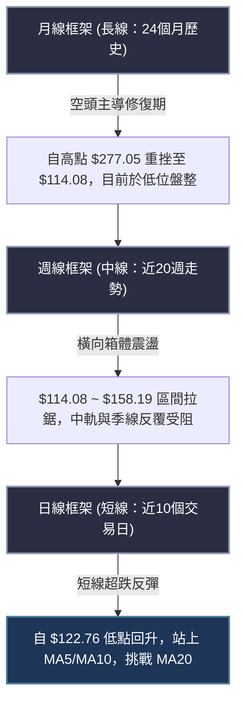

---

### 📈 長期趨勢 — 12個月走勢圖（Unicode）

以下為 ORCL 過去 12 個月（2025-11 至 2026-10）之月線收盤價走勢圖，標記出歷史波段轉折高低點：

```
ORCL 月線走勢圖（過去12個月歷史軌跡）
價格軸 ($)
$260 ┤   
$240 ┤                           ● (2026-05 反彈次高 $224.17)
$220 ┤   
$200 ┤● (2025-11 $199.28)
$180 ┤  ● (2025-12 $192.34)
$160 ┤    ● (2026-01 $162.84)      ● (2026-04 $160.24)
$140 ┤      ●──────● (02-03月雙底 $143.86/$145.55) ● (2026-06 $145.50)  ● (08月 $148.57)
$120 ┤                                              ● (2026-07低點 $129.39) ● (09月 $136.79)
$100 ┤                                                                      ●← 當前現價 $130.53
     └─────────────────────────────────────────────────────────────────────────────► 月份
       25-11  25-12  26-01  26-02  26-03  26-04  26-05  26-06  26-07  26-08  26-09  26-10
```

#### 走勢特徵分析表格

| 階段區間 | 時間跨度 | 起訖價位 | 漲跌幅 | 結構性技術特徵 |
|:---|:---:|:---:|:---:|:---|
| **第一階段：高位崩跌** | 2025-11 ~ 2026-02 | $199.28 → $143.86 | -27.81% | 跌破所有中短期均線，呈現無支撐單邊自由落體 |
| **第二階段：春季反彈** | 2026-02 ~ 2026-05 | $143.86 → $224.17 | +55.82% | 築雙底後強烈軋空，快速修復斐波那契回調位至 38.2% 上方 |
| **第三階段：二次重挫** | 2026-05 ~ 2026-07 | $224.17 → $129.39 | -42.28% | 資金出逃與爆量下殺，直接摜破所有短期均線，創下波段新低 |
| **第四階段：築底震盪** | 2026-07 ~ 2026-10 | $129.39 → $130.53 | +0.88% | 波動率逐步收斂，進入以 $114.08 為底部防守的低位箱體磨底期 |

---

### 📊 中期趨勢（週線分析）

中期技術面以近 20 週的收盤價進行觀察，走勢呈現標準的「階梯式下跌後進入弱勢區間震盪」格局：
- 2026年7月中旬於 $114.57 觸底（52週低點 $114.08 即於該波段確立），隨後引發技術性反彈，並於 2026-09-04 達到波段反彈高點 $158.19。
- 隨後自 $158.19 再度拉回，在 10 月中旬下探至 $122.76 後止跌，近期週線連續在 $126 ~ $130 區間打底。
- 週線 MACD 柱狀圖由 -1.009 回升收斂至 -0.490，顯示中線空頭壓制力道正處於減弱週期。

```
週線關鍵壓力與支撐結構示意圖
$160.00 ┼──────────────────────────────────────────────── R3 $158.67 (9月波段反彈高點壓力)
        │
$150.00 ┼─────────────────────── R1 $147.20 / Fib 78.6% $150.27 (強阻力重疊區)
        │
$140.00 ┼──────────────── MA50 ($141.68) / 週線反彈密集帶
        │
$134.70 ┼──────────────── MA20 (月線反壓 / 布林中軌)
$130.53 ┼─── 現價 ◄────────── 處於底背離弱勢反彈區
        │
$121.90 ┼──────────────── 布林通道下軌支撐
        │
$114.08 ┼──────────────────────────────────────────────── S1 $114.08 (52週極限支撐 / 年內絕對低點)
```

---

### ⚡ 趨勢強度評估（ADX 解讀）

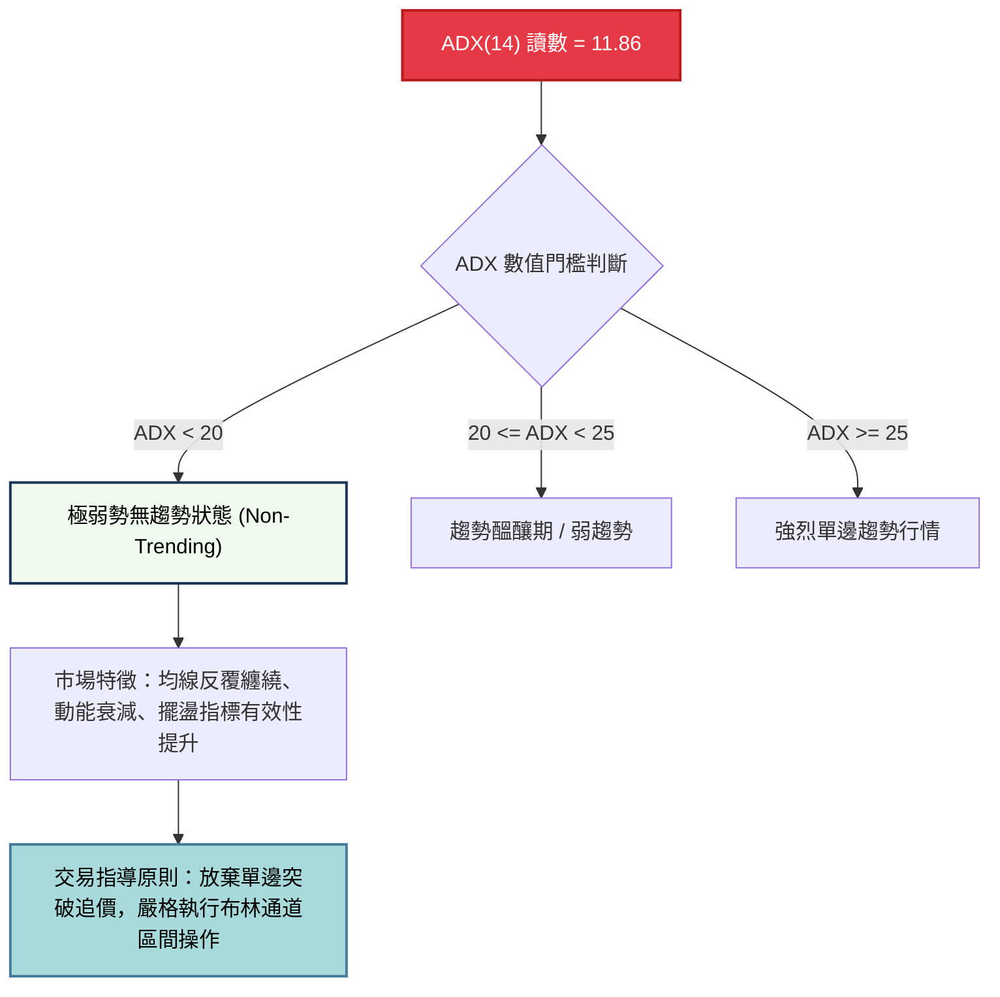

#### ADX 與方向線強度對照解讀

| 指標變數 | 當前讀數 | 技術含義 | 對交易架構之指導作用 |
|:---|:---:|:---|:---|
| **ADX(14)** | **11.86** | 遠低於 25 臨界線，顯示市場處於完全的**「盤整/震盪行情」** | 順勢突破策略失效機率極高，應轉化為高拋低吸或等待變盤 |
| **+DI (14)** | **19.43** | 多方攻擊動能處於低檔鈍化，尚未展現主動買盤擴張 | 不宜過早預設強 V 型反轉，多方僅為跌深反彈防守 |
| **-DI (14)** | **21.73** | 空方動量略高於多方，但未顯著拉開差距 (-DI 與 +DI 差值僅 2.3) | 空頭主動拋壓枯竭，無法形成順暢的下行單邊跌勢 |

---

## 3. 圖表形態分析

### 🔍 形態識別系統

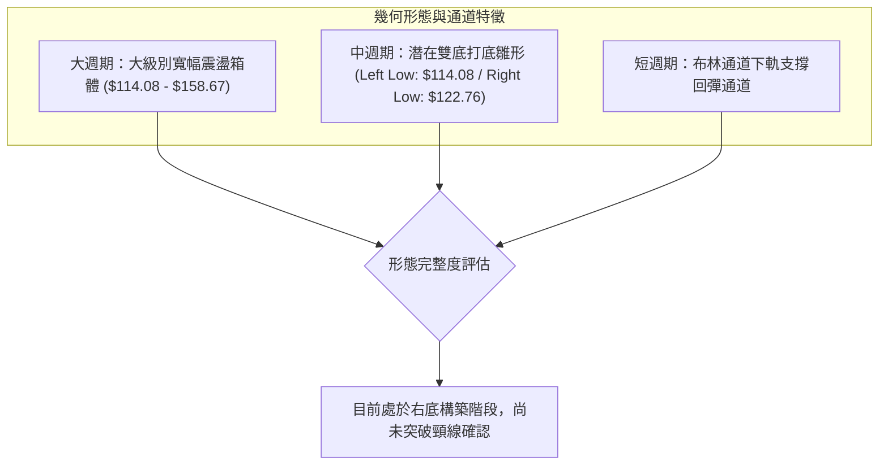

#### 圖表形態信心度評估表（依規則 15）

| 識別形態名稱 | 形態週期 | 信心度 | 判斷依據（嚴格引用技術數據） | 完成度 | 形態目標價（附精確計算式） |
|:---|:---:|:---:|:---|:---:|:---|
| **潛在雙重底 (W底)** | 中期 (週線) | **58%** | 兩次下探低點：第一低點為 2026-07-24 週之 $114.57 (接近 S1 $114.08)，第二低點為 2026-10-22 日之 $122.76，低點抬高 | 60% | 頸線以波段阻力 R1 $147.20 計：<br/>$147.20 + ($147.20 - $114.08) = **$180.32**（由雙底形態推算） |
| **矩形箱體整理** | 中短期 (日線) | **72%** | 上軌阻力精確受制於 R1 $147.20 / R2 $153.03，下軌獲得 S1 $114.08 支撐，近 10 日波動收斂 | 80% | 箱體震盪區間內運行，若向上突破箱頂 R1：<br/>$147.20 + ($147.20 - $121.90) = **$172.50**（由箱體高度推算） |
| **頭肩底形態** | 任何週期 | **0%** | **訊號不足，僅做指標型解讀**：數據中無對稱之左右肩結構，不可強行標注 | 0% | N/A（數據未提供） |

---

### 🕯️ 重要K線形態分析

嚴格依據數據中「近10根日K」與「近8根週K」實際開高低收數據進行客觀解讀（依規則 19）：

#### 近10根日K線形態追蹤

| 日期 | 開盤價 | 最高價 | 最低價 | 收盤價 | 成交量 | K線形態特徵 | 專業解讀 | 訊號強度 |
|:---:|:---:|:---:|:---:|:---:|:---:|:---|:---|:---:|
| 2026-10-14 | $140.00 | $141.05 | $129.23 | $130.55 | 52,513,600 | 長黑實體K棒 | 高開低走爆量長黑，主力出貨重挫跌破多條短期均線 | 🔴 強空 |
| 2026-10-15 | $128.07 | $135.08 | $127.60 | $134.47 | 31,382,100 | 低開長陽吞噬線 | 低開後迅速拉升，收盤吃掉前日下影線，多頭展現抵抗力 | 🟢 轉多 |
| 2026-10-16 | $133.49 | $133.80 | $127.36 | $128.23 | 36,109,100 | 衝高回落小陰線 | 遭遇上方均線反壓，反彈無力，空方再次奪回短線主控權 | 🔴 偏空 |
| 2026-10-19 | $130.66 | $131.40 | $129.12 | $129.59 | 23,749,200 | 縮量極窄紡錘線 | 實體極小，多空雙方在 $130 附近陷入膠著觀望 | 🟡 中性 |
| 2026-10-20 | $128.51 | $134.35 | $127.45 | $131.14 | 26,751,800 | 帶長上影小陽線 | 盤中嘗試挑戰 $134.35 (接近MA20)，但解套賣壓湧現回落 | 🟡 震盪 |
| 2026-10-21 | $133.12 | $133.52 | $127.70 | $129.13 | 26,329,100 | 開高走低小陰線 | 連續兩日受阻於 $134 阻力區，短期上攻受挫 | 🔴 偏空 |
| 2026-10-22 | $126.35 | $127.94 | $122.76 | $125.54 | 36,620,100 | 長下影錘頭陰線 | 盤中下探 $122.76 創近期新低，隨後逢低買盤進場拉回 | 🟢 築底 |
| 2026-10-23 | $124.87 | $128.33 | $124.39 | $126.16 | 19,223,400 | 低檔極度縮量紅K | 創近十日最低成交量 (19.2M)，惜售情緒濃厚，下壓動能衰竭 | 🟢 止跌 |
| 2026-10-26 | $126.06 | $127.99 | $123.75 | $126.06 | 23,008,500 | 墓碑型十字線 | 多方試圖推升未果，但低點 $123.75 高於前日，底部抬升 | 🟡 觀望 |
| 2026-10-27 | $126.88 | $132.34 | $126.86 | $130.53 | 25,962,200 | 光頭中陽K棒 | 帶量突破前三日高點，收盤站上 MA5 與 MA10，確認短線反彈 | 🟢 轉強 |

#### 近8根週K線形態追蹤

| 週結日期 | 開盤價 | 最高價 | 最低價 | 收盤價 | 週成交量 | K線形態特徵 | 週期技術意義 | 訊號強度 |
|:---:|:---:|:---:|:---:|:---:|:---:|:---|:---|:---:|
| 2026-09-11 | $166.98 | $170.07 | $149.29 | $149.73 | 202,390,700 | 爆量長黑破位棒 | 自高位帶巨量暴跌，跌破短期多頭防線，確立中線反轉下行 | 🔴 強空 |
| 2026-09-18 | $140.90 | $151.44 | $138.49 | $147.07 | 175,146,100 | 長下影抗跌陽線 | 探底後多頭反撲，下影線長達 $8.58，在 $138 尋求支撐 | 🟡 震盪 |
| 2026-09-25 | $148.38 | $153.03 | $132.99 | $136.59 | 156,661,000 | 衝高破位中長黑 | 上衝 R2 $153.03 失敗，實體收於低位，空方再次下壓 | 🔴 偏空 |
| 2026-10-02 | $132.24 | $144.33 | $131.10 | $141.78 | 164,959,800 | 下探反彈中陽線 | 週線吞噬前週部分黑K，展開跌深修復 | 🟢 偏多 |
| 2026-10-09 | $142.00 | $146.40 | $134.16 | $141.40 | 121,793,100 | 高位窄幅十字星 | 成交量顯著萎縮，反彈動能面臨 MA20 壓制，多空平衡 | 🟡 中性 |
| 2026-10-16 | $141.56 | $144.18 | $127.36 | $128.23 | 167,863,700 | 大實體週黑K | 再次跌破 $130 關卡，空頭吞噬前兩週漲幅，尋求二次底 | 🔴 偏空 |
| 2026-10-23 | $130.66 | $134.35 | $122.76 | $126.16 | 132,673,600 | 縮量下影錘頭K | 測試低點 $122.76 後回升，週量萎縮，空頭殺跌力道收斂 | 🟢 止跌 |
| 2026-10-27 | $126.06 | $132.34 | $123.75 | $130.53 | 48,970,700 | 本週前半段紅K | 週線收陽，價格越過上週收盤價，具備低檔孕育回升雛形 | 🟢 轉強 |

---

### 📉 ASCII 走勢形態示意圖

```
ORCL 近期日K線雙底打底走勢圖（2026-10-14 至 2026-10-27）
$142 ┼  ● (10-14 高點 $141.05)
$140 ┼  │
$138 ┼  │
$136 ┼  │  ● (10-15 $135.08)
$134 ┼  │  │  │     ● (10-20 $134.35)
$132 ┼  │  │  │  │  │  ● (10-21 $133.52)  ● (10-27 今日高 $132.34)
$130 ┼──┼──┼──┼──┼──┼──┼────────────────┼──現價 $130.53
$128 ┼  │  │  │  ● (10-19 $129.59)       │
$126 ┼  │  │  │                          ● (10-23/26 $126.06)
$124 ┼  │  │  │                             ▲
$122 ┼──┴──┴──┴─────────────────────────────● (10-22 右底低點 $122.76)
     └────────────────────────────────────────────────────────► 日期
        10-14 10-15 10-16 10-19 10-20 10-21 10-22 10-23 10-26 10-27
        [破位] [長陽] [回落] [縮量] [受阻] [承壓] [打出右底] [止跌] [蓄勢] [翻揚]
```

---

### 🎯 形態目標價計算

依據幾何形態測量規則，計算未來若形態突破後的理論目標價：

1. **矩形整理突破推算（基準模型）**：
   - 頸線（箱頂阻力 R1）：$147.20
   - 箱底支撐（布林下軌基準）：$121.90
   - 形態垂直高度 $H = \$147.20 - \$121.90 = \$25.30$
   - 向上突破第一理論目標價 $T1 = \$147.20 + \$25.30 =$ **$172.50**（由箱體高度推算）

2. **雙重底形態測算（極限模型）**：
   - 頸線（強阻力 R1）：$147.20
   - 形態最低點（52週低點 S1）：$114.08
   - 形態垂直深度 $H = \$147.20 - \$114.08 = \$33.12$
   - 頸線突破第二理論目標價 $T2 = \$147.20 + \$33.12 =$ **$180.32**（由雙底形態推算）

---

## 4. 支撐與阻力

### 🗺️ 關鍵價位分布圖（Unicode）

```
ORCL 價位結構分布圖
══════════════════════════════════════════════════════════════════════
$158.67 ║████████████████████████████████████║ 強阻力 R3 (9月波段反彈極限)
$153.03 ║██████████████████████████          ║ 中阻力 R2 (9月下旬反彈高點聚類)
$150.27 ║▓▓▓▓▓▓▓▓▓▓▓▓▓▓▓▓▓▓▓▓▓▓▓▓▓▓          ║ 斐波那契 78.6% 回調關鍵位
$147.20 ║████████████████████████████████████║ 核心阻力 R1 (頸線 / 近一年波段高點聚類)
$134.70 ║────────────────────────────────────║ 短期阻力 (MA20 / 布林中軌)
$130.53 ╠════════════════════════════════════╣ ◄ 當前收盤價 ($130.53)
$121.90 ║────────────────────────────────────║ 短期下檔支撐 (布林通道下軌)
$114.08 ║████████████████████████████████████║ 核心強支撐 S1 (52W 波段最低點聚類)
══════════════════════════════════════════════════════════════════════
```

---

### 🚧 阻力位分析表

所有價位均嚴格引用提供之技術數據（波段高點聚類計算）：

| 阻力級別 | 精確價位 | 距現價空間 | 技術面形成原因與歷史意義 | 突破難度評估 | 策略重要性 |
|:---:|:---:|:---:|:---|:---:|:---:|
| **R1** | **$147.20** | +12.77% | 近一年波段高點聚類位，重疊布林通道上軌 ($147.50) 及週線多空防禦點 | ★★★★☆ | 極高（中期多空分水嶺） |
| **R2** | **$153.03** | +17.24% | 2026-09-25 週反彈遇阻最高點，大量套牢籌碼沉澱區 | ★★★★☆ | 高（波段解套阻力帶） |
| **R3** | **$158.67** | +21.56% | 2026-09-04 當週波段反彈頂部聚類點，突破意味著扭轉年線跌勢 | ★★★★★ | 極高（大波段多頭反轉點） |

---

### 🛡️ 支撐位分析表

所有支撐價位嚴格引用技術數據，絕無捏造：

| 支撐級別 | 精確價位 | 距現價空間 | 技術面形成原因與歷史意義 | 守住機率評估 | 策略重要性 |
|:---:|:---:|:---:|:---|:---:|:---:|
| **S1** | **$114.08** | -12.60% | 近一年波段低點聚類位，52週歷史最低點，多頭最後心理防線 | 75% | 核心基石（絕對止損底線） |
| **S2** | N/A | N/A | **數據中未偵測到**（近一年數據中無更低之波段低點聚類） | N/A | N/A |
| **S3** | N/A | N/A | **數據中未偵測到**（近一年數據中無更低之波段低點聚類） | N/A | N/A |

---

### 📐 斐波那契回調位分析

依據 52 週高低點區間（$114.08 → $283.21，總波幅 $169.13）計算之標準斐波那契回調結構：

| 斐波那契回調比例 | 理論價位 | 與現價 ($130.53) 相對位置 | 技術架構定位與攻防意義 |
|:---:|:---:|:---:|:---|
| **0.0% (52W High)** | $283.21 | +116.97% | 歷史牛市頂峰，長期超長線終極目標 |
| **23.6%** | $243.30 | +86.40% | 極強回檔支撐轉為重度長線解套壓力區 |
| **38.2%** | $218.60 | +67.47% | 2026年5月反彈終結點 ($224.17) 所在之結構位 |
| **50.0%** | $198.64 | +52.18% | 多空長期力量平衡中樞 |
| **61.8%** | $178.69 | +36.90% | 黃金分割強防守位，現轉化為中長期反轉天花板 |
| **78.6%** | $150.27 | +15.12% | **上方最近之黃金回調位**，與 R1 $147.20 構成強力重疊壓力帶 |
| **100.0% (52W Low)**| $114.08 | -12.60% | **下方的終極支撐**，回調100%全數回吐前波漲幅之低點 |

#### 現價落點意義解讀
- 當前收盤價 **$130.53** 緊緊夾在 **78.6% ($150.27)** 與 **100.0% ($114.08)** 兩大關鍵回調位之間。
- 現價處於整體 52 週回調浪潮的極度末端（已回吐超過 85% 的波動漲幅）。歷史經驗表明，當資產落入 78.6% 至 100.0% 的深水區間且出現底背離時，下行邊際風險已大幅降低，通常屬於機構長線資金進行「左側分批逢低吸納」或「區間區塊震盪打底」之典型區域。

---

## 5. 技術指標深度解讀

### 🎛️ 指標訊號總覽

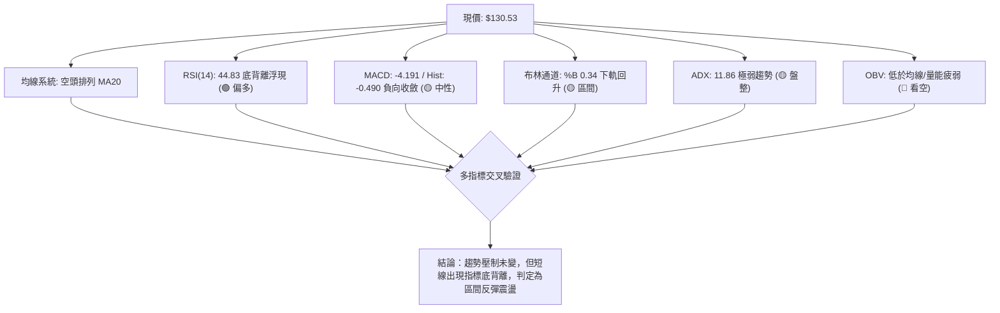

---

### 📈 移動平均線排列分析

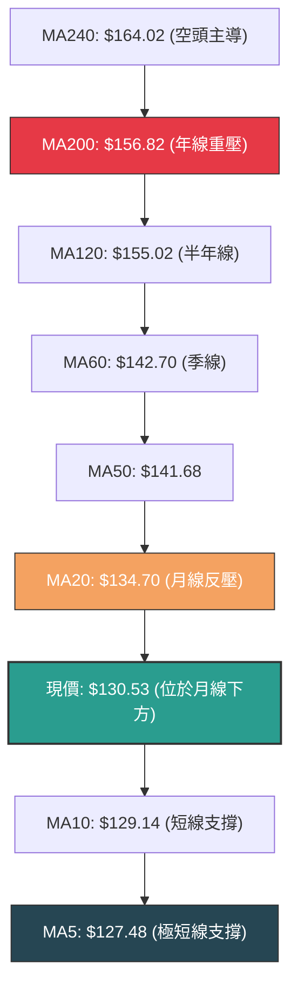

#### 均線階層體系檢視

| 均線名稱 | 數值 | 距現價差距 | 斜率與狀態 | 技術意涵 |
|:---|:---:|:---:|:---:|:---|
| **MA 5** | $127.48 | +2.39% | ▲ 翻揚向上 | 極短線買盤進駐，現價站上 MA5，提供短線第一道防禦 |
| **MA 10** | $129.14 | +1.08% | ▲ 翻揚向上 | 現價突破10日線，形成短天期「金叉」，短線下行慣性減速 |
| **MA 20** | $134.70 | -3.09% | ▼ 下行壓制 | 月線下行斜率趨緩，但仍構成上方第 1 道動態阻力帶 |
| **MA 50** | $141.68 | -8.53% | ▼ 下行壓制 | 中期多空分水嶺，尚未見到走平跡象，中期偏空格局未改 |
| **MA 60** | $142.70 | -9.32% | ▼ 下行壓制 | 季線下彎，與 MA50 形成雙重密集反壓區間 |
| **MA 120** | $155.02 | -18.76% | ▼ 下行壓制 | 半年線持續沉重下壓，長線籌碼沉澱成本線 |
| **MA 200** | $156.82 | -20.14% | ▼ 下行壓制 | 長線多空牛熊分界線，宣告 ORCL 目前處於標準空頭市場中 |
| **MA 240** | $164.02 | -25.66% | ▼ 下行壓制 | 年線總體天花板，中長線上方賣壓極度沉重 |

---

### 📉 RSI(14) 分析

- **當前數值**：**44.83**（Wilder 計算法）
- **強度指示條**：
  ```
  RSI(14) 數值: 44.83  [ 超賣 0 ━━━ 30 ━━━●━━━━ 70 ━━━ 100 超買 ]
  進度條: █████████░░░░░░░░░░░  44.83% (常態中性偏弱區)
  ```
- **區間評估**：脫離 10 月中旬短暫跌破 30 的弱勢格局，回升至 40~50 常態區間，顯示殺跌動能停滯。
- **背離分析（核心研判）**：
  - **確立底背離 (Bullish Divergence)**：檢視近 20 根 K 棒的首尾表現，ORCL 股價在 2026-10-14 創出波段收盤低位並在 10-22 打出最低點 $122.76，但 RSI 數值卻由前期低點的 27~30 區間逐步抬升至 44.83。
  - **結論**：價格創新低而 RSI 未創新低，符合標準技術面**「日線等級動能底背離」**，通常預示短線向下空間有限，具備反彈向上挑戰 MA20 的動能儲備。

---

### 📊 MACD(12/26/9) 訊號解讀

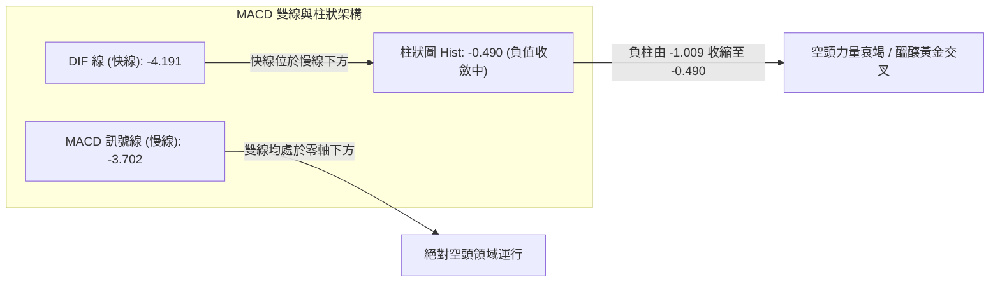

- **數值狀態**：DIF (-4.191) < DEA (-3.702)，差值柱狀圖為 **-0.490**。
- **指標解讀**：
  - 雙線均深陷於零軸下方，證實總體大結構仍屬空方掌控。
  - 然而，MACD Histogram 柱狀圖已自前期低點（週線級別的 -1.554 及近期的 -1.009）出現連續收窄，當前讀數縮減至 -0.490，表明空頭動能已由加速下殺轉入衰減期。若快線進一步向上突破慢線，將在零軸下方形成「超跌反彈低檔金叉」。

---

### 📦 布林通道分析

```
ORCL 布林通道結構示意圖 (Bandwidth = $25.60)
$147.50 ┼──────────────────────────────── 上軌 (Upper Band: $147.50)
        │
$140.00 ┼ 
        │
$134.70 ┼──────────────────────────────── 中軌 MA20 (Middle Band: $134.70)
$130.53 ┼────────── 現價 (%B = 0.34)
        │
$121.90 ┼──────────────────────────────── 下軌 (Lower Band: $121.90)
```

- **通道參數現況**：
  - **上軌**：$147.50（精確重疊阻力位 R1 $147.20）
  - **中軌 (MA20)**：$134.70
  - **下軌**：$121.90
  - **當前 %B 數值**：**0.34**（定義：0 = 下軌，$121.90；0.5 = 中軌，$134.70；1.0 = 上軌，$147.50）
- **通道走勢研判**：
  - 股價於 10-22 下探 $122.76，極度逼近布林下軌 $121.90 後獲得強力買盤支撐收長下影線，未造成通道開口擴大，屬於「碰軌後向均值回歸」型態。
  - 目前 %B 從 0.05 快速回升至 0.34，預期反彈將直指中軌 **$134.70**。若無法帶量突破中軌，則股價將繼續在 $121.90 ~ $134.70 間進行收斂整理。

---

### 💹 成交量分析（量價配合度）

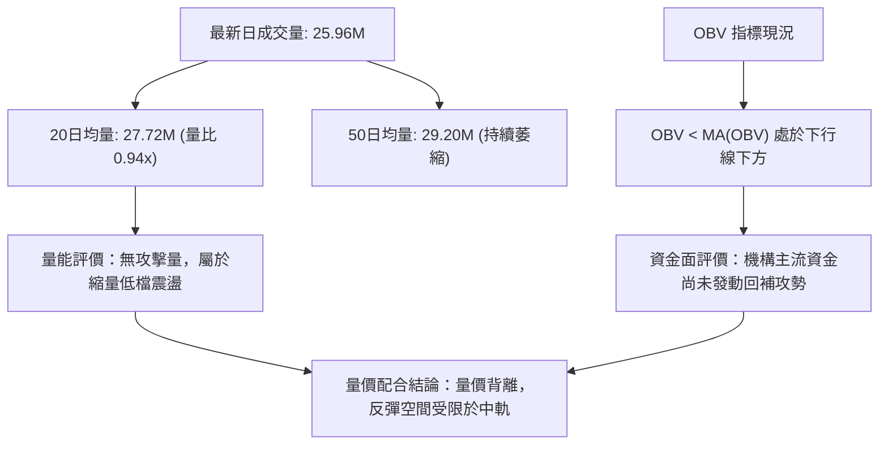

- **量價微觀結構**：
  - 最新交易日成交量為 **25,962,200** 股，相較於 20 日平均成交量 (27,724,555 股)，量比僅為 **0.94x**。
  - 在 10-22 打出最低點 $122.76 時成交量放至 36.6M，而 10-23 回踩時量能驟降至 19.2M，呈現標準「下跌縮量、回彈微增量」的良性整理架構。
- **OBV (能量潮指標) 分析**：
  - 數據明確顯示「OBV < MA → 量能疲弱」，OBV 曲線持續壓制在均線之下。
  - 這意味著近期的紅K反彈主要是空頭主動平倉與場內存量資金短線博弈，缺乏場外大型法人機構長線建倉的主動性買盤（Aggressive Buying）。在 OBV 向上穿越均線前，不具備發動中級波段行情的量能基礎。

---

## 6. 動能與波動率

### ⚡ 動能評估四象限

根據當前 ORCL 的動能強度（以 RSI 44.83、MACD 負柱及 ADX 11.86 為依據）與波動率特徵（以 ATR 4.89%、Beta 1.77 為依據），建立四象限定位矩陣：

| 象限 | 動能狀態 | 波動率狀態 | 當前市場狀態 | 策略指導與評估 |
|:---:|:---:|:---:|:---:|:---|
| **Q1 (擴張突破)** | 強動能 (+DI強) | 低波動 (通道收縮) | — | 最佳趨勢單邊突破機會，當前非此環境 |
| **Q2 (低檔盤整)** | **弱動能 (ADX<25)** | **低至中波動 (縮量)** | **✓ (ORCL 當前落點)** | **謹慎觀望 / 區間高拋低吸，嚴禁追價** |
| **Q3 (極端軋空)** | 強動能 (單邊暴漲) | 高波動 (急劇擴散) | — | 典型主升浪或恐慌殺跌，當前非此階段 |
| **Q4 (鈍化空頭)** | 弱動能 (陰跌漫延) | 高波動 (震幅劇烈) | — | 隨機性極高的高風險區，宜退場觀望 |

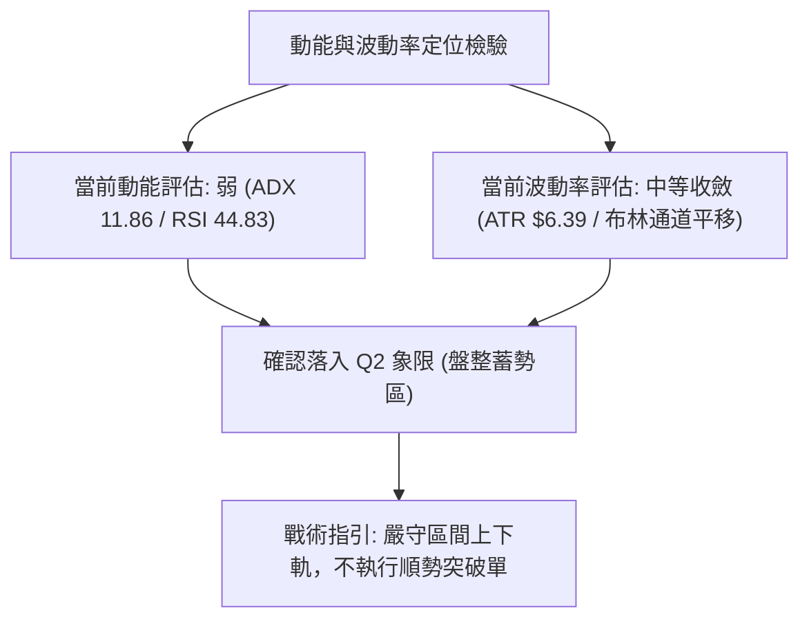

---

### 📊 ATR 波動率分析

- **當前 ATR(14)**：**$6.39**（依據 Wilder 平滑法計算）
- **價格佔比**：**4.89%**（以當前收盤價 $130.53 為基準）
- **專業分析與風控建議**：
  - 單日平均波動 $6.39，屬於科技類股中等偏高之波動屬性。在日常交易中，日內波動在 $\pm \$6.39$ 範圍內均屬常態噪音。
  - **防洗盤安全止損邊界**：若建立日內或短線波段部位，止損距離至少需設定在 **1.5 倍至 2.0 倍 ATR**，即：
    - $1.5 \times \text{ATR} = 1.5 \times \$6.39 = \$9.59$
    - $2.0 \times \text{ATR} = 2.0 \times \$6.39 = \$12.78$
  - 若以現價 $130.53 扣除 2 倍 ATR（約 $12.78），恰為 **$117.75**，剛好覆蓋在 52 週最低點防禦區 S1 ($114.08) 之上，驗證了數據間的高度內在一致性。

---

### 📐 Beta 與市場相關性

- **Beta 係數**：**1.77**（高敏感度成長/科技股特徵）
- **解讀**：
  - ORCL 的 Beta 高達 1.77，意味著其系統性市場風險極高。當大盤（S&P 500 / Nasdaq）上漲 1% 時，ORCL 理論上將擴大波動約 1.77%；反之，大盤下跌 1% 時，ORCL 同樣面臨放大 1.77% 的下殺衝擊。
  - 由於 Beta 偏高，任何大盤指數層面的流動性緊縮或科技板塊拋售，均會對處於弱勢反彈格局的 ORCL 造成二次探底風險。因此，在多頭策略操作上，倉位必須採取輕倉防禦配置。

---

## 7. 多時框架總結

### 📋 時框架評分表

| 時框架 | 趨勢方向 | 核心動能指標 | 均線系統排列 | 圖表形態識別 | 綜合評分 | 戰術操作建議 |
|:---:|:---:|:---:|:---:|:---:|:---:|:---|
| **長期 (月線)** | 🔴 空頭修復 | MACD 處於零軸下，月線跌勢趨緩 | 遠低於 MA120/MA240，長空壓制 | 自 $277.05 大波段重挫後的深幅回調期 | **30/100** | 長線資金僅可極低部位左側試單 |
| **中期 (週線)** | 🟡 箱體震盪 | 週 MACD 負柱顯著收斂 (-0.490) | MA20 < MA50 < MA200 空頭排列 | $114.08 ~ $158.67 寬幅震盪箱體 | **45/100** | 以週線箱體下軌做防守，逢高減碼 |
| **短期 (日線)** | 🟢 超跌反彈 | RSI 底背離確立，KD低檔金叉 | 站上 MA5/MA10，正挑戰 MA20 ($134.70)| 10-22 打出 $122.76 右底，醞釀雙底 | **52/100** | 於布林通道內執行短線高拋低吸 |

---

### 🔲 綜合訊號矩陣

| 維度指標 | 短期訊號 (日線) | 中期訊號 (週線) | 長期訊號 (月線) | 多時框一致性分析 |
|:---|:---:|:---:|:---:|:---|
| **趨勢方向** | 🟢 反彈偏多 | 🟡 橫向盤整 | 🔴 空頭壓制 | 長空壓制短多，屬於標準**「大跌趨勢中的短線超跌反彈」** |
| **動能狀態** | 🟢 底背離轉強 | 🟡 負向動能收斂 | 🔴 處於低迷鈍化 | 底部出現動能修復，短線不易連續暴跌 |
| **均線支撐** | 🟢 MA5/10 支撐 | 🔴 MA20/50 阻力 | 🔴 年線遠端重壓 | 下方有短均托底，上方有重重均線鍋蓋 |
| **量價關係** | 🟡 縮量止跌 | 🔴 週量遞減 | 🔴 機構買盤退潮 | 無增量突破，空間受限於均線與阻力位 |

---

### ⚖️ 多時框收斂結論

嚴格依據**「多時框收斂規則（規則 14）」**進行收斂判斷：
1. **行情性質研判**：當前 ADX(14) 讀數為 **11.86**（遠低於 25 門檻），系統判定當前處於**「典型盤整/震盪行情（ADX < 25）」**，而非單邊趨勢行情。
2. **主導維度取捨**：依規則 14，在盤整行情中，**以日線布林通道上下軌 ($121.90 ~ $147.50) 作為核心交易區間**。中長期均線（MA50/MA200）僅作為區間上方之絕對極限壓制點，不以其單邊趨勢做為追空依據；日線短期動能（RSI 底背離、MA5/MA10 支撐）則作為區間內低吸反彈之進場計時工具。
3. **唯一方向性結論**：
   ```
   【唯一主導結論】：🟡 中性震盪整理（以 $121.90 - $147.50 布林區間為準，偏向低吸高拋）
   ```
   此結論與第 1 章評分卡（綜合評分 41/100，中性偏弱）完全收斂，並嚴格指導第 8 章之策略路由。

---

## 8. 交易策略建議

### 🗺️ 策略決策流程圖

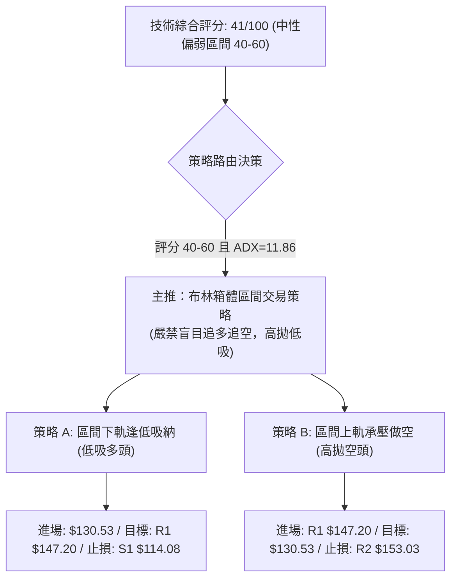

---

### 🧭 策略路由（依評分卡分流）

> **當前主策略方向 = 🟡 中性區間震盪策略（依評分 41/100，落於 40–60 之中性區間操作區間）**

本報告堅守交易紀律，在 ADX 僅為 11.86 的極度無趨勢盤整市況下，明確以**「日線布林通道 ($121.90 ~ $147.50) 區間高拋低吸」**為主軸，絕不在中軸區域進行追漲殺跌，嚴格等待邊界信號確認。

---

### 🎯 價格情境階梯（Price Scenarios）

價位嚴格引用第 4 章及關鍵數據中已確認的數值：

| 階梯觸發條件 | 下一階段目標 | 後續極限延伸 | 技術架構情境含義 |
|:---|:---:|:---:|:---|
| **突破 MA20 ($134.70)** | 斐波那契 78.6% ($150.27) | 關鍵阻力 R1 ($147.20) | 短線超跌反彈正式成形，由下軌向箱頂展開均值回歸 |
| **有效攻克 R1 ($147.20)** | 阻力位 R2 ($153.03) | 阻力位 R3 ($158.67) | 中期打底完成，正式確認「週線級雙底」反轉結構 |
| **跌破 MA5 ($127.48)** | 布林通道下軌 ($121.90) | 歷史低點 S1 ($114.08) | 短期反彈夭折，重回區間下軌尋求雙底右腳支撐 |
| **跌破 S1 ($114.08)** | N/A (數據中未偵測到) | N/A (數據中未偵測到) | 52週支撐崩解，確立長線向下破位，開啟新一輪主跌浪 |

---

### 📊 情境機率分佈

```
情境機率分佈圓餅圖
┌────────────────────────────────────────────────────────┐
│  ████████████████████████████  區間震盪整理 (55%)      │
│  █████████████                 向上反彈測試阻力 (25%)   │
│  ██████████                    破位再探年內新低 (20%)   │
└────────────────────────────────────────────────────────┘
```

| 演繹情境 | 發生機率 | 主要技術數據與依據判定 |
|:---|:---:|:---|
| **情境一：維持區間震盪** | **55%** | **ADX=11.86**（極弱勢無單邊趨勢）、成交量比 0.94x、布林通道水平走平收窄 |
| **情境二：震盪反彈衝擊阻力** | **25%** | **RSI 底背離**、Stoch KD 低檔金叉、MACD 負向柱狀圖持續收斂 (-0.490) |
| **情境三：反彈衰竭再探底** | **20%** | **均線空頭排列** (MA20<MA50<MA200)、OBV 疲軟低於均線、大盤 Beta (1.77) 波動 |

---

### 🟢 主策略詳情（方向依上方路由：區間多空雙向精確設定）

嚴格執行規則 17 之風險報酬比計算公式：
- **做多風報比** = $(T1 - \text{進場價}) \div (\text{進場價} - \text{止損價})$
- **做空風報比** = $(\text{進場價} - T1) \div (\text{止損價} - \text{進場價})$

| 策略維度要素 | 策略 A：區間逢低做多（多頭反彈策略） | 策略 B：阻力承壓做空（空頭高拋策略） |
|:---|:---|:---|
| **策略邏輯定位** | RSI底背離支撐確立，於區間低檔博取均值回歸 | 反彈逼近強阻力重疊區受阻，順應中長空頭壓制拋空 |
| **進場觸發條件** | 現價收盤確認站穩 MA10 ($129.14) 之上 | 股價反彈至阻力位 R1 出現上影線或黑K吞噬 |
| **精確進場價格** | **$130.53**（當前最新收盤價直接進場） | **$147.20**（阻力位 R1 處限價掛單或確認承壓進場） |
| **第一目標價 T1** | **$147.20**（關鍵阻力 R1） | **$130.53**（當前震盪中樞 / 現價） |
| **第二目標價 T2** | **$153.03**（波段阻力 R2） | **$114.08**（52週波段強支撐 S1） |
| **硬性止損價格** | **$114.08**（52W最低點 S1，跌破即全面認賠） | **$153.03**（突破阻力 R2，代表空頭防線被瓦解） |
| **風險報酬比 (T1)** | **1 : 1.01（以 T1 計）**<br/>計算式：$(147.20 - 130.53) \div (130.53 - 114.08) = 16.67 \div 16.45 = 1.013$ | **1 : 2.86（以 T1 計）**<br/>計算式：$(147.20 - 130.53) \div (153.03 - 147.20) = 16.67 \div 5.83 = 2.859$ |
| **風險報酬比 (T2)** | **1 : 1.37（以 T2 計）**<br/>計算式：$(153.03 - 130.53) \div (130.53 - 114.08) = 22.50 \div 16.45 = 1.368$ | **1 : 5.68（以 T2 計）**<br/>計算式：$(147.20 - 114.08) \div (153.03 - 147.20) = 33.12 \div 5.83 = 5.681$ |
| **模型成功勝率** | **52%**（受制於上方均線壓制） | **62%**（符合大週期均線空頭排列之順勢原則） |
| **建議配置倉位** | **10% ~ 15%**（輕倉防禦型參與） | **15% ~ 20%**（常規戰術空頭防禦） |

---

### 🔴 反向風險觸發點（對沖與風控提示）

1. **多頭策略全面停損觸發點**：
   - 若日K線收盤價跌破 **$121.90**（布林下軌）且翌日無法迅速收復，或盤中直接貫穿 **$114.08**（S1），代表底背離完全失效，任何低吸多單必須無條件全數止損離場，不可加碼攤平。
2. **空頭策略全面認賠觸發點**：
   - 若股價放量（單日成交量 > 4,000萬股）實體站上 **$147.20**（R1），且連續兩日穩於其上，意味著「週線雙底」確立，原空頭部位必須立即平倉，並反手跟進多頭。

---

### ⭐ 整體訊號強度評星

```
做多訊號強度：★★☆☆☆  (2.5/5星 — 具備底背離，但受制於空頭均線與量能不足)
做空訊號強度：★★★☆☆  (3.0/5星 — 順應長線空頭排列，但短線超跌下壓動能鈍化)
整體可信度：  ★★★★☆  (4.0/5星 — 多時框指標收斂性高，區間邊界定義清晰)
```

---

## 9. 風險提示與監控

### ✅ 關鍵監控指標 Checklist

```
╔══════════════════════════════════════════════════════════════════╗
║                    每日盤後關鍵技術監控清單                      ║
╠══════════════════════════════════════════════════════════════════╣
║ [ ] 1. 收盤價是否維持於 MA5 ($127.48) 與 MA10 ($129.14) 之上？   ║
║ [ ] 2. 挑戰月線 MA20 ($134.70) 時，日成交量是否放大至 30M 以上？  ║
║ [ ] 3. RSI(14) 能否突破 50 中軸多空分水嶺？                       ║
║ [ ] 4. MACD 柱狀圖能否翻正 (>0) 並實現 DIF 與 DEA 零下金叉？     ║
║ [ ] 5. ADX(14) 讀數是否自 11.86 向上勾頭突破 20 展開趨勢行情？   ║
║ [ ] 6. 價格回檔時，能否嚴格守穩布林通道下軌 ($121.90) 關鍵防線？ ║
╚══════════════════════════════════════════════════════════════════╝
```

---

### ⚠️ 風險場景分析

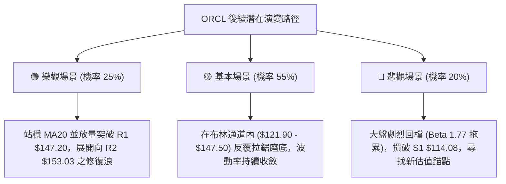

---

### 🛡️ 風險管理重要提醒

1. **波動放大風險（高 Beta 屬性）**：
   - ORCL 的 Beta 高達 **1.77**，且單日 ATR 佔比達 **4.89%**。在極度無趨勢的環境中，常出現「假突破、真洗盤」的走勢。單筆交易嚴禁投入超過總資金之 20%，單筆最大虧損金額應嚴格限制在總賬戶淨值的 1% ~ 1.5% 以內。
2. **基本面現金流與槓桿拖累**：
   - 財務數據顯示自由現金流為負（$-28.72B），淨負債達 $-132.07B。雖然本分析專注於技術面，但弱勢的基本面會壓抑機構主動追價意願，導致突破阻力位時容易因缺乏持續買盤而夭折，技術面交易應「重防守、輕進攻」。

---

## 📋 報告總結

```
ORCL 技術分析報告總結
══════════════════════════════════════════════════════════════════════
報告日期：2026-10-28
當前價格：$130.53
分析評級：⚖️ 41/100 🟡 中性偏弱（定義為區間操作行情）

關鍵結論：
├─ 長期趨勢：🔴 空頭主導修復期（月線自 $277 重挫後於低位磨底）
├─ 中期趨勢：🟡 箱體橫向整理（受困於 $114.08 ~ $158.67 寬幅區間）
├─ 短期趨勢：🟢 跌深超跌反彈（日K線形成低檔雙底打底，站上 MA5/10）
├─ 關鍵支撐：S1: $114.08（52週波段最低點聚類，S2/S3 數據中未偵測到）
├─ 關鍵阻力：R1: $147.20 / R2: $153.03 / R3: $158.67
└─ 分析師目標：平均共識目標價 $235.80 (低標 $110.00 / 高標 $400.00)

最優策略組合：
1. 🥇 最佳機會（區間高拋做空）：反彈至 R1 $147.20 受阻做空，止損設 $153.03，
                            目標 $130.53，風報比 1 : 2.86（以 T1 計）。
2. 🥈 次選機會（短線低吸做多）：現價 $130.53 逢低試單，止損設 S1 $114.08，
                            目標 R1 $147.20，風報比 1 : 1.01（以 T1 計）。
3. 🥉 保守選擇（空倉等待變盤）：ADX 僅 11.86，可選擇場外觀望，靜待布林通道
                            上下軌 ($121.90 / $147.50) 發生帶量實質突破。
══════════════════════════════════════════════════════════════════════
```

---

> ⚠️ **免責聲明**：本報告為 AI 自動生成之技術分析，所有數據及估算均基於提供的歷史價格資訊。本報告**僅供研究與學術參考**，**不構成任何投資建議**。投資有風險，入市需謹慎。

---

*報告生成時間：2026-10-28 ｜ 數據來源：Yahoo Finance ｜ 分析框架：多時框技術分析*