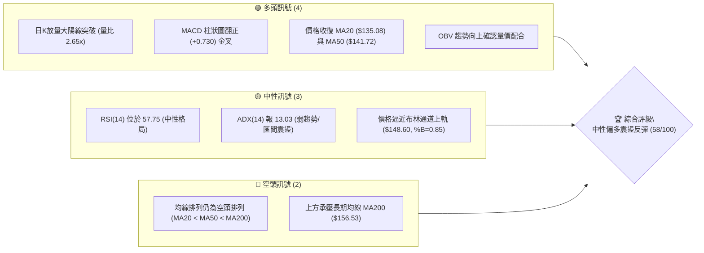
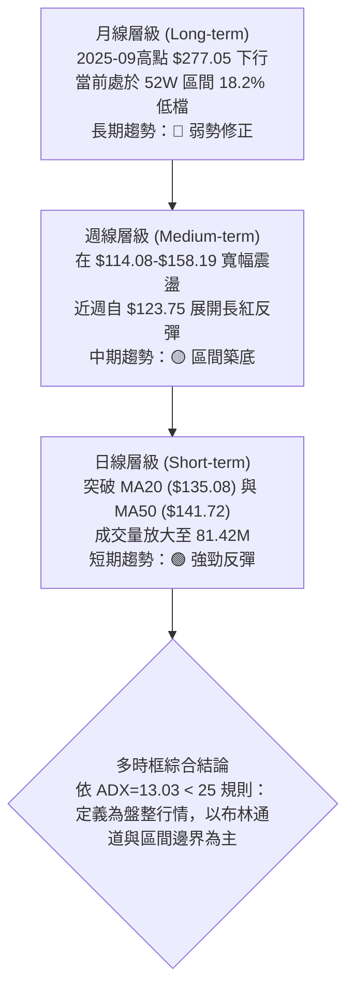
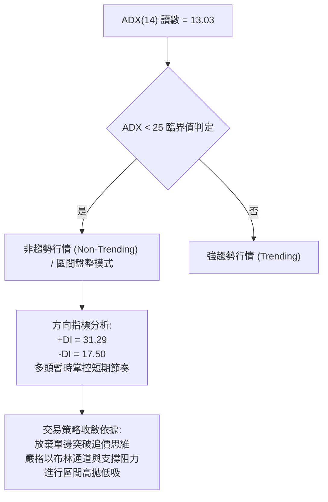
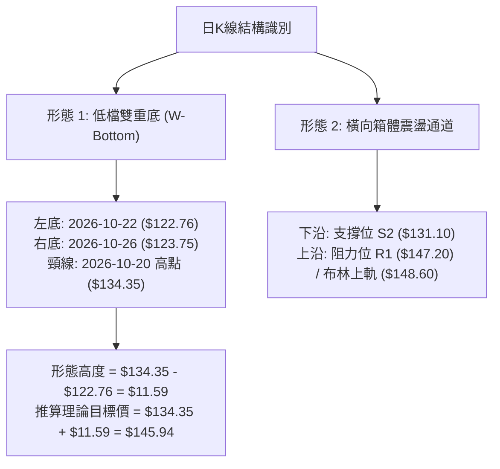
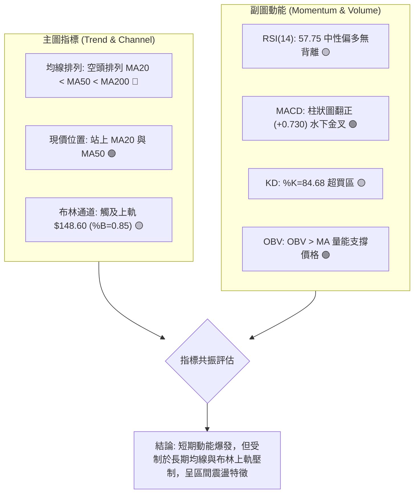
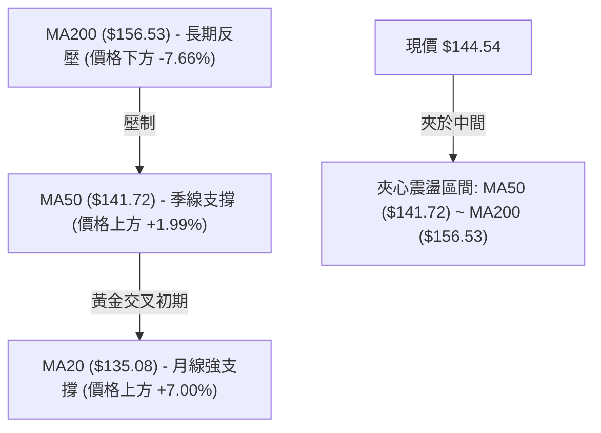
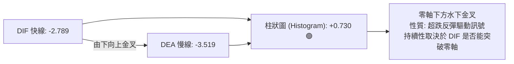
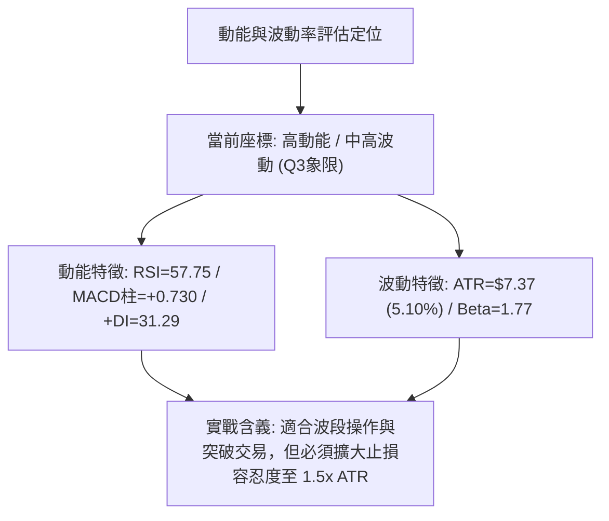
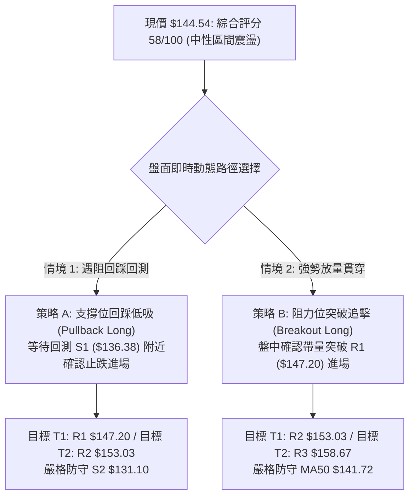
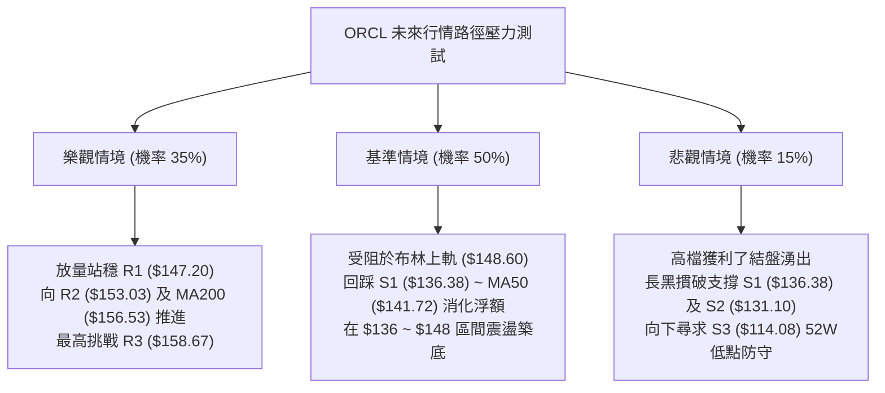

# ORCL 技術分析報告

> **報告日期**：2026-10-29 ｜ **語言**：繁體中文 ｜ **數據來源**：Yahoo Finance ｜ **當前價格**：$144.54

---

## 目錄

| 章節 | 內容 |
|------|------|
| [1. 技術面概覽](#1-技術面概覽) | 訊號儀表板、核心指標、評分卡 |
| [2. 趨勢分析](#2-趨勢分析) | 多時框趨勢、長中短期走勢、ADX 評估 |
| [3. 圖表形態分析](#3-圖表形態分析) | 形態識別、K線組合、目標價推算 |
| [4. 支撐與阻力](#4-支撐與阻力) | 關鍵價位結構、斐波那契回調分析 |
| [5. 技術指標深度解讀](#5-技術指標深度解讀) | 均線系統、RSI、MACD、布林通道、量價配合 |
| [6. 動能與波動率](#6-動能與波動率) | 動能四象限、ATR 波動度、Beta 敏感度 |
| [7. 多時框架總結](#7-多時框架總結) | 時框架評分矩陣、多時框收斂結論 |
| [8. 交易策略建議](#8-交易策略建議) | 策略路由、價格情境階梯、精確風報比策略 |
| [9. 風險提示與監控](#9-風險提示與監控) | 監控指標 Checklist、情境壓力測試、風控法則 |

---

## 1. 技術面概覽

### 🎯 技術訊號儀表板



---

### 📊 核心指標速覽表

| 指標類別 | 指標名稱 | 當前數值 | 訊號 | 解讀 |
|:---|:---|:---|:---:|:---|
| **價格** | 當前收盤價 | $144.54 | 🟢 | 單日大漲放量，脫離 $122.76–$128 低檔整理平台 |
| **均線** | MA20 (月線) | $135.08 | 🟢 | 價格在均線上方 +7.00%，短期動能強勁向上噴發 |
| **均線** | MA50 (季線) | $141.72 | 🟢 | 價格成功站回 MA50 之上 +1.99%，扭轉短中期弱勢 |
| **均線** | MA200 (年線) | $156.53 | 🔴 | 價格仍落後年線 -7.66%，長期趨勢未正式反轉為牛市 |
| **動能** | RSI(14) | 57.75 | 🟡 | 位於 30–70 中性常態偏強區間，尚未進入超買區 |
| **動能** | MACD (12,26,9) | Hist: +0.730 | 🟢 | 快線 (-2.789) 向上金叉慢線 (-3.519)，柱狀圖翻正 |
| **動能** | KD 隨機指標 | %K: 84.68 / %D: 45.45 | 🟡 | %K 進入短線超買區，短線漲勢過急存在正乖離修正壓力 |
| **趨勢** | ADX(14) / DMI | 13.03 (+DI: 31.29) | 🟡 | ADX < 25 判定為非趨勢盤整市場，+DI 顯著大於 -DI (17.50) |
| **通道** | 布林通道 | 上軌 $148.60 / %B: 0.85 | 🟡 | 價格觸及布林通道上軌前緣，面臨軌道動態阻力壓制 |
| **成交量** | 成交量 / 20日均量 | 81.42M / 30.68M | 🟢 | 量比達 2.65x，量能激增確認底部買盤介入突破 |
| **波動** | ATR(14) | $7.37 (5.10%) | 🟡 | 日內平均振幅較大，設定止損與目標需匹配波動空間 |

---

### 🏆 技術評分卡

```
╔══════════════════════════════════════════════════════════════════╗
║                   技術評分卡 — ORCL (2026-10-29)                  ║
╠══════════════════════════════════════════════════════════════════╣
║ 趨勢強度 (Trend)     ████████░░░░░░░░░░░░  40/100  🟡 弱趨勢/低ADX║
║ 動能指標 (Momentum)  █████████████░░░░░░░  68/100  🟢 MACD金叉偏強║
║ 支撐穩定度 (Support) █████████████░░░░░░░  66/100  🟢 S1/S2支撐成型║
║ 成交量配合 (Volume)   ████████████████░░░░  82/100  🟢 巨量2.65x突破║
║ 形態完整度 (Pattern) ███████████░░░░░░░░░  56/100  🟡 雙底待頸線驗證║
║ 均線排列 (MA System) ███████░░░░░░░░░░░░░  36/100  🔴 MA200長期壓制║
╠══════════════════════════════════════════════════════════════════╣
║ 綜合評分 (Composite) ████████████░░░░░░░░  58/100  評級：中性震盪 ║
║ 註：綜合評分由六項評分算術平均得出 (40+68+66+82+56+36)/6 = 58/100 ║
╚══════════════════════════════════════════════════════════════════╝
```

---

## 2. 趨勢分析

### 🌐 多時框趨勢分析



---

### 📈 長期趨勢 — 12個月走勢圖（Unicode）

以下為 ORCL 過去 12 個月（2025-11 至 2026-10）之月線收盤價走勢示意圖。價格自 2025 年高點持續回落，至 2026 年中於 $114.08（2026-07 探底）築出年度低點，目前正在進行低檔反彈修復。

```
ORCL 月線走勢圖（過去12個月：2025-11 至 2026-10）
價格軸 ($)
$260 ┤  ● $259.14 (2025-10高檔)
$240 ┤
$220 ┤                                      ● $224.17 (2026-05反彈高點)
$200 ┤        ● $199.28 (2025-11)
$180 ┤              ● $192.34 (2025-12)
$160 ┤                    ● $162.84               ● $160.24 (2026-04)
$140 ┤                          ● $143.86   ● $145.55         ● $145.50         ● $148.57         ● $144.54 (現價)
$120 ┤                                                              ● $129.39         ● $136.79
$110 ┤                                                                  ● $114.08 (52W最低點, 2026-07)
     └──────────────────────────────────────────────────────────────────────────────────────────
       25-11 25-12 26-01 26-02 26-03 26-04 26-05 26-06 26-07 26-08 26-09 26-10
```

#### 走勢特徵分析表格

| 週期階段 | 涵蓋月份 | 區間高低點 | 走勢特徵與技術含義 |
|:---|:---|:---|:---|
| **第一階段：高檔退潮** | 2025-10 ~ 2026-02 | $259.14 → $143.86 | 月線連續重挫，AI 資本支出疑慮引發機構大幅獲利了結，跌幅達 -44.5% |
| **第二階段：技術性反抽** | 2026-03 ~ 2026-05 | $145.55 → $224.17 | 強力空頭回補浪，一度重返 $220 之上，但缺乏實質現金流支撐，形成假突破 |
| **第三階段：破底探低** | 2026-06 ~ 2026-07 | $224.17 → $114.08 | 斷崖式暴跌，創下 52 週最低點 $114.08，週線 RSI 跌入 26.7 極端超賣區 |
| **第四階段：築底回升** | 2026-08 ~ 2026-10 | $114.08 → $144.54 | 於 $122–$128 構築雙重底支撐，最新月份放量長紅收復 $144.54，進入橫盤震盪區 |

---

### 📊 中期趨勢（週線分析）

中期走勢呈現「低檔寬幅箱體整理」。近 20 週收盤價於 2026-07-24 觸及 $114.57 底部後，週線 MACD 柱狀圖由負翻正（從 -6.718 收斂至目前 +0.730）。

```
中期週線關鍵價位示意圖
$158.67 ────────────────────────────────────────── [近一年波段阻力 R3]
$153.03 ────────────────────────────────────────── [近一年波段阻力 R2 / 09-25 高點聚類]
$148.60 ~ $147.20 ════════════════════════════════ [布林上軌 / 近一年波段阻力 R1]
$144.54 ───────────────────────● 現價 (2026-10-28 收盤)
$136.38 ────────────────────────────────────────── [近一年波段支撐 S1 / 09-25 收盤]
$131.10 ────────────────────────────────────────── [近一年波段支撐 S2 / 10-02 週低點]
$114.08 ══════════════════════════════════════════ [52W 最低點 / 近一年波段支撐 S3]
```

---

### ⚡ 趨勢強度評估（ADX 解讀）



#### ADX 強度對照表

| 指標變數 | 當前讀數 | 門檻區間 | 當前市場狀態解讀 |
|:---|:---:|:---:|:---|
| **ADX(14)** | **13.03** | 0 ~ 20：極弱趨勢 / 無方向震盪<br/>20 ~ 25：弱趨勢形成中<br/>25 ~ 50：明確單邊趨勢<br/>> 50：極強極端單邊 | 確定市場處於「弱趨勢無方向盤整」階段，單日大漲不代表單邊牛市展開，僅為箱體震盪中的動能脈衝。 |
| **+DI (14)** | **31.29** | 高於 -DI (17.50) 差值達 13.79 | 多頭買盤在短週期佔據優勢，主導近期的超跌反彈動能。 |
| **-DI (14)** | **17.50** | 低於 20 水平 | 空方拋壓在低檔快速減弱，空頭暫無主動摜壓意願。 |

---

## 3. 圖表形態分析

### 🔍 形態識別系統



#### 形態信心度與目標價評估表

| 形態名稱 | 信心度 | 判斷依據（引用數據） | 完成度 | 目標價（附嚴格計算式） |
|:---|:---:|:---|:---:|:---|
| **低檔雙重底 (W-Bottom)** | **75%** | 兩次低點分別落於 10-22 ($122.76) 與 10-26 ($123.75)，低點墊高；10-28 放量長紅收盤 $144.54 實體突破頸線 10-20 高點 ($134.35) | 90% | 頸線 $134.35 + 形態高度 ($134.35 − $122.76 = $11.59) = **$145.94**（已於 10-28 盤中高點 $148.48 達成） |
| **箱體震盪突破** | **60%** | 價格脫離 10 月中旬 $126–$134 整理區，但面臨上方近一年波段阻力 R1 $147.20 與布林上軌 $148.60 壓制 | 65% | 依箱體下沿 S1 $136.38 與上沿 R1 $147.20 推算，若確認站穩 R1，延伸目標為阻力位 **$153.03 (R2)** |
| **大型頭肩頂/底** | **30%** | 數據中週線結構仍在修復，無完整右肩結構 | 0% | *訊號不足，僅做指標型解讀，不預設立場* |

---

### 🕯️ 重要K線形態分析

嚴格依據提供的「近10根日K」與「近8根週K」之實際數據進行解讀：

| 週期與日期 | 開盤價 (O) | 最高價 (H) | 最低價 (L) | 收盤價 (C) | 成交量 | K線形態名稱 | 技術解讀與訊號意義 | 訊號 |
|:---|:---:|:---:|:---:|:---:|:---:|:---|:---|:---:|
| **日K 10-22** | $126.35 | $127.94 | $122.76 | $125.54 | 36,620,100 | **破底長下影陰線** | 創下波段波谷 $122.76，下影線長達 $2.78，顯示低檔出現逢低承接買盤 | 🟡 |
| **日K 10-23** | $124.87 | $128.33 | $124.39 | $126.16 | 19,223,400 | **低檔縮量小紅星** | 量能萎縮至 1,922 萬股，空方動能耗竭，形成初步止跌十字孕線結構 | 🟢 |
| **日K 10-26** | $126.06 | $127.99 | $123.75 | $126.06 | 23,008,500 | **平盤十字星 (Doji)** | 二度測試 $123.75 未破前低，確立雙底右腳，多空平衡等待變盤 | 🟢 |
| **日K 10-27** | $126.88 | $132.34 | $126.86 | $130.53 | 26,026,700 | **轉折中陽線** | 實體紅棒向上推進，收盤重返 $130 之上，多方買盤開始回流 | 🟢 |
| **日K 10-28** | $131.32 | $148.48 | $128.38 | $144.54 | 81,418,100 | **放量長陽帶上影** | 爆出 8,141 萬巨量（量比 2.65x），一舉吞噬前 7 日高點，惟 $148.48 遇阻回吐 | 🟢 |
| **週K 10-09** | $142.00 | $146.40 | $134.16 | $141.40 | 121,793,100 | **高檔震盪紡錘線** | 於 $146.40 遭遇阻力，週線動能停滯 | 🟡 |
| **週K 10-16** | $141.56 | $144.18 | $127.36 | $128.23 | 167,863,700 | **帶量大陰線** | 週跌幅顯著，實體陰線跌破 $130，確立前波拉回修正格局 | 🔴 |
| **週K 10-23** | $130.66 | $134.35 | $122.76 | $126.16 | 132,673,600 | **下影線垂頭線** | 測試波段低點 $122.76 後回升，量能萎縮，屬於典型築底孕育訊號 | 🟢 |
| **週K 10-28** | $126.06 | $148.48 | $123.75 | $144.54 | 130,453,300 | **週線看漲吞噬長紅** | 當週大漲 +14.57%，實體完全包覆前兩週 K 線，確立中期反彈動能重啟 | 🟢 |

---

### 📉 ASCII 走勢形態示意圖

```
ORCL 日線雙底突破與關鍵價位示意圖
$153.03 ┤                                                         [阻力位 R2]
$148.60 ┤                                   ▲ 10-28高點 $148.48 (遇阻回落)
$147.20 ┤═══════════════════════════════════╤═════════════════════ [阻力位 R1 / 頸線突破目標]
$144.54 ┤                                   █ ← 10-28 收盤長陽實體
$141.72 ┤───────────────────────────────────┼───────────────────── [MA50 季線]
$136.38 ┤                                   │                     [支撐位 S1]
$134.35 ┤─────────────● 10-20 頸線高點 ──────┼───────────────────── [W底頸線位]
$130.53 ┤             │                     █ 10-27
$126.06 ┤   █ 10-16   │               ● 10-26 (右底 $123.75)
$122.76 ┤             ● 10-22 (左底 $122.76)
        └────────────────────────────────────────────────────────
```

---

## 4. 支撐與阻力

### 🗺️ 關鍵價位分布圖（Unicode）

```
ORCL 價位結構分布圖（嚴格依據 OHLCV 計算聚類值）
═════════════════════════════════════════════════════════════════
$158.67 ║██████████████████████████████║ 強阻力 R3 (+9.78%) 近一年波段高點聚類
$156.53 ║▓▓▓▓▓▓▓▓▓▓▓▓▓▓▓▓▓▓▓▓▓▓▓▓      ║ 動態年線 MA200 反壓位
$153.03 ║████████████████████          ║ 阻力 R2 (+5.88%) 09-25 波段高點
$149.95 ║▒▒▒▒▒▒▒▒▒▒▒▒▒▒▒▒▒▒▒▒▒▒        ║ 斐波那契 78.6% 回調關鍵位
$148.60 ║▓▓▓▓▓▓▓▓▓▓▓▓▓▓▓▓▓▓            ║ 布林通道上軌動態阻力
$147.20 ║████████████████████████      ║ 關鍵阻力 R1 (+1.84%) 近期波段高點
════════╠══════════════════════════════╣ ◄ 當前收盤價 $144.54 (距 52W 低點 +26.7%)
$141.72 ║▓▓▓▓▓▓▓▓▓▓▓▓▓▓▓▓▓▓            ║ 動態季線 MA50 轉化為第一支撐
$136.38 ║████████████████████          ║ 關鍵支撐 S1 (-5.65%) 近一年波段低點聚類
$135.08 ║▓▓▓▓▓▓▓▓▓▓▓▓▓▓▓▓▓▓            ║ 動態月線 MA20 / 布林通道中軌
$131.10 ║████████████████████████      ║ 強支撐 S2 (-9.30%) 10-02 低點聚類
$121.57 ║▓▓▓▓▓▓▓▓▓▓▓▓▓▓                ║ 布林通道下軌極限防守位
$114.08 ║██████████████████████████████║ 極限強支撐 S3 (-21.08%) 52週歷史最低點
═════════════════════════════════════════════════════════════════
```

---

### 🚧 阻力位分析表

| 阻力級別 | 價位 | 距現價幅標 | 形成原因與技術共振 | 突破難度 | 重要性 |
|:---|:---:|:---:|:---|:---:|:---:|
| **阻力位 R1** | **$147.20** | +1.84% | 近一年波段高點聚類，與布林上軌 ($148.60) 及 10-28 盤中高點 ($148.48) 形成重疊反壓區 | 🟡 中等 | ★★★★☆ |
| **阻力位 R2** | **$153.03** | +5.88% | 近一年波段高點聚類（09-25 週K高點 $153.03），為前期密集套牢籌碼峰下沿 | 🔴 較高 | ★★★★☆ |
| **阻力位 R3** | **$158.67** | +9.78% | 09-04 週K高點 ($158.19) 聚類點，同時上方緊鄰 MA200 ($156.53)，為多空牛熊分水嶺 | 🔴 極高 | ★★★★★ |

---

### 🛡️ 支撐位分析表

| 支撐級別 | 價位 | 距現價幅標 | 形成原因與技術共振 | 守住機率 | 重要性 |
|:---|:---:|:---:|:---|:---:|:---:|
| **支撐位 S1** | **$136.38** | -5.65% | 近一年波段低點聚類（09-25 週收盤 $136.59），下方緊鄰 MA20 ($135.08) 與 W底頸線 ($134.35) | 🟢 70% | ★★★★☆ |
| **支撐位 S2** | **$131.10** | -9.30% | 近一年波段低點聚類（10-02 週K低點 $131.10），10 月築底平台下沿防守線 | 🟢 85% | ★★★★★ |
| **支撐位 S3** | **$114.08** | -21.08% | 52 週最低點（2026-07 歷史大底聚類），斐波那契 100% 回調極限支撐 | 🟢 95% | ★★★★★ |

---

### 📐 斐波那契回調位分析

依據 52 週完整波動區間（高點 $281.69 → 低點 $114.08，波動垂直幅度 $167.61）計算：

```
斐波那契回調階梯分布
$281.69 ├── 0.0%  (52W High)
$242.13 ├── 23.6%
$217.66 ├── 38.2%
$197.88 ├── 50.0%
$178.11 ├── 61.8%
$149.95 ├── 78.6%  ▲ 關鍵阻力過渡帶
$144.54 ┼─── 現價位置 (位於 78.6% 與 100.0% 之間)
$114.08 └── 100.0% (52W Low)
```

| 回調比率 | 價位 | 當前價位相對關係 | 結構意義解讀 |
|:---|:---:|:---:|:---|
| **0.0% (52W High)** | $281.69 | +94.89% | 2025 年多頭狂熱週期最高點 |
| **23.6%** | $242.13 | +67.52% | 歷史牛市主跌段第一折返阻力 |
| **38.2%** | $217.66 | +50.59% | 2026-05 反彈波段頂部區域 |
| **50.0%** | $197.88 | +36.90% | 中長期對稱平衡軸線 |
| **61.8%** | $178.11 | +23.23% | 黃金分割強防守位，中長期空頭反壓防線 |
| **78.6%** | **$149.95** | **+3.74%** | **現階段最關鍵上方分界線**。現價落於 $114.08 至 $149.95 之間，距離 78.6% 回調位僅 3.74%，若無法放量突破 $149.95，技術面僅屬超跌反彈。 |
| **100.0% (52W Low)**| **$114.08** | **-21.08%** | 2026 年終極防守基石，跌破將引發流動性崩潰。 |

---

## 5. 技術指標深度解讀

### 🎛️ 指標訊號總覽



---

### 📈 移動平均線排列分析



#### 移動平均線數據對照表

| 均線名稱 | 數值 | 距現價乖離 | 排列狀態 | 走勢特徵解讀 |
|:---|:---:|:---:|:---:|:---|
| **MA5** | $130.57 | +10.70% | 急速陡峭向上 | 連續大漲帶動短期線體垂直上揚，短線存在過熱乖離修正需求 |
| **MA10** | $130.54 | +10.73% | 勾頭向上 | 與 MA5 形成短線雙多頭發散，提供第一波回檔動態緩衝 |
| **MA20** | $135.08 | +7.00% | 轉折向上 | 突破月線代表近 20 個交易日進場籌碼全面翻紅轉為獲利狀態 |
| **MA50** | $141.72 | +1.99% | 平緩走平 | 10-28 一舉越過季線，扭轉自 9 月以來的下行中線走勢 |
| **MA60** | $142.69 | +1.29% | 底部回升 | 價格重返 60 日均線之上，中天期籌碼壓力減輕 |
| **MA120** | $154.62 | -6.52% | 下行傾斜 | 半年線持續向下施壓，構成 $154.62 的反壓屏障 |
| **MA200** | $156.53 | -7.66% | 空頭下彎 | 長期牛熊線未越過前，任何上漲均定義為反彈而非大牛市 |
| **MA240** | $163.68 | -11.70% | 空頭排列 | 超長期均線位於高檔，顯示高檔套牢盤沉重 |

---

### 📉 RSI(14) 分析

進度條展示：
```
RSI(14) 讀數：57.75  [中性常態偏強]
0 ══════════════ 30 ════════════════════ 70 ══════════════ 100
[    超賣區     ] [ ▓▓▓▓▓▓▓▓▓▓▓▓▓▓▓░░░░░ ] [    超買區     ]
```

- **超買超賣判定**：數值 57.75 脫離了 10 月中旬的 39–40 弱勢區間，進入 50–70 強勢擴張帶，但尚未觸及 70 超買警戒線，多方仍有向上延伸空間。
- **背離判斷**：依據提供的明確技術數據標注——**「RSI 背離：無明顯背離（僅比較近20根K棒首尾的價格與RSI方向）」**。日線收盤自 10-15 的 $134.47 上升至 10-28 的 $144.54，RSI 亦由 40 附近同步回升至 57.75，量價與動能協同，不存在頂背離或底背離。

---

### 📊 MACD(12/26/9) 訊號解讀



- **數值表現**：DIF (-2.789) 高於 DEA (-3.519)，柱狀圖讀數為 **+0.730**，顯著由負轉正，確認日線層級發出正規買入訊號。
- **背離檢查**：10-16 至 10-23 價格自 $128.23 跌至 $126.16，但 MACD 柱狀圖自 -0.901 收斂至 -1.009 並迅速拉升翻紅，展現水下動能集結狀態。

---

### 📦 布林通道分析

```
ORCL 日線布林通道結構示意圖（20日參數，2倍標準差）
$148.60 ┬────────────────────────────────────────── [BB 上軌動態反壓]
        │                           ● 10-28 高點 $148.48 (觸軌)
$144.54 ┼───────────────────────────● 現價位置 (%B = 0.85)
        │
$135.08 ┼────────────────────────────────────────── [BB 中軌 / MA20 支撐]
        │
$121.57 ┴────────────────────────────────────────── [BB 下軌極限防守]
```

- **通道寬度與狀態**：上軌 $148.60，中軌 $135.08，下軌 $121.57，帶寬為 $27.03（約 20%）。
- **位置解讀 (%B)**：%B 值為 **0.85**，顯示目前收盤價已經處於通道上部 85% 的相對高位，歷史統計顯示 %B > 0.80 時，價格容易在上軌至阻力位 $147.20 附近受到均值回歸拉力牽制。

---

### 💹 成交量分析（量價配合度）

```
量價配合矩陣
最新成交量: 81,418,100  ██████████████████████████ (2.65x 均量)
20日均量:   30,682,605  ██████████
50日均量:   30,447,220  ██████████
```

1. **爆量性質確認**：10-28 爆出 8,141 萬股巨量，為 20 日均量的 2.65 倍，屬於「底部放量實體突破」，配合新聞面雲端營收前景發酵，主力資金介入跡象明確。
2. **OBV 能量潮解讀**：數據明確指出「**OBV > MA → 量能支撐上漲**」。OBV 指標突破自身均線，顯示買盤成交量顯著大於賣盤，量能指標完全驗證價格的反彈有效性，非無量虛拉。

---

## 6. 動能與波動率

### ⚡ 動能評估四象限



| 象限 | 動能維度 | 波動維度 | 當前狀態標記 | 技術評估與操作導向 |
|:---:|:---:|:---:|:---:|:---|
| **Q1** | 強動能 | 低波動 | — | 穩定單邊趨勢，最佳加碼擴張期 |
| **Q2** | 弱動能 | 低波動 | — | 沉悶窄幅盤整，觀望等待方向破局 |
| **Q3** | **強動能** | **高波動** | **✓ (ORCL 當前)** | **爆發性波段反彈，伴隨高劇烈震盪，收益與風險比高，需嚴格風控** |
| **Q4** | 弱動能 | 高波動 | — | 無序混亂洗盤或恐慌殺跌，極易頻繁止損，應嚴格避免進場 |

---

### 📊 ATR 波動率分析

- **ATR(14) 讀數**：**$7.37**（佔當前股價比例高達 **5.10%**，採 Wilder 平滑算法）。
- **日間預期波動區間**：
  - 單日震盪上限：$144.54 + $7.37 = **$151.91**（直逼 R2 $153.03）
  - 單日震盪下限：$144.54 − $7.37 = **$137.17**（接近 S1 $136.38）
- **止損距離建議**：
  - **保守型（1.5 倍 ATR）**：$7.37 × 1.5 = **$11.06**，設定止損於 $144.54 − $11.06 = **$133.48**（保護在月線 $135.08 之下）。
  - **進取型（1.0 倍 ATR）**：$7.37 × 1.0 = **$7.37**，設定止損於 $144.54 − $7.37 = **$137.17**（保護在季線 $141.72 與 S1 附近）。

---

### 📐 Beta 與市場相關性

- **Beta 係數**：**1.77**。
- **市場敏感度解讀**：ORCL 屬於極高彈性（High Beta）科技權值股。當標普 500 指數或那斯達克指數波動 1.0% 時，ORCL 理論上將產生 1.77% 的同向放大波動。在當前大盤受聯準會利率會議與科技巨頭財報分歧干擾下，高 Beta 特性意味著個股極易出現跳空與極端影線。

---

## 7. 多時框架總結

### 📋 時框架評分表

| 時框架 | 趨勢方向 | 動能表現 | 均線排列狀態 | 圖表形態特徵 | 綜合評分 | 操作建議導向 |
|:---|:---:|:---:|:---|:---|:---:|:---|
| **日線 (短線)** | 🟢 強勁偏多 | RSI=57.75, MACD翻紅 | 突破 MA20 & MA50，下距 MA20 7% | 雙底突破，逼近布林上軌 | 68/100 | 等待回踩支撐低吸或突破追單 |
| **週線 (中線)** | 🟡 震盪整理 | RSI=57.8, MACD柱=+0.73 | 位於均線下方震盪，反彈修復中 | 寬幅箱體，底部長紅吞噬 | 56/100 | 箱體區間高拋低吸，嚴設止損 |
| **月線 (長線)** | 🔴 弱勢修正 | 處於52W區間18.2%低檔 | MA200 反壓顯著，歷史空頭結構 | 自 $277 回落之長期修正波 | 38/100 | 僅視為空頭市場反彈，不宜長抱 |

---

### 🔲 綜合訊號矩陣

```
時框訊號一致性矩陣
┌──────────────┬──────────────┬──────────────┬──────────────┐
│   維度指標   │  短期 (日線) │  中期 (週線) │  長期 (月線) │
├──────────────┼──────────────┼──────────────┼──────────────┤
│ 價格趨勢     │    🟢 多頭   │    🟡 盤整   │    🔴 空頭   │
│ 動能 (RSI)   │    🟢 擴張   │    🟡 中性   │    🔴 偏弱   │
│ 指標 (MACD)  │    🟢 金叉   │    🟢 翻正   │    🔴 空方   │
│ 均線架構     │    🟢 站上   │    🟡 糾結   │    🔴 空頭   │
│ 成交量能     │    🟢 爆量   │    🟡 常態   │    🔴 萎縮   │
└──────────────┴──────────────┴──────────────┴──────────────┘
```

---

### ⚖️ 多時框收斂結論

依據本報告設定之**多時框收斂規則（規則 14）**進行判定：

1. **行情性質判定**：ADX(14) 讀數為 **13.03**，遠低於 25 臨界值，嚴格判定為**「非趨勢之盤整行情」**。
2. **主導維度取捨**：依規則，盤整行情中中長期的單邊趨勢權重降低，交易邏輯**以日線布林通道上下軌 ($121.57 ~ $148.60) 及波段 S/R ($136.38 ~ $147.20) 為主要交易區間**。
3. **唯一收斂結論**：**中性偏多區間震盪（評分 58/100）**。
   - 日線雖呈現巨量紅棒突破，但已接近布林上軌 ($148.60) 與關鍵阻力 R1 ($147.20)，上方空間受限；
   - 下方則有已扭轉向上的 MA20 ($135.08) 及支撐位 S1 ($136.38) 提供強力防守。
   - 本報告第 8 章交易策略將完全對齊此結論，採取「支撐位回踩接多」或「阻力位突破追多」之高勝率區間交易模式。

---

## 8. 交易策略建議

### 🗺️ 策略決策流程圖



---

### 🧭 策略路由

> **當前主策略方向 = 區間震盪操作（高拋低吸／等待突破確認，依評分 58/100）**

本標的綜合評分為 **58/100**，落入 40–60 中性區間，且 ADX 為 13.03，禁止單邊盲目重倉追高。主策略鎖定在「布林通道與關鍵支撐阻力」之間進行精確的高風報比波段部署。

---

### 🎯 價格情境階梯（Price Scenarios）

價位嚴格引用第 4 章由 OHLCV 所產出之精確數值：

| 觸發條件 | 下一目標 | 後續延伸 | 情境技術含義與應對要領 |
|:---|:---:|:---:|:---|
| **強勢突破 R1 ($147.20)** | **R2 ($153.03)** | **R3 ($158.67)** | 短線全面逼空轉強，打開邁向年線 MA200 ($156.53) 之反彈通道 |
| **站穩現價區間 ($141.72–$144.54)** | R1 ($147.20) | S1 ($136.38) | 消化單日大漲獲利盤，維持在季線與布林上軌間強勢橫盤整理 |
| **回踩跌破 S1 ($136.38)** | **S2 ($131.10)** | **S3 ($114.08)** | 多頭反彈動能衰竭，宣告 W 底頸線失守，重回低檔震盪測底格局 |

---

### 📊 情境機率分佈

| 預期情境 | 發生機率 | 主要技術指標依據 |
|:---|:---:|:---|
| **區間震盪整固** | **50%** | ADX 僅 13.03 無單邊趨勢；%B=0.85 觸及布林通道上軌，短線有均值回歸修復需求 |
| **向上突破推進** | **35%** | 最新成交量爆出 2.65x 均量；OBV > MA 支持量增價漲；MACD 柱狀圖翻正達 +0.730 |
| **假突破再破底** | **15%** | 均線系統長期仍為空頭排列；上方受制於 52 週 78.6% 斐波那契回調位 $149.95 壓制 |

---

### 🟢 主策略詳情

以下策略數值均嚴格依據關鍵價位制定，風險報酬比計算式為：  
$$\text{風報比} = \frac{\text{目標價} - \text{進場價}}{\text{進場價} - \text{止損價}}$$

| 策略要素 | 策略 A：回踩支撐位逢低做多 (推薦) | 策略 B：突破阻力位追擊做多 |
|:---|:---|:---|
| **進場條件** | 價格自布林上軌拉回，於支撐位 S1 獲支撐且出現 60分K/日K 止跌訊號 | 日K收盤或盤中帶量實體突破阻力位 R1，確認多頭續攻 |
| **進場價格** | **$136.38**（精確對齊支撐位 S1） | **$147.20**（精確對齊阻力位 R1） |
| **目標價 T1** | **$147.20**（阻力位 R1） | **$153.03**（阻力位 R2） |
| **目標價 T2** | **$153.03**（阻力位 R2） | **$158.67**（阻力位 R3） |
| **止損價格** | **$131.10**（精確對齊支撐位 S2，跌破宣告破底） | **$141.72**（精確對齊季線 MA50 支撐） |
| **風報比計算 (T1)** | $\frac{147.20 - 136.38}{136.38 - 131.10} = \frac{10.82}{5.28} =$ **1 : 2.05（以 T1 計）** | $\frac{153.03 - 147.20}{147.20 - 141.72} = \frac{5.83}{5.48} =$ **1 : 1.06（以 T1 計）** |
| **風報比計算 (T2)** | $\frac{153.03 - 136.38}{136.38 - 131.10} = \frac{16.65}{5.28} =$ **1 : 3.15（以 T2 計）** | $\frac{158.67 - 147.20}{147.20 - 141.72} = \frac{11.47}{5.48} =$ **1 : 2.09（以 T2 計）** |
| **成功機率** | **65%** | **55%** |
| **建議倉位** | **15%**（基礎波段倉位） | **10%**（動態追擊倉位） |

---

### 🔴 反向風險觸發點（對沖提示）

- **做空/對沖防禦觸發點**：若價格反彈至阻力位 **R1 ($147.20)** 或布林上軌 **$148.60** 出現長上影線且成交量萎縮，或跌破關鍵支撐 **S1 ($136.38)**，多頭策略應立即減倉或退出。
- **全面空頭反轉確認**：收盤價有效跌破 **S2 ($131.10)**，意味著雙底構建徹底失敗，股價將重測 52 週低點 **S3 ($114.08)**，此時嚴禁持有多單。

---

### ⭐ 整體訊號強度評星

```
╔══════════════════════════════════════════════════════════════════╗
║ 做多訊號強度：★★★☆☆  (3.5/5星 - 短線動能飽滿，但上方有均線大山)  ║
║ 做空訊號強度：★★☆☆☆  (2.0/5星 - 底部爆量大陽線，空方暫避鋒芒)  ║
║ 整體可信度：  ★★★★☆  (4.0/5星 - 數據完整，價量與指標相互印證)  ║
╚══════════════════════════════════════════════════════════════════╝
```

---

## 9. 風險提示與監控

### ✅ 關鍵監控指標 Checklist

```
╔══════════════════════════════════════════════════════════════════╗
║                  關鍵技術指標監控清單 (Checklist)                 ║
╠══════════════════════════════════════════════════════════════════╣
║ [ ] 價格是否成功收復並站穩阻力位 R1 ($147.20)                     ║
║ [ ] 回檔時是否能守住月線 MA20 ($135.08) 與支撐位 S1 ($136.38)     ║
║ [ ] MACD 柱狀圖是否持續擴大維持在正值區間 (> +0.730)              ║
║ [ ] RSI(14) 能否維持在 50 水平線上，並避免在 70 出現頂背離         ║
║ [ ] 日成交量在後續拉升時是否維持在 3,000 萬股均量以上 (量能持續性)║
║ [ ] ADX(14) 讀數是否由 13.03 出現拐點向上穿越 20 (趨勢展開確認)   ║
║ [ ] 大盤 Nasdaq 與科技軟體板塊是否出現系統性估值殺跌回調          ║
╚══════════════════════════════════════════════════════════════════╝
```

---

### ⚠️ 風險場景分析



---

### 🛡️ 風險管理重要提醒

1. **ATR 波動風險匹配**：當前 ATR 高達 **$7.37 (5.10%)**，每日價格振幅極大，進場時必須嚴格根據風報比計算公式縮小名目口數，避免單日正常波動觸發非必要止損。
2. **高 Beta 聯動風險**：Beta 值為 **1.77**，ORCL 對外部總體經濟環境與大型科技股（如 Alphabet、Microsoft）之財報反應極度敏感。在大盤波動加劇時，應主動將總持倉水位調降至 50% 以下。
3. **長期均線結構約束**：謹記目前長期均線排列仍為空頭架構（MA200 位於 $156.53 下彎），現階段的任何大漲均屬「反彈」而非牛市主升段，嚴禁採取長期死扛心態，達成目標價 T1 與 T2 時應分批停利入袋。

---

## 📋 報告總結

```
╔══════════════════════════════════════════════════════════════════╗
║                     ORCL 技術分析報告總結                        ║
╠══════════════════════════════════════════════════════════════════╣
║ 報告日期：2026-10-29                                             ║
║ 當前價格：$144.54                                                ║
║ 分析評級：⚖️ 中性偏多區間震盪 (技術綜合評分：58 / 100)           ║
║                                                                  ║
║ 關鍵技術結論：                                                   ║
║ ├─ 長期趨勢：🔴 弱勢修正 (年線 MA200 $156.53 下彎壓制)           ║
║ ├─ 中期趨勢：🟡 築底盤整 (ADX=13.03 處於箱體，週線吞噬長紅)      ║
║ ├─ 短期趨勢：🟢 強勁反彈 (放量 2.65x 突破 MA20/MA50，MACD翻紅)   ║
║ ├─ 關鍵支撐：S1 $136.38 │ S2 $131.10 │ S3 $114.08 (52W低點)     ║
║ ├─ 關鍵阻力：R1 $147.20 │ R2 $153.03 │ R3 $158.67 (年線反壓區)  ║
║ └─ 分析師目標：共識買入 (41位分析師，均價 $235.80 / 低標 $110.00) ║
║                                                                  ║
║ 最優操作策略組合：                                               ║
║ 1. 🥇 最佳機會：策略 A (回踩支撐做多)                             ║
║    進場 $136.38 │ 止損 $131.10 │ 目標 $147.20 │ 風報比 1:2.05    ║
║ 2. 🥈 次選機會：策略 B (帶量突破做多)                             ║
║    進場 $147.20 │ 止損 $141.72 │ 目標 $153.03 │ 風報比 1:1.06    ║
║ 3. 🥉 保守選擇：觀望等待 ADX > 20 趨勢明朗化，或於布林上軌高拋     ║
╚══════════════════════════════════════════════════════════════════╝
```

---

> ⚠️ **免責聲明**：本報告為技術分析研究，所有數據、圖表及價位估算均基於歷史量價客觀資訊演算。本報告**僅供學術研究與投資策略參考**，**不構成任何要約或投資買賣建議**。金融市場瞬息萬變，投資人應獨立評估風險，自負盈虧。

---
*報告生成時間：2026-10-29 ｜ 數據來源：Yahoo Finance ｜ 分析框架：多時框技術分析模型*