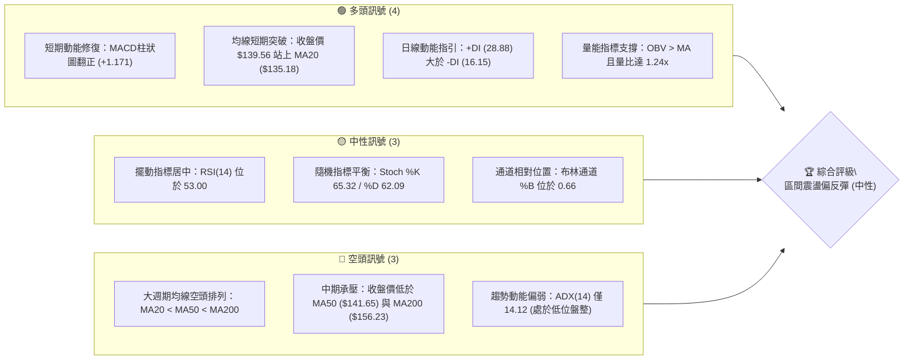
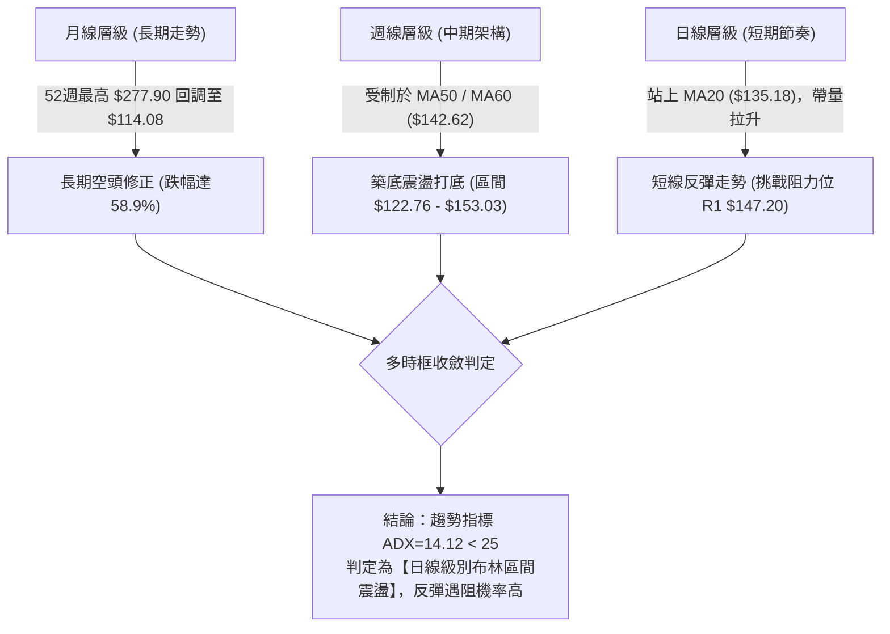
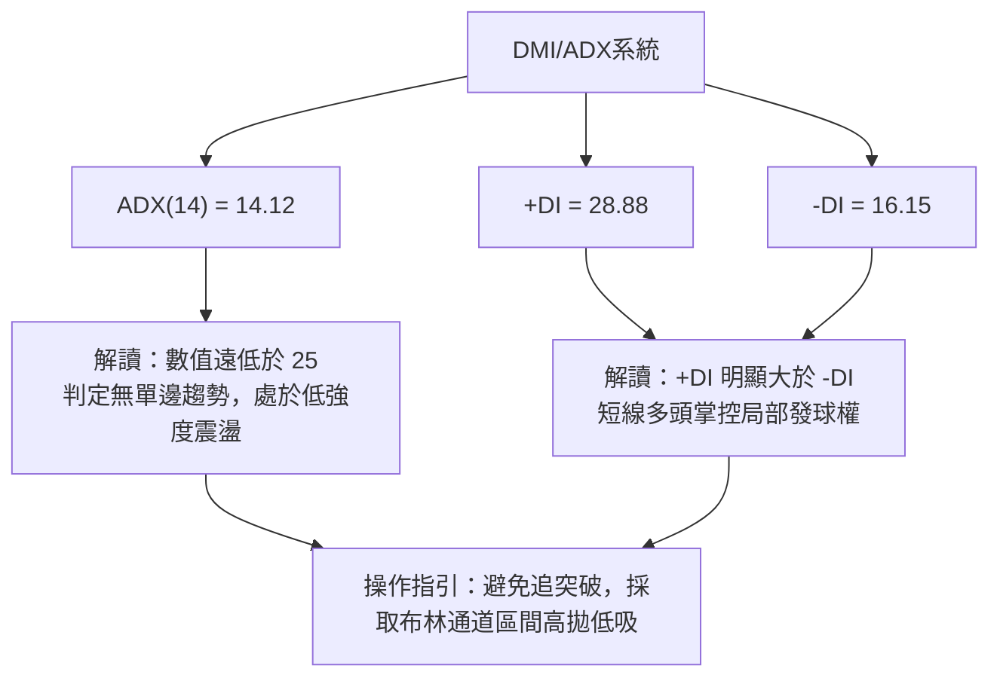
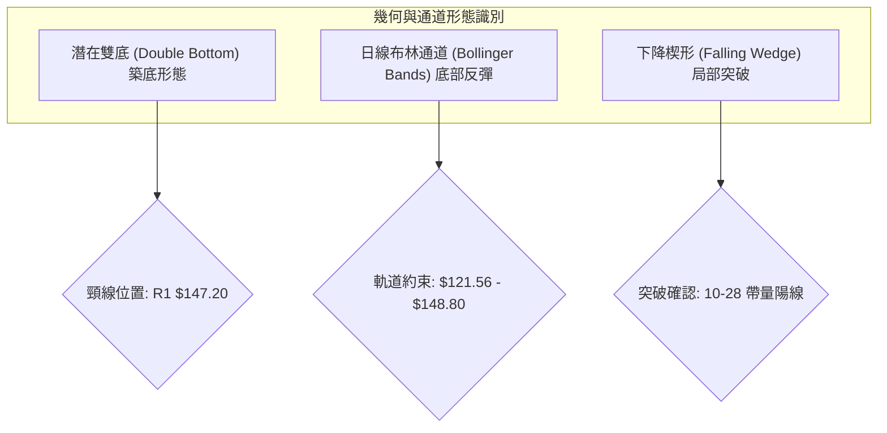
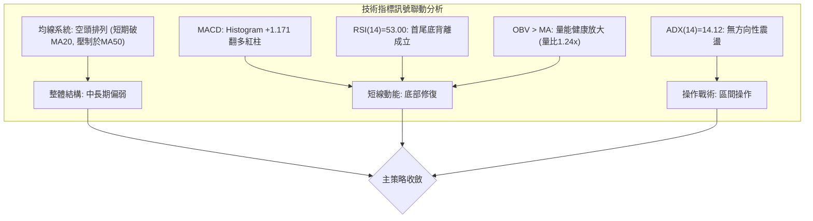
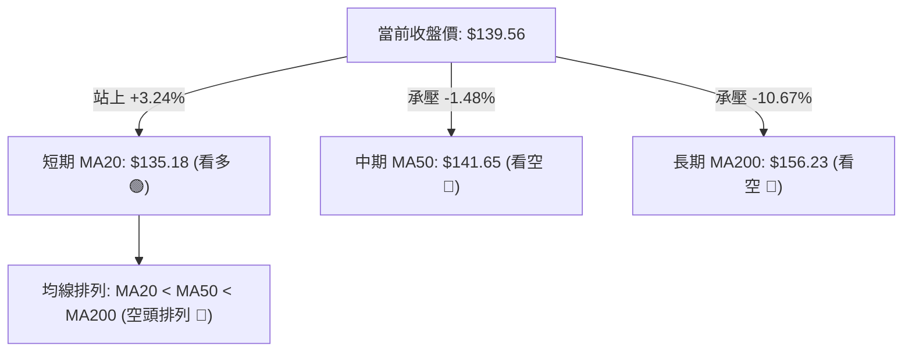
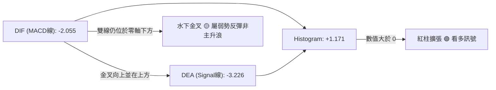
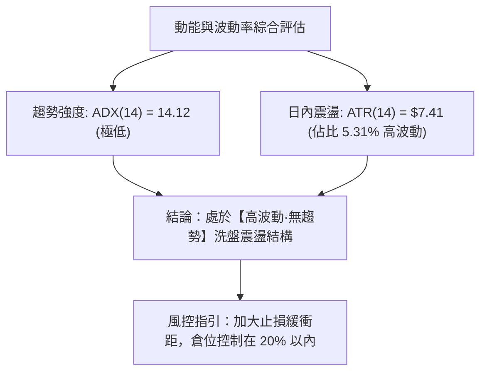
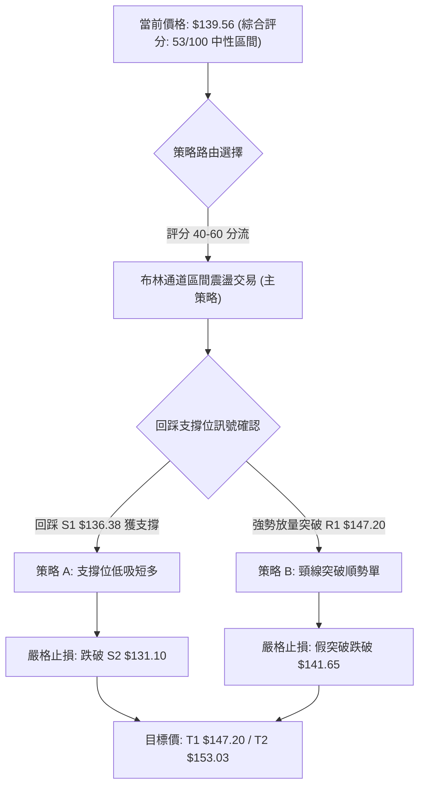
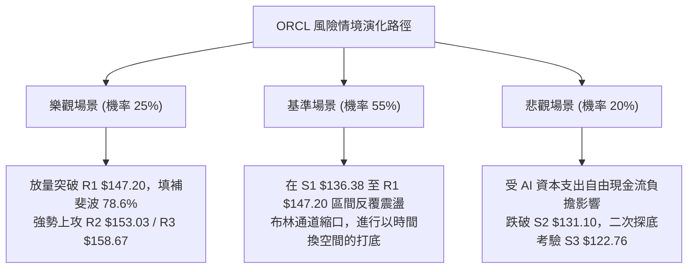

# ORCL 技術分析報告

> **報告日期**：2026-10-30 ｜ **語言**：繁體中文 ｜ **數據來源**：Yahoo Finance ｜ **當前價格**：$139.56

---

## 目錄

| 章節 | 內容 |
|------|------|
| [1. 技術面概覽](#1-技術面概覽) | 訊號儀表板、核心指標、評分卡 |
| [2. 趨勢分析](#2-趨勢分析) | 多時框趨勢、長中短期走勢 |
| [3. 圖表形態分析](#3-圖表形態分析) | 形態識別、K線組合、目標價 |
| [4. 支撐與阻力](#4-支撐與阻力) | 關鍵價位、斐波那契回調 |
| [5. 技術指標深度解讀](#5-技術指標深度解讀) | MA/RSI/MACD/布林/成交量 |
| [6. 動能與波動率](#6-動能與波動率) | 動能評估、ATR、Beta |
| [7. 多時框架總結](#7-多時框架總結) | 時框架評分矩陣 |
| [8. 交易策略建議](#8-交易策略建議) | 多空策略、風險報酬比 |
| [9. 風險提示與監控](#9-風險提示與監控) | 監控指標、風險場景 |
| [📋 報告總結](#-報告總結) | 核心結論與策略速查 |

---

## 1. 技術面概覽

### 🎯 技術訊號儀表板



### 📊 核心指標速覽表

| 指標類別 | 指標名稱 | 當前數值 | 訊號 | 解讀 |
|----------|----------|----------|------|------|
| **價格** | 當前收盤價 | $139.56 | 🟡 | 位於52週區間15.6%低位，自低檔反彈但中期仍受制 |
| **均線** | 短期 MA20 | $135.18 | 🟢 | 價格站上MA20（上方+3.24%），短期具備反彈動能 |
| **均線** | 中期 MA50 | $141.65 | 🔴 | 價格位於MA50下方（-1.48%），中期多空分水嶺承壓 |
| **均線** | 長期 MA200| $156.23 | 🔴 | 價格遠在長期均線下方（-10.67%），長期架構偏空 |
| **動能** | RSI(14)  | 53.00   | 🟡 | 處於中性溫和區間，近20根K棒首尾呈現底背離提示 |
| **動能** | MACD     | -2.055  | 🟢 | 雙線雖在零軸下，但Signal為-3.226，Histogram為+1.171轉多 |
| **動能** | ADX(14)  | 14.12   | 🟡 | 數值低於25，代表缺乏單邊趨勢，屬於震盪盤整行情 |
| **動能** | DMI系統  | +DI 28.88 / -DI 16.15 | 🟢 | 多頭進攻力道短線超越空頭 |
| **通道** | 布林帶   | 上軌 $148.80 / 下軌 $121.56 | 🟡 | %B為0.66，運行於中軌上方，朝上軌推進 |
| **波動** | ATR(14)  | $7.41   | 🔴 | 佔股價5.31%，日內波動劇烈，風控止損距需拉寬 |
| **量能** | 20日量比 | 1.24x   | 🟢 | 最新量3,906.75萬股超越20日均量，OBV支撐價格反彈 |

### 🏆 技術評分卡

```
╔══════════════════════════════════════════════════════════════════════╗
║                    技術評分卡 — ORCL (2026-10-30)                   ║
╠══════════════════════════════════════════════════════════════════════╣
║ 趨勢強度      ███████░░░░░░░░░░░░░  35/100  🔴 ADX=14.12 趨勢極弱   ║
║ 動能指標      ████████████░░░░░░░░  60/100  🟢 MACD翻正、RSI底背離 ║
║ 支撐穩定度    ██████████████░░░░░░  70/100  🟢 S1/S2形成穩固雙重底  ║
║ 成交量配合    █████████████░░░░░░░  65/100  🟢 量比1.24x、OBV向上   ║
║ 形態完整度    ████████████░░░░░░░░  60/100  🟡 W底築底中，待破頸線  ║
║ 均線排列      ██████░░░░░░░░░░░░░░  30/100  🔴 MA20<MA50<MA200空排  ║
╠══════════════════════════════════════════════════════════════════════╣
║ 綜合評分      ███████████░░░░░░░░░  53/100  🟡 區間震盪（中性觀望） ║
╚══════════════════════════════════════════════════════════════════════╝
```
*(註：綜合評分由六項子評分算術平均：(35 + 60 + 70 + 65 + 60 + 30) ÷ 6 = 53.33，四捨五入為 53/100)*

---

## 2. 趨勢分析

### 🌐 多時框趨勢分析



### 📈 長期趨勢 — 12個月走勢圖（Unicode）

```
ORCL 過去12個月價格走勢圖（2025-11 至 2026-10）
價格軸 ($)
$280 ┤
$260 ┤
$240 ┤                              ●(2026-05: $224.17)
$220 ┤
$200 ┤●(2025-11: $199.28)
$180 ┤  ●(2025-12: $192.34)
$160 ┤    ●(2026-01: $162.84)        ●(2026-04: $160.24)
$140 ┤      ●        ●(2026-03: $145.55)    ●(2026-06: $145.50)  ●(2026-08: $148.57)    ●←現價 $139.56
$120 ┤       (2026-02: $143.86)                  ●(2026-07: $129.39)      ●(2026-09: $136.79)
     └──────────────────────────────────────────────────────────────────────────
       11   12   01   02   03   04   05   06   07   08   09   10  (月份)
```

**走勢特徵分析表格**：

| 階段區間 | 起止月份 | 價格變化 ($) | 漲跌幅 (%) | 走勢特徵解讀 |
|----------|----------|--------------|------------|--------------|
| 第一階段 | 2025-11 → 2026-02 | $199.28 → $143.86 | -27.81% | 主跌浪延續，跌破多條長期均線，機構減倉 |
| 第二階段 | 2026-03 → 2026-05 | $145.55 → $224.17 | +54.02% | 劇烈反彈浪，受AI資本支出預期推動，但後續動能無以為繼 |
| 第三階段 | 2026-06 → 2026-07 | $145.50 → $129.39 | -11.07% | 斷崖式跳空下挫，7月觸及52週極低點 $114.08，資本支出引發負自由現金流恐慌 |
| 第四階段 | 2026-08 → 2026-10 | $148.57 → $139.56 | -6.06%  | 低檔L型震盪築底，波動收斂，進入區間壓縮期 |

### 📊 中期趨勢（週線分析）

週線層級顯示，自 2026-07-24 觸及波段低點 $114.57 確立以來，走勢呈現兩段式低點抬高的築底特徵。近8週的高點由 2026-09-11 的 $170.07 降至 2026-10-29 週的 $148.48，而波段低點由 2026-10-23 的 $122.76 快速拉起至現價 $139.56。

```
週線級別價格壓力與支撐結構
阻力區間: $153.03 (R2 - 9月反彈頸線) ─────────────────────────
阻力區間: $147.20 (R1 - 近期週K波段高點密集區) ═════════════════
現價水位: $139.56 --------------------------------------------- ◄ 處於反彈中段
支撐區間: $131.10 (S2 - 10月初平台低點) ═══════════════════════
支撐區間: $122.76 (S3 - 10月22日波段最低點) ───────────────────
```

### ⚡ 趨勢強度評估（ADX 解讀）



| 指標名稱 | 實際數值 | 門檻區間 | 強度解讀 |
|----------|----------|----------|----------|
| ADX(14)  | 14.12    | < 20     | 極弱趨勢 / 典型無趨勢橫盤整理 |
| +DI      | 28.88    | > 25     | 多頭進攻力道短線充沛 |
| -DI      | 16.15    | < 20     | 空頭砸盤動能暫時退潮 |
| 綜合評判 | 震盪偏多 | ADX<25   | **非趨勢行情**，受規約第14條約束，以日線布林通道 ($121.56 - $148.80) 為主戰場 |

---

## 3. 圖表形態分析

### 🔍 形態識別系統



**圖表形態信心度表格**：

| 形態名稱 | 信心度 | 判斷依據（嚴格引用歷史數據） | 完成度 | 目標價（附計算式） |
|----------|--------|------------------------------|--------|--------------------|
| 雙底形態 (W底) | 65% | 第一次低點 2026-10-16 收 $128.23，第二次低點 2026-10-22 最低 $122.76（符合S3支撐），隨後快速回升 | 75% | 頸線 R1 $147.20 − 底部 S3 $122.76 = 形態高 $24.44。<br/>突破目標 = 頸線 $147.20 + $24.44 = **$171.64** (若未突破則視為無效) |
| 布林通道中軌突破 | 85% | 10-28 收盤價 $144.54 強勢站上布林中軌 MA20 ($135.18)，當前收 $139.56 仍位於中軌之上 | 100% | 通道上軌目標價 = **$148.80** |
| 下降旗形/楔形整理 | 45% | 近2個月波段高點下移，但因成交量不規則波動，幾何結構欠缺對稱性 | 40% | 訊號不足，僅做指標型解讀（規則 15） |

### 🕯️ 重要K線形態分析

依據規則 19，嚴格採用數據中提供的近10根日K與近8根週K實際數據進行解讀：

| 日期（時框） | 開盤價 | 最高價 | 最低價 | 收盤價 | K線形態名稱 | 技術解讀 | 訊號 |
|--------------|--------|--------|--------|--------|-------------|----------|------|
| 2026-10-22 (日) | 126.35 | 127.94 | 122.76 | 125.54 | 探底長下影小陰線 | 下測 S3 $122.76 湧現承接買盤，下影線長達 $2.78 | 🟢 |
| 2026-10-26 (日) | 126.06 | 127.99 | 123.75 | 126.06 | 墓碑/十字星線 | 開收盤同價於 $126.06，空頭下殺無力，多空達動態平衡 | 🟡 |
| 2026-10-27 (日) | 126.88 | 132.34 | 126.86 | 130.53 | 光腳實體陽線 | 開盤即為最低，多頭全面反攻，收盤站上 $130.00 關卡 | 🟢 |
| 2026-10-28 (日) | 131.32 | 148.48 | 128.38 | 144.54 | 帶量突破長陽線 | 8,193萬股爆量突破 MA20，高點觸及 $148.48 逼近布林上軌 | 🟢 |
| 2026-10-29 (日) | 144.14 | 144.61 | 136.59 | 139.56 | 獲利回吐中陰線 | 遭遇 MA50 ($141.65) 反壓，成交量降至3,906萬股，屬健康洗盤 | 🟡 |
| 2026-10-16 (週) | 141.56 | 144.18 | 127.36 | 128.23 | 週線中陰線 | 實體下挫跌破 $130，確立空頭回踩波段支撐 | 🔴 |
| 2026-10-23 (週) | 130.66 | 134.35 | 122.76 | 126.16 | 週線錘頭下影線 | 最低見 $122.76 後拉回，週成交量萎縮至1.32億股，賣壓衰竭 | 🟢 |
| 2026-10-29 (週) | 126.06 | 148.48 | 123.75 | 139.56 | 週線反包大陽線 | 單週振幅達 $24.73，形成單棒吞噬前週實體之強勢多頭反擊 | 🟢 |

### 📉 ASCII 走勢形態示意圖

```
日線級別「雙重底（W底）」與突破回踩示意圖
價格 ($)
$148.48 ┤                  ● (10-28 突破高點)
$147.20 ┤- - - - - - - - - - - - - - - - - - - - - - - - 頸線阻力 (R1)
$144.54 ┤                ╱ ╲
$139.56 ┤               ╱   ● (現價 10-29 回踩蓄勢)
$136.38 ┤- - - - - - - ╱ - - - - - - - - - - - - - - - - 支撐 (S1)
$130.53 ┤      ●      ╱
$128.23 ┤     ╱ ╲    ╱
$125.54 ┤    ╱   ╲  ╱  
$122.76 ┤   ●     ●     (左底 10-16: $127.36 / 右底 10-22: $122.76)
         └──────────────────────────────────────
           10-16  10-20  10-22  10-26  10-28  10-29 (日期)
```

### 🎯 形態目標價計算

根據日線雙底結構（信心度 65%）進行理論測幅計算：
1. **基底支撐價位**：取第二隻腳極低點 $122.76（亦即官方支撐點聚類 S3）。
2. **頸線確認價位**：取日線形態高點聚類 R1 = $147.20。
3. **形態垂直高度**：$147.20 − $122.76 = **$24.44**。
4. **理論突破目標價**：
   $$\text{雙底測幅目標價} = \text{頸線價位} + \text{形態高度} = \$147.20 + \$24.44 = \$171.64$$
5. **現實路徑檢驗**：由於前方存在長期均線壓力 MA200 ($156.23) 以及強阻力 R3 ($158.67)，在上漲到達理論測幅 $171.64 之前，價格必然在 $147.20 至 $158.67 面臨極度嚴峻的換手考驗。

---

## 4. 支撐與阻力

### 🗺️ 關鍵價位分布圖（Unicode）

```
ORCL 價位結構分布圖 (嚴格引用 OHLCV 聚類計算數據)
═══════════════════════════════════════════════════════════════════
$158.67 ║██████████████████████████████║ 強阻力 R3 (波段高點/近MA120)
$156.23 ║▓▓▓▓▓▓▓▓▓▓▓▓▓▓▓▓▓▓▓▓▓▓        ║ 長期生命線 MA200 反壓
$153.03 ║████████████████████          ║ 阻力 R2 (9-25 週高點聚類)
$148.80 ║▒▒▒▒▒▒▒▒▒▒▒▒▒▒▒▒▒▒            ║ 布林通道上軌壓力
$147.20 ║██████████████████████████████║ 關鍵阻力 R1 (頸線/10-28高點聚類)
$141.65 ║──────────────────────────────║ 中期均線 MA50 阻速線
$139.56 ╠══════════════════════════════╣ ◄ 當前收盤價位
$136.38 ║▓▓▓▓▓▓▓▓▓▓▓▓▓▓▓▓▓▓▓▓          ║ 近期支撐 S1 (10-29最低點聚類)
$135.18 ║┄┄┄┄┄┄┄┄┄┄┄┄┄┄┄┄┄┄┄┄┄┄┄┄┄┄┄┄║ 布林中軌 / MA20 動態支撐
$131.10 ║████████████████████████      ║ 強支撐 S2 (10-02 週低點/10-20低點)
$122.76 ║██████████████████████████████║ 鐵底支撐 S3 (10-22 波段最低點)
$121.56 ║▒▒▒▒▒▒▒▒▒▒▒▒▒▒▒▒              ║ 布林通道下軌極限
═══════════════════════════════════════════════════════════════════
```

### 🚧 阻力位分析表

依據規則 13，本分析嚴格採用數據提供之波段高點聚類數值：

| 阻力級別 | 準確價位 | 距現價幅寬 | 形成原因與結構強度 | 突破難度 | 重要性 |
|----------|----------|------------|--------------------|----------|--------|
| **R1** | **$147.20** | +5.48% | 近一年波段高點聚類；10-28日最高觸及 $148.48 遭空頭反撲回落，此處為日線W底頸線所在 | 中等偏高 | 🔴 核心生命線 |
| **R2** | **$153.03** | +9.65% | 2026-09-25 週K高點密集聚類；接近 MA120 ($154.16) 密集籌碼解套套牢區 | 高 | 🟡 波段轉折點 |
| **R3** | **$158.67** | +13.70%| 2026-09-04 週K衝高點 $158.19 聚類；重疊長期均線 MA200 ($156.23) | 極高 | 🔴 多空牛熊分水嶺 |

### 🛡️ 支撐位分析表

依據規則 13，本分析嚴格採用數據提供之波段低點聚類數值：

| 支撐級別 | 準確價位 | 距現價幅寬 | 形成原因與結構強度 | 守住機率 | 重要性 |
|----------|----------|------------|--------------------|----------|--------|
| **S1** | **$136.38** | -2.28% | 2026-10-29 當日回踩低點聚類 ($136.59)；重合布林中軌 MA20 ($135.18) | 70% | 🟢 短線防守位 |
| **S2** | **$131.10** | -6.07% | 2026-10-02 週K低點聚類；10-20 與 10-27 兩度下探測試確認之平台支撐 | 85% | 🟢 中期強防線 |
| **S3** | **$122.76** | -12.04%| 2026-10-22 當日最低點聚類；下半年次低點，跌破將引發向 52W 低點 $114.08 崩跌 | 95% | 🔴 波段鐵底 |

### 📐 斐波那契回調位分析

依據 52 週絕對高低點區間（$114.08 → $277.90）計算回調體系：

| 斐波那契比例 | 計算價位 | 當前相對位置 | 技術意涵解讀 |
|--------------|----------|--------------|--------------|
| 0.0% (52W High) | $277.90 | 現價在其下方 -49.78% | 歷史牛市頂峰，強烈套牢盤存續區間 |
| 23.6% | $239.24 | 現價在其下方 -41.66% | 超級牛市回調支撐（已被實體跌破） |
| 38.2% | $215.32 | 現價在其下方 -35.18% | 2026-05 反彈頂點 ($224.17) 承壓區 |
| 50.0% | $195.99 | 現價在其下方 -28.79% | 多空中樞軸心點，長線估值修正平衡線 |
| 61.8% | $176.66 | 現價在其下方 -21.00% | 黃金分割防守位（失守確認長期走熊） |
| **78.6%** | **$149.14** | **現價在其下方 -6.42%** | **極限回調阻力位，緊密共振 R1 ($147.20) 與布林上軌 ($148.80)** |
| **100.0% (52W Low)**| **$114.08** | **現價在其上方 +22.34%** | **年度絕對鐵底，2026-07-24 觸及 $114.57 確立啟動反彈** |

**位置解讀**：
當前收盤價 **$139.56** 精確運行於 **斐波那契 78.6% ($149.14)** 與 **100.0% ($114.08)** 兩大極端位之間。此區間屬於「深度折價修復帶」。由於價格處於 52 週低檔 15.6% 分位，向上面臨 78.6% 回調位 $149.14 的巨大天花板壓制，該位置與 R1 ($147.20) 形成雙重阻力壁壘。

---

## 5. 技術指標深度解讀

### 🎛️ 指標訊號總覽



### 📈 移動平均線排列分析



| 均線名稱 | 當前價位 | 乖離幅度 (%) | 走勢特徵 | 訊號 |
|----------|----------|--------------|----------|------|
| MA 5     | $133.37  | +4.64%       | 急速抬頭，近5日均線短多確立 | 🟢 |
| MA 10    | $131.05  | +6.50%       | 翻揚向上，提供短線下檔支撐 | 🟢 |
| MA 20    | $135.18  | +3.24%       | 走平回升，價格突破中軌轉強 | 🟢 |
| MA 50    | $141.65  | -1.48%       | 持續下行，構成反彈首道重壓 | 🔴 |
| MA 60    | $142.62  | -2.15%       | 季線下彎，中期空頭防守線 | 🔴 |
| MA 120   | $154.16  | -9.47%       | 半年線空頭壓制，乖離仍大 | 🔴 |
| MA 200   | $156.23  | -10.67%      | 長期牛熊線下傾，格局定調偏空 | 🔴 |
| MA 240   | $163.37  | -14.58%      | 年線高懸，長期修正未除 | 🔴 |

### 📉 RSI(14) 分析

當前 Wilder RSI(14) 讀數為 **53.00**，處於中性平衡區間（30–70）。

```
RSI(14) 當前水平: 53.00
超賣 (0-30)          中性平衡區 (30-70)                 超買 (70-100)
├──────────────┼─────────────────●───────────────┼──────────────┤
0             30                53.00           70            100
[█████████████████████████████░░░░░░░░░░░░░░░░░░░░] 53%
```

**背離深度檢驗**：
- **底背離判定**：**成立 🟢**。
- **數據佐證**：檢視近20根日K首尾，前期價格於 2026-10-22 創下收盤波段低點 $125.54（最低 $122.76），而最新收盤價推升至 $139.56；在價格尋底震盪期間，RSI 自 10月中旬低檔（週線 10-16 的 40.0 與 10-23 的 39.4）強勢拉升至當前的 53.00。低點抬高伴隨 RSI 動能指標的快速斜率上穿，形成標準的「底背離（Bullish Divergence）」，預示空頭砸盤力量耗竭，短線多頭修復行情確立。

### 📊 MACD(12/26/9) 訊號解讀



- **MACD 指標數值**：DIF = -2.055，Signal = -3.226，Histogram = **+1.171**。
- **解讀**：DIF 於水下由下往上穿越 Signal 線形成水下黃金交叉，Histogram 翻正至 +1.171，顯示賣壓顯著減輕。但因雙線均在零軸（0.00）下方運行，歷史經驗顯示水下金叉多屬波段空頭格局下的「技術性抽頭反彈」，若要演變為中級多頭行情，DIF 必須帶量站上零軸。

### 📦 布林通道分析

```
日線布林通道 (20, 2) 結構分布示意圖
價格 ($)
$148.80 ┤-------------------------------------- 布林上軌 (阻力)
        │                            ╭───
$144.54 ┤                ● (10-28 陽線)
$139.56 ┤                 ╲  ● (現價 %B = 0.66)
$135.18 ┤------------------●------------------- 布林中軌 (MA20支撐)
        │            ╭────╯
$125.54 ┤          ● (10-22 觸底)
$121.56 ┤-------------------------------------- 布林下軌 (支撐)
```

- **布林通道數據**：
  - 上軌：**$148.80**
  - 中軌 (MA20)：**$135.18**
  - 下軌：**$121.56**
  - 通道寬度 (Bandwidth)：($148.80 − $121.56) ÷ $135.18 = **20.15%**
  - 當前位置 %B：**0.66**（位於中軌與上軌之間）
- **技術解讀**：股價在 10-22 回踩下軌附近後獲得強大買盤，10-28 帶量突破中軌 $135.18，當前收在 $139.56。根據布林通道常態分佈特性，通道在 20% 寬度下未見開口單向擴張，因此價格將在 **中軌 $135.18 與 上軌 $148.80 之間進行區間運動**。

### 💹 成交量分析（量價配合度）

1. **量能指標數據**：
   - 最新成交量：**39,067,500 股**
   - 20日均量：**31,388,810 股**（量比：**1.24x** 🟢）
   - 50日均量：**30,707,826 股**
2. **OBV (能量潮) 趨勢**：
   - 官方數據確認：**OBV > MA → 量能支撐上漲** 🟢。
3. **量價微觀解讀**：
   - 2026-10-28 日K暴漲至 $144.54 時，成交量急遽放大至 **81,933,800 股**（為均量的 2.6 倍），顯示有主力級別機構資金於低檔回補。
   - 2026-10-29 出現中陰線回調至 $139.56，成交量迅速回落至 **39,067,500 股**，呈現標準的「漲時放量、跌時縮量」多頭蓄勢量價特徵。

---

## 6. 動能與波動率

### ⚡ 動能評估四象限

| 象限 | 動能維度 | 波動維度 | 當前狀態評估 | 策略意涵 |
|------|----------|----------|--------------|----------|
| **Q1 (高動能·低波動)** | 強 (>50) | 低 (<4%) | ── | 穩健單邊趨勢，主升浪持有 |
| **Q2 (低動能·低波動)** | 弱 (<50) | 低 (<4%) | ── | 沉悶築底期，流動性枯竭 |
| **Q3 (高動能·高波動)** | 強 (>50) | 高 (>5%) | ── | 突破爆發期，投機追漲情緒濃 |
| **Q4 (弱動能·高波動)** | **弱 (ADX=14.12)** | **高 (ATR=5.31%)** | **✓ ORCL 處於此象限** | **高洗盤風險區：避免追價，以區間逆勢高拋低吸為主** |



### 📊 ATR 波動率分析

- **ATR(14) 數值**：**$7.41**（佔股價比例高達 **5.31%**，Wilder 演算法）。
- **波動特徵解讀**：ORCL 單日平均真實波幅高達 $7.41，意味著日內經常出現 ±$7 以上的劇烈拉鋸（如 10-28 日內自 $128.38 暴拉至 $148.48，單日震幅逾 $20）。
- **止損距離建議**：
  - 超短線交易（1.0 × ATR）：止損距為 **$7.41**。
  - 波段交易（1.5 × ATR）：止損距為 **$11.12**。
  - 結論：任何緊貼進場價（如 $2–$3）的過窄止損極易被日內噪聲洗出場，進場點必須嚴格等待拉回支撐位。

### 📐 Beta 與市場相關性

- **Beta 係數**：**1.77** 🔴。
- **市場風險特徵**：Beta 達 1.77 顯示 ORCL 具備極高的市場敏感度。當標普500指數波動 1% 時，ORCL 理論上將同向波動 1.77%。在科技股大盤回調或 AI 基礎設施板塊資本支出遭到質疑之際，該股將承受放大版的回撤壓力。

---

## 7. 多時框架總結

### 📋 時框架評分表

| 時框架 | 趨勢方向 | 動能狀態 | 均線排列 | 形態特徵 | 綜合評分 | 操作建議 |
|--------|----------|----------|----------|----------|----------|----------|
| **月線 (長期)** | 🔴 偏空 | 弱（52W低位） | 空頭排列 (MA200下方) | 大雙頂破位後回撤 | 30/100 | 長期資產配置宜減持觀望 |
| **週線 (中期)** | 🟡 震盪 | 中性偏多 (底背離) | 承壓於週MA50 | 低檔大箱體築底 | 50/100 | 箱體區間內高拋低吸 |
| **日線 (短期)** | 🟢 偏多 | 強 (MACD金叉) | 突破MA20，測試MA50 | 局部雙底成形回踩中 | 65/100 | 回踩 S1 逢低做多 |

### 🔲 綜合訊號矩陣

| 維度指標 | 短期 (日線) | 中期 (週線) | 長期 (月線) | 訊號衝突判定與對沖權衡 |
|----------|-------------|-------------|-------------|------------------------|
| **均線架構** | 🟢 站上 MA20 | 🔴 受制 MA50 | 🔴 遠低 MA200 | 短期反彈受制於長期均線蓋頂 |
| **動能指標** | 🟢 MACD柱+1.171 | 🟢 週底背離翻紅 | 🔴 長期動能衰減 | 短中期反彈動能正在釋放 |
| **支撐阻力** | 🟢 站穩 S1 $136.38 | 🟡 震盪於S2/R2間 | 🔴 承壓於斐波78.6% | 上方阻力重重，反彈空間受限 |
| **量能特徵** | 🟢 量比 1.24x | 🟡 週成交量平緩 | 🔴 跌波帶量漲波縮量 | 需持續補量方能克服 R1 阻力 |

### ⚖️ 多時框收斂結論

> **唯一方向性結論：中性觀望（定義為日線布林通道區間操作，偏反彈短多）**

**嚴格依據規約第 14 條收斂邏輯**：
1. **行情屬性判定**：當前 ADX(14) 讀數為 **14.12**（遠小於 25 臨界值），**確立目前市場處於「盤整行情」而非趨勢行情**。
2. **優先級收斂原則**：規約第 14 條明確規定：「*盤整行情（ADX<25）：以日線布林通道上下軌為主要交易區間*」。
3. **多空權衡**：雖然週線與月線均線呈現空頭排列（MA200 下方），但因日線級別 MACD 出現水下金叉翻多、RSI 形成日線底背離、且價格帶量重回布林中軌 MA20 ($135.18) 之上，短期空頭不宜盲目追空；但上方同時存在 MA50 ($141.65) 與 R1 ($147.20) 重壓。
4. **收斂總結**：短期操作嚴禁以突破單追高，應將 ORCL 視為 **布林通道中下軌 ($135.18 - $136.38) 至 上軌 ($147.20 - $148.80) 的箱體震盪行情**，主策略定調為**區間偏多操作**。

---

## 8. 交易策略建議

### 🗺️ 策略決策流程圖



### 🧭 策略路由

> **當前主策略方向 = 中性區間操作（震盪偏多反彈）（依技術評分卡：53/100）**

依據規則，綜合評分為 53/100（介於 40–60 之間），主策略**嚴禁單邊豪賭**，必須以「布林通道上下軌為界」進行區間網格或支撐低吸。

### 🎯 價格情境階梯（Price Scenarios）

價位嚴格引用第四章關鍵價位計算數值：

| 觸發條件 | 下一目標 | 後續延伸 | 情境含義 |
|----------|----------|----------|----------|
| **向上突破 R1 $147.20** | **R2 $153.03** | **R3 $158.67** | 日線雙底形態確立，短期轉為多頭進攻 |
| **站穩現價 $139.56** | **BB上軌 $148.80** | **R1 $147.20** | 區間多頭反彈延續，測試布林通道頂部 |
| **跌破 S1 $136.38** | **S2 $131.10** | **S3 $122.76** | 短線反彈宣告夭折，重回大箱體下沿尋底 |

### 📊 情境機率分佈

| 情境類別 | 發生機率 | 主要技術依據（引用數據指標） |
|----------|----------|------------------------------|
| **區間震盪反彈 (情境一)** | **55%** | ADX=14.12 確立震盪，MACD柱狀圖翻正(+1.171)，價格穩守布林中軌 MA20 ($135.18)，OBV量能持續配合上漲。 |
| **承壓回落盤整 (情境二)** | **30%** | 上方遭遇下行中的 MA50 ($141.65) 與斐波那契 78.6% ($149.14) 重壓，且長期均線 MA200 空頭排列打壓反彈空間。 |
| **跌破破位暴跌 (情境三)** | **15%** | 負自由現金流基本面隱憂發酵，若大盤重挫引發 Beta=1.77 乘數下跌，致使跌破 S3 $122.76。 |

### 🟢 主策略詳情

嚴格依據規則 17 計算風險報酬比：`風險報酬比 = (T1 − 進場價) ÷ (進場價 − 止損價)`，進場價若為區間，以**區間中點**計算：

| 策略要素 | 策略 A（回踩支撐低吸單 — 主推） | 策略 B（突破頸線順勢單 — 次選） |
|----------|----------------------------------|----------------------------------|
| **策略類型** | 支撐位回踩逢低做多 | 頸線帶量突破追多 |
| **進場條件** | 價格回踩 S1 與 MA20 獲得支撐不破 | 帶量突破日線雙底頸線阻力 R1 |
| **進場價格** | **$136.38**（取 S1 精確價位） | **$147.20**（取 R1 精確價位） |
| **目標價 T1** | **$147.20**（阻力位 R1） | **$153.03**（阻力位 R2） |
| **目標價 T2** | **$153.03**（阻力位 R2） | **$158.67**（強阻力 R3） |
| **止損價格** | **$131.10**（支撐位 S2，跌破認賠） | **$141.65**（中期 MA50，假突破止損） |
| **風險報酬比** | **1 : 2.05（以 T1 計）**<br/>計算式：($147.20 − $136.38) ÷ ($136.38 − $131.10)<br/>= $10.82 ÷ $5.28 = 2.049<br/>*(另以 T2 計為 1 : 3.15)* | **1 : 1.05（以 T1 計）**<br/>計算式：($153.03 − $147.20) ÷ ($147.20 − $141.65)<br/>= $5.83 ÷ $5.55 = 1.050<br/>*(另以 T2 計為 1 : 2.07)* |
| **成功機率** | **65%** | **45%** |
| **建議倉位** | **15% - 20%**（資金控管） | **10%**（輕倉試單） |

### 🔴 反向風險觸發點（對沖提示）

- **多頭結構推翻觸發位**：若日線收盤價跌破 **S1 $136.38** 且跌破布林中軌 **MA20 $135.18**，多頭反彈動能歸零，所有短多倉位必須無條件離場。
- **波段極端避險位**：若實體日K跌破 **S2 $131.10**，意味著 W底 築底徹底失敗，走勢將直奔鐵底 **S3 $122.76** 甚至考驗 52W 低點 **$114.08**，持有現貨者應在此買入 Put 選擇權進行對沖。

### ⭐ 整體訊號強度評星

```
做多訊號強度：★★★☆☆  (3/5星 — 短期底背離與MACD金叉，具備反彈動能)
做空訊號強度：★★☆☆☆  (2/5星 — 雖然長期偏空，但短線超跌且量能支撐)
整體可信度：  ★★★☆☆  (3/5星 — ADX偏低，處於震盪磨底期，宜嚴守紀律)
```

---

## 9. 風險提示與監控

### ✅ 關鍵監控指標 Checklist

```
╔══════════════════════════════════════════════════════════════════════╗
║                    ORCL 交易風控與指標監控清單                      ║
╠══════════════════════════════════════════════════════════════════════╣
║ [ ] 每日收盤價是否能守穩短期均線 MA20 ($135.18)                     ║
║ [ ] RSI(14) 是否能維持在 50 中軸上方運行（防止重返弱勢區）          ║
║ [ ] MACD Histogram 柱狀圖是否持續擴張（高於 +1.171）               ║
║ [ ] 日成交量是否能維持在 3,138 萬股 (20日均量) 之上                  ║
║ [ ] 向上挑戰 R1 ($147.20) 時，是否出現量價背離或長上影線            ║
║ [ ] 下向下測試 S1 ($136.38) 時，日K收盤是否實體跌破                 ║
║ [ ] ATR 是否突破 $7.41 導致日內破壞性震盪加劇                       ║
╚══════════════════════════════════════════════════════════════════════╝
```

### ⚠️ 風險場景分析



### 🛡️ 風險管理重要提醒

1. **基本面現金流與高負債風險溢價**：
   技術面背後存在不可忽視的財務結構矛盾——雖然最新季度營收增長 29.6%、淨利增長 62.6%，但公司 TTM 自由現金流為 **-$28.72B**（資本支出達 $75.66B 侵蝕現金流），且總負債高達 **$169.14B**（Net Debt -$132.07B）。高槓桿環境下，市場對利率敏感度極高，一旦信用市場收緊，將壓抑估值倍數。
2. **高 Beta 波動懲罰**：
   ORCL 的 Beta 高達 **1.77**，且 ATR 達 **$7.41 (5.31%)**。嚴禁在盤中採用滿倉或高槓桿交易，單筆交易虧損額度必須嚴格鎖定在總資金的 1% 至 1.5% 以內。
3. **無趨勢環境下的紀律執行**：
   ADX(14) 僅 14.12 告訴我們當前**市場毫無單邊趨勢**。此時「追漲殺跌」將面臨兩頭被巴的極高機率。交易者務必遵循「跌到支撐 S1 敢買、漲到阻力 R1 肯賣」的防守型交易哲學。

---

## 📋 報告總結

```
╔══════════════════════════════════════════════════════════════════════╗
║                     ORCL 技術分析報告總結                           ║
╠══════════════════════════════════════════════════════════════════════╣
║ 報告日期：2026-10-30                                                 ║
║ 當前價格：$139.56                                                    ║
║ 分析評級：⚖️ 中性觀望（評分 53/100，定位為布林帶區間震盪）           ║
╠══════════════════════════════════════════════════════════════════════╣
║ 關鍵結論：                                                           ║
║ ├─ 長期趨勢：🔴 弱勢修正（受制於 MA200 $156.23 與空頭均線排列）      ║
║ ├─ 中期趨勢：🟡 箱體築底（運行於 S3 $122.76 至 R2 $153.03 之間）    ║
║ ├─ 短期趨勢：🟢 震盪反彈（站上 MA20 $135.18，MACD紅柱擴張）          ║
║ ├─ 關鍵支撐：S1 $136.38  │  S2 $131.10  │  S3 $122.76              ║
║ ├─ 關鍵阻力：R1 $147.20  │  R2 $153.03  │  R3 $158.67              ║
║ └─ 華爾街共識目標：$235.80 (41位分析師，覆蓋區間 $110.00 - $400.00)  ║
╠══════════════════════════════════════════════════════════════════════╣
║ 最優策略組合：                                                       ║
║ 1. 🥇 最佳機會：策略 A（回踩 S1 $136.38 低吸，止損 S2 $131.10，     ║
║                 目標 R1 $147.20，風報比 1 : 2.05，勝率 65%）         ║
║ 2. 🥈 次選機會：策略 B（帶量突破 R1 $147.20 追買，目標 R2 $153.03，  ║
║                 止損 $141.65，風報比 1 : 1.05，勝率 45%）           ║
║ 3. 🥉 保守選擇：場外觀望，等待日線實體站上 MA50 ($141.65) 並完成     ║
║                 右側確認後再行布局。                                 ║
╚══════════════════════════════════════════════════════════════════════╝
```

---

> ⚠️ **免責聲明**：本報告為技術分析研究，所有技術點位與估算均嚴格基於所提供之歷史 OHLCV 價格數據。本報告**僅供學術研究與投資決策輔助參考**，**不構成任何要約、招攬或具體投資建議**。金融市場瞬息萬變，投資人應獨立評估風險，自負盈虧。

---

*報告生成時間：2026-10-30 ｜ 數據來源：Yahoo Finance ｜ 分析框架：資深多時框技術分析體系*