# ORCL 技術分析報告

> **報告日期**：2026-10-31 ｜ **語言**：繁體中文 ｜ **數據來源**：Yahoo Finance ｜ **當前價格**：$130.67

---

## 目錄

| 章節 | 內容 |
|------|------|
| [1. 技術面概覽](#1-技術面概覽) | 訊號儀表板、核心指標、評分卡 |
| [2. 趨勢分析](#2-趨勢分析) | 多時框趨勢、長中短期走勢 |
| [3. 圖表形態分析](#3-圖表形態分析) | 形態識別、K線組合、目標價 |
| [4. 支撐與阻力](#4-支撐與阻力) | 關鍵價位、斐波那契回調 |
| [5. 技術指標深度解讀](#5-技術指標深度解讀) | MA/RSI/MACD/布林/成交量 |
| [6. 動能與波動率](#6-動能與波動率) | 動能評估、ATR、Beta |
| [7. 多時框架總結](#7-多時框架總結) | 時框架評分矩陣 |
| [8. 交易策略建議](#8-交易策略建議) | 多空策略、風險報酬比 |
| [9. 風險提示與監控](#9-風險提示與監控) | 監控指標、風險場景 |
| [📋 報告總結](#-報告總結) | 總體結論與精華摘要 |

---

## 1. 技術面概覽

### 🎯 技術訊號儀表板

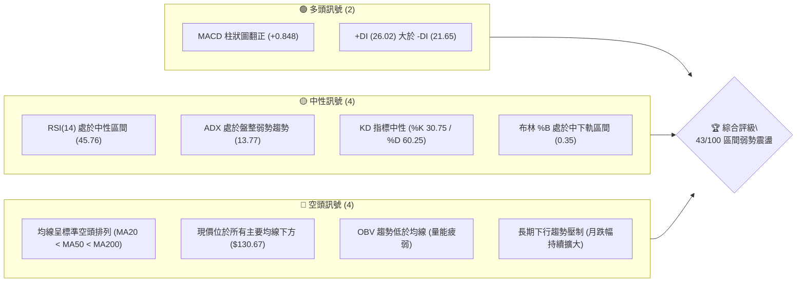

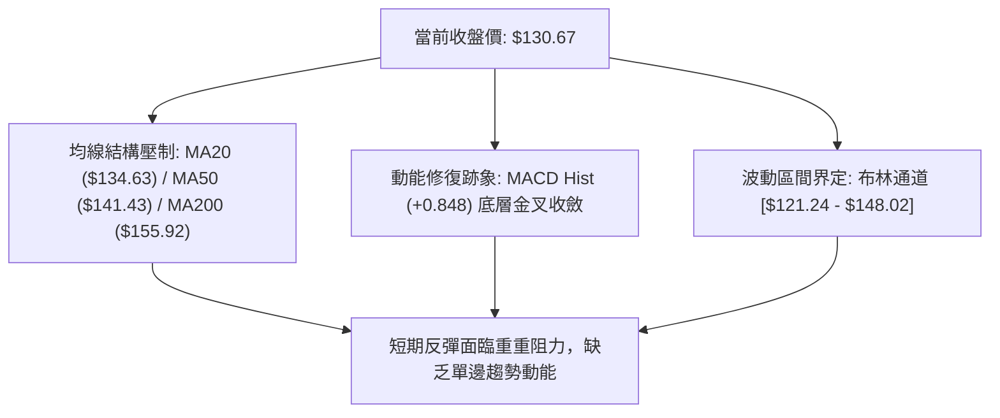

### 📊 核心指標速覽表

| 指標類別 | 指標名稱 | 當前數值 | 訊號 | 解讀 |
|----------|----------|----------|------|------|
| **價格** | 當前收盤價 | $130.67 | 🔴 | 位於 52 週高低區間底部 10.9% 處，走勢極度疲弱 |
| **均線** | MA20 | $134.63 | 🔴 | 價格低於短期均線 2.94%，短線承壓 |
| **均線** | MA50 | $141.43 | 🔴 | 價格低於中期生命線 7.61%，中期下行通道未變 |
| **均線** | MA200 | $155.92 | 🔴 | 價格低於長期牛熊分水嶺 16.19%，長期技術格局偏空 |
| **動能** | RSI(14) | 45.76 | 🟡 | 位於 30–70 中性區間，空方動能減緩但未見強力反撲 |
| **動能** | MACD (12,26,9) | 柱狀圖 +0.848 | 🟢 | DIF (-2.166) 高於 DEA (-3.014)，零軸下黃金交叉延續 |
| **動能** | 隨機指標 Stoch | %K: 30.75 / %D: 60.25 | 🟡 | %K 由高位回落跌破 %D，短線超買修正完畢 |
| **趨勢** | ADX(14) | 13.77 | 🟡 | 數值遠低於 25，表明目前無單邊趨勢，進入無序盤整 |
| **通道** | 布林帶寬 (%B) | 0.35 | 🟡 | 位於下軌 ($121.24) 與中軌 ($134.63) 之間，偏弱運行 |
| **成交量** | 成交量比率 | 1.29x | 🟡 | 最新量 40.98M 高於 20日均量 31.68M，但 OBV 低於均線 |
| **波動** | ATR(14) | $7.64 | 🟡 | 佔現價 5.85%，日常日內波動劇烈，洗盤風險高 |

### 🏆 技術評分卡

```
╔══════════════════════════════════════════════════════════════╗
║              技術評分卡 — ORCL (2026-10-31)                  ║
╠══════════════════════════════════════════════════════════════╣
║ 趨勢強度 (ADX=13.77, 均線下行)  ██████░░░░░░░░░░░░░░  32/100 🔴 ║
║ 動能指標 (MACD翻正, RSI=45.76)   ██████████░░░░░░░░░░  52/100 🟡 ║
║ 支撐穩定度 (S1=$122.76 守穩中)  ███████████░░░░░░░░░  58/100 🟡 ║
║ 成交量配合 (量比1.29x, OBV疲弱) ████████░░░░░░░░░░░░  42/100 🟡 ║
║ 形態完整度 (區間震盪, 築底階段) █████████░░░░░░░░░░░  48/100 🟡 ║
║ 均線排列 (空頭排列 MA20<50<200) █████░░░░░░░░░░░░░░░  26/100 🔴 ║
╠══════════════════════════════════════════════════════════════╣
║ 綜合評分 (六項算術平均四捨五入) ████████░░░░░░░░░░░░  43/100 🟡 ║
║ 評級結論：區間弱勢震盪 (以布林通道與關鍵支撐阻力操作為主)   ║
╚══════════════════════════════════════════════════════════════╝
```

*計算依據：(32 + 52 + 58 + 42 + 48 + 26) ÷ 6 = 258 ÷ 6 = 43.0，四捨五入為 43 分。*

---

## 2. 趨勢分析

### 🌐 多時框趨勢分析

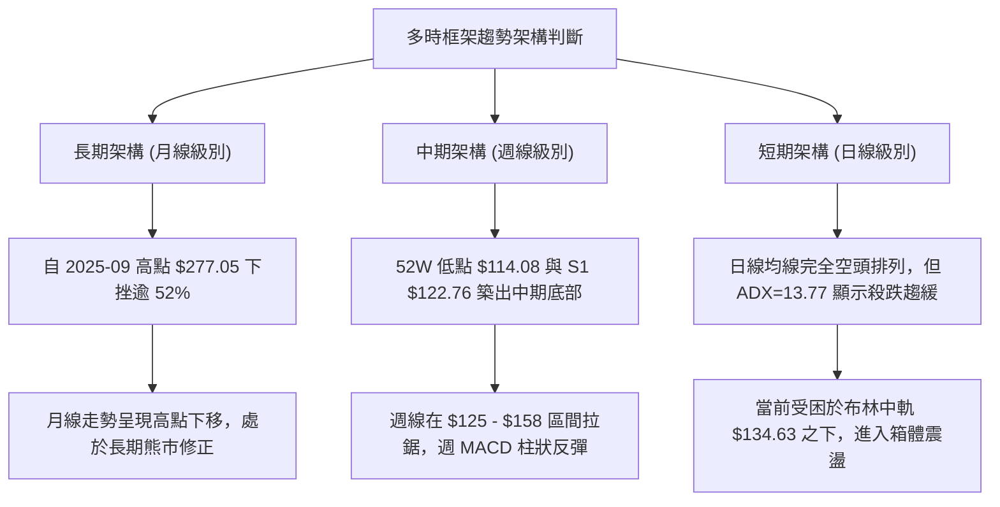

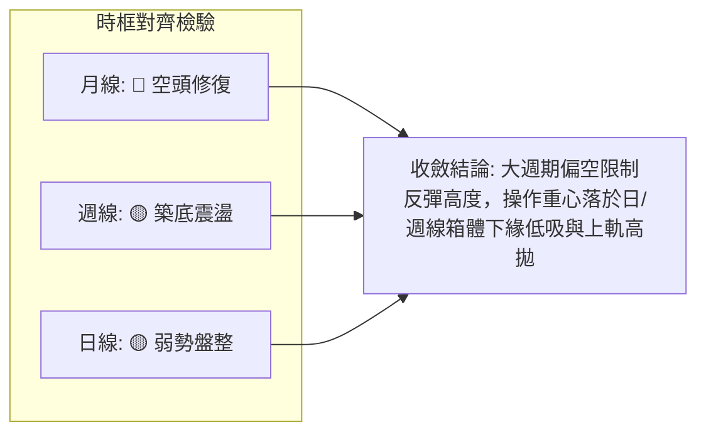

### 📈 長期趨勢 — 12個月走勢圖（Unicode）

以下為 ORCL 過去 12 個月（2025-11 至 2026-10）之月線收盤走勢圖，標注歷史關鍵高低點：

```
ORCL 月線收盤走勢圖（過去12個月：2025-11 至 2026-10）
價格軸 ($)
$240 ┤
$220 ┤                               ● (2026-05 反彈次高: $224.17)
$200 ┤ ● (2025-11: $199.28)
$190 ┤   ● (2025-12: $192.34)
$180 ┤
$160 ┤       ● (2026-01: $162.84)      ● (2026-04: $160.24)
$150 ┤                                   ● (2026-08: $148.57)
$140 ┤           ● (2026-02: $143.86)       ● (2026-06: $145.50)
$130 ┤               ● (2026-03: $145.55)       ● (2026-09: $136.79)  ● (現價 2026-10: $130.67)
$120 ┤                                              ● (2026-07 波段低: $129.39)
     └─┬─────┬─────┬─────┬─────┬─────┬─────┬─────┬─────┬─────┬─────┬─────┬──
     11/25 12/25 01/26 02/26 03/26 04/26 05/26 06/26 07/26 08/26 09/26 10/26
```

#### 走勢特徵分析表格

| 階段區間 | 起止月份 | 價格變化 | 漲跌幅 | 結構特徵與技術解讀 |
|----------|----------|----------|--------|--------------------|
| **第一輪深跌** | 2025-11 → 2026-02 | $199.28 → $143.86 | -27.81% | 承接 2025-09 歷史頂部回落，連續四個月收黑，均線轉空 |
| **春季強反彈** | 2026-02 → 2026-05 | $143.86 → $224.17 | +55.82% | 典型空頭市場中的劇烈反彈（Suckers Rally），未能突破前期高點 |
| **二次跳水** | 2026-05 → 2026-07 | $224.17 → $129.39 | -42.28% | 資金出逃引發懸崖式下跌，7月創下收盤低點 $129.39，並下探年內低點 $114.08 |
| **底部箱體構築** | 2026-07 → 2026-10 | $129.39 → $130.67 | +0.99% | 價格在 $125 - $150 展開長達 4 個月的反覆築底洗盤，波動幅度收窄 |

### 📊 中期趨勢（週線分析）

```
ORCL 週線近期關鍵壓力與支撐示意圖
═════════════════════════════════════════════════════════════════
[阻力 R3]  $158.67 ----------------------------- (2026-09-04 波段高點聚集處)
                   \
[阻力 R2]  $153.03 --\-------------------------- (2026-09-25 週高點壓制)
                      \
[阻力 R1]  $147.20 ----\------------------------ (近一年波段高點聚類/布林上軌附近)
                        \       ▲ (2026-10-28 爆量衝高回落 $148.48)
[現  價]   $130.67 ======\===== | ==============================
                          \     ▼ (拉回震盪測試)
[支撐 S1]  $122.76 --------\-------------------- (2026-10-22 日低 / 10-23 週低點)
                            \
[支撐 S2]  $114.08 ----------\------------------ (52W 絕對低點，強支撐基石)
═════════════════════════════════════════════════════════════════
```

從近 20 週收盤走勢觀察：
1. **收盤低點逐步墊高**：自 2026-07-24 收盤 $114.57 以後，週線收盤價在 10 月中下旬分別守在 $128.23、$126.16 與本週的 $130.67，並未跌破 7 月極端低位。
2. **量價異動確認阻力**：2026-10-30 該週成交量放大至 211,312,200 股，週最高點來到 $148.48（精準碰觸 R1 $147.20 聚類上方），隨後收長上影線收在 $130.67，顯示中期解套賣壓依然沉重。

### ⚡ 趨勢強度評估（ADX 解讀）

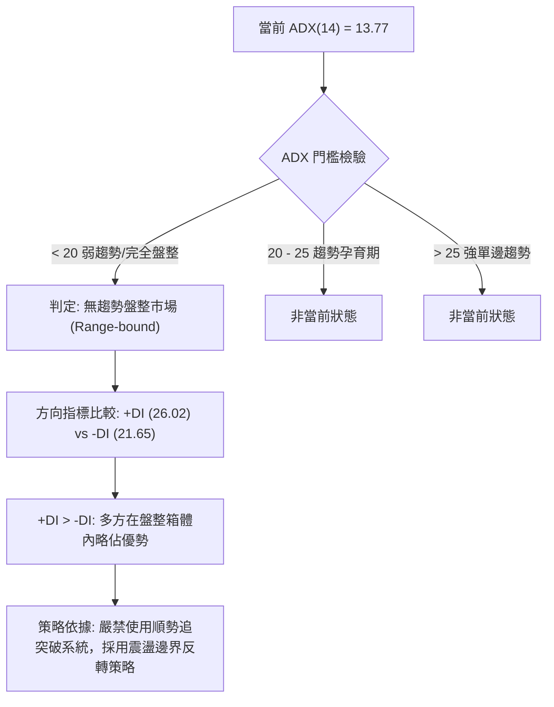

#### ADX 強度標準對照表

| 指標變數 | 當前讀數 | 標準區間定義 | 趨勢屬性判定 | 交易指引 |
|----------|----------|--------------|--------------|----------|
| **ADX** | **13.77** | < 20 (極弱/休眠) | 盤整市（無方向趨勢） | 順勢指標失效，均線易頻繁假突破 |
| **+DI** | **26.02** | 0 – 100 | 多方控盤動能 | 買方在反彈波中具備主動權 |
| **-DI** | **21.65** | 0 – 100 | 空方施壓動能 | 空方殺跌力量已較 7 月大幅退潮 |
| **DI 差值** | **+4.37** | 差值收窄 | 勢均力敵 | 箱體區間未打破前，方向性空間受限 |

---

## 3. 圖表形態分析

### 🔍 形態識別系統

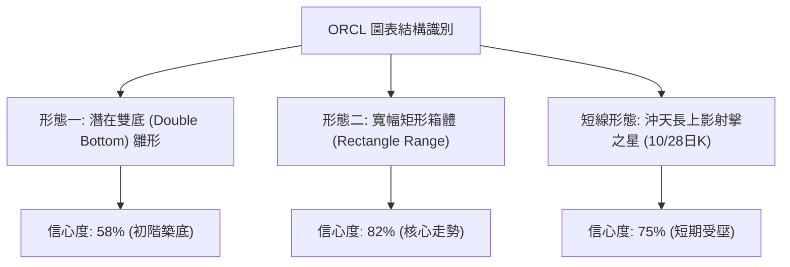

#### 形態識別與信心度評估表

| 形態名稱 | 信心度 | 判斷依據（引用數據） | 完成度 | 目標價（附計算式） |
|----------|--------|----------------------|--------|--------------------|
| **寬幅矩形箱體** | 82% | 股價受限於下軌支撐 S1 ($122.76) 與阻力 R1 ($147.20)，多次在此區間反彈與受阻 | 85% | **箱頂 $147.20**（若向上突破，形態高度 $147.20 - $122.76 = $24.44，量度目標 $147.20 + $24.44 = $171.64，貼近 Fib 61.8% $172.19） |
| **雙重底 (W底)** | 58% | 第一低點為 2026-07 低位 S2 ($114.08)，第二低點為 2026-10-22 日低 S1 ($122.76)，低點墊高 | 45% | **頸線暫定 R1 $147.20**。未正式突破頸線前不可視為完成，完成目標價同上推算至 $171.64 |
| **假突破回洗形態** | 75% | 2026-10-28 爆量 81.93M 觸碰 $148.48 後迅速回吐至 $130.67，形成帶量長上影線 | 100% | **回測下緣目標 $122.76 (S1)** |

### 🕯️ 重要 K 線形態分析

依據提供的「近10根日K」與「近8根週K」實際開高低收數據進行嚴格識別：

#### 近 10 根日 K 線形態解讀

| 日期 | 開盤價 | 最高價 | 最低價 | 收盤價 | 成交量 | K線形態名稱 | 形態特徵與技術解讀 | 訊號 |
|------|--------|--------|--------|--------|--------|-------------|--------------------|------|
| 2026-10-19 | $130.66 | $131.40 | $129.12 | $129.59 | 23,749,200 | 小陰紡錘線 | 實體極小，波動僅 $2.28，市場交投清淡觀望 | 🟡 |
| 2026-10-20 | $128.51 | $134.35 | $127.45 | $131.14 | 26,751,800 | 震盪反彈中陽 | 低開高走，實體收在當日高位區，展現逢低承接買盤 | 🟢 |
| 2026-10-21 | $133.12 | $133.52 | $127.70 | $129.13 | 26,329,100 | 衝高回落小陰 | 高開後未能守住漲幅，收盤跌破開盤價，多頭上攻遇阻 | 🔴 |
| 2026-10-22 | $126.35 | $127.94 | $122.76 | $125.54 | 36,620,100 | 下影長陰探底線 | 盤中殺跌至波段低點 S1 ($122.76)，帶出量能並見下影收復 | 🟡 |
| 2026-10-23 | $124.87 | $128.33 | $124.39 | $126.16 | 19,223,400 | 低位孕線小陽 | 實體完全包含在前一日長黑內部，縮量止跌，賣壓衰竭 | 🟢 |
| 2026-10-26 | $126.06 | $127.99 | $123.75 | $126.06 | 23,008,500 | 十字星 (Doji) | 開盤與收盤完全一致 ($126.06)，多空力量在低位達成完全平衡 | 🟡 |
| 2026-10-27 | $126.88 | $132.34 | $126.86 | $130.53 | 26,026,700 | 啟動陽線 | 脫離底部橫盤區，收盤價突破前四日高點，確認底背離反彈 | 🟢 |
| 2026-10-28 | $131.32 | $148.48 | $128.38 | $144.54 | 81,933,800 | 爆量長上影大陽 | 成交量激增至 81.93M，盤中狂飆至 $148.48 碰觸 R1 阻力後引發暴量拋壓 | 🟡 |
| 2026-10-29 | $144.14 | $144.61 | $136.59 | $139.56 | 39,366,900 | 承壓中陰線 | 跳空開平後一路走低，長上影後的多頭獲利回吐，吞噬前日部分實體 | 🔴 |
| 2026-10-30 | $133.62 | $135.20 | $129.00 | $130.67 | 40,976,300 | 光頭中黑破位線 | 連續第二日下跌，收盤跌破 MA20 ($134.63)，短線衝高動能完全耗盡 | 🔴 |

#### 近 8 根週 K 線形態解讀

| 週截止日 | 開盤價 | 最高價 | 最低價 | 收盤價 | 週成交量 | 週K形態名稱 | 趨勢與架構解讀 | 訊號 |
|----------|--------|--------|--------|--------|----------|-------------|----------------|------|
| 2026-09-11 | $166.98 | $170.07 | $149.29 | $149.73 | 202,390,700 | 斷頭中長陰 | 跌破 $150 關卡，創近期大量拋售 | 🔴 |
| 2026-09-18 | $140.90 | $151.44 | $138.49 | $147.07 | 175,146,100 | 下影長陽星 | 低開高走嘗試抵抗，但高點未能越過前週中點 | 🟡 |
| 2026-09-25 | $148.38 | $153.03 | $132.99 | $136.59 | 156,661,000 | 倒錘長黑線 | 上探阻力 R2 ($153.03) 未果，下挫收在低位 | 🔴 |
| 2026-10-02 | $132.24 | $144.33 | $131.10 | $141.78 | 164,959,800 | 築底反彈大陽 | 週線上漲逾 $5，下檔買盤支撐顯現 | 🟢 |
| 2026-10-09 | $142.00 | $146.40 | $134.16 | $141.40 | 121,793,100 | 高位十字小陰 | 量能急凍至 121M，多空陷入僵持 | 🟡 |
| 2026-10-16 | $141.56 | $144.18 | $127.36 | $128.23 | 167,863,700 | 破位中長黑 | 實體吞噬前兩週低點，空方再次奪取主導權 | 🔴 |
| 2026-10-23 | $130.66 | $134.35 | $122.76 | $126.16 | 132,673,600 | 鎚頭探底線 | 探測波段低點 S1 ($122.76) 後留下逾 $3.4 下影線 | 🟢 |
| 2026-10-30 | $126.06 | $148.48 | $123.75 | $130.67 | 211,312,200 | 暴量倒錘流星線 | 上探阻力 R1 ($147.20) 至 $148.48 後收長上影線，多頭嚴重受阻 | 🔴 |

### 📉 ASCII 走勢形態示意圖

```
ORCL 近期日K線形態走向（2026-10-19 至 2026-10-30）
價格軸 ($)
$148.48 ┤               ▲ (10-28 爆量長針頂部，碰觸 R1 $147.20)
$144.00 ┤               │ █ (10-28 收盤 $144.54)
$140.00 ┤               │ █   █ (10-29 回檔 $139.56)
$136.00 ┤         ▲     │ █   █
$134.63 ┼─────────┼─────┼─┼───┼── [布林中軌 / MA20 阻力線]
$132.00 ┤   ▲     │     │ █   █
$130.67 ┤   │     │ █   │ █   █   █ (10-30 最新收盤 $130.67)
$128.00 ┤ █ │ █   │ █   █ █   █   │
$126.00 ┤ █ █ █   │ │ ┼ █ █   │   │
$124.00 ┤     │ █ │ │ │ │ │   │   │
$122.76 ┼─────┼─┼─┴─┼─┼─┼───┼───┼── [支撐位 S1 聚類線]
        └─────┴───┴───┴───┴───┴───┴──
         10-19 20  21  22  23  26  27  28  29  30 (日K)
```

### 🎯 形態目標價計算

根據已識別的「寬幅矩形箱體」幾何架構，嚴格以提供的數值進行推算：
1. **箱體底部（支撐基石）**：波段低點聚類 S1 = **$122.76**
2. **箱體頂部（頸線阻力）**：波段高點聚類 R1 = **$147.20**
3. **箱體垂直高度 ($H$)**：
   $$H = \text{R1} - \text{S1} = \$147.20 - \$122.76 = \$24.44$$
4. **向上突破量度目標價**：
   $$\text{Target}_{\text{Up}} = \text{R1} + H = \$147.20 + \$24.44 = \$171.64$$
   *(該數值與 52 週斐波那契 61.8% 回調位 $172.19 高度重合，誤差僅 $0.55)*
5. **向下跌破量度目標價**：
   $$\text{Target}_{\text{Down}} = \text{S1} - H = \$122.76 - \$24.44 = \$98.32$$
   *(若跌破 S1，中途將受到 52 週低點 S2 $114.08 的強烈攔截)*

---

## 4. 支撐與阻力

### 🗺️ 關鍵價位分布圖（Unicode）

```
ORCL 價位結構分布圖（引用 OHLCV 計算之精確關鍵位）
═══════════════════════════════════════════════════════════════════
$266.20 ║████████████████████████████████████║ 52W High (0.0% Fib)
        ║                                    ║
$190.14 ║▓▓▓▓▓▓▓▓▓▓▓▓▓▓▓▓▓▓▓▓                ║ 50.0% Fib 強壓位
        ║                                    ║
$158.67 ║████████████████████████████████    ║ 強阻力 R3 (波段高點聚類)
$153.03 ║████████████████████████            ║ 阻力 R2 (波段高點聚類)
$147.20 ║████████████████████████████████████║ 關鍵阻力 R1 / Fib 78.6% ($146.63)
        ║                                    ║
$134.63 ╟┈┈┈┈┈┈┈┈┈┈┈┈┈┈┈┈┈┈┈┈┈┈┈┈┈┈┈┈┈┈┈┈┈┈┈┈╢ 短線阻力 (MA20 / 布林中軌)
$130.67 ╠════════════════════════════════════╣ ◄ 當前收盤價 ($130.67)
        ║                                    ║
$122.76 ║▓▓▓▓▓▓▓▓▓▓▓▓▓▓▓▓▓▓▓▓▓▓▓▓▓▓▓▓        ║ 近期核心支撐 S1 (波段低點聚類)
$114.08 ║████████████████████████████████████║ 絕對鐵底支撐 S2 / 52W Low (100% Fib)
═══════════════════════════════════════════════════════════════════
```

### 🚧 阻力位分析表

所有價位均嚴格引用 OHLCV 計算之波段高點聚類數值：

| 阻力級別 | 精確價位 | 距現價空間 | 形成原因與籌碼特徵 | 突破難度 | 重要性 |
|----------|----------|------------|--------------------|----------|--------|
| **R1** | **$147.20** | +12.65% | 近一年波段高點聚類；與 10-28 爆量高點 ($148.48) 及布林上軌 ($148.02) 高度重疊 | 🔴 極高 | ★★★★★ |
| **R2** | **$153.03** | +17.11% | 2026-09-25 週高點聚類；上方緊鄰 MA120 ($153.65) 與下行均線壓制 | 🔴 高 | ★★★★☆ |
| **R3** | **$158.67** | +21.43% | 2026-09-04 波段起跌頂部；接近長期牛熊線 MA200 ($155.92) | 🔴 極高 | ★★★★☆ |

### 🛡️ 支撐位分析表

所有價位均嚴格引用 OHLCV 計算之波段低點聚類數值：

| 支撐級別 | 精確價位 | 距現價空間 | 形成原因與籌碼特徵 | 守住機率 | 重要性 |
|----------|----------|------------|--------------------|----------|--------|
| **S1** | **$122.76** | -6.05% | 近一年波段低點聚類；2026-10-22 日低與 10-23 週低在此獲得強勁承接 | 🟡 70% | ★★★★★ |
| **S2** | **$114.08** | -12.70% | 52 週絕對低點 (100.0% 斐波那契極限)；長線機構防守底線 | 🟢 85% | ★★★★★ |
| **S3** | **N/A** | N/A | *數據中未偵測到波段低點聚類 S3（歷史低點已由 S2 涵蓋）* | N/A | N/A |

### 📐 斐波那契回調位分析

依據 52 週區間波段（極值 $114.08 → $266.20）計算之精確回調位：

```
斐波那契回調階梯分布
0.0%  (52W High) ────────────────────────────────── $266.20
23.6%            ────────────────────────────────── $230.30
38.2%            ────────────────────────────────── $208.09
50.0%            ────────────────────────────────── $190.14
61.8%            ────────────────────────────────── $172.19
78.6%            ────────────────────────────────── $146.63
[現價 $130.67]   ·································· (落於 78.6% 與 100.0% 之間)
100.0% (52W Low) ────────────────────────────────── $114.08
```

#### 現價位置與回調位解讀：
1. **現價區間定位**：ORCL 當前收盤價 **$130.67**，正處於 **78.6% 回調位 ($146.63)** 與 **100.0% 52週低點 ($114.08)** 之間的「深度修正重挫區」。
2. **黃金分割共振壓制**：斐波那契 78.6% 位置在 **$146.63**，與波段高點阻力位 **R1 ($147.20)** 及布林上軌 ($148.02) 形成了三重技術共振阻力帶。這解釋了為何 10-28 股價衝擊至 $148.48 時立即遭遇排山倒海的拋壓。
3. **下檔防守價值**：距離 100.0% 斐波那契位 ($114.08) 僅剩 12.70% 下行空間，表明空頭回撤波段已進入極端尾聲，下行空間遠小於上方潛在修復空間。

---

## 5. 技術指標深度解讀

### 🎛️ 指標訊號總覽

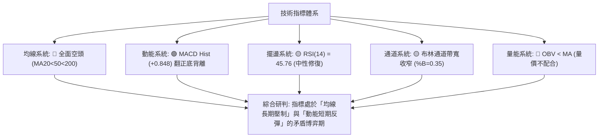

### 📈 移動平均線排列分析

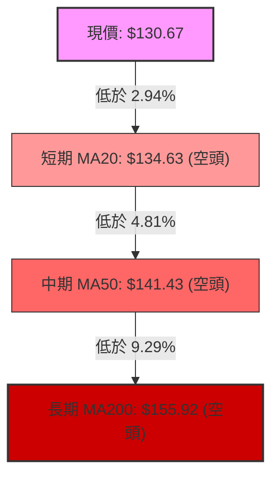

#### 均線階梯監控表

| 均線名稱 | 當前價格 | 距現價差幅 | 斜率走勢 | 歷史軌跡特徵 | 多空信號 |
|----------|----------|------------|----------|--------------|----------|
| **MA5** | $134.27 | -2.68% | 走平微跌 | 10-28 衝高帶動短期拐頭，但 10-30 再度失守 | 🔴 |
| **MA10** | $131.29 | -0.47% | 走平 | 貼近現價，短線糾結中 | 🟡 |
| **MA20** | $134.63 | -2.94% | 持續向下 | 20日下行趨勢線，布林中軌，短線核心壓力 | 🔴 |
| **MA50** | $141.43 | -7.61% | 向下俯衝 | 中期生命線，未站穩前不具備翻多條件 | 🔴 |
| **MA60** | $142.42 | -8.25% | 向下俯衝 | 季線壓制沉重 | 🔴 |
| **MA120** | $153.65 | -14.95% | 平緩下行 | 半年線壓制，與 R2 $153.03 重疊 | 🔴 |
| **MA200** | $155.92 | -16.19% | 穩定下行 | 長期熊市壓制，空頭排列關鍵節點 | 🔴 |
| **MA240** | $163.00 | -19.83% | 緩降 | 年線下壓 | 🔴 |

**均線綜合判定**：MA5 < MA10 < MA20 < MA50 < MA60 < MA120 < MA200 < MA240，呈現教科書級別的「完整均線空頭排列」。現價處於所有均線下方，任何上衝若無持續巨量推動，均應視為均線乖離率過大後的技術性抽頭回抽。

### 📉 RSI(14) 分析

```
RSI(14) 當前讀數：45.76
0 ────── 超賣(30) ────────── 當前(45.76) ────── 超買(70) ────── 100
[░░░░░░░░░░░░░░░░░░░░▓▓▓▓▓▓▓▓▓▓█░░░░░░░░░░░░░░░░░░░░░░░░░░░░░░░░░] 45.76%
```

#### RSI 深度解讀與背離檢查：
1. **中性修復階段**：RSI 讀數自 2026-07-02 的極端超賣低點 26.7 緩步攀升至目前的 45.76，脫離了超賣鈍化區，回到 30–70 的常態震盪中樞。
2. **背離檢驗結論**：
   - 價格於 2026-07 探底 $114.08 時 RSI 為 27.5；
   - 價格於 2026-10-22 下探 S1 ($122.76) 時，日線 RSI 守在 40 水準，未再破新低。
   - 依據規則 7 與官方數據快照：「**無明顯背離**（僅比較近20根K棒首尾的價格與RSI方向）」。指標處於中性格局，無頂背離亦無直接的強烈底背離。

### 📊 MACD(12,26,9) 訊號解讀

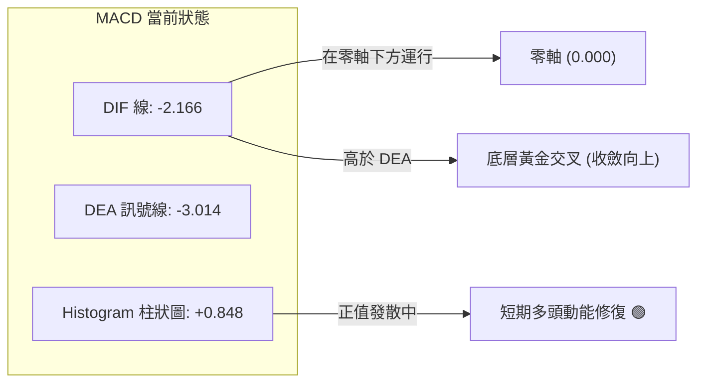

#### 數值解讀與動能推演：
- **MACD DIF (-2.166)** 向上穿過 **DEA (-3.014)**，柱狀圖為 **+0.848**。
- **研判**：這是在零軸極深位置展開的弱勢黃金交叉。歷史經驗顯示，零軸之下的低位金叉通常只代表跌勢趨緩與超賣反抽，並非單邊主升浪的信號。若 DIF 無法有效向上突破零軸，反彈動能將隨時夭折。

### 📦 布林通道分析

```
ORCL 布林通道結構示意圖（日線）
═════════════════════════════════════════════════════════════════
$148.02 ┬──────────────────────────────────────────── BB 上軌 (Upper)
        │
$134.63 ┼──────────────────────────────────────────── BB 中軌 / MA20 (Mid)
        │         ▲ 10-28 突破中軌，受阻於上軌
$130.67 ┼·········┼·································· 現價 ($130.67, %B=0.35)
        │         ▼ 10-30 回落至中軌下方
$121.24 ┴──────────────────────────────────────────── BB 下軌 (Lower)
═════════════════════════════════════════════════════════════════
```

- **通道帶寬**：上軌 $148.02，下軌 $121.24，通道帶寬為 $26.78。
- **%B 指標**：0.35。這意味著現價位於中軌 ($134.63) 與下軌 ($121.24) 之間的下半區，距離下軌約 35% 位置。
- **行為研判**：10-28 日股價一度暴衝至 $148.48，實質刺穿布林上軌 ($148.02)，但隨即遭遇劇烈回踩，確認了布林通道維持水平收斂走勢，股價重回通道內部運作。

### 💹 成交量分析（量價配合度）

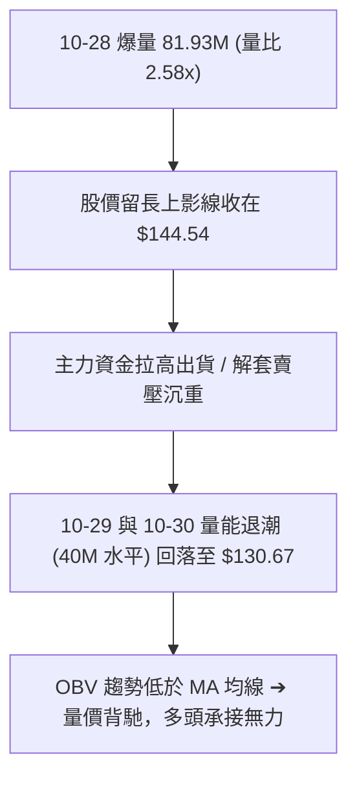

- **最新量能**：40,976,300 股，高於 20 日均量 (31,682,130 股)，量比為 **1.29x**。
- **OBV 趨勢解讀**：數據明確提示「**OBV < MA → 量能疲弱**」。雖然最新一週成交量達 2.11 億股，但大量的成交換手並未轉化為實質收盤價上漲，反映出累積能量線（OBV）依然受制於長期均量線下方，缺乏機構主力中長線建倉的增量真金白銀。

---

## 6. 動能與波動率

### ⚡ 動能評估四象限

| 象限 | 動能強度 | 波動率水準 | 當前狀態評估 | 技術含義與操作指導 |
|------|----------|------------|--------------|--------------------|
| **Q1** | 強 (ADX>25) | 低 (ATR%<3%) | ❌ 否定 | 理想單邊低風險主升浪 |
| **Q2** | **弱 (ADX=13.77)** | **中低 (ATR% 5.85%)** | **✓ 當前狀態** | **區間沉澱震盪期：動能衰退，價格受困於箱體內部，適合逢邊界短線操作** |
| **Q3** | 強 (ADX>25) | 高 (ATR%>6%) | ❌ 否定 | 單邊暴跌或加速趕底階段 |
| **Q4** | 弱 (ADX<20) | 極高 (ATR%>8%) | ❌ 否定 | 劇烈洗盤無序市場 |

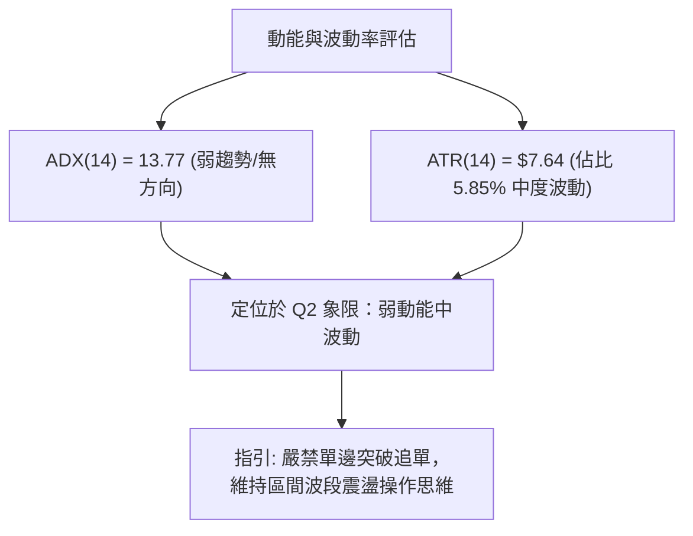

### 📊 ATR 波動率分析

- **ATR(14) 數值**：**$7.64**（佔現價 $130.67 之比率為 **5.85%**，Wilder 計算）。
- **日內波動幅度**：ORCL 每日平均真實波幅高達 $7.64，顯示其雖然處於震盪格局，但個股短線博弈劇烈。
- **止損距離建議**：
  - 震盪策略止損倍數：建議設定為 **1.0 至 1.5 倍 ATR**（約 **$7.60 - $11.40**）。
  - 當前若在現價 $130.67 建倉，下方關鍵技術止損應設於支撐位 S1 **$122.76**（距現價 -$7.91，剛好約為 **1.03 倍 ATR**），在技術防守與資金控管上具備高度合理性。

### 📐 Beta 與市場相關性

- **Beta 係數**：**1.77**（高彈性/高 Beta 股）。
- **特徵解讀**：Beta 高達 1.77 說明 ORCL 的波動幅度顯著大於標普 500 指數與那斯達克指數。當大盤微幅調整時，ORCL 往往出現加倍的殺跌；反之，若科技板塊迎來整體風險偏好回暖，該股具備極高的高彈性修復爆發力。

---

## 7. 多時框架總結

### 📋 時框架評分表

| 時框架 | 趨勢方向 | 動能狀態 | 均線排列 | 圖表形態 | 綜合評分 | 交易建議 |
|--------|----------|----------|----------|----------|----------|----------|
| **長期 (月線)** | 🔴 下行偏空 | 弱勢反彈未遂 | 空頭排列 | 自高點下挫修正 | 30/100 | 長期投資者保持觀望 |
| **中期 (週線)** | 🟡 橫向築底 | MACD翻正底背離 | 空頭排列未改 | 雙底雛形/倒錘線 | 45/100 | 區間操作，嚴控持倉 |
| **短期 (日線)** | 🟡 箱體震盪 | RSI=45.76/KD走平 | 破位受制MA20 | 矩形區間震盪 | 43/100 | 箱體下緣低吸，上緣減碼 |

### 🔲 綜合訊號矩陣

```
ORCL 多維度訊號一致性矩陣
═════════════════════════════════════════════════════════════════
指標系統        短期 (日線)       中期 (週線)       長期 (月線)       跨週期協同性
─────────────────────────────────────────────────────────────────
均線系統 (MA)   🔴 破位 MA20      🔴 處 MA50 之下   🔴 處 MA200 之下   全週期共振看空 🔴
動能 (MACD/RSI) 🟡 中性修復       🟢 柱狀連翻紅     🔴 零軸深處        短中長動能背馳 🟡
趨勢強度 (ADX)  🟡 無趨勢 (13.77) 🟡 橫向沉澱       🔴 下降趨勢疲憊    空方動能衰竭 🟡
成交量 (OBV)    🔴 低於均線       🟡 週量放大倒錘   🔴 縮量陰跌        增量承接不足 🔴
形態支撐        🟡 守住 S1        🟢 52W低點打底    🟡 Fib 78.6%震盪   築底訊號初現 🟡
═════════════════════════════════════════════════════════════════
```

### ⚖️ 多時框收斂結論

依據多時框收斂規則（規則 14）：
1. **行情屬性判定**：當前日線 **ADX(14) 為 13.77**，遠低於 25 臨界線，技術架構定義為標準的「**低波動無趨勢盤整行情**」。
2. **主導維度收斂**：在 ADX < 25 的盤整市中，順勢追突破指標全面失效，市場以**日線布林通道上下軌（$121.24 - $148.02）及波段聚類高低點（S1 $122.76 至 R1 $147.20）**作為主導交易邊界。
3. **唯一方向性結論**：**中性弱勢觀望 / 區間震盪操作**。綜合評分為 **43/100**，日線與週線衝突由日線布林箱體主導，策略核心為「**拒絕中軸追高，依託支撐 S1 與布林下軌低吸博弈反彈，阻力位 R1 嚴格停利**」。

---

## 8. 交易策略建議

### 🗺️ 策略決策流程圖

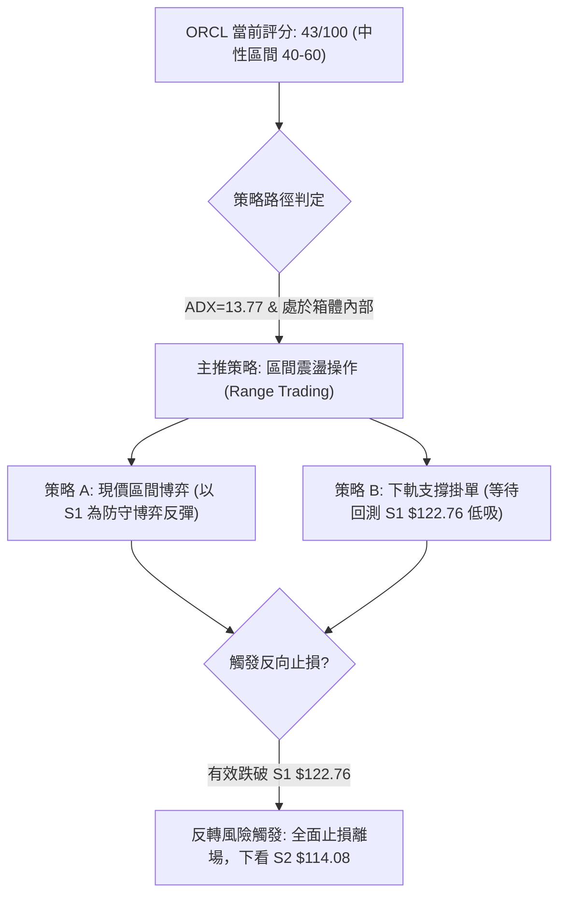

### 🧭 策略路由（依評分卡分流）

**當前主策略方向 = 中性區間震盪操作（依評分 43/100，處於 40–60 區間）**  
本策略嚴格遵守多時框收斂規則，不展開激進單邊追多或追空，以**布林上下軌與波段聚類價位**進行邊界博弈，標注「等待突破確認」。

### 🎯 價格情境階梯（Price Scenarios）

價位完全引用第 4 章及數據中經 OHLCV 計算之實際數值：

| 觸發條件 | 下一目標 | 後續延伸 | 情境含義 | 操作處置 |
|----------|----------|----------|----------|----------|
| **強勢突破 R1 $147.20** | **R2 $153.03** | **R3 $158.67** | 箱體向上破局，反彈波升級為中期逆轉波 | 突破後回踩不破加碼，跟進看多 |
| **受阻於中軌 $134.63** | **現價 $130.67** | **S1 $122.76** | 區間震盪延續，反彈受挫重回箱底測試 | 箱體中軸減碼，耐心等待回踩 |
| **有效跌破 S1 $122.76** | **S2 $114.08** | **N/A** | 區間支撐失守，考驗 52 週絕對鐵底 | 多單無條件停損，空頭重掌主導權 |

### 📊 情境機率分佈

| 情境劇本 | 發生機率 | 主要技術指標依據 |
|----------|----------|------------------|
| **區間震盪 (箱體拉鋸)** | **55%** | **ADX=13.77** 極弱趨勢、布林帶寬水平收窄、成交量在 40M 水平平穩，多空無力發動單邊 |
| **回落再探底 (測試S1/S2)** | **30%** | **均線空頭排列 (MA20<50<200)**、10-28 爆量留極長上影線、OBV 低於均線顯示承接虛弱 |
| **強勢反彈 (突破R1)** | **15%** | **MACD 柱狀圖 (+0.848)** 處於正值區、+DI (26.02) 暫居主導，但受制於整體均線反壓 |

### 🟢 主策略詳情（區間操作多頭策略）

依規則 17，風險報酬比嚴格以公式計算：  
$$\text{風險報酬比} = \frac{\text{目標價 T1} - \text{進場價}}{\text{進場價} - \text{止損價}}$$

| 策略要素 | 策略 A（現價區間博弈策略） | 策略 B（下軌支撐逢低承接策略） |
|----------|----------------------------|--------------------------------|
| **進場條件** | 現價 $130.67 縮量企穩，搏擊 MACD 正向修復 | 等待股價回撤至近一年波段低點 S1 附近企穩 |
| **進場價格** | **$130.67** | **$122.76** (S1 精確位) |
| **目標價 T1** | **$147.20** (R1 關鍵阻力) | **$134.63** (MA20 / 布林中軌) |
| **目標價 T2** | **$153.03** (R2 次級阻力) | **$147.20** (R1 關鍵阻力) |
| **止損價格** | **$122.76** (S1 波段低點聚類) | **$114.08** (S2 / 52週絕對低點) |
| **風險報酬比** | **1 : 2.09（以 T1 計）** *(註1)* | **1 : 1.37（以 T1 計）** *(註2)* |
| **成功機率** | 50% | 65% |
| **建議倉位** | 10% (輕倉試單) | 20% (標準波段倉位) |

- *註1 (策略 A 驗算)*：$\frac{147.20 - 130.67}{130.67 - 122.76} = \frac{16.53}{7.91} = 2.08976 \approx 2.09$，呈現為 **1 : 2.09（以 T1 計）**；以 T2 計則為 $\frac{153.03 - 130.67}{7.91} = \frac{22.36}{7.91} = 2.8268 \approx$ **1 : 2.83（以 T2 計）**。
- *註2 (策略 B 驗算)*：$\frac{134.63 - 122.76}{122.76 - 114.08} = \frac{11.87}{8.68} = 1.3675 \approx 1.37$，呈現為 **1 : 1.37（以 T1 計）**；以 T2 計則為 $\frac{147.20 - 122.76}{8.68} = \frac{24.44}{8.68} = 2.8156 \approx$ **1 : 2.82（以 T2 計）**。

### 🔴 反向風險觸發點（對沖提示）

- **多頭結構破壞點**：日線收盤價若收在 **$122.76 (S1)** 之下，代表箱體震盪失敗，空方重啟殺跌。操作上應立即止損所有區間多單。
- **對沖啟動信號**：一旦摜破 $122.76，股價將無技術緩衝直奔 **$114.08 (S2)**，屆時應轉為防守或小量買入 Put 選擇權規避下行風險。
- **空頭平倉警報**：若日線強勢帶量貫穿 **$147.20 (R1)** 並收穩，所有空頭頭寸必須無條件平倉。

### ⭐ 整體訊號強度評星

```
做多訊號強度：★★☆☆☆  (2/5星 - 均線壓制沉重，僅具超跌波段交易價值)
做空訊號強度：★★★☆☆  (3/5星 - 大週期順勢，但 ADX 弱化，追空盈虧比差)
整體可信度：  ★★★☆☆  (3/5星 - 處於盤整沉澱期，箱體邊界明確)
```

---

## 9. 風險提示與監控

### ✅ 關鍵監控指標 Checklist

```
╔══════════════════════════════════════════════════════════════╗
║              ORCL 日常交易技術監控 Checklist                 ║
╠══════════════════════════════════════════════════════════════╣
║ [ ] 價格是否跌破支撐位 S1 ($122.76)？（是 ➔ 嚴格止損）       ║
║ [ ] 日線是否有效站穩布林中軌 MA20 ($134.63)？（是 ➔ 短線轉強）║
║ [ ] 日成交量是否萎縮破 25M 或暴增破 60M？（異常警惕異動）   ║
║ [ ] RSI(14) 是否再次跌入 30 以下極端超賣區？（尋找衰竭點）    ║
║ [ ] MACD 柱狀圖是否由紅翻綠跌破零軸？（翻綠 ➔ 動能熄火）     ║
║ [ ] ADX(14) 是否突破 25？（突破 ➔ 脫離盤整，新趨勢確立）     ║
╚══════════════════════════════════════════════════════════════╝
```

### ⚠️ 風險場景分析

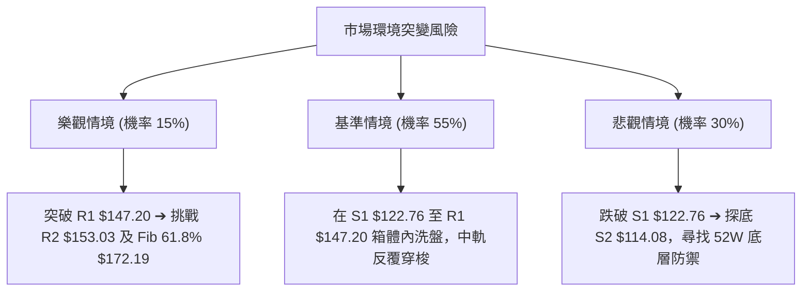

### 🛡️ 風險管理重要提醒

1. **基本面巨額負債與現金流風險警訊**：
   - 財務數據顯示 ORCL 總負債高達 **$169.14B**，自由現金流 (FCF) 為 **$-28.72B**。最新新聞直指「*Oracle Stocks Decline With Funding Ceiling Excluding Debt Refinancing*」，高槓桿資本結構在當前高利率環境下對技術面構成巨大的估值壓制天花板。
2. **高 Beta 波動控制**：
   - 本股 Beta 為 **1.77**，ATR 達 **$7.64**，單日振幅極大（如 10-28 單日高低差超過 $20）。總倉位配置不得超過個人投資組合的 **10%–15%**，單筆交易的最大止損虧損額嚴格限制在總資產的 **1.0%** 以內。
3. **盤整市嚴禁追漲殺跌**：
   - ADX 僅為 **13.77**，在低 ADX 環境下，任何大陽線突破或大陰線破位有超過 60% 機率為假動作，嚴禁在大陽線當天追高（10-28 追高者次日即承受巨額虧損）。

---

## 📋 報告總結

```
ORCL 技術分析報告總結
════════════════════════════════════════════════════════
報告日期：2026-10-31
當前價格：$130.67
分析評級：⚖️ 43/100 區間弱勢震盪 (以箱體邊界操作為準)

關鍵結論：
├─ 長期趨勢：🔴 空頭主導 (自 $277.05 下挫逾 52%，均線空頭排列)
├─ 中期趨勢：🟡 橫向築底 (受限於 $122.76 至 $147.20 箱體拉鋸)
├─ 短期趨勢：🟡 衝高回踩 (受阻於 R1 $147.20，回落於 MA20 之下)
├─ 關鍵支撐：S1: $122.76  ｜  S2: $114.08
├─ 關鍵阻力：R1: $147.20  ｜  R2: $153.03  ｜  R3: $158.67
└─ 分析師目標：共識目標均價 $235.80 (高 $400 / 低 $110)

最優策略組合：
1. 🥇 最佳機會：策略 B — 回踩 S1 ($122.76) 逢低承接，止損設 S2 ($114.08)，
                風險報酬比 1:1.37（以 T1 $134.63 計），安全邊際最高。
2. 🥈 次選機會：策略 A — 現價 $130.67 輕倉試單博弈短線反彈，止損 S1 ($122.76)，
                目標 R1 ($147.20)，風險報酬比 1:2.09（以 T1 計）。
3. 🥉 保守選擇：空倉觀望 — 等待 ADX 升破 25 且價格明確突破 R1 ($147.20)
                或跌破 S1 ($122.76) 後，再行順勢跟進。
════════════════════════════════════════════════════════
```

---

> ⚠️ **免責聲明**：本報告為 AI 自動生成之技術分析，所有數據及估算均基於提供的歷史價格資訊。本報告**僅供研究與學術參考**，**不構成任何投資建議**。投資有風險，入市需謹慎。

---

*報告生成時間：2026-10-31 ｜ 數據來源：Yahoo Finance ｜ 分析框架：多時框技術分析*