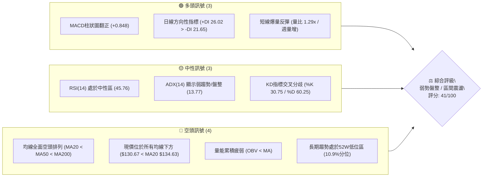
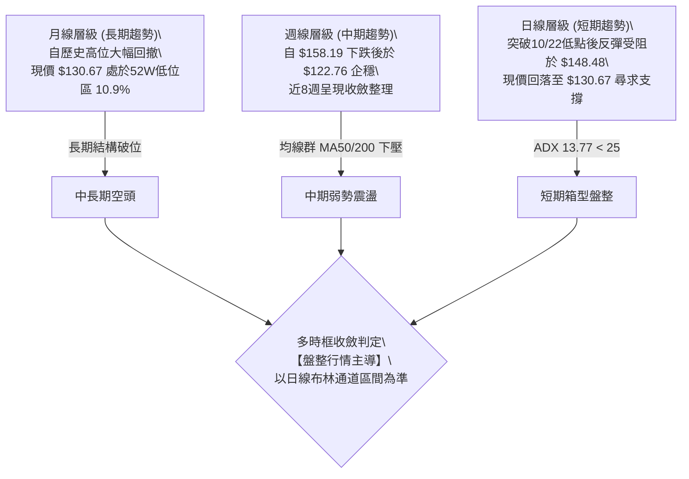
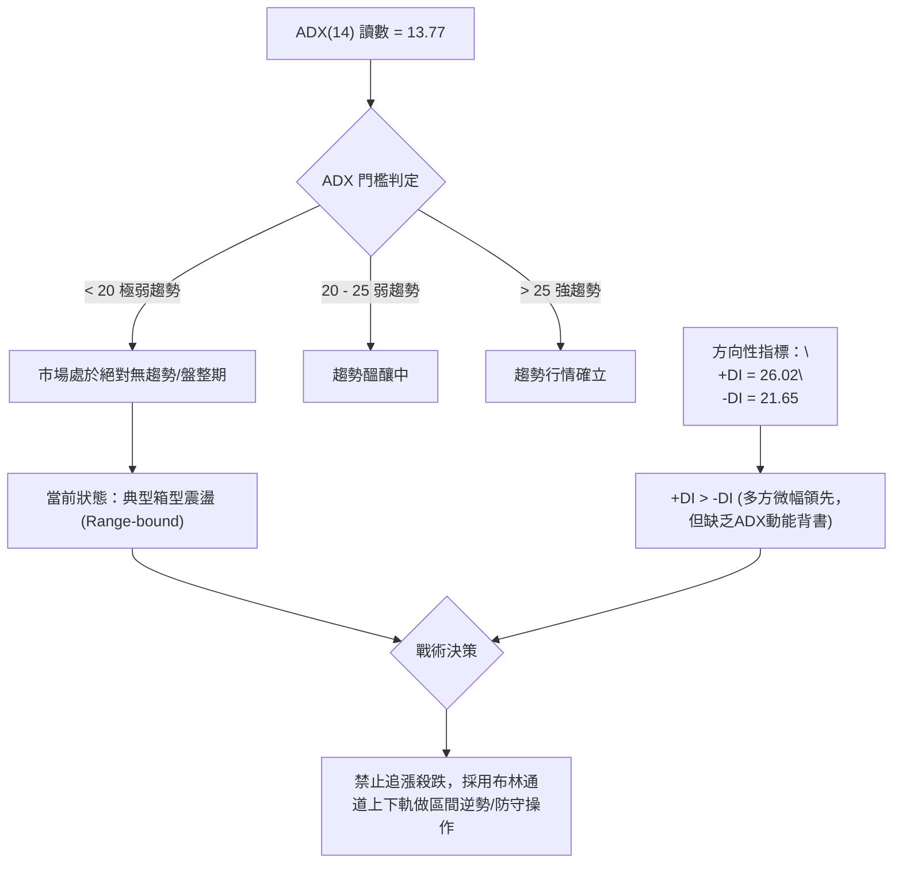
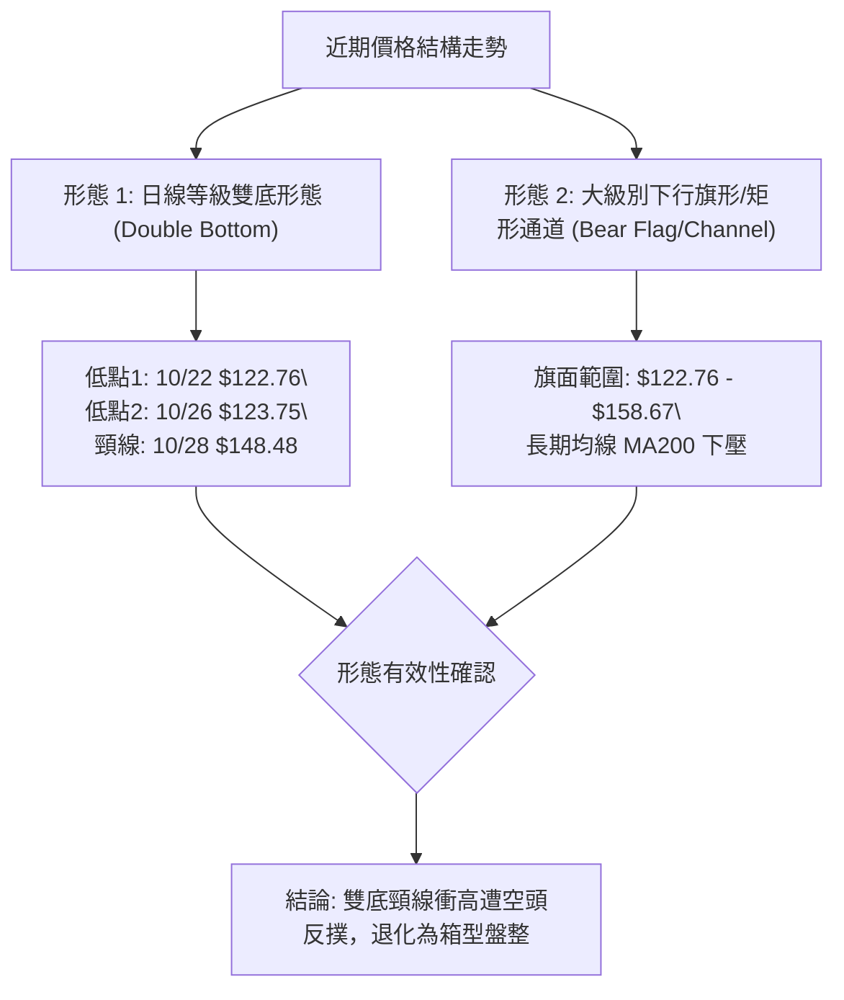
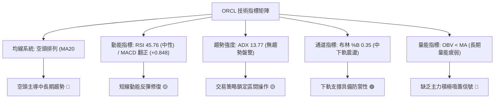
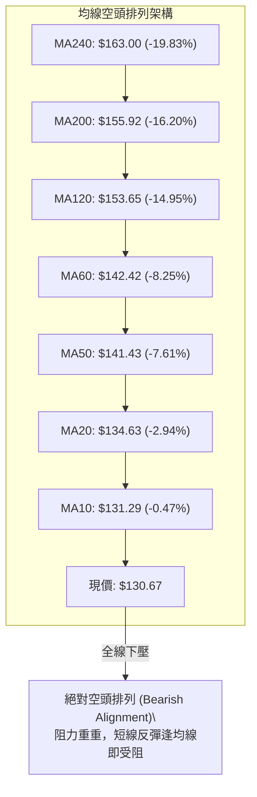
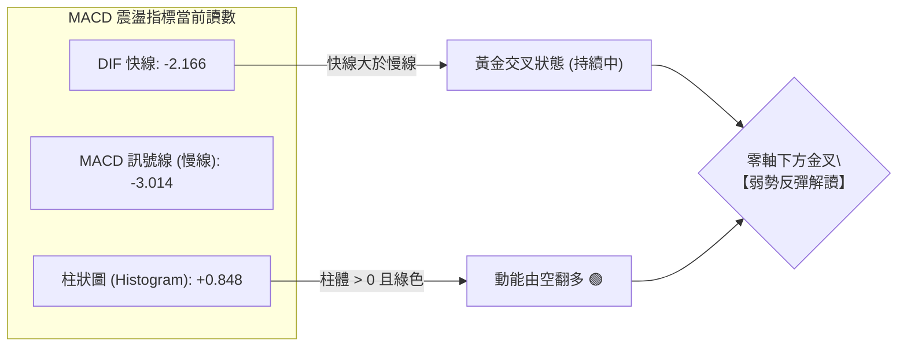
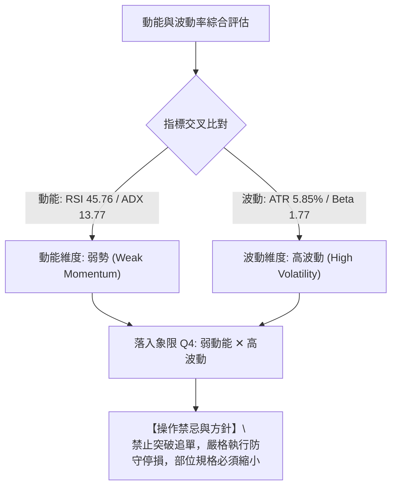
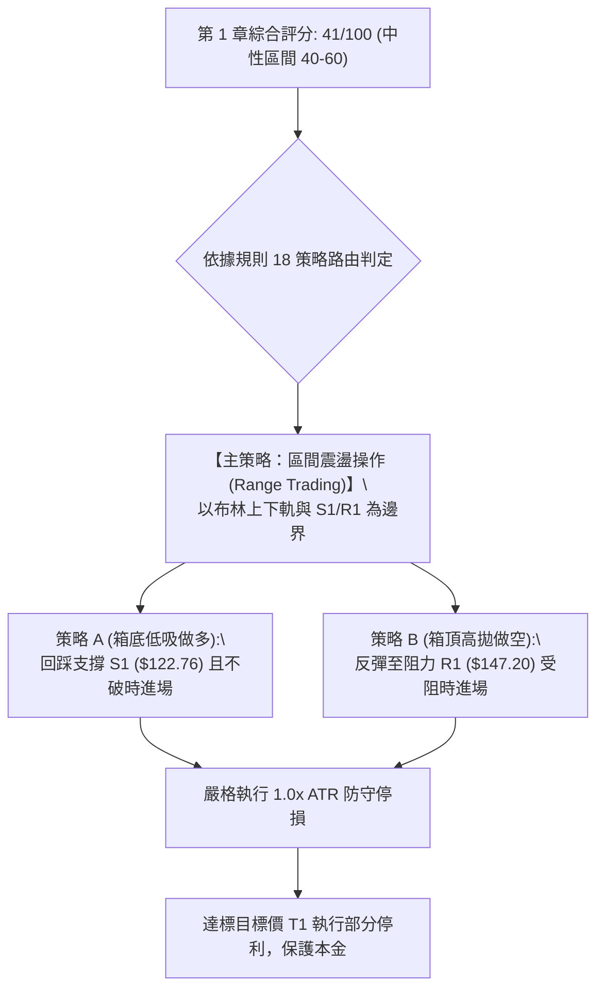
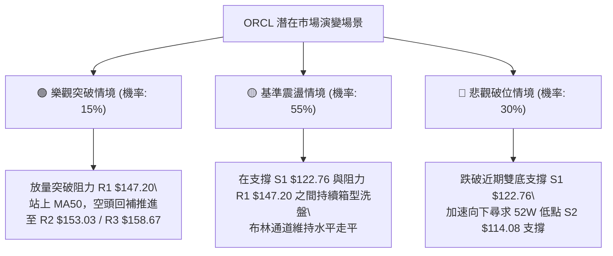

# ORCL 技術分析報告

> **報告日期**：2026-11-01 ｜ **語言**：繁體中文 ｜ **數據來源**：Yahoo Finance ｜ **當前價格**：$130.67 USD

---

## 目錄

| 章節 | 內容 |
|------|------|
| [1. 技術面概覽](#1-技術面概覽) | 訊號儀表板、核心指標、評分卡 |
| [2. 趨勢分析](#2-趨勢分析) | 多時框趨勢、長中短期走勢、ADX解讀 |
| [3. 圖表形態分析](#3-圖表形態分析) | 形態識別、K線組合、目標價推算 |
| [4. 支撐與阻力](#4-支撐與阻力) | 關鍵價位、斐波那契回調結構 |
| [5. 技術指標深度解讀](#5-技術指標深度解讀) | MA/RSI/MACD/布林/成交量量價背離 |
| [6. 動能與波動率](#6-動能與波動率) | 動能四象限、ATR、Beta與市場連動 |
| [7. 多時框架總結](#7-多時框架總結) | 時框架矩陣與多時框優先級收斂 |
| [8. 交易策略建議](#8-交易策略建議) | 策略路由、主策略、情境階梯、風控 |
| [9. 風險提示與監控](#9-風險提示與監控) | 監控清單、情境樹、風控準則 |
| [報告總結](#-報告總結) | 儀表板結論與交易執行總結 |

---

## 1. 技術面概覽

### 🎯 技術訊號儀表板



### 📊 核心指標速覽表

| 指標類別 | 指標名稱 | 當前數值 | 訊號 | 解讀 |
|:---|:---|:---:|:---:|:---|
| **價格** | 當前收盤價 | $130.67 | 🔴 | 位於52週高低區間底部10.9%位置，處於深度修正後弱勢整理 |
| **均線** | 短期 MA20 | $134.63 | 🔴 | 現價低於MA20達 -2.94%，短期下行斜率未扭轉，形成第一道動態阻力 |
| **均線** | 中期 MA50 | $141.43 | 🔴 | 現價低於MA50達 -7.61%，中期下行趨勢顯著，構成反彈重大反壓 |
| **均線** | 長期 MA200 | $155.92 | 🔴 | 現價低於MA200達 -16.20%，長線多空分水嶺失守，確認中長期偏空架構 |
| **動能** | RSI(14) | 45.76 | 🟡 | 位於40–50中性格局，自超賣區修復後缺乏持續推升力道 |
| **動能** | MACD (12,26,9) | -2.166 / -3.014 | 🟢 | 快線低位向上穿越慢線，柱狀圖為 +0.848，發出短線反彈修復訊號 |
| **動能** | 隨機指標 KD | %K 30.75 / %D 60.25 | 🟡 | %K 跌破 %D 進入低位整理，尚未出現超賣黃金交叉，動能偏弱 |
| **趨勢** | ADX (14) | 13.77 (+DI:26.02, -DI:21.65) | 🟡 | ADX < 25 表明趨勢動力衰退，市場正處於無方向性或弱勢箱型盤整 |
| **通道** | 布林通道 (%B) | %B 0.35 (軌道: 121.24 - 148.02) | 🟡 | 位於中軌($134.63)與下軌($121.24)之間，尚未觸及超賣極端下軌 |
| **波動** | ATR(14) | $7.64 (佔股價 5.85%) | 🔴 | 日均波幅高達5.85%，屬於高波動性資產，進出場需寬幅風控空間 |
| **成交量** | 最新量 / 20日均量 | 40.98M / 31.68M (1.29x) | 🟢 | 成交量溫和放大，但 OBV < MA，顯示長期資金累積意願仍未全面回歸 |

### 🏆 技術評分卡

```
╔══════════════════════════════════════════════════════════════╗
║               技術評分卡 — ORCL (2026-11-01)                 ║
╠══════════════════════════════════════════════════════════════╣
║ 趨勢強度 (Trend Strength)   ██████░░░░░░░░░░░░░░  30/100 🔴 ║
║ 動能指標 (Momentum Indicators) ██████████░░░░░░░░░░  50/100 🟡 ║
║ 支撐穩定度 (Support Stability) ████████████░░░░░░░░  60/100 🟡 ║
║ 成交量配合 (Volume Profile)    ████████░░░░░░░░░░░░  40/100 🔴 ║
║ 形態完整度 (Pattern Quality)  ██████████░░░░░░░░░░  50/100 🟡 ║
║ 均線排列 (Moving Averages)  ████░░░░░░░░░░░░░░░░  15/100 🔴 ║
╠══════════════════════════════════════════════════════════════╣
║ 綜合評分 (Overall Score)    ████████░░░░░░░░░░░░  41/100 🟡 ║
║ 結論評級：中性偏空 / 區間震盪（算術平均 (30+50+60+40+50+15)/6 = 40.83 ≈ 41）║
╚══════════════════════════════════════════════════════════════╝
```

---

## 2. 趨勢分析

### 🌐 多時框趨勢分析



### 📈 長期趨勢 — 12個月走勢圖（Unicode）

```
ORCL 月線走勢圖（過去12個月：2025-11 至 2026-10）
價格軸 ($)
$260 ┤
$240 ┤
$220 ┤                              ●(2026-05 $224.17)
$200 ┤●(2025-11 $199.28)
$180 ┤    ●(2025-12 $192.34)
$160 ┤        ●(2026-01 $162.84)        ●(2026-04 $160.24)
$140 ┤            ●(02 $143.86) ●(03 $145.55)  ●(06 $145.50)  ●(08 $148.57)
$120 ┤                                              ●(07 $129.39)  ●(09 $136.79) ●(10 $130.67)←現價
     └──────────────────────────────────────────────────────────────────────────
       N    D    J    F    M    A    M    J    J    A    S    O  (月份)
```

#### 過去12個月走勢特徵分析表格

| 階段區間 | 起始/結束收盤價 | 區間漲跌幅 | 走勢結構與技術特徵 | 成交量與市場動能評估 |
|:---|:---:|:---:|:---|:---|
| **第一階段：高位破位回落**<br>(2025-11 ~ 2026-02) | $199.28 → $143.86 | -27.81% | 連續4個月單邊下挫，失守兩百美元大關，月K線實體呈現空頭吞噬 | 賣壓沉重，外逃資金顯著，空頭動能完全主導 |
| **第二階段：春季反彈衝高**<br>(2026-03 ~ 2026-05) | $145.55 → $224.17 | +54.01% | 走出強勁V型反轉波段，5月高見 $224.17，假突破前期阻力區 | AI 題材資金湧入推升，但月線留長上影線埋下伏筆 |
| **第三階段：二次崩跌探底**<br>(2026-06 ~ 2026-07) | $224.17 → $129.39 | -42.28% | 6、7月遭遇斷崖式拋售，7月創下收盤低點 $129.39，波段最低至 $114.08 | 恐慌盤湧出，週成交量放大至2.5億股，建立年內大底 S2 ($114.08) |
| **第四階段：築底弱勢收斂**<br>(2026-08 ~ 2026-10) | $129.39 → $130.67 | +0.99% | 價格在 $125.00 - $158.00 間進行高波動箱型震盪，10月收盤報 $130.67 | 成交量自高峰逐步回落，均線呈現完全空頭排列，趨勢動能鈍化 |

### 📊 中期趨勢（週線分析）

```
ORCL 中期阻力與支撐結構圖（週線視角）
═════════════════════════════════════════════════════════════════
 $170.07 ┬  [2026-09-11 週高點反壓]
         │
 $158.67 ┼─ 阻力 R3 (波段高點阻力聚類 / 斐波那契61.8% $172.19下方)
 $153.03 ┼─ 阻力 R2 (2026-09-25 週高點聚類)
 $147.20 ┼─ 阻力 R1 (2026-10-30 週高點 $148.48 聚集處 / 斐波那契78.6% $146.63)
         │
 $130.67 ┼  ◄───【當前收盤價】
         │
 $122.76 ┼─ 支撐 S1 (2026-10-23 週低點 / 10-22 日低點聚類)
         │
 $114.08 ┴─ 支撐 S2 (52週絕對低點 / 2026-07-24 波段極限支撐)
═════════════════════════════════════════════════════════════════
```

### ⚡ 趨勢強度評估（ADX 解讀）



#### ADX 指標強度對照表

| 指標變數 | 當前讀數 | 狀態級別 | 技術意涵與操作指引 |
|:---|:---:|:---:|:---|
| **ADX (14)** | **13.77** | 弱趨勢 / 盤整 | 讀數遠低於 25，表明不論多方或空方皆無力維持單邊單向運動，趨勢跟隨型策略（Trend Following）失效，切換為擺動交易 |
| **+DI (14)** | **26.02** | 多方佔優 | 短期買盤力道高於賣盤，多頭嘗試組織反撲 |
| **-DI (14)** | **21.65** | 空方收斂 | 賣方動能相較7月低點已明顯減弱，下行加速度放緩 |
| **綜合判定** | **無方向性震盪** | 🟡 中性防守 | 多方略有優勢但欠缺趨勢強度確認，價格易在均線糾結處反覆洗盤 |

---

## 3. 圖表形態分析

### 🔍 形態識別系統



#### 圖表形態信心度與目標價評估表

| 形態名稱 | 信心度 (%) | 判斷依據（引用數據） | 完成度 (%) | 目標價（附嚴謹計算式） |
|:---|:---:|:---|:---:|:---|
| **短線雙底結構**<br>(Double Bottom) | **55%** | 兩次低點分別出現在 2026-10-22 低點 $122.76 與 2026-10-26 低點 $123.75（構成對稱支撐 S1）。10-28 突破頸線高見 $148.48 後回落。 | 70% | 頸線阻力 R1 $147.20。形態高度 = $147.20 - $122.76 = $24.44。<br>若有效突破頸線，推算目標價 = 頸線 $147.20 + 形態高度 $24.44 = **$171.64**（接近斐波那契61.8% $172.19）。因受制於下影線賣壓，信心度僅55%。 |
| **中期下行旗形/箱型**<br>(Bearish Rectangle) | **65%** | 價格自 2026-05 $224.17 急殺至 2026-07 低點 $114.08（支撐 S2），其後反彈在波段高點阻力 R1 $147.20、R2 $153.03、R3 $158.67 遭遇壓制，均線呈現空頭排列。 | 85% | 箱頂阻力 R3 $158.67，箱底支撐 S2 $114.08。形態高度 = $158.67 - $114.08 = $44.59。<br>若向下實體跌破 S2，推算空頭延伸目標 = 破位點 $114.08 - 形態高度 $44.59 = **$69.49**（數據中未偵測到此支撐，列為極端風險防範）。 |
| **布林帶區間收斂**<br>(BB Squeeze) | **80%** | 布林通道上軌 $148.02，下軌 $121.24，%B 為 0.35。ADX 13.77 顯示無單邊方向，價格完全被侷限於軌道內。 | 90% | 上軌目標價 **$148.02**（與阻力 R1 $147.20 聚類）；下軌防守價 **$121.24**（與支撐 S1 $122.76 聚類）。 |

### 🕯️ 重要K線形態分析

嚴格依據數據中「近10根日K」與「近8根週K」之實際開高低收數據進行客觀解讀：

#### 近10根日K形態分析表

| 日期（日K） | 開盤價 ($) | 最高價 ($) | 最低價 ($) | 收盤價 ($) | 成交量 (股) | K線形態類型 | 技術解讀與多空意涵 | 訊號 |
|:---|:---:|:---:|:---:|:---:|:---:|:---:|:---|:---:|
| **2026-10-19** | 130.66 | 131.40 | 129.12 | 129.59 | 23,749,200 | 窄幅陰十字 | 波幅僅 $2.28，市場交投清淡，缺乏方向性 | 🟡 |
| **2026-10-20** | 128.51 | 134.35 | 127.45 | 131.14 | 26,751,800 | 帶長上影陽線 | 盤中衝高至 $134.35 遭遇 MA20 動態反壓，買盤受挫 | 🟡 |
| **2026-10-21** | 133.12 | 133.52 | 127.70 | 129.13 | 26,329,100 | 下跌光腳中陰 | 高開低走，完全吞沒前日漲幅，賣方奪回主控權 | 🔴 |
| **2026-10-22** | 126.35 | 127.94 | 122.76 | 125.54 | 36,620,100 | 長下影探底陰線 | 盤中創近期波段低點 $122.76（確立支撐 S1），低位買盤承接，量能放大 | 🟢 |
| **2026-10-23** | 124.87 | 128.33 | 124.39 | 126.16 | 19,223,400 | 低位縮量小陽線 | 守住前日低點，在低檔進行防守性縮量整理，空方拋壓竭盡 | 🟡 |
| **2026-10-26** | 126.06 | 127.99 | 123.75 | 126.06 | 23,008,500 | 平盤十字星 | 低點 $123.75 確立次低點，多空雙方在底部達成微弱平衡 | 🟡 |
| **2026-10-27** | 126.88 | 132.34 | 126.86 | 130.53 | 26,026,700 | 光頭中陽線 | 帶量穩健推升，收於當日高位區，宣告築底完成啟動反彈 | 🟢 |
| **2026-10-28** | 131.32 | 148.48 | 128.38 | 144.54 | 81,933,800 | 爆量長陽線 (破位大陽) | 單日成交量爆發至81.93M（量比超2.5x），最高觸及 $148.48（突破阻力 R1），多頭強勢宣洩 | 🟢 |
| **2026-10-29** | 144.14 | 144.61 | 136.59 | 139.56 | 39,366,900 | 衝高回落大陰線 | 獲利了結賣壓湧現，實體長陰下挫，收盤失守 $140，形成烏雲蓋頂先兆 | 🔴 |
| **2026-10-30** | 133.62 | 135.20 | 129.00 | 130.67 | 40,976,300 | 破位中陰線 | 跌破 MA20 ($134.63)，量能維持40.97M高位，回吐10-28大部分漲幅，短線多頭受挫 | 🔴 |

#### 近8根週K形態分析表

| 日期（週K） | 開盤價 ($) | 最高價 ($) | 最低價 ($) | 收盤價 ($) | 週成交量 (股) | K線形態類型 | 技術解讀與多空意涵 | 訊號 |
|:---|:---:|:---:|:---:|:---:|:---:|:---:|:---|:---:|
| **2026-09-11** | 166.98 | 170.07 | 149.29 | 149.73 | 202,390,700 | 烏雲蓋頂長陰 | 週高點 $170.07 逼近斐波那契61.8% ($172.19) 後爆量潰敗，形成中期頂部 | 🔴 |
| **2026-09-18** | 140.90 | 151.44 | 138.49 | 147.07 | 175,146,100 | 下探回升陽十字 | 盤中下探 $138.49 後拉回，多空激烈爭奪 $147.00 關卡 | 🟡 |
| **2026-09-25** | 148.38 | 153.03 | 132.99 | 136.59 | 156,661,000 | 帶長上影大陰 | 衝高 $153.03（確立阻力 R2）後遭遇密集套牢盤狙擊，收盤重挫 | 🔴 |
| **2026-10-02** | 132.24 | 144.33 | 131.10 | 141.78 | 164,959,800 | 破底反彈中陽 | 守住 $131.10，收盤重返 $140 之上，呈現低位震盪護盤跡象 | 🟢 |
| **2026-10-09** | 142.00 | 146.40 | 134.16 | 141.40 | 121,793,100 | 縮量高位紡錘線 | 波動幅度收斂，成交量降至1.21億股，向上攻擊力道放緩 | 🟡 |
| **2026-10-16** | 141.56 | 144.18 | 127.36 | 128.23 | 167,863,700 | 破位光腳大陰線 | 實體大陰線摜破 $130 關口，賣壓進一步放大，確立空頭中繼下行 | 🔴 |
| **2026-10-23** | 130.66 | 134.35 | 122.76 | 126.16 | 132,673,600 | 帶長下影錘頭陰線 | 觸及波段低點 $122.76（支撐 S1）後收回，顯現強力抄底承接盤 | 🟢 |
| **2026-10-30** | 126.06 | 148.48 | 123.75 | 130.67 | 211,312,200 | 長上影流星陰線 | 爆出2.11億股巨量，最高飆升至 $148.48（阻力 R1），但終場大幅回落收在 $130.67，顯示上方套牢賣壓極其沉重 | 🔴 |

### 📉 ASCII 走勢形態示意圖

```
ORCL 近期日K線形態突破與回測結構圖
價格 ($)
$148.48 ┬                           ▲ (10-28 爆量假突破上影線頂點)
        │                          ╱│
$147.20 ┼─────────────────────────╱─┼─ [關鍵阻力 R1 / 頸線位]
        │                        ╱  │
$141.43 ┼┄┄┄┄┄┄┄┄┄┄┄┄┄┄┄┄┄┄┄┄┄┄╱┄┄┄┄│┄┄ [MA50 中期生命線反壓]
        │                    ╱    │
$134.63 ┼┄┄┄┄┄┄┄┄┄┄┄┄┄┄┄┄┄┄┄╱┄┄┄┄┄│┄┄ [MA20 / 布林中軌]
        │                  ╱      │
$130.67 ┼─────────────────●───────▼─ ◄───【當前收盤價】
        │               ╱  (10-27) │  (10-30 長陰摜回)
$126.06 ┼─────────────●────────────┼─ (10-26 次低點)
        │            ╱             │
$122.76 ┴──────────●──────────────┴─ [波段雙底低點 / 關鍵支撐 S1]
                 (10-22)
```

### 🎯 形態目標價計算

1. **短線反彈延伸目標（以雙底測量，若能有效站穩頸線）**：
   - 形態底部低點：$122.76（取 2026-10-22 實體波段低點）
   - 形態頸線高點：$147.20（阻力位 R1）
   - 形態高度（Height）：$147.20 - $122.76 = **$24.44**
   - 向上突破測量目標價（Target）：頸線 $147.20 + 形態高度 $24.44 = **$171.64**
   - **覆核驗證**：該目標價精準指向斐波那契61.8%回調位 **$172.19**（兩者僅差 $0.55），具備高度技術共振意義。

2. **區間下破測量風險（若跌破箱底支撐 S1）**：
   - 當前箱型區間：頂部阻力 R1 $147.20，底部支撐 S1 $122.76
   - 區間垂直高度：$147.20 - $122.76 = **$24.44**
   - 向下跌破測量目標：支撐 S1 $122.76 - 形態高度 $24.44 = **$98.32**（數據中未偵測到此支撐，直接觀察 52W 絕對低點支撐 S2 **$114.08**）。

---

## 4. 支撐與阻力

### 🗺️ 關鍵價位分布圖（Unicode）

```
ORCL 價位結構分布圖 (Price Architecture)
═══════════════════════════════════════════════════════════════
 $158.67 ║████████████████████████║ 強阻力 R3 (近一年波段高點聚類)
 $153.03 ║████████████████████░░░║ 阻力 R2 (09-25 週高點聚類)
 $147.20 ║████████████████████████║ 關鍵阻力 R1 (Fib 78.6% $146.63 聚類)
         ║                        ║
 $134.63 ║┄┄┄┄┄┄┄┄┄┄┄┄┄┄┄┄┄┄┄┄┄┄║ 動態阻力 (MA20 / 布林中軌)
 $130.67 ╠════════════════════════╣ ◄───【現價 $130.67】
         ║                        ║
 $122.76 ║▓▓▓▓▓▓▓▓▓▓▓▓▓▓▓▓▓▓▓▓░░░║ 近期強支撐 S1 (10-22日低點 / 週低點聚類)
 $114.08 ║████████████████████████║ 52週絕對底 S2 (年度極限波段低點)
═══════════════════════════════════════════════════════════════
```

### 🚧 阻力位分析表

數據來源嚴格引用「關鍵價位（由 OHLCV 計算）」區塊數值：

| 阻力級別 | 準確價位 ($) | 距現價空間 (%) | 形成原因與籌碼結構 | 突破難度評估 | 技術重要性 |
|:---|:---:|:---:|:---|:---:|:---:|
| **關鍵阻力 R1** | **$147.20** | +12.65% | 近一年波段高點聚類；精準共振 2026-10-30 週高點 $148.48 及斐波那契 78.6% 回調位 ($146.63)。10-28 長陽大量換手被套牢區間。 | 🔴 極高<br>需 >60M 日成交量連續突破 | ★★★★★<br>多空短期強弱分水嶺 |
| **波段阻力 R2** | **$153.03** | +17.11% | 2026-09-25 週高點籌碼聚類密集區；接近 MA120 ($153.65) 長期下壓趨勢線。 | 🔴 高<br>面臨中期解套賣壓狙擊 | ★★★★☆<br>中期波段目標反壓 |
| **強阻力 R3** | **$158.67** | +21.43% | 2026-09-04 週波段高點 ($158.19) 聚類；重合 MA200 ($155.92) 年線防線，為牛熊終極分界。 | 🔴 極高<br>非重大利好難以有效收復 | ★★★★★<br>中長線空頭堡壘 |

### 🛡️ 支撐位分析表

數據來源嚴格引用「關鍵價位（由 OHLCV 計算）」區塊數值：

| 支撐級別 | 準確價位 ($) | 距現價空間 (%) | 形成原因與籌碼結構 | 守住機率評估 | 技術重要性 |
|:---|:---:|:---:|:---|:---:|:---:|
| **近期支撐 S1** | **$122.76** | -6.05% | 2026-10-22 日低點與 10-23 週低點雙重確認聚類；接近布林通道下軌 ($121.24)，為近期探底之微觀頸線底部。 | 🟢 70%<br>短線超賣區買盤湧現 | ★★★★☆<br>短線多頭防守生命線 |
| **強支撐 S2** | **$114.08** | -12.70% | 52週絕對最低價（2026-07-24 當週打出）；斐波那契 100.0% 回調底，長線機構強烈價值買盤護盤區域。 | 🟢 85%<br>歷史性年度支撐堡壘 | ★★★★★<br>年度多頭最後防線 |
| **支撐 S3** | N/A | N/A | **數據中未偵測到**（依規則 13 與 16，不憑空捏造向下點位）。 | N/A | N/A |

### 📐 斐波那契回調位分析

依據 52 週區間極限低點 **$114.08** 至極限高點 **$266.20**（垂直落差達 $152.12）計算：

```
斐波那契回調位階分布 (52W 區間 $114.08 → $266.20)
═════════════════════════════════════════════════════════════════
   0.0% ─── $266.20 (52週歷史高點)
  23.6% ─── $230.30
  38.2% ─── $208.09
  50.0% ─── $190.14 (多家中期大行持倉成本區)
  61.8% ─── $172.19 (黃金分割關鍵反壓，中線牛熊轉換點)
  78.6% ─── $146.63 (與關鍵阻力 R1 $147.20 形成高度密集共振)
  【現價】─ $130.67 (位於 78.6% 與 100.0% 之間之深度回撤整理帶)
 100.0% ─── $114.08 (52週絕對低點，極限支撐 S2)
═════════════════════════════════════════════════════════════════
```

#### 斐波那契位階深入解讀
- **現價所處區間**：ORCL 當前收盤價 **$130.67** 精準坐落於 **78.6% 回調位 ($146.63)** 與 **100.0% 回調位 ($114.08)** 之間。
- **技術意義**：
  1. 回撤幅度超過 61.8%（$172.19）並深度下探至 78.6%（$146.63）下方，技術上已確立原本的上漲大浪遭到毀滅性破壞，行情由多頭主升段退化為深度熊市修正。
  2. 現價距離下方 100.0% 回調位（$114.08）僅有 12.70% 緩衝空間，而上方 78.6% 回調位（$146.63）恰與阻力位 R1 ($147.20) 重疊，意味著 $146.63 - $147.20 構成難以逾越的技術天花板。未放量站穩 $147.20 前，任何反彈均屬弱勢死貓跳（Dead Cat Bounce）。

---

## 5. 技術指標深度解讀

### 🎛️ 指標訊號總覽



### 📈 移動平均線排列分析



#### 均線系統數據細部解讀
- **排列狀態**：短中長期均線呈現完整的階梯式空頭排列（MA10 $131.29 < MA20 $134.63 < MA50 $141.43 < MA60 $142.42 < MA120 $153.65 < MA200 $155.92 < MA240 $163.00）。所有均線當前斜率均向下傾斜（▼）。
- **現價位階**：現價 $130.67 遭到所有均線壓制。距最近的 MA10 差距 -0.47%，距 MA20 差距 -2.94%，距 MA200 差距達 -16.20%。
- **短線扣抵動態**：10-28 股價一度大漲至 $148.48，短暫刺穿 MA20 與 MA50，但隨即在 10-29 與 10-30 快速回落跌破 MA20。顯示均線下壓動能龐大，多頭無力扭轉中期下行慣性。

### 📉 RSI(14) 分析

```
RSI(14) 讀數：45.76  (Wilder 平滑法)
[0] ─────────── [30] ─────── [45.76] ─────── [70] ─────────── [100]
      超賣區              當前中性位置           超買區
進度條：█████████░░░░░░░░░░░  45.8% (中性區間)
```

- **區間診斷**：RSI 當前數值為 **45.76**，處於 30 至 70 之間的中性震盪區域。相較於 2026-07 跌至 26.7 的極度超賣區，指標已經完成修復，但未能有效突破 50 中軸（牛熊分界線），反映市場僅屬弱勢整理，並無主動買盤發動上攻。
- **背離分析**：依據日線近20根K棒首尾之價格與 RSI 方向比對：
  - 價格由 10-19 收盤 $129.59 至 10-30 收盤 $130.67，微幅變動 +0.83%；RSI 由低檔回升至 45.76。
  - 結論：**無明顯背離現象**（系統偵測明確顯示「無明顯背離」）。多空動能與價格走勢基本同步，未出現典型底背離（價格破底而RSI抬升）或頂背離（價格創高而RSI回落）的反轉先兆。

### 📊 MACD(12,26,9) 訊號解讀



- **數值與結構**：DIF 快線為 **-2.166**，MACD 訊號線（DEA）為 **-3.014**，柱狀圖為 **+0.848**。
- **技術意義**：
  1. 快線已於低檔向上穿越慢線，柱狀圖翻正至 +0.848，且在週線級別上 2026-10-30 的 MACD 柱亦自 -1.009 翻正至 +0.848，日線與週線共振出現短線動能修復訊號。
  2. **重要盲點警示**：儘管出現金叉，但 DIF 與 DEA 雙線仍深處在**零軸下方**（-2.166 與 -3.014）。零軸下方的黃金交叉在技術分析中嚴格定義為「空頭市場中的超跌反彈」，而非新一輪主升浪的展開。若反彈遭遇零軸或均線反壓，極易再度形成二次死叉。

### 📦 布林通道分析

```
ORCL 日線布林通道 (20, 2) 價位結構圖
═════════════════════════════════════════════════════════════════
 $148.02 ┬─────────────────────────────── 布林上軌 (Upper Band)
         │                              ▲ (10-28 觸及上軌 $148.48 受阻)
 $134.63 ┼┄┄┄┄┄┄┄┄┄┄┄┄┄┄┄┄┄┄┄┄┄┄┄┄┄┄┄┄ 布林中軌 (MA20)
         │
 $130.67 ┼──────────────●──────────────── ◄───【現價，%B = 0.35】
         │
 $121.24 ┴─────────────────────────────── 布林下軌 (Lower Band)
═════════════════════════════════════════════════════════════════
```

- **通道參數與現況**：
  - **布林上軌**：$148.02
  - **布林中軌 (MA20)**：$134.63
  - **布林下軌**：$121.24
  - **通道帶寬 (Bandwidth)**：($148.02 - $121.24) / $134.63 = 19.89%
  - **布林 %B**：**0.35**
- **解讀**：%B 數值 0.35 明確指示現價處於中軌與下軌之間的弱勢空方掌控區。10-28 價格一度向上衝刺上軌（盤中最高 $148.48 刺穿上軌 $148.02），但未能形成布林帶開口擴張之「走軌突破」（Walking the Band），反而收出長上影線快速跌回通道內，印證通道中軌 $134.63 與上軌 $148.02 構成堅固阻力。當前價格向中軌靠近失敗，技術軌跡正回踩測試下軌 $121.24（與支撐 S1 $122.76 形成支撐帶）。

### 💹 成交量分析（量價配合度）

- **量能數據統計**：
  - 最新交易日成交量：**40,976,300 股 (40.98M)**
  - 20日均量：**31,682,130 股 (31.68M)** ➔ **量比：1.29x**（溫和放量）
  - 50日均量：**31,229,652 股 (31.23M)**
- **量價關係與 OBV 深度診斷**：
  1. **巨量滯漲與出貨特徵**：2026-10-28 股價放量大漲至 $144.54，成交量高達 81.93M（為均量的 2.58 倍）；然而隨後的 10-29 與 10-30 兩天，在成交量維持於約 40M 之高水位下，股價卻重挫回落至 $130.67。此種「放量衝高後緊接著連續放量下跌」之量價配合極度不健康，顯示主力資金趁反彈於阻力位 R1 附近進行了激進的籌碼派發。
  2. **OBV 能量潮趨勢**：系統明確偵測出 **OBV < MA（OBV 處於其均線下方）**。儘管股價短期自 $122.76 彈升，但能量潮指標未見同步推升，OBV 持續低迷說明當前市場買盤以散戶抄底或空頭平倉回補為主，欠缺機構主力資金的長線累積（Accumulation），量能總體依然呈現疲弱格局。

---

## 6. 動能與波動率

### ⚡ 動能評估四象限



#### 動能與波動象限位置表

| 象限 | 動能維度 | 波動維度 | 當前狀態標註 | 技術特徵與交易意涵 |
|:---:|:---:|:---:|:---:|:---|
| **Q1** | 強動能 | 低波動 | — | 趨勢穩健推進，勝率最高的主升段行情 |
| **Q2** | 弱動能 | 低波動 | — | 窄幅橫盤整理，蓄勢待變，宜低吸高拋 |
| **Q3** | 強動能 | 高波動 | — | 爆發性行情，高風險高回報，追順勢動能 |
| **Q4** | **弱動能** | **高波動** | **✓ (當前處於此象限)** | **無序劇烈震盪，假突破頻繁，極易遭遇洗盤與滑點虧損；應控制倉位** |

### 📊 ATR 波動率分析

- **ATR(14) 讀數**：**$7.64**
- **波動百分比**：佔當前股價（$130.67）的 **5.85%**（Wilder 平滑法）。
- **實務止損距離與交易風險建議**：
  1. 日均波動高達 $7.64，意味著在正常市場隨機噪聲中，ORCL 單日波幅常態性覆蓋近 $8 美元區間。
  2. **止損緩衝設定**：若採取緊縮止損（例如 2%–3%，約 $2.6–$3.9），極易在日內噪聲中被洗出場。因此，技術止損幅度必須保留至少 **1.0 至 1.5 倍 ATR** 的緩衝空間：
     - **1.0x ATR 緩衝距離** = $7.64
     - **1.5x ATR 緩衝距離** = $11.46
  3. **倉位計算**：因單日 ATR 佔比近 6%，在風險預算固定（如單筆交易最大承擔總資產 1% 風險）原則下，投資人必須主動**調降持倉規模 30% 至 50%**，以抵禦高波動引發的本金回撤。

### 📐 Beta 與市場相關性

- **Beta 係數**：**1.77**
- **市場連動性解讀**：
  1. Beta 高達 1.77，表示 ORCL 相較於標普500大盤（Beta = 1.0）具備超高的系統性風險彈性。當標普500指數上漲或下跌 1% 時，ORCL 理論上將呈現 1.77% 的同向放大波動。
  2. **近期市場環境共振**：近期科技板塊面臨總體市場對 AI 資本支出回報率之審視（如新聞提及「Big Tech Now Spends More on AI Than It Brings In From Operations」）。ORCL 的高 Beta 特性導致其在科技股情緒轉向時，面臨數倍於大盤的拋售下挫壓力；而在修復期，又展現高度脈衝式抽頭特徵，交易者須緊盯大盤波動率指標（VIX）作為外圍風控濾網。

---

## 7. 多時框架總結

### 📋 時框架評分表

| 時框架 | 趨勢方向 | 動能指標狀態 | 均線排列特徵 | 圖表形態識別 | 綜合評分 (0-100) | 操作指引建議 |
|:---|:---:|:---:|:---:|:---:|:---:|:---|
| **長期 (月線)** | 🔴 下行修正 | RSI 偏弱，距52W高點回撤達 -50.9% | MA120/MA240 趨勢向下下壓 | 長線頂部大幅回撤後的築底階段 | **30/100** 🔴 | 長線部位靜待底部確立，不可盲目左側抄底 |
| **中期 (週線)** | 🔴 弱勢震盪 | 週 MACD 翻正 (+0.848)，週 RSI 45.8 | 週均線群在 $145 - $155 形成密集反壓 | 下行旗形內部整理，長上影流星線 | **40/100** 🔴 | 逢阻力 R1/R2 分批減倉，不宜追高 |
| **短期 (日線)** | 🟡 箱型盤整 | MACD 柱翻正，日 RSI 45.76，KD 低檔 | 均線空頭排列，但日KD跌深回抽 | $122.76 - $148.02 寬幅箱型 | **50/100** 🟡 | 依循布林通道上下軌打短線區間防守單 |

### 🔲 綜合訊號矩陣

| 技術分析維度 | 短期 (日線級別) | 中期 (週線級別) | 長期 (月線級別) | 訊號一致性診斷 |
|:---|:---:|:---:|:---:|:---|
| **趨勢方向** | 盤整震盪 🟡 | 空頭下行 🔴 | 空頭修正 🔴 | 中長期方向高度一致偏空，短線呈現暫時性止跌 |
| **動能訊號** | 弱勢修復 🟢 | 低檔鈍化 🟡 | 負向擴散 🔴 | 動能層級向下遞減，僅日線出現微幅反彈動力 |
| **均線架構** | 全線壓制 🔴 | 空頭下壓 🔴 | 轉為空頭 🔴 | 均線系統完全呈現中長期空頭結構，反彈阻力極重 |
| **關鍵位階** | 測支撐 S1 🟡 | 受阻於 R1 🔴 | 位於Fib 78.6%下 🔴 | 位階屬於深度回撤區，結構性反轉條件尚未具備 |

### ⚖️ 多時框收斂結論

嚴格執行「嚴格要求 14」之多時框收斂收斂規則：

1. **趨勢/盤整行情判定**：
   - 當前 **ADX(14) 讀數為 13.77**，明確遠低於臨界值 25（ADX < 25）。
   - 規則強制判定：**當前市場屬於典型「盤整行情」**。
2. **主導維度與時框收斂**：
   - 在 ADX < 25 的盤整行情中，**以日線布林通道上下軌（$121.24 - $148.02）為主要交易區間**。
   - 儘管中長期均線（MA50 $141.43、MA200 $155.92）維持空頭排列，但在短線 ADX 鈍化且無單邊趨勢之背景下，空方無法一鼓作氣擊穿底部，多方亦無法發動突破行情。
3. **唯一收斂結論**：
   - **【中性觀望 / 區間震盪交易】**（與第 1 章綜合評分 **41/100** 完全收斂）。
   - 主策略全面禁止突破型追價，交易嚴格限定在支撐位 S1 ($122.76) 與阻力位 R1 ($147.20) / 布林上下軌區間內進行防守型操作。

---

## 8. 交易策略建議

### 🗺️ 策略決策流程圖



### 🧭 策略路由（依評分卡分流）

> **當前主策略方向 = 中性區間震盪操作（依評分 41/100，落於 40–60 之中性盤整區間）**
> 
> 因評分 41 分未低於 40（非單邊空頭），亦未達 60（非強勢多頭），且 ADX 13.77 指示絕對無趨勢，因此**不進行單邊孤注一擲**，策略聚焦於**「區間邊界操作」**：以布林下軌/支撐 S1 進行防守型做多，並以布林上軌/阻力 R1 進行逆勢對沖或空頭試單。

### 🎯 價格情境階梯（Price Scenarios）

價位嚴格引用「關鍵價位」區塊與第 4 章計算數值：

| 觸發條件 | 下一目標價 | 後續延伸目標 | 情境技術含義與因應對策 |
|:---|:---:|:---:|:---|
| **向上突破 R1 $147.20** | **R2 $153.03** | **R3 $158.67** | 短線轉強，突破日線布林上軌與雙底頸線，挑戰年線 MA200 反壓 |
| **站穩現價區間 ($126–$134)** | **MA20 $134.63** | **R1 $147.20** | 區間震盪，收復短期均線，多空在布林通道內部進行拉鋸整理 |
| **向下跌破 S1 $122.76** | **S2 $114.08** | **數據未偵測到S3** | 中期轉弱，跌破近期築底雙底支撐，重啟下行探測52週極限低點 |

### 📊 情境機率分佈

| 預測情境 | 機率分配 (%) | 主要技術依據與指標佐證 |
|:---|:---:|:---|
| **區間震盪整理** | **55%** | **ADX 13.77 處於極弱勢無趨勢狀態**；布林通道寬度收縮；日KD與RSI均在40-60中性軸糾結，多空均欠缺打破箱型之爆發力道。 |
| **回落再探底 (下破)** | **30%** | **均線系統呈現完整空頭排列 (MA20<MA50<MA200)**；OBV 能量潮疲弱；10-28 爆量長陽遭到 10-29/30 快速回吞，反映上方沉重套牢賣壓。 |
| **強勢突破上行** | **15%** | MACD 柱狀圖雖維持微幅正值 (+0.848)，但 DIF 仍處零軸下方深處；在缺乏 >60M 持續量能支撐下，直接突破 R1 ($147.20) 難度極高。 |

### 🟢 主策略詳情（方向依上方路由：區間防守交易）

所有價位均精確引用數據，進場價以區間中點計算；風險報酬比嚴格依規則 17 格式呈現：

| 策略要素 | 策略 A：箱底支撐低吸（多向防守） | 策略 B：箱頂阻力高拋（空向對沖） |
|:---|:---|:---|
| **交易邏輯** | 測試近期雙底低點與布林下軌不破，博取反彈 | 衝刺斐波那契 78.6% 與阻力 R1 受阻，順應大趨勢做空 |
| **進場條件** | 價格回踩 S1 ($122.76) 至 $124.00 區間企穩，且日K收下影線 | 價格反彈至 R1 ($147.20) 至 $148.02 區間滯漲，出現長上影線 |
| **進場價格** | **$123.38**（取區間 $122.76 - $124.00 之中點） | **$147.61**（取區間 $147.20 - $148.02 之中點） |
| **目標價 T1** | **$134.63**（精確對應 MA20 / 布林中軌） | **$134.63**（精確對應 MA20 / 布林中軌） |
| **目標價 T2** | **$147.20**（精確對應 阻力位 R1） | **$122.76**（精確對應 支撐位 S1） |
| **止損價格** | **$118.00**（有效跌破 S1 $122.76 並保留 ATR 緩衝） | **$154.00**（有效突破 R1 $147.20 並站上 R2 $153.03） |
| **風險報酬比** | **1 : 2.09（以 T1 計）**<br>計算式: ($134.63 - $123.38) / ($123.38 - $118.00) = 11.25 / 5.38 = 2.09<br>*(另注：以 T2 計為 1 : 4.43)* | **1 : 2.03（以 T1 計）**<br>計算式: ($147.61 - $134.63) / ($154.00 - $147.61) = 12.98 / 6.39 = 2.03<br>*(另注：以 T2 計為 1 : 3.89)* |
| **成功機率** | **55%** (受制於大盤與科技股震盪) | **60%** (順應均線空頭排列趨勢) |
| **建議倉位** | **總資金 8% - 10%** (嚴格控制部位規格) | **總資金 10% - 12%** (具備中長期均線下壓加持) |

### 🔴 反向風險觸發點（對沖提示）

- **多頭部位防守停損線**：若日K線收盤價**實體跌破 $122.76 (S1)**，宣告雙底結構徹底瓦解，下行空間直接打開至 52 週絕對低點 **$114.08 (S2)**。多頭必須無條件全數止損離場，不得向下攤平。
- **空頭部位對沖停損線**：若日K線收盤價**實體放量突破 $147.20 (R1)** 且單日成交量 > 50M，宣告下行旗形被多頭向上扭轉，空單必須全數回補，並可反手輕倉順勢追向 R2 ($153.03) 及 R3 ($158.67)。

### ⭐ 整體訊號強度評星

```
╔══════════════════════════════════════════════════╗
║ 做多訊號強度：★★☆☆☆  (2/5星 — 僅屬低位超跌反彈) ║
║ 做空訊號強度：★★★☆☆  (3/5星 — 順均線趨勢但缺動能)║
║ 整體可信度：  ★★★☆☆  (3/5星 — ADX鈍化，區間主導)║
╚══════════════════════════════════════════════════╝
```

---

## 9. 風險提示與監控

### ✅ 關鍵監控指標 Checklist

```
╔══════════════════════════════════════════════════════════════╗
║               每日盤後交易監控清單 (Checklist)               ║
╠══════════════════════════════════════════════════════════════╣
║ [ ] 關鍵支撐防守：收盤價是否嚴格維持於 S1 ($122.76) 之上？   ║
║ [ ] 動態阻力突破：收盤價是否放量站穩 MA20 ($134.63) 之上？   ║
║ [ ] 動能狀態檢視：日線 MACD 柱狀圖是否維持正值 (+0.848)？     ║
║ [ ] 震盪極值過濾：RSI(14) 是否觸及 30 (超賣) 或 70 (超買)？    ║
║ [ ] 通道收斂狀態：布林通道帶寬是否收窄至 15% 以下醞釀大變盤？║
║ [ ] 量能累積驗證：單日成交量是否大於 20日均量 (31.68M) 且量增？║
║ [ ] 趨勢重啟確認：ADX(14) 讀數是否由 13.77 抬升突破 25？      ║
╚══════════════════════════════════════════════════════════════╝
```

### ⚠️ 風險場景分析



### 🛡️ 風險管理重要提醒

1. **基本面與資本支出引發之估值重估風險**：
   - 財務數據顯示 ORCL 自由現金流（FCF TTM）為 **$-28.72B**（負數），資本支出（CapEx）高達 **$75.66B**，總負債達 **$169.14B**（Net Debt $-132.07B）。
   - 最新市場新聞明確警告「Big Tech Shareholder Returns Hit 15-Year Low as AI Spending Surges」以及「Oracle's massive expansion plans face a daunting reality」。高額 AI 資本支出帶來的現金流失血可能引發機構降評，任何盤中突發消息均可能打破技術支撐。
2. **高 Beta 波動性之部位縮減原則**：
   - 鑑於 Beta 高達 **1.77**，且 ATR 達 **$7.64 (5.85%)**，投資人不可採用常規大盤股之部位比例。建議單一帳戶在 ORCL 上的總暴險額度**不得超過總資產之 10%**，並以固定金額停損法（例如每筆損失上限設定為總資金的 1%）反推可交易股數。
3. **無趨勢環境下的紀律執行**：
   - ADX 13.77 代表目前為典型「鋸齒洗盤市」（Chop Market）。在盤整市中，最致命的錯誤是在箱頂（$147 附近）受長陽誘惑追多，或在箱底（$123 附近）受長陰恐嚇殺跌。交易者必須恪守「靠近邊界才進場、不到邊界多看少動」之鐵律。

---

## 📋 報告總結

```
╔══════════════════════════════════════════════════════════════════╗
║                   ORCL 技術分析報告總結                          ║
╠══════════════════════════════════════════════════════════════════╣
║ 報告日期：2026-11-01                                             ║
║ 當前價格：$130.67 USD (位於 52週區間 10.9% 低位分位)             ║
║ 綜合評分：41 / 100  (算術平均：(30+50+60+40+50+15)/6 ≈ 41)       ║
║ 分析評級：⚖️ 中性觀望 / 箱型震盪 (Range-bound)                  ║
║                                                                  ║
║ 核心結構診斷：                                                   ║
║ ├─ 長期趨勢：🔴 偏空 (距52W高點回撤達 -50.9%，均線全線空頭排列)  ║
║ ├─ 中期趨勢：🔴 弱勢 (受阻於 R1 $147.20 / 週線流星長上影線)       ║
║ ├─ 短期趨勢：🟡 盤整 (ADX 13.77 < 25，鎖定日線布林通道內波動)    ║
║ ├─ 關鍵支撐：S1 $122.76 (近期雙底) ｜ S2 $114.08 (52W絕對底)    ║
║ ├─ 關鍵阻力：R1 $147.20 (Fib 78.6%) ｜ R2 $153.03 ｜ R3 $158.67  ║
║ └─ 分析師目標價：均價 $235.80 (最高 $400.00 / 最低 $110.00)      ║
║                                                                  ║
║ 最優策略指引：                                                   ║
║ 1. 🥇 最佳機會 (勝率 55%)：箱底低吸多單 (策略 A)                ║
║    進場 $123.38 ➔ 止損 $118.00 ➔ 目標 T1 $134.63 (風報比 1:2.09) ║
║ 2. 🥈 次選機會 (勝率 60%)：箱頂高拋空單 (策略 B)                ║
║    進場 $147.61 ➔ 止損 $154.00 ➔ 目標 T1 $134.63 (風報比 1:2.03) ║
║ 3. 🥉 保守選擇：完全空倉觀望，靜待日線收盤突破 $147.20 或跌破   ║
║    $122.76 並伴隨 ADX > 25 趨勢確立後，再順勢進場介入。          ║
╚══════════════════════════════════════════════════════════════════╝
```

---

> ⚠️ **免責聲明**：本報告為依據特定量化技術指標與歷史行情數據生成之技術分析研究，所有數據與價位皆基於歷史交易紀錄嚴格計算。本報告**僅供學術研究與投資策略參考**，**不構成任何要約、招攬或實質投資建議**。金融市場具備高度不確定性，衍生品及股票交易具本金虧損風險，投資人應依個人風險承受能力獨立判斷並自負盈虧。

---

*報告生成時間：2026-11-01 ｜ 數據來源：Yahoo Finance ｜ 分析框架：多時框技術分析體系 (CFA Level III Standards)*