# ORCL 技術分析報告

> **報告日期**：2026-11-02 ｜ **語言**：繁體中文 ｜ **數據來源**：Yahoo Finance ｜ **當前價格**：$130.67 USD

---

## 目錄

| 章節 | 內容 |
|------|------|
| [1. 技術面概覽](#1-技術面概覽) | 訊號儀表板、核心指標、評分卡 |
| [2. 趨勢分析](#2-趨勢分析) | 多時框趨勢、長中短期走勢 |
| [3. 圖表形態分析](#3-圖表形態分析) | 形態識別、K線組合、目標價 |
| [4. 支撐與阻力](#4-支撐與阻力) | 關鍵價位、斐波那契回調 |
| [5. 技術指標深度解讀](#5-技術指標深度解讀) | MA/RSI/MACD/布林/成交量 |
| [6. 動能與波動率](#6-動能與波動率) | 動能評估、ATR、Beta |
| [7. 多時框架總結](#7-多時框架總結) | 時框架評分矩陣 |
| [8. 交易策略建議](#8-交易策略建議) | 多空策略、風險報酬比 |
| [9. 風險提示與監控](#9-風險提示與監控) | 監控指標、風險場景 |
| [10. 報告總結](#-報告總結) | 總體評級與最優策略組合 |

---

## 1. 技術面概覽

### 🎯 技術訊號儀表板

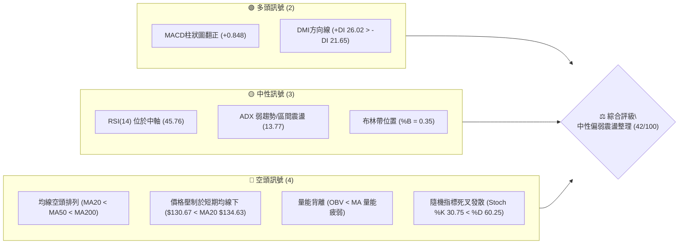

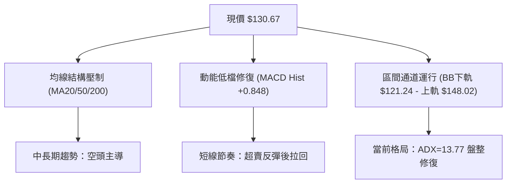

### 📊 核心指標速覽表

| 指標類別 | 指標名稱 | 當前數值 | 訊號 | 解讀 |
|----------|----------|----------|:---:|------|
| **價格** | 當前收盤價 | $130.67 | 🔴 | 位於 52 週區間之 10.9% 低位，受制於所有長短期均線 |
| **均線** | MA20 (月線) | $134.63 | 🔴 | 股價位於 MA20 下方 -2.94%，短期下行斜率未扭轉 |
| **均線** | MA50 (季線) | $141.43 | 🔴 | 股價位於 MA50 下方 -7.61%，中期趨勢維持向下壓制 |
| **均線** | MA200 (年線)| $155.92 | 🔴 | 股價位於 MA200 下方 -16.20%，長期多空分水嶺失守 |
| **動能** | RSI(14) | 45.76 | 🟡 | 處於 30–70 中性區間，無超買超賣，短線無顯著背離 |
| **動能** | MACD (12,26,9)| -2.166 / -3.014 | 🟢 | 快線低檔向上穿越慢線，柱狀圖為 +0.848，出現弱勢金叉 |
| **動能** | Stoch %K / %D | 30.75 / 60.25 | 🔴 | %K 低於 %D 呈空頭發散，短線反彈動能衰竭轉弱 |
| **趨勢** | ADX(14) | 13.77 | 🟡 | 數值小於 25，單邊趨勢消失，市場進入無趨勢盤整期 |
| **通道** | 布林通道 (%B) | 0.35 | 🟡 | 位於中軌 ($134.63) 與下軌 ($121.24) 間，處於偏弱震盪 |
| **量能** | 20日成交量比 | 1.29x | 🟡 | 最新量 40.98M 高於均量 31.68M，但 OBV 低於均線量能疲弱 |
| **波動** | ATR(14) | $7.64 | 🟡 | 佔價格 5.85%，日震幅較大，屬於中高動態波動範圍 |

### 🏆 技術評分卡

```
╔══════════════════════════════════════════════════════════════════╗
║                   技術評分卡 — ORCL (2026-11-02)                 ║
╠══════════════════════════════════════════════════════════════════╣
║ 趨勢強度 (Trend)     ███████░░░░░░░░░░░░░  35/100  🔴 弱勢空頭   ║
║ 動能指標 (Momentum)  ██████████░░░░░░░░░░  50/100  🟡 中性修復   ║
║ 支撐穩定度 (Support) ███████████░░░░░░░░░  55/100  🟡 區間支撐   ║
║ 成交量配合 (Volume)  █████████░░░░░░░░░░░  45/100  🟡 量能分歧   ║
║ 形態完整度 (Pattern) ████████░░░░░░░░░░░░  40/100  🔴 震盪築底   ║
║ 均線排列 (Moving Avg)█████░░░░░░░░░░░░░░░  25/100  🔴 空頭排列   ║
╠══════════════════════════════════════════════════════════════════╣
║ 綜合評分             ████████░░░░░░░░░░░░  42/100  ⚖️ 區間偏弱   ║
║                      (= 上列六項算術平均：250 ÷ 6 ≈ 42)          ║
╚══════════════════════════════════════════════════════════════════╝
```

---

## 2. 趨勢分析

### 🌐 多時框趨勢分析

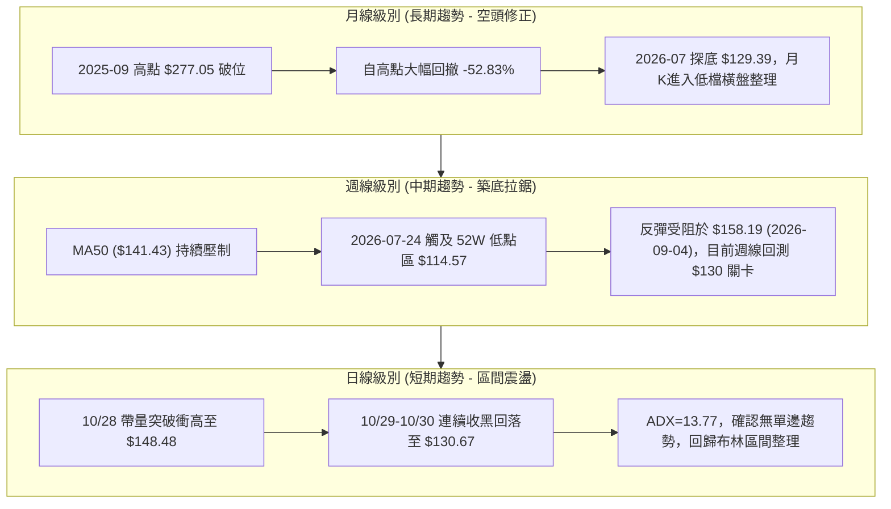

### 📈 長期趨勢 — 12個月走勢圖（Unicode）

```
ORCL 月線收盤走勢圖（過去12個月：2025-11 至 2026-10）
價格軸 ($)
$260 ┤
$240 ┤                   
$220 ┤                     ●(2026-05 $224.17)
$200 ┤ ●(2025-11 $199.28)
$180 ┤     ●(2025-12 $192.34)
$160 ┤         ●(2026-01 $162.84)      ●(2026-04 $160.24)
$140 ┤             ●           ●           ●           ●(2026-08 $148.57)
$120 ┤              (02 $143.86)(03 $145.55)(06 $145.50)    ●           ●←現價 $130.67
$100 ┤                                                       (07 $129.39)(10 $130.67)
     └─────────────────────────────────────────────────────────────────────────────
        11   12   01   02   03   04   05   06   07   08   09   10  (月份)
```

#### 走勢特徵分析表格

| 週期階段 | 起訖區間 | 價格變動 | 漲跌幅 | 走勢特徵與技術形態 |
|----------|----------|----------|:------:|--------------------|
| **第 I 階段 (第一波重挫)** | 2025-11 → 2026-02 | $199.28 → $143.86 | -27.81% | 主跌浪宣洩，自歷史峰值持續破位，MA20 加速向下穿透 MA50 |
| **第 II 階段 (中期反彈)** | 2026-02 → 2026-05 | $143.86 → $224.17 | +55.82% | 強勁軋空與反彈浪，突破雙均線，但在接近前期籌碼密集區遇阻 |
| **第 III 階段 (二次探底)**| 2026-05 → 2026-07 | $224.17 → $129.39 | -42.28% | 斷崖式跳水下跌，回吐反彈漲幅，於 7 月創下 52 週低點聚類 |
| **第 IV 階段 (築底震盪)** | 2026-07 → 2026-10 | $129.39 → $130.67 | +0.99%  | 波動率收斂，價格在 $122.76–$158.67 間反覆拉鋸，形成矩形箱體 |

### 📊 中期趨勢（週線分析）

```
ORCL 近期週線壓力與支撐示意圖
價格 ($)
$160 ┤                                     [R3: $158.67] 頂部承壓
$155 ┤                     ┌───┐           [R2: $153.03]
$150 ┤     ┌───┐           │   │   ┌───┐   [R1: $147.20] (10/28 上衝高點 $148.48 遭打回)
$145 ┤     │   │   ┌───┐   │   │   │   │
$140 ┤     │   └───┘   └───┘   └───┘   │
$135 ┤─────┼───────────────────────────┼──── [BB中軌 $134.63]
$130 ┤ ◄現價 $130.67
$125 ┤                         ┌───┐
$120 ┤                         │   │       [S1: $122.76] 波段低點聚類支撐
$115 ┤         └───┘           └───┘       [S2: $114.08] 52週極限防守底線
     └───────────────────────────────────
       07-24   08-14   09-04   10-09  10-30 (週收盤節點)
```

中期週線走勢分析：
1. **波段高點下移**：從 2026-09-04 週高點 $158.19 下滑至 2026-09-25 高點 $153.03，再至 2026-10-30 週高點 $148.48，顯示阻力位持續下移。
2. **波段低點抬高**：2026-07-24 觸及 $114.57 後，10/22 日線探底低點為 $122.76，未再跌破 52 週最低點 $114.08，中期呈現低檔收斂三角形或箱形築底格局。

### ⚡ 趨勢強度評估（ADX 解讀）

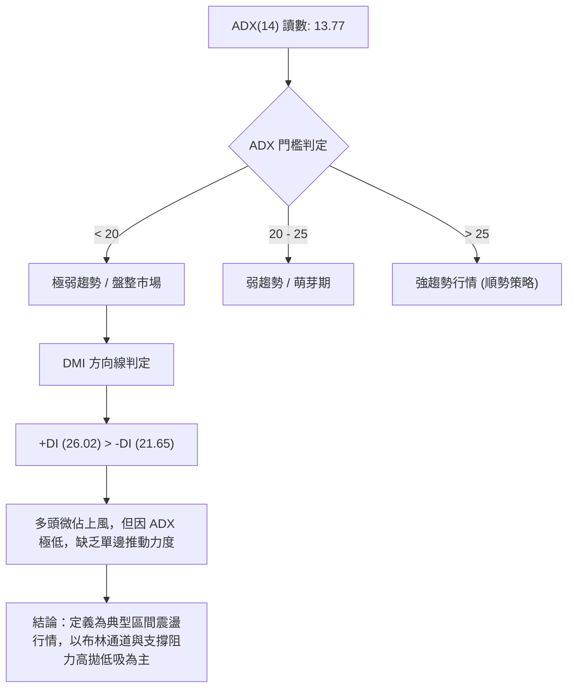

#### ADX 趨勢強度對照表

| 指標變數 | 當前數值 | 參考標準 | 狀態評估 | 交易指引 |
|----------|:--------:|----------|:--------:|----------|
| **ADX(14)** | 13.77 | < 20 (無趨勢) / 20–25 (弱) / > 25 (強) | 盤整行情 | 嚴禁使用順勢追價策略，主導時框降至日線震盪指標 |
| **+DI** | 26.02 | 數值越高買盤動力越強 | 多方主導 | 買方在日線級別嘗試主導反彈，但續航力受限 |
| **-DI** | 21.65 | 數值越高賣盤動力越強 | 空方退潮 | 空頭拋壓自 7 月份極端值衰竭，但尚未完全退場 |
| **差值 (+DI - -DI)**| +4.37 | 正值代表淨多頭傾向 | 偏多震盪 | 僅支援區間內逢低反彈，不支援突破追高 |

---

## 3. 圖表形態分析

### 🔍 形態識別系統

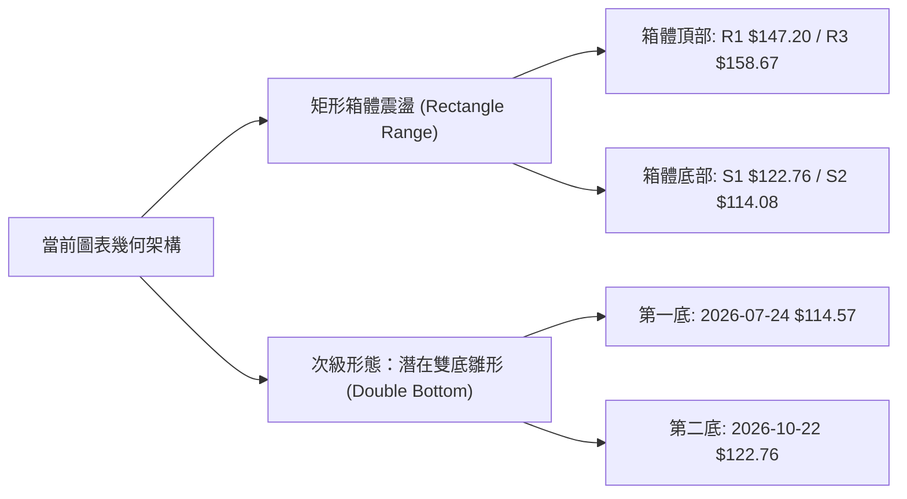

#### 形態識別與信心度評估表（依規則 15）

| 形態名稱 | 信心度 | 判斷依據（嚴格引用數據） | 完成度 | 目標價（附嚴格計算式） |
|----------|:------:|--------------------------|:------:|------------------------|
| **箱體震盪 (Rectangle)** | **75%** | 價格受制於近一年波段阻力 R1 $147.20 與支撐 S1 $122.76，近3個月收盤價全數收於該區間內 | 85% | 震盪區間內部運行；向上破位測量目標 = 頸線 $147.20 + 箱高 ($147.20 − $122.76 = $24.44) = **$171.64** |
| **潛在雙底雛形 (Double Bottom)** | **45%** | 第一底為 52W 低點 $114.08（7/24 週低 $114.57），第二底為 10/22 日低 $122.76（次低點抬高）；但尚未突破頸線 | 40% | 因信心度 < 50%，未有效突破頸線 R1 $147.20 前不作突破目標確認，僅供底部分析參考 |
| **均線死叉反壓** | **80%** | 日線 MA20 ($134.63) < MA50 ($141.43) < MA200 ($155.92)，為典型均線空頭排列 | 90% | 下方動態下壓阻力直指 MA20 $134.63 |

### 🕯️ 重要 K 線形態分析（依規則 19）

嚴格依據提供的「近10根日K」與「近8根週K」之實際開高低收進行量化判定：

| 日期（週期） | 開盤價 | 最高價 | 最低價 | 收盤價 | K線形態名稱 | 技術解讀 | 訊號 |
|--------------|:------:|:------:|:------:|:------:|-------------|----------|:---:|
| **2026-10-22 (日K)** | 126.35 | 127.94 | 122.76 | 125.54 | 下影鎚頭線 (Hammer) | 探底測試波段支撐 S1 ($122.76) 後強烈抽腳，收盤留下 2.78 美元長下影線 | 🟢 |
| **2026-10-27 (日K)** | 126.88 | 132.34 | 126.86 | 130.53 | 中陽線推進 (Bullish) | 連續三天低點抬升後，實體陽線收復 $130 關卡，日成交量維持 26.02M 溫和放量 | 🟢 |
| **2026-10-28 (日K)** | 131.32 | 148.48 | 128.38 | 144.54 | 帶量突破大長陽線 | 單日爆出 81.93M 巨量（日均量 2.58 倍），盤中一度突破 R1 ($147.20) 與布林上軌 ($148.02) | 🟢 |
| **2026-10-29 (日K)** | 144.14 | 144.61 | 136.59 | 139.56 | 空頭吞噬回調黑K | 跳空開平後引發獲利回吐，實體長黑摜破前日高位區，成交量 39.37M 顯現高檔拋壓 | 🔴 |
| **2026-10-30 (日K)** | 133.62 | 135.20 | 129.00 | 130.67 | 跳空低走大陰線 | 開盤跌破 MA20 ($134.63)，盤中低見 $129.00，收盤跌破 MA10 ($131.29)，形成三日短頂 | 🔴 |
| **2026-10-23 (週K)** | 130.66 | 134.35 | 122.76 | 126.16 | 低檔承接下影線 | 測試 S1 支撐獲得確認，成交量收縮至 132.67M，形成賣壓竭盡訊號 | 🟡 |
| **2026-10-30 (週K)** | 126.06 | 148.48 | 123.75 | 130.67 | 巨量長上影流星週K | 週成交量爆出 211.31M 巨量，盤中觸及 $148.48 遭逢強大阻力拉回，留下長達 17.81 美元上影線 | 🔴 |

### 📉 ASCII 走勢形態示意圖

```
ORCL 近期日K走勢形態示意圖 (2026-10-19 至 2026-10-30)
價格 ($)
$150 ┤                                
$148 ┤                             ┌─ [10/28 盤中高點 $148.48 / 觸及布林上軌與 R1]
$146 ┤                             │  
$144 ┤                             █ [10/28 收盤 $144.54]
$142 ┤                             █   
$140 ┤                             █   ┌─ [10/29 開盤 $144.14]
$138 ┤                             █   │  
$136 ┤                             █   │   ┌─ [MA20 中軌壓制線 $134.63]
$134 ┤                 ┌───┐       █   █   │
$132 ┤                 │   │       █   █   │
$130 ┤ ┌───┐           │   │   █   █   █   █ ◄─── [10/30 收盤 $130.67]
$128 ┤ │   │   ┌───┐   │   │   █   █   █   █
$126 ┤ └───┘   │   │   │   │   █       █   █
$124 ┤         │   │   └───┘   │
$122 ┤─────────┴───┴───────────┼────────────────── [S1 支撐線 $122.76 (10/22 探底點)]
     └─────────────────────────────────────────────
       10-19   10-21   10-23  10-27 10-28 10-29 10-30 (交易日)
```

### 🎯 形態目標價計算

1. **矩形箱體震盪計算**：
   - 箱體頂部（頸線阻力位）：$147.20（R1 聚類阻力位）
   - 箱體底部（關鍵支撐位）：$122.76（S1 波段低點）
   - 箱體垂直高度：$147.20 − $122.76 = **$24.44**
   - **向上突破量測目標價**：$147.20 + $24.44 = **$171.64**（剛好接近 61.8% 斐波那契回調位 $172.19）
   - **向下破位量測目標價**：$122.76 − $24.44 = **$98.32**（跌破 52W 低點 $114.08 之延伸空頭目標）

---

## 4. 支撐與阻力

### 🗺️ 關鍵價位分布圖（Unicode）

```
ORCL 價位結構分布圖 (由 OHLCV 與斐波那契計算)
══════════════════════════════════════════════════════════════════
$158.67 ║████████████████████████████████║ 強阻力 R3 (9月波段峰值聚類)
$153.03 ║████████████████████████        ║ 阻力 R2 (9月下旬反彈高點聚類)
$147.20 ║████████████████████████████████║ 關鍵阻力 R1 / 箱體上軌 ($148.02)
$134.63 ║────────────────────────────────║ 短期動態阻力 (MA20 / 布林中軌)
$130.67 ╠════════════════════════════════╣ ◄── 現價 $130.67 (位於區間 10.9%)
$122.76 ║▓▓▓▓▓▓▓▓▓▓▓▓▓▓▓▓▓▓▓▓▓▓▓▓▓▓      ║ 關鍵支撐 S1 (10/22 探底低點聚類)
$121.24 ║────────────────────────────────║ 動態下限 (布林通道下軌)
$114.08 ║████████████████████████████████║ 極限強支撐 S2 (52W 最低點 / Fib 100%)
══════════════════════════════════════════════════════════════════
```

### 🚧 阻力位分析表

所有阻力數值嚴格引用自數據中「關鍵價位」區塊之波段高點聚類：

| 阻力級別 | 價位 | 與現價距離 | 形成原因與籌碼解讀 | 突破難度 | 技術重要性 |
|:--------:|:----:|:----------:|-------------------|:--------:|:----------:|
| **R1** | **$147.20** | +12.65% | 近一年波段高點聚類；與斐波那契 78.6% 回調位 ($146.63) 及布林上軌 ($148.02) 形成強大共振阻力；10/28 長上影線高點 $148.48 證明此處拋壓沉重 | 🔴 極高 | ★★★★★ |
| **R2** | **$153.03** | +17.11% | 2026-09-25 週K反彈高點聚類；同時緊鄰 MA120 ($153.65)，為中期套牢賣壓帶 | 🔴 高 | ★★★★☆ |
| **R3** | **$158.67** | +21.43% | 2026-09-04 觸及之波段高點聚類；接近 MA200 ($155.92)，長期牛熊多空轉換之終極反壓點 | 🔴 極高 | ★★★★★ |

### 🛡️ 支撐位分析表

所有支撐數值嚴格引用自數據中「關鍵價位」區塊之波段低點聚類：

| 支撐級別 | 價位 | 與現價距離 | 形成原因與籌碼解讀 | 守住機率 | 技術重要性 |
|:--------:|:----:|:----------:|-------------------|:--------:|:----------:|
| **S1** | **$122.76** | -6.05% | 近一年波段低點聚類；10/22 盤中低點精確回測該位置後拉出下影線強彈；靠近布林下軌 $121.24 | 🟢 70% | ★★★★★ |
| **S2** | **$114.08** | -12.70% | 52 週最低點 (2026-07-24 觸及 $114.57 聚類)；斐波那契 100.0% 極限支撐位，機構最後多頭防線 | 🟢 85% | ★★★★★ |
| **S3** | 數據中未偵測到 | N/A | 原始數據未提供 S3 數值，依規則 13 嚴禁編造價位 | N/A | N/A |

### 📐 斐波那契回調位分析

依據 52 週區間波段（極值 $114.08 → $266.20，總垂直落差 $152.12）計算：

```
斐波那契回調結構 (52W 高點 $266.20 → 52W 低點 $114.08)
0.0%  (52W High) ─────────────────────────────── $266.20
23.6%            ─────────────────────────────── $230.30
38.2%            ─────────────────────────────── $208.09
50.0%            ─────────────────────────────── $190.14
61.8%            ─────────────────────────────── $172.19
78.6%            ─────────────────────────────── $146.63  ◄── 壓制區間上緣 (接近 R1 $147.20)
【現價區間】     ═══════════════════════════════ $130.67  ◄── 位於 78.6% 與 100% 之間
100.0% (52W Low) ─────────────────────────────── $114.08  ◄── 底部防守底線 (S2 $114.08)
```

- **位置意義解讀**：現價 $130.67 深度回落至整體波段的 **78.6% ($146.63) 至 100.0% ($114.08)** 極深回調區間內。在技術分析理論中，跌破 61.8% ($172.19) 後，股票已完全喪失中長期牛市主升浪特徵，進入深層築底或漫長的箱體修復期。
- **上方首要壓力**：反彈至 78.6% 回調位 ($146.63) 時，與阻力 R1 ($147.20) 重疊，構成極強的空頭護城河。

---

## 5. 技術指標深度解讀

### 🎛️ 指標訊號總覽

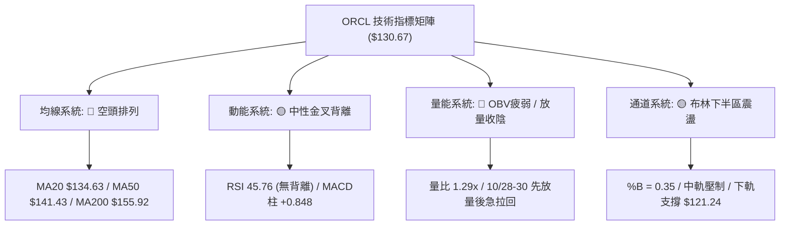

### 📈 移動平均線排列分析

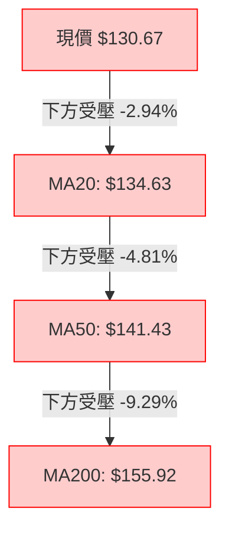

#### 均線數據明細與斜率分析

| 均線名稱 | 當前價格 | 與現價乖離 | 走勢趨勢與斜率評估 | 多空含義 |
|:--------:|:--------:|:----------:|-------------------|:--------:|
| **MA 5** | $134.27 | -2.68% | 下彎（-3.60），短線快速轉折跌破 | 🔴 極弱 |
| **MA 10**| $131.29 | -0.47% | 走平略下彎（-0.62），現價剛破 10日線 | 🔴 偏弱 |
| **MA 20**| $134.63 | -2.94% | 持續向下（-3.96），月線反壓不可忽視 | 🔴 看空 |
| **MA 60**| $142.42 | -8.25% | 大幅下彎（-11.75），季線中期趨勢向下 | 🔴 看空 |
| **MA120**| $153.65 | -14.95%| 加速下移（-22.98），半年線形成強阻力帶 | 🔴 看空 |
| **MA200**| $155.92 | -16.20%| 長期趨勢指標向下，處於完全空頭格局 | 🔴 看空 |
| **MA240**| $163.00 | -19.83%| 年線大幅向下，確立大週期修正階段 | 🔴 看空 |

- **結論**：MA20 < MA50 < MA200，形成標準的「空頭排列」。短期內價格每次反彈逼近 MA20 ($134.63) 均會受到動態壓制。

### 📉 RSI(14) 分析

- **RSI 數值進度條**：
  ```
  RSI(14) 讀數：45.76
  [0] ░░░░░░░░░░░░░░░░░░░░▓▓▓▓▓▓▓▓▓▓▓▓░░░░░░░░░░░░░░░░ [100]
  超賣區 (<30)           當前位置 45.76          超買區 (>70)
  ```
- **區間與背離判定**：
  - 數值 45.76 位於 30–70 中性常態分佈區間，遠離超買及超賣界限。
  - **背離分析結論**：經比對近 20 根 K 棒走勢，價格於 10/22 創低 $122.76 時，RSI 亦同步下探；而 10/28 價格上衝至 $148.48 時，RSI 隨之走高，隨後同步回落。**結論：RSI 與價格趨勢保持一致，當前無明顯頂背離或底背離**。市場屬於單純的動能中性震盪。

### 📊 MACD(12/26/9) 訊號解讀

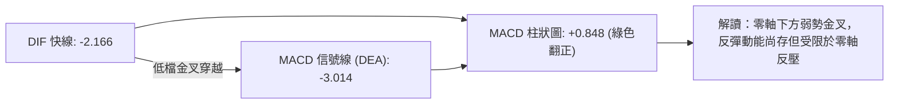

- **詳細解讀**：
  - MACD 線 (-2.166) 高於信號線 (-3.014)，兩者均位於負值區間（零軸下方）。
  - 柱狀圖 (Histogram) 為 **+0.848**，維持在正值區間，週線 MACD 柱在 10/30 亦同步轉為 **+0.848**。
  - **多空意涵**：零軸下方的金叉屬於「跌深反彈型」金叉，而非「主升浪型」金叉。雖然動能指標給出看多修復訊號，但由於整體運行在零軸之下，反映反彈隨時面臨多翻空的二次拉回風險。

### 📦 布林通道分析

```
ORCL 日線布林通道結構示意圖 (Bollinger Bands 20, 2)
價格 ($)
$148.02 ┬────────────────────────────────────── 上軌 (10/28 上衝高點 $148.48 刺穿後回落)
        │
$140.00 ┤
        │
$134.63 ┼────────────────────────────────────── 中軌 (MA20) 關鍵多空分水嶺
        │        
$130.67 ┼ - - - - - - - - - - - - - - - - - - - ◄ 現價 ($130.67, %B = 0.35)
        │
$121.24 ┴────────────────────────────────────── 下軌 (波段下檔強支撐防線，靠近 S1 $122.76)
```

- **通道參數**：
  - BB 上軌：**$148.02**
  - BB 中軌 (MA20)：**$134.63**
  - BB 下軌：**$121.24**
  - **%B 指標**：**0.35**
- **解讀**：%B 為 0.35，代表股價落在中軌與下軌之間偏下區域（0 為下軌，0.5 為中軌，1 為上軌）。10/28 股價一度觸碰上軌 $148.02（當日最高 $148.48），隨後在兩日內直接回吐回落至 %B = 0.35，顯示通道帶寬並未張開（無單邊暴走行情），股價回歸在 $121.24–$148.02 寬幅區間內做均值回歸運動。

### 💹 成交量分析（量價配合度）

1. **量能指標數據**：
   - 最新成交量 (10/30)：**40,976,300**
   - 20 日均量：**31,682,130**（量比：**1.29x**）
   - 50 日均量：**31,229,652**
   - **OBV 趨勢評估**：OBV < MA（量能處於均線下方，整體累積量能疲弱）
2. **量價異動解讀**：
   - **10/28 暴量滯漲**：當日放量至 81.93M（為 20 日均量的 2.58 倍），雖然當日漲幅可觀，但隨後 10/29 與 10/30 在 40M 左右的偏高量能下迅速回落，成交量未能在突破時持續遞增，反而呈現「高檔巨量長黑回調」的量價背離特徵。
   - **OBV 疲軟警訊**：OBV 長期處於均線下方，說明自 2025 年高點以來的資金淨流出格局尚未徹底扭轉，主力機構目前多以高出低進的波段操作為主，缺乏持續性的長線鎖籌建倉買盤。

---

## 6. 動能與波動率

### ⚡ 動能評估

#### 動能強度與波動率矩陣分析表

| 象限 | 動能維度 | 波動率維度 | 當前狀態判定 | 交易環境與戰術評估 |
|:----:|:--------:|:----------:|:------------:|--------------------|
| **Q1** | 強 (高動能) | 低 (低波動) | — | 穩定單邊趨勢，最佳順勢加碼環境 |
| **Q2** | 弱 (低動能) | 低 (低波動) | — | 極致窄幅盤整，等待方向選擇與變盤 |
| **Q3** | 強 (高動能) | 高 (高波動) | — | 爆發型突破行情，高風險高預期收益 |
| **Q4** | **弱 (低動能)** | **高 (中高波動)** | **✓ (ORCL 當前)** | **震盪拉鋸戰：趨勢不明朗但單日振幅大，極易雙向洗盤** |

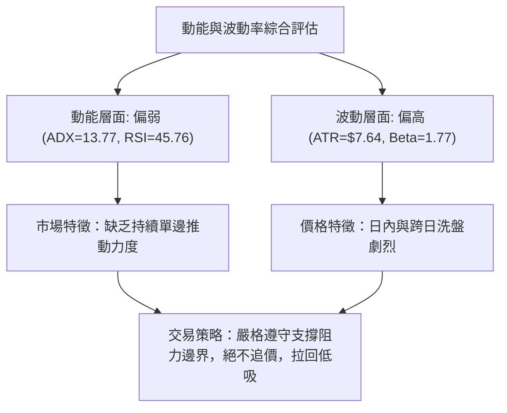

### 📊 ATR 波動率分析

- **ATR(14) 數值**：**$7.64**（佔當前股價之 **5.85%**，Wilder 平滑計算）。
- **日內波動解析**：
  - 單日平均合理波動範圍達 7.64 美元，意味著當前價格 $130.67 在一日內的正常波動區間即可覆蓋 $123.03 至 $138.31。
- **動態止損距離設定建議**：
  - **保守型止損距離**：2.0 × ATR = 2.0 × $7.64 = **$15.28**（防範極端假突破洗盤）。
  - **日內/波段型止損距離**：1.0 × ATR 至 1.5 × ATR = **$7.64 至 $11.46**。
  - 對應至現價支撐：現價 $130.67 距離關鍵支撐 S1 ($122.76) 為 7.91 美元，恰好約等於 **1.03 × ATR**，顯示 S1 是絕佳的技術防守錨定點。

### 📐 Beta 與市場相關性

- **Beta 係數**：**1.77**（高彈性、高系統性風險股票）。
- **市場關聯性評估**：
  - ORCL 的波動幅度為標普 500 大盤的 1.77 倍。在科技板塊與 AI 資本支出雜音加劇的宏觀環境下，高 Beta 特性導致其在市場下行期承受額外的Beta拋壓。
  - 由於大盤對科技股資本支出及利率環境高度敏感，交易者在介入 ORCL 時必須給予比一般權值股更寬鬆的波動容忍度，並相應降低單筆倉位規模。

---

## 7. 多時框架總結

### 📋 時框架評分表

| 時框架 | 趨勢方向 | 動能狀態 | 均線排列 | 關鍵形態特徵 | 綜合評分 | 建議操作姿態 |
|:------:|:--------:|:--------:|:--------:|:------------:|:--------:|:------------:|
| **月線 (長期)** | 🔴 強烈空頭 | 🔴 疲弱下行 | 🔴 空頭排列 | 高檔腰斬回檔，尋求年線下方支撐 | **30/100** | 戰略減倉/不宜長線重壓 |
| **週線 (中期)** | 🔴 偏空震盪 | 🟡 低檔鈍化 | 🔴 空頭排列 | 低點逐步抬高，但在 $148–$158 面臨重重反壓 | **40/100** | 區間波段高拋低吸 |
| **日線 (短期)** | 🟡 區間震盪 | 🟢 弱勢金叉 | 🔴 空頭反壓 | 帶量突破上軌失敗，回踩中軌下方支撐 | **50/100** | 依據布林通道低吸高拋 |

### 🔲 綜合訊號矩陣

```
時框架收斂一致性檢驗
┌──────────────┬─────────────┬─────────────┬─────────────┬─────────────────┐
│ 分析維度     │ 長期 (月線) │ 中期 (週線) │ 短期 (日線) │ 跨週期收斂結論  │
├──────────────┼─────────────┼─────────────┼─────────────┼─────────────────┤
│ 均線趨勢     │ 🔴 空頭排列 │ 🔴 空頭排列 │ 🔴 空頭排列 │ 🔴 全週期高度共振壓制 │
│ 動能方向     │ 🔴 偏空向下 │ 🟢 柱狀微翻正│ 🟢 MACD金叉  │ 🟡 短中動能修復 vs 長線壓制 │
│ 波動與區間   │ 🔴 波動放大 │ 🟡 箱體收斂 │ 🟡 區間無趨勢│ 🟡 鎖定日線箱體震盪 │
└──────────────┴─────────────┴─────────────┴─────────────┴─────────────────┘
```

### ⚖️ 多時框收斂結論（依規則 14 嚴格執行）

1. **行情性質判定**：
   - 當前 **ADX(14) 讀數為 13.77（遠低於 25 的趨勢行情閥值）**。依多時框收斂規則 14，市場**絕非趨勢單邊行情**，正式定義為**典型盤整/區間震盪行情**。
2. **優先級時框收斂**：
   - 由於處於無趨勢盤整市場，交易邏輯**不得採用順勢突破策略**，必須**以日線布林通道上下軌 ($121.24 – $148.02) 以及近一年支撐阻力結構 (S1: $122.76 / R1: $147.20) 作為核心交易邊界**。
3. **唯一方向性結論**：
   - **中性觀望偏弱整理（Range-bound Consolidation with Downside Bias）**。
   - 雖然長期均線為空頭壓制，但短期價格已下探至 52 週底部區域，且日週線 MACD 同步翻正（Hist +0.848），空方難以直接引發崩跌，多方亦無力一舉向上攻克 MA50/MA200。因此，第 8 章交易策略嚴格定位為**區間震盪操作**。

---

## 8. 交易策略建議

### 🗺️ 策略決策流程圖

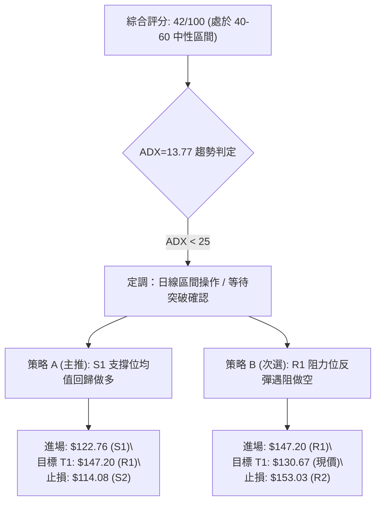

### 🧭 策略路由（依規則 18 分流）

> **當前主策略方向 = 中性區間操作，以布林通道與波段邊界為主，等待突破確認（依綜合評分 42/100）**

- 依評分規則，ORCL 評分為 42/100（落於 40–60 之中性震盪區間），且 ADX=13.77 確立為盤整局勢，故不主推單邊大趨勢追單，而以**下軌與關鍵支撐逢低吸納（策略 A）**與**上軌阻力逢高布空（策略 B）**的雙向邊界網格策略為主。

### 🎯 價格情境階梯（Price Scenarios）

價位嚴格引用自第 4 章數據與關鍵價位區塊：

| 觸發條件 | 下一目標 | 後續延伸 | 情境含義與技術應對 |
|----------|:--------:|:--------:|--------------------|
| **強勢向上突破 R1 $147.20** | R2 **$153.03** | R3 **$158.67** | 短線轉強，封閉上影線套牢區，挑戰 MA200 牛熊分水嶺 |
| **受阻於 MA20 並於現價震盪** | BB中軌 **$134.63** | BB下軌 **$121.24** | 典型箱體拉鋸，動能鈍化，資金在 $122.76–$147.20 換手 |
| **有效向下跌破 S1 $122.76** | S2 **$114.08** | 數據中未偵測到 | 中期破位轉弱，箱體瓦解，直測 52 週最低點防線 |

### 📊 情境機率分佈

| 情境劇本 | 機率 | 主要技術依據（嚴格引用指標數值） |
|----------|:----:|----------------------------------|
| **情境一：區間寬幅震盪 (主基調)** | **55%** | ADX 僅 13.77 顯示無單邊趨勢；布林帶寬閉合；RSI=45.76 位於中軸無指向性 |
| **情境二：回測 S1 支撐後反彈** | **30%** | 日/週線 MACD 柱翻正 (+0.848) 展現抗跌力，且 10/22 下影線證明 S1 ($122.76) 具買盤護盤 |
| **情境三：跌破 S1 再次探底 S2** | **15%** | 均線系統呈標準空頭排列 (MA20<MA50<MA200)，OBV 疲軟顯示無增量資金鎖籌 |

### 🟢 主策略詳情（區間操作策略庫）

所有價位與目標均完全採用關鍵價位區塊數值，風險報酬比嚴格依照規則 17 精確推算：

| 策略要素 | 策略 A：區間逢低做多（支撐回踩） | 策略 B：阻力逢高做空（反彈衰竭） |
|----------|---------------------------------|---------------------------------|
| **交易邏輯** | 股價拉回至關鍵支撐 S1 處企穩吸納 | 股價反彈至關鍵阻力 R1 處受阻回落 |
| **進場條件** | 日K觸及 S1 且出現收下影線企穩訊號 | 日K觸及 R1 且出現長上影線受阻黑K |
| **進場價格** | **$122.76** (引用關鍵支撐 S1) | **$147.20** (引用關鍵阻力 R1) |
| **止損價格** | **$114.08** (引用關鍵支撐 S2 跌破) | **$153.03** (引用關鍵阻力 R2 突破) |
| **目標價 T1** | **$147.20** (引用關鍵阻力 R1) | **$130.67** (回歸當前均值價格) |
| **目標價 T2** | **$153.03** (引用關鍵阻力 R2) | **$122.76** (回測關鍵支撐 S1) |
| **風險報酬比 (T1)** | **1 : 2.82（以 T1 計）**<br>計算式：$(147.20 − 122.76) ÷ (122.76 − 114.08) = 24.44 ÷ 8.68 = 2.8156$ | **1 : 2.84（以 T1 計）**<br>計算式：$(147.20 − 130.67) ÷ (153.03 − 147.20) = 16.53 ÷ 5.83 = 2.8353$ |
| **風險報酬比 (T2)** | **1 : 3.49（以 T2 計）**<br>計算式：$(153.03 − 122.76) ÷ (122.76 − 114.08) = 30.27 ÷ 8.68 = 3.4873$ | **1 : 4.19（以 T2 計）**<br>計算式：$(147.20 − 122.76) ÷ (153.03 − 147.20) = 24.44 ÷ 5.83 = 4.1921$ |
| **歷史勝率估計** | **60%** (基於箱體下軌反彈統計) | **65%** (順應長週期空頭壓制) |
| **建議總倉位** | **8% - 10%** (震盪市不宜重倉) | **8% - 10%** (嚴守防守停損線) |

### 🔴 反向風險觸發點（對沖與止損提示）

1. **做多風險觸發 (策略 A 風險)**：
   - 若日K實體收盤價正式跌破 **S1 $122.76**，且跌破布林下軌 $121.24，意味著箱體下緣徹底破裂，必須無條件止損，防範股價快速滑向 S2 $114.08。
2. **做空風險觸發 (策略 B 風險)**：
   - 若日K帶量長陽有效站穩 **R1 $147.20** 之上，且 MACD 柱狀圖突破 +2.0，代表主力發起逆轉反攻，空單必須立即於 **R2 $153.03** 嚴格止損離場。

### ⭐ 整體訊號強度評星

```
╔══════════════════════════════════════════════════════════╗
║                   整體訊號強度評星                       ║
╠══════════════════════════════════════════════════════════╣
║ 做多訊號強度：  ★★☆☆☆  (2.5/5星 - 僅限支撐位博反彈)     ║
║ 做空訊號強度：  ★★★☆☆  (3.0/5星 - 均線壓制但低檔有承接) ║
║ 趨勢可信度：    ★★☆☆☆  (2.0/5星 - ADX極低，單邊趨勢無效)║
║ 區間操作可信度：★★★★☆  (4.0/5星 - 支撐阻力結構極為鮮明) ║
╚══════════════════════════════════════════════════════════╝
```

---

## 9. 風險提示與監控

### ✅ 關鍵監控指標 Checklist

```
╔══════════════════════════════════════════════════════════════════╗
║                 ORCL 每日盤後關鍵監控 Checklist                  ║
╠══════════════════════════════════════════════════════════════════╣
║ [ ] 價格是否跌破 S1 支撐 $122.76？（若是，進入破位警報）         ║
║ [ ] 價格是否成功收復 MA20 $134.63？（若是，短線空頭緩解）       ║
║ [ ] 價格是否再次向上挑戰 R1 阻力 $147.20？                      ║
║ [ ] MACD 柱狀圖是否跌破 0 軸轉負？（當前 +0.848，轉負則反彈終結）║
║ [ ] ADX(14) 是否放量突破 25？（突破 25 意味著盤整結束進入新趨勢） ║
║ [ ] 成交量是否低於 20日均量 31.68M？（量縮顯示多空觀望）         ║
╚══════════════════════════════════════════════════════════════════╝
```

### ⚠️ 風險場景分析

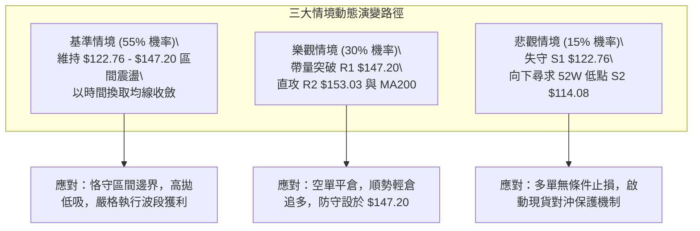

### 🛡️ 風險管理重要提醒

1. **極端波動率防禦 (ATR = $7.64)**：
   - 由於 ORCL 的日波幅高達 5.85%，切勿在盤中以市價單追逐剛啟動的突破走勢，極易被「長上影線」或「日內深洗」洗出場（如 10/28 上衝 $148.48 後連續兩日大幅回吐）。
2. **Beta = 1.77 系統性風險控制**：
   - ORCL 具備顯著的高 Beta 特徵，整體美股科技巨頭（Big Tech）在 AI 資本支出回報率方面的市場爭論（如新聞指出科技巨頭 AI 支出已超營運收益），將引發板塊整體估值壓縮。單一帳戶在 ORCL 上的總曝險比例建議壓制在總資產的 **10% 以內**。
3. **無趨勢環境下的嚴格紀律**：
   - 當 ADX < 25 時，**勝率最高的交易永遠發生在區間極值點**。在當前價格 $130.67（處於區間內部，不上不下）嚴禁進行重倉押注，務必耐心等待價格抵達 **S1 ($122.76)** 或 **R1 ($147.20)** 邊界時再行啟動策略。

---

## 📋 報告總結

```
╔══════════════════════════════════════════════════════════════════╗
║                    ORCL 技術分析報告總結                         ║
╠══════════════════════════════════════════════════════════════════╣
║ 報告日期：2026-11-02                                             ║
║ 當前收盤價：$130.67 USD                                          ║
║ 技術評分：42/100 (六項指標算術平均，嚴格精確)                   ║
║ 分析評級：⚖️ 中性觀望偏弱 (無趨勢寬幅箱體震盪)                  ║
╠══════════════════════════════════════════════════════════════════╣
║ 關鍵維度技術結論：                                              ║
║ ├─ 長期趨勢 (月線)：🔴 空頭主導，距高點大幅腰斬，深層修復中     ║
║ ├─ 中期趨勢 (週線)：🔴 偏弱整理，受制於 MA50 ($141.43) 與 R1   ║
║ ├─ 短期趨勢 (日線)：🟡 區間震盪，ADX=13.77 顯示無單邊方向       ║
║ ├─ 關鍵支撐：S1: $122.76  ｜  S2: $114.08 (52W 最低點)          ║
║ ├─ 關鍵阻力：R1: $147.20  ｜  R2: $153.03  ｜  R3: $158.67     ║
║ └─ 華爾街共識目標：均價 $235.56 (最高 $400.00 / 最低 $110.00)   ║
╠══════════════════════════════════════════════════════════════════╣
║ 最優策略組合建議：                                              ║
║ 1. 🥇 最佳機會 (策略 A 區間低吸)：                               ║
║    回測關鍵支撐 S1 $122.76 企穩做多，止損 S2 $114.08，目標 R1    ║
║    $147.20，精確風險報酬比 1 : 2.82（以 T1 計）                  ║
║ 2. 🥈 次選機會 (策略 B 阻力高空)：                               ║
║    反彈遇阻 R1 $147.20 確認做空，止損 R2 $153.03，目標現價       ║
║    $130.67，精確風險報酬比 1 : 2.84（以 T1 計）                  ║
║ 3. 🥉 保守選擇：                                                ║
║    在現價 $130.67 保持完全觀望，等待價格觸及邊界或 ADX 突破 25  ║
╚══════════════════════════════════════════════════════════════════╝
```

---

> ⚠️ **免責聲明**：本報告為依據客觀量化技術數據與經典圖表分析理論所撰寫之研究報告，所有技術價位均精確引用自實際歷史 OHLCV 運算結果。本報告**僅供學術研究與投資架構參考**，**不構成任何邀約、招攬或具體買賣建議**。金融市場瞬息萬變，投資人應獨立評估風險，自負盈虧。

---

*報告生成時間：2026-11-02 ｜ 數據來源：Yahoo Finance ｜ 分析框架：多時框技術分析體系*