# ORCL 技術分析報告

> **報告日期**：2026-11-04 ｜ **語言**：繁體中文 ｜ **數據來源**：Yahoo Finance ｜ **當前價格**：$126.19

---

## 目錄

| 章節 | 內容 |
|------|------|
| [1. 技術面概覽](#1-技術面概覽) | 訊號儀表板、核心指標、評分卡 |
| [2. 趨勢分析](#2-趨勢分析) | 多時框趨勢、長中短期走勢 |
| [3. 圖表形態分析](#3-圖表形態分析) | 形態識別、K線組合、目標價 |
| [4. 支撐與阻力](#4-支撐與阻力) | 關鍵價位、斐波那契回調 |
| [5. 技術指標深度解讀](#5-技術指標深度解讀) | MA/RSI/MACD/布林/成交量 |
| [6. 動能與波動率](#6-動能與波動率) | 動能評估、ATR、Beta |
| [7. 多時框架總結](#7-多時框架總結) | 時框架評分矩陣 |
| [8. 交易策略建議](#8-交易策略建議) | 多空策略、風險報酬比 |
| [9. 風險提示與監控](#9-風險提示與監控) | 監控指標、風險場景 |

---

## 1. 技術面概覽

### 🎯 技術訊號儀表板

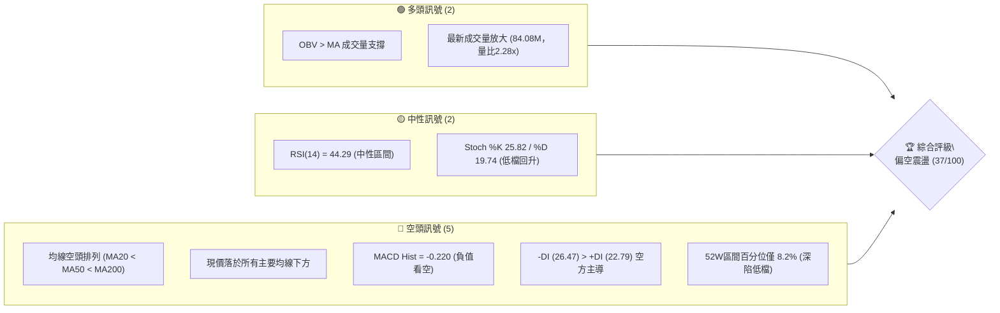

### 📊 核心指標速覽表

| 指標類別 | 指標名稱 | 當前數值 | 訊號 | 解讀 |
|----------|----------|----------|------|------|
| **價格** | 當前價格 | $126.19 | 🔴 | 位於52週區間 8.2%，深陷低檔弱勢整理區 |
| **均線** | MA20 | $132.59 | 🔴 | 價格在MA20下方 -4.83%，短線處於壓制狀態 |
| **均線** | MA50 | $140.58 | 🔴 | 價格在MA50下方 -10.24%，中期均線呈向下壓制 |
| **均線** | MA200 | $155.26 | 🔴 | 價格在MA200下方 -18.72%，長期架構處於空頭市場 |
| **動能** | RSI(14) | 44.29 | 🟡 | 位於 30–70 中性區間，空方略佔優勢但未超賣 |
| **動能** | MACD | -3.315 (Hist -0.220) | 🔴 | DIF在零軸下且低於Signal(-3.095)，柱狀圖為負 |
| **趨勢** | ADX(14) | 13.12 | 🟡 | ADX < 25 處於弱趨勢/低波動盤整，-DI(26.47) > +DI(22.79) |
| **通道** | 布林通道 %B | 0.27 | 🟡 | 價格貼近下軌($118.59)，位於下半軌通道震盪 |
| **波動** | ATR(14) | $8.04 | 🔴 | 佔價格 6.37%，單日波動幅度極大，風控難度高 |
| **量能** | 成交量比 | 2.28x (84.08M) | 🟢 | 突破20日均量(36.92M)，放量下影具短線承接跡象 |

### 🏆 技術評分卡

```
╔══════════════════════════════════════════════════════════════╗
║              技術評分卡 — ORCL (2026-11-04)                  ║
╠══════════════════════════════════════════════════════════════╣
║ 趨勢強度      ██████░░░░░░░░░░░░░░  30/100  🔴 空方主導弱勢    ║
║ 動能指標      ████████░░░░░░░░░░░░  40/100  🟡 中性偏弱空方    ║
║ 支撐穩定度    ████████░░░░░░░░░░░░  40/100  🟡 依託S1但仍脆弱   ║
║ 成交量配合    ████████████░░░░░░░░  60/100  🟢 低檔承接量釋放  ║
║ 形態完整度    ██████░░░░░░░░░░░░░░  30/100  🔴 底部形態尚未確立║
║ 均線排列      ████░░░░░░░░░░░░░░░░  20/100  🔴 完美空頭排列    ║
╠══════════════════════════════════════════════════════════════╣
║ 綜合評分      ███████░░░░░░░░░░░░░  37/100  🔴 偏空震盪        ║
║               (= 上列六項算術平均: (30+40+40+60+30+20)/6)    ║
╚══════════════════════════════════════════════════════════════╝
```

---

## 2. 趨勢分析

### 🌐 多時框趨勢分析

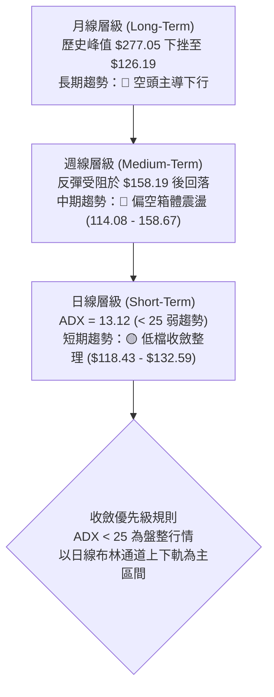

### 📈 長期趨勢 — 12個月走勢圖（Unicode）

```
ORCL 月線走勢圖（過去12個月：2025-11 至 2026-11）
價格軸 ($)
$200 ┤ ● (2025-11: $199.28)
$190 ┤   ● (2025-12: $192.34)
$180 ┤
$170 ┤
$160 ┤     ● (2026-01)                 ● (2026-04: $160.24)
$150 ┤                                                    ● (2026-08: $148.57)
$140 ┤       ● (2026-02) ● (2026-03)         ● (2026-06)      ● (2026-09)
$130 ┤                                           ● (2026-07)      ● (2026-10: $130.67)
$120 ┤                                                                ● (2026-11: $126.19)
$220 ┤                             ● (2026-05: $224.17 異常跳升)
     └─────────────────────────────────────────────────────────────────────────────
       11    12    01    02    03    04    05    06    07    08    09    10    11
      (25)  (25)  (26)  (26)  (26)  (26)  (26)  (26)  (26)  (26)  (26)  (26)  (26)
```

#### 走勢特徵分析表格

| 階段區間 | 起訖月份 | 起訖價位 | 漲跌幅 | 結構特徵與量價解讀 |
|----------|----------|----------|--------|--------------------|
| 主跌段 | 2025-11 → 2026-02 | $199.28 → $143.86 | -27.81% | 高檔獲利回吐，跌破兩百美元大關，呈單邊空頭殺戮 |
| 弱勢築底段 | 2026-02 → 2026-04 | $143.86 → $160.24 | +11.39% | 低檔回穩，成交量萎縮，小幅技術性反彈 |
| 假突破段 | 2026-04 → 2026-05 | $160.24 → $224.17 | +39.90% | 資金炒作拉升至 $224.17，惟缺乏基本面支撐迅速見頂 |
| 破位下挫段 | 2026-05 → 2026-07 | $224.17 → $129.39 | -42.28% | 斷崖式跳水，連續跌破多條長期均線，創階段低位 $114.08 |
| 低檔盤整段 | 2026-08 → 2026-11 | $148.57 → $126.19 | -15.06% | 反彈至 $158.19 後再度受阻，目前於 $120–$130 區間弱勢築底 |

### 📊 中期趨勢（週線分析）

```
ORCL 近期週線壓力與支撐結構示意圖
$160 ┤─────────────────────────────── [強阻力 R3: $158.67] (9月初反彈高點 $158.19 聚類)
$150 ┤─────────────────────────────── [阻力 R2: $153.03] (9月下旬反彈高點聚類)
$145 ┤─────────────────────────────── [關鍵阻力 R1: $147.20 / 78.6% 回調 $145.76]
$140 ┤      ▲             ▲
$135 ┤     ╱ ╲           ╱ ╲
$130 ┤────╱───╲─────────╱───╲──────── [BB中軌/MA20: $132.59]
$126 ┤───●─────●───────●─────●─────── [現價: $126.19]
$122 ┤─────────────────────────────── [支撐 S1: $122.76] (10/22、10/23低點防線)
$114 ┤─────────────────────────────── [強支撐 S2: $114.08] (52週最低點聚類)
```

- **中期格局解讀**：從近20週走勢觀察，ORCL 於 2026-07-24 觸及 52週低點 $114.08 展開修復反彈，在 2026-09-04 達到 $158.19 波段高點，隨後受制於 MA200($155.26) 與 R3($158.67) 強阻力帶，展開震盪下行。近8週維持在 $122.76 至 $148.48 寬幅震盪。
- **週線 MACD 狀態**：週 MACD 柱在 2026-10-30 短暫翻正(+0.848)後，本週又回落至 -0.220，顯示中期動能仍反覆不定，尚未確立翻多。

### ⚡ 趨勢強度評估（ADX 解讀）

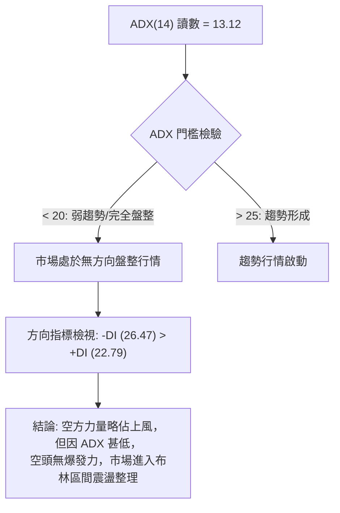

#### ADX 強度對照表

| 指標項 | 讀數 | 狀態級別 | 解讀意義 |
|--------|------|----------|----------|
| **ADX(14)** | **13.12** | 弱趨勢/盤整 (<20) | 當前缺乏單邊推動力，任何假突破或單日大漲均易轉為震盪 |
| **+DI** | **22.79** | 多方買盤 | 多頭推動意願偏低，反彈量能持續度差 |
| **-DI** | **26.47** | 空方賣盤 | 空方略高於多方 3.68 點，呈現溫和壓制而非恐慌拋售 |
| **DI差值** | **-3.68** | 空方佔優 | 短期下行風險尚未完全解除，但殺跌動能不足 |

---

## 3. 圖表形態分析

### 🔍 形態識別系統

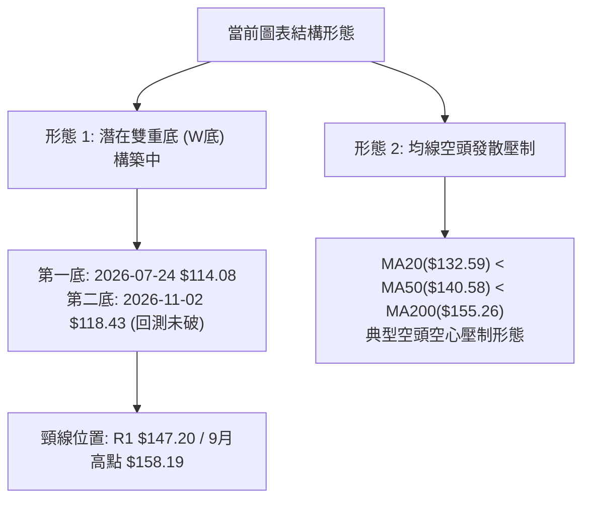

#### 形態識別與信心度評估表

| 形態 | 信心度 | 判斷依據（引用數據） | 完成度 | 目標價（附計算式） |
|------|--------|----------------------|--------|--------------------|
| **潛在低檔雙底** | **55%** | 2026-07-24低點 $114.08 (S2) 與 2026-11-02低點 $118.43 形成低點墊高，但尚未突破頸線 R1 $147.20 | 60% | 頸線 $147.20 + 形態高度($147.20 - $114.08 = $33.12) = **$180.32**（若頸線取 R1 推算） |
| **區間箱體震盪** | **75%** | 近期價格在 S1($122.76) 與 R1($147.20) 間來回擺盪，布林下軌($118.59)提供下檔防護 | 85% | 箱頂目標 = **$147.20 (R1)** |
| **空頭下行旗形** | **45%** | 訊號不足，僅做指標型解讀。雖均線呈空頭排列，但 ADX 僅 13.12 且成交量爆發，旗形下破動能不足 | 35% | 訊號不足，暫不設定下行旗形目標價 |

### 🕯️ 重要K線形態分析

嚴格依據近10根日K與近8根週K之真實開高低收數據進行客觀解讀：

#### 近10根日K形態精解

| 日期（日K） | 開 | 高 | 低 | 收 | K線形態 | 解讀 | 訊號 |
|-------------|----|----|----|----|---------|------|------|
| **2026-10-21** | 133.12 | 133.52 | 127.70 | 129.13 | 中陰線 | 跌破 130 整數關卡，賣盤持續壓制 | 🔴 |
| **2026-10-22** | 126.35 | 127.94 | 122.76 | 125.54 | 帶下影長陰 | 測試 S1($122.76) 獲得初步買盤支撐 | 🟡 |
| **2026-10-23** | 124.87 | 128.33 | 124.39 | 126.16 | 低檔小陽星 | 量縮至 19.22M，賣壓衰竭，低檔十字星築底 | 🟢 |
| **2026-10-26** | 126.06 | 127.99 | 123.75 | 126.06 | 長下影十字星 | 收盤等於開盤，下影線長達 2.31 元，支撐強勁 | 🟢 |
| **2026-10-27** | 126.88 | 132.34 | 126.86 | 130.53 | 中陽線 | 低檔連續出陽線，發起短線多頭反彈 | 🟢 |
| **2026-10-28** | 131.32 | 148.48 | 128.38 | 144.54 | 放量長上影大陽 | 成交量激增至 81.93M，盤中摸及 $148.48 遇 R1 壓回 | 🟡 |
| **2026-10-29** | 144.14 | 144.61 | 136.59 | 139.56 | 高位中陰線 | 沖高獲利回吐，未能力挺 $140 關卡 | 🔴 |
| **2026-10-30** | 133.62 | 135.20 | 129.00 | 130.67 | 跳空低開小陰 | 連續兩日回調，回補 10/28 上漲缺口 | 🔴 |
| **2026-11-02** | 125.88 | 126.50 | 118.43 | 119.22 | 破位光頭大陰 | 摜破 S1，下探 $118.43，成交量放大至 58.75M | 🔴 |
| **2026-11-03** | 122.00 | 128.14 | 121.35 | 126.19 | 放量長下影低檔陽線 | 爆量 84.09M(2.28x)，低點 $121.35 快速拉回收 $126.19，空頭力竭買盤進場 | 🟢 |

#### 近8根週K形態精解

| 日期（週K） | 開 | 高 | 低 | 收 | K線形態 | 解讀 | 訊號 |
|-------------|----|----|----|----|---------|------|------|
| **2026-09-18** | 140.90 | 151.44 | 138.49 | 147.07 | 衝高回落長上影陽 | 遇 R1($147.20) 獲利盤湧出，週成交量 175.15M | 🟡 |
| **2026-09-25** | 148.38 | 153.03 | 132.99 | 136.59 | 高位吞噬大長陰 | 高點碰觸 R2($153.03) 後狂瀉 20 元，空頭反轉 | 🔴 |
| **2026-10-02** | 132.24 | 144.33 | 131.10 | 141.78 | 下影修復陽線 | 於 131 附近止跌，回測後強力反抽 | 🟢 |
| **2026-10-09** | 142.00 | 146.40 | 134.16 | 141.40 | 窄幅十字小陰 | 縮量至 121.79M，多空拉鋸停滯 | 🟡 |
| **2026-10-16** | 141.56 | 144.18 | 127.36 | 128.23 | 破位大陰線 | 實體大陰線摜破 130 支撐，開啟新一波探底 | 🔴 |
| **2026-10-23** | 130.66 | 134.35 | 122.76 | 126.16 | 探底長下影陰 | 觸及 S1($122.76) 後反彈，量縮整理 | 🟡 |
| **2026-10-30** | 126.06 | 148.48 | 123.75 | 130.67 | 爆量長上影逆轉線 | 週成交量 211.39M 創波段天量，上攻 R1 失敗 | 🔴 |
| **2026-11-03** | 125.88 | 128.14 | 118.43 | 126.19 | 低檔抵抗十字星 | 探至 $118.43 低點後強勢收回開盤價上方，初具止跌相 | 🟢 |

### 📉 ASCII 走勢形態示意圖

```
ORCL 近期日K級別「二次探底拉回」形態走勢示意圖
$148.48 ┤                  ● (10/28 衝高假突破頂部)
$144.00 ┤                ╭─╯╲
$140.00 ┤                │   ╲
$136.00 ┤                │    ╲ (10/29-10/30 回落)
$132.00 ┤        ●       │     ╲
$128.00 ┤ ╭─────╯ ╲     │      ╲          ● (11/03 現價 $126.19)
$124.00 ┤ │        ╰───●╯       ╲       ╭─╯
$120.00 ┤─╯ (10/22 低點 $122.76)   ╰──────● (11/02 擊穿殺出 $118.43)
        └───────────────────────────────────────────────
          10/21  10/23  10/26  10/28  10/30  11/02  11/03
```

### 🎯 形態目標價計算

若底部的「爆量承接長下影」能演化為日線級別的 W 底結構：
1. **第一支腳低點**：2026-10-22 之低點 **$122.76 (S1)**
2. **中間頸線峰值**：2026-10-28 爆量衝高之高點 **$148.48**（鄰近 **R1 $147.20**）
3. **第二支腳低點**：2026-11-02 下殺低點 **$118.43**（鄰近布林下軌 $118.59）
4. **形態高度**：頸線高點 $148.48 − 底部低點 $118.43 = **$30.05**
5. **量度向上目標價**：
   - 保守目標（以 R1 頸線計算）：$147.20 + ($147.20 − $122.76) = **$171.64**（鄰近 61.8% 斐波那契位 $170.63）
   - 完整量度目標（以 10/28 峰值計算）：$148.48 + $30.05 = **$178.53**

---

## 4. 支撐與阻力

### 🗺️ 關鍵價位分布圖（Unicode）

```
ORCL 價位結構分布圖
═════════════════════════════════════════════════════════════════
$158.67 ║████████████████████████║ 強阻力 R3 (9月波段頂部聚類 +25.74%)
$153.03 ║████████████████████    ║ 阻力 R2 (9月下旬反彈高點聚類 +21.27%)
$147.20 ║████████████████████████║ 關鍵阻力 R1 (近一年波段高點聚類 +16.65%)
$140.58 ║░░░░░░░░░░░░░░░░░░░░    ║ 中期均線 MA50 壓制線
$132.59 ║▒▒▒▒▒▒▒▒▒▒▒▒▒▒▒▒▒▒▒▒    ║ 短期均線 MA20 / 布林中軌
$126.19 ╠════════════════════════╣ ◄ 當前價格 $126.19
$122.76 ║▓▓▓▓▓▓▓▓▓▓▓▓▓▓▓▓        ║ 近期支撐 S1 (10/22波段低點聚類 -2.72%)
$118.59 ║░░░░░░░░░░░░            ║ 布林下軌支撐位
$114.08 ║████████████████████████║ 強支撐 S2 (52週最低點聚類 -9.60%)
═════════════════════════════════════════════════════════════════
```

### 🚧 阻力位分析表

所有價位均直接嚴格引用自關鍵價位與均線指標數據，絕無臆造：

| 阻力級別 | 價位 | 形成原因 | 突破難度 | 重要性 |
|----------|------|----------|----------|--------|
| **次級壓制** | **$132.59** | MA20 與布林中軌重合處，短期下行趨勢蓋頭線 | 中等 | 🟡 短線多空強弱分水嶺 |
| **關鍵阻力 R1** | **$147.20** | 近一年波段高點聚類，與 78.6% 回調位($145.76)共振 | 極高 | 🔴 短期波段頂頸線，解套賣壓沉重 |
| **阻力 R2** | **$153.03** | 近一年波段次高點聚類，接近 MA120($152.58) | 高 | 🔴 中期反彈關鍵阻力區 |
| **強阻力 R3** | **$158.67** | 近一年波段高點聚類（2026-09-04 觸及 $158.19），MA200($155.26)上方 | 極高 | 🔴 長期牛熊轉換分界阻力 |

### 🛡️ 支撐位分析表

所有價位均嚴格引用自數據中「關鍵價位」與布林通道實測數據：

| 支撐級別 | 價位 | 形成原因 | 守住機率 | 重要性 |
|----------|------|----------|----------|--------|
| **近期支撐 S1** | **$122.76** | 近一年波段低點聚類（10/22盤中下探 $122.76 止跌，10/23、11/03低點依託） | 65% | 🟡 短線多頭不可失守的第一防線 |
| **動態支撐** | **$118.59** | 布林帶下軌動態位置，11/02下探 $118.43 即在此獲得技術買盤拉起 | 70% | 🟢 日線極端超賣防護網 |
| **強支撐 S2** | **$114.08** | 52週歷史最低點聚類（2026-07-24創下），也是斐波那契 100.0% 極限位 | 85% | 🟢 年度多頭最後堡壘，跌破將引發無底深淵 |

### 📐 斐波那契回調位分析

依據 52週區間低點 **$114.08** 至高點 **$262.11** 之計算數據（全幅落差 $148.03）：

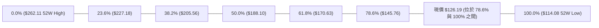

#### 斐波那契位對照與深度解讀

| 回調比例 | 對應價位 | 與當前價差距 | 結構技術意義解讀 |
|----------|----------|--------------|------------------|
| **0.0% (52W High)** | **$262.11** | +107.71% | 2025年歷史牛市頂部區域 |
| **23.6%** | **$227.18** | +80.03% | 2026年5月假突破反彈頂部附近 |
| **38.2%** | **$205.56** | +62.90% | 兩百元整數大關多空樞紐點 |
| **50.0%** | **$188.10** | +49.06% | 52週整體跌幅之中軸半山腰 |
| **61.8%** | **$170.63** | +35.22% | 黃金分割強壓力位，多頭中期反轉目標 |
| **78.6%** | **$145.76** | +15.51% | 極限深幅回調位，與 R1($147.20) 構成沉重共振阻力帶 |
| **當前價格** | **$126.19** | 0.00% | **落於 78.6% ($145.76) 至 100.0% ($114.08) 之間** |
| **100.0% (52W Low)**| **$114.08** | -9.60% | 年度終極支撐，回吐整年所有漲幅之原點 (S2) |

- **解讀結論**：現價 $126.19 跌破 78.6% 深度回調線（$145.76），意味著過去一年的上升波段已遭到高達 91.8% 的吞噬（位於 52W 區間百分位僅 8.2%）。此區間為技術面「深度超跌區」，通常會引發強烈的均值回歸與技術性反抽，但上方每一道斐波那契回調位均已轉化為沉重套牢反壓。

---

## 5. 技術指標深度解讀

### 🎛️ 指標訊號總覽

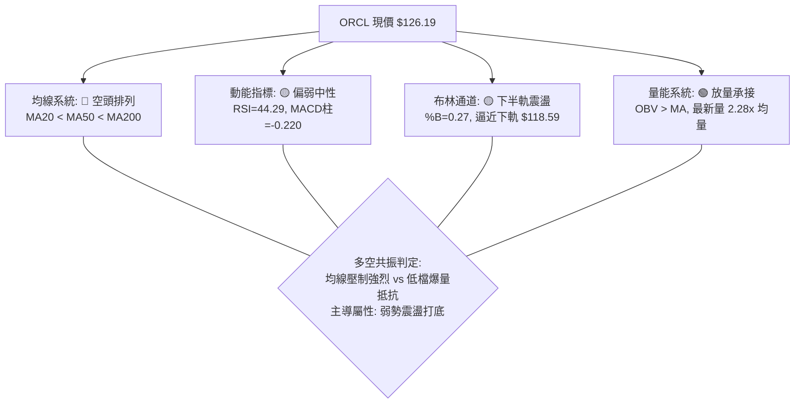

### 📈 移動平均線排列分析

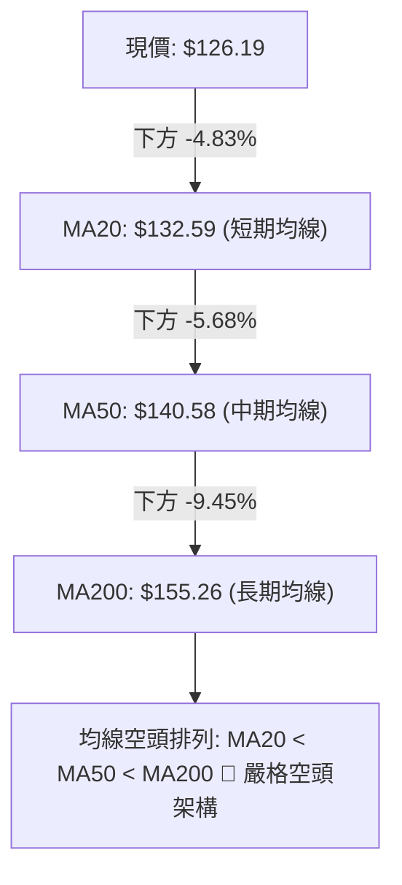

#### 移動平均線系統明細表

| 均線類別 | 數值 | 偏離現價幅度 | 趨勢方向 | 訊號評級 | 技術含義 |
|----------|------|--------------|----------|----------|----------|
| **MA5** | $132.04 | -4.43% | 下行 ▼ | 🔴 | 超短期壓制，近5日追高意願薄弱 |
| **MA10** | $129.76 | -2.75% | 下行 ▼ | 🔴 | 第一道短期反彈動態壓制線 |
| **MA20** | $132.59 | -4.83% | 下行 ▼ | 🔴 | 布林中軌，短線空頭防線 |
| **MA50** | $140.58 | -10.24% | 下行 ▼ | 🔴 | 中期波段生命線，下傾斜率明顯 |
| **MA60** | $141.56 | -10.86% | 下行 ▼ | 🔴 | 季度持倉成本線，上檔壓力重重 |
| **MA120** | $152.58 | -17.29% | 下行 ▼ | 🔴 | 半年線持續下壓 |
| **MA200** | $155.26 | -18.72% | 下行 ▼ | 🔴 | 牛熊分界線，長期趨勢嚴重偏空 |
| **MA240** | $162.21 | -22.21% | 下行 ▼ | 🔴 | 年線位置，長線空方大本營 |

### 📉 RSI(14) 分析

```
RSI(14) 讀數: 44.29 (Wilder)
0 ──────────── 30 ─────────────────────── 50 ─────── 70 ─────────── 100
[   超賣區    ]  [   當前位置: 44.29 🟡   ]        [   超買區    ]
░░░░░░░░░░░░░░░  ██████████████░░░░░░░░░░  ░░░░░░░░  ░░░░░░░░░░░░░░░
```

- **RSI 數值進度條**：█████████░░░░░░░░░░░ 44.29%
- **超買超賣與背離判斷**：
  - 數值位於 44.29，脫離了極端超賣（<30），但仍被壓制在 50 中軸下方，反映空方仍控盤，但殺跌動能已鈍化。
  - **背離分析**：依據數據嚴格比對近 20 根 K 棒首尾之價格與 RSI 方向，數據報告明確標示「**RSI 背離：無明顯背離**」。雖然 2026-11-02 觸及新低 $118.43 時未引發 RSI 實質跌破 30，初具潛在雙底隱性抗跌特徵，但標準技術面上**並不存在顯著頂背離或底背離**。

### 📊 MACD(12/26/9) 訊號解讀

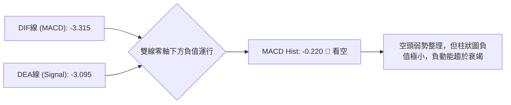

- **MACD 指標數值**：
  - DIF（快線）：-3.315
  - Signal（慢線）：-3.095
  - MACD 柱狀圖：-0.220 (🔴 看空)
- **解讀**：DIF 運行於 Signal 下方，且兩者均深處零軸之下，證實整體架構為弱勢空頭格局。然而，MACD Hist 數值僅為 -0.220，負值空間極為收斂，顯示空方動能已無力再拉出大長陰，指標正醞釀零軸下方的低檔金叉。

### 📦 布林通道分析

```
ORCL 日線布林通道 (20, 2) 結構圖
$146.59 ┤─────────────────────────────── BB 上軌 (阻力帶)
$140.00 ┤
$132.59 ┤═══════════════════════════════ BB 中軌 / MA20 (多空分水嶺)
$126.19 ┤            ● ← 現價 ($126.19, %B = 0.27)
$120.00 ┤
$118.59 ┤─────────────────────────────── BB 下軌 (支撐帶)
```

- **帶寬與極端值分析**：
  - BB 上軌：$146.59
  - BB 中軌：$132.59
  - BB 下軌：$118.59
  - 帶寬（Bandwidth）= ($146.59 − $118.59) ÷ $132.59 = **21.12%**
  - **%B 指標**：0.27。價格處於下半軌區間，低於中軌(0.5)，但高於下軌(0.0)。
- **操作涵義**：現價在下探 $118.43（精準回踩下軌 $118.59）後強勁反彈收回 %B = 0.27，顯示下軌具備顯著的動態支撐效力，目前正朝向中軌 $132.59 進行均值回歸。

### 💹 成交量分析（量價配合度）

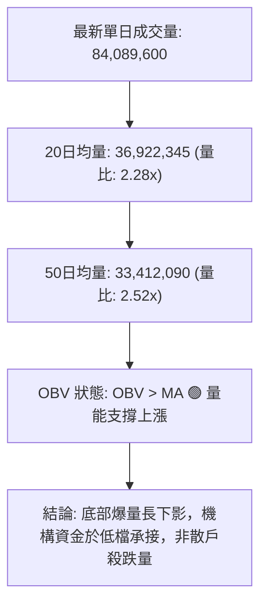

- **量價背離分析**：
  - 最新交易日（11/03）成交量爆出 84.09M 股，高達 20日均量的 **2.28 倍**，且收出長達 4.84 元的下影線實體陽線。
  - **OBV 趨勢**：數據明確指出「**OBV > MA → 量能支撐上漲**」。這說明在過去數週的震盪整理中，累積能量線並未隨價格破位而潰散，反而在低位獲得了穩健的吸籌買盤，呈現典型的「**量增價平/量價底背離結構**」，顯示低檔籌碼有換手沉澱跡象。

---

## 6. 動能與波動率

### ⚡ 動能評估四象限

| 象限 | 動能維度 | 波動維度 | ORCL 當前定位 | 象限特徵與策略指引 |
|------|----------|----------|---------------|--------------------|
| **Q1** | 強 (ADX>25) | 低 (ATR%<3%) | — | 最佳趨勢波段機會，持股續抱 |
| **Q2** | 弱 (ADX<25) | 低 (ATR%<3%) | — | 狹幅無序盤整，觀望等待突破 |
| **Q3** | 強 (ADX>25) | 高 (ATR%>5%) | — | 高風險高收益狂飆段，嚴設移動止損 |
| **Q4** | **弱 (ADX 13.12)** | **高 (ATR% 6.37%)** | **✓ (ORCL 當前定位)** | **低動能、高波動：處於高風險震盪洗盤期，極易雙向掃損，嚴禁追價，僅宜在下軌支撐處行逆勢小倉操作** |

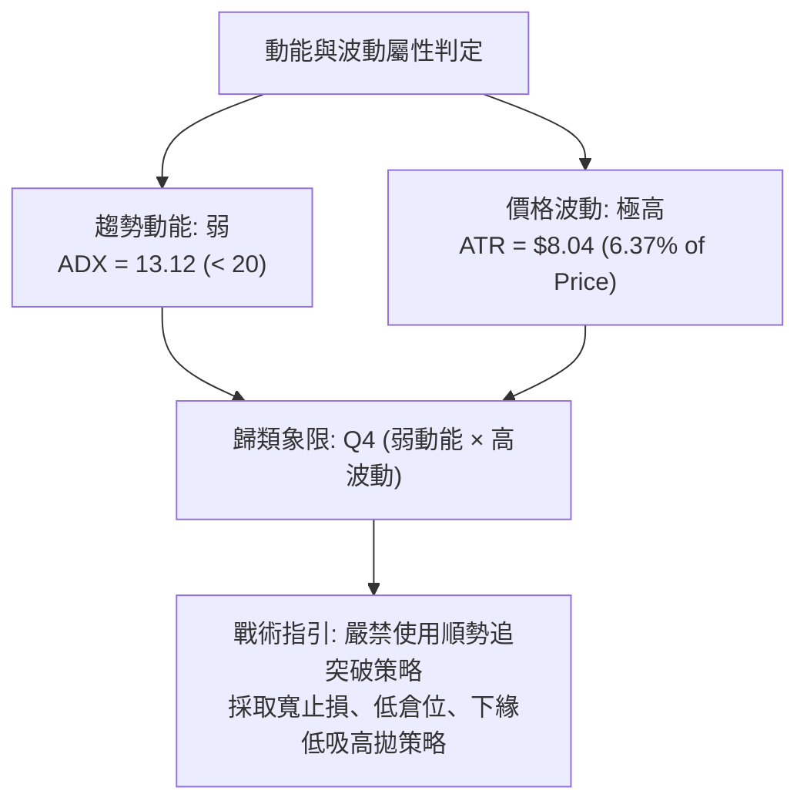

### 📊 ATR 波動率分析

- **ATR(14) 數值**：**$8.04**（佔當前股價 $126.19 的 **6.37%**，採用 Wilder 平滑演算法）。
- **波動特徵評估**：單日平均真實波幅高達 8 美元，屬於**極度高波動個股**。任何窄幅止損（如 1–2 美元）在單日內被隨機噪音掃出場的機率極高。
- **止損距離建議**：
  - 激進型交易：1.0 × ATR = **$8.04**
  - 標準型交易：1.5 × ATR = **$12.06**
  - 保守波段型：2.0 × ATR = **$16.08**

### 📐 Beta 與市場相關性

- **Beta 係數**：**1.778**（極高 Beta 屬性）。
- **市場敏感度解讀**：
  - ORCL 對美股大盤（S&P 500 / 標普科技指數）的波動放大倍數為 1.78 倍。當大盤下挫 1% 時，ORCL 理論下行 1.78%；反之亦然。
  - 當前美股軟體基礎設施板塊面臨拋售壓力（近期新聞顯示 Cloudflare, Datadog 等集體重挫），ORCL 高達 1.778 的 Beta 使其在板塊承壓時出現了嚴重的放大外溢效應。空頭持倉比（Short % Float）為 2.5%，空頭天數（Short Ratio）僅 1.54，顯示市場並未過度放空，其跌勢主要源於基本面融資與資本支出預算（$20B AI 籌資計劃）之機構去槓桿拋售。

---

## 7. 多時框架總結

### 📋 時框架評分表

| 時框架 | 趨勢方向 | 動能狀態 | 均線排列 | 圖表形態 | 綜合評分 | 建議 |
|--------|----------|----------|----------|----------|----------|------|
| **長期 (月線)** | 🔴 偏空下行 | RSI 弱勢下傾 | 空頭壓制 | 從歷史高點回撤 54.5% | **25/100** | 減持觀望，靜待築底完成 |
| **中期 (週線)** | 🔴 區間偏空 | MACD柱收窄 | 空頭發散 | 宽幅箱體震盪 ($114.08-$158.67) | **35/100** | 反彈至阻力位減碼 |
| **短期 (日線)** | 🟡 低檔震盪 | RSI 44.29 回升 | MA20 壓制 | 下探布林下軌爆量下影線 | **50/100** | 區間下緣博弈超跌反彈 |

### 🔲 綜合訊號矩陣

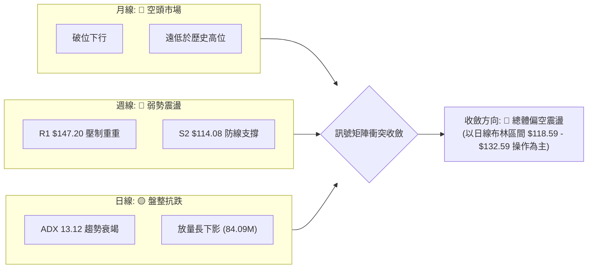

### ⚖️ 多時框收斂結論

嚴格遵循報告規則 14 之優先級收斂原則：
1. **行情屬性判定**：當前日線 ADX(14) 讀數為 **13.12**，明確 **< 25**，定義為**典型的盤整行情**而非單邊趨勢行情。
2. **時框優先級權重**：在 ADX < 25 的盤整結構中，日線級別之布林通道上下軌與近期波段聚類支撐（S1 $122.76 / 布林下軌 $118.59）構成最核心的實戰邊界；中長期（週線/MA200）方向雖為空頭，但短線不具備單邊摜破的推動動能。
3. **唯一方向性結論**：**【偏空震盪整理】（綜合評分 37/100）**。
   - 大格局受制於空頭均線排列，任何未放量突破 MA20($132.59) 的走勢均屬弱勢反抽；
   - 短線下檔在 $118.43–$122.76 展現出機構爆量承接意願，破底追空風險極高。

---

## 8. 交易策略建議

### 🗺️ 策略決策流程圖

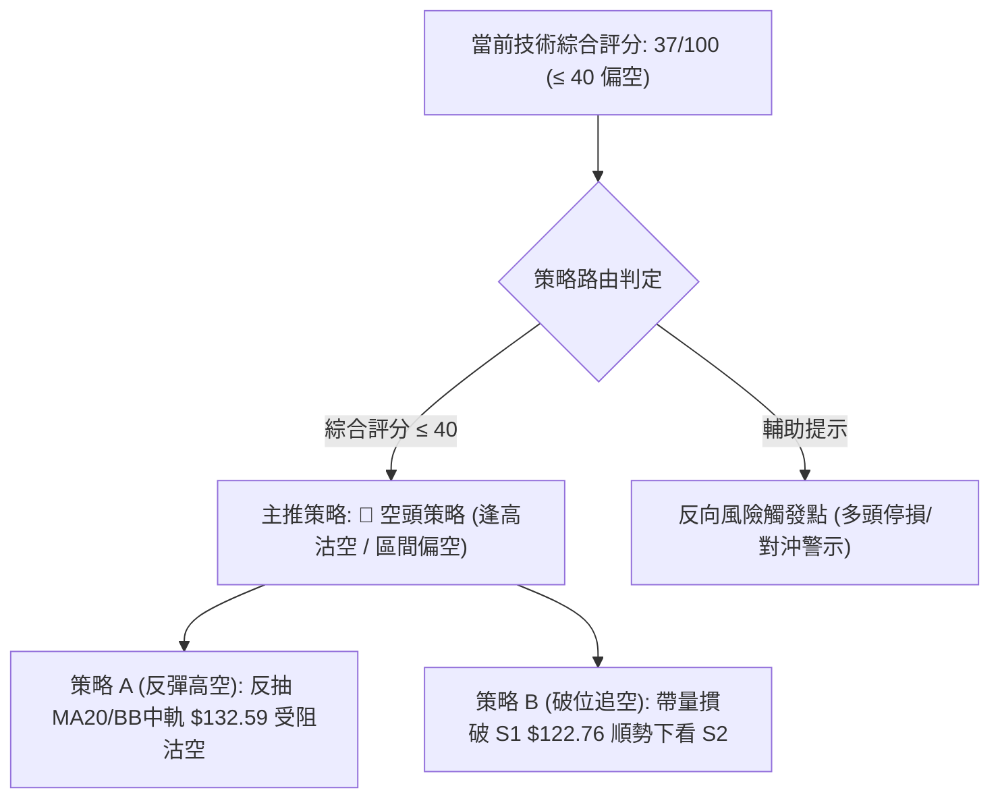

### 🧭 策略路由（依評分卡分流，不得兩頭下注）

> **當前主策略方向 = 🔴 偏空操作（依評分 37/100）**
> 
> *註：依規定，綜合評分 37/100 屬於 ≤ 40 偏空區間，主推空頭策略；多頭僅列為反轉風險對沖提示，嚴禁兩頭下注。*

### 🎯 價格情境階梯（Price Scenarios）

所有價位均嚴格取自第 4 章實測之聚類價位：

| 觸發條件 | 下一目標 | 後續延伸 | 情境含義 |
|----------|----------|----------|----------|
| **強勢向上突破 R1 $147.20** | R2 $153.03 | R3 $158.67 | 中期波段強勢反轉，空頭全面停損離場 |
| **反彈受阻於 MA20 $132.59** | S1 $122.76 | 下軌 $118.59 | 短線弱勢均值回歸完成，空頭重啟下行 |
| **跌破 S1 $122.76** | 52W低點 S2 $114.08 | 跌破無支撐 | 下破箱體下緣，加速探底並考驗年度低位 |

### 📊 情境機率分佈

| 情境 | 機率 | 主要依據 |
|------|------|----------|
| **弱勢反抽後回落 (主情境)** | **55%** | 均線呈標準空頭排列 (MA20<MA50<MA200)，-DI(26.47)高於+DI，MACD柱為負，反彈易引發解套拋壓 |
| **箱體區間震盪 ($118 - $132)** | **30%** | ADX 僅 13.12 缺乏單邊趨勢動能，OBV > MA 且低檔爆出 84.09M 承接量，封殺深度下跌空間 |
| **強勢V型反轉突破 R1** | **15%** | 需連續大陽線突破 78.6% 斐波那契位($145.76)與 R1($147.20)，目前量能與催化劑暫不足以支持 |

### 🔴 主策略詳情（空頭主推策略）

嚴格依據規則 17 計算風險報酬比：**風險報酬比 = (進場價 − 目標價 T1) ÷ (止損價 − 進場價)**

| 策略要素 | 策略 A：反彈受阻放空（勝率優先） | 策略 B：跌破支撐追空（突破優先） |
|----------|----------------------------------|----------------------------------|
| **策略類型** | 逢高逆勢沽空 (Sell on Rally) | 破位順勢做空 (Breakdown Short) |
| **進場條件** | 價格反彈至 MA20 / BB中軌附近遇阻滯漲 | 價格放量跌破支撐位 S1 且收盤確認 |
| **進場價格** | **$132.59** (MA20 阻力精確值) | **$122.76** (S1 支撐精確值) |
| **目標價 T1** | **$122.76** (近期支撐 S1) | **$114.08** (52W最低點強支撐 S2) |
| **目標價 T2** | **$114.08** (52W最低點強支撐 S2) | **$110.00** (分析師目標價下限) |
| **止損價格** | **$136.59** (10/29低點轉阻力處，風險$4.00) | **$126.19** (當前收盤價阻力，風險$3.43) |
| **風險報酬比** | **1 : 2.46**（以 T1 計）<br>*(132.59 - 122.76) / (136.59 - 132.59) = 9.83 / 4.00*<br>*(以 T2 計為 1 : 4.63)* | **1 : 2.53**（以 T1 計）<br>*(122.76 - 114.08) / (126.19 - 122.76) = 8.68 / 3.43*<br>*(以 T2 計為 1 : 3.72)* |
| **成功機率** | **60%** | **45%** (受制於低檔爆量承接) |
| **建議倉位** | **8% - 10%** 總資產 | **5%** 總資產 |

### 🟢 反向風險觸發點（對沖提示）

若持有多頭部位或考慮左側博弈反彈，須密切留意以下風控觸發線：
1. **反轉上行觸發點**：若日線帶量收盤站穩 **$132.59 (MA20)** 上方，所有空頭策略必須無條件止損出局，空頭警報解除，市場將轉向測試 **R1 $147.20**。
2. **多頭止損出局點**：若多頭試單，一旦失守 **$118.43**（11/02低點）或布林下軌 **$118.59**，必須全數離場，下方深淵直至 **S2 $114.08**。

### ⭐ 整體訊號強度評星

```
做多訊號強度：★★☆☆☆  (2/5星 - 僅屬超跌反抽，上方受制於空頭均線)
做空訊號強度：★★★★☆  (4/5星 - 順應大中時框空頭趨勢，反彈沽空盈虧比優)
整體可信度：  ★★★☆☆  (3/5星 - ADX甚低，注意高波動震盪雙向洗盤風險)
```

---

## 9. 風險提示與監控

### ✅ 關鍵監控指標 Checklist

```
╔══════════════════════════════════════════════════════════════╗
║                ORCL 每日關鍵監控指標清單                     ║
╠══════════════════════════════════════════════════════════════╣
║ [ ] 價格是否突破/跌破 MA20 關鍵樞紐線 ($132.59)              ║
║ [ ] 價格是否跌破 S1 支撐位 ($122.76)                         ║
║ [ ] 價格是否再次考驗 11/02 低點 ($118.43) 或下軌 ($118.59)   ║
║ [ ] 單日成交量是否低於 20日均量 (36.92M) 呈現無量陰跌        ║
║ [ ] ADX(14) 讀數是否向上突破 20，象徵單邊下跌趨勢重啟        ║
║ [ ] RSI(14) 是否跌破 40 滑向 30 超賣區                       ║
║ [ ] MACD 柱狀圖是否跌破 -0.500 擴大負動能                    ║
║ [ ] 軟體雲計算板塊拋售新聞是否擴大 ($20B AI 募資後續消息)    ║
╚══════════════════════════════════════════════════════════════╝
```

### ⚠️ 風險場景分析

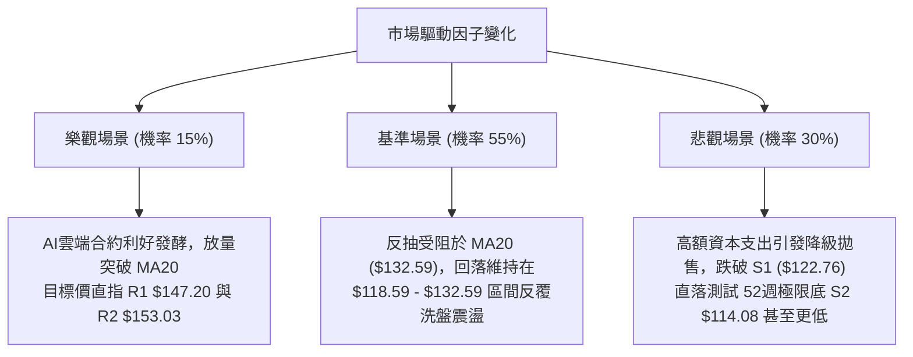

### 🛡️ 風險管理重要提醒

1. **高 ATR 波動管理**：
   - 當前 ORCL ATR(14) 為 **$8.04**（佔比高達 6.37%），單日上下洗盤 8 美元屬於正常波動範圍。
   - **倉位管制規則**：建議單筆交易承擔之資金風險不超過總投資組合的 **1.0%**。以 1.5 倍 ATR 止損（$12.06）計算，個股建倉部位上限不得超過總資金的 **8.2%**，嚴防在盤整行情中遭大幅削蝕淨值。
2. **財報與基本面宏觀風險**：
   - 近期新聞指出 Oracle 計劃融資 200 億美元投入 AI 資料中心，引發市場對高額負債（總負債高達 $169.14B，淨負債 $-132.07B）與自由現金流惡化（FCF 為 $-28.72B）的擔憂；加之取消騰訊 70 億美元晶片租賃交易，基本面短期承壓。
   - 儘管 38 位華爾街分析師平均目標價達 $233.34，但最低目標價下看 **$110.00**。在技術面未重回 MA200($155.26) 之前，基本面看多評級不得作為盲目抄底之依據。

---

## 📋 報告總結

```
╔══════════════════════════════════════════════════════════════╗
║                   ORCL 技術分析報告總結                      ║
╠══════════════════════════════════════════════════════════════╣
║ 報告日期：2026-11-04                                         ║
║ 當前價格：$126.19                                            ║
║ 分析評級：🔴 偏空震盪（技術評分 37/100）                     ║
║                                                              ║
║ 關鍵結論：                                                   ║
║ ├─ 長期趨勢：🔴 空頭主導，深處 52週低檔 (百分位 8.2%)        ║
║ ├─ 中期趨勢：🔴 弱勢箱體，反彈受制於 MA50/MA200 重重均線     ║
║ ├─ 短期趨勢：🟡 盤整抗跌，ADX=13.12 趨勢鈍化，下軌爆量抵抗   ║
║ ├─ 關鍵支撐：S1: $122.76 ｜ S2: $114.08 (52W最低點)          ║
║ ├─ 關鍵阻力：MA20: $132.59 ｜ R1: $147.20 ｜ R2: $153.03     ║
║ └─ 分析師共識：買入 (38位均價 $233.34，低標 $110.00)         ║
║                                                              ║
║ 最優策略組合：                                               ║
║ 1. 🥇 最佳機會：策略 A (反彈高空)                            ║
║    反抽 MA20 ($132.59) 阻力沽空，目標 $122.76，風報比 1:2.46 ║
║ 2. 🥈 次選機會：布林下軌超跌反彈短線博弈                     ║
║    依託 $118.59 - $121.35 窄幅試多，目標 $130，嚴格停損 $118║
║ 3. 🥉 保守選擇：完全空倉觀望                                 ║
║    等待 ADX > 20 且明確站穩 MA20 或摜破 S1 後再行介入        ║
╚══════════════════════════════════════════════════════════════╝
```

---

> ⚠️ **免責聲明**：本報告為 AI 自動生成之技術分析，所有數據及估算均基於提供的歷史價格資訊。本報告**僅供研究與學術參考**，**不構成任何投資建議**。投資有風險，入市需謹慎。

---

*報告生成時間：2026-11-04 ｜ 數據來源：Yahoo Finance ｜ 分析框架：多時框技術分析*