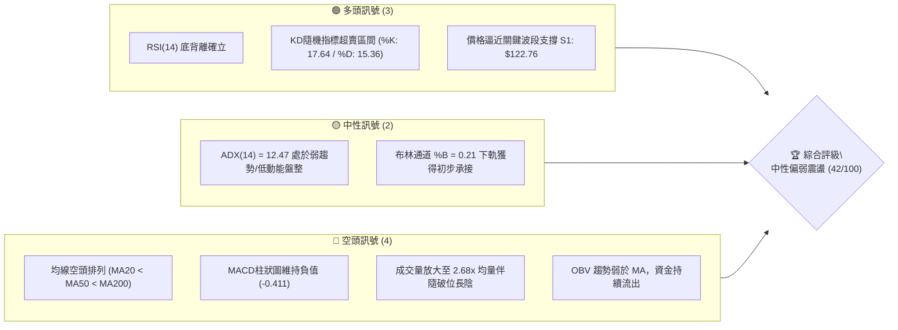
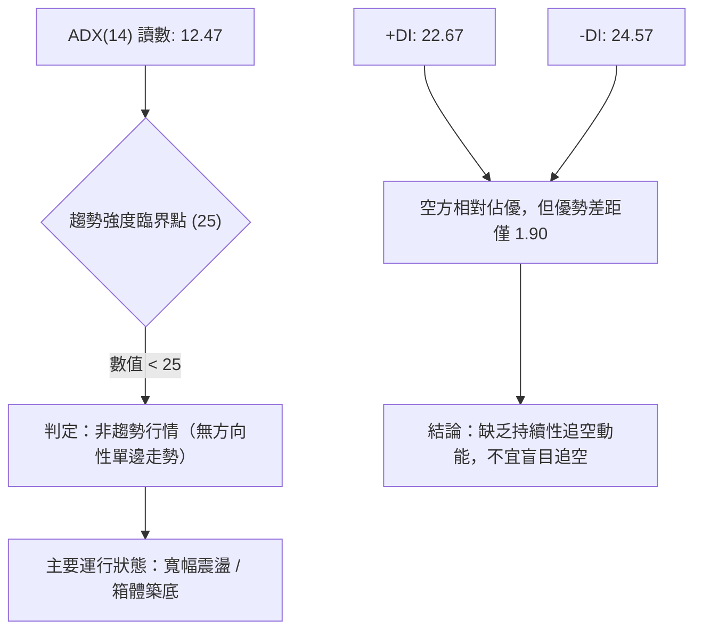
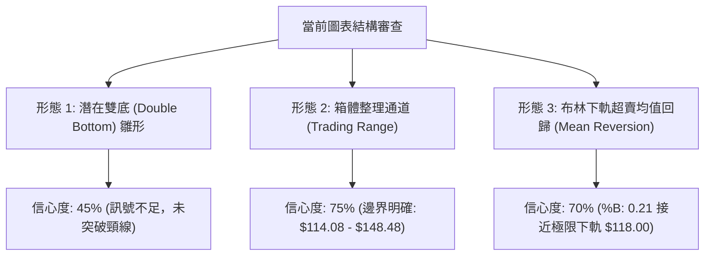
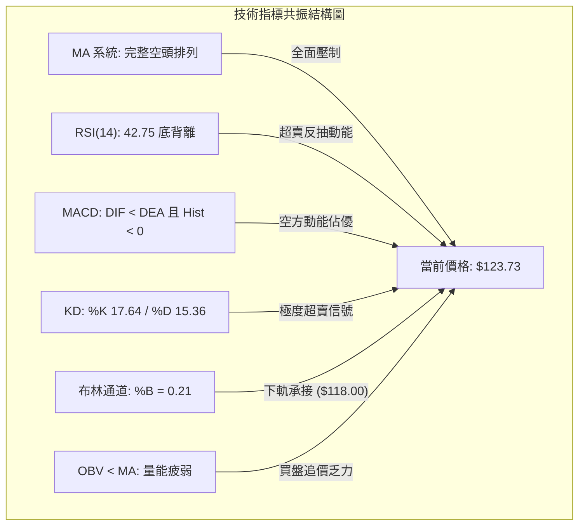
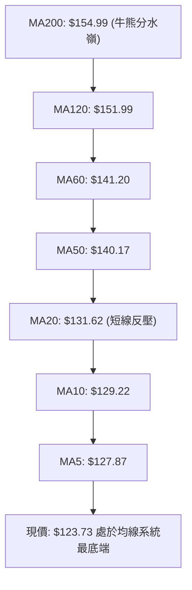
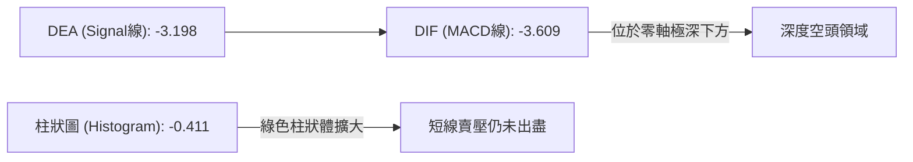
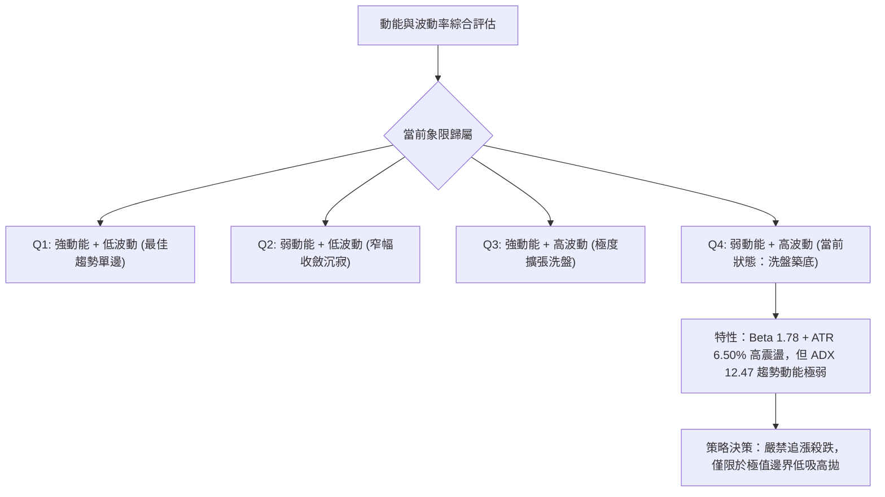
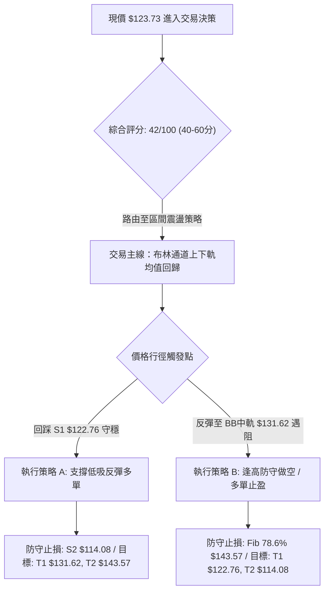
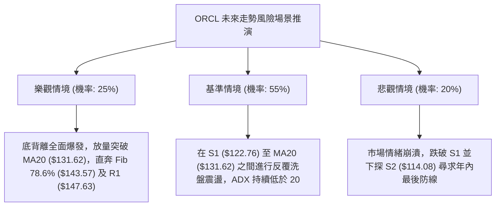

# ORCL 技術分析報告

> **報告日期**：2026-11-05 ｜ **語言**：繁體中文 ｜ **數據來源**：Yahoo Finance ｜ **當前價格**：$123.73

---

## 目錄

| 章節 | 內容 |
|------|------|
| [1. 技術面概覽](#1-技術面概覽) | 訊號儀表板、核心指標、評分卡 |
| [2. 趨勢分析](#2-趨勢分析) | 多時框趨勢、長中短期走勢 |
| [3. 圖表形態分析](#3-圖表形態分析) | 形態識別、K線組合、目標價 |
| [4. 支撐與阻力](#4-支撐與阻力) | 關鍵價位、斐波那契回調 |
| [5. 技術指標深度解讀](#5-技術指標深度解讀) | MA/RSI/MACD/布林/成交量 |
| [6. 動能與波動率](#6-動能與波動率) | 動能評估、ATR、Beta |
| [7. 多時框架總結](#7-多時框架總結) | 時框架評分矩陣 |
| [8. 交易策略建議](#8-交易策略建議) | 多空策略、風險報酬比 |
| [9. 風險提示與監控](#9-風險提示與監控) | 監控指標、風險場景 |

---

## 1. 技術面概覽

### 🎯 技術訊號儀表板



---

### 📊 核心指標速覽表

| 指標類別 | 指標名稱 | 當前數值 | 訊號 | 解讀 |
|----------|----------|----------|:---:|------|
| **價格** | 當前收盤價 | $123.73 | 🔴 | 位於 52 週價格區間之 7.0%，處於近一年極度低檔區 |
| **均線** | MA20 | $131.62 | 🔴 | 現價低於短期均線 $7.89 (-6.00%)，短線反壓沉重 |
| **均線** | MA50 | $140.17 | 🔴 | 現價低於中期均線 $16.44 (-11.73%)，中期空頭掌控 |
| **均線** | MA200 | $154.99 | 🔴 | 現價低於長期牛熊線 $31.26 (-20.17%)，長線結構受損 |
| **動能** | RSI(14) | 42.75 | 🟡 | 位於中性偏弱區間，近 20 根 K 棒呈現首尾底背離 |
| **動能** | MACD (12,26,9) | -3.609 / -3.198 | 🔴 | DIF 線位於訊號線下方，Histogram 為 -0.411 看空 |
| **擺動** | KD (%K / %D) | 17.64 / 15.36 | 🟢 | 進入超賣鈍化區，隨時具備技術性均值回歸修復動能 |
| **波動** | ATR(14) | $8.04 (6.50%) | 🔴 | 每日震幅達 6.50%，波動度偏高，操作須寬設止損 |
| **趨勢** | ADX(14) | 12.47 | 🟡 | 指標小於 25，單邊動能耗竭，轉入寬幅箱體盤整 |
| **通道** | 布林通道 | 下軌 $118.00 / 上軌 $145.25 | 🟡 | %B 為 0.21，位於下軌支撐與中軌之間震盪 |
| **量能** | 當日量 / 20日均量 | 1.117億 / 4,173萬 (2.68x) | 🔴 | 巨量下跌後初見換手，OBV < MA 顯示量能尚未翻多 |

---

### 🏆 技術評分卡

```
╔══════════════════════════════════════════════════════════════════╗
║                技術評分卡 — ORCL (2026-11-05)                   ║
╠══════════════════════════════════════════════════════════════════╣
║ 趨勢強度       ███████░░░░░░░░░░░░░  35/100   🔴 弱勢盤整/空頭主導 ║
║ 動能指標       █████████░░░░░░░░░░░  48/100   🟡 超賣與底背離醞釀 ║
║ 支撐穩定度     ██████████░░░░░░░░░░  52/100   🟡 S1 $122.76 尋求防守 ║
║ 成交量配合     ███████░░░░░░░░░░░░░  38/100   🔴 賣壓湧現，OBV疲弱  ║
║ 形態完整度     █████████░░░░░░░░░░░  45/100   🟡 區間箱體，雙底雛形 ║
║ 均線排列       ██████░░░░░░░░░░░░░░  34/100   🔴 均線完整空頭排列   ║
╠══════════════════════════════════════════════════════════════════╣
║ 綜合評分       ████████░░░░░░░░░░░░  42/100   🟡 中性偏弱（區間操作）║
╚══════════════════════════════════════════════════════════════════╝
※ 註：綜合評分由六項子評分算術平均得出：(35 + 48 + 52 + 38 + 45 + 34) ÷ 6 = 42/100。
```

---

## 2. 趨勢分析

### 🌐 多時框趨勢分析

```mermaid
graph TD
    A["月線層級 (Long-term)"] -->|"2025-09 高點 $277.05 大級別退潮回撤"| B["中期週線 (Medium-term)"]
    B -->|"52W高點 $251.91 跌至低點 $114.08，現處底部箱體"| C["短期日線 (Short-term)"]
    C -->|"ADX("14")=12.47 < 25，單邊動能鈍化，進入區間築底"| D{"多時框收斂定調"}
    D --> E["主策略：以布林通道下軌 $118.00 與 S1 $122.76 為防守點進行區間操作"]
```

---

### 📈 長期趨勢 — 12個月走勢圖（Unicode）

以下圖表展示 ORCL 過去 12 個月（2025-11 至 2026-11）之月線收盤價格軌跡與轉折高低點：

```
ORCL 月線走勢圖（過去12個月：2025-11 至 2026-11）
價格 ($)
$230 ┤                      ● $224.17 (2026-05 反彈次高點)
$210 ┤
$190 ┤● $199.28 (2025-11)
$170 ┤      ● $162.84
$150 ┤            ● $143.86       ● $145.50       ● $148.57
$130 ┤                                  ● $129.39       ● $130.67
$110 ┤                                                        ● $123.73 (現價)
     └─┬─────┬─────┬─────┬─────┬─────┬─────┬─────┬─────┬─────┬─────┬──
     11/25 12/25 01/26 02/26 03/26 04/26 05/26 06/26 07/26 08/26 09/26 10/26 11/26
```

#### 走勢特徵分析表格

| 階段週期 | 期間收盤區間 | 累積漲跌幅 | 結構特徵與量價行為 |
|----------|:------------:|:----------:|--------------------|
| **第一階段：高檔滑落** | $199.28 → $143.86 (2025-11 ~ 2026-02) | -27.81% | 自 2025 年秋季高點向下崩跌，跌破短期多道均線支撐 |
| **第二階段：強力反彈** | $145.55 → $224.17 (2026-03 ~ 2026-05) | +54.02% | 雲端與 AI 題材推動單邊軋空暴漲，創下年內反彈次高點 |
| **第三階段：破位暴跌** | $224.17 → $129.39 (2026-06 ~ 2026-07) | -42.28% | 資本支出暴增疊加自由現金流轉負，引發機構去槓桿拋售 |
| **第四階段：築底震盪** | $129.39 → $123.73 (2026-08 ~ 2026-11) | -4.37%  | 價格受制於 MA60 ($141.20) 與 R1 ($147.63)，在 $114-$130 築底 |

---

### 📊 中期趨勢（週線分析）

週線架構顯示，價格自 2026 年 7 月 24 日見到低點 $114.57（52 週最低 $114.08）後，展開了長達 3 個月的弱勢橫盤修復：

```
週線級別價格壓力與支撐示意圖
$160.00 ┼────────────────────────────── R3: $158.67 (2026-09 波段頂部)
$150.00 ┼────────────────────────────── R1: $147.63 / MA200: $154.99
$140.00 ┼────────────────────────────── MA50: $140.17 / MA60: $141.20
$130.00 ┼───────────────────┬────────── MA20: $131.62 (週線短壓)
$123.73 ┼  現價 $123.73     │
$120.00 ┼───────────────────┴────────── S1: $122.76 (近期低點聚類)
$114.08 ┼────────────────────────────── S2: $114.08 (52W 最低點極限支撐)
```

- **週線均線壓制**：週線收盤價在 2026-10-30 衝高至 $130.67，但 2026-11-04 當週因巨量跳水回落至 $123.73，成交量放大至 2.54 億股，反映市場在消息面利空衝擊下的恐慌拋售。
- **週線 MACD**：週線 MACD 柱狀圖由 2026-10-30 的 +0.848 驟降至 2026-11-04 的 -0.411，顯示中期反彈動能遭遇阻滯。

---

### ⚡ 趨勢強度評估（ADX 解讀）



#### ADX 趨勢強度對照表

| 指標名稱 | 實際數值 | 參考臨界值 | 狀態評估 | 實戰策略指引 |
|----------|:--------:|:----------:|:--------:|--------------|
| **ADX(14)** | **12.47** | 25.00 | 極弱趨勢 / 盤整 | 🔴 禁止趨勢突破追單；🟢 採用布林通道均值回歸策略 |
| **+DI** | **22.67** | — | 多方力量偏弱 | 🟡 買盤未聚集足夠推升動能 |
| **-DI** | **24.57** | — | 空方力量微幅領先 | 🟡 空方動能不足以發動新一輪崩盤主跌段 |
| **方向差值 (\|+DI - -DI\|)** | **1.90** | 10.00 | 多空勢均力敵 | 🟢 多空膠著，隨時可能由超賣技術指標觸發反抽 |

---

## 3. 圖表形態分析

### 🔍 形態識別系統



#### 形態識別信心度表格（依規則 15）

| 形態名稱 | 信心度 | 判斷依據（引用數據） | 完成度 | 目標價（附嚴謹計算式） |
|----------|:------:|----------------------|:------:|------------------------|
| **潛在雙重底** | 45% | 左底 2026-07-24 之 $114.57 (52W低 $114.08)，現右底測試 S1: $122.76。未突破頸線前僅屬猜測 | 40% | 訊號不足，僅做指標型解讀。若成形，頸線為 R1 $147.63，形態高度 = $147.63 - $114.08 = $33.55，突破推算目標 = $147.63 + $33.55 = $181.18（接近斐波那契 50.0% 之 $182.99） |
| **箱體震盪** | 75% | 下邊界由 S2 $114.08 與 S1 $122.76 構成，上邊界由 2026-10-28 高點 $148.48 (R1: $147.63) 構成 | 80% | 區間上沿目標 = R1: $147.63；區間下沿支撐 = S1: $122.76 |
| **布林通道回歸** | 70% | 價格跌至 %B = 0.21，下軌 $118.00，RSI 底背離確認 | 65% | 布林中軌回歸目標 = BB中軌 (MA20): $131.62 |

---

### 🕯️ 重要 K 線形態分析（依規則 19）

依據數據所提供之「近 10 根日 K」與「近 8 根週 K」實際數據進行形態解讀：

| 週期 | 日期 | 開盤價 | 最高價 | 最低價 | 收盤價 | 成交量 | K線形態名稱 | 形態深度解讀與訊號含義 |
|:---:|:---:|:---:|:---:|:---:|:---:|:---:|:---:|:---|
| 日K | 2026-10-28 | $131.32 | $148.48 | $128.38 | $144.54 | 81,933,800 | 衝高帶上影大陽線 | 多方發動攻擊測試 R1 阻力區，高位遇獲利盤壓制，留有 $3.94 上影線，成交量急劇放大。 🟢 |
| 日K | 2026-10-29 | $144.14 | $144.61 | $136.59 | $139.56 | 39,366,900 | 實體中陰線 | 吞噬前一日大陽線上半部，多方追高意願不足，高檔反轉回落。 🔴 |
| 日K | 2026-11-02 | $125.88 | $126.50 | $118.43 | $119.22 | 58,749,300 | 長下影破位中陰線 | 消息利空跳空低開，盤中摜破 $120 創波段低點 $118.43，但下影線長達 $0.79，顯示下軌有低吸買盤承接。 🔴 |
| 日K | 2026-11-03 | $122.00 | $128.14 | $121.35 | $126.19 | 84,295,400 | 低開逆襲長陽線 | 貫穿前一日實體，形成強烈多頭反擊，單日暴量 8,429 萬股，量價配合強烈。 🟢 |
| 日K | 2026-11-04 | $121.78 | $129.85 | $121.78 | $123.73 | 111,747,000 | 倒錘子帶長上影陰線 | 早盤衝高至 $129.85 逼近 MA20，隨後騰訊晶片合約利空發酵，巨量拋盤打壓，留有長達 $6.12 之上影線，收盤守在 $123.73（高於 S1 $122.76）。 🟡 |
| 週K | 2026-10-30 | $126.06 | $148.48 | $123.75 | $130.67 | 211,388,800 | 巨量倒錘射擊之星 | 當週最高觸及 $148.48 逼近 R1，但最終收斂於 $130.67，上影線長達 $17.81，形成強烈中期空頭阻力牆。 🔴 |
| 週K | 2026-11-04 | $125.88 | $129.85 | $118.43 | $123.73 | 254,791,700 | 巨量探底回升線 | 測試 $118.43 支撐後回彈，換手量達 2.54 億股，顯示籌碼在 $120 下方發生大規模易手。 🟡 |

---

### 📉 ASCII 走勢形態示意圖

```
ORCL 近期日K線形態走向（2026-10-22 至 2026-11-04）
價格
$150 ┤                       ┌─┐ $148.48 (2026-10-28 衝高)
$145 ┤                       │ │
$140 ┤                       │ │ ┌─┐ $139.56
$135 ┤                   ┌─┐ │ │ │ │
$130 ┤           ┌─┐     │ │ │ │ │ │ ┌─┐ $130.67         ┌─┐ $129.85 (上影線)
$125 ┤   ┌─┐ ┌─┐ │ │ ┌─┐ │ │ │ │ │ │ │ │         ┌─┐     │ │
$120 ┤───│─│─│─│─│─│─│─│─│─│─│─│─│─│─│─│─────────│─│─────│─│── S1: $122.76
$115 ┤   └─┘ └─┘ └─┘ └─┘ └─┘ └─┘ └─┘ └─┘ ┌─┐     └─┘     └─┘
     └───────────────────────────────────│─│───────────────────
                                         └─┘ $118.43 (2026-11-02 探底)
      10/22   10/26   10/28   10/30   11/02   11/03   11/04
```

---

### 🎯 形態目標價計算

根據上述高可信度之「箱體震盪」形態，進行上下邊界推算：
1. **箱體下邊界（強支撐帶）**：以波段低點聚類 **S1: $122.76** 與 52 週低點 **S2: $114.08** 為界。
2. **箱體中軸（第一反彈目標）**：取布林中軌與 MA20 交會處 **$131.62**。
3. **箱體上邊界（第二反彈目標）**：取波段高點聚類 **R1: $147.63**（與 2026-10-28 高點 $148.48 高度重合）。
4. **箱體等幅突破測量（附嚴格計算式）**：
   - 箱體高度 = 上邊界 $147.63 − 下邊界 $114.08 = **$33.55**。
   - 若向上突破 R1，推算目標價 = $147.63 + $33.55 = **$181.18**（緊鄰斐波那契 50.0% 回調位 $182.99）。
   - 若向下跌破 S2，向下推算極端測量 = $114.08 − $33.55 = **$80.53**（數據中未列此支撐，純屬幾何測距）。

---

## 4. 支撐與阻力

### 🗺️ 關鍵價位分布圖（Unicode）

```
ORCL 價位結構分布圖（OHLCV 精確計算）
══════════════════════════════════════════════════════════════════
$158.67 ║██████████████████████████████║ 強阻力 R3 (2026-09 波段高點)
$153.03 ║████████████████████          ║ 阻力 R2 (MA200: $154.99 附近)
$147.63 ║██████████████████████████████║ 關鍵阻力 R1 (箱體上沿 / 10-28高點)
$143.57 ║░░░░░░░░░░░░░░░░░░░░░░░░░░░░░░║ 斐波那契 78.6% 回調位
$131.62 ║▒▒▒▒▒▒▒▒▒▒▒▒▒▒▒▒▒▒▒▒          ║ 短線動態壓力 (MA20 / 布林中軌)
$123.73 ╠══════════════════════════════╣ ◄ 當前收盤價 ($123.73)
$122.76 ║▓▓▓▓▓▓▓▓▓▓▓▓▓▓▓▓▓▓▓▓▓▓▓▓▓▓▓▓▓▓║ 近期支撐 S1 (-0.78%, 波段密集低點)
$118.00 ║░░░░░░░░░░░░░░░░              ║ 布林通道下軌支撐
$114.08 ║██████████████████████████████║ 強支撐 S2 (52W 最低點 / Fib 100%)
══════════════════════════════════════════════════════════════════
```

---

### 🚧 阻力位分析表

以下價位完全嚴格引用技術數據「關鍵價位」區塊之數值：

| 阻力級別 | 價位 | 形成原因（依據數據） | 突破難度 | 技術重要性 |
|:---:|:---:|---|:---:|:---:|
| **R1** | **$147.63** | 近一年波段高點聚類、2026-10-28 盤中高點 $148.48 之密集解套區 | 🔴 極高 | ★★★★★（短中期箱體突破之唯一分水嶺） |
| **R2** | **$153.03** | 2026-09-25 週 K 棒高點 $153.03，緊鄰 MA120 ($151.99) 與 MA200 ($154.99) | 🔴 高 | ★★★★☆（中期牛熊轉換臨界帶） |
| **R3** | **$158.67** | 2026-09-04 週 K 棒波段收盤高點聚類，長期下行通道上軌壓制 | 🔴 極高 | ★★★☆☆（若觸及代表大級別反轉確立） |

---

### 🛡️ 支撐位分析表

以下價位完全嚴格引用技術數據「關鍵價位」區塊之數值：

| 支撐級別 | 價位 | 形成原因（依據數據） | 守住機率 | 技術重要性 |
|:---:|:---:|---|:---:|:---:|
| **S1** | **$122.76** | 2026-10-22 與 2026-10-23 之波段低點聚類，距現價僅 -0.78% | 🟡 60% | ★★★★☆（多方短線最後一道防線） |
| **S2** | **$114.08** | 52 週最低點（2026-07 築底低位），斐波那契 100.0% 回調位 | 🟢 85% | ★★★★★（年內終極多頭防守點，破位將引發系統性下行） |
| **S3** | **數據中未偵測到** | 歷史數據未提供 $114.08 下方之波段低點聚類 | N/A（數據未提供） | N/A（數據未提供） |

---

### 📐 斐波那契回調位分析

本波回調基準取自數據中明列之 52 週區間：波段高點 **$251.91 (0.0%)** 至波段低點 **$114.08 (100.0%)**，總跌幅為 **$137.83**：

```
斐波那契回調結構矩陣
$251.91 ├─  0.0% (52W High) 頂部阻力
$219.38 ├─ 23.6% 回調位
$199.26 ├─ 38.2% 回調位
$182.99 ├─ 50.0% 關鍵平衡位
$166.73 ├─ 61.8% 黃金分割回調位
$143.57 ├─ 78.6% 深次回調阻力位
$123.73 ├─ [當前現價位置：落於 78.6% 與 100.0% 之間]
$114.08 └─ 100.0% (52W Low) 築底基石
```

- **位置解讀**：當前價格 $123.73 深度處於 **78.6% ($143.57)** 與 **100.0% ($114.08)** 之間。在技術分析中，當資產跌破 61.8% 且深入 78.6% 以下時，原有的上漲趨勢已完全被摧毀，此時不再屬於常規「回調」，而是轉入「底部極限測試階段」。
- **下行風險測算**：距 100.0% 支撐 $114.08 僅有 $9.65 緩衝空間（-7.80%），顯示下行空間相對有限，支撐具備堅實的幾何意義。
- **上行阻力測算**：反彈的第一道大級別斐波那契壓制為 78.6% 之 **$143.57**，此價位與布林通道上軌 ($145.25) 及 R1 ($147.63) 形成強大的空頭防禦共振帶。

---

## 5. 技術指標深度解讀

### 🎛️ 指標訊號總覽



---

### 📈 移動平均線排列分析



#### 移動平均線數據全覽

| 均線名稱 | 當前價格 | 與現價價差 | 乖離率 (%) | 均線走勢形態 | 技術解讀 |
|:---:|:---:|:---:|:---:|:---:|---|
| **MA5** | $127.87 | -$4.14 | -3.24% | 下行 | 短線超跌，受制於 5 日線下行拖曳 |
| **MA10** | $129.22 | -$5.49 | -4.25% | 下行 | 10 日線向下死叉，壓制短波段反撲 |
| **MA20** | $131.62 | -$7.89 | -6.00% | 下行 | 月線反壓，布林通道中軌所在 |
| **MA50** | $140.17 | -$16.44 | -11.73% | 下行 | 中期空頭生命線，多空強弱分界 |
| **MA60** | $141.20 | -$17.47 | -12.38% | 下行 | 季線阻力，壓制第三季以來的反彈 |
| **MA120** | $151.99 | -$28.26 | -18.59% | 下行 | 半年線阻力，長線籌碼沉澱套牢區 |
| **MA200** | $154.99 | -$31.26 | -20.17% | 下行 | 年線關卡，確立大級別處於空頭週期 |
| **MA240** | $161.80 | -$38.07 | -23.53% | 下行 | 長期資本成本線，遠距現價形成重壓 |

---

### 📉 RSI(14) 分析與背離判定

- **RSI 數值強度**：
  `RSI(14) = 42.75` ▓▓▓▓▓▓▓▓░░░░░░░░░░░░ 42.75%（中性偏弱）
- **超買超賣狀態**：
  RSI(14) Wilder 讀數為 42.75，目前落於 30 至 70 之中性區，未觸及絕對超賣閾值（<30），但 KD 指標（%K: 17.64 / %D: 15.36）已深度進入超賣區間。
- **背離分析結論**：
  **⚠️ 明確存在日線級別底背離（Bullish Divergence）！**
  - **判定依據**：近 20 根 K 棒的首尾比對顯示，價格在 2026-11-02 創下新低 $118.43（收盤 $119.22），顯著低於 10 月中旬收盤價，但 RSI 數值卻未再創波段新低，反而於 40-43 區間走平回升。
  - **技術含義**：空方下殺動能已出現衰竭跡象，顯示低檔賣壓不再具備持續加速下殺的能力，為潛在的技術性反彈奠定動能基礎。

---

### 📊 MACD (12, 26, 9) 訊號解讀



- **MACD 數值**：DIF = -3.609，DEA = -3.198，兩者均在零軸深處運行。
- **柱狀圖**：Histogram = -0.411，為負值。
- **結論**：雖然價格出現短線底背離訊號，但 MACD 快慢線並未形成黃金交叉，空方仍然在趨勢層面掌握主導權。反彈僅能視為技術性抽腳，而非趨勢翻轉。

---

### 📦 布林通道分析 (20, 2)

```
布林通道當前位置示意圖（寬度：$27.25）
$145.25 ┬────────────────────────────────────────── 布林上軌 (BB Upper)
$140.00 ┤
$135.00 ┤
$131.62 ┼────────────────────────────────────────── 布林中軌 (MA20)
$125.00 ┤
$123.73 ┼──── ● 當前收盤價 ($123.73, %B = 0.21)
$118.00 ┴────────────────────────────────────────── 布林下軌 (BB Lower)
```

- **軌道邊界**：上軌 $145.25、中軌 (MA20) $131.62、下軌 $118.00。
- **%B 指標讀數**：**0.21**（計算式：($123.73 - $118.00) / ($145.25 - $118.00) = 0.2102）。
- **解讀**：數值 0.21 顯示價格極度靠近下軌，通常 %B 降至 0.20 以下時，隨時可能觸發均值回歸买盤向中軌 $131.62 靠攏。通道呈現橫向收口走平，符合 ADX = 12.47 的箱體整理特徵。

---

### 💹 成交量分析（量價配合度）

- **量能突變**：2026-11-04 最新成交量達 **111,747,000 股**，相對於 20 日均量（41,733,015 股）之量比高達 **2.68 倍**。
- **量價背離與承接評估**：
  - 11 月 4 日巨量陰線留有下影線，盤中振幅達 $8.07（最低 $121.78，收盤 $123.73），此巨量為消息面（騰訊晶片租賃合約取消傳聞）所引發的恐慌拋售。
  - 然而，收盤價未跌破 11 月 2 日的最低價 $118.43，且高於支撐位 S1 ($122.76)，這表明 2.68 倍的巨量中存在大量機構主力在此低檔進行「被動接盤吸收」。
- **OBV 趨勢**：數據顯示 `OBV < MA → 量能疲弱`。雖然有低吸接盤，但尚未形成主動性攻擊量潮，量能結構總體維持疲弱。

---

## 6. 動能與波動率

### ⚡ 動能評估四象限



#### 動能狀態評估矩陣

| 象限 | 動能強度 (Momentum) | 波動率 (Volatility) | 當前判定 | 戰術指引 |
|:---:|:---:|:---:|:---:|---|
| **Q1** | 強 | 低 | — | 趨勢穩健推進，適合順勢加碼 |
| **Q2** | 弱 | 低 | — | 橫盤死水，適合觀望等待突破 |
| **Q3** | 強 | 高 | — | 主升或主跌浪，高風險高回報 |
| **Q4** | **弱** | **高** | **✓ 正處於此** | **高波動無序震盪，需利用高 ATR 進行寬止損、逆勢區間網格操作** |

---

### 📊 ATR 波動率分析

- **ATR(14) 數值**：**$8.04**（佔當前股價之 **6.50%**，Wilder 平滑法）。
- **波動特徵解讀**：單日平均波動 $8.04 屬於科技板塊中高度波動個股。這意味著正常的日內洗盤雜訊可輕易達到 $4.00 - $8.00。
- **止損與部位建議**：
  - **1.0x ATR 止損距離**：$8.04。若於現價 $123.73 做多，常規雜訊止損點應設於 $123.73 - $8.04 = $115.69（高於 52 週低點 S2: $114.08）。
  - **結構化止損點**：應直接鎖定於 S2 支撐下方 **$114.08**，距現價之空間恰為 $9.65（約 1.2x ATR），非常符合量化風控之黃金比例。

---

### 📐 Beta 與市場相關性

- **Beta 係數**：**1.778**。
- **市場敏感度分析**：ORCL 相對於標普 500 指數具備高達 1.778 倍的波動彈性。大盤若下跌 1%，ORCL 預期跌幅為 1.78%；反之，大盤反彈時亦具備更強的彈升力道。在低 ADX 盤整階段，高 Beta 意味著個股極易受到大盤日內波動的牽引而產生假突破與假跌破，交易者不可在支撐位被跌破的第一時間即盲目止損，必須觀察日線收盤確認。

---

## 7. 多時框架總結

### 📋 時框架評分表

| 時框架 | 趨勢方向 | 動能指標 | 均線排列 | 圖表形態 | 綜合評分 | 戰術建議 |
|:---:|:---:|:---:|:---:|:---:|:---:|---|
| **月線 (長期)** | 🔴 空頭退潮 | 🟡 RSI 中性弱勢 | 🔴 跌破中期均線 | 2025高位回吐50% | **36/100** | 長線資金分批定投，不可一次性重倉 |
| **週線 (中期)** | 🔴 震盪向下 | 🔴 MACD 柱翻負 | 🔴 均線空頭反壓 | 52W低點箱體拉鋸 | **38/100** | 受制於 MA60 ($141.20)，反彈減磅 |
| **日線 (短期)** | 🟡 底部震盪 | 🟢 RSI底背離/超賣 | 🔴 MA20/50反壓 | 布林通道下軌承接 | **52/100** | 依托 S1 $122.76 尋求均值回歸做多 |

---

### 🔲 綜合訊號矩陣

```
ORCL 綜合時框共振矩陣
趨勢維度 ────────────── 均線系統 ───── 動能系統 ───── 形態邊界 ───── 最終權重
長期 (月線) 🔴 (退潮)   🔴 空頭排列   🟡 零軸上方收斂 🟡 斐波50%下方   25%
中期 (週線) 🔴 (向下)   🔴 空頭排列   🔴 MACD擴散   🟡 築底箱體區間   35%
短期 (日線) 🟡 (盤整)   🔴 均線壓制   🟢 底背離超賣   🟢 S1支撐確認    40%
──────────────────────────────────────────────────────────────────
整體定調：日線超賣反彈共振 vs 中長期均線空頭壓制 ＝ 區間震盪築底
```

---

### ⚖️ 多時框收斂結論（依規則 14）

1. **行情性質判定**：當前 ADX(14) 讀數為 **12.47**，遠低於趨勢門檻值 25.00，明確判定當前市場處於 **「盤整行情（Ranging Market）」**，而非單邊趨勢行情。
2. **多時框收斂取捨法則**：
   - 依「嚴格要求 14」規定：**盤整行情（ADX < 25）以日線布林通道上下軌為主要交易區間**。
   - 儘管中長期週線與月線均線呈現空頭壓制，但由於缺乏單邊趨勢下行動能（ADX 僅 12.47，且 -DI 與 +DI 差距僅 1.90），市場不具備順勢做空破位的條件。
   - 同時，日線 RSI 呈現強烈「底背離」，KD 出現「超賣」，布林通道 %B 降至 0.21，日線層級發出了強烈的超跌反抽訊號。
3. **唯一方向性結論**：
   **【中性弱勢區間震盪（偏多反彈操作）】**
   整體評分卡綜合評分為 **42/100**，落入 40–60 分之「中性區間操作」區間。核心戰術為：**不追空、不猜頂，依託日線布林下軌 $118.00 與波段支撐 S1 $122.76 建立多頭均值回歸頭寸，目標上看布林中軌 MA20 ($131.62) 及斐波那契 78.6% 回調位 ($143.57)。**

---

## 8. 交易策略建議

### 🗺️ 策略決策流程圖



---

### 🧭 策略路由（依規則 18 評分卡分流）

> **當前主策略方向 = 中性區間操作（等待支撐確認低吸，依評分 42/100）**
> 
> 本報告評分卡綜合評分為 **42/100**（位於 40–60 分之中性震盪區間）。依據規則，當前主推**「區間布林通道邊界操作策略」**，以布林通道下軌 $118.00 至支撐 S1 $122.76 為低吸區域，中軌 MA20 $131.62 與 R1 $147.63 為獲利目標，明確拒絕追漲殺跌。

---

### 🎯 價格情境階梯（Price Scenarios）

價位完全嚴格引用數據中提供之數值：

| 觸發條件 | 下一目標 | 後續延伸目標 | 情境技術含義 |
|----------|:--------:|:------------:|--------------|
| **強勢向上突破 R1 $147.63** | **R2 $153.03** | **R3 $158.67** | 徹底扭轉日線空頭結構，大級別雙底確立，挑戰年線 |
| **向上反彈突破 MA20 $131.62** | **Fib 78.6% $143.57** | **R1 $147.63** | 短線均值回歸發酵，多頭反攻箱體頂部 |
| **現價 $123.73 窄幅震盪** | **BB中軌 $131.62** | **S1 $122.76** | ADX 低迷下的無方向籌碼沉澱，維持網格震盪 |
| **有效跌破 S1 $122.76** | **BB下軌 $118.00** | **S2 $114.08** | 短線支撐失守，價格尋求 52 週最低點進行終極防守 |
| **放量跌破 S2 $114.08** | **數據中未偵測到** | **數據中未偵測到** | 52 週底線失守，長期空頭主跌段重啟（極端風險） |

---

### 📊 情境機率分佈

| 運行情境 | 發生機率 | 主要技術與量價依據 |
|----------|:--------:|--------------------|
| **情境一：依託 S1 反彈修復** | **50%** | RSI 顯著底背離、KD 超賣、最新巨量 2.68x 具備低吸接盤特徵、布林 %B=0.21 |
| **情境二：箱體底部橫盤拉鋸** | **35%** | ADX(14) 僅 12.47，市場單邊動能枯竭，多空力量差距（1.90）極小，趨向收斂 |
| **情境三：跌破 S1 探底 S2** | **15%** | 均線系統完整空頭排列，OBV 疲弱，騰訊晶片取消傳聞等消息面持續干擾 |

---

### 🟢 主策略詳情（依規則 17 嚴謹計算風險報酬比）

本報告規劃兩套嚴謹之操作策略，價位完全對應數據中已載明之數值：

| 策略要素 | 策略 A：S1 支撐低吸反彈多單（主推） | 策略 B：反彈遇阻做空 / 破位空單（次選） |
|----------|------------------------------------|----------------------------------------|
| **進場條件** | 價格回踩測試 S1 獲得支撐，或現價企穩 | 價格向上反抽測試 BB 中軌 (MA20) 遇阻受挫 |
| **進場價格** | **$122.76**（引用關鍵支撐 S1） | **$131.62**（引用 BB中軌 / MA20） |
| **止損價格** | **$114.08**（引用關鍵支撐 S2 / 52W Low） | **$143.57**（引用斐波那契 78.6% 回調位） |
| **目標價 T1** | **$131.62**（引用 BB中軌 / MA20） | **$122.76**（引用關鍵支撐 S1） |
| **目標價 T2** | **$143.57**（引用斐波那契 78.6% 回調位） | **$114.08**（引用關鍵支撐 S2 / 52W Low） |
| **風險報酬比 (T1)** | **1 : 1.02（以 T1 計）** <br> 計算式：($131.62 - $122.76) ÷ ($122.76 - $114.08) = 8.86 ÷ 8.68 = 1.0207 | **1 : 0.74（以 T1 計）** <br> 計算式：($131.62 - $122.76) ÷ ($143.57 - $131.62) = 8.86 ÷ 11.95 = 0.7414 |
| **風險報酬比 (T2)** | **1 : 2.40（以 T2 計）** <br> 計算式：($143.57 - $122.76) ÷ ($122.76 - $114.08) = 20.81 ÷ 8.68 = 2.3975 | **1 : 1.47（以 T2 計）** <br> 計算式：($131.62 - $114.08) ÷ ($143.57 - $131.62) = 17.54 ÷ 11.95 = 1.4678 |
| **預估勝率** | **60%** | **40%** |
| **建議倉位** | **8% - 10%**（輕倉分批操作） | **5%**（嚴格對沖性質操作） |

---

### 🔴 反向風險觸發點（對沖提示）

- **多頭轉向全面防禦之觸發條件**：
  若日線收盤價**實體跌破 S1: $122.76**，且成交量未見萎縮，代表底背離結構失效，短線將直奔 **S2: $114.08**。此時多頭應立即將現貨倉位減半或買入看跌期權進行 Delta 對沖。
- **空頭被迫全面止損之觸發條件**：
  若價格放量長陽突破 **MA20 ($131.62)** 並站穩三個交易日，且 ADX 開始拐頭向上突破 20，意味著中期底背離反轉正式展開，任何空頭部位應無條件平倉。

---

### ⭐ 整體訊號強度評星

```
做多訊號強度：★★★☆☆  (3.0/5星 — 超賣與背離共振，具備賠率優勢)
做空訊號強度：★★☆☆☆  (2.0/5星 — 均線雖空，但空間受阻於 52W 低點，盈虧比不佳)
整體可信度：  ★★★☆☆  (3.5/5星 — 數據顯示低位盤整特徵清晰，區間操作確定性較高)
```

---

## 9. 風險提示與監控

### ✅ 關鍵監控指標 Checklist

```
╔══════════════════════════════════════════════════════════════════╗
║                    每日盤面關鍵監控清單                          ║
╠══════════════════════════════════════════════════════════════════╣
║ [ ] 價格防守線：收盤價是否守穩 S1 ($122.76) 上方？                 ║
║ [ ] 極端防守線：盤中最低價是否守住 52 週最低點 S2 ($114.08)？     ║
║ [ ] 動能背離線：RSI(14) 能否維持在 40 以上並向上穿越 50 中軸？    ║
║ [ ] 均線壓制線：反彈能否觸及並突破 MA20 ($131.62) 與 MA5 ($127.87)？║
║ [ ] 趨勢甦醒線：ADX(14) 讀數是否由 12.47 拐頭回升突破 20 臨界點？ ║
║ [ ] 籌碼量能線：單日成交量是否回落至 4,173 萬股均量以下（縮量築底）？║
╚══════════════════════════════════════════════════════════════════╝
```

---

### ⚠️ 風險場景分析



---

### 🛡️ 風險管理重要提醒

1. **高 Beta 波動防範**：ORCL 的 Beta 高達 **1.778**，波動度極其劇烈。在科技板塊受宏觀利率政策與雲端資本支出預期擾動之際，日內洗盤極易觸發止損，倉位配置嚴格限制在總資產的 **8%–10%** 以內。
2. **高 ATR 資金管理**：ATR 為 **$8.04 (6.50%)**，止損點不可設得過於緊繃。必須採取「縮小單筆頭寸規模、拉大止損點位（以 S2: $114.08 為硬止損）」的策略，以防止被市場雜訊震盪洗出場。
3. **基本面現金流風險**：自由現金流（FCF）為 **-$28.72B**，資本支出高達 **$75.66B**，負債淨額達 **$-132.07B**。基本面的沉重資本負擔是限制股價走出長牛單邊行情的主要枷鎖。因此，所有的多頭操作均以**「超跌技術性反彈」**視之，切忌抱持長期死守心態。

---

## 📋 報告總結

```
╔══════════════════════════════════════════════════════════════════╗
║                     ORCL 技術分析報告總結                        ║
╠══════════════════════════════════════════════════════════════════╣
║ 報告日期：2026-11-05                                            ║
║ 當前價格：$123.73 USD                                            ║
║ 分析評級：⚖️ 中性弱勢震盪（評分：42/100，區間均值回歸操作）     ║
║                                                                  ║
║ 關鍵結論：                                                       ║
║ ├─ 長期趨勢：🔴 空頭主導，處於 2025 年高位回撤之 78.6% 深度回調區 ║
║ ├─ 中期趨勢：🔴 週線均線空頭反壓，受制於 MA60 ($141.20) 與 R1   ║
║ ├─ 短期趨勢：🟡 ADX=12.47 極弱趨勢，日線 RSI 底背離，尋求築底    ║
║ ├─ 關鍵支撐：S1: $122.76 ｜ S2: $114.08 (52W最低點終極防守)      ║
║ ├─ 關鍵阻力：MA20: $131.62 ｜ R1: $147.63 ｜ R2: $153.03         ║
║ └─ 機構共識：買入評級 (39位分析師)，目標價均值 $235.46           ║
║                                                                  ║
║ 最優策略組合：                                                   ║
║ 1. 🥇 最佳機會：回踩 S1 ($122.76) 輕倉建立反彈多單，止損設於    ║
║                 S2 ($114.08)，目標 T1 $131.62 (R:R = 1:1.02)，    ║
║                 目標 T2 $143.57 (R:R = 1:2.40)。                 ║
║ 2. 🥈 次選機會：反彈至布林中軌 MA20 ($131.62) 遇阻時，開展網格  ║
║                 高拋對沖，博弈回踩 S1 ($122.76)。                ║
║ 3. 🥉 保守選擇：完全空倉觀望，等待日線有效站穩 MA20 ($131.62)   ║
║                 或 ADX 突破 20 明確方向後再行介入。             ║
╚══════════════════════════════════════════════════════════════════╝
```

---

> ⚠️ **免責聲明**：本報告為 AI 自動生成之技術分析，所有數據及估算均嚴格基於所提供之歷史價格與指標資訊。本報告**僅供研究與學術參考**，**不構成任何形式的要約、招攬或投資建議**。金融市場投資具備極高風險，標的價格可升亦可跌，投資者入市前應獨立評估自身風險承受能力，並自負盈虧責任。

---

*報告生成時間：2026-11-05 ｜ 數據來源：Yahoo Finance ｜ 分析框架：多時框技術分析模型*