# ORCL 技術分析報告

> **報告日期**：2026-11-06 ｜ **語言**：繁體中文 ｜ **數據來源**：Yahoo Finance ｜ **當前價格**：$115.16

---

## 目錄

| 章節 | 內容 |
|------|------|
| [1. 技術面概覽](#1-技術面概覽) | 訊號儀表板、核心指標、評分卡 |
| [2. 趨勢分析](#2-趨勢分析) | 多時框趨勢、長中短期走勢 |
| [3. 圖表形態分析](#3-圖表形態分析) | 形態識別、K線組合、目標價 |
| [4. 支撐與阻力](#4-支撐與阻力) | 關鍵價位、斐波那契回調 |
| [5. 技術指標深度解讀](#5-技術指標深度解讀) | MA/RSI/MACD/布林/成交量 |
| [6. 動能與波動率](#6-動能與波動率) | 動能評估、ATR、Beta |
| [7. 多時框架總結](#7-多時框架總結) | 時框架評分矩陣 |
| [8. 交易策略建議](#8-交易策略建議) | 多空策略、風險報酬比 |
| [9. 風險提示與監控](#9-風險提示與監控) | 監控指標、風險場景 |

---

## 1. 技術面概覽

### 🎯 技術訊號儀表板

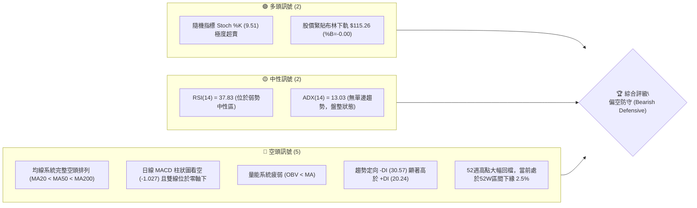

### 📊 核心指標速覽表

| 指標類別 | 指標名稱 | 當前數值 | 訊號 | 解讀 |
|----------|----------|----------|------|------|
| **價格** | 當前收盤價 | $115.16 | 🔴 | 位於52週區間 2.5% 極低位，逼近歷史波段低點 |
| **均線** | MA20 | $130.62 | 🔴 | 價格低於 MA20 達 -11.84%，短線受壓嚴重 |
| **均線** | MA50 | $139.51 | 🔴 | 中期生命線下行，價格差距達 -17.45% |
| **均線** | MA200 | $154.71 | 🔴 | 長期牛熊分界線失守，長期格局全面偏空 |
| **動能** | RSI(14) | 37.83 | 🟡 | 位於弱勢區間（30–70），未達超賣但動能疲軟 |
| **動能** | MACD(12,26,9) | -4.481 / -3.454 | 🔴 | DIF 與 MACD 線雙雙在零軸下方運行，柱狀圖負值（-1.027） |
| **動能** | Stoch %K / %D | 9.51 / 17.66 | 🟢 | 進入極度超賣區（<20），短線存在技術性反抽動能 |
| **趨勢** | ADX(14) | 13.03 | 🟡 | ADX < 25 表明趨勢動能衰竭，目前處於弱勢寬幅震盪/築底階段 |
| **通道** | 布林帶 %B | -0.00 | 🟢 | 價格刺穿布林下軌（$115.26），存在向通道內回歸需求 |
| **波動** | ATR(14) | $8.36 | 🔴 | ATR 佔股價 7.26%，單日波動劇烈，風控難度高 |
| **成交量** | 量比 (Volume Ratio) | 1.33x | 🔴 | 放量下挫（56.59M vs 20日均量 42.45M），OBV < MA 呈量能萎縮 |

### 🏆 技術評分卡

```
╔══════════════════════════════════════════════════════════════════╗
║                   技術評分卡 — ORCL (2026-11-06)                 ║
╠══════════════════════════════════════════════════════════════════╣
║ 趨勢強度 (Trend)       ████░░░░░░░░░░░░░░░░  20/100  🔴 極弱     ║
║ 動能指標 (Momentum)    ███████░░░░░░░░░░░░░  35/100  🔴 疲軟     ║
║ 支撐穩定度 (Support)   ████████░░░░░░░░░░░░  40/100  🟡 考驗S1   ║
║ 成交量配合 (Volume)    ██████░░░░░░░░░░░░░░  30/100  🔴 價跌量增 ║
║ 形態完整度 (Pattern)   ███████░░░░░░░░░░░░░  35/100  🔴 破位下行 ║
║ 均線排列 (Moving Avg)  ████░░░░░░░░░░░░░░░░  20/100  🔴 空頭排列 ║
╠══════════════════════════════════════════════════════════════════╣
║ 綜合評分 (Overall)     ██████░░░░░░░░░░░░░░  30/100  🔴 強烈偏空 ║
║ 評分計算：(20 + 35 + 40 + 30 + 35 + 20) ÷ 6 = 30.0 (規則 18)    ║
╚══════════════════════════════════════════════════════════════════╝
```

---

## 2. 趨勢分析

### 🌐 多時框趨勢分析

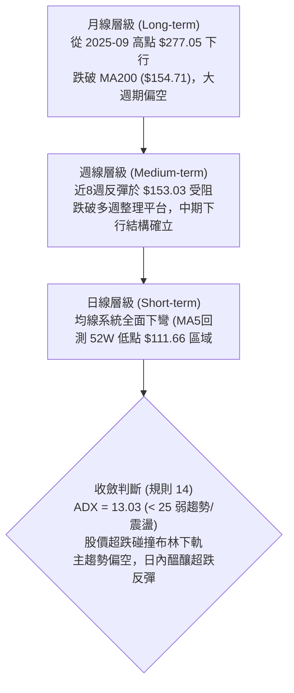

### 📈 長期趨勢 — 12個月走勢圖（Unicode）

```
ORCL 月線走勢圖（過去12個月：2025-12 至 2026-11）
價格軸 ($)
$225 ┤                         ● (2026-05: $224.17)
$210 ┤
$195 ┤ ● (2025-12: $192.34)
$180 ┤
$165 ┤      ● (2026-01: $162.84)      ● (2026-04: $160.24)
$150 ┤                                      ● (2026-08: $148.57)
$135 ┤           ● (2026-02: $143.86)            ● (2026-09: $136.79)
$120 ┤                ● (2026-03: $145.55)            ● (2026-10: $130.67)
$105 ┤                                                     ● (2026-11: $115.16 當前)
     └─┬─────┬─────┬─────┬─────┬─────┬─────┬─────┬─────┬─────┬─────┬─────┬──
      12月  01月  02月  03月  04月  05月  06月  07月  08月  09月  10月  11月
     (2025)                      (2026)
```

#### 走勢特徵分析表格

| 階段 | 時間區間 | 起始收盤 | 終止收盤 | 區間漲跌幅 | 主要走勢特徵 |
|------|----------|----------|----------|------------|--------------|
| 第一階段：震盪陰跌 | 2025-12 ~ 2026-03 | $192.34 | $145.55 | -24.33% | 高位籌碼鬆動，月線連四跌探底 |
| 第二階段：強勁反撲 | 2026-03 ~ 2026-05 | $145.55 | $224.17 | +54.02% | 資本支出激增與 AI 雲題材催生多頭脈衝行情 |
| 第三階段：斷崖暴跌 | 2026-05 ~ 2026-07 | $224.17 | $129.39 | -42.28% | 債務與自由現金流轉負，引發法人踩踏賣壓 |
| 第四階段：弱勢橫盤 | 2026-07 ~ 2026-09 | $129.39 | $136.79 | +5.72% | 於 $140 附近進行中繼整理，成交動能遞減 |
| 第五階段：破位探底 | 2026-09 ~ 2026-11 | $136.79 | $115.16 | -15.81% | 跌破所有短期均線，直逼 52 週最低點 $111.66 |

### 📊 中期趨勢（週線分析）

中期技術架構呈現典型的「階梯式下行」破位走勢：

```
週線級別價格壓力與支撐階梯示意：
$158.67 ──────────────────────────────────────── 強阻力 R3 (9月反彈頂點 $158.19 聚類)
          │
$153.03 ──┴───────────────────────────────────── 阻力 R2 (9/25當週高點 $153.03)
             │
$147.63 ─────┴────────────────────────────────── 阻力 R1 (10/30當週高點 $148.48 聚類)
                │
                └─── 近8週震盪箱體下緣跌破 ($122.76)
                       │
$115.16 ───────────────┼──────────────────────── 當前收盤價 ($115.16)
                       │
$114.08 ───────────────┴──────────────────────── 支撐 S1 (近一年波段低點聚類)
$111.66 ──────────────────────────────────────── 52週極限低點 (斐波那契 100.0%)
```

### ⚡ 趨勢強度評估（ADX 解讀）

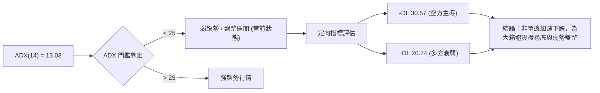

#### ADX 指標強度對照表

| 指標 | 當前數值 | 參考閾值 | 市場狀態解讀 |
|------|----------|----------|--------------|
| **ADX(14)** | 13.03 | < 25 (弱趨勢/無趨勢) | 趨勢動能處於休眠期，未形成連續加速單邊單向破位，多空拉鋸中 |
| **+DI** | 20.24 | 中性基準 25.0 | 多頭進攻意願極低，買盤呈現被動掛單而非主動推升 |
| **-DI** | 30.57 | > 25.0 (空頭主控) | 空頭主導盤面結構，賣壓持續主宰市場走向 |
| **趨勢方向總結** | -DI 遠高於 +DI | 差值 -10.33 | 總體判定：處於空頭主控的弱勢磨底與區間修正行情 |

---

## 3. 圖表形態分析

### 🔍 形態識別系統

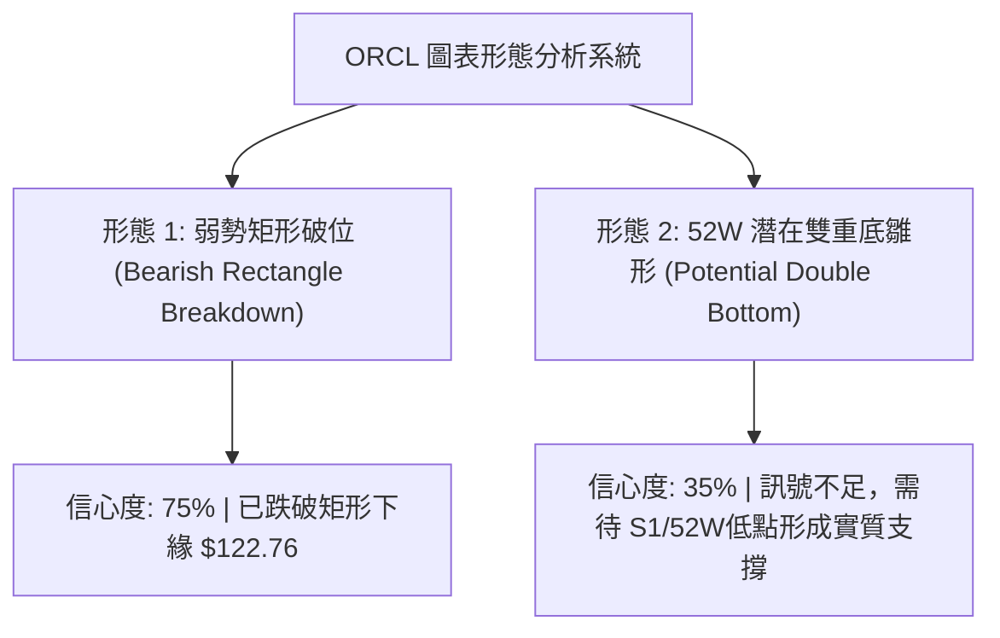

#### 形態識別與信心度評估表

| 形態 | 信心度 | 判斷依據（引用數據） | 完成度 | 目標價（附計算式） |
|------|--------|----------------------|--------|--------------------|
| 弱勢箱體跌破 | 75% | 跌破 10/23 週 K 低點 $122.76 與日 K 頸線位，日線空頭排列 | 90% | 箱體高點 $148.48 − 箱體低點 $122.76 = 高度 $25.72；破位目標 = $122.76 − $25.72 = **$97.04（由箱體形態推算）** |
| 潛在雙重底雛形 | 35% | 當前低點 $111.66 測試 52W 低點 $111.66，但各指標未形成金叉 | 30% | 訊號不足，僅做指標型解讀（規則 15），暫不預測頸線突破目標 |

### 🕯️ 重要 K 線形態分析

依規則 19，嚴格採用數據源中「近10根日K」與「近8根週K」進行實證解讀：

#### 近10根日 K 線形態解讀

| 日期 | 開 | 高 | 低 | 收 | 成交量 | K線形態 | 解讀與訊號 |
|------|----|----|----|----|--------|---------|------------|
| 2026-10-23 | 124.87 | 128.33 | 124.39 | 126.16 | 19,223,400 | 短陽線 | 低檔弱勢縮量小幅整理 🟡 |
| 2026-10-26 | 126.06 | 127.99 | 123.75 | 126.06 | 23,008,500 | 十字星十字星 | 多空拉鋸，收盤價持平開盤價 🟡 |
| 2026-10-27 | 126.88 | 132.34 | 126.86 | 130.53 | 26,026,700 | 溫和中陽線 | 向上試探 MA20 阻力，溫和放量 🟢 |
| 2026-10-28 | 131.32 | 148.48 | 128.38 | 144.54 | 81,933,800 | 長上影大陽線 | 爆量突破衝擊阻力區後遇強烈拋壓，留下上影線 🟡 |
| 2026-10-29 | 144.14 | 144.61 | 136.59 | 139.56 | 39,366,900 | 中陰線 | 開盤承接無力，高檔籌碼迅速潰退 🔴 |
| 2026-10-30 | 133.62 | 135.20 | 129.00 | 130.67 | 41,052,900 | 跳空下行中陰線 | 形成烏雲蓋頂後續跌勢，吞噬先前漲幅 🔴 |
| 2026-11-02 | 125.88 | 126.50 | 118.43 | 119.22 | 58,749,300 | 破位長陰線 | 跌破 $120 整數支撐，賣壓洶湧 🔴 |
| 2026-11-03 | 122.00 | 128.14 | 121.35 | 126.19 | 84,295,400 | 帶長上影中陽線 | 超跌反彈但遭遇日線 MA5 壓制回落 🟡 |
| 2026-11-04 | 121.78 | 129.85 | 121.78 | 123.73 | 111,828,100| 爆量衝高回落倒錘頭 | 天量衝高至 $129.85 後遭遇巨量出貨 🔴 |
| 2026-11-05 | 123.00 | 124.24 | 111.66 | 115.16 | 56,591,200 | 下影光頭中陰線 | 盤中殺跌至 52W 低點 $111.66 後微幅收回，留短下影 🔴 |

#### 近8根週 K 線形態解讀

| 週末日期 | 開 | 高 | 低 | 收 | 週成交量 | K線形態 | 解讀與訊號 |
|----------|----|----|----|----|----------|---------|------------|
| 2026-09-18 | 140.90 | 151.44 | 138.49 | 147.07 | 175,146,100 | 上影小陽線 | 反彈上探 $150 阻力受挫 🟡 |
| 2026-09-25 | 148.38 | 153.03 | 132.99 | 136.59 | 156,661,000 | 射擊之星中陰線 | 衝刺 R2 $153.03 失敗，回吐全部週內漲幅 🔴 |
| 2026-10-02 | 132.24 | 144.33 | 131.10 | 141.78 | 164,959,800 | 下影長中陽線 | 於 $131 獲得短期支撐並回抽 🟢 |
| 2026-10-09 | 142.00 | 146.40 | 134.16 | 141.40 | 121,793,100 | 縮量十字星 | 箱體上部橫盤，方向未明 🟡 |
| 2026-10-16 | 141.56 | 144.18 | 127.36 | 128.23 | 167,863,700 | 中長大陰線 | 破位下殺，吞沒前兩週漲幅 🔴 |
| 2026-10-23 | 130.66 | 134.35 | 122.76 | 126.16 | 132,673,600 | 帶下影弱勢陰線 | 探底 $122.76，空頭仍握有絕對話語權 🔴 |
| 2026-10-30 | 126.06 | 148.48 | 123.75 | 130.67 | 211,388,800 | 巨量長上影倒錘陽 | 衝擊 R1 $147.63 遭巨量解套盤沉重打擊 🔴 |
| 2026-11-05 | 125.88 | 129.85 | 111.66 | 115.16 | 311,464,000 | 爆量長陰摜破線 | 巨量下挫摜穿前低，測試 52W 低點 $111.66 🔴 |

### 📉 ASCII 走勢形態示意圖

```
日線級別「衝高回落倒錘頭 + 破位長陰線」組合形態：

$148.48 ──┐ (10/28 高點：巨量長上影天線)
          │
$139.56 ──┼────┐ (10/29 陰線確認)
          │    │
$130.67 ──┴────┼────┐ (10/30 缺口陰線)
               │    │
$126.19 ───────┴────┼────┐ (11/03 弱反彈受阻)
                    │    │
$123.73 ────────────┴────┼──────┐ (11/04 爆量 1.11億股衝高回落)
                         │      │
$115.16 ─────────────────┴──────┼───● (11/05 收盤現價)
                                │
$111.66 ────────────────────────┴───── (11/05 盤中最低測試點)
```

---

## 4. 支撐與阻力

### 🗺️ 關鍵價位分布圖（Unicode）

```
ORCL 價位結構分布圖 (依據 OHLCV 計算與聚類結果)
══════════════════════════════════════════════════════════════════
$158.67 ║██████████████████████████████║ 強阻力 R3 (9月波段高點聚類)
$153.03 ║████████████████████          ║ 阻力 R2 (9/25波段高點聚類)
$147.63 ║████████████████████████      ║ 關鍵阻力 R1 (10/28日K及箱體高點)
        ║                              ║
$130.62 ║┈┈┈┈┈┈┈┈┈┈┈┈┈┈┈┈┈┈┈┈┈┈┈┈┈┈┈┈┈┈║ 布林中軌 / MA20 短期反彈強壓
        ║                              ║
$115.26 ║░░░░░░░░░░░░░░░░░░░░░░░░░░░░░░║ 布林下軌支撐線
$115.16 ╠══════════════════════════════╣ ◄ 當前收盤價 ($115.16)
$114.08 ║▓▓▓▓▓▓▓▓▓▓▓▓▓▓▓▓▓▓▓▓          ║ 近期支撐 S1 (近一年波段低點聚類)
$111.66 ║██████████████████████████████║ 52週極限低點 / 斐波那契 100%
══════════════════════════════════════════════════════════════════
```

### 🚧 阻力位分析表

價位嚴格引用系統計算之波段聚類數值：

| 阻力級別 | 價位 | 形成原因 | 突破難度 | 重要性 |
|----------|------|----------|----------|--------|
| **R1** | $147.63 | 近一年波段高點聚類，對應 10/28 日 K 衝高高點（$148.48）與 9月密集換手區 | ★★★★☆ | 極高。突破代表日線級別扭轉空頭格局 |
| **R2** | $153.03 | 近一年波段高點聚類，對應 2026-09-25 週 K 衝高頂點（$153.03） | ★★★★☆ | 高。此處為空方波段防守陣地 |
| **R3** | $158.67 | 近一年波段高點聚類，對應 2026-09-04 當週波段收盤反彈極值（$158.19） | ★★★★★ | 核心骨幹阻力。未收復前長期趨勢均為空頭 |

### 🛡️ 支撐位分析表

價位嚴格引用系統計算之波段聚類數值：

| 支撐級別 | 價位 | 形成原因 | 守住機率 | 重要性 |
|----------|------|----------|----------|--------|
| **S1** | $114.08 | 近一年波段低點聚類，距離現價僅 -0.94% | 50% | 極高。多頭短期最後防禦防線，失守將直探 52W 低點 |
| **S2 (次級支撐)** | $111.66 | 數據提供的 52W Low 與斐波那契 100.0% 回調位 | 40% | 生死存亡位。跌破將引發無支撐區間的加速下行風險 |
| **S3** | N/A（數據未提供） | 數據中未偵測到低於 $111.66 的波段聚類數據 | N/A | N/A（數據未提供） |

### 📐 斐波那契回調位分析

依據 52 週區間高低點（$111.66 → $249.07）計算：

```
斐波那契回調比例分布：
0.0%  (52W High)  ─── $249.07 (歷史頂部)
23.6%             ─── $216.64
38.2%             ─── $196.58
50.0%             ─── $180.36
61.8% (黃金分割)  ─── $164.15 (跌破宣告牛市結束)
78.6%             ─── $141.07 (10月反彈受阻區域)
100.0%(52W Low)   ─── $111.66 (當前生死線)
```

- **位置判定**：當前收盤價 **$115.16** 緊貼於 **78.6% 回調位（$141.07）** 與 **100.0% 回調位（$111.66）** 之間，處於回調深水區的最底層（區間僅剩 2.5% 緩衝）。
- **結構意涵**：股價回吐了過去一年全部漲幅的 97.5%，若 100.0%（$111.66）被有效擊穿，技術結構將進入「空頭完全釋放」狀態，上方所有均線與籌碼套牢區均將轉化為沉重賣壓。

---

## 5. 技術指標深度解讀

### 🎛️ 指標訊號總覽

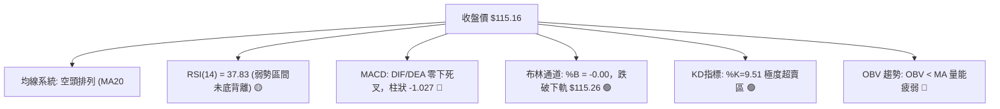

### 📈 移動平均線排列分析

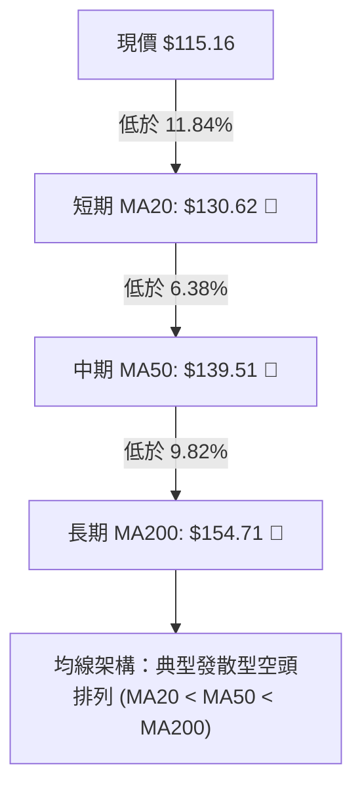

#### 各週期移動平均線深度對照表

| 均線名稱 | 當前價格 | 與現價價差 ($) | 乖離率 (%) | 均線歷史軌跡走勢形態 |
|----------|----------|----------------|------------|----------------------|
| **MA5** | $122.99 | -$7.83 | -6.37% | 下彎極速下沉，短線直接壓制日 K 棒 |
| **MA10** | $128.18 | -$13.02 | -10.16% | 斜率陡峭向下，空方壓制力道持續放大 |
| **MA20** | $130.62 | -$15.46 | -11.84% | 月均線下行，為波段空頭的核心防守防線 |
| **MA60** | $140.58 | -$25.42 | -18.08% | 季線下穿長期均線，中期趨勢完全轉空 |
| **MA120**| $151.35 | -$36.19 | -23.91% | 半年線呈現不可逆下行走勢 |
| **MA200**| $154.71 | -$39.55 | -25.56% | 牛熊分水嶺，現價大幅折價達 25.56% |
| **MA240**| $161.41 | -$46.25 | -28.66% | 年線全面反轉向下，確立長期熊市格局 |

### 📉 RSI(14) 分析

```
RSI(14) 當前數值進度條：
0            20           40           60           80          100
├────────────┼────────────┼────────────┼────────────┼────────────┤
[███████████████████████░░░░░░░░░░░░░░░░░░░░░░░░░░░░░░░░░░░░░░] 37.83
                       ▲ 弱勢中性區間
```

- **超買超賣判定**：RSI 目前讀數為 **37.83**（Wilder），尚未進入 < 30 的絕對超賣區域，顯示拋售力道尚未出現疲竭式的恐慌真空，仍具備慣性下挫的空間。
- **背離判斷**：系統近 20 根 K 棒數據明確顯示**「無明顯背離」**。價格自 10/28 高點滑落，RSI 同步下行；在日線級別首尾對比中，並未出現「價格創新低而 RSI 抬高」的底背離結構，技術指標全面確認當前下行趨勢的真實性。

### 📊 MACD(12,26,9) 訊號解讀

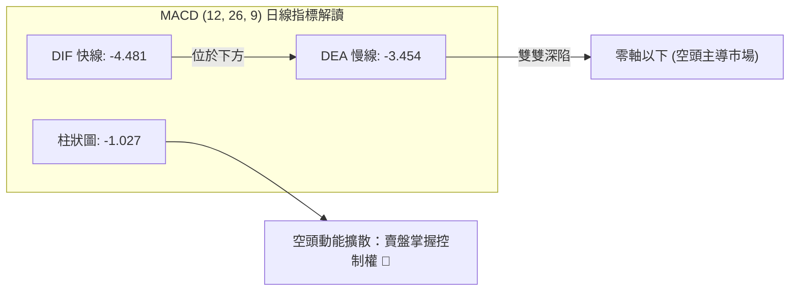

- **柱狀圖動態**：MACD Hist 為 **-1.027**，且 DIF（-4.481）深陷於 DEA（-3.454）下方。負柱狀體呈現持續擴張態勢，驗證了由 $148.48 啟動的回檔走勢並未結束，短期未出現收斂金叉的底層訊號。

### 📦 布林通道分析

```
日線布林通道 (20, 2) 結構示意圖：
$145.98 ────────────────────────────────────── 上軌 Upper Band
          │
          │
$130.62 ──┼─────────────────────────────────── 中軌 Middle Band (MA20)
          │
          │
$115.26 ──┼─────────────────────────────────── 下軌 Lower Band
$115.16 ──┴─● 現價 (收盤破軌: %B = -0.00)
```

- **極限壓迫狀態**：收盤價 $115.16 實質破位並貼在布林下軌（$115.26），通道指標 **%B 為 -0.00**。
- **統計學均值回歸效應**：當 %B 跌破 0 軸，顯示短期下挫幅度已達正態分佈的 2 個標準差極限邊界。歷史統計上，當價格完全脫離通道時，常伴隨強烈向中軌（$130.62）收斂的「均值回歸反抽」，但需視成交量是否承接而定。

### 💹 成交量分析（量價配合度）

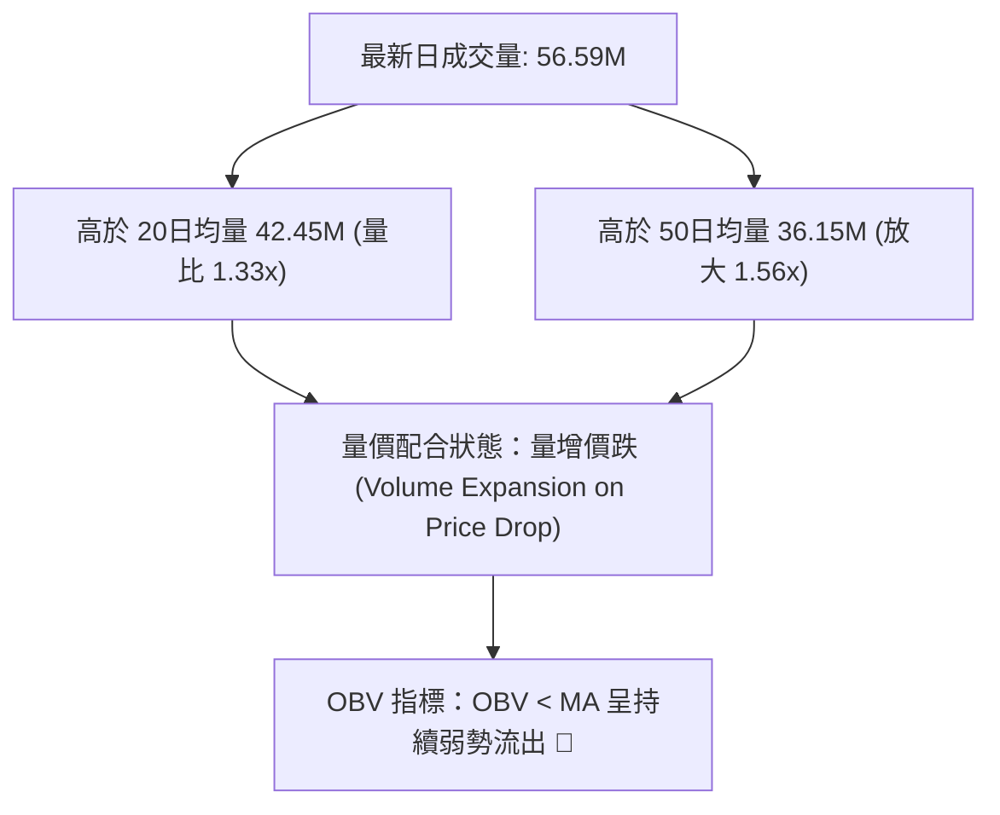

- **量能異動剖析**：11/04 出現高達 **111,828,100 股** 的驚人天量衝高回落倒錘頭，隔日（11/05）再放量至 **56,591,200 股** 擊穿前低，顯示高檔套牢賣盤傾巢而出，為典型的「帶量殺跌」；OBV 指標持續位於其均線下方運行，確認主力資金無意在此建立中長線多頭部位。

---

## 6. 動能與波動率

### ⚡ 動能評估四象限

| 象限 | 動能強度 | 波動率 | 當前狀態標註 | 核心技術評估與操作導向 |
|------|----------|--------|--------------|------------------------|
| **第一象限 (Q1)** | 強動能 | 低波動 | — | 穩健單邊牛市，順勢持股增倉 |
| **第二象限 (Q2)** | 弱動能 | 低波動 | — | 窄幅縮量震盪，觀望等待方向突破 |
| **第三象限 (Q3)** | 強動能 | 高波動 | — | 極端情緒爆發，短線高風險高報酬 |
| **第四象限 (Q4)** | **弱動能 (ADX 13.03)** | **高波動 (ATR 7.26%)**| **✓ 當前 ORCL 所處位置** | **空頭震盪洗盤，避免盲目抄底，以防禦與逢高放空為主** |

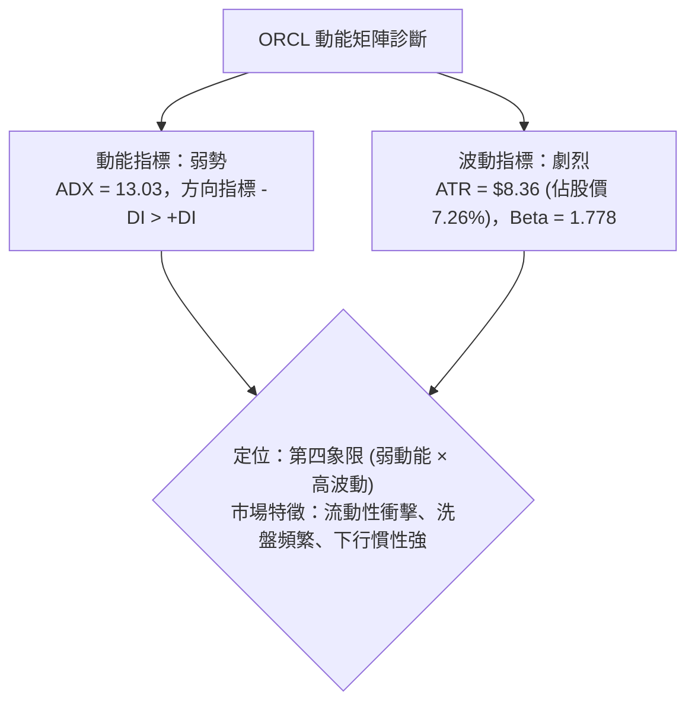

### 📊 ATR 波動率分析

- **ATR(14) 實質數值**：**$8.36**（採用 Wilder 平滑計算法），佔當前股價高達 **7.26%**。
- **日內價格波動衝擊**：近 10 日內，日 K 振幅屢次超過 $10 美元（如 10/28 振幅 $20.10、11/05 振幅 $12.58），高波動代表普通投資人的窄幅止損極易被雜訊洗出。
- **風控止損空間設定**：
  - 短線交易保護止損需給予至少 **1.0 × ATR（$8.36）** 的緩衝距離。
  - 波段交易必須採用 **1.5 × ATR ~ 2.0 × ATR（$12.54 ~ $16.72）** 作為防守帶，以抵禦高 Beta 特性帶來的短線劇烈抽搐。

### 📐 Beta 與市場相關性

- **Beta 係數**：**1.778**。ORCL 屬於**極高波動性（High-Beta）**科技股。
- **市場聯動解讀**：當標普 500 指數或納斯達克波動 1% 時，ORCL 理論上將呈現 1.78% 的同向放大波動。近期新聞顯示市場對 AI 雲資本支出及資料中心信貸的疑慮蔓延，引發高 Beta 軟體股遭到無差別拋售，這解釋了其自高點回調幅度遠大於大盤的結構性脆弱點。

---

## 7. 多時框架總結

### 📋 時框架評分表

| 時框架 | 趨勢方向 | 動能狀態 | 均線排列 | 圖表形態 | 綜合評分 | 戰術建議 |
|--------|----------|----------|----------|----------|----------|----------|
| **月線 (長期)** | 🔴 大幅回檔 | 弱勢衰竭 | 跌破 MA200 | 自高點 $277 破位下行 | 25/100 | 長線資金避開，等待明確築底訊號 |
| **週線 (中期)** | 🔴 空頭下行 | 下降擴散 | 均線系統全面拐頭 | 跌破前期週箱體 $122.76 | 30/100 | 反彈皆為波段賣點，嚴禁重倉抄底 |
| **日線 (短期)** | 🔴 弱勢觸底 | 超賣鈍化 | 空頭排列 MA20<50<200 | 刺穿布林下軌，考驗 S1 | 35/100 | 短線醞釀超跌反抽，但不改弱勢本質 |

### 🔲 綜合訊號矩陣

```
時框維度與指標交叉比對矩陣：
┌─────────────┬─────────────┬─────────────┬─────────────┬─────────────┐
│   時框架    │  均線趨勢   │  動能指標   │  量價配合   │  綜合傾向   │
├─────────────┼─────────────┼─────────────┼─────────────┼─────────────┤
│ 短期 (日線) │ 🔴 空頭排列 │ 🟢 KD超賣   │ 🔴 帶量破位 │ 🔴 弱勢反彈 │
│ 中期 (週線) │ 🔴 均線拐頭 │ 🔴 MACD負向 │ 🔴 天量收陰 │ 🔴 確立破位 │
│ 長期 (月線) │ 🔴 失守年線 │ 🔴 動能流失 │ 🔴 巨額資本支出│ 🔴 長期熊市 │
└─────────────┴─────────────┴─────────────┴─────────────┴─────────────┘
各時框共振度：🔴 空頭完全共振 (Bearish Full Resonance)
```

### ⚖️ 多時框收斂結論

依據多時框收斂規則（規則 14）：
1. **行情屬性判定**：當前 **ADX(14) 為 13.03**（遠低於 25 臨界線），定義為**「盤整/弱勢寬幅震盪行情」**。
2. **主導維度確立**：雖然主週期方向（中長期週線、MA50、MA200）全面處於空頭壓制，但由於 ADX < 25 且日線布林通道跌破下軌（%B = -0.00），市場隨時可能誘發均值回歸的橫盤修復或向上抽芯。
3. **唯一方向性結論**：**偏空防守（Bearish Defensive）**。操作主軸以「反彈逢高放空」為主，多頭僅限極短線超跌快進快出，整體禁止盲目追空或無止損抄底。此結論直接導引至第 8 章的交易策略架構。

---

## 8. 交易策略建議

### 🗺️ 策略決策流程圖

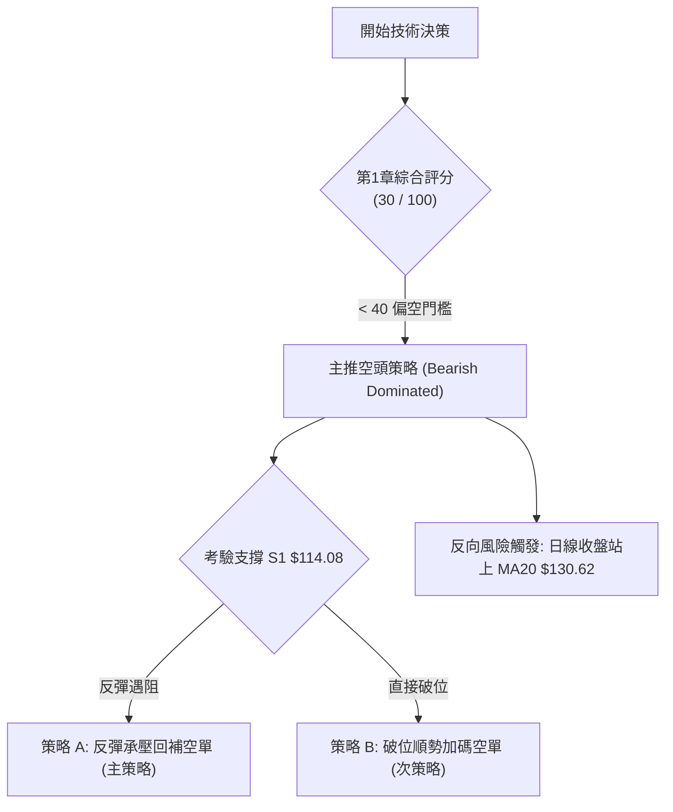

### 🧭 策略路由（依評分卡分流）

> **當前主策略方向 = 主推空頭策略（依第 1 章技術評分卡綜合評分 30/100 偏空門檻判定，規則 18）**

因綜合評分僅為 30 分（≤ 40 偏空區間），本報告嚴格依據技術紀律主推空頭戰略，多方僅視為超跌反彈後的作空窗口，絕不進行兩頭下注。

### 🎯 價格情境階梯（Price Scenarios）

價位嚴格引用關鍵價位區塊與第 4 章聚類數值：

| 觸發條件 | 下一目標 | 後續延伸 | 情境含義 |
|----------|----------|----------|----------|
| **向上反彈突破 MA20 ($130.62)** | 關鍵阻力 R1 ($147.63) | 阻力 R2 ($153.03) | 均值回歸擴大，短線空頭架構遭破壞 |
| **維持於現價區間震盪** | 測試布林下軌 ($115.26) | 徘徊於 $114.08 ~ $122.99 | 弱勢橫盤消化賣壓，等待新的驅動量能 |
| **有效跌破支撐 S1 ($114.08)** | 52W 低點 S2 ($111.66) | 斐波那契 100% 破位向下 | 中期跌勢重新加速，展開無支撐真空滑落 |

### 📊 情境機率分佈

| 情境 | 機率 | 主要依據 |
|------|------|----------|
| **反彈受阻後回落 (主情境)** | **55%** | 均線空頭排列（MA20/50/200），反彈遭遇 MA5（$122.99）或 MA20（$130.62）強烈解套賣壓 |
| **跌破 S1/52W低點加速破底** | **30%** | OBV 持續萎縮，近兩日帶量殺跌，基本面負自由現金流及高負債問題發酵 |
| **直接強勢 V 型反轉** | **15%** | 僅由極度超賣之 Stoch %K（9.51）支撐，但上方籌碼套牢深重，逆轉機率極低 |

### 🟢 主策略詳情（空頭交易策略）

所有價位均嚴格取自數據庫計算數值，風險報酬比嚴格依規則 17 定義計算：

| 策略要素 | 策略 A（反彈至阻力回補作空 - 主選） | 策略 B（跌破 S1 追空破位 - 次選） |
|----------|-------------------------------------|-----------------------------------|
| **交易方向** | 做空 (Short on Bounce) | 做空 (Short on Breakdown) |
| **進場條件** | 價格反彈至 MA20 附近受阻回落 | 實質摜破近一年支撐位 S1 |
| **進場價格** | **$130.62** (精確取自 MA20 / 布林中軌) | **$114.08** (精確取自支撐位 S1) |
| **目標價 T1** | **$114.08** (關鍵支撐 S1) | **$111.66** (52W Low / 斐波那契 100%) |
| **目標價 T2** | **$111.66** (52W Low / 斐波那契 100%) | **$97.04** (由第3章箱體破位高度推算) |
| **止損價格** | **$139.51** (精確取自 MA50 阻力) | **$115.26** (精確取自布林下軌) |
| **風險報酬比** | **1 : 1.86（以 T1 計）**<br>*(計算式：($130.62 − $114.08) ÷ ($139.51 − $130.62) = $16.54 ÷ $8.89 = 1.86)*<br>*(若以 T2 計則為 1 : 2.13)* | **1 : 2.05（以 T1 計）**<br>*(計算式：($114.08 − $111.66) ÷ ($115.26 − $114.08) = $2.42 ÷ $1.18 = 2.05)*<br>*(若以 T2 計則為 1 : 14.44)* |
| **成功機率** | 65% | 55% |
| **建議倉位** | 10% ~ 15% 總資本 | 5% ~ 8% 總資本 |

### 🔴 反向風險觸發點（對沖提示）

- **全面空頭停損觸發價位**：**$139.51（MA50）**。若日線連續兩日實體收盤站上 MA50，宣告中期空頭結構失效。
- **左側空頭減倉點**：若日線級別收復 **$130.62（MA20）**，所有浮盈空單應立即獲利了結 50% 倉位或將止損點下移至進場保本點位。
- **底背離風險**：若價格再次下探 $111.66 附近，而日線 RSI(14) 掉頭向上突破 40 形成明確底背離結構，則必須無條件平掉所有空頭頭寸。

### ⭐ 整體訊號強度評星

```
做多訊號強度：★☆☆☆☆  (1/5星 - 極弱，僅依賴超賣反彈)
做空訊號強度：★★★★☆  (4/5星 - 強烈，均線與量能全面壓制)
整體可信度：  ★★★★☆  (4/5星 - 指標共振，方向高度一致)
```

---

## 9. 風險提示與監控

### ✅ 關鍵監控指標 Checklist

```
╔══════════════════════════════════════════════════════════════════╗
║                    技術監控清單 (Monitoring Checklist)          ║
╠══════════════════════════════════════════════════════════════════╣
║ [ ] 支撐 S1 ($114.08) 是否收盤跌破？ (跌破則引發第二輪殺跌)     ║
║ [ ] 52W 極限低點 ($111.66) 是否有大單承接掛單？                  ║
║ [ ] 日成交量是否回落至 20 日均量 ($42.45M) 之下完成籌碼沉澱？     ║
║ [ ] RSI(14) 能否在不破 $111.66 前提下收復 40 關口？             ║
║ [ ] MACD 綠色柱狀圖是否由負轉正 (目前為 -1.027)？               ║
║ [ ] 股價能否重返日線布林通道下軌 ($115.26) 之上並站穩？          ║
╚══════════════════════════════════════════════════════════════════╝
```

### ⚠️ 風險場景分析

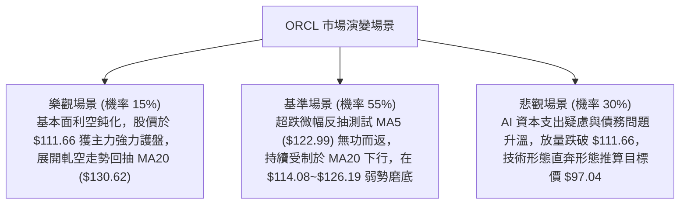

### 🛡️ 風險管理重要提醒

1. **基本面重大拖累因子**：技術面之弱勢根植於基本面數據的急劇惡化——最新 TTM 資本支出高達 **$75.66B**，導致自由現金流（FCF）深陷 **$-28.72B** 負值，總債務膨脹至 **$169.14B**（淨債務 **$-132.07B**，Debt/Equity 達 251.72）。技術面的反彈極易受到基本面信貸與評級雜音的無情撲殺。
2. **高 Beta 波動性控倉**：因 Beta 高達 **1.778** 且 ATR 為 **$8.36**，任何單筆持倉的潛在損失不得超過總投資組合淨值的 **1.5%**。以 ATR 止損距離（約 $8.36）推算，單一策略的持倉比重應嚴格限制在 **10%** 以內。
3. **拒絕情緒化左側抄底**：在均線呈現 MA20 < MA50 < MA200 完美空頭排列且 -DI 牢固壓制 +DI 的結構下，左側「猜底」行為屬於高風險操作。必須耐心等待日線級別出現實質底部形態（如雙底右腳放量或 MACD 零下金叉）後方可考慮部位反轉。

---

## 📋 報告總結

```
╔══════════════════════════════════════════════════════════════════╗
║                     ORCL 技術分析報告總結                        ║
╠══════════════════════════════════════════════════════════════════╣
║ 報告日期：2026-11-06                                             ║
║ 當前價格：$115.16 USD                                            ║
║ 分析評級：🔴 偏空防守 / 逢高作空 (綜合評分: 30 / 100)            ║
║                                                                  ║
║ 關鍵維度結論：                                                   ║
║ ├─ 長期趨勢：🔴 跌破 MA200 ($154.71)，全面進入大週期修正結構     ║
║ ├─ 中期趨勢：🔴 跌破 $122.76 箱體下緣，週線下行通道完好         ║
║ ├─ 短期趨勢：🔴 均線空頭排列，但短線跌破布林下軌 (%B=-0.00) 超賣 ║
║ ├─ 關鍵支撐：S1: $114.08  |  S2 (52W Low): $111.66              ║
║ ├─ 關鍵阻力：MA20: $130.62 | R1: $147.63 | R2: $153.03           ║
║ └─ 分析師目標：均價 $235.46 (與當前技術盤面嚴重背離，暫不可作依據)║
║                                                                  ║
║ 最優策略組合：                                                   ║
║ 1. 🥇 最佳機會：等待超跌反彈至 MA20 ($130.62) 遇阻，建立波段空單 ║
║ 2. 🥈 次選機會：跌破關鍵支撐 S1 ($114.08) 後順勢輕倉做空至 $111.66║
║ 3. 🥉 保守選擇：完全空倉觀望，靜待 $111.66 形成有效雙底結構     ║
╚══════════════════════════════════════════════════════════════════╝
```

---

> ⚠️ **免責聲明**：本報告為 AI 自動生成之技術分析，所有數據及估算均基於提供的歷史價格資訊。本報告**僅供研究與學術參考**，**不構成任何投資建議**。投資有風險，入市需謹慎。

---

*報告生成時間：2026-11-06 ｜ 數據來源：Yahoo Finance ｜ 分析框架：多時框技術分析*