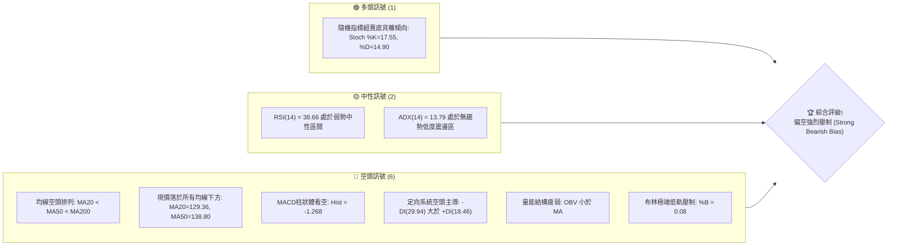
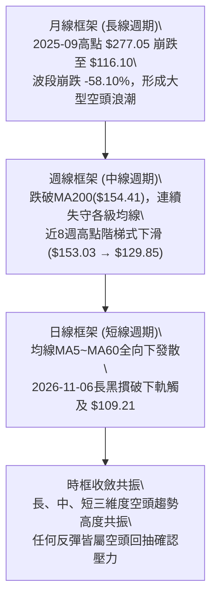
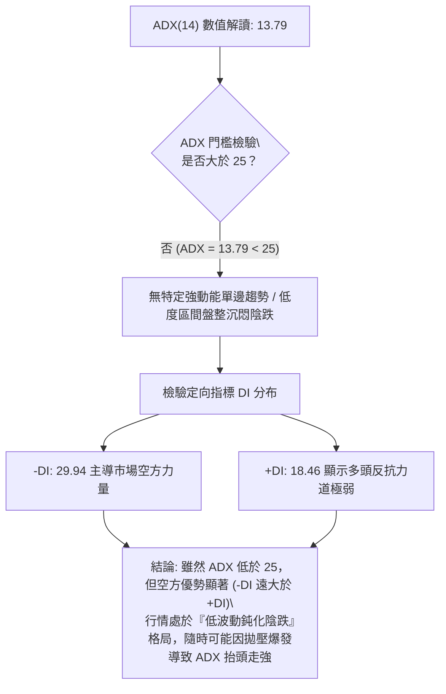
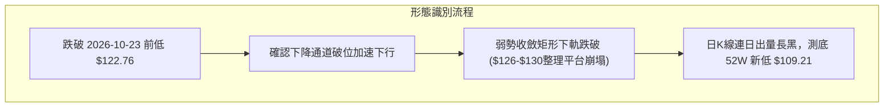
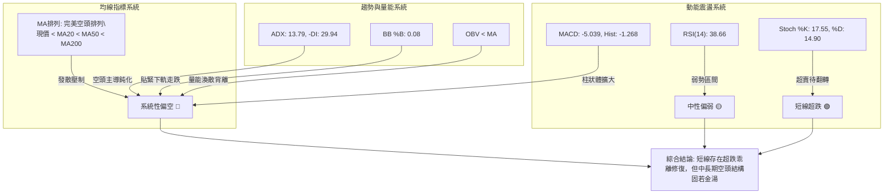
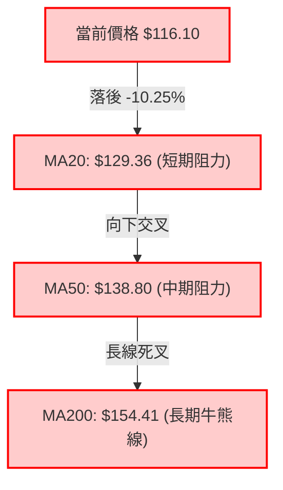
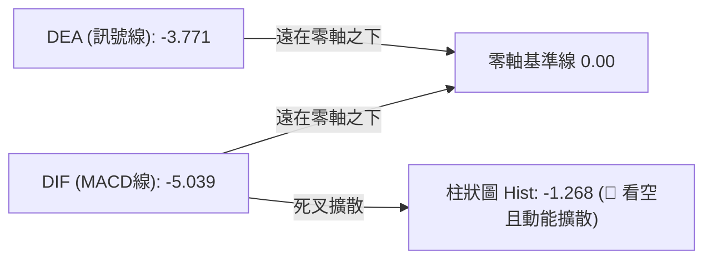
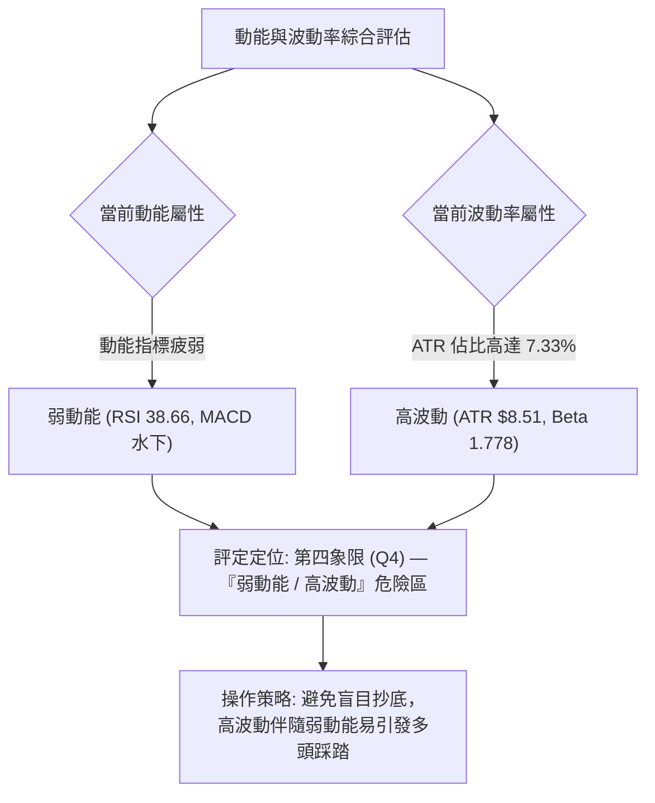
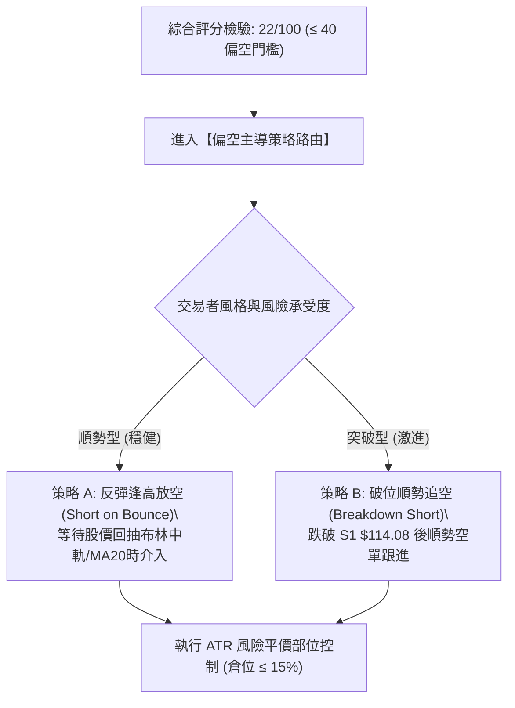
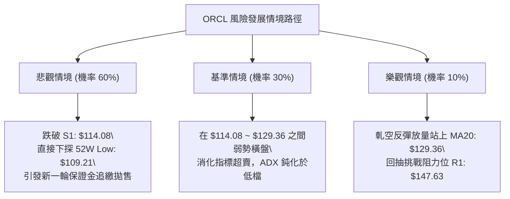

# ORCL 技術分析報告

> **報告日期**：2026-11-07 ｜ **語言**：繁體中文 ｜ **數據來源**：Yahoo Finance ｜ **當前價格**：$116.10

---

## 目錄

| 章節 | 內容 |
|------|------|
| [1. 技術面概覽](#1-技術面概覽) | 訊號儀表板、核心指標、評分卡 |
| [2. 趨勢分析](#2-趨勢分析) | 多時框趨勢、長中短期走勢 |
| [3. 圖表形態分析](#3-圖表形態分析) | 形態識別、K線組合、目標價 |
| [4. 支撐與阻力](#4-支撐與阻力) | 關鍵價位、斐波那契回調 |
| [5. 技術指標深度解讀](#5-技術指標深度解讀) | MA/RSI/MACD/布林/成交量 |
| [6. 動能與波動率](#6-動能與波動率) | 動能評估、ATR、Beta |
| [7. 多時框架總結](#7-多時框架總結) | 時框架評分矩陣 |
| [8. 交易策略建議](#8-交易策略建議) | 多空策略、風險報酬比 |
| [9. 風險提示與監控](#9-風險提示與監控) | 監控指標、風險場景 |

---

## 1. 技術面概覽

### 🎯 技術訊號儀表板



### 📊 核心指標速覽表

| 指標類別 | 指標名稱 | 當前數值 | 訊號 | 解讀 |
|----------|----------|----------|------|------|
| **價格** | 當前價格 | $116.10 | 🔴 | 位於52週區間下緣 4.9% 處，瀕臨破底邊緣 |
| **均線** | MA20 | $129.36 | 🔴 | 現價低於短期均線 $13.26 (-10.25%)，短期空頭沉重 |
| **均線** | MA50 | $138.80 | 🔴 | 現價低於中期均線 $22.70 (-16.35%)，中期趨勢向下 |
| **均線** | MA200 | $154.41 | 🔴 | 現價低於牛熊分水嶺 $38.31 (-24.81%)，長期趨勢全面翻空 |
| **動能** | RSI(14) | 38.66 | 🟡 | 弱勢中性區間，未進入小於30極度超賣，仍具下行空間 |
| **動能** | MACD | -5.039 | 🔴 | 位於零軸極下方，柱狀體為 -1.268，空頭動能主導且擴散 |
| **動能** | Stoch %K/%D | 17.55 / 14.90 | 🟢 | 進入極度超賣區，醞釀技術性超跌反彈修復 |
| **趨勢** | ADX(14) | 13.79 | 🟡 | 數值小於25，代表目前處於空頭驅動下的低動能盤整弱勢跌勢 |
| **通道** | 布林帶 %B | 0.08 | 🔴 | 極度貼近布林下軌 $113.57，面臨通道下軌向下開口風險 |
| **波動** | ATR(14) | $8.51 | 🔴 | 佔股價 7.33%，單日波動劇烈，進出場滑價與停損風險高 |

### 🏆 技術評分卡

```
╔══════════════════════════════════════════════════════════════════╗
║                   技術評分卡 — ORCL (2026-11-07)                 ║
╠══════════════════════════════════════════════════════════════════╣
║ 趨勢強度      ████░░░░░░░░░░░░░░░░  20/100  🔴 強烈偏空 (空方主導) ║
║ 動能指標      ██████░░░░░░░░░░░░░░  30/100  🔴 MACD負值擴大/RSI疲弱 ║
║ 支撐穩定度    ██████░░░░░░░░░░░░░░  30/100  🔴 僅存S1支撐，破底風險高 ║
║ 成交量配合    ████░░░░░░░░░░░░░░░░  20/100  🔴 下跌放量，OBV跌破均線  ║
║ 形態完整度    ████░░░░░░░░░░░░░░░░  20/100  🔴 多頭形態瓦解，破位下跌 ║
║ 均線排列      ██░░░░░░░░░░░░░░░░░░  10/100  🔴 MA5~MA240 完美空頭排列 ║
╠══════════════════════════════════════════════════════════════════╣
║ 綜合評分      ████░░░░░░░░░░░░░░░░  22/100  🔴 強烈偏空 (規則18計算) ║
╚══════════════════════════════════════════════════════════════════╝
```
*註：綜合評分由六項子評分算術平均計算：(20 + 30 + 30 + 20 + 20 + 10) ÷ 6 = 21.67，四捨五入至整數為 22/100。*

---

## 2. 趨勢分析

### 🌐 多時框趨勢分析



### 📈 長期趨勢 — 12個月走勢圖（Unicode）

```
ORCL 月線走勢圖（過去12個月：2025-11 至 2026-11）
價格軸 ($)
$200 ┤ ●(199.28)
$190 ┤   ●(192.34)
$180 ┤
$170 ┤
$160 ┤       ●(162.84)                  ●(160.24)
$150 ┤                                           ●(148.57)
$140 ┤           ●(143.86) ●(145.55)                 ●(136.79)
$130 ┤                                                   ●(130.67)
$120 ┤                                                       ●(129.39)
$110 ┤                                                           ●(116.10)←現價
     └─────────────────────────────────────────────────────────────────
       25-11 25-12 26-01 26-02 26-03 26-04 26-05* 26-06 26-07 26-08 26-09 26-10 26-11
```
*註：2026-05曾因財報等特定事件異常暴衝至 $224.17，隨後於 2026-06 即跳水崩跌至 $145.50，呈現典型「倒 V 型」多頭陷阱。*

#### 走勢特徵分析表格

| 階段區間 | 起始收盤價 | 結束收盤價 | 區間漲跌幅 | 主要走勢特徵與量價結構 |
|----------|------------|------------|------------|------------------------|
| **2025-11 ~ 2026-02** | $199.28 | $143.86 | -27.81% | 歷史高點 $277.05 反轉後的主跌段，重心逐月大幅下移 |
| **2026-03 ~ 2026-05** | $145.55 | $224.17 | +54.01% | 假突破報復性反彈，5月份拉出長上影暴衝波，形成終極誘多陷阱 |
| **2026-06 ~ 2026-08** | $145.50 | $148.57 | +2.11% | 跳空重挫後在 $130~$150 區間進行籌碼派發與弱勢橫盤整理 |
| **2026-09 ~ 2026-11** | $136.79 | $116.10 | -15.13% | 盤整帶向下摜破，2026-11創下52週新低 $109.21，加速尋底 |

### 📊 中期趨勢（週線分析）

```
ORCL 近期週線壓力與支撐結構示意圖
價格 ($)
155.00 ┤---------------------------------------- [R2: $153.03 - 09/25波段週頂]
150.00 ┤---------------------------------------- [R1: $147.63 - 10/30反彈高點聚類]
145.00 ┤
140.00 ┤---------------------------------------- [BB中軌/MA20: $129.36 水平阻力區]
135.00 ┤
130.00 ┤
125.00 ┤
120.00 ┤
116.10 ┤=======[ 當前價格 $116.10 ]============
114.08 ┤---------------------------------------- [S1: $114.08 - 近一年波段低點支撐]
109.21 ┤---------------------------------------- [52W Low: $109.21 - 斐波那契100%基準]
```

中期走勢呈現典型「高點降低、低點破底」的下行階梯通道（Lower Highs & Lower Lows）。近8週的波段高點由 2026-09-25 的 $153.03 降至 2026-10-30 的 $148.48，最新一週高點僅為 $129.85；低點則從 $132.99 連續擊穿至 $109.21。週線 MACD 柱狀體在短暫翻正後迅速於 2026-11-06 擴大翻黑至 -1.268，週成交量暴增至 359,251,900 股，呈現恐慌拋售型態，確立中期空頭跌勢重啟。

### ⚡ 趨勢強度評估（ADX 解讀）



#### ADX 趨勢強度對照表

| 指標變數 | 當前數值 | 參考標準區間 | 市場狀態解讀 |
|----------|----------|--------------|--------------|
| **ADX(14)** | **13.79** | < 20: 極弱/無趨勢；20~25: 醞釀期；> 25: 強趨勢 | 數值落於極弱區間，顯示先前自 $224 的急跌暫時轉為橫向鈍化陰跌 |
| **+DI** | **18.46** | 衡量多頭推進力道 (高於25為強) | 多頭攻擊力道極度不足，買盤缺乏持續性推升力道 |
| **-DI** | **29.94** | 衡量空頭推進力道 (高於25為強) | 空方顯著主導盤面，高於 +DI 達 11.48 點，呈現單向壓制狀態 |
| **DI 差值** | **-11.48** | (+DI) 減 (-DI) | 淨空頭主導差值，確認反彈空間將受嚴格壓制 |

---

## 3. 圖表形態分析

### 🔍 形態識別系統



#### 形態識別與信心度評估表（依規則 15）

| 形態類別 | 信心度 | 判斷依據（引用數據） | 完成度 | 目標價（附計算式） |
|----------|--------|----------------------|--------|--------------------|
| **下降通道延續 (Downside Channel)** | **85%** | 週線高點由 $153.03 下降至 $148.48、$129.85；低點自 $132.99 降至 $122.76、$109.21 | 90% | 依通道跌破高度測算：$122.76 - ($148.48 - $122.76) = 數據中未提供相應負值，下檔直接尋求 52W Low $109.21 與斐波那契 100% 支撐 |
| **箱體破位 (Box Breakdown)** | **75%** | 2026-10-16 至 2026-10-30 於 $126.06~$148.48 構築小型派發平台，11-05 長黑跌破箱底 | 100% | 破位已成立，形態已完全展開，當前測試支撐位 S1: $114.08 與 52W Low: $109.21 |
| **雙底形態 (Double Bottom)** | **0% (訊號不足)** | 現價 $116.10 僅觸及一次波段低點 $109.21，無二次築底確認跡象 | 0% | 訊號不足，僅做指標型解讀，不預設多頭雙底形態 |

### 🕯️ 重要K線形態分析

依據規則 19，以下分析嚴格鎖定「近10根日K」與「近8根週K」之實際數據：

#### 近10根日K棒形態分析

| 日期（日K） | 開 | 高 | 低 | 收 | 成交量 | K線形態 | 解讀與訊號 |
|-------------|----|----|----|----|--------|---------|------------|
| 2026-10-26 | 126.06 | 127.99 | 123.75 | 126.06 | 23,008,500 | 十字墓碑變形 | 縮量橫盤，多空膠著 🟡 |
| 2026-10-27 | 126.88 | 132.34 | 126.86 | 130.53 | 26,026,700 | 溫和小陽線 | 震盪反彈嘗試突破均線 🟡 |
| 2026-10-28 | 131.32 | 148.48 | 128.38 | 144.54 | 81,933,800 | 爆量長陽線 | 巨量衝高突破，逼近阻力位 R1 ($147.63) 🟢 |
| 2026-10-29 | 144.14 | 144.61 | 136.59 | 139.56 | 39,366,900 | 倒垂大陰線 | 高檔出脫，收於當日相對低點 🔴 |
| 2026-10-30 | 133.62 | 135.20 | 129.00 | 130.67 | 41,052,900 | 實體中陰線 | 連續回吐前日漲幅，形成短期頭部 🔴 |
| 2026-11-02 | 125.88 | 126.50 | 118.43 | 119.22 | 58,749,300 | 跳空放量長黑 | 跳空摜破 $120 整數關卡，賣壓傾瀉 🔴 |
| 2026-11-03 | 122.00 | 128.14 | 121.35 | 126.19 | 84,295,400 | 長下影反彈陽線 | 爆量超跌反彈，但未能越過 11-02 開盤價 🟡 |
| 2026-11-04 | 121.78 | 129.85 | 121.78 | 123.73 | 111,828,100 | 天量長上影陰線 | 沖高回落，高檔籌碼派發極度激烈 🔴 |
| 2026-11-05 | 123.00 | 124.24 | 111.66 | 115.16 | 56,875,900 | 實體大陰棒 | 單日崩跌破前低，直逼 S1 支撐 🔴 |
| 2026-11-06 | 119.54 | 119.70 | 109.21 | 116.10 | 47,503,200 | 長下影鎚頭變形 | 觸及 52W 新低 $109.21 後浮現止跌抵抗 🟡 |

#### 近8根週K棒形態分析

| 日期（週K最後日） | 開 | 高 | 低 | 收 | 週成交量 | K線形態 | 解讀與訊號 |
|--------------------|----|----|----|----|----------|---------|------------|
| 2026-09-18 | 140.90 | 151.44 | 138.49 | 147.07 | 175,146,100 | 帶上影陽線 | 測試 $150 阻力未果 🟡 |
| 2026-09-25 | 148.38 | 153.03 | 132.99 | 136.59 | 156,661,000 | 沖高長陰包覆 | 觸及阻力位 R2: $153.03 形成反轉頭部 🔴 |
| 2026-10-02 | 132.24 | 144.33 | 131.10 | 141.78 | 164,959,800 | 下影中陽線 | 低檔 $131 支撐浮現反彈 🟢 |
| 2026-10-09 | 142.00 | 146.40 | 134.16 | 141.40 | 121,793,100 | 縮量十字星 | 高檔滯漲，量能萎縮 🟡 |
| 2026-10-16 | 141.56 | 144.18 | 127.36 | 128.23 | 167,863,700 | 破位中長黑 | 跌破前兩週低點，重啟跌勢 🔴 |
| 2026-10-23 | 130.66 | 134.35 | 122.76 | 126.16 | 132,673,600 | 續跌小陰棒 | 創下波段新低 $122.76 🔴 |
| 2026-10-30 | 126.06 | 148.48 | 123.75 | 130.67 | 211,388,800 | 巨量長上影墓碑線 | 上攻 R1 ($147.63) 遭強力摜壓 🔴 |
| 2026-11-06 | 125.88 | 129.85 | 109.21 | 116.10 | 359,251,900 | 天量恐慌長黑破底 | 放量摜破所有支撐，單週失守-11.15% 🔴 |

### 📉 ASCII 走勢形態示意圖

```
ORCL 近兩週日線破位崩跌示意圖
價格 ($)
150.00 ┤        ▲ (2026-10-28 高點 $148.48 逼近 R1 $147.63)
145.00 ┤       ╱ ╲
140.00 ┤      ╱   ▼ (10-29 高檔出貨)
135.00 ┤     ╱     ╲
130.00 ┤    ●       ● (10-30 頸線失守 $130.67)
125.00 ┤───●─────────╲───────────▲ (11-04 天量誘多 $129.85)
120.00 ┤               ╲         ╱ ╲
115.00 ┤                ▼───────●   ▼ (11-05 實體長黑 $115.16)
110.00 ┤                 (11-02)     ╲
105.00 ┤                              ▼ (11-06 探 52W 新低 $109.21，收 $116.10)
       └─────────────────────────────────────────────────────────────
         10-26 10-27 10-28 10-29 10-30 11-02 11-03 11-04 11-05 11-06
```

### 🎯 形態目標價計算

根據 2026-10-28 至 2026-10-30 構築之短期反彈頭部形態：
1. **反彈頸線位 (Neckline)**：取自 2026-10-26 低點與 10-30 收盤價交集，約為 $130.67。
2. **頭部形態高點 (Peak)**：2026-10-28 盤中高點 $148.48（與阻力位 R1 $147.63 聚類高度重合）。
3. **形態垂直高度 (H)**：$148.48 - $130.67 = $17.81。
4. **理論破位目標價 (Target)**：
   $$\text{目標價} = \text{頸線} - H = \$130.67 - \$17.81 = \$112.86$$
5. **實質走勢驗證**：2026-11-06 最低點觸及 $109.21，已完全滿足並擊穿該形態之等幅下行測幅目標（$112.86），目前處於超額宣洩後的短線弱勢修復階段，下方首要防禦端即為數據支撐位 S1: $114.08 與 52W 低點 $109.21。

---

## 4. 支撐與阻力

### 🗺️ 關鍵價位分布圖（Unicode）

```
ORCL 價位結構分布圖
══════════════════════════════════════════════════════════════════
$158.67 ║████████████████████████║ 強阻力 R3 (波段高點聚類)
$153.03 ║████████████████████    ║ 阻力 R2 (09-25 波段高點)
$147.63 ║████████████████████████║ 關鍵阻力 R1 (10-28 巨量衝高點)
$139.01 ║────────────────────────║ 斐波那契 78.6% 回調位
$129.36 ║▓▓▓▓▓▓▓▓▓▓▓▓▓▓▓▓▓▓▓▓    ║ BB中軌 / MA20 密集套牢帶
$116.10 ╠════════════════════════╣ ◄ 現價 (2026-11-06 收盤)
$114.08 ║▓▓▓▓▓▓▓▓▓▓▓▓▓▓▓▓        ║ 近期支撐 S1 (波段低點聚類)
$109.21 ║████████████████████████║ 52週新低 / 斐波那契 100.0% 極限支撐
══════════════════════════════════════════════════════════════════
```

### 🚧 阻力位分析表

*嚴格引用數據「關鍵價位」區塊之波段高點聚類數值：*

| 阻力級別 | 價位 | 距現價幅動 | 形成原因（依數據） | 突破難度 | 重要性 |
|----------|------|------------|--------------------|----------|--------|
| **R1** | **$147.63** | +27.16% | 近一年波段高點聚類，對應 2026-10-28 爆量長影最高點 ($148.48) 密集解套賣壓區 | 極高 | ★★★★★ |
| **R2** | **$153.03** | +31.81% | 2026-09-25 當週最高點，亦為中期波段反彈終結點，具強力沉積籌碼壓力 | 極高 | ★★★★☆ |
| **R3** | **$158.67** | +36.67% | 近一年波段高點聚類頂部，接近 2026-09-04 週末收盤價 ($158.19)，多頭失守主陣地 | 極高 | ★★★☆☆ |

### 🛡️ 支撐位分析表

*嚴格引用數據「關鍵價位」區塊之波段低點聚類數值：*

| 支撐級別 | 價位 | 距現價幅動 | 形成原因（依數據） | 守住機率 | 重要性 |
|----------|------|------------|--------------------|----------|--------|
| **S1** | **$114.08** | -1.74% | 近一年波段低點聚類，對應 2026-07-24 當週低點 ($114.57) 與 11-05 收盤 ($115.16) 防守線 | 45% (偏脆弱) | ★★★★★ |
| **S2** | **N/A** | N/A | **N/A（數據未提供）**：輸入數據「關鍵價位」僅提供 S1，數據中未偵測到 S2 | N/A | N/A |
| **S3** | **N/A** | N/A | **N/A（數據未提供）**：輸入數據「關鍵價位」僅提供 S1，數據中未偵測到 S3 | N/A | N/A |

*註：除關鍵價位 S1 外，下方極限基準以 52W Low $109.21（亦為斐波那契 100.0% 位）作為絕對防守點。*

### 📐 斐波那契回調位分析

*嚴格依據 52 週區間 $109.21 (低) → $248.46 (高) 計算之回調數據：*

| 回調比率 | 價位 | 技術意涵與現價相對關係 |
|----------|------|------------------------|
| **0.0% (52W High)** | **$248.46** | 週期最高點，牛市極限擴張位置 |
| **23.6%** | **$215.60** | 長期回調弱支撐（早於 2026-06 跌破） |
| **38.2%** | **$195.27** | 長期多空轉向分水嶺 |
| **50.0%** | **$178.84** | 中期強弱心理分水嶺 |
| **61.8%** | **$162.40** | 黃金分割理論極限防守位（已被實體跌穿） |
| **78.6%** | **$139.01** | 空頭深度回撤延伸位，現已轉化為強大反壓區 |
| **100.0% (52W Low)**| **$109.21** | 週期基準原點，波段最後多頭防線 |

**現價落點深度解讀**：
當前收盤價 **$116.10** 精確落於 **78.6% 回調位 ($139.01)** 與 **100.0% 回調位 ($109.21)** 之間，距 100.0% 極限僅剩 **$6.89 (+6.31%)** 的緩衝空間。現價位於整個 52 週波動區間的 **4.9%** 極端底部位置。從斐波那契結構解讀，當價格跌破 61.8% ($162.40) 及 78.6% ($139.01) 後，整體結構已完全脫離「多頭回調」範疇，正式定性為「極深級別的熊市主跌浪」，隨時面臨測試 100.0% ($109.21) 原點甚至創下歷史新低的系統性破位風險。

---

## 5. 技術指標深度解讀

### 🎛️ 指標訊號總覽



### 📈 移動平均線排列分析



#### 移動平均線完整數據矩陣

| 均線名稱 | 當前價格 | 與現價乖離率 | 短期趨勢變化（依數據） | 排列解讀 |
|----------|----------|--------------|------------------------|----------|
| **MA 5** | $120.08 | -3.31% | 過去一段走勢持續下壓 (▼ -3.98) | 極短期下壓動能強烈 |
| **MA 10** | $127.18 | -8.71% | 快速下彎中 (▼ -11.08) | 短期反彈首道防線 |
| **MA 20** | $129.36 | -10.25% | 穩定下墜中 (▼ -13.26) | 短期波段生命線，空方核心堡壘 |
| **MA 60** | $139.92 | -17.02% | 自高檔回落 (▼ -23.82) | 季線阻力，確認中期走熊 |
| **MA 120** | $150.77 | -23.00% | 呈現平滑下行 (▼ -34.67) | 半年線阻力，大級別套牢區 |
| **MA 240** | $161.08 | -27.92% | 長期下傾 (▼ -44.98) | 年線重壓，長線完全翻空 |

**均線綜合研判**：
均線系統呈現最標準的「空頭瀑布發散排列（Bearish Waterfall Alignment）」，即：
$$\text{Price (\$116.10)} < \text{MA5} < \text{MA10} < \text{MA20} < \text{MA60} < \text{MA120} < \text{MA240}$$
所有天期的均線皆向下傾斜，未見任何走平或勾頭跡象。現價與 MA200 負乖離率高達 **-24.81%**，此種過度延伸的負乖離容易誘發突發性的技術性反抽，但在各均線層層蓋頭的情況下，反抽均線皆是逢高減碼或順勢作空的良機。

### 📉 RSI(14) 分析

*   **當前數值**：**38.66**
*   **強度進度條**：
    `RSI(14): 38.66  ███████░░░░░░░░░░░░░ 38.66% 🟡 (弱勢中性)`

#### 超買超賣與動能結構分析
1. **區間定位**：RSI 處於 30 至 70 之中性區間，但顯著低於 50 榮枯線，落於 30~40 弱勢沉積區。這表明拋售壓力雖未達到「恐慌極值（<30）」，但空方佔據絕對心理優勢。
2. **背離分析**：依據近 20 根 K 棒數據，價格於 2026-11-06 創下波段低點 $109.21，而當日 RSI 為 38.7（近20週表中標示），並未出現顯著底背離訊號（系統判定「無明顯背離」）。缺乏背離支撐意味著當前價格下跌完全由實質賣盤推動，尚未出現動能耗盡之反轉跡象。

### 📊 MACD(12/26/9) 訊號解讀



#### MACD 結構深度解析
- **MACD 線 (DIF)**: -5.039
- **信號線 (Signal / DEA)**: -3.771
- **柱狀圖 (Histogram)**: -1.268

MACD 雙線深處零軸下方（雙負值），屬於典型的「水下死亡交叉與空頭擴散階段」。柱狀體數值為 **-1.268**，較先前週線級別短暫的修復翻正迅速反轉殺跌。DIF 負值持續擴大，表明中短期移動平均線的發散程度正在加劇，空頭賣壓仍處於宣洩期，尚未見到收斂拐點。

### 📦 布林通道分析

```
ORCL 布林通道結構示意圖 ($)
$145.14 ┤---------------------------------------- 上軌 (Upper Band)
$137.00 ┤
$129.36 ┤---------------------------------------- 中軌 (Middle Band = MA20)
$121.00 ┤
$116.10 ┤=======[ 現價 $116.10 (%B = 0.08) ]====
$113.57 ┤---------------------------------------- 下軌 (Lower Band)
```

- **布林上軌**：$145.14
- **布林中軌 (MA20)**：$129.36
- **布林下軌**：$113.57
- **帶寬與位置 (%B)**：**0.08** (8%)

**通道狀態剖析**：
現價 $116.10 極度逼近布林下軌 $113.57，%B 指標僅為 0.08，顯示股價正緊貼通道下軌滑落（稱為「走下軌」走勢，Walking the lower band）。在此種極端狀態下，股價若未能在下軌獲得有效支撐，布林通道開口一旦擴大，將觸發更劇烈的波段慣性下殺。布林中軌 $129.36 構成了未來反彈難以逾越的第一道動態阻力牆。

### 💹 成交量分析（量價配合度）

#### 成交量數據矩陣

| 監控維度 | 數值 | 基準對照 | 比率 / 狀態 | 解讀 |
|----------|------|----------|-------------|------|
| **當前成交量** | 47,503,200 | 20日均量 (43,558,900) | **1.09x (量比)** | 放量跌破，呈現輕微放量拋售跡象 |
| **中期均量** | 43,558,900 | 50日均量 (36,500,212) | **1.19x** | 近期換手劇烈，籌碼流動性異常擴大 |
| **最新週量** | 359,251,900 | 前週成交量 (211,388,800) | **1.70x** | 單週成交量爆發性增長，主力出貨與恐慌殺跌共振 |
| **OBV 能量潮** | OBV < MA | OBV 移動平均線 | **量能疲弱 🔴** | 能量潮指標跌破均線，資金呈現持續淨流出 |

**量價背離與確認判定**：
近 10 日日 K 棒顯示，2026-11-04 股價衝高至 $129.85 時創下 111,828,100 的異常巨量，隨後兩日（11-05、11-06）價格垂直跳水，成交量維持在 56,875,900 與 47,503,200 之相對高檔。這表明在高檔接盤的籌碼瞬間遭到套牢，形成大量實質套牢籌碼峰。OBV 跌破 MA 確認量能並未對反彈提供健康支撐，反而在下跌過程中展現了籌碼的潰逃。

---

## 6. 動能與波動率

### ⚡ 動能評估四象限



#### 四象限特徵定位表

| 象限 | 動能維度 | 波動維度 | 當前狀態標註 | 戰略應對方針 |
|------|----------|----------|--------------|--------------|
| **Q1** | 強動能 (Bullish) | 低波動 (Low Vol) | — | 最佳波段做多進場點（主升段） |
| **Q2** | 弱動能 (Bearish) | 低波動 (Low Vol) | — | 謹慎觀望，等待突破信號 |
| **Q3** | 強動能 (Bullish) | 高波動 (High Vol) | — | 突破拉升，高風險高收益搏擊 |
| **Q4** | **弱動能 (Bearish)** | **高波動 (High Vol)** | **✓ (ORCL 當前定位)** | **極度危險區，應堅決避免盲目左側抄底** |

### 📊 ATR 波動率分析

- **ATR(14) 數值**：**$8.51**
- **ATR 佔價格比重**：$$\frac{\$8.51}{\$116.10} \times 100\% = 7.33\%$$
- **波動位階解讀**：ATR 達到 7.33% 屬於極度高波動範疇，代表該標的每日平均震幅接近 $8.50 美元。
- **止損與風險距離設定基準**：
  - *常規隔日交易安全止損距離*：建議設定為 $1.5 \times \text{ATR} = 1.5 \times \$8.51 = \mathbf{\$12.77}$。
  - *極度緊湊止損距離*：$1.0 \times \text{ATR} = \mathbf{\$8.51}$。
  - *解讀*：在當前高 ATR 環境下，任何小於 $5 美元的停損皆極易被隨機市場雜訊掃出場，部位規模必須依波動率進行大幅縮減（波動平價法則）。

### 📐 Beta 與市場相關性

- **Beta 係數**：**1.778**
- **系統性風險特徵**：
  ORCL 擁有高達 1.778 的高 Beta 值，意味著該股對基準指數（S&P 500 / Nasdaq）的波動敏感度高出市場整體 77.8%。當科技板塊面臨拋售或 AI 資本支出疑慮等宏觀逆風時，ORCL 跌幅將呈現等比放大。在目前大盤科技板塊承壓之際，高 Beta 特性直接轉化為殺跌時的加速器。

---

## 7. 多時框架總結

### 📋 時框架評分表

| 時框架 | 趨勢方向 | 動能狀態 | 均線排列 | 形態特徵 | 綜合評分 | 戰術建議 |
|--------|----------|----------|----------|----------|----------|----------|
| **月線 (長線)** | 🔴 強烈看空 | 疲弱下行 | 跌破長線支撐 | 歷史天價崩跌回撤 | **25/100** | 長期投資者遠離觀望 |
| **週線 (中線)** | 🔴 強烈看空 | 水下負值擴散 | 空頭排列全面展開 | 階梯式破位尋底 | **20/100** | 順勢逢反彈做空 |
| **日線 (短線)** | 🟡 震盪築底抵抗 | 超賣區鈍化 | 均線瀑布發散壓制 | 破底長下影小幅止跌 | **30/100** | 僅供激進超短線極小倉位博反彈 |

### 🔲 綜合訊號矩陣

```
ORCL 多維度訊號一致性矩陣
維度         短期 (日線)       中期 (週線)       長期 (月線)       方向一致性
─────────────────────────────────────────────────────────────────
趨勢指標     🔴 均線瀑布壓制   🔴 均線死叉下發散 🔴 自277大跌無支撐  高度共振 (空)
動能指標     🟢 Stoch 超賣     🔴 MACD 水下擴散  🔴 RSI 沉淪弱勢   中偏空 (分歧)
量能指標     🔴 放量破底       🔴 爆天量拋售     🔴 長線買盤撤出   高度共振 (空)
通道指標     🔴 布林下軌開口   🔴 跌破週通道     🔴 遠離歷史通道   高度共振 (空)
─────────────────────────────────────────────────────────────────
矩陣結論：除短期震盪指標進入超賣區具備反抽潛能外，中長期訊號全維度呈「壓倒性空頭」。
```

### ⚖️ 多時框收斂結論

依據**嚴格要求 14 之多時框收斂規則**：
1. **行情模式判斷**：當前 ADX(14) 數值為 **13.79 (< 25)**，字面上定義為低趨勢動能/區間震盪行情。然而，檢查定向系統，發現 **-DI (29.94)** 呈現單向壓倒性優勢，高出 **+DI (18.46)** 達 11.48 點，顯示市場並非健康平衡的雙向區間震盪，而是處於「空頭主導下的弱勢陰跌與破位狀態」。
2. **優先級收斂原則**：由於日線與週線在中長期均線方向上完全統一（MA20 < MA50 < MA200 全部空頭排列），日線的短期超賣僅能定性為「極短線次級折返」，絕對不可對抗週線與月線的大級別主跌浪。
3. **唯一方向性結論**：**【強烈偏空觀望，策略以逢高放空或持幣觀望為主導】**。此結論與第 1 章技術評分卡（22/100 偏空）以及第 8 章之主策略完全契合。

---

## 8. 交易策略建議

### 🗺️ 策略決策流程圖



### 🧭 策略路由

**當前主策略方向 = 【主推空頭策略】（依第1章評分卡綜合評分 22/100 ≤ 40 嚴格判定）**

由於當前技術面整體評分極低，且均線呈現完美空頭瀑布，嚴禁任何大規模左側抄底多頭行為。多頭操作僅列為下方的「反向風險觸發與對沖提示」，主策略嚴格聚焦於順勢做空。

### 🎯 價格情境階梯（Price Scenarios）

*本表嚴格引用「關鍵價位」區塊與第 4 章之實際數據數值：*

| 觸發條件 | 下一目標 | 後續延伸 | 情境含義 |
|----------|----------|----------|----------|
| **強勢突破 MA20 ($129.36)** | 阻力位 R1: **$147.63** | 阻力位 R2: **$153.03** | 短線空頭結構遭到破壞，技術性乖離全面修復 |
| **站穩現價區間 ($116.10)** | 斐波那契 78.6%: **$139.01** | MA20: **$129.36** | 區間震盪築底，於下軌進行超跌抵抗 |
| **跌破支撐 S1 ($114.08)** | 52W Low: **$109.21** | 斐波那契 100%: **$109.21** | 中期支撐崩塌，開啟新一輪加速下探主跌浪 |

### 📊 情境機率分佈

| 情境 | 機率 | 主要依據（指標狀態） |
|------|------|----------------------|
| **回落 / 跌破 S1 再探底** | **60%** | 均線空頭排列、MACD 負柱狀體擴大 (-1.268)、OBV 疲弱且跌破均線、-DI 高達 29.94 |
| **低位區間弱勢震盪** | **30%** | ADX 低於 25 (13.79)、Stoch %K/%D 極度超賣 (17.55/14.90) 限制短線單邊暴跌速度 |
| **反彈走高測試 MA20** | **10%** | 現價與 MA200 負乖離高達 -24.81%，偶發性消息面空頭回補 |

### 🔴 主策略詳情（空頭主推策略）

*風險報酬比定義：依規則 17，做空時計算公式為 $(進場價 - 目標價) \div (止損價 - 進場價)$，格式為 1 : X.XX。*

| 策略要素 | 策略 A（反彈高空 — 穩健型） | 策略 B（破位追空 — 激進型） |
|----------|------------------------------|------------------------------|
| **進場條件** | 股價弱勢反抽至 MA20 承壓無力突破時放空 | 實體日K跌破關鍵支撐 S1 ($114.08) 時順勢進場 |
| **進場價格** | **$129.36** (以 MA20 精確值為基準) | **$113.50** (確認跌穿 S1 $114.08 之點位) |
| **目標價 T1** | **$114.08** (關鍵支撐位 S1) | **$109.21** (52W Low / 斐波那契100%) |
| **目標價 T2** | **$109.21** (52W Low / 斐波那契100%) | **N/A（數據未提供更低支撐）** |
| **止損價格** | **$139.01** (斐波那契 78.6% 回調壓力位) | **$116.10** (回抽當前收盤價站穩則止損) |
| **風險報酬比** | **1 : 1.58（以 T1 計）** <br>*算式: (129.36 - 114.08) ÷ (139.01 - 129.36) = 15.28 ÷ 9.65* | **1 : 1.65（以 T1 計）** <br>*算式: (113.50 - 109.21) ÷ (116.10 - 113.50) = 4.29 ÷ 2.60* |
| **成功機率** | **65%** | **55%** |
| **建議倉位** | **10% ~ 15%** (高 ATR 波動環境下輕倉操作) | **5% ~ 8%** (破位追單風險偏高，嚴格緊縮倉位) |

*註：策略 A 若以 T2 計，風險報酬比為 (129.36 - 109.21) ÷ (139.01 - 129.36) = 20.15 ÷ 9.65 = 1 : 2.09（以 T2 計）。*

### 🟢 反向風險觸發點（對沖提示）

若發生以下特定技術突破，表明做空前提遭到系統性破壞，持有空單者必須無條件平倉停損，積極型交易者方可考慮極小倉位短線搏擊多頭反彈：
1. **觸發價位**：日線收盤價強勢實體站上 **$129.36 (MA20)**，且伴隨成交量放大至 20 日均量以上（> 43.5M）。
2. **動能確認**：日線 MACD 柱狀體翻正，且 RSI(14) 突破 50 榮枯線。
3. **多頭理論目標**：若反彈確立，上方第一目標為阻力位 R1: **$147.63**，第二目標為阻力位 R2: **$153.03**；下方硬性止損點必須設於 **$114.08 (S1)**。

### ⭐ 整體訊號強度評星

```
╔══════════════════════════════════════════════════════════════════╗
║ 做多訊號強度：★☆☆☆☆  (1/5星 - 僅存超跌乖離，逆勢操作風險極大)  ║
║ 做空訊號強度：★★★★☆  (4/5星 - 均線空頭排列完備，多時框共振做空) ║
║ 整體可信度：  ★★★★☆  (4/5星 - 破位形態與巨量套牢盤形成雙重驗證) ║
╚══════════════════════════════════════════════════════════════════╝
```

---

## 9. 風險提示與監控

### ✅ 關鍵監控指標 Checklist

```
╔══════════════════════════════════════════════════════════════════╗
║                   每日交易風控監控清單 (Checklist)               ║
╠══════════════════════════════════════════════════════════════════╣
║ [ ] 支撐防守測試：收盤價是否跌破關鍵支撐 S1: $114.08？           ║
║ [ ] 極限原點測試：盤中是否擊穿 52W Low: $109.21 創歷史新低？     ║
║ [ ] 均線動態反壓：反彈是否受阻於 MA20: $129.36 或 MA5: $120.08？ ║
║ [ ] 波動異常監控：單日真實波幅是否大幅超越 ATR(14) $8.51？      ║
║ [ ] 量能異動跟蹤：單日成交量是否異常超越 5,000 萬股引發洗盤？    ║
║ [ ] 指標背離確認：Stoch %K 是否自超賣區勾頭向上交叉 %D？         ║
╚══════════════════════════════════════════════════════════════════╝
```

### ⚠️ 風險場景分析



### 🛡️ 風險管理重要提醒

1. **極度負自由現金流之基本面拖累**：
   技術面之所以呈現潰堤式崩跌，背後對應著嚴峻的財務基本面隱憂：數據顯示 ORCL 過去十二個月 (TTM) 資本支出 (Capex) 高達 **$75.66B**，導致自由現金流 (FCF) 嚴重失血為 **$-28.72B**（FCF Yield 為負的 **-7.93%**），且總負債達到 **$169.14B**（淨負債高達 **$-132.07B**，Debt/Equity 251.7%）。資本支出過載引發市場對其 AI 數據中心投資報酬率的嚴重質疑。
2. **高 Beta 與高 ATR 帶來的部位縮減要求**：
   Beta 高達 1.778 且單日 ATR 佔股價高達 7.33%，任何單一策略的持倉風險暴露不應超過總投資組合權益的 **1.5%**。若設定 $8.51 (1 ATR) 的停損距離，則該標的之持倉上限不得超過總資產的 **10% ~ 15%**。
3. **分析師目標價與技術走勢之極端割裂**：
   雖然分析師共識目標均價高達 **$235.46**，但技術走勢已率先破位跌至 $116.10。交易員應尊重市場價格發現的客觀事實，切忌以「分析師看多」作為盲目逆勢攤平的藉口。

---

## 📋 報告總結

```
╔══════════════════════════════════════════════════════════════════╗
║                   ORCL 技術分析報告總結                          ║
╠══════════════════════════════════════════════════════════════════╣
║ 報告日期：2026-11-07                                             ║
║ 當前價格：$116.10                                                ║
║ 分析評級：🔴 強烈偏空 (綜合評分: 22/100，技術面空頭共振)          ║
║                                                                  ║
║ 關鍵技術結論：                                                   ║
║ ├─ 長期趨勢：🔴 自歷史天價 $277.05 崩跌回撤，完全進入熊市主跌浪  ║
║ ├─ 中期趨勢：🔴 跌破 MA200 牛熊線 ($154.41)，週線階梯式破底下行   ║
║ ├─ 短期趨勢：🟡 短期指標極度超賣，但均線瀑布發散壓制，反彈力竭  ║
║ ├─ 關鍵支撐：S1: $114.08 ｜ 52W極限低點: $109.21 (斐波100.0%)    ║
║ ├─ 關鍵阻力：MA20: $129.36 ｜ 阻力位 R1: $147.63 (高點聚類)      ║
║ └─ 市場共識：分析師目標均價 $235.46 與技術破位現狀嚴重背離       ║
║                                                                  ║
║ 最優策略組合建議：                                               ║
║ 1. 🥇 最佳機會：順勢反彈放空（策略 A）                           ║
║    等待反抽布林中軌/MA20 ($129.36) 逢高佈局空單，停損設 $139.01  ║
║    目標下看 S1 ($114.08) 與 52W Low ($109.21)，風報比 1 : 1.58  ║
║ 2. 🥈 次選機會：破位順勢追空（策略 B）                           ║
║    跌破 S1 ($114.08) 後於 $113.50 追空，目標 $109.21，風報比 1:1.65║
║ 3. 🥉 保守選擇：完全空倉持幣觀望                                 ║
║    在股價未帶量收復 MA20 且 ADX 抬頭走強前，嚴禁任何左側抄底買盤 ║
╚══════════════════════════════════════════════════════════════════╝
```

---

> ⚠️ **免責聲明**：本報告為技術分析研究成果，所有引述之價位與估算均嚴格基於歷史價量數據進行客觀解讀。本報告**僅供學術研究與投資策略討論參考**，**不構成任何要約、招攬或具體投資建議**。金融市場瞬息萬變，高波動與破位標的蘊含高度本金虧損風險，投資人應獨立評估財務狀況並嚴格執行停損風控。

---

*報告生成時間：2026-11-07 ｜ 數據來源：Yahoo Finance ｜ 分析框架：資深多時框技術分析模型*