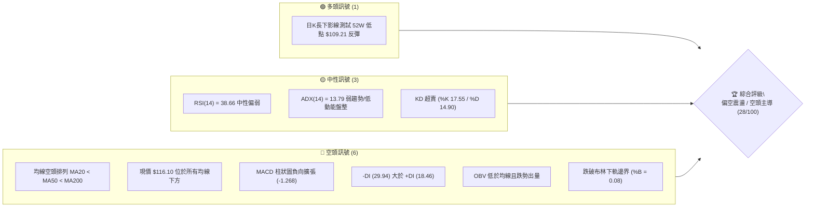
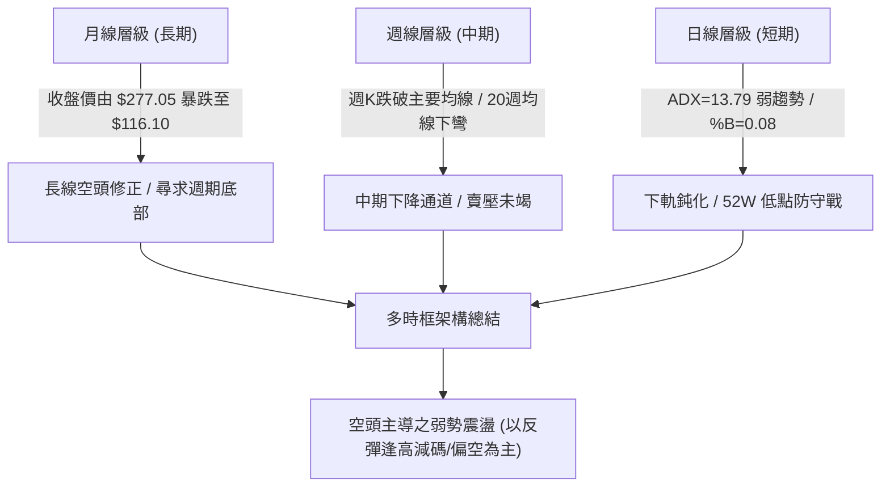
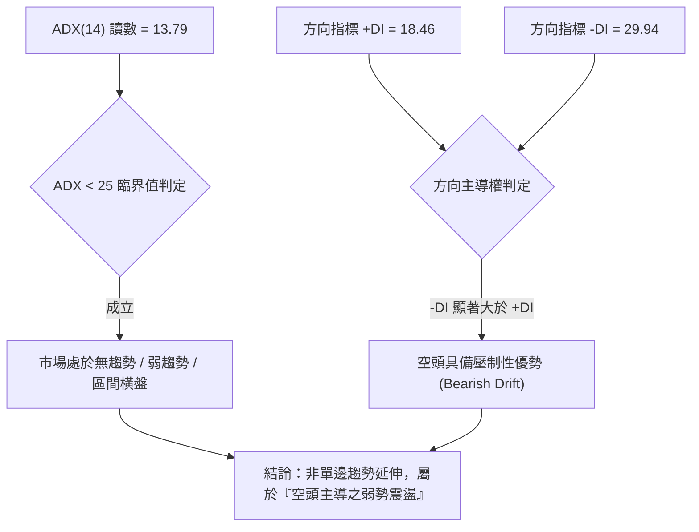
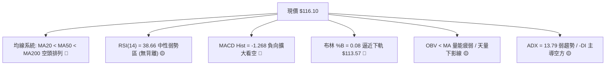
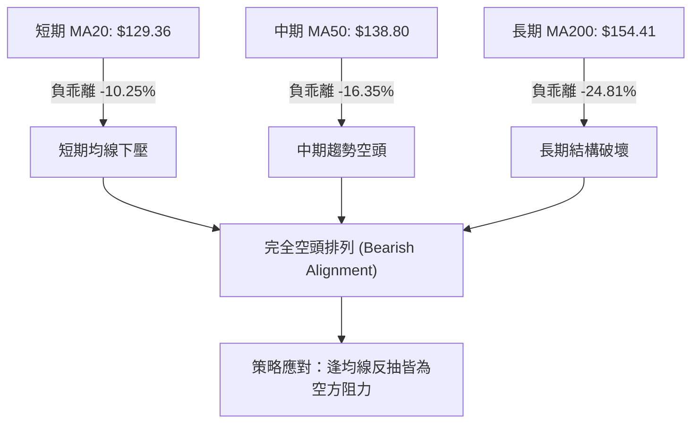
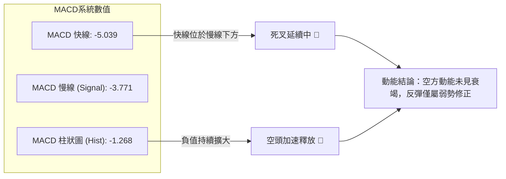
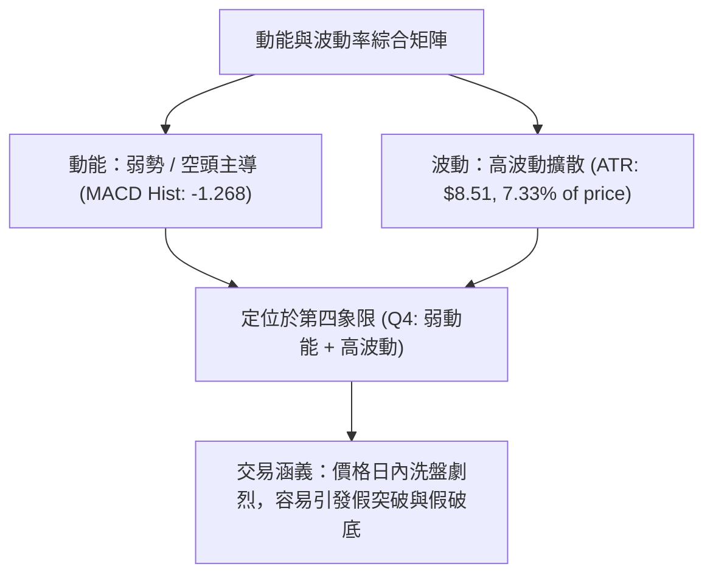
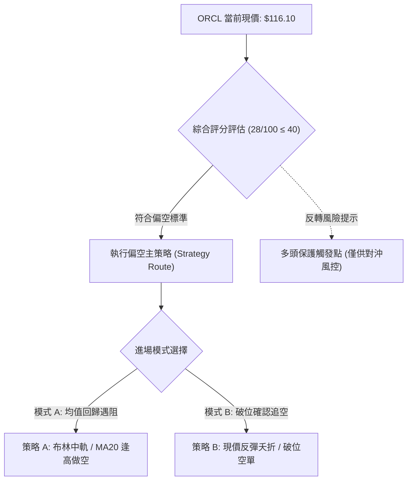
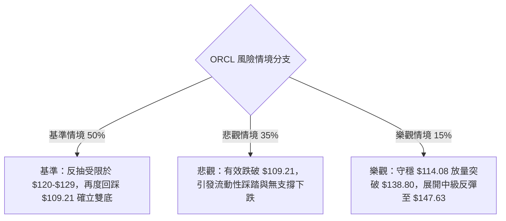

# ORCL 技術分析報告

> **報告日期**：2026-11-08 ｜ **語言**：繁體中文 ｜ **數據來源**：Yahoo Finance ｜ **當前價格**：$116.10

---

## 目錄

| 章節 | 內容 |
|------|------|
| [1. 技術面概覽](#1-技術面概覽) | 訊號儀表板、核心指標、評分卡 |
| [2. 趨勢分析](#2-趨勢分析) | 多時框趨勢、長中短期走勢、ADX 解讀 |
| [3. 圖表形態分析](#3-圖表形態分析) | 形態識別、K線組合、目標價推算 |
| [4. 支撐與阻力](#4-支撐與阻力) | 關鍵價位結構、斐波那契回調 |
| [5. 技術指標深度解讀](#5-技術指標深度解讀) | MA/RSI/MACD/布林/成交量 |
| [6. 動能與波動率](#6-動能與波動率) | 動能四象限、ATR、Beta 與市場連動 |
| [7. 多時框架總結](#7-多時框架總結) | 時框架評分矩陣、多時框收斂結論 |
| [8. 交易策略建議](#8-交易策略建議) | 策略路由、主策略詳情、風險報酬比 |
| [9. 風險提示與監控](#9-風險提示與監控) | 關鍵監控清單、情境分支、風控原則 |

---

## 1. 技術面概覽

### 🎯 技術訊號儀表板



### 📊 核心指標速覽表

| 指標類別 | 指標名稱 | 當前數值 | 訊號 | 解讀 |
|----------|----------|----------|------|------|
| **價格** | 當前收盤價 | $116.10 | 🔴 | 位於 52 週區間 4.9% 極低分位，距低點僅一步之遙 |
| **均線** | MA20 | $129.36 | 🔴 | 價格低於 MA20 達 -10.25%，短線下行斜率陡峭 |
| **均線** | MA50 | $138.80 | 🔴 | 中期關鍵防線失守，均線空頭發散 |
| **均線** | MA200 | $154.41 | 🔴 | 長期牛熊分界線在上，長期趨勢全面轉空 |
| **動能** | RSI(14) | 38.66 | 🟡 | 進入弱勢區間（30–40），尚未進入極度超賣（<30） |
| **動能** | MACD(12,26,9) | -5.039 / -3.771 | 🔴 | MACD 處於零軸下方，Histogram 擴張至 -1.268，空頭動能未消退 |
| **動能** | 隨機指標 (KD) | %K 17.55 / %D 14.90 | 🟡 | 位於超賣區間，存在技術性弱反彈需求 |
| **趨勢** | ADX(14) | 13.79 | 🟡 | ADX < 25 表明單邊趨勢衰竭，進入低動能飄移/空頭主導之震盪 |
| **通道** | 布林帶 %B | 0.08 | 🔴 | 貼近布林下軌 $113.57 運行，極度偏向空方軌道 |
| **波動** | ATR(14) | $8.51 | 🔴 | 佔股價 7.33%，單日波動劇烈，洗盤風險高 |
| **量能** | 最新日成交量 | 47,503,200 | 🟡 | 量比 1.09x（對比20日均量 43,558,900），週量顯著放量 |

### 🏆 技術評分卡

```
╔══════════════════════════════════════════════════════════════════╗
║              技術評分卡 — ORCL (2026-11-08)                     ║
╠══════════════════════════════════════════════════════════════════╣
║  趨勢強度      █████░░░░░░░░░░░░░░░  25/100  🔴 空頭慣性延續    ║
║  動能指標      ██████░░░░░░░░░░░░░░  30/100  🔴 MACD負向擴大    ║
║  支撐穩定度    ███████░░░░░░░░░░░░░  35/100  🟡 考驗S1與前低    ║
║  成交量配合    ██████░░░░░░░░░░░░░░  30/100  🔴 OBV<MA 跌勢放量 ║
║  形態完整度    ███████░░░░░░░░░░░░░  35/100  🟡 下跌通道運行    ║
║  均線排列      ███░░░░░░░░░░░░░░░░░  15/100  🔴 完美空頭排列    ║
╠══════════════════════════════════════════════════════════════════╣
║  綜合評分      ██████░░░░░░░░░░░░░░  28/100  🔴 強烈偏空/弱勢   ║
╚══════════════════════════════════════════════════════════════════╝
```
*(備註：綜合評分 = 六項子評分之算術平均值：(25 + 30 + 35 + 30 + 35 + 15) ÷ 6 = 28.33，四捨五入至整數為 28/100)*

---

## 2. 趨勢分析

### 🌐 多時框趨勢分析



### 📈 長期趨勢 — 12個月走勢圖（Unicode）

以下展示 ORCL 過去 12 個月（2025-11 至 2026-11）的歷史收盤價格軌跡與結構轉折：

```
ORCL 月線走勢圖（過去12個月：2025-11 至 2026-11）
價格 ($)
$230 ┤                  ● (2026-05 高點: $224.17)
$210 ┤
$190 ┤● (2025-11: $199.28)
$170 ┤      ● (2025-12: $192.34)
$150 ┤          ● (2026-01: $162.84)      ● (2026-08: $148.57)
$130 ┤              ● (2026-02: $143.86)      ● (2026-09: $136.79)
$110 ┤                                            ● (2026-10: $130.67)
$100 ┤                                                ●← 目前現價 ($116.10)
     └─────────────────────────────────────────────────────────────
        11   12   01   02   03   04   05   06   07   08   09   10   11 (月份)
```

#### 走勢特徵分析表格

| 階段區間 | 起訖月份 | 起點價格 | 終點價格 | 區間漲跌幅 | 結構特徵與走勢解讀 |
|----------|----------|----------|----------|------------|--------------------|
| **第 I 階段** | 2025-11 ~ 2026-02 | $199.28 | $143.86 | -27.81% | 歷史高點回落後的大型退潮期，跌破兩百美元心理整數關卡 |
| **第 II 階段** | 2026-02 ~ 2026-05 | $143.86 | $224.17 | +55.82% | 強勁的業績/題材反彈波，一度修復中期均線並創下波段高點 |
| **第 III 階段** | 2026-05 ~ 2026-07 | $224.17 | $129.39 | -42.28% | 斷崖式跳水下跌，連續跌破多條長期均線，流動性大幅收縮 |
| **第 IV 階段** | 2026-07 ~ 2026-11 | $129.39 | $116.10 | -10.27% | 弱勢反彈失敗（8月觸及 $148.57 後回落），破底逼近 52 週低點 |

### 📊 中期趨勢（週線分析）

從近 20 週收盤走勢觀察，ORCL 呈現典型的「反彈無量、下跌放量」格局：
- 2026-09-04 達到波段反彈頂部（收盤 $158.19，週成交量僅 115,081,900）。
- 其後週線連番下挫，MACD 柱狀圖由正轉負（2026-09-18 轉為 -0.930）。
- 2026-11-06 當週暴跌至收盤 $116.10，週成交量劇增至 **359,251,900**，為近 20 週之最大單週量能。放量長黑代表籌碼大幅鬆動，雖留下長下影線（最低 $109.21），但空方掌控週線波段節奏。

```
週線支撐與阻力結構示意圖
$160 ┤               ▲ 波段高點 R3: $158.67
$150 ┤         ▲ 頸線壓力 R1: $147.63 / R2: $153.03
$140 ┤   ─ ─ ─ ─ ─ ─ ─ ─ ─ ─ ─ ─ ─ ─ ─ ─ (MA50: $138.80)
$130 ┤         ─ ─ ─ ─ ─ ─ ─ ─ ─ ─ ─ ─ (MA20: $129.36)
$120 ┤   
$116 ┤───► 【現價 $116.10】
$114 ┤   ▼ 關鍵支撐 S1: $114.08
$109 ┤   ▼ 52週歷史低點: $109.21
```

### ⚡ 趨勢強度評估（ADX 解讀）



#### ADX 趨勢強度參照對照表

| 指標名稱 | 實際數值 | 門檻區間 | 技術含意 |
|----------|----------|----------|----------|
| **ADX(14)** | **13.79** | < 20 (極弱/無趨勢) | 趨勢動能極弱，不具備強勁單邊破位動能，行情容易陷入寬幅拉鋸 |
| **+DI** | **18.46** | 基準線 | 多方進攻能量偏低，買盤難以推動連續性大陽線 |
| **-DI** | **29.94** | > 25 (偏高) | 空方仍居主導地位，逢反彈賣壓持續湧現 |
| **差值 (-DI − +DI)** | **+11.48** | > 0 | 空頭優勢擴大，空方完全控制當前波段節奏 |

---

## 3. 圖表形態分析

### 🔍 形態識別系統

依據規則 15，各圖表形態必須依據真實數據建立並標註信心度：

| 形態名稱 | 信心度 | 判斷依據（引用數據） | 完成度 | 目標價（附計算式） |
|----------|--------|----------------------|--------|--------------------|
| **下跌通道 (Descending Channel)** | **75%** | 連接高點 $153.03 (09-25) 與 $148.48 (10-30)，以及低點 $122.76 (10-23) 與 $109.21 (11-06) | 85% | 通道下軌支撐測算：$109.21；通道上軌壓力測算：$129.36 (BB中軌/MA20) |
| **雙底潛在形態 (Double Bottom)** | **35%** | 訊號不足，僅做指標型解讀。雖有 11-06 觸及 $109.21 抽腳，但尚未形成第二次確立之底，未突破頸線 | 20% | 頸線為 R1 $147.63，若突破目標為 $147.63 + ($147.63 − $109.21) = $186.05（目前信心不足，不予採納） |
| **日K破底抽腳錘頭形態** | **65%** | 2026-11-06 最低跌至 $109.21 後拉升至 $116.10 收盤，下影線長達 $6.89 | 100% | 短線反彈第一阻力目標為當週開盤價與均線聚類：MA5 ($120.08) |

### 🕯️ 重要 K 線形態分析

嚴格依據數據中「近 10 根日 K」與「近 8 根週 K」之真實開高低收數據進行專業解讀：

#### 1. 近 10 根日 K 棒結構解析

| 日期 | 開 | 高 | 低 | 收 | 成交量 | K線形態名稱 | 技術解讀與訊號 |
|------|----|----|----|----|--------|-------------|----------------|
| **10-26** | 126.06 | 127.99 | 123.75 | 126.06 | 23,008,500 | 十字星線 (Doji) | 開收同價，多空在此暫時平衡，量能萎縮 🟡 |
| **10-27** | 126.88 | 132.34 | 126.86 | 130.53 | 26,026,700 | 溫和中陽線 | 震盪走高，確認短期 $123.75 之支撐有效 🟢 |
| **10-28** | 131.32 | 148.48 | 128.38 | 144.54 | 81,933,800 | 突破放量長大陽 | 量能暴增至 81.9M，最高暴拉至 $148.48 逼近 R1，多方竭力進攻 🟢 |
| **10-29** | 144.14 | 144.61 | 136.59 | 139.56 | 39,366,900 | 衝高回落中陰線 | 開高走低，上檔 R1 賣壓沉重，量能萎縮顯示追價乏力 🔴 |
| **10-30** | 133.62 | 135.20 | 129.00 | 130.67 | 41,052,900 | 跳空下行陰線 | 跌破 $131 關鍵整數，吞噬前兩日漲幅，形成假突破 🔴 |
| **11-02** | 125.88 | 126.50 | 118.43 | 119.22 | 58,749,300 | 破位放量大陰線 | 開盤跳空摜破 $120，收在全天相對低點，空頭全面主導 🔴 |
| **11-03** | 122.00 | 128.14 | 121.35 | 126.19 | 84,295,400 | 放量長陽反彈 | 成交量擴增至 84.3M，回抽測試上方壓力，多頭抵抗 🟢 |
| **11-04** | 121.78 | 129.85 | 121.78 | 123.73 | 111,828,100 | 天量倒錘子線 | 成交量爆出 1.11 億股天量，衝高 $129.85 後重挫收黑，主力出貨信號 🔴 |
| **11-05** | 123.00 | 124.24 | 111.66 | 115.16 | 56,875,900 | 破位光頭長陰線 | 最低摜破 $112 至 $111.66，收盤跌破 S1 $114.08，空方宣洩 🔴 |
| **11-06** | 119.54 | 119.70 | 109.21 | 116.10 | 47,503,200 | 長下影長針探底錘頭 | 觸及 52W 低點 $109.21 後大幅拉升 $6.89 收在 $116.10，現短線買盤 🟡 |

#### 2. 近 8 根週 K 棒結構解析

| 日期 | 開 | 高 | 低 | 收 | 成交量 | K線形態名稱 | 技術解讀與訊號 |
|------|----|----|----|----|--------|-------------|----------------|
| **09-18** | 140.90 | 151.44 | 138.49 | 147.07 | 175,146,100 | 上影小陽線 | 挑戰 $151 未果，週線動能趨緩 🟡 |
| **09-25** | 148.38 | 153.03 | 132.99 | 136.59 | 156,661,000 | 帶長上影大陰線 | 觸及 R2 $153.03 後重挫 16.4 美元，確立中級高點 🔴 |
| **10-02** | 132.24 | 144.33 | 131.10 | 141.78 | 164,959,800 | 探底回升中陽線 | 下測 $131 支撐獲得反彈，回測頸線 🟢 |
| **10-09** | 142.00 | 146.40 | 134.16 | 141.40 | 121,793,100 | 窄幅十字小陰 | 量能縮至 121M，反彈動能衰竭 🟡 |
| **10-16** | 141.56 | 144.18 | 127.36 | 128.23 | 167,863,700 | 中長實體陰線 | 跌破 $130，跌勢重啟 🔴 |
| **10-23** | 130.66 | 134.35 | 122.76 | 126.16 | 132,673,600 | 弱勢下探小陰 | 連續兩週收在下軌附近，弱勢未改 🔴 |
| **10-30** | 126.06 | 148.48 | 123.75 | 130.67 | 211,388,800 | 巨量倒轉錘頭週線 | 單週振幅高達 24.7 美元，衝高 $148.48 後全數回吐，多頭被套牢 🔴 |
| **11-06** | 125.88 | 129.85 | 109.21 | 116.10 | 359,251,900 | 天量長下影大黑K | 3.59億股恐慌拋售，探底 $109.21 後抽腳收 $116.10，具初步止跌意味 🟡 |

### 📉 ASCII 走勢形態示意圖

```
ORCL 近期日K走勢形態示意圖 (2026-10-26 至 2026-11-06)
$150 ┤          ▲ 10-28 假突破 ($148.48)
$145 ┤          █
$140 ┤          █  █ 10-29 轉折陰線
$135 ┤          █  █  █ 10-30 跳空
$130 ┤      █   █  █  █       ▲ 11-04 天量衝高 ($129.85)
$125 ┤  █   █   █  █  █   █   █  █
$120 ┤  █   █   █  █  █   █   █  █
$115 ┤                     █      █  █ 11-06 現價 ($116.10)
$110 ┤                            █  │
$105 ┤                            ▼  ┴ 11-06 最低探底 ($109.21)
     └─────────────────────────────────────────────────────────────
       10/26 27  28 29 30 11/02 03 04 05 06
```

### 🎯 形態目標價計算

根據 10-28 高點 $148.48 與 11-04 次高點 $129.85 所構築之短線箱型下破測量：
- **形態高點（阻力頸線）**：$129.85（11-04 高點）
- **形態破位點**：$121.78（11-04/11-05 跌破起點）
- **形態高度 ($H$)**：$129.85 − $121.78 = $8.07
- **等距下跌目標 (Downside Measured Target)**：
  $$\text{目標價} = \text{破位點} - H = \$121.78 - \$8.07 = \$113.71$$
- **實證檢驗**：ORCL 於 11-05 及 11-06 跌破此目標價，最低下探至 $109.21，隨後收於 $116.10，顯示等距下跌滿足點已在 $113.71 附近獲初步買盤對沖。

---

## 4. 支撐與阻力

### 🗺️ 關鍵價位分布圖（Unicode）

```
ORCL 價位結構分布圖
═══════════════════════════════════════════════════════════════
$158.67 ║██████████████████████████████████████║ 強波段阻力 R3
$153.03 ║████████████████████████████          ║ 波段阻力 R2
$147.63 ║████████████████████████████████████  ║ 核心關鍵阻力 R1
$138.80 ║──────────────────────────────────────║ MA50 均線壓力帶
$129.36 ║──────────────────────────────────────║ BB中軌 / MA20 壓力
$116.10 ╠══════════════════════════════════════╣ ◄ 當前收盤價 ($116.10)
$114.08 ║▓▓▓▓▓▓▓▓▓▓▓▓▓▓▓▓▓▓▓▓                  ║ 近期波段支撐 S1
$109.21 ║██████████████████████████████████████║ 52週歷史低點 (極限支撐)
═══════════════════════════════════════════════════════════════
```

### 🚧 阻力位分析表

*(依嚴格規則 13，本報告所有阻力價位嚴格引用自提供的數據區塊，不憑空捏造)*

| 阻力級別 | 價位 | 距現價幅離 | 形成原因 | 突破難度 | 重要性 |
|----------|------|------------|----------|----------|--------|
| **R1** | **$147.63** | +27.16% | 近一年波段高點聚類、10-28 爆量衝高回落高點區 ($148.48) | 極高 | 🔴 核心反轉樞紐頸線 |
| **R2** | **$153.03** | +31.81% | 近一年波段高點聚類、09-25 週線波段高點 ($153.03) | 極高 | 🔴 中期多空重裝堡壘 |
| **R3** | **$158.67** | +36.67% | 近一年波段高點聚類、09-04 週線最高收盤區域 | 極高 | 🔴 長期下降趨勢反轉點 |

### 🛡️ 支撐位分析表

| 支撐級別 | 價位 | 距現價幅離 | 形成原因 | 守住機率 | 重要性 |
|----------|------|------------|----------|----------|--------|
| **S1** | **$114.08** | -1.74% | 近一年波段低點聚類、貼近布林下軌 $113.57 | 55% | 🟡 短線生死分水嶺 |
| **S2 (52W Low)** | **$109.21** | -5.93% | 52 週絕對歷史低點、11-06 當日長針探底極限點 | 70% | 🟢 多頭年度最後防線 |
| **S3** | **數據中未偵測到** | N/A | 歷史數據未提供低於 $109.21 之低點聚類 | N/A | ⚪ 數據未提供，嚴格不予編造 |

### 📐 斐波那契回調位分析

依據 52 週完整波動區間（高點 **$248.46** 至 低點 **$109.21**，總垂直空間 $139.25）之精確斐波那契回調計算：

| 斐波那契分位 | 對應精確價位 | 距現價幅離 | 當前技術含意與結構位置 |
|--------------|--------------|------------|------------------------|
| **0.0% (52W High)** | **$248.46** | +114.01% | 52 週最高峰值，長期多頭天花板 |
| **23.6%** | **$215.60** | +85.70% | 05-2026 高點所在區域，極強結構阻力 |
| **38.2%** | **$195.27** | +68.19% | 2025 年末主要震盪密集籌碼區 |
| **50.0%** | **$178.84** | +54.04% | 52 週整體多空力量中軸平衡點 |
| **61.8% (黃金分割)** | **$162.40** | +39.88% | MA240 ($161.08) 聚類區，牛熊轉換線 |
| **78.6%** | **$139.01** | +19.73% | 與 MA50 ($138.80) 高度重合，反彈首要強阻力帶 |
| **100.0% (52W Low)**| **$109.21** | -5.93% | 52 週極限低點，空頭滿足點 |

> **位置判定**：當前收盤價 **$116.10** 精確落在 **78.6% ($139.01)** 與 **100.0% ($109.21)** 之間。此區間屬於「深度回撤臨界區」，股價已回吐過去一年漲幅的 95% 以上。若 100.0% ($109.21) 被有效摜破，將進入下行無支撐的真空跌勢；若守穩，則具備向 78.6% 回抽的技術性修復空間。

---

## 5. 技術指標深度解讀

### 🎛️ 指標訊號總覽



### 📈 移動平均線排列分析



#### 移動平均線多時態數據表

| 均線名稱 | 數值 | 價格與均線差值 | 偏離百分比 | 均線斜率與歷史軌跡 |
|----------|------|----------------|------------|--------------------|
| **MA5** | $120.08 | -$3.98 | -3.31% | 短線下行，下穿加速 🔴 |
| **MA10** | $127.18 | -$11.08 | -8.71% | 連續 10 日下彎，構成第一動態阻力 🔴 |
| **MA20** | $129.36 | -$13.26 | -10.25% | 布林中軌，短波段多空分水嶺 🔴 |
| **MA60** | $139.92 | -$23.82 | -17.02% | 季線下行，中線反彈強阻力 🔴 |
| **MA120** | $150.77 | -$34.67 | -23.00% | 半年線持續下壓 🔴 |
| **MA200** | $154.41 | -$38.31 | -24.81% | 經典牛熊線，長期走空確立 🔴 |
| **MA240** | $161.08 | -$44.98 | -27.92% | 年線大幅壓頂 🔴 |

### 📉 RSI(14) 分析

- **當前讀數**：`38.66` (Wilder 計算)
- **強度指示條**：
  $$\text{RSI(14)}: \text{███████░░░░░░░░░░░░░ } 38.66\% \text{ (弱勢中性)}$$
- **區間評估**：處於 30 至 70 之中性偏弱區間，但低於 40 水平，說明空方動能佔優，多方難以組織有效逆攻。
- **背離判斷**：數據明確標註「**無明顯背離**（僅比較近 20 根 K 棒首尾的價格與 RSI 方向）」。價格創下新低（11-06 觸及 $109.21），而 RSI 落在 38.66，同步維持低位，**不存在底背離，亦無頂背離**，走勢屬於動能與價格同向回落。

### 📊 MACD(12,26,9) 訊號解讀



### 📦 布林通道分析

```
ORCL 布林通道結構示意圖 (日線參數: 20, 2)
$145.14 ┤═══════════════════════════════════ 上軌 (+2σ)
        │
$129.36 ┤─────────────────────────────────── 中軌 (MA20)
        │
$116.10 ┤─────► 【現價 $116.10】 (%B: 0.08)
$113.57 ┤═══════════════════════════════════ 下軌 (-2σ)
```
- **帶寬與位置**：上軌 $145.14，中軌 $129.36，下軌 $113.57。
- **指標位置**：%B 為 **0.08**，極度逼近下軌（0 代表下軌，0.5 代表中軌）。此數值顯示價格正沿著下軌向下「爬行」（Walking the band），通常為強烈空頭行情的特徵，但在通道開口未劇烈放大（帶寬約 $31.57）時，價格常在觸及下軌後引發短線均值回歸。

### 💹 成交量分析（量價配合度）

1. **量價背離分析**：
   - 10-28 爆發 81.9M 大量反彈至 $148.48，隨後 10-29 量縮至 39.4M 轉跌，呈現典型的「買盤後繼無力」。
   - 11-04 在 $129.85 爆出 111.8M 之天量收倒錘子陰線，顯示主力高檔出貨意志堅決。
   - 11-06 破底探至 $109.21 時，單日成交 47.5M，週成交量達 359.2M，顯著大於前週（211.3M），代表跌勢中有大量籌碼被迫斷頭或停損換手。
2. **OBV 能量潮判斷**：
   - 當前數據顯示「**OBV < MA → 量能疲弱**」。能量潮指標低於其移動平均線，反映資金持續處於淨流出狀態，量能無法確認任何可信的多頭反轉。

---

## 6. 動能與波動率

### ⚡ 動能評估四象限

| 象限 | 動能維度 (Momentum) | 波動維度 (Volatility) | ORCL 判定 | 戰略評估 |
|------|----------------------|------------------------|-----------|----------|
| **Q1** | 強動能 (Bullish) | 低波動 (Low Vol) | — | 最佳波段做多機會 |
| **Q2** | 弱動能 (Bearish) | 低波動 (Low Vol) | — | 靜態橫盤觀望 |
| **Q3** | 強動能 (Bullish) | 高波動 (High Vol) | — | 高風險成長追逐 |
| **Q4** | **弱動能 (Bearish)** | **高波動 (High Vol)** | **✓ 落在 Q4** | **高風險高洗盤區：禁止盲目抄底，以防守或逢高偏空為主** |



### 📊 ATR 波動率分析

- **ATR(14) 讀數**：**$8.51**（佔股價 $116.10 之比例達 **7.33%**，屬極高波動個股）。
- **停損距離設定指引**：
  - **保守型（1.5 倍 ATR）**：$8.51 \times 1.5 = \$12.77$（對應價格空間過寬，需縮減部位應對）。
  - **一般波段型（1.0 倍 ATR）**：$8.51 \times 1.0 = \$8.51$。
  - **日內/緊湊型（0.75 倍 ATR）**：$8.51 \times 0.75 = \$6.38$。
- **啟示**：高 ATR 意味著任何操作若停損設定過窄（< $5.00），極易被單日雜訊震盪掃出場。

### 📐 Beta 與市場相關性

- **Beta 係數**：**1.778**。
- **市場連動分析**：ORCL 屬於極高彈性（High Beta）標的，其波動幅度為標普500大盤的 1.778 倍。在當前 AI 科技股情緒波動加劇及利率預期反覆的環境下，高 Beta 特質放大了下行回撤深度。
- **空頭做空比率**：Short % of Float 僅 2.5%，Short Ratio 為 1.54，顯示當前下挫主要由**機構實質現貨拋售**主導，而非空頭過度擁擠所致，因此短線引發軋空（Short Squeeze）的機率較低。

---

## 7. 多時框架總結

### 📋 時框架評分表

| 時框架 | 趨勢方向 | 動能狀態 | 均線排列 | 形態特徵 | 綜合評分 | 操作建議 |
|--------|----------|----------|----------|----------|----------|----------|
| **月線 (長期)** | 🔴 轉空尋底 | RSI 偏弱 | 跌破多條長期 MA | 從 $277 巨型回撤 | 25/100 | 長期投資者暫緩左側進場 |
| **週線 (中期)** | 🔴 下降通道 | MACD 柱負擴 | 空頭排列 | 下跌通道內運行 | 20/100 | 中線反彈逢高減碼/偏空 |
| **日線 (短期)** | 🟡 弱勢震盪 | KD 超賣/RSI 38 | 跌破所有短期均線 | 11-06 長針探底 | 35/100 | 嚴禁追空，防守性區間操作 |

### 🔲 綜合訊號矩陣

| 維度 | 短期 (日線) | 中期 (週線) | 長期 (月線) | 一致性研判 |
|------|-------------|-------------|-------------|------------|
| **均線方向** | 下降 (MA5/10/20下彎) | 下降 (MA50下壓) | 下降 (MA200下方) | 🔴 全時框高度共振向下 |
| **動能方向** | 超賣引發微弱修復 | 負向動能持續擴大 | 深度下行修正 | 🟡 中長空，短線技術反彈 |
| **量能狀態** | 破底探針換手放量 | 天量長黑帶長下影 | 放量出逃 | 🟡 拋售高峰出現，尋求初底 |

### ⚖️ 多時框收斂結論

依據【嚴格要求 14】之多時框收斂規則：
1. **行情性質判定**：當前日線 ADX(14) 讀數為 **13.79 (< 25)**，嚴格定義為**「盤整/低動能弱勢行情」**。
2. **主導時框與空間定義**：在 ADX < 25 的盤整結構下，以**日線布林通道（上軌 $145.14、中軌 $129.36、下軌 $113.57）**作為主要交易邊界，輔以關鍵支撐 S1 ($114.08) 與 52W 低點 ($109.21)。
3. **時框衝突收斂**：日線短線出現長下影線（11-06 低點 $109.21）且指標超賣，但週線與月線均線呈現全面空頭排列。依收斂規則，日線超賣僅能視為「**短線跌深引發的技術性修復**」，無法逆轉中長期空頭架構。
4. **唯一方向性結論**：**偏空震盪（以反彈遇阻做空為主導）**。此結論與第 1 章之綜合評分（28/100）保持嚴格一致，決定了第 8 章之主交易策略。

---

## 8. 交易策略建議

### 🗺️ 策略決策流程圖



### 🧭 策略路由（依評分卡分流）

> **當前主策略方向 = 偏空操作（依評分 28/100，綜合評分 ≤ 40 觸發主推空頭策略）**
> 
> 本報告依規則 18 嚴格分流，**主推空頭策略**（以反彈至動態阻力逢高布空，或跌破關鍵支撐追空），多頭僅列為反轉風險觸發點與風控對沖提示，不兩頭下注。

### 🎯 價格情境階梯（Price Scenarios）

*(所有價位嚴格引用自數據區塊之關鍵高低點、均線與回調位)*

| 觸發條件 | 下一目標 | 後續延伸 | 情境含義 |
|----------|----------|----------|----------|
| **反彈受阻於 MA20 ($129.36)** | 下測 S1 ($114.08) | 考驗 52W 低點 ($109.21) | 典型均線受阻空頭延續（主情境） |
| **跌破 S1 ($114.08)** | 測試 52W 低點 ($109.21) | 跌破則數據中未偵測到 | 空頭破位加速，跌入無支撐區 |
| **反彈突破 MA50 ($138.80)** | 挑戰 R1 ($147.63) | 衝擊 R2 ($153.03) | 空頭結構遭破壞，轉為中級反彈 |

### 📊 情境機率分佈

| 情境 | 機率 | 主要依據 |
|------|------|----------|
| **情境 I：回落再探底 / 破位** | **50%** | MACD 柱狀負向擴大 (-1.268)，均線空頭排列，OBV 疲弱 |
| **情境 II：區間震盪（反彈遇阻）** | **35%** | ADX = 13.79 (<25)，日線 KD 超賣，布林下軌支撐引發均值回歸 |
| **情境 III：強勁反轉上行** | **15%** | 缺乏底背離信號，天量下影線需數週籌碼沉澱，反轉概率極低 |

### 🟢 主策略詳情（空頭操作）

依據【規則 17】嚴格計算風險報酬比：做空之風險報酬比 = $(\text{進場價} - \text{目標價}) \div (\text{止損價} - \text{進場價})$。

| 策略要素 | 策略 A（反彈至布林中軌遇阻做空） | 策略 B（現價回抽確認失敗做空） |
|----------|---------------------------------|---------------------------------|
| **策略類型** | 順勢逢高沽空 (Fade the Rebound) | 動能破位偏空 (Breakdown Continuation) |
| **進場條件** | 價格反彈至 MA20 / BB 中軌出現上影線滯漲 | 價格反彈無法越過 MA5，轉折向下破位 |
| **進場價格** | **$129.36**（精確對應 MA20 與 BB 中軌） | **$116.10**（當前精確收盤價） |
| **目標價 T1** | **$114.08**（關鍵支撐 S1） | **$109.21**（52 週歷史低點） |
| **目標價 T2** | **$109.21**（52 週歷史低點） | **N/A（數據中未偵測到更低支撐）** |
| **止損價格** | **$138.80**（精確對應 MA50 阻力位） | **$120.08**（精確對應 MA5 動態均線） |
| **風險空間** | $\$138.80 - \$129.36 = \$9.44$ | $\$120.08 - \$116.10 = \$3.98$ |
| **獲利空間(T1)**| $\$129.36 - \$114.08 = \$15.28$ | $\$116.10 - \$109.21 = \$6.89$ |
| **風險報酬比** | **1 : 1.62（以 T1 計）** *(T2計為 1 : 2.13)* | **1 : 1.73（以 T1 計）** |
| **成功機率** | **65%** | **55%** |
| **建議倉位** | **總資金之 10%–15%** | **總資金之 5%–8%** |

### 🔴 反向風險觸發點（對沖提示）

若市場出現以下極端逆轉信號，將直接推翻上述空頭策略，空單必須無條件止損或反向建立保護性對沖部位：
1. **價位突破信號**：日線收盤價強勢站上 **$138.80 (MA50)**，且伴隨成交量突破 8,000 萬股以上。
2. **指標轉折信號**：MACD 柱狀圖在零軸下方出現金叉，且日線收盤突破布林帶中軌 ($129.36)。
3. **對沖建議點**：若價格帶量站穩 **$129.36**，所有底層弱勢空單應立即獲利平倉或止損出場觀望。

### ⭐ 整體訊號強度評星

```
╔══════════════════════════════════════════════════════════════╗
║  做多訊號強度：★☆☆☆☆  (1/5星 - 僅有極短期超賣修復)         ║
║  做空訊號強度：★★★★☆  (4/5星 - 均線空頭、動能下行一致)     ║
║  整體可信度：  ★★★★☆  (4/5星 - 多時框數據共振驗證)         ║
╚══════════════════════════════════════════════════════════════╝
```

---

## 9. 風險提示與監控

### ✅ 關鍵監控指標 Checklist

```
╔══════════════════════════════════════════════════════════════════╗
║                  交易監控清單 (Monitoring Checklist)            ║
╠══════════════════════════════════════════════════════════════════╣
║ [ ] 52W 低點保衛：觀察收盤價是否有效跌破 $109.21                ║
║ [ ] S1 支撐回測：觀察 $114.08 能否提供兩日以上不破的支撐平台    ║
║ [ ] 動態均線壓制：每日跟蹤 MA5 ($120.08) 與 MA20 ($129.36) 走勢 ║
║ [ ] MACD 柱狀變化：監控負值柱是否自 -1.268 開始收斂             ║
║ [ ] 成交量異常：日成交量是否再度爆出 1 億股以上之異常換手       ║
║ [ ] 波動率指標：ATR 是否由 $8.51 擴大（若 > $10.00 需縮減倉位）  ║
╚══════════════════════════════════════════════════════════════════╝
```

### ⚠️ 風險場景分析



### 🛡️ 風險管理重要提醒

1. **高 Beta 與巨額波動風險**：ORCL 目前的 Beta 高達 **1.778**，且 ATR 為 **$8.51**（佔現價 7.33%）。這意味著個股單日波動可輕易吞噬不合理的緊密停損。部位規模（Position Sizing）必須根據 ATR 進行嚴格倒算，單筆交易之最大虧損金額不得超過總帳戶權益之 **1.0%**。
2. **財報與基本面空窗期風險**：雖然 TTM 營收成長率為 29.6%，但自由現金流（FCF TTM = -$28.72B）呈現負值，資本支出（Capex = $75.66B）龐大，加上新聞面傳出微軟 AI 合約轉向及 AI 資本支出回報疑慮，基本面短期承壓。技術面若無強烈催化劑，容易受到市場情緒牽引進行非理性拋售。
3. **無支撐區間的流動性真空**：若 52 週低點 **$109.21** 失守，下方在過去一年的交易歷史中缺乏波段低點聚類（數據中未偵測到 S2 以下支撐）。一旦破位，做空切忌盲目擴大槓桿，做多嚴禁盲目左側接刀，必須耐心等待右側底部反轉形態成型。

---

## 📋 報告總結

```
╔══════════════════════════════════════════════════════════════════╗
║               ORCL 技術分析報告總結 (2026-11-08)                 ║
╠══════════════════════════════════════════════════════════════════╣
║ 報告日期：2026-11-08                                             ║
║ 當前價格：$116.10                                                ║
║ 技術評分：28 / 100 (算術平均)                                    ║
║ 分析評級：🔴 偏空震盪 / 空頭主導                                ║
║                                                                  ║
║ 關鍵結論：                                                       ║
║ ├─ 長期趨勢：🔴 跌破多條長期均線，自高點回落逾 50%，長期走空     ║
║ ├─ 中期趨勢：🔴 週線下降通道運行，MACD 柱負向擴張至 -1.268      ║
║ ├─ 短期趨勢：🟡 ADX=13.79 (弱趨勢)，11-06 觸及 $109.21 長針抽腳 ║
║ ├─ 核心阻力：R1: $147.63 ｜ BB中軌/MA20: $129.36                ║
║ ├─ 關鍵支撐：S1: $114.08 ｜ 52W 低點: $109.21                    ║
║ └─ 斐波那契：現價落於 78.6% ($139.01) 與 100% ($109.21) 深度回撤 ║
║                                                                  ║
║ 最優策略組合：                                                   ║
║ 1. 🥇 最佳機會：策略 A (反彈至 MA20/BB中軌 $129.36 遇阻做空，    ║
║                 目標 $114.08 / $109.21，風報比 1 : 1.62)         ║
║ 2. 🥈 次選機會：策略 B (現價反彈夭折破位做空，進場 $116.10，     ║
║                 停損 $120.08，目標 $109.21，風報比 1 : 1.73)     ║
║ 3. 🥉 保守選擇：場外空倉觀望，等待日線有效站穩 $129.36 或在      ║
║                 $109.21 上方構築出具備雙底背離之明確反轉架構    ║
╚══════════════════════════════════════════════════════════════════╝
```

---

> ⚠️ **免責聲明**：本報告為依據標準技術分析理論自動生成之量化研究報告，所有引述之價位、指標與形態數據均基於歷史價格行情。本報告**僅供研究、學術交流與交易架構參考**，**不構成任何要約、招攬或具體投資建議**。金融市場具有高度不確定性與本金虧損風險，投資人應獨立評估自身風險承受能力並自負盈虧。

---

*報告生成時間：2026-11-08 ｜ 數據來源：Yahoo Finance ｜ 分析框架：多時框技術分析 (Multi-Timeframe Analysis)*