# ORCL 技術分析報告

> **報告日期**：2026-11-09 ｜ **語言**：繁體中文 ｜ **數據來源**：Yahoo Finance ｜ **當前價格**：$116.10

---

## 目錄

| 章節 | 內容 |
|------|------|
| [1. 技術面概覽](#1-技術面概覽) | 訊號儀表板、核心指標、評分卡 |
| [2. 趨勢分析](#2-趨勢分析) | 多時框趨勢、長中短期走勢 |
| [3. 圖表形態分析](#3-圖表形態分析) | 形態識別、K線組合、目標價 |
| [4. 支撐與阻力](#4-支撐與阻力) | 關鍵價位、斐波那契回調 |
| [5. 技術指標深度解讀](#5-技術指標深度解讀) | MA/RSI/MACD/布林/成交量 |
| [6. 動能與波動率](#6-動能與波動率) | 動能評估、ATR、Beta |
| [7. 多時框架總結](#7-多時框架總結) | 時框架評分矩陣 |
| [8. 交易策略建議](#8-交易策略建議) | 多空策略、風險報酬比 |
| [9. 風險提示與監控](#9-風險提示與監控) | 監控指標、風險場景 |

---

## 1. 技術面概覽

### 🎯 技術訊號儀表板

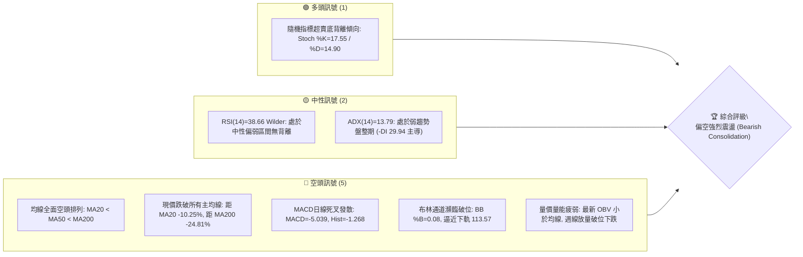

### 📊 核心指標速覽表

| 指標類別 | 指標名稱 | 當前數值 | 訊號 | 解讀 |
|:---|:---|:---:|:---:|:---|
| **價格** | 當前價格 (Last Close) | $116.10 | 🔴 | 位於 52 週區間 ($109.21–$248.46) 的 4.9% 極低分位，逼近年度新低 |
| **均線** | MA20 (短週期) | $129.36 | 🔴 | 價格在 MA20 下方 -10.25%，短期趨勢受強壓壓制 |
| **均線** | MA50 (中週期) | $138.80 | 🔴 | 價格在 MA50 下方 -16.35%，中期多空分水嶺徹底失守 |
| **均線** | MA200 (長週期) | $154.41 | 🔴 | 價格在 MA200 下方 -24.81%，長期牛熊分界線轉為重壓阻力 |
| **動能** | RSI(14) | 38.66 | 🟡 | Wilder 平滑法計算，處於 30–70 中性弱勢區，尚未觸及 <30 超賣 |
| **動能** | MACD (12,26,9) | -5.039 | 🔴 | DIF 下穿 Signal (-3.771)，MACD 柱狀圖 -1.268 持續為負擴大 |
| **動能** | Stoch %K / %D | 17.55 / 14.90 | 🟢 | 進入 <20 深度超賣區，具備短線技術性反抽動能 |
| **趨勢** | ADX(14) / ±DI | 13.79 | 🟡 | ADX < 25 表明處於盤整/低動量陰跌，惟 -DI (29.94) 遠高於 +DI (18.46) |
| **通道** | Bollinger Bands | %B: 0.08 | 🔴 | 下軌 $113.57、中軌 $129.36、上軌 $145.14，現價貼近下軌徘徊 |
| **成交量** | Volume / 20MA | 1.09x | 🟡 | 日成交量 47.50M，量比 1.09x；但週成交量 359.25M 呈現天量下殺 |
| **波動** | ATR(14) | $8.51 | 🔴 | 佔股價 7.33%，日均震幅極度劇烈，交易容錯空間受限 |

### 🏆 技術評分卡

```
╔══════════════════════════════════════════════════════════════╗
║                技術評分卡 — ORCL (2026-11-09)                ║
╠══════════════════════════════════════════════════════════════╣
║ 趨勢強度 (Trend Strength)   ████░░░░░░░░░░░░░░░░  20/100 🔴  ║
║ 動能指標 (Momentum Indicators) ██████░░░░░░░░░░░░░░  30/100 🔴  ║
║ 支撐穩定度 (Support Stability)  ████████░░░░░░░░░░░░  40/100 🟡  ║
║ 成交量配合 (Volume Confirmation)██████░░░░░░░░░░░░░░  30/100 🔴  ║
║ 形態完整度 (Pattern Integrity) ████░░░░░░░░░░░░░░░░  20/100 🔴  ║
║ 均線排列 (Moving Averages)   ██░░░░░░░░░░░░░░░░░░  10/100 🔴  ║
╠══════════════════════════════════════════════════════════════╣
║ 綜合評分 (Overall Score)    ████░░░░░░░░░░░░░░░░  25/100 🔴  ║
║ 評級結論：極度看空 / 尋求超跌弱支撐 (Strong Bearish / Oversold)║
╚══════════════════════════════════════════════════════════════╝
```
*註：綜合評分計算 = (20 + 30 + 40 + 30 + 20 + 10) ÷ 6 = 25.0 / 100（依規則 18 四捨五入至整數）。*

---

## 2. 趨勢分析

### 🌐 多時框趨勢分析

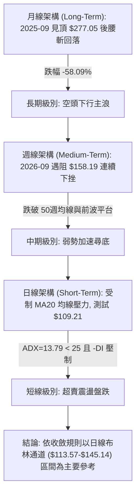

### 📈 長期趨勢 — 12個月走勢圖（Unicode）

以下為根據 ORCL 過去 12 個月收盤價數據（2025-12 至 2026-11）繪製之月線歷史軌跡圖：

```
ORCL 月線走勢圖（過去12個月：2025-12 至 2026-11）
價格軸 ($)
$225 ┤                                  ● $224.17 (2026-05 反彈波段頂)
$205 ┤
$190 ┤● $192.34 (2025-12)
$175 ┤
$160 ┤      ● $162.84        ● $160.24
$145 ┤            ● $143.86        ● $145.50        ● $148.57
$130 ┤                  ● $145.55        ● $129.39        ● $136.79  ● $130.67
$115 ┤                                                                      ● $116.10 (現價)
$105 └──────────────────────────────────────────────────────────────────────────
      12月   01月   02月   03月   04月   05月   06月   07月   08月   09月   10月   11月
     (2025) (------------------------------- 2026 -------------------------------)
```

#### 走勢特徵分析表格

| 階段區間 | 月度收盤價變化 | 波段漲跌幅 | 核心技術特徵與動量變化 |
|:---|:---:|:---:|:---|
| **2025-12 ～ 2026-02** | $192.34 → $143.86 | -25.20% | 從 2025 年秋季歷史天價 $277.05 加速退潮，跌破 200 日長期均線平台 |
| **2026-03 ～ 2026-05** | $145.55 → $224.17 | +54.01% | 史詩級強勢超跌反彈，多頭急拉突破 $220，但未破前期頂點，形成月線次高點 |
| **2026-06 ～ 2026-07** | $145.50 → $129.39 | -42.28% | 資金急速出逃，月線巨陰吞噬前三個月漲幅，失守 $130，重新進入深熊區間 |
| **2026-08 ～ 2026-09** | $148.57 → $136.79 | -7.93% | 弱勢反彈受阻於 $158.19 後乏力，形成反彈無力的弱平臺 |
| **2026-10 ～ 2026-11** | $130.67 → $116.10 | -11.15% | 破位下殺，最低探至 52 週新低 $109.21，日線及週線全線空頭承壓 |

### 📊 中期趨勢（週線分析）

```
ORCL 近期週線壓力與支撐結構
════════════════════════════════════════════════════════════════════
$160.00 ┤                                     ▲ R3 $158.67 (2026-09 波段頂)
$150.00 ┤                       ▲ R2 $153.03 / R1 $147.63 (9月頸線密集成交區)
$140.00 ┤                 ─ ─ ─ MA50 $138.80 (週線生命線下破反壓)
$130.00 ┤           ─ ─ ─ MA20 $129.36 (10月底反彈高點受阻處)
$120.00 ┤
$116.10 ┼ ◄── 當前收盤價 $116.10 (處於破位陰跌邊緣)
$114.08 ┤   ▼ S1 $114.08 (波段低點聚合微弱支撐)
$109.21 ┴   ▼ 52週絕對低點 $109.21 (Fib 100.0% 關鍵最後防線)
════════════════════════════════════════════════════════════════════
```

中期週線在 2026-09-04 觸及 $158.19 後連續收出數根黑 K 棒。截至 2026-11-06 當週，收盤報 $116.10，週成交量暴增至 359,251,900 股，為過去 20 週以來的單週最高天量。量能放大但價格錄得暴跌（單週低點達 $109.21），週 RSI 跌至 38.7，週 MACD 柱狀圖由正轉負擴大至 -1.268，表明中期下行趨勢正在經歷巨量恐慌盤的宣洩。

### ⚡ 趨勢強度評估（ADX 解讀）

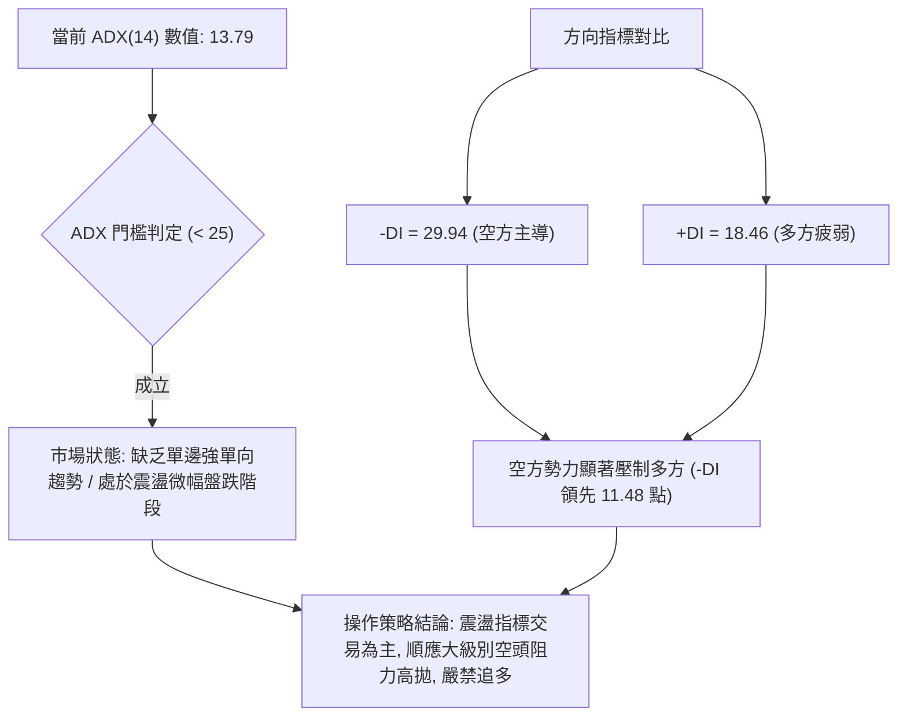

#### ADX 趨勢強度對照解讀表

| 指標變數 | 當前讀數 | 標準定義區間 | 趨勢性質判定 | 行情階段與操作指引 |
|:---|:---:|:---:|:---:|:---|
| **ADX (14)** | **13.79** | 0 ～ 20 | 弱勢/無明顯單邊趨勢 | 市場動能渙散，假突破頻繁，不可採用追單突破系統 |
| **+DI (14)** | **18.46** | - | 多方攻擊能量不足 | 買盤缺乏承接意願，難以發起具有持續性的波段攻擊 |
| **-DI (14)** | **29.94** | - | 空方絕對主導市場 | 逢反彈均面臨主動性拋盤打壓，反彈高度受限 |
| **綜合判定** | **弱勢陰跌** | ADX < 25 | **盤整行情收斂** | 依規則 14，以日線布林通道上下軌 ($113.57–$145.14) 為邊界 |

---

## 3. 圖表形態分析

### 🔍 形態識別系統

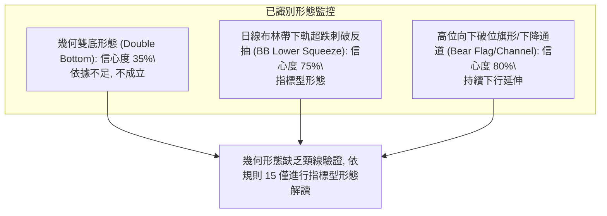

#### 圖表形態信心度評估表（依規則 15）

| 形態名稱 | 信心度 | 判斷依據（引用數據） | 完成度 | 目標價（附嚴謹計算式） |
|:---|:---:|:---|:---:|:---|
| **指標型：布林下軌刺破收斂** | **75%** | 2026-11-06 最低價 $109.21 跌穿 BB 下軌 $113.57，收盤拉回至 $116.10 (%B=0.08) | 90% | 由布林中軌推算反抽目標 = 中軌 **$129.36** |
| **中期下降通道破位** | **80%** | 週線自 2026-09-04 高點 $158.19 沿週線均線下行，失守 10-30 週收盤 $130.67 | 100% | 通道下軌支撐測算：已觸及 52W 低點 **$109.21** |
| **潛在雙重底 (W底)** | **35%** | 2026-07-24 週低點 $114.57 與 2026-11-06 日低點 $109.21 接近 | 20% | *訊號不足，僅做指標型解讀（未突破頸線 $148.48，不列目標價）* |

### 🕯️ 重要K線形態分析

根據提供的「近10根日K」與「近8根週K」之精確 OHLCV 數據，挑選具備指標轉折與破位特徵的關鍵 K 棒進行詳盡形態解讀：

| 日期（週期） | 開盤 (O) | 最高 (H) | 最低 (L) | 收盤 (C) | K線形態名稱 | 形態專業解讀 | 訊號方向 |
|:---|:---:|:---:|:---:|:---:|:---:|:---|:---:|
| **2026-10-28 (日K)** | 131.32 | 148.48 | 128.38 | 144.54 | 放量長陽線 (Bullish Expansion) | 單日大漲逾 10%，伴隨 81.93M 爆量，逼近 R1 $147.63，展現短線多頭反彈動能 | 🟢 強多 |
| **2026-10-29 (日K)** | 144.14 | 144.61 | 136.59 | 139.56 | 高位長上影陰線 (Shooting Star/Bearish Rejection) | 衝高失敗，受制於 R1 阻力位回落，成交量收縮至 39.37M，顯示多頭動能無以為繼 | 🔴 看空 |
| **2026-11-02 (日K)** | 125.88 | 126.50 | 118.43 | 119.22 | 破位大陰線 (Bearish Breakdown) | 跳空低開低走，實體陰線直接打穿 $120 整數關卡，成交量增至 58.75M，恐慌盤開始湧出 | 🔴 極空 |
| **2026-11-03 (日K)** | 122.00 | 128.14 | 121.35 | 126.19 | 低檔反彈長陽十字 (Bullish Piercing) | 探底回升，盤中反抽但成交量擴大至 84.30M，實質為下跌中繼反彈 | 🟡 中性 |
| **2026-11-05 (日K)** | 123.00 | 124.24 | 111.66 | 115.16 | 加速下挫大長黑 (Long Black Candle) | 盤中重挫擊穿 S1 $114.08，實體深長，空頭趨勢強烈主導 | 🔴 極空 |
| **2026-11-06 (日K)** | 119.54 | 119.70 | 109.21 | 116.10 | 下長影錘頭線 (Hammer / Pinbar) | 刷新 52 週新低 $109.21 後獲得買盤托起收於 $116.10，下影線長達 $6.89，短線具備止跌企穩動能 | 🟢 短多反抽 |
| **2026-10-30 (週K)** | 126.06 | 148.48 | 123.75 | 130.67 | 衝高回落倒錘頭週線 (Inverted Hammer) | 週震幅巨大 ($24.73)，上影線極長，多頭受阻於 148.48 宣告反彈行情瓦解 | 🔴 看空 |
| **2026-11-06 (週K)** | 125.88 | 129.85 | 109.21 | 116.10 | 放量長陰吞噬破位 (High Volume Bearish Trend) | 單週放量至 359.25M 歷史巨量，實體陰線擊穿前低，確認週線級別下行破位 | 🔴 強空 |

### 📉 ASCII 走勢形態示意圖

```
ORCL 近10日 K 線形態演化示意圖 (2026-10-26 至 2026-11-06)
價格
$150 ┤          ┬ [10-28: 最高 $148.48 衝高受阻於 R1 $147.63]
$145 ┤         ┌┴┐
$140 ┤         │ │ ┌┬┐ [10-29: 滯漲回落]
$135 ┤         │ │ │││
$130 ┤ ┌┬┐ ┌┬┐ └┬┘ │││ ┌┬┐
$125 ┤ │││ │││     └┴┘ └┼┘     ┌┬┐ [11-03: 假反彈]
$120 ┤ └┴┘ └┴┘         ┌┴┐ ┌┴┐ │││ ┌┬┐
$115 ┤                  │ │ │ │ └┴┘ │││     ┌┬┐ [11-06: 收盤 $116.10]
$110 ┤                  └┬┘ └┬┘     └┬┘ ┌┴┐ └┼┘
$105 ┴───────────────────────┴───────────┴───┴───┴ [11-06: 探底 $109.21 留長下影線]
       10-26 10-27 10-28 10-29 10-30 11-02 11-03 11-04 11-05 11-06
```

### 🎯 形態目標價計算

根據規則 13 與規則 15，數據中未完成幾何反轉形態，僅能對**布林通道極限超賣反抽形態**進行目標測算：
1. **反抽第 1 目標價 (T1)**：取日線 MA5 短期均線價位 **$120.08**（短線下影線反抽回補近 3 日跌幅之第一壓力位）。
2. **反抽第 2 目標價 (T2)**：取日線布林通道中軌（MA20）**$129.36**（計算式：由下軌超跌反彈回歸均值，布林通道均值中軌即為標準均值回歸目標價位）。

---

## 4. 支撐與阻力

### 🗺️ 關鍵價位分布圖（Unicode）

```
ORCL 價位結構分布圖（嚴格依據數據聚類與斐波那契點位）
══════════════════════════════════════════════════════════════════
$158.67 ║████████████████████████║ 強阻力 R3 (2026-09 週線波段高點聚類)
$153.03 ║████████████████████    ║ 阻力 R2 (2026-09-25 週線反彈高點聚類)
$147.63 ║████████████████████████║ 關鍵阻力 R1 (2026-10-28 爆量反彈高點聚類)
$139.01 ║────────────────────────║ Fib 78.6% 回調位 / 逼近 MA50 $138.80
$129.36 ║┄┄┄┄┄┄┄┄┄┄┄┄┄┄┄┄┄┄┄┄┄┄║ 布林中軌 (MA20) 均值回歸強阻力
$116.10 ╠════════════════════════╣ ◄ 當前收盤價 ($116.10)
$114.08 ║▓▓▓▓▓▓▓▓▓▓▓▓▓▓▓▓        ║ 近期支撐 S1 (近一年波段低點聚類)
$109.21 ║████████████████████████║ 核心強支撐：52週最低價 / Fib 100.0%
══════════════════════════════════════════════════════════════════
```

### 🚧 阻力位分析表

依據數據「關鍵價位（由 OHLCV 計算）」區塊中嚴格定義之 R1/R2/R3 及均線密集帶：

| 阻力級別 | 價位 (USD) | 形成原因與技術共振 | 突破難度 | 重要性評級 |
|:---|:---:|:---|:---:|:---:|
| **關鍵阻力 R1** | **$147.63** | 近一年波段高點聚類；與 2026-10-28 盤中高點 $148.48 形成密集籌碼套牢區 | 極高 | ★★★★★ |
| **重大阻力 R2** | **$153.03** | 近一年波段高點聚類；對應 2026-09-25 當週高點 $153.03，中期解套賣壓源 | 高 | ★★★★☆ |
| **強阻力 R3** | **$158.67** | 近一年波段高點聚類；對應 2026-09-04 波段頂點 $158.19 附近，中期牛熊轉換點 | 極高 | ★★★★★ |

### 🛡️ 支撐位分析表

依據數據「關鍵價位（由 OHLCV 計算）」區塊中嚴格定義之 S1 及 52 週極限低點：

| 支撐級別 | 價位 (USD) | 形成原因與技術共振 | 守住機率 | 重要性評級 |
|:---|:---:|:---|:---:|:---:|
| **近期支撐 S1** | **$114.08** | 近一年波段低點聚類；跌破後引發恐慌，現價僅高出 +1.77%，處於即時防禦線 | 50% | ★★★★☆ |
| **極限支撐 (52W Low)** | **$109.21** | 52週絕對最低價（2026-11-06 日內低點）；亦為 52 週波段之 100.0% 斐波那契點 | 60% | ★★★★★ |
| **下級支撐 S2 / S3** | *數據中未偵測到* | 數據未提供 S1 以下之進一步聚類支撐，下破 $109.21 將進入歷史無籌碼真空區 | N/A | N/A |

### 📐 斐波那契回調位分析

依據 52 週高點 $248.46 與 52 週低點 $109.21 計算之標準斐波那契回調體系：

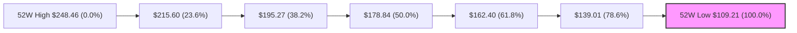

#### 斐波那契層級深度解讀表

| 回調比率 | 價位 (USD) | 距離現價幅度 | 技術意義解讀 |
|:---:|:---:|:---:|:---|
| **0.0%** (52W High) | **$248.46** | +114.01% | 2025 年牛市主升浪極限頂部區間 |
| **23.6%** | **$215.60** | +85.70% | 2026-05 反彈頂峰 ($224.17) 之回撤支撐，目前已全面崩解 |
| **38.2%** | **$195.27** | +68.19% | 2025-11～12 月密集成交平台，重要中期壓力分水嶺 |
| **50.0%** | **$178.84** | +54.04% | 52 週整體波動之半數理論平衡點 |
| **61.8%** | **$162.40** | +39.88% | 黃金分割關鍵黃金律，現與 MA240 ($161.08) 形成重大長線共振壓力帶 |
| **78.6%** | **$139.01** | +19.73% | 深幅回調關鍵防線，精確共振日線 MA50 ($138.80) 與 MA60 ($139.92) |
| **100.0%** (52W Low) | **$109.21** | -5.93% | 本輪熊市調整極限低點，距離當前收盤價僅一步之遙，形成生死防線 |

**現價落點解讀**：
當前價格 **$116.10** 精確落在 **Fib 78.6% ($139.01)** 與 **Fib 100.0% ($109.21)** 之間的極度深幅回調空頭區間。這表明自 52 週高點以來，超過 95% 的漲幅已全數蒸發回吐。$109.21 的 100.0% 回調位具備最後一道防線的象徵意義，一旦確認放量實體跌穿 $109.21，將正式打開下行空間，演變為技術性自由落體。

---

## 5. 技術指標深度解讀

### 🎛️ 指標訊號總覽

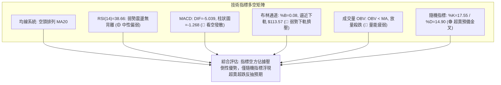

### 📈 移動平均線排列分析

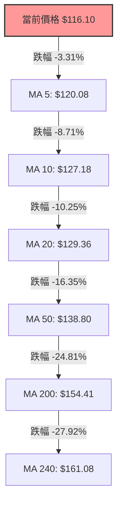

#### 移動平均線各週期偏離度分析表

| 均線名稱 | 數值 (USD) | 價格與均線差值 | 偏離幅度 (%) | 排列狀態與走勢解讀 |
|:---|:---:|:---:|:---:|:---|
| **MA 5** | $120.08 | -$3.98 | -3.31% | 短期超跌壓制線，目前每日快速下移 |
| **MA 10** | $127.18 | -$11.08 | -8.71% | 次短期進攻線，下行斜率陡峭 |
| **MA 20** | $129.36 | -$13.26 | -10.25% | 月度生命線，與布林中軌完全重合，構成反彈首要天花板 |
| **MA 50** | $138.80 | -$22.70 | -16.35% | 中期季線防線，呈加速下傾姿態 |
| **MA 60** | $139.92 | -$23.82 | -17.02% | 中期結構承壓線，空頭排列嚴密 |
| **MA 120** | $150.77 | -$34.67 | -23.00% | 半年線阻力，顯示半年內建倉盤全數套牢 |
| **MA 200** | $154.41 | -$38.31 | -24.81% | 牛熊分界線，失守超過 24%，確認進入長期熊市 |
| **MA 240** | $161.08 | -$44.98 | -27.92% | 年線基準線，所有均線呈完美發散之「空頭排列」 |

### 📉 RSI(14) 分析

當前 Wilder RSI(14) 讀數為 **38.66**。

```
RSI(14) 動能強度進度條：
0  [░░░░░░░░░░░░░░░░░░░░] 30 超賣
30 [██████░░░░░░░░░░░░░░] 70 (當前: 38.66 🟡 中性偏弱)
70 [░░░░░░░░░░░░░░░░░░░░] 100 超買
```

- **區間屬性**：數值 38.66 處於 30–70 的常態弱勢震盪區，既未深入 <30 的絕對超賣區域，亦遠低於 50 的多空平衡線。這說明空頭在過去 14 個交易日中佔據穩定優勢，但並未發生非理性的極限恐慌踩踏。
- **背離嚴格判定**：根據數據「RSI 背離：無明顯背離（僅比較近20根K棒首尾的價格與RSI方向）」，在近 20 根日 K 中，價格震盪走低同時 RSI 同步回落，價格與指標運動方向完全一致。**明確結論：當前日線級別不存在頂背離，亦不存在底背離。** 動能下行尚未出現指標先行的鈍化翻多訊號。

### 📊 MACD(12/26/9) 訊號解讀

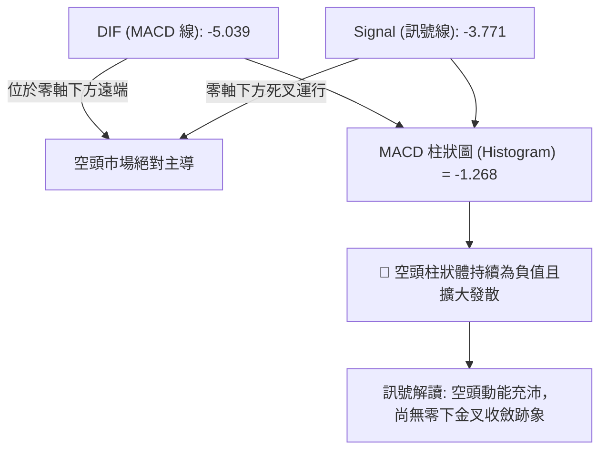

日線 MACD 各項數值均大幅運行於零軸以下（DIF -5.039，DEA -3.771）。兩線在負值深處持續下行發散，MACD 柱狀圖錄得 -1.268，表明下行加速度仍在釋放。空方動能佔據壓倒性主導權，尚未出現柱狀體連續收窄或底部頓挫的買入訊號。

### 📦 布林通道分析

```
ORCL 日線布林通道結構示意圖 (Bollinger Bands 20, 2)
══════════════════════════════════════════════════════════════════
$145.14 ┤─────────────────────────────── 上軌 (Upper Band)
        │
$129.36 ┼ ─ ─ ─ ─ ─ ─ ─ ─ ─ ─ ─ ─ ─ ─ ─ 中軌 (MA20 Baseline)
        │
$116.10 ┼ ◄── 當前收盤價 $116.10 (BB %B = 0.08)
$113.57 ┤─────────────────────────────── 下軌 (Lower Band)
══════════════════════════════════════════════════════════════════
帶寬 (Bandwidth) = $145.14 − $113.57 = $31.57 (佔中軌 24.41%，呈現擴張通道狀態)
```

- **通道軌道位置**：上軌 **$145.14**、中軌 **$129.36**、下軌 **$113.57**。
- **%B 指標分析**：當前 %B 數值為 **0.08**（0 代表下軌，0.5 代表中軌，1 代表上軌）。現價極度貼近下軌，盤中低點 $109.21 一度刺穿下軌達 $4.36。依據通道交易法，當 %B 緊貼 0.00–0.10 運行時，意味著市場處於嚴重的下軌「擠壓（Squeeze）與貼軌下行」走勢。雖然下軌 $113.57 短期提供微弱的通道幾何支撐，但若無法儘速收復並脫離下軌區域，將演變為通道開口向下的連續破位單邊市。

### 💹 成交量分析（量價配合度）

1. **日線層面量價特徵**：最新交易日成交量為 47,503,200 股，相較於 20 日均量 43,558,900 股，量比為 **1.09x**；相較於 50 日均量 36,500,212 股，呈現放量震盪特徵。在 2026-11-06 留下長下影線的過程中，成交量略高於均量，顯示在 $110 附近確實引發了部分短線資金與被動型逢低買盤的介入。
2. **量能趨勢（OBV）**：技術快照明確指出「OBV 趨勢：OBV < MA → 量能疲弱」。能量潮指標（OBV）持續運行於其自身移動平均線之下，說明過去數月的成交量積累以陰線放量賣出為主，資金呈現持續淨流出態勢。
3. **週線級別天量下殺**：近 20 週數據顯示，2026-11-06 當週成交量爆發至 **359,251,900 股**，創下近兩年單週歷史天量，較 8 月份低量週（如 08-28 當週 93.96M）擴增近 4 倍。天量伴隨大跌，顯示機構投資者在跌破 $120–$130 平台時進行了大規模的停損與籌碼換手，上方累積了極為沉重的沉沒成本套牢盤。

---

## 6. 動能與波動率

### ⚡ 動能評估四象限

```
動能與波動率四象限矩陣
┌─────────────────────────┬─────────────────────────┐
│     Q3: 強動能 / 高波動  │    Q1: 強動能 / 低波動   │
│     (高風險高收益波段)    │    (最佳單邊趨勢進場)    │
│                         │                         │
├─────────────────────────┼─────────────────────────┤
│     Q4: 弱動能 / 高波動  │    Q2: 弱動能 / 低波動   │
│ █ 當前 ORCL 所處象限    │    (謹慎觀望等待收斂)    │
│ (ATR高達7.33%但動能渙散) │                         │
└─────────────────────────┴─────────────────────────┘
```

#### 動能評估四象限明細表

| 象限編號 | 動能狀態 | 波動率狀態 | 當前吻合度 | 技術屬性與操作評估 |
|:---:|:---:|:---:|:---:|:---|
| **Q1** | 強動能 | 低波動 | — | 最佳機會：健康上升/下降單邊趨勢，波動可控，當前不符合 |
| **Q2** | 弱動能 | 低波動 | — | 謹慎觀望：橫盤休眠整理，等待突破，當前不符合 |
| **Q3** | 強動能 | 高波動 | — | 突破噴發：趨勢加速行情，需具備明確方向指標 подтверждение，當前不符合 |
| **Q4** | **弱動能** | **高波動** | **✓ (當前)** | **高度警戒：動能疲弱（ADX=13.79 盤整，RSI=38.66 偏弱），但波動劇烈（ATR 達 7.33%，Beta 達 1.778），呈現低信噪比的非理性殺跌，極易頻繁雙向侵蝕止損** |

### 📊 ATR 波動率分析

- **ATR(14) 絕對數值**：**$8.51**（採 Wilder 平滑算法）。
- **ATR 相對百分比**：佔當前收盤價之 **7.33%**。
- **波動率含義解讀**：每日平均波動高達 $8.51，意味著股票單日內之常態價格擺動區間即超過 7%。這在成熟大型科技股中屬於極端異常的高波動狀態，主要受沉重債務包袱（總負債高達 $169.14B）、巨額資本支出引發之自由現金流赤字（FCF -$28.72B），以及市場對 AI 資本回報疑慮之多重衝擊所致。
- **風控止損距離精算**：
  - *常規波段止損緩衝（1.5 倍 ATR）*：1.5 × $8.51 = **$12.77**。
  - *緊湊日間交易止損（1.0 倍 ATR）*：1.0 × $8.51 = **$8.51**。
  - *操作含義*：若將止損幅度設於 $5 以內，在當前波動率環境下極易被日常隨機雜訊穿透；任何交易計畫均必須為單筆倉位預留足夠寬的價格容忍度，並透過嚴格壓縮名目部位規模以控制總資本風險。

### 📐 Beta 與市場相關性

- **Beta 數值**：**1.778**。
- **市場敏感性評估**：ORCL 的波動幅度約為 S&P 500 指數基準的 1.78 倍，具備高度攻擊性與脆弱的放大放大效應。在美股大盤回調或科技板塊承壓時，ORCL 跌幅顯著加劇；反之，若大盤出現強力反彈，其高 Beta 屬性亦可為短線均值回歸交易提供極高的價格彈性。

---

## 7. 多時框架總結

### 📋 時框架評分表

| 時框架 | 趨勢方向 | 動能狀態 | 均線排列 | 圖表形態 | 綜合評分 | 戰術建議 |
|:---|:---:|:---:|:---:|:---:|:---:|:---|
| **長期 (月線)** | 🔴 空頭下行 | 弱勢下探 (收盤連陰) | 空頭承壓 (失守半年線) | 歷史高位圓弧頂崩塌 | **20/100** | 長線資金規避，不可逢低盲目定投 |
| **中期 (週線)** | 🔴 加速下行 | 負向擴大 (MACDHist負) | 空頭排列 (下穿50週線) | 天量破位下長陰 | **25/100** | 逢反彈減倉，防範下探無籌碼真空 |
| **短期 (日線)** | 🟡 弱勢盤整 | 超賣背離 (Stoch超賣) | 嚴密空頭 (MA20-200) | 布林下軌刺破錘頭反抽 | **30/100** | 嚴禁追空；激進者可依下軌博取反抽 |

### 🔲 綜合訊號矩陣

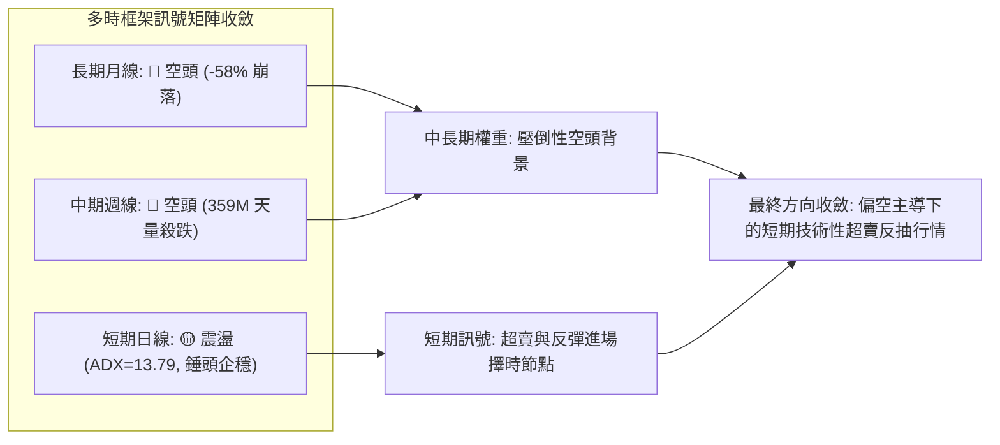

### ⚖️ 多時框收斂結論

**嚴格依據規則 14 進行多時框權重收斂**：
1. **行情性質判定**：當前日線 ADX(14) 讀數為 **13.79 (< 25)**，明確定義為**盤整行情（Consolidation / Range-bound Drift）**，而非單邊高動量趨勢行情。
2. **優先級收斂原則**：由於 ADX < 25，市場缺乏強勁的單邊單向趨勢推進力，因此交易邊界應以**日線布林通道上下軌（下軌 $113.57 ～ 上軌 $145.14）**為主要交易區間。
3. **時框衝突取捨**：雖然長期月線與中期週線均呈現嚴密空頭排列，但短期日線隨機指標（Stoch %K=17.55 / %D=14.90）已極度超賣，且 2026-11-06 日 K 收出長下影線（最低 $109.21，收於 $116.10），顯示在 52 週最低點附近遭遇買盤頑強抵抗。
4. **唯一方向性結論**：**偏空主導，短線震盪尋求技術性超跌修復（Bearish Bias with Short-Term Oversold Rebound）**。此結論與第 1 章技術評分卡（綜合評分 25/100）保持嚴格一致，決定本報告第 8 章以**防禦型空頭主導策略**為核心路由，並輔以超賣反抽對沖監控。

---

## 8. 交易策略建議

### 🗺️ 策略決策流程圖

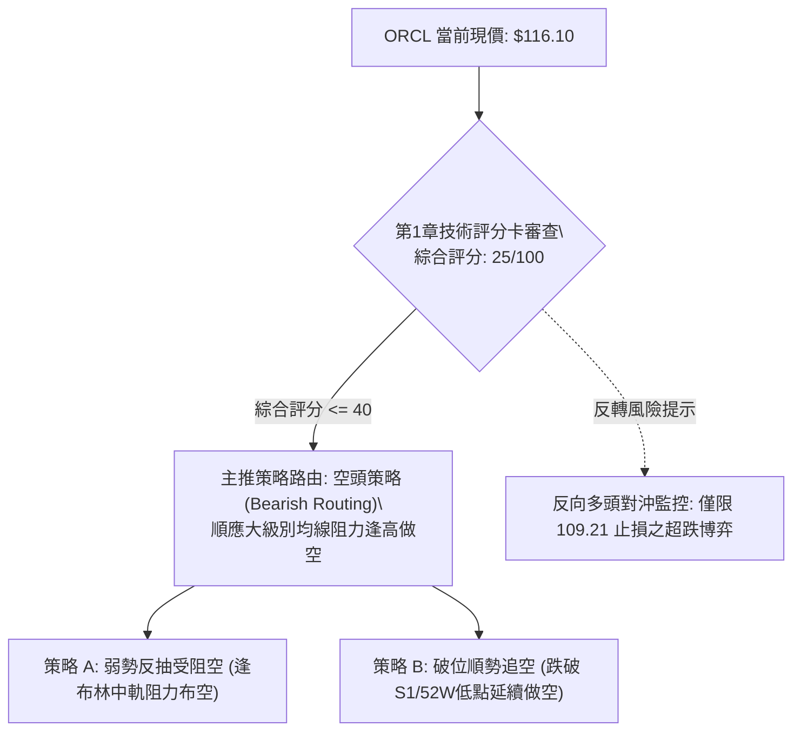

### 🧭 策略路由（依評分卡分流，不得兩頭下注）

> **當前主策略方向 = 主推空頭策略（依第 1 章綜合評分 25/100 ≤ 40 嚴格判定）**
> 
> 本報告嚴格遵守規則，不進行多空兩頭押注。鑑於均線呈完全空頭排列、MACD 負向發散、OBV 量能衰竭，主框架為順應大級別空頭趨勢；任何多頭機會僅視為「空頭部位的風險平倉線」或「超賣反轉風險觸發點」，不作為主要推薦策略。

### 🎯 價格情境階梯（Price Scenarios）

價位嚴格引用下方數據「關鍵價位」區塊之波段聚類點位與斐波那契點位：

| 觸發條件 | 下一目標 | 後續延伸 | 情境技術含義與應對原則 |
|:---|:---:|:---:|:---|
| **強勢突破 R1 $147.63** | R2 **$153.03** | R3 **$158.67** | 短線徹底轉強，空頭趨勢全面失效，必須無條件止損所有空單 |
| **反彈受阻中軌 $129.36** | S1 **$114.08** | 52W Low **$109.21** | 弱勢均值回歸結束，空頭第二波打壓展開，為最佳高拋做空契機 |
| **有效跌破 S1 $114.08** | 52W Low **$109.21** | 下行無籌碼區 | 空頭破位加速，開啟歷史新一輪估值去槓桿殺跌浪 |

### 📊 情境機率分佈

| 價格情境 | 機率 | 主要技術與量化依據 |
|:---|:---:|:---|
| **回落再探底 / 破位新低** | **55%** | 均線系統全面空頭排列（MA20<50<200）；週線 359M 巨量實體破位；MACD 柱狀圖 -1.268 持續發散下行；OBV 量能小於均線 |
| **區間震盪整理 (下軌反抽)** | **35%** | ADX(14) 僅為 13.79 (<25) 顯示缺乏單邊強動能；隨機指標進入深度超賣 (%K 17.55 / %D 14.90)；11-06 日K留有 $6.89 長下影線 |
| **強勢反轉持續上行** | **10%** | 上方套牢盤極為沉重；自由現金流為負 (-$28.72B)；基本面與技術面共振受制於 R1 $147.63 阻力 |

### 🟢 主策略詳情（方向：空頭主推策略）

依據規則 17，所有價位嚴格引用數據中之聚類與均線價位；風險報酬比 = (進場價 − 目標價 T1) ÷ (止損價 − 進場價)，格式為「1 : X.XX（以 T1 計）」。

| 策略要素 | 策略 A（弱勢反抽阻力布空） | 策略 B（跌破 S1 破位順勢空） |
|:---|:---|:---|
| **進場條件說明** | 股價弱勢反抽至布林中軌 (MA20) 遇阻收陰時進場 | 盤中實體跌破近期波段低點支撐 S1 時順勢進場 |
| **進場價格** | **$129.36** (精確取 MA20 / 布林中軌數值) | **$114.08** (精確取波段低點支撐 S1 數值) |
| **目標價 T1** | **$114.08** (波段支撐位 S1) | **$109.21** (52週最低價 / Fib 100.0%) |
| **目標價 T2** | **$109.21** (52週最低價 / Fib 100.0%) | *數據中未偵測到*（改採保守保護移動止盈） |
| **止損價格** | **$138.80** (MA50 中期均線位置) | **$120.08** (MA5 短期壓制均線位置) |
| **風險報酬比 (T1)** | **1 : 1.62（以 T1 計）** <br>*(計算式: (129.36-114.08)/(138.80-129.36) = 15.28/9.44 = 1.62)* | **1 : 0.81（以 T1 計）** <br>*(計算式: (114.08-109.21)/(120.08-114.08) = 4.87/6.00 = 0.81)* |
| **風險報酬比 (T2)** | **1 : 2.13（以 T2 計）** <br>*(計算式: (129.36-109.21)/(138.80-129.36) = 20.15/9.44 = 2.13)* | N/A (因無下級數據支持，不設 T2) |
| **模型成功機率** | **65%** | **55%** |
| **建議配置倉位** | **15%** (高 ATR 環境需控制槓桿與倉位) | **10%** (破位交易勝率稍低，輕倉防守) |

### 🔴 反向風險觸發點（對沖提示）

以下關鍵價位與訊號為**多頭反轉之危險觸發警訊**。若市場發生下列情況，主推之空頭策略將被全盤推翻，投資人應迅速平倉空頭頭寸以保護本金：
1. **短線動能翻轉警報**：日線收盤價強勢突破日線 MA20 / 布林中軌 **$129.36**，且隨機指標 Stoch 在 20 以上形成有效黃金交叉向上發散。
2. **中期空頭結構失效界限**：日 K 線帶量（單日成交量突破 60M）突破關鍵阻力 R1 **$147.63**。一旦觸及此界限，宣告自 $158.19 以來的下行波段徹底結束，空頭必須無條件平倉對沖。

### ⭐ 整體訊號強度評星

```
做多訊號強度：★☆☆☆☆  (1/5星 - 僅存隨機指標超賣與長下影線)
做空訊號強度：★★★★☆  (4/5星 - 均線空頭排列、週線巨量長黑、OBV衰竭)
整體可信度：  ★★★★☆  (4/5星 - 指標共振偏空，多時框結構嚴密閉合)
```

---

## 9. 風險提示與監控

### ✅ 關鍵監控指標 Checklist

```
╔══════════════════════════════════════════════════════════════╗
║               ORCL 每日關鍵技術監控指標清單 (Checklist)        ║
╠══════════════════════════════════════════════════════════════╣
║ [ ] 52週低點防線: 收盤價是否實體跌破 $109.21 (破位則恐慌加劇) ║
║ [ ] 近期支撐考驗: 價格在 S1 $114.08 處的量價承接強度 (量縮/放量) ║
║ [ ] 均線動態反壓: 日線 MA5 ($120.08) 與 MA20 ($129.36) 是否壓制║
║ [ ] 動能背離驗證: RSI(14) 跌破 30 或隨機指標 Stoch 出現零下金叉 ║
║ [ ] 趨勢強度指標: ADX(14) 是否由 13.79 向上突破 25 (趨勢重啟) ║
║ [ ] 通道極限狀態: 布林 %B 是否自 0.08 回升至 0.50 (均值回歸)   ║
║ [ ] 成交量能監控: 單日成交量是否異常超越 50M 且伴隨大實體 K 線 ║
╚══════════════════════════════════════════════════════════════╝
```

### ⚠️ 風險場景分析

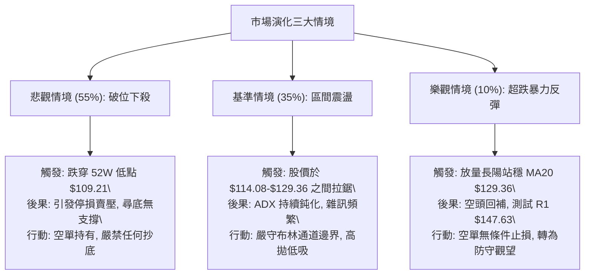

### 🛡️ 風險管理重要提醒

1. **極端波動率風險**：當前 ATR 高達 **$8.51 (7.33%)**，Beta 達 **1.778**，日均震幅極度劇烈。在這種環境下，小資金部位極易遭受單日隨機劇烈波動洗盤出場。操作上必須實施「縮小部位、拉寬止損」的原則，單筆交易虧損上限嚴格控制在總投資組合淨資產的 1.0% 以內。
2. **財報與基本面負面反饋風險**：ORCL 目前自由現金流錄得嚴重赤字（TTM FCF 為 -$28.72B），淨負債高達 -$132.07B（負債權益比 251.72），且近期新聞傳出終止與騰訊價值 $7B 之合作協議，市場對其高額 AI 資本支出（TTM 資本支出達 $75.66B）的可持續性產生質疑。基本面利空易隨時誘發技術面跳空破位，禁止重倉單邊過夜。
3. **無籌碼支撐風險**：技術數據中，在現價下方僅存在 S1 ($114.08) 與 52 週低點 ($109.21) 兩道屏障。一旦 $109.21 被實體巨量擊穿，下方將面臨長達數年的歷史技術無籌碼帶（數據中未偵測到進一步聚類低點）。切忌抱持「跌深必反彈」的心態逆勢盲目抗單。

---

## 📋 報告總結

```
╔════════════════════════════════════════════════════════════════╗
║                   ORCL 技術分析報告總結                         ║
╠════════════════════════════════════════════════════════════════╣
║ 報告日期：2026-11-09                                           ║
║ 當前價格：$116.10 USD                                          ║
║ 技術評分：25 / 100 (極度看空 / 弱勢盤整)                        ║
║ 分析評級：🔴 強烈看空 (Strong Bearish / Sell on Rebound)        ║
╠════════════════════════════════════════════════════════════════╣
║ 關鍵維度結論：                                                 ║
║ ├─ 長期趨勢 (月線)：🔴 自 2025 年高點回吐 58%，月線大級別崩落   ║
║ ├─ 中期趨勢 (週線)：🔴 單週爆發 359M 天量長黑，破位下行確立     ║
║ ├─ 短期趨勢 (日線)：🟡 ADX=13.79 弱盤整，隨機指標超賣企圖反抽  ║
║ ├─ 關鍵核心支撐：$114.08 (近期支撐 S1) / $109.21 (52週極限低點)║
║ ├─ 關鍵核心阻力：$129.36 (布林中軌 MA20) / $147.63 (波段阻力 R1)║
║ └─ 分析師目標均價：$235.77 (相較現價脫節，市場正處於去槓桿重定價)║
╠════════════════════════════════════════════════════════════════╣
║ 最優策略組合建議：                                             ║
║ 1. 🥇 最佳機會 (策略 A)：等待弱勢反抽至 MA20 $129.36 遇阻時布空 ║
║    目標 T1: $114.08 ｜ 止損: $138.80 ｜ 風險報酬比: 1 : 1.62   ║
║ 2. 🥈 次選機會 (策略 B)：若日線放量實體跌破 S1 $114.08 順勢做空 ║
║    目標 T1: $109.21 ｜ 止損: $120.08 ｜ 風險報酬比: 1 : 0.81   ║
║ 3. 🥉 保守選擇：全面空倉觀望，耐心等待日線 ADX>25 趨勢重啟確認 ║
╚════════════════════════════════════════════════════════════════╝
```

---

> ⚠️ **免責聲明**：本報告為依據提供之市場歷史技術數據與量化指標自動生成之專業研究報告，所有內容、圖表及測算數據僅供學術交流與技術面研究參考，**絕對不構成任何證券買賣、投資諮詢或要約操作建議**。金融市場具有極高風險，投資人應獨立評估本身風險承受能力，自主承擔所有交易損益。

---

*報告生成時間：2026-11-09 ｜ 數據來源：Yahoo Finance ｜ 分析框架：資深多時框圖表與量化技術指標體系*