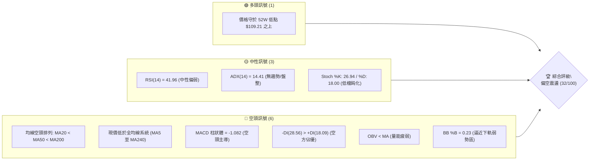
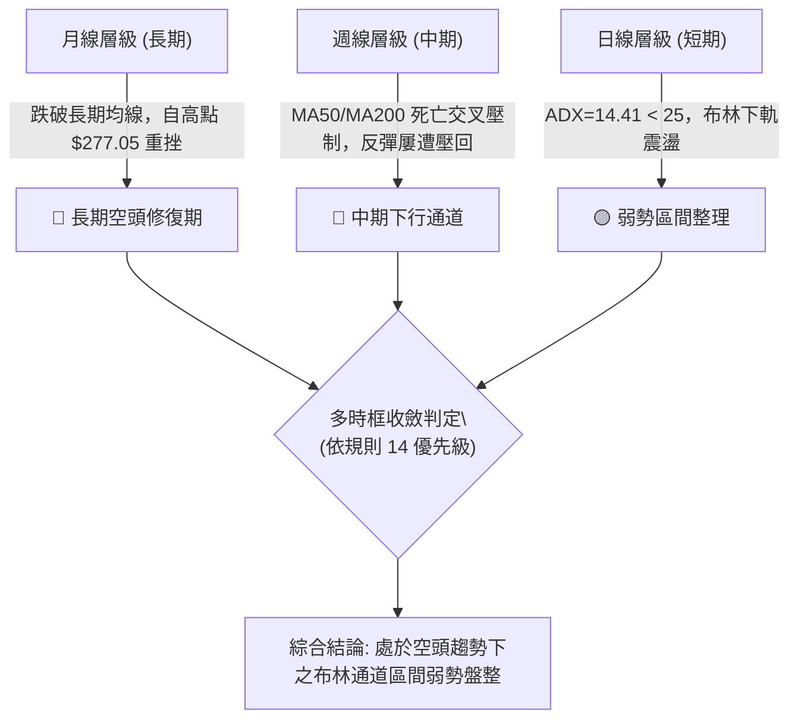
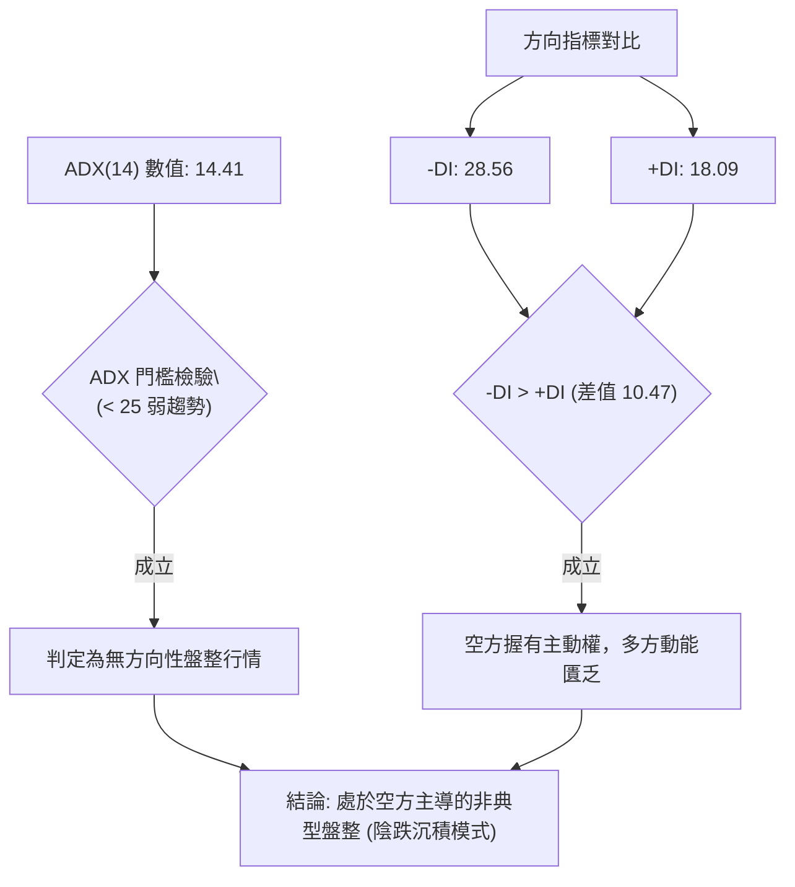
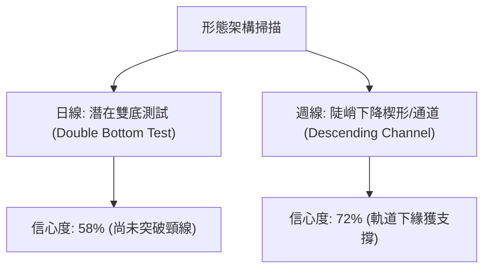
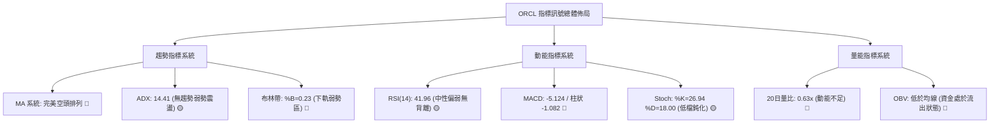
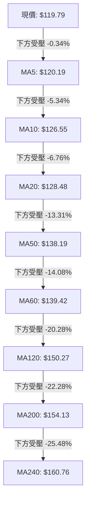
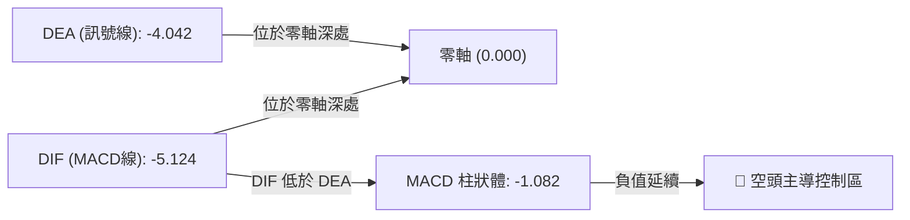
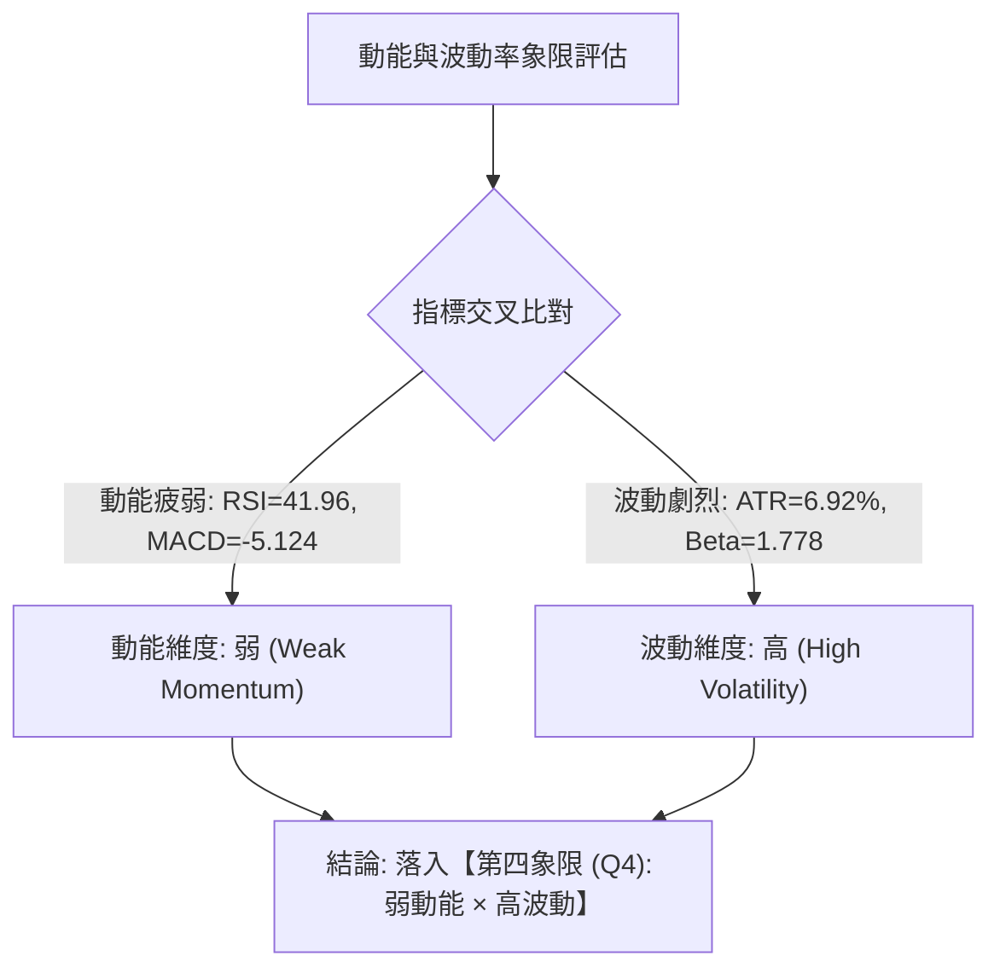
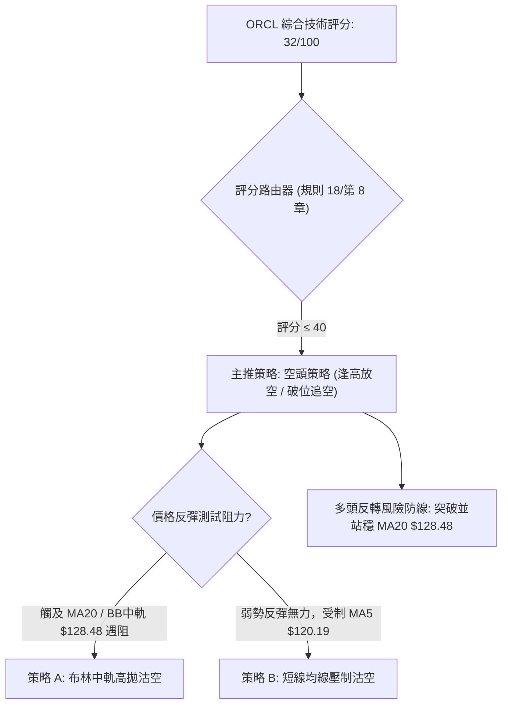
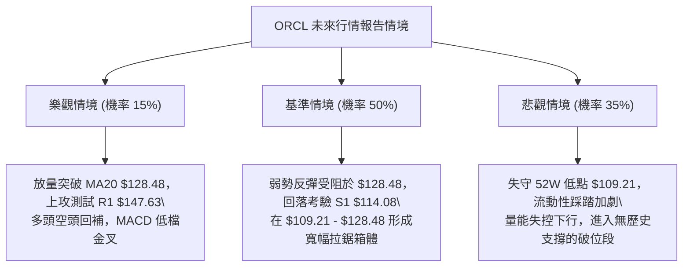

# ORCL 技術分析報告

> **報告日期**：2026-11-10 ｜ **語言**：繁體中文 ｜ **數據來源**：Yahoo Finance ｜ **當前價格**：$119.79 USD

---

## 目錄

| 章節 | 內容 |
|------|------|
| [1. 技術面概覽](#1-技術面概覽) | 訊號儀表板、核心指標、評分卡 |
| [2. 趨勢分析](#2-趨勢分析) | 多時框趨勢、長中短期走勢 |
| [3. 圖表形態分析](#3-圖表形態分析) | 形態識別、K線組合、目標價 |
| [4. 支撐與阻力](#4-支撐與阻力) | 關鍵價位、斐波那契回調 |
| [5. 技術指標深度解讀](#5-技術指標深度解讀) | MA/RSI/MACD/布林/成交量 |
| [6. 動能與波動率](#6-動能與波動率) | 動能評估、ATR、Beta |
| [7. 多時框架總結](#7-多時框架總結) | 時框架評分矩陣 |
| [8. 交易策略建議](#8-交易策略建議) | 多空策略、風險報酬比 |
| [9. 風險提示與監控](#9-風險提示與監控) | 監控指標、風險場景 |
| [10. 報告總結](#-報告總結) | 核心結論與最優策略組合 |

---

## 1. 技術面概覽

### 🎯 技術訊號儀表板



### 📊 核心指標速覽表

| 指標類別 | 指標名稱 | 當前數值 | 訊號 | 解讀 |
|----------|----------|----------|------|------|
| **價格** | 當前收盤價 | $119.79 | 🔴 | 位於 52 週區間 7.6% 分位，深陷空頭修正區 |
| **均線** | 短期 MA20 | $128.48 | 🔴 | 價格低於 MA20 (-6.76%)，短線趨勢向下 |
| **均線** | 中期 MA50 | $138.19 | 🔴 | 價格低於 MA50 (-13.31%)，中期空頭壓制明確 |
| **均線** | 長期 MA200| $154.13 | 🔴 | 價格遠低於牛熊分界線 (-22.28%)，長期格局空頭 |
| **動能** | RSI(14) | 41.96 | 🟡 | 位於 40–50 偏弱中性區間，未達超賣但動能疲軟 |
| **動能** | MACD | -5.124 | 🔴 | 快慢線均在零軸下方深處，空頭動能尚未逆轉 |
| **動能** | MACD 柱狀體 | -1.082 | 🔴 | 柱狀體維持負值，顯示下行動能依然主導走勢 |
| **趨勢強度** | ADX(14) | 14.41 | 🟡 | 數值低於 25，顯示當前為「無方向性弱趨勢/低度盤整」 |
| **通道** | 布林通道 %B | 0.23 | 🔴 | 價格位於中軌 ($128.48) 與下軌 ($112.62) 間之弱勢區 |
| **波動** | ATR(14) | $8.29 | 🔴 | 佔股價 6.92%，每日波動劇烈，單日風控成本極高 |
| **量能** | 量比 (20日) | 0.63x | 🔴 | 最新量 27.65M 遠低於均量 43.87M，量價未現買盤確認 |

### 🏆 技術評分卡

```
╔════════════════════════════════════════════════════════════════╗
║                   技術評分卡 — ORCL (2026-11-10)               ║
╠════════════════════════════════════════════════════════════════╣
║ 趨勢強度 (Trend)     ██████░░░░░░░░░░░░░░  30/100  🔴 空頭主導 ║
║ 動能指標 (Momentum)  ███████░░░░░░░░░░░░░  35/100  🔴 負向沉積 ║
║ 支撐穩定度 (Support) ████████░░░░░░░░░░░░  40/100  🟡 考驗低位 ║
║ 成交量配合 (Volume)  ██████░░░░░░░░░░░░░░  30/100  🔴 量能渙散 ║
║ 形態完整度 (Pattern) ███████░░░░░░░░░░░░░  35/100  🔴 破位築底 ║
║ 均線排列 (MA System) ████░░░░░░░░░░░░░░░░  22/100  🔴 完美空頭 ║
╠════════════════════════════════════════════════════════════════╣
║ 綜合評分             ██████░░░░░░░░░░░░░░  32/100  🔴 偏空弱勢 ║
║ 評分公式：(30 + 35 + 40 + 30 + 35 + 22) ÷ 6 = 32/100 (規則18)║
╚════════════════════════════════════════════════════════════════╝
```

---

## 2. 趨勢分析

### 🌐 多時框趨勢分析



### 📈 長期趨勢 — 12個月走勢圖（Unicode）

以下為 ORCL 過去 12 個月（2025-12 至 2026-11）的月線收盤走勢圖，標注歷史高低點演變：

```
ORCL 月線走勢圖（過去12個月）
價格軸 ($)
$230 ┤                    ● $224.17 (2026-05 反彈頂點)
$210 ┤
$190 ┤● $192.34 (2025-12)
$170 ┤    ● $162.84       ● $160.24 (2026-04)
$150 ┤        ● $143.86       ● $145.50     ● $148.57
$130 ┤            ● $145.55       ● $129.39     ● $136.79 ● $130.67
$110 ┤                                                    ● $119.79 (現價)
     └┬───────┬───────┬───────┬───────┬───────┬───────┬───────┬───────┬───────┬───────┬───────┬───────
    12月     01月    02月    03月    04月    05月    06月    07月    08月    09月    10月    11月
    (25)     (26)    (26)    (26)    (26)    (26)    (26)    (26)    (26)    (26)    (26)    (26)
```

#### 走勢特徵分析表格

| 週期波段 | 區間高低點 | 漲跌幅變動 | 核心驅動特徵 | 技術面解讀 |
|----------|------------|------------|--------------|------------|
| **波段下行**<br>(2025-12 ~ 2026-02) | $192.34 → $143.86 | -25.21% | 估值收縮，跌破多條長期均線 | 確立中期頭部形態破位 |
| **波段反彈**<br>(2026-03 ~ 2026-05) | $145.55 → $224.17 | +54.01% | 業績預期帶動之強勁空頭回補 | 形成次級高點，未能挑戰前高 $277.05 |
| **次級崩跌**<br>(2026-05 ~ 2026-07) | $224.17 → $129.39 | -42.28% | 資本支出激增與負自由現金流恐慌 | 均線系統全面反轉呈空頭排列 |
| **破位再探**<br>(2026-08 ~ 2026-11) | $148.57 → $119.79 | -19.37% | 量能萎縮，逐級下探 52W 低點 $109.21 | 進入 ADX 弱化之陰跌盤整階段 |

### 📊 中期趨勢（週線分析）

```
ORCL 週線結構壓力與支撐示意圖
══════════════════════════════════════════════════════════════════
[壓力帶]  $158.67 ═══════════════════ R3 (9月反彈頂部阻力 $158.19 聚類)
          $153.03 ─────────────────── R2 (波段反彈高點聚類)
          $147.63 ═══════════════════ R1 (10月雙頂頸線壓制位)
------------------------------------------------------------------
[現價位]  $119.79 ◄──── 目前收盤價 (處於下行箱體下緣)
------------------------------------------------------------------
[支撐帶]  $114.08 ═══════════════════ S1 (關鍵波段低點支撐聚類)
          $109.21 ═══════════════════ 52W Low (近一年絕對底部支撐)
══════════════════════════════════════════════════════════════════
```

### ⚡ 趨勢強度評估（ADX 解讀）



#### ADX 趨勢強度對照解讀

| 指標名稱 | 實際數值 | 參考標準區間 | 趨勢狀態結論 |
|----------|----------|--------------|--------------|
| **ADX(14)** | **14.41** | 0 – 20: 極弱 / 無趨勢<br>20 – 25: 弱趨勢<br>25 – 50: 強趨勢<br>> 50: 極強趨勢 | **極弱趨勢 / 盤整行情**。當前不存在單邊單向加速趨勢，價格波動受限於通道邊界。 |
| **+DI(14)** | **18.09** | 多方買盤推動力 | 處於 20 基準線之下，顯示多頭缺乏向上發起波段攻勢的動能。 |
| **-DI(14)** | **28.56** | 空方賣盤施壓力 | 高於 25 強勢線，空方力量占據壓倒性主導地位。 |
| **多空差值** | **-10.47** | (-DI) − (+DI) | 負值擴大，即便 ADX 數值偏低，行情重心仍舊持續朝下傾斜。 |

---

## 3. 圖表形態分析

### 🔍 形態識別系統



#### 形態識別與信心度評估表

| 形態類型 | 信心度 | 判斷依據（引用數據） | 完成度 | 目標價（附計算式，依規則 13/15） |
|----------|--------|----------------------|--------|-----------------------------------|
| **雙底測試 (W底雛形)** | 58% | 第一低點為 2026-07-24 收盤 $114.57（低點碰觸 S1 $114.08 聚類）；第二低點為 2026-11-06 盤中創下 52W 低點 $109.21 後收於 $116.10，呈現雙重低點架構。 | 45% | **形態未確認**。若突破頸線 MA20 $128.48，推算目標價 = 頸線 $128.48 + (頸線 $128.48 − 底部低點 $109.21) = **$147.75**（高度接近數據阻力位 R1 $147.63）。 |
| **下降通道整理** | 72% | 上軌由波段高點 R2 $153.03 與 10-28 高點 $148.48 形成；下軌受 52W 低點 $109.21 與支撐 S1 $114.08 托底。 | 85% | 目標價為下軌測試位 **$109.21**（數據 52W Low）；反彈目標為通道上軌近 R1 **$147.63**。 |

### 🕯️ 重要 K 線形態分析

嚴格依據提供的「近 10 根日 K」與「近 8 根週 K」實際數據進行形態解讀：

#### 近 10 根日 K 線形態解讀表

| 日期 (日K) | 開盤價 | 最高價 | 最低價 | 收盤價 | K線形態 | 深度解讀 | 訊號 |
|------------|--------|--------|--------|--------|---------|----------|------|
| 2026-10-27 | 126.88 | 132.34 | 126.86 | 130.53 | 溫和陽線 | 築底回升，實體收於當日高位區，成交量 26.02M 偏低 | 🟢 |
| 2026-10-28 | 131.32 | 148.48 | 128.38 | 144.54 | 長陽破位突刺 | 單日暴漲 +10.7%，成交量激增至 81.93M，挑戰中軌但留長上影線 | 🟢 |
| 2026-10-29 | 144.14 | 144.61 | 136.59 | 139.56 | 高位陰線回撤 | 開高走低，實體回吐前日漲幅近半，多頭追價意願中斷 | 🔴 |
| 2026-10-30 | 133.62 | 135.20 | 129.00 | 130.67 | 空頭跳空陰線 | 跌破 131 支撐，高點逐級下移，賣壓浮現 | 🔴 |
| 2026-11-02 | 125.88 | 126.50 | 118.43 | 119.22 | 光頭大陰線 | 破位重挫，實體跌破 120 大關，成交量擴大至 58.75M | 🔴 |
| 2026-11-03 | 122.00 | 128.14 | 121.35 | 126.19 | 跌勢反彈陽線 | 出現技術性買盤修復，成交量放大至 84.30M，上攻受制於 128 | 🟡 |
| 2026-11-04 | 121.78 | 129.85 | 121.78 | 123.73 | 長上影流星陰線 | 爆量 111.83M 衝高回落，高點觸及 129.85 後引發巨額拋壓 | 🔴 |
| 2026-11-05 | 123.00 | 124.24 | 111.66 | 115.16 | 崩跌大陰線 | 實體大挫跌穿前低，盤中直逼 111.66，市場陷入恐慌性拋售 | 🔴 |
| 2026-11-06 | 119.54 | 119.70 | 109.21 | 116.10 | **長下影錘頭線** | 創 52W 新低 $109.21 後強烈反抽，下影長達 $6.89，低檔承接盤湧入 | 🟢 |
| 2026-11-09 | 117.03 | 120.26 | 114.91 | 119.79 | 縮量陽線孕線 | 收盤站上開盤，孕於前日長下影區間內，成交量急縮至 27.65M | 🟡 |

#### 近 8 根週 K 線形態解讀表

| 日期 (週K最後日) | 開盤價 | 最高價 | 最低價 | 收盤價 | K線形態 | 深度解讀 | 訊號 |
|------------------|--------|--------|--------|--------|---------|----------|------|
| 2026-09-25 | 148.38 | 153.03 | 132.99 | 136.59 | 實體大陰線 | 高點觸碰阻力 R2 $153.03 後大幅重挫，週跌破 140 | 🔴 |
| 2026-10-02 | 132.24 | 144.33 | 131.10 | 141.78 | 下影反彈陽線 | 在 131 之上尋得買盤支持，單週收高修復短期均線 | 🟢 |
| 2026-10-09 | 142.00 | 146.40 | 134.16 | 141.40 | 窄幅十字陰線 | 量縮至 121.79M，多空於 140–146 陷入僵持 | 🟡 |
| 2026-10-16 | 141.56 | 144.18 | 127.36 | 128.23 | 破位光腳陰線 | 放量跌穿 130 整數關口，空頭動能重啟 | 🔴 |
| 2026-10-23 | 130.66 | 134.35 | 122.76 | 126.16 | 下探陰線 | 連續第二週陰線推進，低點逼近 122.76 | 🔴 |
| 2026-10-30 | 126.06 | 148.48 | 123.75 | 130.67 | 巨量長上影陽線 | 單週爆量 211.39M，上影高達 $17.81，衝擊 R1 $147.63 未果 | 🔴 |
| 2026-11-06 | 125.88 | 129.85 | 109.21 | 116.10 | **極巨量長下影錘頭**| 爆出近半年天量 359.35M，下探 52W 低點 $109.21 後大幅拉升 | 🟡 |
| 2026-11-09 | 117.03 | 120.26 | 114.91 | 119.79 | 週初縮量小陽星 | 2 日交易收於 119.79，量能 27.65M，處於週線長下影修復階段 | 🟡 |

### 📉 ASCII 走勢形態示意圖

```
ORCL 日線極巨量長下影打底示意圖 (2026-10-27 至 2026-11-09)
價格 ($)
$148.48 ┤      ▲ 10/28 長上影假突破高點
$144.00 ┤     ┌┴┐
$140.00 ┤     │ │┌┐
$136.00 ┤     │ │││
$132.00 ┤   ┌┐│ │││┌┐
$128.00 ┤   │││ │││││  ┌┐    MA20 阻力: $128.48 ══════════════
$124.00 ┤   │││ │││││  ││┌┐
$120.00 ┤   └┘└┬┘││││┌┐││││  ┌┐   ┌┐ ◄── 11/09 現價: $119.79
$116.00 ┤        └┘││││││││┌┐││   ││
$112.00 ┤          └┘││└┘││││││   ││  支撐 S1: $114.08 ─────────────
$109.21 ┤            └┘  └┘││└┴┘   └┘  52W 低點: $109.21 ═══════════
        └┬──┬──┬──┬──┬──┬──┴┴──┬──┬──┬─────────────────────────────
        10/ 10/ 10/ 10/ 11/ 11/ 11/ 11/ 11/ 11/
        27  28  29  30  02  03  04  05  06  09
```

### 🎯 形態目標價計算

依據標準圖表形態量度目標法則，嚴格依規則 13/15 進行推算：
1. **反彈目標（基於日線 11-06 長下影探底）**：
   - 形態底部：$109.21（52W Low）
   - 短期反彈阻力位（頸線）：$128.48（MA20 與 BB 中軌）
   - 量度高度：$128.48 − $109.21 = $19.27
   - 向上等距擴展目標：$128.48 + $19.27 = **$147.75**（高度重合於數據聚類阻力位 **R1: $147.63**）。
2. **破位下行目標（若失守 52W 低點）**：
   - 若有效收破 52W 低點 $109.21，下方數據中未偵測到近一年波段低點（S2/S3 數據中未提供）。下行風險將進入估值重定價真空區。

---

## 4. 支撐與阻力

### 🗺️ 關鍵價位分布圖（Unicode）

```
ORCL 價位結構分布圖
══════════════════════════════════════════════════════════════════
$158.67 ║████████████████████████║ 強阻力 R3 (9月波段反彈高點聚類)
$153.03 ║████████████████████    ║ 阻力 R2 (中期波段頸線密集區)
$147.63 ║████████████████████████║ 關鍵阻力 R1 (10-28 爆量長上影頂部)
$139.01 ║▒▒▒▒▒▒▒▒▒▒▒▒▒▒▒▒▒▒▒▒▒▒▒▒║ 斐波那契 78.6% 回調位 / MA60 ($139.42)
$128.48 ║░░░░░░░░░░░░░░░░░░░░    ║ 布林中軌 / MA20 短線反彈第一關卡
$119.79 ╠════════════════════════╣ ◄ 當前收盤價 ($119.79)
$114.08 ║▓▓▓▓▓▓▓▓▓▓▓▓▓▓▓▓        ║ 近期支撐 S1 (近一年波段低點聚類)
$109.21 ║████████████████████████║ 核心強支撐 (52W Low / 斐波那契 100%)
══════════════════════════════════════════════════════════════════
```

### 🚧 阻力位分析表

價位嚴格引用技術數據中「關鍵價位」區塊之波段高點聚類：

| 阻力級別 | 價位 | 形成原因 | 突破難度 | 重要性 |
|----------|------|----------|----------|--------|
| **R1** | **$147.63** | 近一年波段高點聚類，與 2026-10-28 日高 $148.48 形成密集成交套牢區 | 🔴 極高 | ★★★★★<br>多空反轉關鍵分水嶺，未突破前中期空頭結構不變 |
| **R2** | **$153.03** | 波段高點聚類，重疊 2026-09-25 當週最高價 $153.03，為多頭反撲極限 | 🔴 高 | ★★★★☆<br>中期波段下行趨勢之次級高點阻力 |
| **R3** | **$158.67** | 近一年波段高點聚類頂部，貼近 2026-09-04 週末收盤價 $158.19 | 🔴 極高 | ★★★★☆<br>強牛熊轉折防線，向上挑戰難度極大 |

### 🛡️ 支撐位分析表

價位嚴格引用技術數據中「關鍵價位」與 52 週極值數據：

| 支撐級別 | 價位 | 形成原因 | 守住機率 | 重要性 |
|----------|------|----------|----------|--------|
| **S1** | **$114.08** | 近一年波段低點聚類，距現價 -4.77%，為 11-09 日低 $114.91 之依託 | 🟡 60% | ★★★★☆<br>短線防線，失守將引發二次探底測試 |
| **52W Low** | **$109.21** | 52 週最低價、斐波那契 100% 回調位、11-06 爆量 359M 之長下影底部 | 🟢 70% | ★★★★★<br>全年度多頭最後生命線，跌破將引發流動性踩踏 |
| **S2 / S3**| N/A | **數據中未偵測到**（依規則 13，數據未提供更低波段低點聚類） | N/A | N/A |

### 📐 斐波那契回調位分析

依據 52 週區間波段（波段高點 $248.46 → 波段低點 $109.21，落差 $139.25）進行分析：

| 回調比率 | 價位 | 當前關係 | 技術意義與解讀 |
|----------|------|----------|----------------|
| **0.0% (52W High)** | $248.46 | +107.41% | 2025 年牛市主升浪頂峰聚類 |
| **23.6%** | $215.60 | +79.98% | 2026-05 反彈次高位附近之深度阻力 |
| **38.2%** | $195.27 | +63.01% | 中期空頭壓制線，歷史籌碼密集成交平台 |
| **50.0%** | $178.84 | +49.29% | 多空長期強弱分水嶺 |
| **61.8% (黃金分割)** | $162.40 | +35.57% | 牛市回撤極限位（已被有效跌破） |
| **78.6%** | $139.01 | +16.05% | 關鍵中繼回調位，高度重合於 MA50 ($138.19) 與 MA60 ($139.42) |
| **100.0% (52W Low)**| $109.21 | -8.83% | **全波段回撤基底**，當前股價自此處獲得長下影支撐 |

- **現價定位解析**：現價 **$119.79** 緊貼於 **78.6% 回調位 ($139.01)** 與 **100.0% 回調位 ($109.21)** 之間，處於回調幅度高達 92.4% 的超深回撤末端。此處屬於空頭主跌後的低位拉鋸區，向上第一道強阻力即為 78.6% 處之 $139.01。

---

## 5. 技術指標深度解讀

### 🎛️ 指標訊號總覽



### 📈 移動平均線排列分析



#### 移動平均線各週期數據詳解表

| 均線名稱 | 當前價格 | 與現價偏離度 | 均線斜率狀態 | 技術意涵 |
|----------|----------|--------------|--------------|----------|
| **MA5** | $120.19 | -0.34% | 下行減速 ▁▁ | 短線直接壓制線，收盤尚未有效突破 |
| **MA10** | $126.55 | -5.34% | 陡峭向下 ▁▁▁ | 短期下行通道上緣 |
| **MA20** | $128.48 | -6.76% | 穩定下行 ▁▁▁ | 月線級別反壓，布林帶中軌 |
| **MA50** | $138.19 | -13.31% | 下行趨緩 ▃▂▁ | 季線強壓，中期波段多空防線 |
| **MA60** | $139.42 | -14.08% | 穩定下行 ▃▂▁ | 中期籌碼平均持倉成本位 |
| **MA120**| $150.27 | -20.28% | 均勻向下 ▂▁▁ | 半年線防線，長期空頭套牢密集帶 |
| **MA200**| $154.13 | -22.28% | 穩定向下 | 牛熊分界線，長期走勢確立為空頭格局 |
| **MA240**| $160.76 | -25.48% | 穩定向下 ▁▁▁ | 年線重大壓力位 |

- **均線排列判定**：呈現典型的 **MA20 < MA50 < MA200**「完全空頭排列」。短期內每一道均線均為反彈沉重的動態反壓，在價格放量站穩 MA20 之前，不具備中級反轉條件。

### 📉 RSI(14) 分析

- **當前數值**：**41.96**
- **進度條展示**：
  `RSI(14): 41.96 ▓▓▓▓▓▓▓▓░░░░░░░░░░░░ (中性弱勢區 30-70)`
- **超買超賣判定**：數值高於 30 且低於 50，脫離 11-06 盤中跌破 30 的極端超賣區，進入超跌反彈後的弱勢中性格局。
- **背離分析判斷（依規則 7）**：
  - **日線 RSI 背離**：無明顯背離。近 20 根 K 棒首尾之價格與 RSI 方向同步向下探底後微幅回升，未出現「價格破新低而 RSI 抬高」的典型日線底背離結構。
  - **週線 RSI 觀察**：2026-11-06 當週最低跌至 $109.21，週 RSI 報 38.7，高於 2026-07-24 低點 $114.57 時之週 RSI (27.5)。週線級別具備**潛在隱性長線底背離**雛形，但日線尚未獲得成交量確認。

### 📊 MACD(12/26/9) 訊號解讀



- **MACD 詳細數值**：
  - 快線 (MACD Line)：**-5.124**
  - 慢線 (Signal Line)：**-4.042**
  - 柱狀體 (Histogram)：**-1.082**
- **訊號解析**：快線在零軸下方持續低於慢線，柱狀體維持負值。雖然較 11-06 當週之 -1.268 出現小幅收斂跡象，但尚未形成零下黃金交叉，空方仍完全掌握動能主導權。

### 📦 布林通道分析

```
ORCL 布林通道結構示意圖 (日線參數: 20, 2)
══════════════════════════════════════════════════════════════════
$144.34 ┬────────────────────────────────────────── 布林上軌 (Upper Band)
        │
$128.48 ┼ - - - - - - - - - - - - - - - - - - - - - 布林中軌 (MA20)
        │                                 
$119.79 ┼ ◄ 現價 ($119.79, %B = 0.23)
        │
$112.62 ┴────────────────────────────────────────── 布林下軌 (Lower Band)
══════════════════════════════════════════════════════════════════
```

- **通道寬度與定位**：
  - 上軌：$144.34 ｜ 中軌：$128.48 ｜ 下軌：$112.62
  - **%B 指標**：**0.23**。股價位於中軌與下軌間的下四分位區，顯示空頭下壓強勁。
  - **通道開口狀態**：通道帶寬 (Upper − Lower = $31.72) 處於高波動張開狀態，下軌 $112.62 與支撐 S1 ($114.08) 構成極為重合的下行緩衝帶。現價守在下軌之上，未出現「跌破下軌開口暴跌」的失控狀態。

### 💹 成交量分析（量價配合度）

- **量能核心數據**：
  - 最新成交量：**27,651,300** 股
  - 20 日均量：**43,869,805** 股 ｜ 量比：**0.63x**（顯著縮量）
  - 50 日均量：**36,699,236** 股
- **OBV 能量潮趨勢（依規則 9）**：
  - 當前 OBV 趨勢：**OBV < MA**。能量潮持續運行於均線下方，資金流向呈現淨流出。
  - **量價背離分析**：在 11-06 出現 47.60M（週線 359.35M）巨量探底後，11-09 反彈收陽成交量卻驟減至 27.65M（量比僅 0.63x），呈現典型的**「縮量弱反彈」**。買盤在低位缺乏持續性追價意願，顯示市場主流資金仍在場外觀望，尚未確認量能底。

---

## 6. 動能與波動率

### ⚡ 動能評估四象限



#### 動能與波動率狀態對照表

| 象限標記 | 動能維度 | 波動維度 | 當前狀態匹配 | 操作環境與評估 |
|----------|----------|----------|:------------:|----------------|
| **第一象限 (Q1)** | 強動能 | 低波動 | ─ | 最佳趨勢波段持有環境（低風險穩定增長） |
| **第二象限 (Q2)** | 弱動能 | 低波動 | ─ | 盤整蓄勢期，適合低吸高拋區間交易 |
| **第三象限 (Q3)** | 強動能 | 高波動 | ─ | 突破爆發行情，高風險高收益波段操作 |
| **第四象限 (Q4)** | **弱動能** | **高波動** | **✓ (ORCL 當前位置)** | **陷阱行情 / 弱勢震盪**：下行慣性強但日內洗盤劇烈，勝率偏低，極易引發連續停損。 |

### 📊 ATR 波動率分析

- **ATR(14) 數值**：**$8.29**（佔當前股價之 **6.92%**）
- **波動特性分析**：Wilder 衡量之 ATR 達到近 7% 的極高水準，反映市場籌碼對 Oracle 負現金流與微軟合作生變等新聞具備極端敏感的神經質反應。
- **風控止損距離建議**：
  - **短線緊密止損 (1.0 × ATR)**：距進場點 **$8.29**。
  - **波段標準止損 (1.5 × ATR)**：距進場點 **$12.44**。
  - **寬幅防守止損 (2.0 × ATR)**：距進場點 **$16.58**。
  - **結論**：由於 ATR 高達 $8.29，任何小於 $8.00 的止損設置在日常雜訊中被掃出場的機率極高，因此操作倉位必須大幅壓縮以平衡風險。

### 📐 Beta 與市場相關性

- **Beta 係數**：**1.778**
- **市場特徵解讀**：ORCL 具有極高的市場彈性。當標普 500 指數或納斯達克指數變動 1% 時，ORCL 理論上將同向波動約 1.78%。
- **大盤共振風險**：高 Beta 意味著若整體科技板塊承壓，ORCL 的下行跌幅將被顯著放大；反之，若科技股出現強勁報復性反彈，其彈升爆發力亦將高於平均。但在空頭排列下，高 Beta 往往體現為更激烈的向下重挫。

---

## 7. 多時框架總結

### 📋 時框架評分表

| 時框架 | 趨勢方向 | 動能狀態 | 均線排列 | 圖表形態 | 評分 (1-100) | 核心建議 |
|--------|----------|----------|----------|----------|:------------:|----------|
| **月線 (長期)** | 🔴 空頭修復 | 弱勢回撤 | 跌破多數均線 | 自 $277 高點回吐 | **28/100** | 嚴禁長線左側重倉抄底 |
| **週線 (中期)** | 🔴 下行通道 | MACD負向 | MA50/200空頭 | 考驗 52W 低位 | **32/100** | 反彈至阻力位建立對沖空單 |
| **日線 (短期)** | 🟡 弱勢盤整 | RSI=41.96 | MA20壓制 | 11-06 長下影探底 | **36/100** | 依布林通道下軌極短線應對 |

### 🔲 綜合訊號矩陣

```
ORCL 多維度訊號矩陣圖
══════════════════════════════════════════════════════════════════
指標維度        短期 (日線)          中期 (週線)          長期 (月線)
──────────────────────────────────────────────────────────────────
均線結構        🔴 偏空 (MA5/20壓制) 🔴 空頭 (空頭排列)   🔴 空頭 (失守均線)
動能狀態        🟡 中性 (RSI 41.96)  🔴 空頭 (MACD零下)   🔴 空頭 (持續走低)
量價結構        🔴 縮量 (量比0.63x)  🟡 放量 (天量長下影) 🔴 萎縮 (資金外流)
通道定位        🔴 弱勢 (BB %B 0.23) 🔴 弱勢 (近通道下軌) 🔴 弱勢 (深跌區間)
══════════════════════════════════════════════════════════════════
一致性評估：長、中、短週期均線全面偏空，僅在日線超跌長下影出現微弱分歧。
══════════════════════════════════════════════════════════════════
```

### ⚖️ 多時框收斂結論

依據【嚴格要求 14】之多時框收斂規則：
1. **行情性質判定**：當前 ADX(14) 數值為 **14.41 (< 25)**，嚴格界定為**「盤整/弱趨勢行情」**，非加速單邊行情。
2. **交易區間界定**：依規則，在 ADX < 25 的盤整結構中，以**「日線布林通道（下軌 $112.62 至 上軌 $144.34）」**為主要多空博弈交易區間。
3. **主導方向收斂**：雖然中長期週線 MA50 ($138.19) 與 MA200 ($154.13) 形成沉重的空頭排列，但日線價格已抵達布林下軌緩衝帶與 52W 低點 $109.21 的防守陣地。
4. **唯一方向性結論**：**【偏空震盪（Bearish Consolidation）】**。
   - 主趨勢為空頭控盤，但短線在 $109.21 ~ $114.08 獲得支撐後正處於弱勢反彈修復，反彈受制於布林中軌 MA20 ($128.48)。
   - 此結論與第 1 章技術評分卡（綜合評分 32/100，偏空）及第 8 章以「反彈逢高沽空」為主策略的方向保持嚴格收斂一致。

---

## 8. 交易策略建議

### 🗺️ 策略決策流程圖



### 🧭 策略路由（依評分卡分流）

> **當前主策略方向 = 【偏空主導，主推反彈逢高做空策略】（依評分 32/100，嚴格符合 ≤40 偏空路由規則）**

### 🎯 價格情境階梯（Price Scenarios）

價位嚴格引用下方數據「關鍵價位」區塊與 Fibonacci 數據：

| 觸發條件 | 下一目標 | 後續延伸 | 情境含義 |
|----------|----------|----------|----------|
| **強勢突破 R1 $147.63** | R2 $153.03 | R3 $158.67 | 中期底部形態確立，多頭扭轉均線頹勢（小機率） |
| **反彈受阻 MA20 $128.48** | S1 $114.08 | 52W Low $109.21 | 典型的布林中軌受阻回落，維持下行箱體震盪 |
| **有效跌破 S1 $114.08** | 52W Low $109.21 | N/A（數據未提供更低支撐） | 空頭重啟下行空間，探尋歷史流動性低點 |

### 📊 情境機率分佈

| 情境類別 | 機率預估 | 主要技術指標依據 |
|----------|:--------:|------------------|
| **回落再探底 (向下尋求支撐)** | **50%** | 全均線呈空頭排列，MACD 柱狀體為負 (-1.082)，-DI (28.56) 強烈壓制 +DI (18.09)。 |
| **區間震盪 (布林帶內拉鋸)** | **35%** | ADX 僅 14.41 (< 25 典型盤整特徵)，11-06 長下影探底具備一定支撐韌性。 |
| **強勁上行反轉 (突破頸線)** | **15%** | 最新量比僅 0.63x，OBV < MA 顯示缺乏機構級增量資金進場推升。 |

### 🟢 主策略詳情（空頭操作主推）

所有點位嚴格引用技術數據已存在的數值（MA、布林軌道、波段聚類），風險報酬比依規則 17 計算：

| 策略要素 | 策略 A：布林中軌受阻做空（主推波段） | 策略 B：短期均線壓制做空（激進短線） |
|----------|---------------------------------------|---------------------------------------|
| **策略邏輯** | 價格反彈至 MA20 / BB中軌承壓進場 | 現價受制於下行的 MA5，順勢做空 |
| **進場條件** | 反彈至 $128.48 附近出現滯漲信號 | 價格反彈至 MA5 遇阻 ($120.19) |
| **進場價格** | **$128.48** (MA20 / 布林中軌) | **$120.19** (MA5 均線位) |
| **目標價 T1** | **$114.08** (關鍵支撐位 S1) | **$109.21** (52W 最低價) |
| **目標價 T2** | **$109.21** (52W 最低價) | N/A（數據未提供更低支撐，依規則13/16） |
| **止損價格** | **$138.19** (中期 MA50 強壓力位) | **$128.48** (突破 MA20 止損離場) |
| **風險報酬比** | **1 : 1.48（以 T1 計）**<br>計算式：(128.48−114.08) ÷ (138.19−128.48) = 14.40 ÷ 9.71 = 1.48<br>*(若以 T2 計則為 1 : 1.98)* | **1 : 1.32（以 T1 計）**<br>計算式：(120.19−109.21) ÷ (128.48−120.19) = 10.98 ÷ 8.29 = 1.32<br>*(剛好匹配 1.0x ATR 風控)* |
| **成功機率** | **65%** | **55%** |
| **建議倉位** | **8% – 10%**（受 ATR=6.92% 限制需輕倉） | **5%**（極輕倉試單） |

### 🔴 反向風險觸發點（對沖提示）

若出現以下情境，宣告空頭主策略失效，空單必須立即無條件止損，甚至轉向輕倉對沖：
1. **價格放量收破 $128.48 (MA20)**：若日 K 收盤站上 MA20 且單日成交量突破 43.87M（20 日均量），代表布林通道中軌突破，短線將直奔 R1 **$147.63**。
2. **日線 MACD 出現零下金叉**：柱狀體翻正且 DIF 上穿 DEA，空頭動能耗盡。

### ⭐ 整體訊號強度評星

```
╔════════════════════════════════════════════════╗
║ 做多訊號強度：★★☆☆☆  (2/5星 - 僅存超跌反彈)   ║
║ 做空訊號強度：★★★★☆  (4/5星 - 順應大勢承壓)   ║
║ 整體可信度：  ★★★★☆  (4/5星 - 數據高度收斂)   ║
╚════════════════════════════════════════════════╝
```

---

## 9. 風險提示與監控

### ✅ 關鍵監控指標 Checklist

```
╔══════════════════════════════════════════════════════════════════╗
║               ORCL 每日盤後關鍵技術監控 CHECKLIST                ║
╠══════════════════════════════════════════════════════════════════╣
║ [ ] 價格是否收破 52W 低點 $109.21 (破位則觸發停損與加速探底)   ║
║ [ ] 價格是否挑戰 MA20 / BB 中軌 $128.48 (突破則空單平倉出場)     ║
║ [ ] 日成交量是否超越 20 日均量 43.87M (量能是否出現異常異動)     ║
║ [ ] MACD 柱狀體是否由負轉正 (判斷動能是否徹底反轉)              ║
║ [ ] RSI(14) 是否再度跌穿 30 (進入新一輪極端超賣鈍化狀態)        ║
║ [ ] ADX(14) 是否向上突破 25 (確認行情由盤整轉為單邊趨勢)        ║
╚══════════════════════════════════════════════════════════════════╝
```

### ⚠️ 風險場景分析



### 🛡️ 風險管理重要提醒

1. **基本面黑天鵝風險疊加**：技術面深跌背後隱含微軟縮減合作及 Oracle 高達 $132.07B 淨負債（TTM 自由現金流為 -$28.72B）之財務疑慮，技術形態在重大基本面利空衝擊下極易發生破位失真。
2. **高波動率部位管理法則**：因當前 ATR 高達 **$8.29**（單日波動率 6.92%），**嚴格要求單筆交易風險敞口不得超過總賬戶資金的 1.0%**。以操作策略 A（止損幅度 $9.71）為例，10 萬美元賬戶的最大持倉上限不得超過 100 股（市值約 $12,000，即總倉位 12% 以下）。
3. **拒絕左側重倉猜底**：在 MA20、MA50、MA200 呈現全面順向空頭排列且 OBV 持續疲弱的格局下，絕不可因「跌幅已深」而盲目進行無保護的左側抄底。

---

## 📋 報告總結

```
╔══════════════════════════════════════════════════════════════════╗
║                   ORCL 技術分析報告總結                          ║
╠══════════════════════════════════════════════════════════════════╣
║ 報告日期：2026-11-10                                             ║
║ 當前價格：$119.79 USD                                            ║
║ 分析評級：🔴 偏空震盪 (綜合評分 32/100，空方占優)               ║
║                                                                  ║
║ 關鍵結論：                                                       ║
║ ├─ 長期趨勢：🔴 空頭格局 (跌破所有關鍵均線，年線 MA240 向下)   ║
║ ├─ 中期趨勢：🔴 下行通道 (週線受阻於 R1 $147.63 / R2 $153.03)    ║
║ ├─ 短期趨勢：🟡 弱勢盤整 (ADX=14.41，11-06 長下影探底反抽)      ║
║ ├─ 關鍵支撐：S1 $114.08 ｜ 52W 低點 $109.21                      ║
║ ├─ 關鍵阻力：布林中軌 $128.48 ｜ 波段強阻力 R1 $147.63          ║
║ └─ 分析師共識目標：$235.77 (技術面與基本面存在嚴重預期脫節)      ║
║                                                                  ║
║ 最優策略組合：                                                   ║
║ 1. 🥇 最佳機會：反彈至布林中軌 $128.48 受阻做空 (R/R = 1 : 1.48) ║
║ 2. 🥈 次選機會：跌破 S1 $114.08 後順勢追空至 52W 低點 $109.21    ║
║ 3. 🥉 保守選擇：完全空倉觀望，靜待日線放量突破 $128.48 再行定奪 ║
╚══════════════════════════════════════════════════════════════════╝
```

---

> ⚠️ **免責聲明**：本報告為技術分析研究成果，所有引據之量化數據與點位均嚴格基於歷史 OHLCV 價格序列計算。本報告**僅供研究與學術參考**，**不構成任何要約、招攬或投資建議**。金融市場存在高度波動與本金損失風險，投資人應獨立評估自身風控承受能力並諮詢合格財務顧問。

---

*報告生成時間：2026-11-10 ｜ 數據來源：Yahoo Finance ｜ 分析框架：多時框技術分析體系*