# ORCL 技術分析報告

> **報告日期**：2026-11-11 ｜ **語言**：繁體中文 ｜ **數據來源**：Yahoo Finance ｜ **當前價格**：$117.98 USD

---

## 目錄

| 章節 | 內容 |
|------|------|
| [1. 技術面概覽](#1-技術面概覽) | 訊號儀表板、核心指標、評分卡 |
| [2. 趨勢分析](#2-趨勢分析) | 多時框趨勢、長中短期走勢 |
| [3. 圖表形態分析](#3-圖表形態分析) | 形態識別、K線組合、目標價 |
| [4. 支撐與阻力](#4-支撐與阻力) | 關鍵價位、斐波那契回調 |
| [5. 技術指標深度解讀](#5-技術指標深度解讀) | MA/RSI/MACD/布林/成交量 |
| [6. 動能與波動率](#6-動能與波動率) | 動能評估、ATR、Beta |
| [7. 多時框架總結](#7-多時框架總結) | 時框架評分矩陣 |
| [8. 交易策略建議](#8-交易策略建議) | 多空策略、風險報酬比 |
| [9. 風險提示與監控](#9-風險提示與監控) | 監控指標、風險場景 |

---

## 1. 技術面概覽

### 🎯 技術訊號儀表板

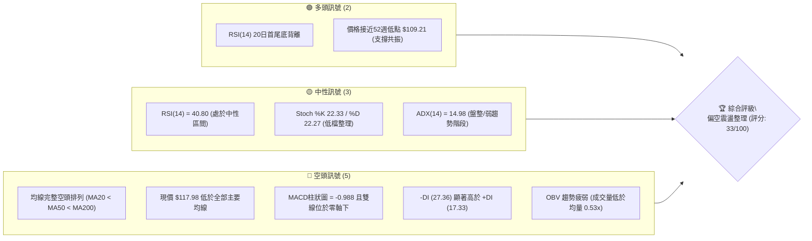

### 📊 核心指標速覽表

| 指標類別 | 指標名稱 | 當前數值 | 訊號 | 解讀 |
|:---|:---|:---|:---:|:---|
| **價格** | 當前價格 | $117.98 | 🔴 | 位於52週區間 6.3% 極低檔，距52週高點重挫逾 52% |
| **均線** | MA20 | $127.22 | 🔴 | 現價低於 MA20 達 -7.26%，短期反彈受壓制 |
| **均線** | MA50 | $137.58 | 🔴 | 中期趨勢下行，現價低於 MA50 達 -14.25% |
| **均線** | MA200 | $153.82 | 🔴 | 長期牛熊分界線失守，全面進入熊市結構 |
| **動能** | RSI(14) | 40.80 | 🟡 | 位於 30-70 中性區間，呈現超賣後反彈修復 |
| **動能** | MACD | -5.277 | 🔴 | DIF (-5.277) < DEA (-4.289)，柱狀圖 -0.988 持續看空 |
| **動能** | 隨機指標 | 22.33 / 22.27 | 🟡 | %K 與 %D 於 20 邊界金叉打平，超賣鈍化 |
| **趨勢** | ADX(14) | 14.98 | 🟡 | 數值低於 25，單邊動能放緩，市場轉為低位震盪 |
| **通道** | 布林 %B | 0.19 | 🟡 | 運行於下軌 ($112.30) 與中軌 ($127.22) 間之弱勢區 |
| **量能** | 當日量比 | 0.53x | 🔴 | 23.19M 遠低於20日均量 43.72M，量能極度萎縮 |
| **波動** | ATR(14) | $8.03 | 🔴 | 佔股價 6.81%，日內波動劇烈，風控門檻極高 |

### 🏆 技術評分卡

```
╔══════════════════════════════════════════════════════════════╗
║                技術評分卡 — ORCL (2026-11-11)                ║
╠══════════════════════════════════════════════════════════════╣
║ 趨勢強度 (ADX=14.98, -DI主導)   ██████░░░░░░░░░░░░░░  30/100 🔴 ║
║ 動能指標 (RSI底背離 vs MACD翻空) ████████░░░░░░░░░░░░  40/100 🟡 ║
║ 支撐穩定度 (波段低點S1=$114.08) ████████░░░░░░░░░░░░  40/100 🟡 ║
║ 成交量配合 (量比0.53x, OBV疲弱)  ████░░░░░░░░░░░░░░░░  20/100 🔴 ║
║ 形態完整度 (低檔反彈尚無底部型)  ████████░░░░░░░░░░░░  40/100 🟡 ║
║ 均線排列 (空頭排列, MA20<50<200) ██████░░░░░░░░░░░░░░  30/100 🔴 ║
╠══════════════════════════════════════════════════════════════╣
║ 綜合評分 (六項算術平均四捨五入)   ███████░░░░░░░░░░░░░  33/100 🔴 ║
║ 評級結論：偏空架構 / 低檔弱勢盤整 (破底風險未完全解除)       ║
╚══════════════════════════════════════════════════════════════╝
```

---

## 2. 趨勢分析

### 🌐 多時框趨勢分析

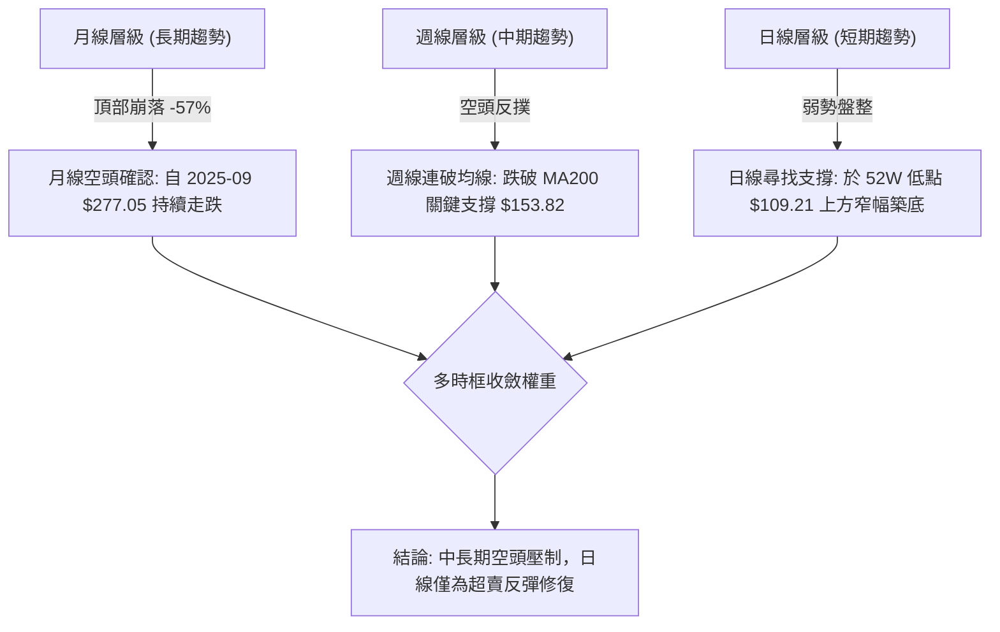

### 📈 長期趨勢 — 12個月走勢圖（Unicode）

```
ORCL 月線走勢圖（過去12個月：2025-11 至 2026-11）
價格軸 ($)
$280 ┤
$260 ┤
$240 ┤                                  ● $224.17 (2026-05)
$220 ┤
$200 ┤ ● $199.28 (2025-11)
$180 ┤     ● $192.34
$160 ┤         ● $162.84       ● $160.24
$140 ┤             ● $143.86   ● $145.50     ● $148.57
$120 ┤                 ● $145.55    ● $129.39     ● $136.79 ● $130.67
$100 ┤                                                        ● $117.98 (現價)
     └─────────────────────────────────────────────────────────────
       11   12   01   02   03   04   05   06   07   08   09   10   11
      2025 2025 2026 2026 2026 2026 2026 2026 2026 2026 2026 2026 2026
```

#### 長期走勢特徵分析表格

| 階段區間 | 起止月份 | 價格變化 ($) | 漲跌幅 (%) | 階段技術特徵解讀 |
|:---|:---|:---|:---:|:---|
| **高位崩落期** | 2025-11 → 2026-02 | $199.28 → $143.86 | -27.81% | 跌破 $200 心理整數關卡，機構拋售加速 |
| **春季強彈期** | 2026-03 → 2026-05 | $145.55 → $224.17 | +54.01% | 資金強勁回補，形成波段次高點 $224.17 |
| **次頂潰敗期** | 2026-05 → 2026-07 | $224.17 → $129.39 | -42.28% | 帶量長黑摜破上升趨勢線，形成毀滅性套牢區 |
| **弱勢弱彈期** | 2026-07 → 2026-08 | $129.39 → $148.57 | +14.82% | 跌深反彈，受阻於波段聚類阻力 R1 ($147.63) |
| **二次探底期** | 2026-08 → 2026-11 | $148.57 → $117.98 | -20.59% | 連續破底逼近 52W 低點 $109.21，成交量萎縮 |

### 📊 中期趨勢（週線分析）

中期技術面正承受巨幅下行壓力。近 20 週收盤走勢顯示，ORCL 在 2026 年 9 月初上攻至 $158.19 後動能枯竭，隨後展開無情陰跌。

```
週線關鍵架構阻力與支撐示意：
阻力 R2:  $153.03 ════════════════════════════════════ (2026-09-25 週高點)
阻力 R1:  $147.63 ──────────────────────────────── (近一年波段高點聚類)
前週反彈: $130.67 -------------------------------- (2026-10-30 收盤價)
當前價格: $117.98 ◄◄ 現價運行區
波段支撐: $114.08 ┄┄┄┄┄┄┄┄┄┄┄┄┄┄┄┄┄┄┄┄┄┄┄┄┄┄┄┄┄┄ (近一年波段低點聚類 S1)
極限低點: $109.21 ════════════════════════════════════ (52週最低點 100% 回調位)
```

2026-11-06 當週爆出 359,351,800 股的天量，低點下探 $109.21，收盤於 $116.10，顯示低檔出現恐慌性換手；然而本週（截至 11-10）反彈至 $117.98 卻僅有 50,914,500 股，呈現「放量下跌、縮量微彈」的中期偏空格局。

### ⚡ 趨勢強度評估（ADX 解讀）

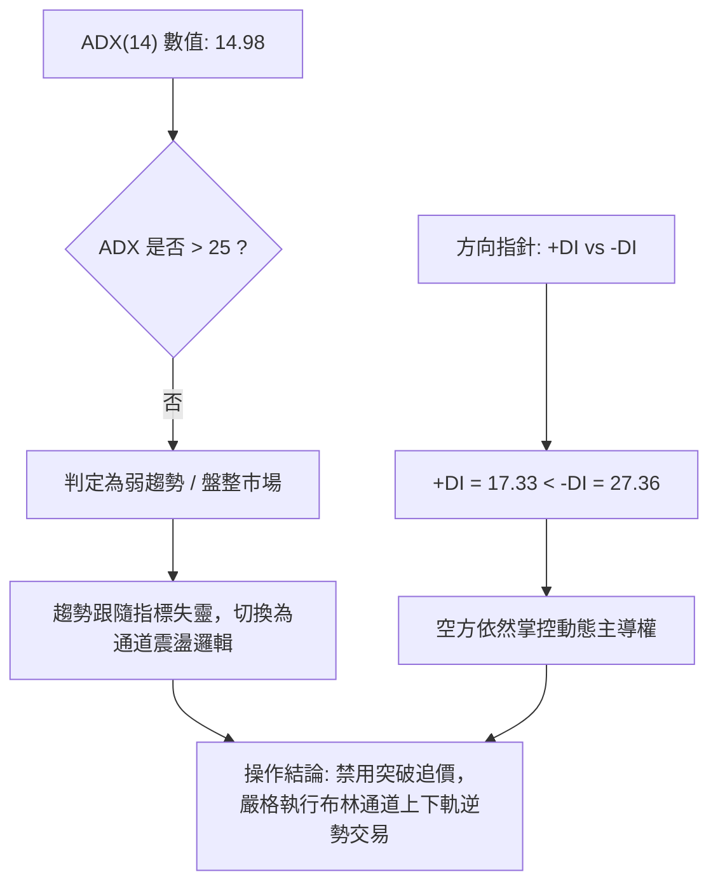

#### ADX 強度對照表

| ADX 數值區間 | 趨勢狀態判定 | 當前數值 | 當前狀態解讀 |
|:---|:---|:---:|:---|
| 0 – 20 | 無趨勢 / 極弱震盪 | **14.98** | **處於此區間**：單邊趨勢動能衰竭，空方動能減弱轉入橫盤蓄勢 |
| 20 – 25 | 潛在趨勢萌芽 / 弱趨勢 | — | 觀望指標是否上穿 25 確認新方向 |
| 25 – 40 | 強勁單邊趨勢 | — | 順勢操作的黃金階段（目前不具備條件） |
| 40 – 60 | 極強單邊趨勢 | — | 動能高度過熱 |
| 60 – 100 | 超強趨勢 / 接近尾聲 | — | 趨勢隨時可能出現耗竭性反轉 |

---

## 3. 圖表形態分析

### 🔍 形態識別系統

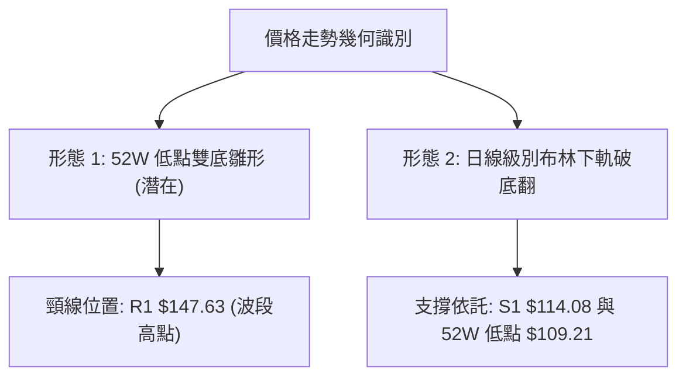

#### 圖表形態評估表

| 形態名稱 | 信心度 | 判斷依據（引用數據） | 完成度 | 目標價（附計算式） |
|:---|:---:|:---|:---:|:---|
| **雙底反轉雛形 (W底)** | 35% | 2026-07 月低點 $129.39 與 2026-11-06 日低點 $109.21，價差過大，形態不對稱 | 20% | 訊號不足，僅做指標型解讀（信心度 < 50%） |
| **下降通道下軌支撐** | 60% | 2026-11-06 跌破 $112.30（BB下軌）後收盤拉回 $116.10，連續3日守住 $109.21 | 65% | 依布林通道推算目標：中軌 MA20 **$127.22** |
| **超賣區低檔整固** | 55% | 2026-11-06 至 11-10 K線實體縮小，波幅收斂於 $109.21 至 $120.26 區間 | 50% | 依突破區間高度推算：$120.26 + ($120.26 - $109.21) = **$131.31** |

### 🕯️ 重要K線形態分析

嚴格依據近 10 根日 K 與近 8 根週 K 實際 OHLCV 進行辨識：

#### 近10根日K形態解析

| 日期 | 開 | 高 | 低 | 收 | 成交量 | K線形態 | 解讀與訊號 |
|:---|:---:|:---:|:---:|:---:|:---:|:---|:---|
| 2026-10-28 | 131.32 | 148.48 | 128.38 | 144.54 | 81,933,800 | 帶長上影大陽線 | 盤中巨震衝擊波段阻力，遇阻大幅回落 🟡 |
| 2026-10-29 | 144.14 | 144.61 | 136.59 | 139.56 | 39,366,900 | 中陰線 | 多頭無力承接，量縮回吐前日漲幅 🔴 |
| 2026-10-30 | 133.62 | 135.20 | 129.00 | 130.67 | 41,052,900 | 跳空小陰線 | 破位下行，確認 10-28 長上影為假突破 🔴 |
| 2026-11-02 | 125.88 | 126.50 | 118.43 | 119.22 | 58,749,300 | 實體大陰線 | 跌破 $120 整數支撐，空頭長驅直入 🔴 |
| 2026-11-03 | 122.00 | 128.14 | 121.35 | 126.19 | 84,295,400 | 反彈陽線 | 低檔放量抄底，但未能回補上方跳空口 🟡 |
| 2026-11-04 | 121.78 | 129.85 | 121.78 | 123.73 | 111,828,100 | 放量衝高回落十字星 | 111.8M 天量滯漲，多空激烈分歧 🔴 |
| 2026-11-05 | 123.00 | 124.24 | 111.66 | 115.16 | 56,875,900 | 破位實體中長陰 | 摜破 $114.08 支撐位，引發停損賣壓 🔴 |
| 2026-11-06 | 119.54 | 119.70 | 109.21 | 116.10 | 47,603,100 | 長下影錘頭形陽星 | 觸及 52W 新低 $109.21 後強彈，下影線長達 $6.89 🟢 |
| 2026-11-09 | 117.03 | 120.26 | 114.91 | 119.79 | 27,724,800 | 實體陽線 | 連續第二日不破低點，短期止跌回穩 🟢 |
| 2026-11-10 | 117.91 | 120.23 | 115.50 | 117.98 | 23,189,700 | 縮量小實體十字星 | 成交量創近期新低，變盤訊號，市場屏息觀望 🟡 |

#### 近8根週K形態解析

| 日期 | 開 | 高 | 低 | 收 | 週成交量 | K線形態 | 解讀與訊號 |
|:---|:---:|:---:|:---:|:---:|:---:|:---|:---|
| 2026-09-25 | 148.38 | 153.03 | 132.99 | 136.59 | 156,661,000 | 帶長上影週長陰 | 觸及波段高點 R2 ($153.03) 後潰敗 🔴 |
| 2026-10-02 | 132.24 | 144.33 | 131.10 | 141.78 | 164,959,800 | 震盪中陽線 | 下影線確認 $131 具備承接力 🟢 |
| 2026-10-09 | 142.00 | 146.40 | 134.16 | 141.40 | 121,793,100 | 高位窄幅十字星 | 逼近 R1 ($147.63) 動能放緩 🟡 |
| 2026-10-16 | 141.56 | 144.18 | 127.36 | 128.23 | 167,863,700 | 實體破位大陰線 | 吞噬前兩週整理平台，轉入空頭掌控 🔴 |
| 2026-10-23 | 130.66 | 134.35 | 122.76 | 126.16 | 132,673,600 | 陰十字星線 | 破底陰跌，低點逐週下移 🔴 |
| 2026-10-30 | 126.06 | 148.48 | 123.75 | 130.67 | 211,388,800 | 巨量天線倒錘頭 | 衝擊 R1 ($147.63) 爆出 2.11 億股遭主力無情出貨 🔴 |
| 2026-11-06 | 125.88 | 129.85 | 109.21 | 116.10 | 359,351,800 | 爆量長下影恐慌棒 | 3.59 億股天量砸出 52W 新低 $109.21，恐慌盤湧出 🟡 |
| 2026-11-10 | 117.03 | 120.26 | 114.91 | 117.98 | 50,914,500 | 縮量孕線十字星 | 兩日交易縮量整固，等待方向決策 🟡 |

### 📉 ASCII 走勢形態示意圖

```
日線低檔錘頭防禦架構示意：
$130.67 ─┐ (10-30 平台)
         │  
$126.19 ─┼──────┐ (11-03 彈升)
         │      │      ┌─ $120.26 (11-09 / 11-10 雙頂受阻)
         │      │  ┌───┴───┐
$117.98 ─┼──────┼──┤現價區 ├────
         │      │  └───────┘
$114.08 ─┼──────┴───────┐ (S1 支撐位)
         │              │
$109.21 ─┴──────────────┴─● (11-06 長下影探底低點：52W Low)
```

### 🎯 形態目標價計算

目前日線層級最明確的幾何結構為 2026-11-06 形成的「$109.21 - $120.26 破底翻箱型整理」：
1. **箱型底邊（支撐）**：$109.21（52W Low）
2. **箱型頂邊（短線頸線）**：$120.26（近兩日高點共振聚類）
3. **箱型振幅高度**：$120.26 - $109.21 = **$11.05**
4. **等距向上對稱目標價**：頸線 $120.26 + 形態高度 $11.05 = **$131.31**（此位置恰好逼近 2026-10-30 跳空平台低點 $130.67）

---

## 4. 支撐與阻力

### 🗺️ 關鍵價位分布圖（Unicode）

```
ORCL 價位結構分布圖 (依 OHLCV 與斐波那契精確計算)
════════════════════════════════════════════════════════════════
$178.84 ║████████████████████████████████████████║ 斐波那契 50.0% 回調位
$162.40 ║████████████████████████████████████    ║ 斐波那契 61.8% 黃金分割阻力
$158.67 ║████████████████████████████████        ║ 強阻力 R3 (波段高點聚類)
$153.82 ║▓▓▓▓▓▓▓▓▓▓▓▓▓▓▓▓▓▓▓▓▓▓▓▓▓▓▓▓▓▓        ║ 牛熊分水嶺 MA200
$153.03 ║████████████████████████████            ║ 強阻力 R2 (波段高點聚類)
$147.63 ║████████████████████                    ║ 關鍵阻力 R1 (波段高點聚類)
$139.01 ║████████████████                        ║ 斐波那契 78.6% 回調阻力
$127.22 ║▓▓▓▓▓▓▓▓▓▓▓▓                            ║ 短期反彈中軌 MA20 (BB中軌)
$117.98 ╠════════════════════════════════════════╣ ◄ 現價 ($117.98)
$114.08 ║▓▓▓▓▓▓▓▓                                ║ 關鍵支撐 S1 (波段低點聚類)
$112.30 ║▓▓▓▓                                    ║ 布林通道下軌
$109.21 ║████████████████████████████████████████║ 極限防線 (52W Low / 斐波 100%)
════════════════════════════════════════════════════════════════
```

### 🚧 阻力位分析表

數據完全引用自歷史波段高點聚類與均線指標系統：

| 阻力級別 | 精確價位 | 距現價幅 | 形成原因與籌碼特徵 | 突破難度 | 重要性 |
|:---|:---:|:---:|:---|:---:|:---:|
| **R1** | **$147.63** | +25.13% | 近一年波段高點聚類；2026-10-28 及 10-30 兩度衝高回落之出貨防線 | 極高 | ★★★★★ |
| **R2** | **$153.03** | +29.71% | 2026-09-25 週線波段高點聚類；與 MA200 ($153.82) 形成共振重壓區 | 極高 | ★★★★☆ |
| **R3** | **$158.67** | +34.49% | 2026-09-04 週線反彈最高點；多頭中期結構最後防線崩塌點 | 極高 | ★★★☆☆ |

### 🛡️ 支撐位分析表

數據完全引用自歷史波段低點聚類與統計邊界：

| 支撐級別 | 精確價位 | 距現價幅 | 形成原因與籌碼特徵 | 守住機率 | 重要性 |
|:---|:---:|:---:|:---|:---:|:---:|
| **S1** | **$114.08** | -3.31% | 近一年波段低點聚類；2026-11-09 與 11-10 日線回測守穩支撐位 | 60% | ★★★★☆ |
| **52W Low** | **$109.21** | -7.43% | 2026-11-06 爆出 3.59 億股巨量砸出的年內絕對低點；斐波那契 100% 回調位 | 75% | ★★★★★ |
| **S2 / S3** | **N/A** | N/A | *數據中未偵測到 $109.21 下方之低點聚類（依規則 13 嚴禁編造）* | N/A | N/A |

### 📐 斐波那契回調位分析

依據 52 週波段高點 $248.46 至 52 週波段低點 $109.21 計算之標準斐波那契回調水準：

| 回調比例 | 精確價位 | 相對現價位置 | 技術意義與多空攻防解讀 |
|:---:|:---:|:---:|:---|
| **0.0%** | **$248.46** | +110.60% | 52 週最高點，歷史牛市頂部聚類 |
| **23.6%** | **$215.60** | +82.74% | 弱勢反彈極限阻力，2026-05 月線次高點崩跌頸線 |
| **38.2%** | **$195.27** | +65.51% | 中期分水嶺，跌破後確認長期上升趨勢終結 |
| **50.0%** | **$178.84** | +51.59% | 多空中樞位置，長期籌碼密集沉澱區 |
| **61.8%** | **$162.40** | +37.65% | 黃金分割強阻力，與 MA240 ($160.44) 形成共振帶 |
| **78.6%** | **$139.01** | +17.83% | 深次回調阻力位，目前壓制 MA50 ($137.58) 與 MA60 ($138.95) |
| **100.0%** | **$109.21** | -7.43% | 52 週最低點，年內跌勢全數回吐之極限支撐點 |

**位置解讀**：現價 **$117.98** 緊密運行於 **78.6% ($139.01)** 與 **100.0% ($109.21)** 之間的極低回調區間。這表明市場已回吐了整整一年內的所有漲幅，處於嚴重超賣的深水區。然而，由於上方 $139.01 距離遙遠，當前任何反彈均屬於「超跌反抽」，在未收復 78.6% 斐波那契位前，無法確認長期多頭架構重啟。

---

## 5. 技術指標深度解讀

### 🎛️ 指標訊號總覽

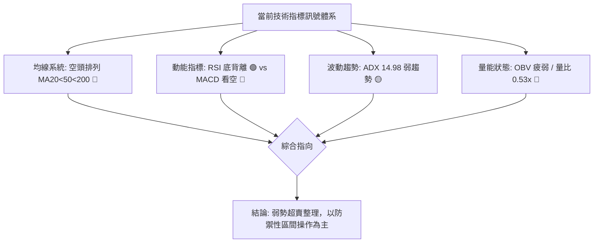

### 📈 移動平均線排列分析

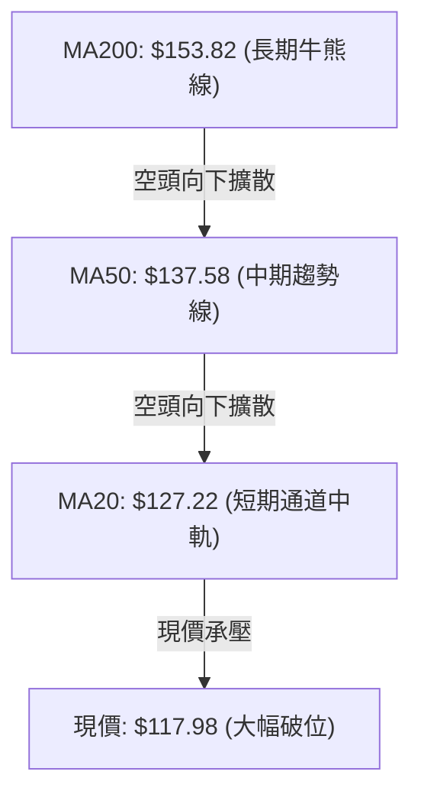

#### 均線系統監控矩陣

| 均線名稱 | 數值 | 偏離現價幅 | 均線斜率與歷史軌跡 | 訊號 |
|:---|:---:|:---:|:---|:---:|
| **MA 5** | $118.55 | -0.48% | 短線低檔走平，現價於其下方微幅糾纏 | 🟡 |
| **MA 10** | $125.29 | -5.84% | 陡峭向下延伸，短線第一道反壓 | 🔴 |
| **MA 20** | $127.22 | -7.26% | 穩定下行，布林帶中軌，短線強弱反轉關鍵線 | 🔴 |
| **MA 50** | $137.58 | -14.25% | 中期生命線下壓，壓制所有中期反彈動能 | 🔴 |
| **MA 60** | $138.95 | -15.09% | 季線下行，中線空頭壓制 | 🔴 |
| **MA120** | $149.70 | -21.19% | 半年線快速走跌，籌碼深度套牢 | 🔴 |
| **MA200** | $153.82 | -23.30% | 長期年線宣告失守，大格局進入熊市階段 | 🔴 |
| **MA240** | $160.44 | -26.46% | 長期成本均線下彎，上方形成多重套牢天花板 | 🔴 |

### 📉 RSI(14) 分析

```
RSI(14) 數值展示: 40.80 / 100
[0] ────────── [30] ───────●────── [70] ────────── [100]
超賣區          │    40.80 │         超買區
                └─ 弱勢整理 ─┘
進度條: ████████░░░░░░░░░░░░ 40.8%
```

- **超買超賣判定**：數值 40.80 位於 30–70 之常規中性區，脫離極端超賣區（2026-11-06 週線 RSI 曾低見 38.7，日線觸底）。
- **背離分析**：**明確存在底背離 (Bullish Divergence)**。
  - **價格軌跡**：近 20 根 K 棒中，價格自 2026-10-28 高點一路摜破前低至 2026-11-06 的 $109.21，創下 52 週新低。
  - **RSI 軌跡**：在價格探底 $109.21 時，RSI(14) 並未刷新歷史低點，而是維持在 40.80 附近首尾走平上揚。
  - **結論**：空頭下殺動能已出現耗竭跡象，短線具備技術性反彈動能，但需量能確認。

### 📊 MACD(12/26/9) 訊號解讀

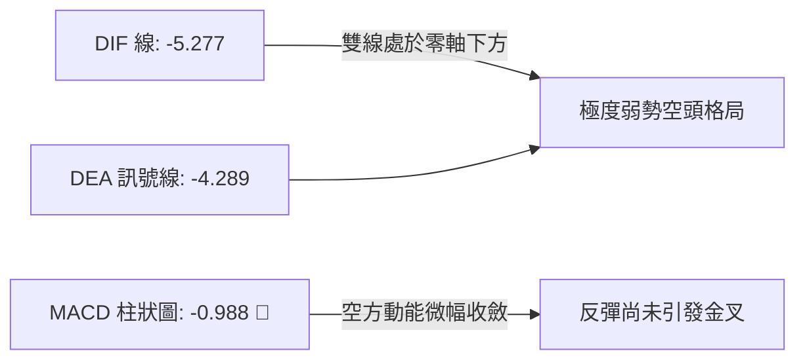

- **DIF (-5.277)** 深度低於 **DEA (-4.289)**，兩者皆在遠低於零軸的負值區運行，顯示空頭仍全盤掌控中長週期主動權。
- **柱狀圖為 -0.988**，維持負值，代表尚未出現翻紅金叉訊號；但相較於 2026-11-06 當週的 -1.268，負柱長度已出現小幅收斂，顯示急殺節奏暫歇。

### 📦 布林通道分析

```
日線布林通道 (20, 2) 結構分布：
$142.13 ────── 上軌 (Upper Band)
               │
$127.22 ────── 中軌 MA20 (Middle Band)
               │
$117.98 ────── 現價 (靠近下軌運行，弱勢反抽中)
               │
$112.30 ────── 下軌 (Lower Band) 
```

- **通道寬度**：上軌 $142.13 與下軌 $112.30 差距達 $29.83，開口處於擴張後維持高位。
- **%B 指標**：**0.19**。當 %B < 0.20 時，表明股價運行在極度弱勢的下軌邊界。股價在 2026-11-06 曾跌破下軌 ($112.30)，隨後收盤站回，目前屬於破軌後的「帶內弱勢回彈」，反彈的第一技術目標即為中軌 **$127.22**。

### 💹 成交量分析（量價配合度）

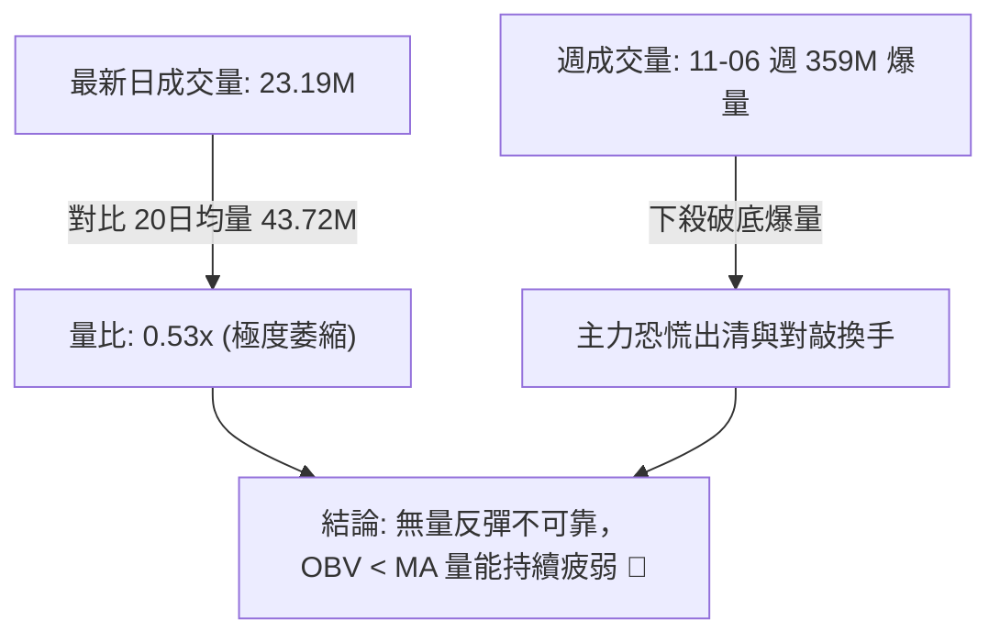

- **量能失衡**：最新交易日成交量僅 23,189,700 股，僅為 20 日均量 (43.72M) 的 53%，亦低於 50 日均量 (36.84M)。
- **OBV 趨勢**：數據明確顯示「OBV < MA → 量能疲弱」。OBV 處於均線下方下行，表明每次反彈皆無大資金實質建倉，屬於散戶場內博弈的無量反抽，量價嚴重頂背離（量縮價平）。

---

## 6. 動能與波動率

### ⚡ 動能評估

| 象限 | 動能維度 (RSI / MACD) | 波動率維度 (ATR / Beta) | 當前判定 | 技術策略意涵 |
|:---:|:---:|:---:|:---:|:---|
| **Q1** | 強動能 (Bullish) | 低波動 (Low Volatility) | — | 穩健多頭主升段，全力做多 |
| **Q2** | 弱動能 (Bearish) | 低波動 (Low Volatility) | — | 沉悶磨底盤整，等待方向確立 |
| **Q3** | 強動能 (Bullish) | 高波動 (High Volatility) | — | 投機性強拉，適合高拋低吸 |
| **Q4** | **弱動能 (Bearish)** | **高波動 (High Volatility)** | **✓ (ORCL 當前狀態)** | **高風險弱勢震盪，嚴格控倉止損** |

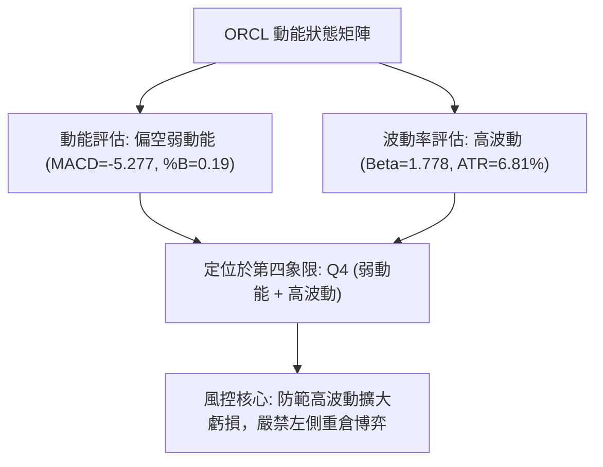

### 📊 ATR 波動率分析

- **ATR(14) 數值**：**$8.03**
- **價格百分比**：高達 **6.81%**（以現價 $117.98 計算）。
- **止損距離建議**：
  - **日間防守緩衝**：由於單日波動即達 $8.03，任何短線交易止損區間若小於 1.0x ATR ($8.03)，極易被市場隨機噪音打出場。
  - **常規停損空間**：建議保守型交易者將多單停損設在 **1.5x ATR = $12.05**，短線積極型設在 **1.0x ATR = $8.03**。

### 📐 Beta 與市場相關性

- **Beta 數值**：**1.778**
- **屬性解讀**：ORCL 屬於**極高波動性成長/科技權重股**。其走勢相較於標普 500 指數具有 177.8% 的放大倍率。
- **大盤共振效應**：當大盤出現回調時，ORCL 易面臨加劇拋售；反之，若大盤展開反彈，其高 Beta 屬性能在空頭回補時帶來超越指數的彈幅。

---

## 7. 多時框架總結

### 📋 時框架評分表

| 時框架 | 趨勢方向 | 動能狀態 | 均線排列 | 圖表形態 | 綜合評分 | 戰術建議 |
|:---|:---:|:---:|:---:|:---:|:---:|:---|
| **長期 (月線)** | 🔴 極度偏空 | 弱勢下探 | 空頭發散 | 頂部瀑布崩跌 | 20/100 | 長期投資者保持現金，不可盲目長線抄底 |
| **中期 (週線)** | 🔴 偏空下行 | 急殺微斂 | 破 MA200 | 長下影爆量破位 | 30/100 | 反彈皆為減碼點，逢高佈局中期對沖 |
| **短期 (日線)** | 🟡 低檔震盪 | RSI底背離 | 承壓MA20 | 箱型破底翻雛形 | 45/100 | 僅供高風險耐受者進行極短線波段反彈操作 |

### 🔲 綜合訊號矩陣

| 維度 | 短期 (日線) | 中期 (週線) | 長期 (月線) | 多時框一致性 |
|:---|:---:|:---:|:---:|:---:|
| **趨勢方向** | 橫向整理 | 單邊下跌 | 週期熊市 | 🔴 高度共振偏空 |
| **均線架構** | 承壓 MA20 ($127.22) | 跌破 MA50 ($137.58) | 跌破 MA200 ($153.82) | 🔴 完全空頭排列 |
| **量價關係** | 量縮微彈 (0.53x) | 爆量長陰 (359M) | 高位放量崩落 | 🔴 主力資金持續流出 |
| **指標狀態** | RSI 底背離 (40.80) | MACD 綠柱 (-0.988) | -DI (27.36) 主導 | 🟡 短多長空衝突 |

### ⚖️ 多時框收斂結論

依據多時框收斂規則（規則 14）：
1. **行情屬性判定**：當前 ADX(14) 數值為 **14.98**，顯著低於 25 臨界線，技術面確認為**「弱趨勢 / 盤整行情」**。
2. **主導維度確立**：雖然中長期（月線、週線、MA200）處於絕對空頭架構，但在 ADX < 25 的盤整環境下，單邊追空容易遭遇劇烈反抽；交易邏輯必須**以日線布林通道 ($112.30 - $142.13) 及波段低點 $109.21 為主要震盪交易區間**。
3. **唯一方向性結論**：**【偏空觀望 / 低檔弱勢區間震盪】**。
   - 由於第 1 章技術評分卡算術平均為 **33/100（≤40）**，第 8 章之主策略嚴格**依規則 18 導向空頭主策略（逢反彈佈局空單）**，多頭交易僅列為超跌博弈提示。

---

## 8. 交易策略建議

### 🗺️ 策略決策流程圖

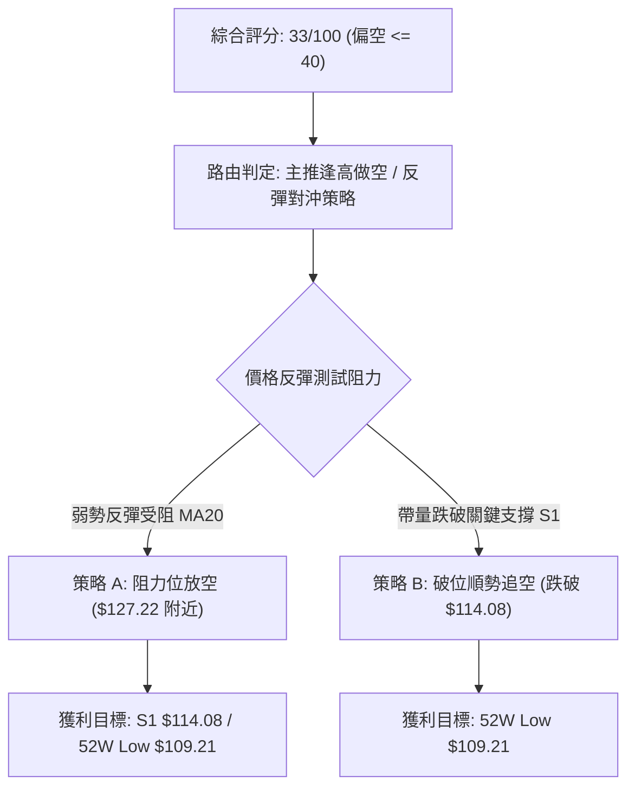

### 🧭 策略路由（依評分卡分流）

> **當前主策略方向 = 主推空頭策略（依綜合評分 33/100 判定）**

由於 ORCL 綜合技術評分僅為 33/100，技術均線全面成空頭排列且 OBV 持續疲弱，多頭僅為超跌底背離修復。策略核心為**「逢反彈至強阻力位做空」**或**「破位關鍵支撐追空」**。

### 🎯 價格情境階梯（Price Scenarios）

價位完全嚴格引用數據中計算之精確點位：

| 觸發條件 | 下一目標 | 後續延伸 | 情境含義 |
|:---|:---:|:---:|:---|
| **強勢向上突破 R1 ($147.63)** | R2 ($153.03) | R3 ($158.67) | 中期多頭反轉，空頭全面停損離場 |
| **弱勢向上測試 MA20 ($127.22)** | 斐波 78.6% ($139.01) | R1 ($147.63) | 布林通道中軌常規修復，提供做空機會 |
| **當前價位橫盤整固 ($117.98)** | MA20 ($127.22) | S1 ($114.08) | 縮量橫盤磨底，等待量能突破 |
| **向下失守關鍵支撐 S1 ($114.08)**| 52W Low ($109.21) | *數據未提供* | 短線反彈失敗，下探年內最低點 |
| **摜破 52W Low ($109.21)** | *數據未提供* | *數據未提供* | 熊市瀑布開啟新一輪恐慌殺跌 |

### 📊 情境機率分佈

| 情境名稱 | 機率 | 主要依據（引用指標狀態） |
|:---|:---:|:---|
| **回落 / 再探低點 (偏空)** | **55%** | 均線系統呈標準空頭排列 (MA20<50<200)；MACD柱狀圖仍為負值 (-0.988)；OBV 持續疲弱。 |
| **區間震盪整理 (中性)** | **30%** | ADX(14) = 14.98 處於盤整區間；RSI(14) 出現日線底背離；量比僅 0.53x 缺乏突破動能。 |
| **繼續上行反彈 (偏多)** | **15%** | 僅憑 RSI 底背離引發超跌空頭回補，但上方遭遇下彎之 MA20 ($127.22) 重壓。 |

### 🔴 主策略詳情（空頭主推策略）

嚴格依據規則 17 計算風險報酬比：`(進場價 − 目標價 T1) ÷ (止損價 − 進場價)`

| 策略要素 | 策略 A：中軌反壓做空 (逢高佈局) | 策略 B：破位順勢做空 (動能追空) |
|:---|:---|:---|
| **策略邏輯** | 股價反彈至布林中軌 MA20 遇阻回落 | 跌破波段支撐 S1，確認反彈夭折 |
| **進場條件** | 反彈至 MA20 附近出現上影線滯漲 | 日K收盤價有效跌破 S1 $114.08 |
| **進場價格** | **$127.22** (MA20 阻力價位) | **$114.08** (S1 支撐破位價) |
| **目標價 T1** | **$114.08** (S1 波段支撐位) | **$109.21** (52W Low 極限低點) |
| **目標價 T2** | **$109.21** (52W Low 極限低點) | *數據中未偵測到（嚴禁捏造）* |
| **止損價格** | **$130.67** (2026-10-30 跳空低點平台) | **$116.10** (2026-11-06 收盤價阻力) |
| **風險報酬比** | **1 : 3.81（以 T1 計）**<br>*(計算式: (127.22-114.08)/(130.67-127.22) = 13.14/3.45)* | **1 : 2.41（以 T1 計）**<br>*(計算式: (114.08-109.21)/(116.10-114.08) = 4.87/2.02)* |
| **成功機率** | 60% | 55% |
| **建議倉位** | 10% - 15% (高波動環境控倉) | 5% - 10% (破位追空防假摔) |

### 🟢 反向風險觸發點（對沖與停損提示）

若出現以下訊號，空頭主策略必須**立即無條件強制停損**，轉為多頭防禦：
1. **價位突破**：日線收盤價帶量突破 **MA20 ($127.22)**，且進一步收復 **$130.67**。
2. **指標反轉**：日線 MACD 柱狀圖翻正（由 -0.988 翻紅轉正），且 DIF 上穿 DEA 形成實質低檔金叉。
3. **量能爆發**：單日成交量突破 20 日均量 (43.72M) 的 1.5 倍以上，OBV 趨勢扭轉向上穿破均線。

### ⭐ 整體訊號強度評星

```
做多訊號強度：★★☆☆☆  (2/5星 - 僅有底背離與超跌支撐)
做空訊號強度：★★★★☆  (4/5星 - 均線空頭排列，量能潰散)
整體可信度：  ★★★★☆  (4/5星 - 多時框趨勢高度一致)
```

---

## 9. 風險提示與監控

### ✅ 關鍵監控指標 Checklist

```
╔══════════════════════════════════════════════════════════════╗
║                交易監控 Checklist — ORCL                     ║
╠══════════════════════════════════════════════════════════════╣
║ [ ] 價格是否跌破 S1 $114.08 (跌破將引發下探 $109.21 恐慌)    ║
║ [ ] 價格是否回升碰觸 MA20 $127.22 (空頭策略之核心狙擊點)      ║
║ [ ] 成交量是否低於 20M 股 (極度縮量警惕突發脈衝變盤)          ║
║ [ ] RSI(14) 是否跌破 30 重新進入深度超賣 (底背離失效風險)     ║
║ [ ] MACD 柱狀圖是否持續收斂至 0 軸附近 (動能衰竭預警)         ║
║ [ ] 日內波幅是否超過 ATR $8.03 (超過需動態收緊停損間距)       ║
╚══════════════════════════════════════════════════════════════╝
```

### ⚠️ 風險場景分析

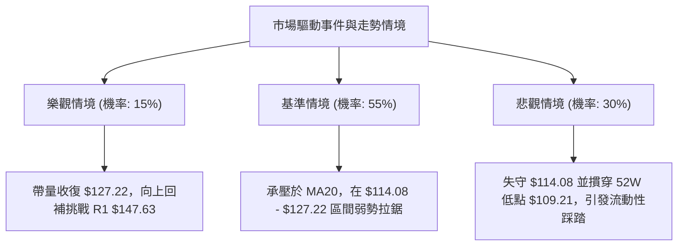

### 🛡️ 風險管理重要提醒

1. **極高 ATR 風險控制**：當前 ATR 為 **$8.03**（股價的 6.81%），屬於極高波動個股。單筆交易停損金額嚴禁超過投資組合總權益的 **1.0%**。若帳戶規模為 $100,000 美元，單次最大容忍虧損為 $1,000 美元；以策略 A 的停損間距 $3.45 計算，最大開倉股數不得超過 **289 股**。
2. **高 Beta 槓桿效應**：ORCL 的 Beta 高達 **1.778**，對標普 500 指數與科技類股 ETF (如 QQQ) 的波動極為敏感。嚴禁在美聯儲利率決議或巨型科技股財報日前夕持有重倉。
3. **量能陷阱防範**：最新日量比僅 **0.53x**，在極度無量的背景下，小額買賣單即可引發價格非理性抽動。請務必使用「限價單 (Limit Order)」執行進出場，嚴禁使用市價單以避免滑點侵蝕利潤。

---

## 📋 報告總結

```
╔══════════════════════════════════════════════════════════════╗
║                ORCL 技術分析報告總結                         ║
╠══════════════════════════════════════════════════════════════╣
║ 報告日期：2026-11-11                                         ║
║ 當前價格：$117.98 USD                                        ║
║ 分析評級：🔴 偏空震盪整理 (綜合評分: 33/100)                  ║
║                                                              ║
║ 關鍵結論：                                                   ║
║ ├─ 長期趨勢：🔴 月線全面走熊，距高點重挫逾 52%               ║
║ ├─ 中期趨勢：🔴 週線跌破 MA200 牛熊線 ($153.82)              ║
║ ├─ 短期趨勢：🟡 日線低檔收斂，守住 52W 低點 $109.21 弱勢整理  ║
║ ├─ 關鍵支撐：S1 $114.08 ｜ 52W Low $109.21                  ║
║ ├─ 關鍵阻力：MA20 $127.22 ｜ R1 $147.63 ｜ R2 $153.03        ║
║ └─ 分析師目標：均價 $235.77 (最低 $110.00 / 最高 $400.00)     ║
║                                                              ║
║ 最優策略組合：                                               ║
║ 1. 🥇 最佳機會：策略 A — 反彈至 MA20 ($127.22) 放空           ║
║    目標 T1: $114.08 ｜ 風險報酬比 1 : 3.81 (以 T1 計)         ║
║ 2. 🥈 次選機會：策略 B — 破位 S1 ($114.08) 順勢追空           ║
║    目標 T1: $109.21 ｜ 風險報酬比 1 : 2.41 (以 T1 計)         ║
║ 3. 🥉 保守選擇：場外空倉觀望，等待突破 MA20 或跌破 $109.21    ║
╚══════════════════════════════════════════════════════════════╝
```

---

> ⚠️ **免責聲明**：本報告為 AI 自動生成之技術分析，所有數據及估算均基於提供的歷史價格資訊。本報告**僅供研究與學術參考**，**不構成任何投資建議**。投資有風險，入市需謹慎。

---

*報告生成時間：2026-11-11 ｜ 數據來源：Yahoo Finance ｜ 分析框架：多時框技術分析*