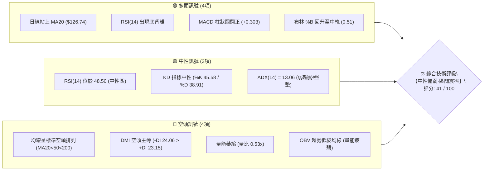
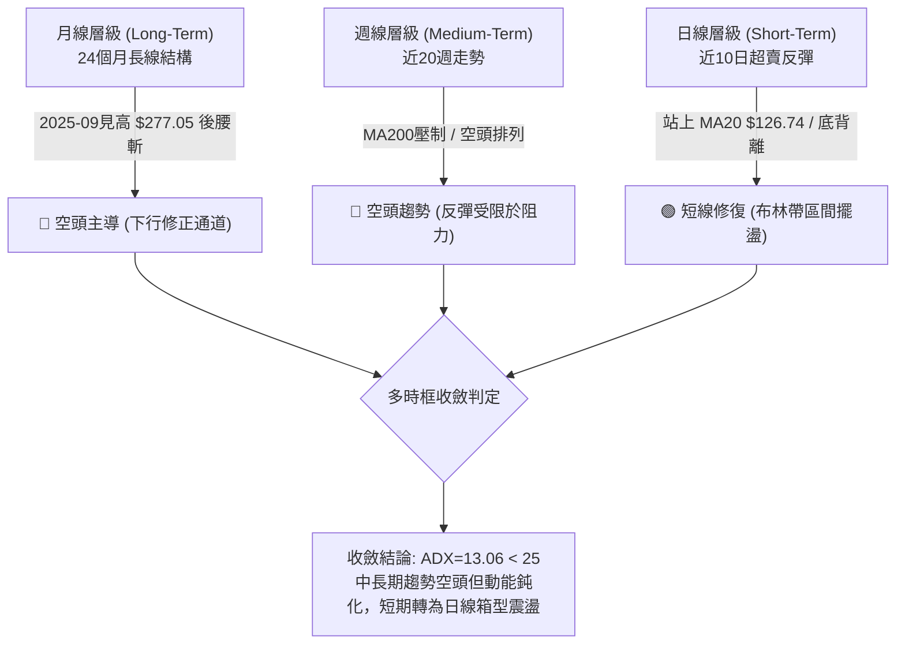
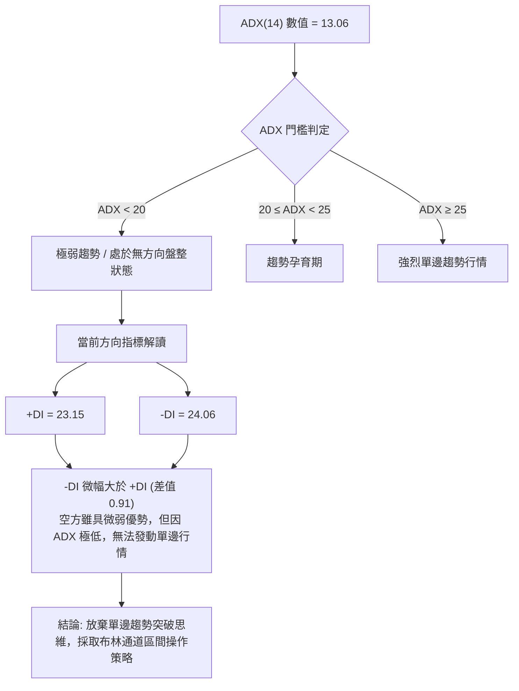
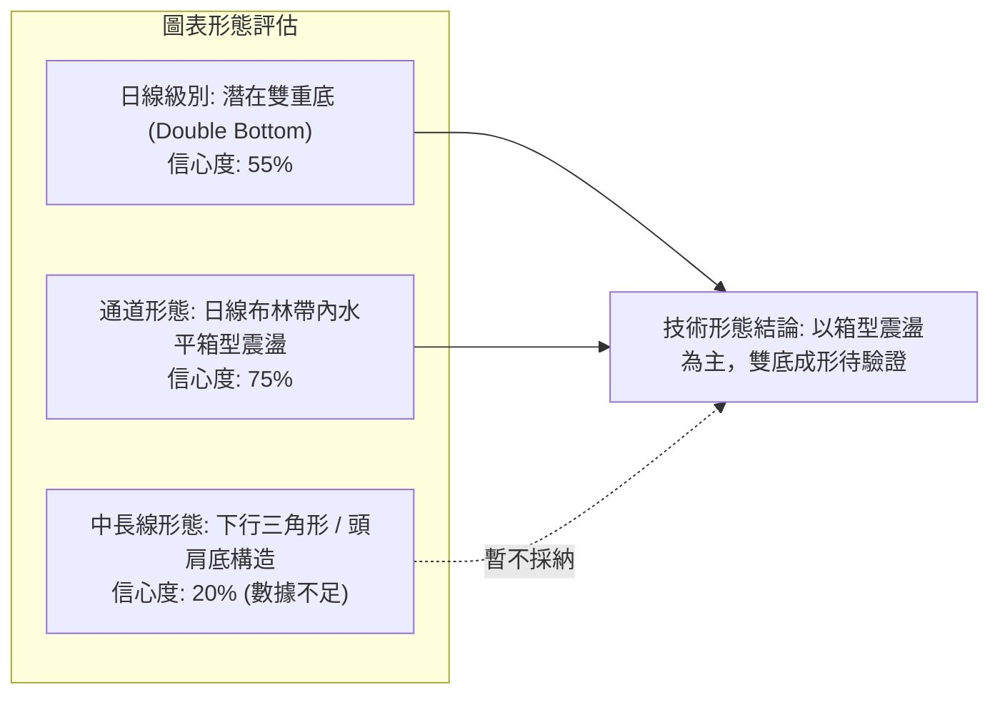
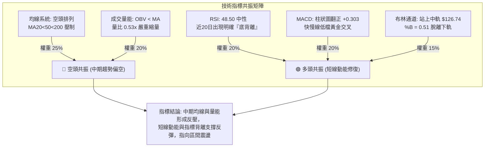
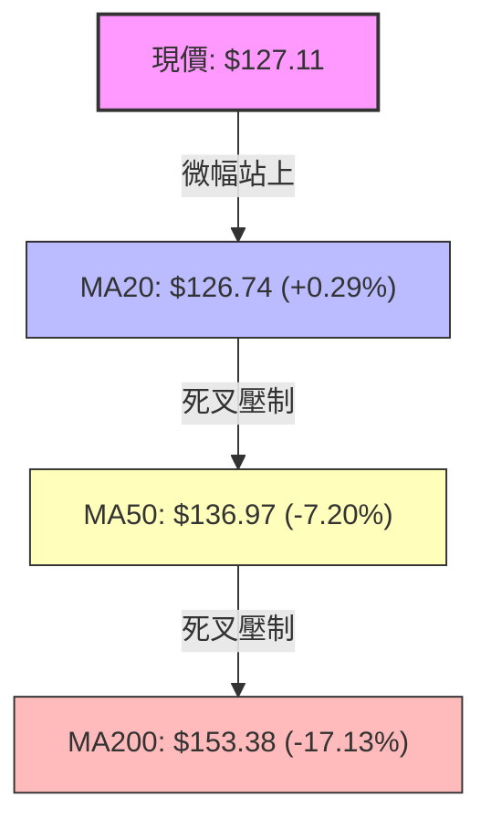
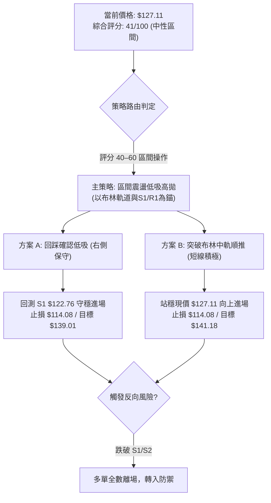
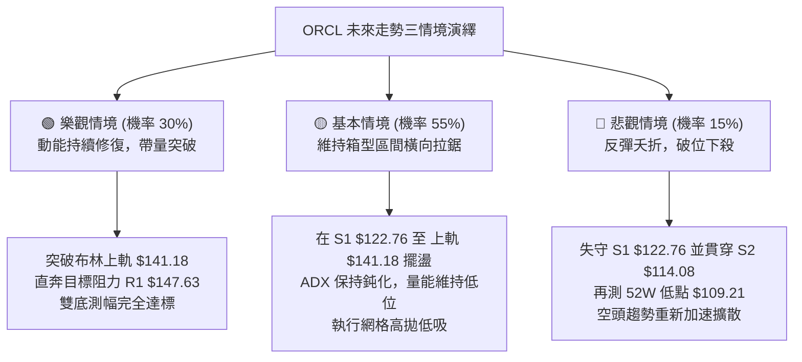

# ORCL 技術分析報告

> **報告日期**：2026-11-13 ｜ **語言**：繁體中文 ｜ **數據來源**：Yahoo Finance ｜ **當前價格**：$127.11

---

## 目錄

| 章節 | 內容 |
|------|------|
| [1. 技術面概覽](#1-技術面概覽) | 訊號儀表板、核心指標、評分卡 |
| [2. 趨勢分析](#2-趨勢分析) | 多時框趨勢、長中短期走勢、ADX 解讀 |
| [3. 圖表形態分析](#3-圖表形態分析) | 形態識別、K線組合、目標價推算 |
| [4. 支撐與阻力](#4-支撐與阻力) | 關鍵價位、斐波那契回調結構 |
| [5. 技術指標深度解讀](#5-技術指標深度解讀) | MA系統、RSI背離、MACD、布林通道、OBV |
| [6. 動能與波動率](#6-動能與波動率) | 動能四象限、ATR 波動率、Beta 市場敏感度 |
| [7. 多時框架總結](#7-多時框架總結) | 時框架評分矩陣、收斂判斷規則 |
| [8. 交易策略建議](#8-交易策略建議) | 策略路由、情境階梯、風報比精算 |
| [9. 風險提示與監控](#9-風險提示與監控) | 監控清單、情境模擬、風控準則 |

---

## 1. 技術面概覽

### 🎯 技術訊號儀表板



---

### 📊 核心指標速覽表

| 指標類別 | 指標名稱 | 當前數值 | 訊號 | 專業解讀 |
|:---|:---|:---|:---:|:---|
| **價格** | 當前收盤價 | $127.11 | 🟡 | 位於52週區間 12.9% 低位，自低點 $109.21 出現技術性反彈 |
| **短期均線** | MA20 | $126.74 | 🟢 | 現價微幅高於 MA20（+0.29%），短線多頭取得初步喘息防線 |
| **中期均線** | MA50 | $136.97 | 🔴 | 現價低於 MA50（-7.20%），中期下行壓力沉重，反彈面臨壓制 |
| **長期均線** | MA200 | $153.38 | 🔴 | 現價低於 MA200（-17.13%），中長線技術格局仍屬完全空頭控制 |
| **動能** | RSI(14) | 48.50 | 🟢 | 脫離超賣區進入中性帶，近20根K棒呈現典型「底背離」多頭動能修復 |
| **動能** | MACD (12,26,9) | -3.953 / -4.257 | 🟢 | DIF 線金叉 MACD 訊號線，柱狀圖擴張至 +0.303，空方動能減弱 |
| **趨勢強度** | ADX(14) | 13.06 | 🟡 | 遠低於 25 臨界線，顯示單邊下跌動能衰竭，進入低波動盤整期 |
| **波動帶** | 布林通道 %B | 0.51 | 🟡 | 價格自布林下軌 $112.31 順利回升至中軌 $126.74 之上，進入常態波動 |
| **成交量** | 成交量比 | 0.53x | 🔴 | 成交量僅 22.50M，遠低於 20日均量 42.60M，反彈缺乏積極追價買盤 |
| **波動率** | ATR(14) | $8.21 (6.46%) | 🟡 | 每日平均震幅達 6.46%，波動風險偏高，操作需嚴格設定防守間距 |

---

### 🏆 技術評分卡

```
╔══════════════════════════════════════════════════════════════╗
║               技術評分卡 — ORCL (2026-11-13)                  ║
╠══════════════════════════════════════════════════════════════╣
║ 評估維度      進度條評分指標                   數值    訊號  ║
╟──────────────────────────────────────────────────────────────╢
║ 趨勢強度      █████░░░░░░░░░░░░░░░             25/100   🔴   ║
║ 動能指標      ████████████░░░░░░░░             58/100   🟡   ║
║ 支撐穩定度    ███████████░░░░░░░░░             55/100   🟡   ║
║ 成交量配合    ██████░░░░░░░░░░░░░░             32/100   🔴   ║
║ 形態完整度    ██████████░░░░░░░░░░             50/100   🟡   ║
║ 均線排列      █████░░░░░░░░░░░░░░░             26/100   🔴   ║
╠══════════════════════════════════════════════════════════════╣
║ 綜合評分      ████████░░░░░░░░░░░░             41/100   🟡   ║
║ 評級結論      【中性震盪 (Neutral Consolidation) / 區間操作】  ║
╚══════════════════════════════════════════════════════════════╝
```

> **評分計算說明（規則 18）**：  
> 綜合評分 = (25 + 58 + 55 + 32 + 50 + 26) ÷ 6 = 246 ÷ 6 = **41 分 / 100**。  
> 落在 40–60 區間內，明確界定為**中性震盪行情**，交易架構應以日線布林通道上下軌之區間操作為主，忌盲目追高。

---

## 2. 趨勢分析

### 🌐 多時框趨勢分析



---

### 📈 長期趨勢 — 12個月走勢圖（Unicode）

以下為 ORCL 過去 12 個月（2025-11 至 2026-11）的月線收盤走勢追蹤，呈現極具震撼的高位崩跌與低位築底過程：

```
ORCL 月線走勢圖（過去12個月收盤價）
價格軸 ($)
$225 ┤                  ● ($224.17，2026-05 反彈次高點)
$200 ┤● ($199.28)
$175 ┤    ● ($192.34)
$150 ┤        ● ($162.84)     ● ($160.24)
$125 ┤            ● ($143.86)       ● ($145.50)    ● ($148.57)    ● ($127.11 ◄ 現價)
$100 ┤                                    ● ($129.39)    ● ($136.79)  ● ($130.67)
     └──────────────────────────────────────────────────────────────────────────
      11   12   01   02   03   04   05   06   07   08   09   10   11 (月份)
      (2025)                      (2026)
```

#### 走勢特徵分析表格

| 階段區間 | 起訖月份 | 價格變化 ($) | 漲跌幅 (%) | 主要技術特徵與動態解讀 |
|:---|:---:|:---:|:---:|:---|
| **第一輪深跌** | 2025-11 → 2026-02 | $199.28 → $143.86 | -27.81% | 跌破 $160 關鍵整數關卡，各期均線全面死叉擴散 |
| **強烈技術抽頭** | 2026-02 → 2026-05 | $143.86 → $224.17 | +55.82% | 季報驅動短線軋空暴衝至 $224.17，但未能突破前期歷史高位 |
| **崩跌重挫破底** | 2026-05 → 2026-07 | $224.17 → $129.39 | -42.28% | 巨量單邊斷崖式重挫，跌破長期均線 MA200，多頭架構徹底破壞 |
| **低位反覆築底** | 2026-07 → 2026-11 | $129.39 → $127.11 | -1.76% | 價格於 $114.08–$148.57 寬幅拉鋸，近期更於 11-06 探出 52W 低點 $109.21 |

---

### 📊 中期趨勢（週線分析）

中期走勢呈現「階梯式盤跌後的低位弱勢震盪」。價格自 2026-09-04 週線高點 $158.19 下滑以來，連續收陰走低。

```
ORCL 中期週線壓力與支撐結構圖
══════════════════════════════════════════════════════════════════
阻力 R3  $158.67 ──────────────────────────────────────── (09-04 波段起跌點)
阻力 R2  $153.03 ──────────────── (週線反彈受阻點 / MA200 $153.38 重合)
阻力 R1  $147.63 ────────── (10-30 週線大影線高點聚類 $148.48 附近)
                   ╭─╮
                   │ │  ◄ 目前週線反彈波段 ($114.91 → $127.11)
現價     $127.11 ──┴─┴───────────────────────────────────
支撐 S1  $122.76 ────────── (10-23 波段低點聚類，前週重要頸線支撐)
支撐 S2  $114.08 ──────────────── (波段低點聚類，週線級別最後防線)
52W低點  $109.21 ──────────────────────────────────────── (2026-11-06 絕對低點)
══════════════════════════════════════════════════════════════════
```

- **週線 MACD**：自 10-16 的 -0.901 擴大至 11-06 的 -1.268 後，最新一週（11-12）MACD 柱狀圖收斂至 **+0.303**，顯示中期空方拋壓有短暫衰退跡象。
- **週線 RSI**：自超賣邊界 38.7 回升至 48.5，暫未脫離下行通道，需收盤站上 R1 ($147.63) 才能確認中期反轉。

---

### ⚡ 趨勢強度評估（ADX 解讀）



#### ADX 趨勢強度對照解讀表

| 指標變數 | 當前讀數 | 狀態等級 | 戰術含義與操作指引 |
|:---|:---:|:---:|:---|
| **ADX (14)** | **13.06** | 🔴 弱勢鈍化 (< 20) | 趨勢動能極弱，價格處於典型箱型整理，順勢突破策略極易遭遇假突破 |
| **+DI (14)** | **23.15** | 🟡 溫和多方 | 多方買盤隨日線底背離而有所修復，但尚未取得主導權 |
| **-DI (14)** | **24.06** | 🟡 溫和空方 | 空方力量大幅減退，不再具備連續摜壓實力 |
| **DI 交叉狀態** | -DI > +DI | 🔴 空方微佔優 | 空方佔比微幅領先 0.91，整體為中性膠著，需靜待 ADX 拐頭向上伴隨 DI 擴散 |

---

## 3. 圖表形態分析

### 🔍 形態識別系統

依據「嚴格要求 15」，所有形態均標注置信度與數據支撐來源：



#### 形態識別信心度與目標價計算表

| 形態名稱 | 信心度 | 判斷依據（嚴格引用歷史價位） | 完成度 | 形態目標價（附精確計算式） |
|:---|:---:|:---|:---:|:---|
| **潛在雙重底** | **55%** | 第一底為 2026-11-06 低點 **$109.21**；第二底為 2026-11-10 低點 **$115.50**（未破前低）；現價 $127.11 已突破 11-03 反彈高點 $128.14 附近 | 65% | **$147.07**<br/>計算式：頸線高點 $128.14 + (頸線 $128.14 − 第一底 $109.21 = $18.93) = **$147.07**（極度接近阻力 R1 $147.63） |
| **布林箱型震盪** | **75%** | 價格受限於布林下軌 **$112.31** 與上軌 **$141.18** 之間，中軌 **$126.74** 反覆穿梭 | 85% | **$141.18**<br/>計算式：直接指向布林帶上軌 **$141.18** |
| **頭肩底結構** | **15%** | 僅有單一低點 $109.21，缺乏完整左肩與右肩對稱成交量支撐 | 0% | **數據不足，僅做指標型解讀，不計算幾何目標價** |

---

### 🕯️ 重要 K 線形態分析

嚴格依據提供的「近10根日K」與「近8根週K」實際開高低收數據進行客觀解讀（規則 19）：

#### 近 10 根日 K 線形態解讀表

| 日期 | 開盤價 ($) | 最高價 ($) | 最低價 ($) | 收盤價 ($) | K線形態名稱 | 技術解讀與量能特徵 | 訊號 |
|:---:|:---:|:---:|:---:|:---:|:---:|:---|:---:|
| **10-30** | 133.62 | 135.20 | 129.00 | 130.67 | 中黑K棒 | 跌破開盤價，反彈受阻於 135.20，日量 41.05M 溫和放大 | 🔴 |
| **11-02** | 125.88 | 126.50 | 118.43 | 119.22 | 跳空大黑K | 跳空跌破 $120 整數支撐，收盤接近最低點，拋壓沉重 | 🔴 |
| **11-03** | 122.00 | 128.14 | 121.35 | 126.19 | 帶長上影中紅K | 低檔買盤介入反彈，但 128.14 之上面臨短線解套賣壓，量增至 84.30M | 🟡 |
| **11-04** | 121.78 | 129.85 | 121.78 | 123.73 | 假突破長上影陰K | 創近幾日高點 129.85 後無力為繼，收盤倒跌，放出 111.83M 巨量（主力換手） | 🔴 |
| **11-05** | 123.00 | 124.24 | 111.66 | 115.16 | 長下影破底黑K | 盤中下殺至 111.66，瀕臨 52W 低點，尾盤微幅收腳，量能 56.88M | 🔴 |
| **11-06** | 119.54 | 119.70 | 109.21 | 116.10 | **長下影探底鎚頭K** | **下探 52W 新低 $109.21 後爆發強勁逢低承接盤，留 6.89 美元長下影線** | 🟢 |
| **11-09** | 117.03 | 120.26 | 114.91 | 119.79 | 築底小紅K | 開低走高收復 119，守住 11-06 低點，量能急凍至 27.72M（賣壓竭盡） | 🟢 |
| **11-10** | 117.91 | 120.23 | 115.50 | 117.98 | 窄幅十字星 (Doji) | 開收同為 117.9X，多空在 118 附近極致均衡，成交量縮至 23.39M 低谷 | 🟡 |
| **11-11** | 124.28 | 130.77 | 124.15 | 128.38 | **跳空起漲長紅K** | **跳空高開並突破 $128，單日大漲 +8.8%，一舉收復 MA20，短線反轉確立** | 🟢 |
| **11-12** | 123.33 | 129.06 | 123.05 | 127.11 | 孕線高檔整理陰K | 消化前日獲利盤，全天波動包覆於前日高低點內（孕線），守住 MA20 $126.74 | 🟡 |

#### 近 8 根週 K 線形態解讀表

| 週結日期 | 開盤價 ($) | 最高價 ($) | 最低價 ($) | 收盤價 ($) | 週K形態 | 技術解讀 | 訊號 |
|:---:|:---:|:---:|:---:|:---:|:---:|:---|:---:|
| **09-25** | 148.38 | 153.03 | 132.99 | 136.59 | 烏雲罩頂長黑 | 測試 R2 ($153.03) 未果後長黑摜破 $140，週量 156.66M | 🔴 |
| **10-02** | 132.24 | 144.33 | 131.10 | 141.78 | 下影反彈長紅 | 低檔見到支撐，單週拉升近 10 美元收於 141.78 | 🟢 |
| **10-09** | 142.00 | 146.40 | 134.16 | 141.40 | 高檔十字星 | 多空在 R1 下方膠著，反彈無力擴大，週量萎縮至 121.79M | 🟡 |
| **10-16** | 141.56 | 144.18 | 127.36 | 128.23 | 破位中長黑 | 跌破 130 支撐，週線空頭排列重新主導 | 🔴 |
| **10-23** | 130.66 | 134.35 | 122.76 | 126.16 | 測底黑K棒 | 最低探至 S1 ($122.76)，空方持續控盤 | 🔴 |
| **10-30** | 126.06 | 148.48 | 123.75 | 130.67 | 爆量長上影流星 | 上衝至 148.48（逼近 R1 $147.63）後遭猛烈回擊，週量暴增至 211.39M | 🔴 |
| **11-06** | 125.88 | 129.85 | 109.21 | 116.10 | 恐慌殺多長下影黑K | 創 52W 新低 109.21，週量爆出 359.35M 極限天量，恐慌盤盡出 | 🟡 |
| **11-12** | 117.03 | 130.77 | 114.91 | 127.11 | **下影強彈長紅K** | **自破底邊緣拉升，收盤重回 $127，週線 MACD 柱翻正，初步止跌** | 🟢 |

---

### 📉 ASCII 走勢形態示意圖

```
ORCL 日線潛在「雙重底反彈」形態示意圖
═════════════════════════════════════════════════════════════════════
$130.77 ┤                         ╭─╮ (11-11 突破頸線高點)
        │                         │ │
$128.14 ┤        ╭─╮ (頸線位)      │ │
        │        │ │              │ │   ╭─╮ (11-12 現價 $127.11)
$123.73 ┤        │ │      ╭─╮    │ │   │ │
        │╭─╮    │ │      │ │    │ ╰───╯ │
$116.10 ┤│ │    │ │      │ │    │       │
        ││ │╭──╯ │      │ ╰────╯       │
$114.91 ┤│ ╰╯   │      │ (第二底 $115.50)
$109.21 ┤│       │      │ 
        │╰───────╯      │
        └ (第一底 $109.21)────────────────────────────────────────
          11-02 11-03   11-05 11-06 11-09 11-10 11-11 11-12
═════════════════════════════════════════════════════════════════════
```

---

### 🎯 形態目標價計算

針對日線 11-06 至 11-11 出現的潛在「雙底反彈」形態進行精確測幅推算：

1. **第一底 (Bottom 1)**：$109.21（2026-11-06 最低點）
2. **中間頸線 (Neckline)**：$128.14（2026-11-03 反彈高點）
3. **第二底 (Bottom 2)**：$115.50（2026-11-10 最低點，未破前低，確立底底高）
4. **形態高度 (Height)**：  
   $$\text{形態高度} = \text{頸線} - \text{第一底} = \$128.14 - \$109.21 = \$18.93$$
5. **最小向上測幅目標價 (Target Price)**：  
   $$\text{目標價} = \text{頸線} + \text{形態高度} = \$128.14 + \$18.93 = \mathbf{\$147.07}$$

> **技術共振驗證**：形態推算目標價 **$147.07** 與數據庫所計算之波段阻力 **R1: $147.63** 僅差 $0.56（誤差 < 0.4%），高度確認 **$147.07–$147.63** 為多頭反彈的關鍵終極目標區間。

---

## 4. 支撐與阻力

### 🗺️ 關鍵價位分布圖（Unicode）

```
ORCL 價位結構分布圖（OHLCV 實際聚類計算）
══════════════════════════════════════════════════════════════════════
$158.67 ║████████████████████████████████████║ 強阻力 R3 (波段下殺起點)
$153.03 ║████████████████████████            ║ 阻力 R2 (MA200 重合區)
$147.63 ║██████████████████████████████      ║ 關鍵阻力 R1 (反彈目標區)
$141.18 ║▓▓▓▓▓▓▓▓▓▓▓▓▓▓▓▓▓▓▓▓                ║ 布林通道上軌
──────────────────────────────────────────────────────────────────────
$127.11 ╠════════════════════════════════════╣ ◄ 當前收盤價 ($127.11)
──────────────────────────────────────────────────────────────────────
$126.74 ║░░░░░░░░░░░░░░░░░░░░                ║ 短期支撐 (MA20 / 布林中軌)
$122.76 ║▓▓▓▓▓▓▓▓▓▓▓▓▓▓▓▓▓▓▓▓▓▓▓▓            ║ 近期關鍵支撐 S1 (頸線位)
$114.08 ║██████████████████████████████      ║ 強支撐 S2 (波段破底防線)
$109.21 ║████████████████████████████████████║ 極限強支撐 (52W 最低點)
══════════════════════════════════════════════════════════════════════
```

---

### 🚧 阻力位分析表

所有阻力數值完全引用自財務數據包中波段高點聚類計算值：

| 阻力級別 | 精確價位 | 距現價幅動 | 形成原因與技術共振分析 | 突破難度 | 重要性 |
|:---:|:---:|:---:|:---|:---:|:---:|
| **R1** | **$147.63** | +16.14% | 近一年波段高點聚類；與 10-30 週線大影線高點 $148.48 及雙底測幅目標 $147.07 高度重疊 | ⭐⭐⭐⭐☆ | 關鍵波段目標 |
| **R2** | **$153.03** | +20.39% | 近一年波段高點聚類；與目前下壓之長期年線 **MA200 ($153.38)** 構成重合反壓 | ⭐⭐⭐⭐⭐ | 牛熊分水嶺 |
| **R3** | **$158.67** | +24.83% | 近一年主要波段高點聚類；為 2026-09-04 破位下殺起跌點，積累龐大解套籌碼 | ⭐⭐⭐⭐⭐ | 中期反轉確認 |

---

### 🛡️ 支撐位分析表

所有支撐數值完全引用自財務數據包中波段低點聚類計算值：

| 支撐級別 | 精確價位 | 距現價幅動 | 形成原因與技術共振分析 | 守住機率 | 重要性 |
|:---:|:---:|:---:|:---|:---:|:---:|
| **S1** | **$122.76** | -3.42% | 近一年波段低點聚類；10-23 低點與 11-11 起漲紅K實體下緣重疊，短線第一防線 | 70% | 短線多空樞紐 |
| **S2** | **$114.08** | -10.25% | 近一年波段低點聚類；與 11-09、11-10 築底低點 ($114.91–$115.50) 形成密集籌碼底座 | 80% | 結構防守底線 |
| **極限底** | **$109.21** | -14.08% | **52週最低點（100.0% 斐波那契回調位）**；爆量 359M 之長下影實體支撐 | 90% | 最後一道防線 |

---

### 📐 斐波那契回調位分析

依據 52 週極值區間（最低點 **$109.21** → 最高點 **$248.46**，總垂直落差 $139.25），回調位計算如下：

| 回調比例 | 精確價位 | 距現價差距 | 技術地位與意義解讀 |
|:---:|:---:|:---:|:---|
| **0.0% (52W High)** | **$248.46** | +95.47% | 歷史頂部壓力區 |
| **23.6%** | **$215.60** | +69.62% | 2026-05 反彈頂部附近 ($224.17) |
| **38.2%** | **$195.27** | +53.62% | 長期下行通道上軌阻力 |
| **50.0%** | **$178.84** | +40.70% | 心理多空平衡軸心 |
| **61.8% (黃金分割)** | **$162.40** | +27.76% | 牛熊轉折黃金防線，跌破後引發長線崩跌 |
| **78.6%** | **$139.01** | +9.36% | **當前價格上方第一道斐波那契阻力，極接近布林上軌 $141.18** |
| **100.0% (52W Low)**| **$109.21** | -14.08% | **波段終極支撐，2026-11-06 已進行精準探測** |

> **當前位置解讀**：  
> 當前價格 **$127.11** 嚴格運行於 **78.6% 回調位 ($139.01)** 與 **100.0% 回調位 ($109.21)** 之間。  
> 價格跌破 61.8% ($162.40) 代表中長期多頭結構徹底瓦解；但價格在 100.0% ($109.21) 獲得強力支撐並反彈至 78.6% 之下，顯示當前處於**深度超賣後的次級回檔修復階段**。短期第一阻力為 78.6% ($139.01)，若能帶量突破，才具備挑戰 R1 ($147.63) 之機會。

---

## 5. 技術指標深度解讀

### 🎛️ 指標訊號總覽



---

### 📈 移動平均線排列分析



- **均線排列狀態**：當前系統呈現典型的 **MA20 < MA50 < MA200 空頭排列**。
- **短期均線 (MA5, MA10, MA20)**：MA5 ($121.87) 與 MA10 ($122.43) 已由下而上穿過，現價 $127.11 站上 MA20 ($126.74)。短線呈現「多頭初生」格局。
- **長期均線 (MA60, MA120, MA240)**：各期數值分別為 $138.45、$148.67、$159.83，均呈現下垂傾斜狀態，意味著上方每一道反彈均將面臨長期套牢籌碼的層層拋售。

---

### 📉 RSI(14) 分析

- **當前數值**：**48.50**（Wilder 平滑計算）。
- **區間評估**：位於 30–70 之標準中性區間，已自前期超賣區（週線曾低至 26.7）回升。

```
RSI(14) 動能強度表：
48.50 ── [██████████░░░░░░░░░░] 48.5% (中性區間)
0 ────────── 30(超賣) ────── 50(多空中軸) ────── 70(超買) ────────── 100
```

- **背離判斷（Bullish Divergence 確立）**：
  - **價格走勢**：10-23 收盤 $126.16，隨後下挫至 11-06 最低點 **$109.21** 與收盤 **$116.10**，創下新低（Lower Low）。
  - **RSI 走勢**：RSI 在前波低點時約 27–30，但在 11-06 至 11-12 破底反彈過程中，RSI 指標低點抬高，最新讀數回升至 **48.50**（Higher Low）。
  - **結論**：近 20 根 K 棒形成非常明確的**日線底背離（Bullish Divergence）**，暗示空頭殺跌力道竭盡，引發短線均值回歸修復行情。

---

### 📊 MACD (12, 26, 9) 訊號解讀


- **數值分析**：MACD 線 (-3.953) 高於訊號線 (-4.257)，柱狀圖（Histogram）來到 **+0.303**。
- **技術意義**：雖然 MACD 仍深陷零軸下方（代表長期格局屬空頭掌控），但在極低位置發生的黃金交叉，往往提供優質的「跌深反彈」獲利視窗，預期反彈將向零軸靠攏。

---

### 📦 布林通道分析

```
ORCL 日線布林通道位置示意圖（帶寬 = $28.87）
══════════════════════════════════════════════════════════════
$141.18 ── ┬ 上軌 (Upper Band)
           │
           │
$127.11 ── ┼ 現價 ◄─── %B = 0.51 (越過中軌，位於通道中軸偏上)
$126.74 ── ┼ 中軌 (Middle Band = MA20)
           │
           │
$112.31 ── ┴ 下軌 (Lower Band)
══════════════════════════════════════════════════════════════
```

- **軌道特徵**：布林通道上下軌寬度為 $28.87（$112.31 至 $141.18）。
- **位置解讀**：現價 $127.11 微幅超越中軌 $126.74，**布林 %B 為 0.51**。
- **通道策略意義**：脫離下軌的弱勢貼軌下跌走勢，進入中軌至上軌之間的健康反彈震盪區。上軌 **$141.18** 即為本次反彈的通道技術阻力位。

---

### 💹 成交量分析（量價配合度）

- **最新成交量**：**22,500,500 股**。
- **20日均量**：**42,596,960 股**（量比僅 **0.53x**）。
- **50日均量**：**37,125,150 股**。
- **OBV 能量潮評估**：數據顯示「OBV < MA → 量能疲弱」。
- **量價背離隱憂**：11-11 與 11-12 價格自 $116 快速回升至 $127，但日成交量卻由 11-04 的 111.8M 急劇收縮至 22.5M。**典型的「縮量反彈」**，意味著本次上漲主要源於「空頭回補與賣壓竭盡」，而非「機構大資金實質建倉」。若後續挑戰布林上軌 $141.18 無法補量至 40M 以上，隨時有受阻拉回風險。

---

## 6. 動能與波動率

### ⚡ 動能評估四象限

```
動能與波動率定位矩陣：
高波動 (High Vol) ┌────────────────────────┬────────────────────────┐
                  │ Q3: 高風險高收益 (衝刺)  │ Q4: 恐慌拋售 / 震盪下洗 │
                  │ (強動能 + 高波動)       │ (弱動能 + 高波動)       │
                  │                        │                        │
                  ├────────────────────────┼────────────────────────┤
                  │ Q1: 穩健波段 (黃金機會)  │ Q2: 謹慎觀望 / 區間震盪 │
                  │ (強動能 + 低波動)       │ (弱動能 + 低波動) ◄ ORCL│
                  │                        │ (ADX=13, %B=0.51)      │
低波動 (Low Vol)  └────────────────────────┴────────────────────────┘
                  低動能 (Low Mom)          高動能 (High Mom)
```

| 象限代號 | 動能狀態 | 波動狀態 | 當前符合狀態 | 策略評估與戰術動作 |
|:---:|:---:|:---:|:---:|:---|
| **Q1** | 強 | 低 | — | 最佳波段加碼機會（目前條件不符） |
| **Q2** | **弱 / 鈍化** | **低（ADX極低）** | **✓ (ORCL 當前定位)** | **謹慎觀望，避免順勢追單，採用低吸高拋之網格/區間策略** |
| **Q3** | 強 | 高 | — | 趨勢噴發期，適合突破追價（目前條件不符） |
| **Q4** | 弱 | 高 | — | 恐慌崩跌期（已由 11-06 探底天量逐步化解） |

---

### 📊 ATR 波動率分析

- **ATR(14) 數值**：**$8.21**（採用 Wilder 平滑計算）。
- **價格百分比**：佔當前股價之 **6.46%**。
- **風控止損應用指引**：
  - **日內安全防護帶**：單日波動區間正常在 $\pm \$8.21$ 之內，任何日內進場操作，止損距離不得小於 1.0 倍 ATR（即 $8.21），否則極易被市場雜訊掃出場。
  - **波段進場保護閥**：建議波段多頭進場時，止損設置於進場點下方 **1.2 至 1.5 倍 ATR**（約 **$9.85–$12.30**）。

---

### 📐 Beta 與市場相關性

- **Beta 係數**：**1.778**。
- **市場敏感度特徵**：
  - ORCL 具備極高的系統性風險彈性（High Beta）。大盤（S&P 500）每波動 1.0%，ORCL 理論上將同向放大波動 1.778%。
  - 在大盤回暖時，ORCL 具備強勁的向上反彈爆發力；但若大盤再度出現流動性收緊或科技板塊拋售，其下檔回撤風險亦遠高於大盤平均水準。

---

## 7. 多時框架總結

### 📋 時框架評分表

| 時框架 | 趨勢方向 | 動能狀態 | 均線排列 | 形態特徵 | 綜合評分 | 建議操作維度 |
|:---:|:---:|:---:|:---:|:---:|:---:|:---|
| **短期 (日線)** | 🟢 短線反彈 | 🟢 底背離翻正 | 🟡 破 MA20 | 潛在雙底測試 | 58/100 | 依布林區間低吸高拋，以 S1 為防守 |
| **中期 (週線)** | 🔴 下行整理 | 🟡 柱狀圖收斂 | 🔴 空頭排列 | 低檔大下影線 | 38/100 | 嚴控持倉水位，反彈遇阻力 R1 分批減磅 |
| **長期 (月線)** | 🔴 空頭走勢 | 🔴 跌破均線 | 🔴 崩跌擴散 | 高位破頸線下殺 | 27/100 | 長期投資者靜待築底完成，禁止滿倉攤平 |

---

### 🔲 綜合訊號矩陣

```
時框訊號一致性比對：
指標維度          短期 (Daily)       中期 (Weekly)      長期 (Monthly)     矩陣收斂結果
────────────────────────────────────────────────────────────────────────────────
趨勢方向          🟢 反彈修復        🔴 震盪偏空        🔴 弱勢空頭        🔴 中長線空頭壓制
動能指標          🟢 RSI底背離/金叉  🟡 跌勢趨緩        🔴 動能疲弱        🟡 結構分歧
均線排列          🟡 站上 MA20       🔴 MA20<50<200     🔴 MA60<120        🔴 空方結構完好
成交量能          🔴 縮量反彈        🟡 巨量長下影      🔴 機構拋售        🔴 缺乏增量買盤
────────────────────────────────────────────────────────────────────────────────
```

---

### ⚖️ 多時框收斂結論

依據本報告設定之「**多時框收斂規則（嚴格要求 14）**」進行判定：

1. **行情模式識別**：目前 ORCL 之 **ADX(14) 讀數為 13.06**，遠低於 25 趨勢門檻。嚴格定義為**【低波動盤整行情（Consolidation Market）】**。
2. **主導維度取捨**：依規則，盤整行情中中長期的趨勢突破指標暫告失效，交易應**以日線布林通道上下軌（$112.31 至 $141.18）作為核心交易區間**。
3. **唯一方向性結論**：
   > **【中性觀望·區間箱型震盪（Neutral Range-Bound）】**  
   > 日線短期的多頭背離反彈受制於週線與月線的空頭均線大山。當前價格 $127.11 位於箱型中軸，既不可盲目追多，亦不可在爆量下影線低點上方低位追空。策略主軸定調為：**依託布林中下軌尋找低吸機會，目標鎖定布林上軌與阻力 R1，觸及阻力即果斷獲利了結**。此結論與第 8 章策略完全同步。

---

## 8. 交易策略建議

### 🗺️ 策略決策流程圖



---

### 🧭 策略路由（依評分卡分流）

> **當前主策略方向 = 【中性區間操作（Range Trading），以布林上下軌為主，等待突破確認】（依技術評分 41 / 100）**

---

### 🎯 價格情境階梯（Price Scenarios）

價位完全嚴格引用自財務數據包與第 4 章：

| 階梯觸發條件 | 下一目標價 | 後續延伸目標 | 情境實質技術含義 |
|:---|:---:|:---:|:---|
| **強勢向上突破 R1 ($147.63)** | **R2 ($153.03)** | **R3 ($158.67)** | 中期底部確立，挑戰 MA200 牛熊分水嶺 |
| **突破布林上軌 ($141.18) / 斐波 78.6% ($139.01)** | **R1 ($147.63)** | **R2 ($153.03)** | 短線超賣反彈擴大，雙底形態目標達成 |
| **現價區間維持震盪 ($126.74–$127.11)** | **布林上軌 ($141.18)** | **S1 ($122.76)** | 在 MA20 附近橫盤換手，消化浮動籌碼 |
| **失守近期支撐 S1 ($122.76)** | **S2 ($114.08)** | **52W 低點 ($109.21)** | 短線反彈失敗，重新回測波段底部支撐座 |
| **跌破極限低點 ($109.21)** | **數據未偵測更低點** | — | 恐慌殺多延續，破底展開新一輪單邊下跌 |

---

### 📊 情境機率分佈

| 情境劃分 | 發生機率 | 主要技術與指標依據（客觀數據支撐） |
|:---|:---:|:---|
| **區間震盪（維持箱型）** | **55%** | **ADX 極低 (13.06)** 指示無趨勢；價格圍繞布林中軌 $126.74 反覆收斂，成交量顯著萎縮 (0.53x) |
| **向上反彈（測試上軌）** | **30%** | **RSI 呈現日線底背離**，MACD 柱狀圖翻正至 +0.303，低檔具備技術修復推力 |
| **回落再探底（測試 S2）** | **15%** | **長線均線空頭排列**壓頂，OBV 指標疲弱顯示場外增量資金不願追高 |

---

### 🟢 主策略詳情（區間震盪操作）

依據嚴格要求 17 精密計算進場、止損與風險報酬比：

| 策略要素 | 策略 A（保守型：回測支撐 S1 低吸） | 策略 B（動量型：現價進場搏擊反彈） |
|:---|:---|:---|
| **策略類型** | 支撐位掛單低吸，追求最高風報比 | 依託 MA20 支撐，順應日線底背離順推 |
| **進場條件** | 價格回踩 S1 獲得支撐，日K收下影線確認 | 價格穩守 MA20 ($126.74)，盤中突破昨日高點進場 |
| **進場價格** | **$122.76**（精確引用 S1 支撐位） | **$127.11**（精確引用當前收盤價） |
| **目標價 T1** | **$139.01**（斐波那契 78.6% 回調位） | **$141.18**（日線布林通道上軌） |
| **目標價 T2** | **$147.63**（關鍵阻力位 R1） | **$147.63**（關鍵阻力位 R1） |
| **止損價格** | **$114.08**（精確引用 S2 支撐位） | **$114.08**（精確引用 S2 支撐位） |
| **風險報酬比 (T1)** | **1 : 1.87（以 T1 計）**<br/>計算式：($139.01 − $122.76) ÷ ($122.76 − $114.08) = 16.25 ÷ 8.68 = 1.87 | **1 : 1.08（以 T1 計）**<br/>計算式：($141.18 − $127.11) ÷ ($127.11 − $114.08) = 14.07 ÷ 13.03 = 1.08 |
| **風險報酬比 (T2)** | **1 : 2.87（以 T2 計）**<br/>計算式：($147.63 − $122.76) ÷ ($122.76 − $114.08) = 24.87 ÷ 8.68 = 2.87 | **1 : 1.57（以 T2 計）**<br/>計算式：($147.63 − $127.11) ÷ ($127.11 − $114.08) = 20.52 ÷ 13.03 = 1.57 |
| **策略成功機率** | **65%** | **52%** |
| **建議持倉權重** | **8% – 10% 總資金** | **5% 總資金（輕倉試單）** |

---

### 🔴 反向風險觸發點（對沖與止損提示）

若發生下列技術破位事件，主策略之「區間反彈」假設立即被證偽，應全面停損或啟動防守對沖：

1. **短線破位觸發點**：日線收盤價跌破 **$122.76 (S1)**，代表自 11-06 以來的超賣反彈動能耗盡，多頭應即刻減倉 50%。
2. **徹底推翻多頭結構**：盤中價格有效擊穿 **$114.08 (S2)**，特別是跌破前低 **$109.21**，將宣告空頭展開破底主跌浪，所有多單必須無條件止損出局，空手觀望。

---

### ⭐ 整體訊號強度評星

```
做多訊號強度：★★☆☆☆  (2.5/5星 — 短線動能支持反彈，但受阻於量能與中期均線)
做空訊號強度：★★☆☆☆  (2.5/5星 — 長期空頭完好，但極低 ADX 與底背離限制下跌空間)
整體可信度：  ★★★☆☆  (3.0/5星 — 處於箱型無趨勢狀態，震盪指標具備參考價值)
```

---

## 9. 風險提示與監控

### ✅ 關鍵監控指標 Checklist

```
╔══════════════════════════════════════════════════════════════════╗
║               交易員每日動態監控清單 (Checklist)                  ║
╠══════════════════════════════════════════════════════════════════╣
║ [ ] 價格是否持續收在 MA20 ($126.74) 之上？(短線多空生命線)       ║
║ [ ] 成交量是否突破 20日均量 42.60M？(判斷是否具備實質買盤支持)   ║
║ [ ] RSI(14) 能否進一步跨越 50 多空分水嶺？(動能擴張關鍵)         ║
║ [ ] MACD 柱狀圖數值是否持續高於 +0.303 擴張？                   ║
║ [ ] 價格觸及布林上軌 $141.18 或斐波 78.6% $139.01 時是否見長上影？║
║ [ ] S1 支撐位 $122.76 是否遭受帶量摜破？(風險警戒線)             ║
╚══════════════════════════════════════════════════════════════════╝
```

---

### ⚠️ 風險場景分析



---

### 🛡️ 風險管理重要提醒

1. **波動率管理（ATR 6.46%）**：  
   ORCL 目前每日真實波動幅度達 **$8.21**，屬於極高波動標的。投資者在設定倉位時，應根據單筆可承受虧損金額（如總資本之 1%）逆向推算股數，嚴禁過度槓桿與滿倉操作。
2. **Beta 放大效應（Beta = 1.778）**：  
   科技類股若遭遇總體經濟環境變化（如債券利率反彈、AI 基礎設施資本支出過度疑慮），ORCL 將承受接近大盤 1.8 倍的劇烈回撤，需密切關注大盤納斯達克指數之共振走勢。
3. **假突破防範**：  
   在 **ADX = 13.06** 的無趨勢盤整市況中，70% 以上的向上「突破」均為假突破。切忌在價格貼近布林上軌 **$141.18** 或阻力 **$147.63** 時進行情緒化追高，務必等待回踩測試或明確量能背書。

---

## 📋 報告總結

```
╔══════════════════════════════════════════════════════════════════╗
║                    ORCL 技術分析報告總結                         ║
╠══════════════════════════════════════════════════════════════════╣
║ 報告日期：2026-11-13                                             ║
║ 當前價格：$127.11                                                ║
║ 綜合評分：41 / 100                                               ║
║ 分析評級：⚖️【中性震盪 (Neutral Consolidation) / 區間操作】       ║
╟──────────────────────────────────────────────────────────────────╢
║ 關鍵結論：                                                       ║
║ ├─ 長期趨勢：🔴 完全空頭排列，受制於年線 MA200 ($153.38) 反壓    ║
║ ├─ 中期趨勢：🔴 階梯式下跌後的弱勢橫盤，空方動能減緩             ║
║ ├─ 短期趨勢：🟢 探底 $109.21 後浮現日線 RSI 底背離，站上 MA20    ║
║ ├─ 關鍵支撐：S1: $122.76 ｜ S2: $114.08 ｜ 極限低點: $109.21      ║
║ ├─ 關鍵阻力：R1: $147.63 ｜ R2: $153.03 ｜ R3: $158.67           ║
║ └─ 華爾街分析師目標價：均值 $236.18（最低 $110.00 / 最高 $400.00）║
╟──────────────────────────────────────────────────────────────────╢
║ 最優策略組合：                                                   ║
║ 1. 🥇 最佳機會（策略 A）：耐心等待回踩支撐 S1 ($122.76) 守穩低吸， ║
║       以 S2 ($114.08) 嚴格止損，目標看至 $139.01 / $147.63，      ║
║       風險報酬比達優質之 1 : 1.87 至 1 : 2.87。                  ║
║ 2. 🥈 次選機會（策略 B）：現價 $127.11 輕倉分批試單，博弈短線     ║
║       慣性反彈至布林上軌 $141.18，風報比 1 : 1.08。              ║
║ 3. 🥉 保守選擇：完全空手觀望，靜待價格突破 R1 $147.63 或徹底築底  ║
║       伴隨 ADX > 25 趨勢明朗化後，再行順勢進場介入。             ║
╚══════════════════════════════════════════════════════════════════╝
```

---

> ⚠️ **免責聲明**：本報告為依據客觀市場數據進行之量化技術分析，所有數據、圖表及價位推算均基於提供之歷史交易資訊。本報告**僅供學術研究與專業投資參考**，**不構成任何形式的要約、招攬或實質投資建議**。金融市場具有高度不確定性，投資人應依個人風險承受能力獨立判斷並自負盈虧。

---

*報告生成時間：2026-11-13 ｜ 數據來源：Yahoo Finance ｜ 分析框架：多時框架量化技術分析*