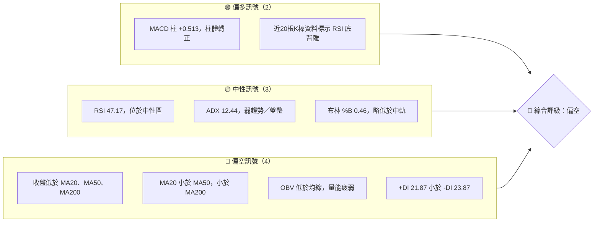
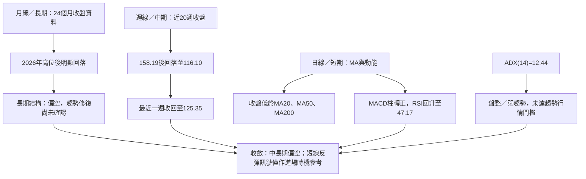
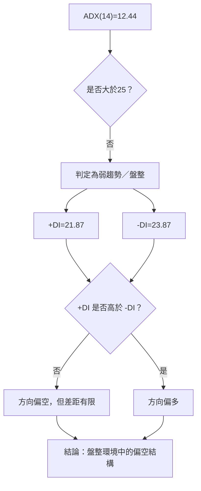
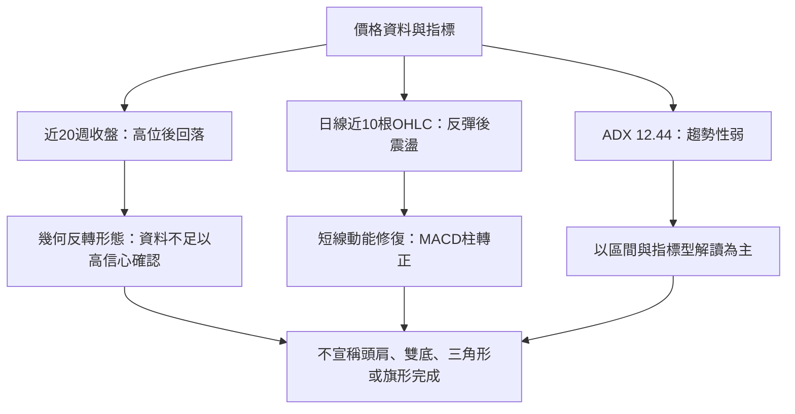
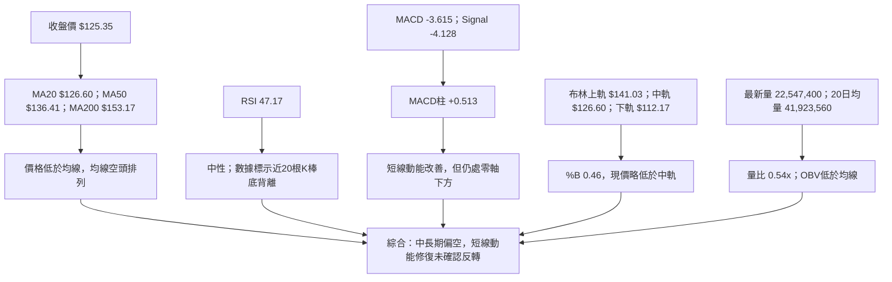
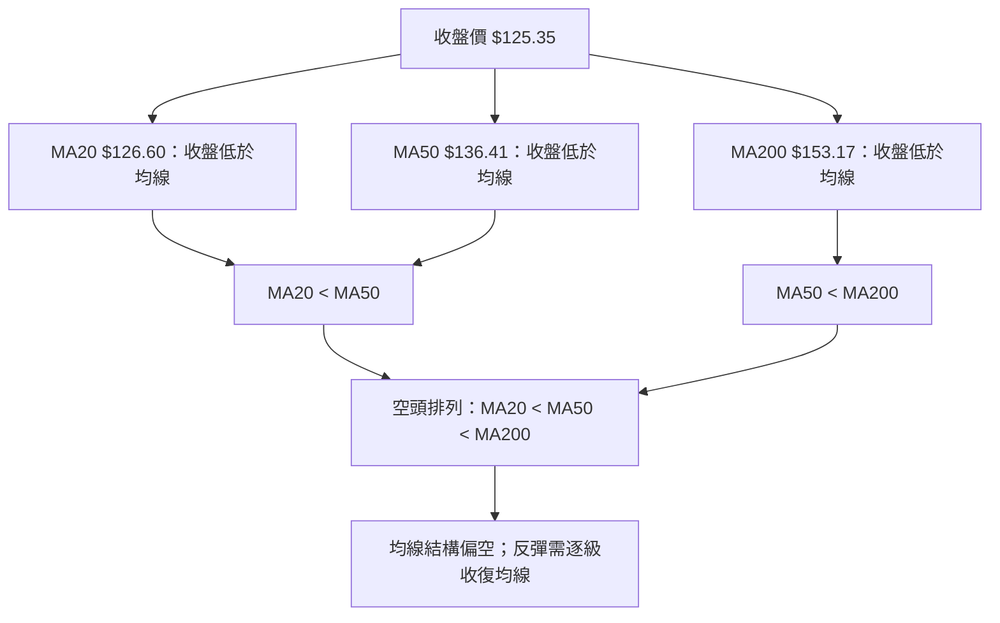
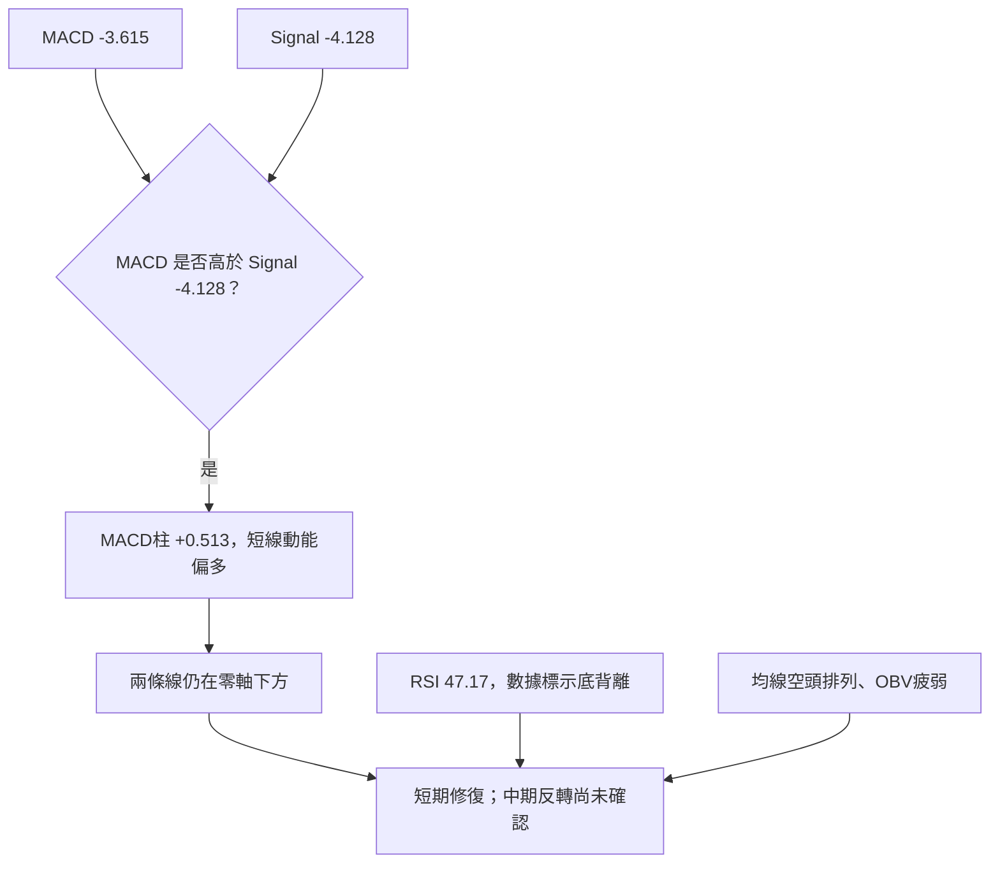
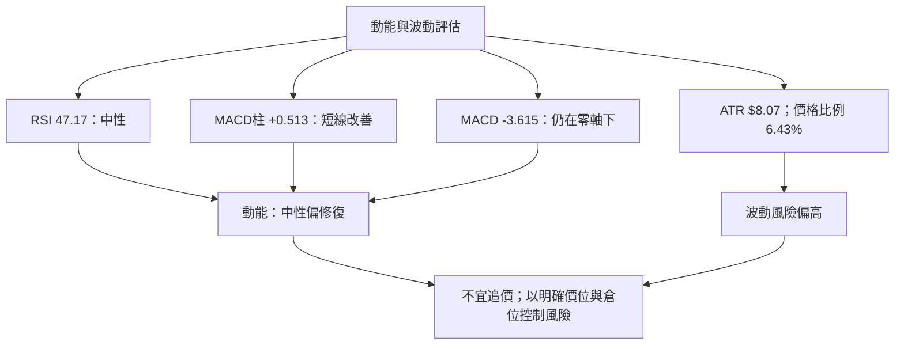
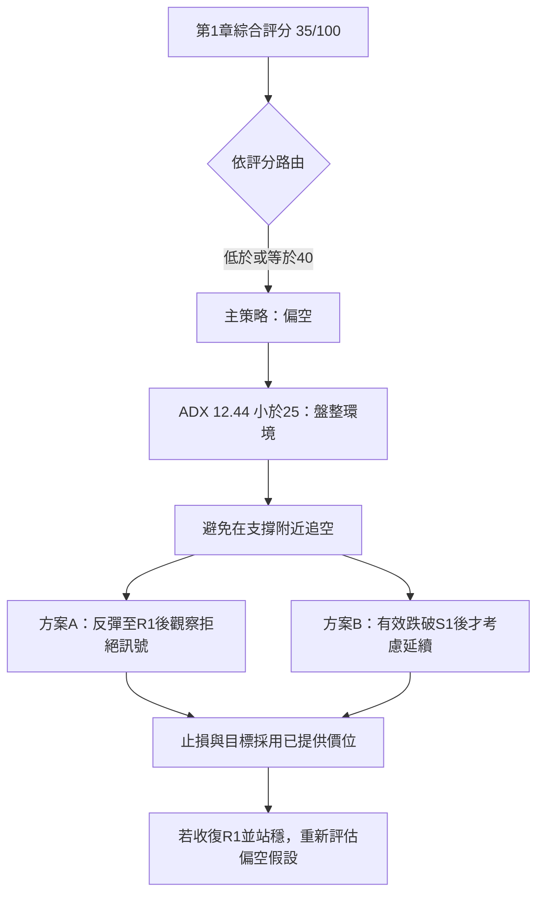
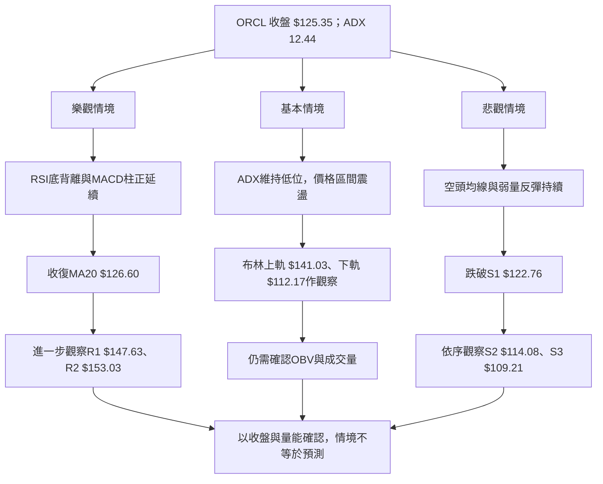

# ORCL 技術分析報告

> **報告日期**：2026-11-14 ｜ **語言**：繁體中文 ｜ **數據來源**：使用者提供之 Yahoo Finance 技術數據 ｜ **當前價格**：**$125.35**

> **分析範圍與限制**：本報告依據截至 2026-11-13 收盤的數據快照。價格位階、技術指標與 K 線判讀僅使用題目提供數據；凡支撐、阻力、斐波那契位階及交易目標，均引用數據包列出的關鍵價位。沒有提供的 ADX 歷史序列、布林帶寬歷史序列等，不自行估算。

---

## 目錄

| 章節 | 內容 |
|------|------|
| 1. 技術面概覽 | 訊號儀表板、核心指標、評分卡 |
| 2. 趨勢分析 | 多時框趨勢、長中短期走勢 |
| 3. 圖表形態分析 | 形態識別、K 線組合、形態目標限制 |
| 4. 支撐與阻力 | 關鍵價位、斐波那契回調 |
| 5. 技術指標深度解讀 | MA、RSI、MACD、布林、成交量 |
| 6. 動能與波動率 | 動能評估、ATR、Beta |
| 7. 多時框架總結 | 時框架評分矩陣與收斂結論 |
| 8. 交易策略建議 | 主策略、情境、風險報酬比 |
| 9. 風險提示與監控 | 監控清單、風險情境、倉位管理 |

---

## 1. 技術面概覽

### 🎯 技術訊號儀表板

ORCL 的短期反彈訊號與中長期趨勢訊號存在分歧：MACD 柱轉正、RSI 自低位回升，顯示賣壓有所緩和；但股價仍低於 MA20、MA50、MA200，均線維持空頭排列，OBV 亦低於其均線。ADX 只有 12.44，代表當前不是強趨勢行情，短線反彈可能受區間震盪干擾。



**儀表板解讀：**偏空訊號主要來自均線排列、價格位於長短期均線下方、OBV 疲弱及 -DI 略高於 +DI。偏多訊號集中在動能改善與數據所標示的 RSI 底背離，尚未獲得均線與成交量充分確認。綜合而言，較合理的解讀是「空頭結構中的反彈／盤整」，而非已確認的中期反轉。

### 📊 核心指標速覽表

| 指標類別 | 指標名稱 | 當前數值 | 訊號 | 解讀 |
|----------|----------|----------:|:---:|------|
| 價格 | 收盤價 | **$125.35** | 🔴 | 低於 MA20、MA50、MA200 |
| 均線 | MA20 | $126.60 | 🔴 | 收盤低於均線 $1.25 |
| 均線 | MA50 | $136.41 | 🔴 | 收盤低於均線 $11.06 |
| 均線 | MA200 | $153.17 | 🔴 | 收盤低於均線 $27.82 |
| 動能 | RSI(14) | 47.17 | 🟡 | 中性，未達超買或超賣 |
| 動能 | MACD | -3.615 | 🟡 | MACD 線仍在零軸下方 |
| 動能 | MACD 柱 | +0.513 | 🟢 | 柱值為正，短期動能有改善 |
| 趨勢 | ADX(14) | 12.44 | 🟡 | 弱趨勢，符合盤整判定 |
| 趨勢 | +DI / -DI | 21.87 / 23.87 | 🔴 | -DI 略高，空頭方向仍佔優 |
| 波動 | ATR(14) | $8.07 | 🔴 | 約為收盤價的 6.43%，日波動偏高 |
| 波動 | 布林 %B | 0.46 | 🟡 | 位於中軌下方、上下軌之間 |
| 成交量 | 最新量／20日均量 | 0.54x | 🔴 | 低於 20 日均量 |
| 量價 | OBV 趨勢 | OBV < MA | 🔴 | 量能未確認價格反彈 |

### 🏆 技術評分卡

評分採 **0–100 分**。六項子評分為：趨勢強度 25、動能指標 50、支撐穩定度 55、成交量配合 30、形態完整度 35、均線排列 15。綜合分數為六項算術平均：  
**(25 + 50 + 55 + 30 + 35 + 15) ÷ 6 = 35.0，四捨五入為 35/100。**

```text
╔══════════════════════════════════════════════════════════════╗
║              技術評分卡 — ORCL（2026-11-14）                 ║
╠══════════════════════════════════════════════════════════════╣
║ 趨勢強度      ▓▓▓▓▓░░░░░░░░░░░░░░░░░░░░░░░░░  25/100 🔴  ║
║ 動能指標      ▓▓▓▓▓▓▓▓▓▓▓▓▓▓▓░░░░░░░░░░░░░░░  50/100 🟡  ║
║ 支撐穩定度    ▓▓▓▓▓▓▓▓▓▓▓▓▓▓▓▓▓░░░░░░░░░░░░░  55/100 🟡  ║
║ 成交量配合    ▓▓▓▓▓▓▓▓▓░░░░░░░░░░░░░░░░░░░░░  30/100 🔴  ║
║ 形態完整度    ▓▓▓▓▓▓▓▓▓▓▓▓░░░░░░░░░░░░░░░░░░  35/100 🔴  ║
║ 均線排列      ▓▓▓▓░░░░░░░░░░░░░░░░░░░░░░░░░░  15/100 🔴  ║
╠══════════════════════════════════════════════════════════════╣
║ 綜合評分      ▓▓▓▓▓▓▓▓▓▓▓▓░░░░░░░░░░░░░░░░░░  35/100 🔴  ║
║ 評級：偏空；屬於弱趨勢／盤整背景下的空頭結構。             ║
╚══════════════════════════════════════════════════════════════╝
```

**評分依據摘要**

- **趨勢強度 25/100**：ADX 12.44 顯示趨勢性弱；方向指標 -DI 高於 +DI，但差距不大。
- **動能指標 50/100**：RSI 中性、MACD 柱轉正，與 MACD 線仍在零軸下方的空頭背景互相牽制。
- **支撐穩定度 55/100**：可引用的 S1、S2、S3 與 52 週低點均已提供，但股價仍接近 S1，支撐尚待市場驗證。
- **成交量配合 30/100**：最新成交量僅為 20 日均量 0.54 倍，且 OBV 低於均線。
- **形態完整度 35/100**：K 線反彈存在，但未形成高信心度的反轉形態；不把短期反彈解讀成已確認趨勢反轉。
- **均線排列 15/100**：MA20 < MA50 < MA200，收盤也低於三條均線。

---

## 2. 趨勢分析

### 🌐 多時框趨勢分析



| 時框 | 方向判定 | 主要依據 | 訊號強度 |
|------|----------|----------|----------|
| 長期（月線／年度視角） | 🔴 偏空 | 2026 年 5 月收盤 $224.17 後，11 月收盤降至 $125.35；收盤低於 MA200 $153.17 | 中高 |
| 中期（週線） | 🔴 偏空、近期反彈 | 週收盤從 2026-09-04 的 $158.19 下滑；11-06 收 $116.10，11-13 回升至 $125.35 | 中 |
| 短期（日線） | 🟡 反彈／盤整 | RSI 47.17，MACD 柱 +0.513，但股價仍低於 MA20，成交量偏弱 | 弱至中 |
| 趨勢環境（ADX） | 🟡 盤整 | ADX 12.44 < 25 | 明確 |

### 📈 長期趨勢 — 12 個月走勢圖

以下依 **2025 年 12 月至 2026 年 11 月** 的月收盤價繪製。圖中使用資料所提供的月收盤數字；圖形為 ASCII 示意，月份與數值表格為準。

```text
ORCL 月線走勢圖（2025-12 至 2026-11 月收盤）
價格（美元）

230 ┤                         ● 224.17
210 ┤
190 ┤ ● 192.34
170 ┤      ● 162.84       ● 160.24
150 ┤           ● 143.86  ● 145.55      ● 145.50         ● 148.57
130 ┤                                      ● 129.39             ● 136.79 ● 130.67 ● 125.35
    └──────────────────────────────────────────────────────────────────────────────
      12月     1月      2月      3月      4月      5月      6月      7月      8月      9月     10月     11月

月收盤：
      192.34  162.84  143.86  145.55  160.24  224.17  145.50  129.39  148.57  136.79  130.67  125.35
```

| 月份 | 收盤價 | 月對月變動 | 解讀 |
|------|-------:|-----------:|------|
| 2025-12 | $192.34 | N/A（前月不在本圖區間） | 作為 12 個月觀察期起點 |
| 2026-01 | $162.84 | -15.34% | 月收盤顯著回落 |
| 2026-02 | $143.86 | -11.66% | 跌勢延續 |
| 2026-03 | $145.55 | +1.17% | 小幅回升，尚未扭轉前期下行 |
| 2026-04 | $160.24 | +10.09% | 月收盤反彈 |
| 2026-05 | $224.17 | +39.90% | 本區間最高月收盤，之後未能維持 |
| 2026-06 | $145.50 | -35.09% | 月收盤大幅回落，顯示波動擴大 |
| 2026-07 | $129.39 | -11.08% | 再跌至本區間最低月收盤 |
| 2026-08 | $148.57 | +14.85% | 反彈，但仍低於 5 月月收盤 |
| 2026-09 | $136.79 | -7.94% | 反彈後再度下滑 |
| 2026-10 | $130.67 | -4.47% | 延續回落 |
| 2026-11 | $125.35 | -4.07% | 月度收盤資料截至 11 月 13 日 |

> 月對月變動以相鄰月收盤價計算；11 月為截至 11 月 13 日的收盤數據，不代表完整月線收盤。

**長期走勢特徵**

1. **大方向轉弱**：2026 年 5 月月收盤 $224.17 之後，6 月至 11 月月收盤均低於 5 月。
2. **高波動下跌**：6 月月收盤跌幅為 -35.09%，之後出現 7 月低收及 8 月反彈，再回到下行。
3. **反彈未能確認反轉**：8 月月收盤回升至 $148.57，但 9 月、10 月、11 月連續回落。
4. **不能把月收盤低點等同實際波段低點**：月線資料提供收盤價，不含每月完整 OHLC；實際 52 週低點應引用已提供的 $109.21。

### 📊 中期趨勢（週線分析）

近 20 週資料顯示，2026 年 9 月 4 日週收盤達 $158.19，之後震盪下滑至 11 月 6 日的 $116.10，11 月 13 日反彈收於 $125.35。週 MACD 柱在 11 月 6 日為 -1.268，11 月 13 日轉為 +0.513；但週收盤仍低於週期內較早的 $158.19，且反彈是否延續尚未確認。

```text
ORCL 週線支撐／阻力示意（價位均取自已提供關鍵價位或資料值）

$158.67 ─────────────────────────────────── R3
$153.03 ─────────────────────────────── R2／週線高點聚類
$147.63 ─────────────────────────── R1
$141.03 ─────────────── 布林上軌（非結構性阻力）
$136.41 ─────────── MA50
$126.60 ─────── MA20／布林中軌
$125.35 ────── 現價（2026-11-13 收盤）
$122.76 ───── S1
$114.08 ── S2
$112.17 ─ 布林下軌（非結構性支撐）
$109.21 ─ S3／52週低點
```

**週線重點**

- **短線改善**：最新週收盤較前一週 $116.10 上升至 $125.35，週 MACD 柱同步轉正。
- **中期結構仍受壓**：近 8 根週 K 中，2026-11-13 的週高 $130.77 尚未觸及 R1 $147.63；股價仍低於 MA50、MA200。
- **成交量未明確支持反轉**：11 月 6 日週成交量 359,351,800，明顯高於其後一週的 135,057,000；反彈週量較低，可能反映回補或技術性修復，未足以證明持續性買盤。
- **盤整背景優先**：ADX 12.44 < 25，依規則應把日線布林區間作為近端交易參考，但中長期方向仍偏空。

### ⚡ 趨勢強度評估（ADX 解讀）



| ADX 區間 | 常見解讀 | ORCL 當前狀態 |
|----------|----------|---------------|
| ADX < 20 | 趨勢弱、容易震盪 | **12.44，符合** |
| ADX 20–25 | 趨勢可能形成，仍需確認 | 不適用 |
| ADX > 25 | 趨勢強度較明確 | 不適用 |
| +DI > -DI | 多方方向較強 | 不符合；+DI 21.87 < -DI 23.87 |
| -DI > +DI | 空方方向較強 | 符合，但差距小 |

**ADX 結論：**方向偏空，但趨勢力度不強。這代表價格容易出現雙向波動，不宜只因空頭排列就假設單邊下跌；操作上仍需等待關鍵價位被有效突破或跌破。

---

## 3. 圖表形態分析

### 🔍 形態識別系統

現有資料包含 24 個月月收盤序列、近 20 週收盤序列，以及近 10 根日 K、近 8 根週 K OHLC。這些資訊可辨識主要方向和短線指標變化，但不足以高信心確認頭肩、三角形、旗形等幾何形態。故本節只列出有數據支持的形態型解讀；未達 50% 信心度者不作確定性形態宣稱。



| 形態／訊號 | 信心度 | 判斷依據（引用資料） | 完成度 | 目標價 |
|------------|-------:|----------------------|--------|--------|
| 頭肩頂／頭肩底 | <50%；不確認 | 缺乏可驗證的頸線與清晰三峰／三谷 OHLC 結構 | N/A | N/A（數據未提供） |
| 雙底 | <50%；不確認 | 近 8 根週 K 低點包含 $122.76、$109.21 等不同價位；尚無明確的等低點與頸線突破確認 | N/A | N/A（數據未提供） |
| 三角形／旗形 | <50%；不確認 | 缺少足以確認收斂趨勢線或旗桿—旗面結構的完整價格序列 | N/A | N/A（數據未提供） |
| 空頭均線排列 | 85% | MA20 $126.60 < MA50 $136.41 < MA200 $153.17；收盤 $125.35 低於三者 | 已形成 | 不屬於幾何形態目標 |
| MACD 柱短線修復 | 75% | MACD 柱 +0.513，前一週為 -1.268；但 MACD 線仍為負值 | 指標改善中，未確認中期反轉 | 不適用 |
| 布林區間位置 | 80% | %B 0.46，價格位於布林中軌 $126.60 下方及下軌 $112.17 上方 | 區間位置可識別 | 不作幾何形態目標 |

> 信心度為技術判讀強度，不是統計勝率。未達 50% 的幾何形態，依要求只註明資料不足，不強行設定形態目標。

### 🕯️ 重要 K 線形態分析

以下 K 線解讀**只使用題目提供的近 10 根日 K、近 8 根週 K OHLC**。表中信號是單根或相鄰 K 棒的外觀解讀，不等同整體趨勢反轉確認。

#### 近 10 根日 K

| 日期 | 開 | 高 | 低 | 收 | K 線形態判讀 | 解讀 | 訊號 |
|------|----:|----:|----:|----:|-------------|------|:---:|
| 2026-11-02 | 125.88 | 126.50 | 118.43 | 119.22 | 長陰實體 | 收盤低於開盤，跌勢明顯；上下影線相對實體較短 | 🔴 |
| 2026-11-03 | 122.00 | 128.14 | 121.35 | 126.19 | 陽線 | 收高於開盤，日內曾回落但收盤回升 | 🟢 |
| 2026-11-04 | 121.78 | 129.85 | 121.78 | 123.73 | 上影較長陽線 | 高位遇賣壓，收盤仍高於開盤但未收近高點 | 🟡 |
| 2026-11-05 | 123.00 | 124.24 | 111.66 | 115.16 | 長陰線 | 大幅下探且收低於開盤，偏空 | 🔴 |
| 2026-11-06 | 119.54 | 119.70 | 109.21 | 116.10 | 長下影陰線，具錘頭外觀但未確認 | 下影線顯示低位有承接；實體仍為陰線，不能單獨視為反轉 | 🟡 |
| 2026-11-09 | 117.03 | 120.26 | 114.91 | 119.79 | 陽線、下影線較明顯 | 收盤高於開盤，低位有承接 | 🟢 |
| 2026-11-10 | 117.91 | 120.23 | 115.50 | 117.98 | 小實體／近十字外觀 | 開收差距小，上下影相對較長，顯示短線猶豫 | 🟡 |
| 2026-11-11 | 124.28 | 130.77 | 124.15 | 128.38 | 陽線 | 收盤高於開盤，且收近高位區域 | 🟢 |
| 2026-11-12 | 123.33 | 129.06 | 123.05 | 127.11 | 陰線 | 收盤低於開盤，與前一日方向相反；不構成吞噬確認 | 🔴 |
| 2026-11-13 | 127.50 | 128.00 | 121.76 | 125.35 | 陰線、下影較長 | 收低於開盤，但低位有一定回收；仍未收復 MA20 | 🟡 |

**日 K 解讀重點**

- 11 月 5 日的長陰線與 11 月 6 日的長下影線，顯示先有明顯賣壓、隨後低位出現承接；但 11 月 6 日仍以陰線收盤，不能只憑下影線定義為反轉。
- 11 月 9 日至 11 月 11 日出現反彈，11 月 12 日及 13 日收陰，表示反彈仍有供給壓力。
- 近 10 根日 K 沒有足夠資料確認具高信心的雙底、吞噬反轉或連續反轉組合。

#### 近 8 根週 K

| 日期（週末交易日） | 開 | 高 | 低 | 收 | K 線形態判讀 | 解讀 | 訊號 |
|------|----:|----:|----:|----:|-------------|------|:---:|
| 2026-09-25 | 148.38 | 153.03 | 132.99 | 136.59 | 長陰線 | 高低區間寬、收盤低於開盤，週線賣壓明顯 | 🔴 |
| 2026-10-02 | 132.24 | 144.33 | 131.10 | 141.78 | 陽線 | 收盤高於開盤，出現週線反彈 | 🟢 |
| 2026-10-09 | 142.00 | 146.40 | 134.16 | 141.40 | 小陰線 | 開收價接近，週內波動較大但收盤略低 | 🟡 |
| 2026-10-16 | 141.56 | 144.18 | 127.36 | 128.23 | 長陰線 | 收盤明顯低於開盤，空方控制較強 | 🔴 |
| 2026-10-23 | 130.66 | 134.35 | 122.76 | 126.16 | 陰線 | 延續弱勢，收盤低於開盤 | 🔴 |
| 2026-10-30 | 126.06 | 148.48 | 123.75 | 130.67 | 長上下影陽線 | 週內波動大，收盤高於開盤；多空拉鋸 | 🟡 |
| 2026-11-06 | 125.88 | 129.85 | 109.21 | 116.10 | 長陰線、下影線明顯 | 大幅下探後收回部分跌幅，仍以陰線收盤 | 🔴 |
| 2026-11-13 | 117.03 | 130.77 | 114.91 | 125.35 | 陽線、收高於開盤 | 週線反彈成立，但尚未突破 R1 $147.63 | 🟡 |

### 📉 ASCII 走勢形態示意圖

```text
週收盤示意（近20週資料；以實際週收盤序列為準）

$158.19 ┤                         ● 2026-09-04
$150.29 ┤             ● 2026-08-28
$149.73 ┤                  ● 2026-09-11
$147.07 ┤                      ● 2026-09-18
$141.78 ┤                                      ● 2026-10-02
$136.59 ┤                          ● 2026-09-25
$130.67 ┤                                                  ● 2026-10-30
$126.16 ┤                                                      ● 2026-10-23
$125.35 ┤                                                              ● 2026-11-13
$116.10 ┤                                                          ● 2026-11-06
$114.57 ┤ ● 2026-07-24
         └──────────────────────────────────────────────────────────────────
           7月             8月                 9月             10月        11月

價位參考：
R3 $158.67 ─────────────────────────────────────────
R2 $153.03 ─────────────────────────────────────────
R1 $147.63 ─────────────────────────────────────────
現價 $125.35 ───────────────────────────────────────
S1 $122.76 ─────────────────────────────────────────
S2 $114.08 ─────────────────────────────────────────
S3 $109.21 ─────────────────────────────────────────
```

**形態判斷：**這組週收盤資料可以支持「9 月高位後回落，11 月出現反彈」的描述，但不能僅憑收盤序列宣稱已完成雙底或反轉形態。頭肩、三角形、旗形均為**訊號不足，僅做指標型解讀**。

### 🎯 形態目標價計算

- **幾何形態目標價**：N/A（數據未提供）。原因是尚未確認具有可量度的頭肩、雙底、三角形或旗形結構，也沒有可靠頸線與形態高度。
- **可引用的技術觀察價位**：R1 $147.63、R2 $153.03、R3 $158.67；S1 $122.76、S2 $114.08、S3 $109.21。這些是數據包提供的波段高低點聚類，並非本報告另行計算的形態目標。
- **不可混淆事項**：關鍵價位不是保證價格必然反應的支撐或阻力；跌破、突破需配合收盤與成交量確認。

---

## 4. 支撐與阻力

### 🗺️ 關鍵價位分布圖

以下阻力、支撐使用題目「關鍵價位（由 OHLCV 計算）」區塊列出的價位。布林軌與均線另行標示，不與結構性支撐阻力混為一談。

```text
ORCL 價位結構分布圖（美元）
══════════════════════════════════════════════════════════════
$158.67 ║████████████████████████████║ R3：高點聚類阻力
$153.03 ║████████████████████████    ║ R2：高點／週K高點區
$147.63 ║████████████████████████    ║ R1：近一年高點聚類
$141.03 ║··························║ 布林上軌（技術指標）
$136.41 ║··························║ MA50
$126.60 ║··························║ MA20／布林中軌
$125.35 ╠════════════════════════════╣ ◄ 現價
$122.76 ║▓▓▓▓▓▓▓▓▓▓▓▓▓▓▓▓▓▓▓▓      ║ S1：波段低點聚類
$114.08 ║████████████████████        ║ S2：波段低點聚類
$112.17 ║··························║ 布林下軌（技術指標）
$109.21 ║████████████████████████    ║ S3：支撐聚類／52週低點
══════════════════════════════════════════════════════════════
```

### 🚧 阻力位分析表

| 阻力級別 | 價位 | 形成原因 | 突破難度 | 重要性 |
|----------|-----:|----------|----------|--------|
| R1 | **$147.63** | 近一年波段高點聚類；價格由現價上行至此需克服下方均線壓力 | 中高 | 高 |
| R2 | **$153.03** | 波段高點聚類；亦為近 8 根週 K 中 2026-09-25 的週高 | 高 | 高 |
| R3 | **$158.67** | 近一年波段高點聚類；接近近 20 週收盤高位 $158.19，但兩者性質不同 | 高 | 高 |

**阻力解讀**

- 現價 $125.35 低於 MA20 $126.60，短線首先需收復 MA20；但 MA20 是均線，不是題目「波段高點聚類」阻力位。
- R1 $147.63 與 MA50 $136.41、布林上軌 $141.03 位於不同分析分類，不能把它們視為同一價位。
- 即使突破 R1，仍須觀察 R2、R3 區域是否出現賣壓；目前成交量與 OBV 尚未顯示有力的量能確認。

### 🛡️ 支撐位分析表

| 支撐級別 | 價位 | 形成原因 | 守住機率評估 | 重要性 |
|----------|-----:|----------|--------------|--------|
| S1 | **$122.76** | 近一年波段低點聚類；高於現價約 2.07% | 中；附近且需收盤確認 | 高 |
| S2 | **$114.08** | 近一年波段低點聚類；接近布林下軌 $112.17，但兩者並非同一數值 | 中低 | 高 |
| S3 | **$109.21** | 波段低點聚類，亦為 52 週低點 | 重要但不代表必然守住 | 高 |

> 守住機率為定性技術評估，不是經統計模型計算的概率。實際確認應看收盤與成交量變化。

### 📐 斐波那契回調位分析

數據包給定 52 週區間 **$109.21 → $248.46** 與斐波那契回調位如下：

| 回調比例 | 價位 |
|----------|-----:|
| 23.6% | $215.60 |
| 38.2% | $195.27 |
| 50.0% | $178.84 |
| 61.8% | $162.40 |
| 78.6% | $139.01 |

**現價位置：**$125.35 低於 78.6% 回調位 $139.01，並高於 52 週低點／100% 位 $109.21。換言之，現價位於 **78.6% 回調位與 100% 位之間**，表示價格已回撤至 52 週高低區間的下端。

**解讀與限制**

- 78.6% 位 $139.01 是斐波那契參考，不是本報告另行認定的結構性阻力。
- 若股價反彈，$139.01 是數據提供的下一個斐波那契觀察位；但交易策略仍以已列出的關鍵價位 R1–R3、S1–S3 為主。
- 若跌破 S3 $109.21，題目資料沒有提供更低的波段支撐或斐波那契延伸位，應標示為 **數據中未偵測到**，不可自行推算替代價位。

---

## 5. 技術指標深度解讀

### 🎛️ 指標訊號總覽



### 📈 移動平均線排列分析



| 均線 | 數值 | 收盤價相對位置 | 方向資料 | 技術判讀 |
|------|-----:|----------------|----------|----------|
| MA20 | $126.60 | 收盤低於 $1.25 | 均線走勢標示下行 | 短線壓力，反彈尚未完全收復 |
| MA50 | $136.41 | 收盤低於 $11.06 | MA60 下行；MA50 數值低於 MA200 | 中期壓力 |
| MA200 | $153.17 | 收盤低於 $27.82 | 長期均線上方壓力 | 長期趨勢尚未轉強 |
| MA5 | $123.72 | 收盤高於 $1.63 | 短均線上行 | 短線反彈訊號，不足以扭轉中長期排列 |
| MA10 | $121.90 | 收盤高於 $3.45 | 短均線上行 | 顯示短線反彈修復 |

**整合判讀：**MA5、MA10 上行與 MA20、MA60、MA120、MA240 下行並存，反映短期反彈與中長期下行背景分歧。由於收盤仍低於 MA20、MA50、MA200，不宜僅憑 MA5、MA10 上行判定趨勢反轉。

### 📉 RSI(14) 分析

**RSI 強度進度條**

```text
RSI(14) 47.17
超賣 0 ├───────────────●─────────────────┤ 100 超買
         30            47.17              70

多頭動能：▓▓▓▓▓▓▓▓▓░░░░░░░░░░░ 47.17/100（指標讀數）
```

- **位置**：RSI 47.17，落在 30–70 中性區；既非超賣，也非超買。
- **方向訊息**：數據包明確標示 RSI 底背離，判定方式為「僅比較近 20 根 K 棒首尾的價格與 RSI 方向」。因此，這是資料提供的底背離標記，但未提供形成該背離的逐根 RSI 與價格配對序列，不能獨立驗證其幾何細節。
- **背離結論**：**底背離：數據包標示存在；信號尚未獲均線排列與 OBV 確認。頂背離：數據未標示，且缺少逐根 RSI 配對資料，不能判定為存在。**
- **交易含意**：底背離可提高反彈警覺，但 RSI 未進入強勢區，不能取代價格突破與量能確認。

### 📊 MACD(12/26/9) 訊號解讀

| MACD 欄位 | 數值 | 狀態 | 解讀 |
|-----------|-----:|------|------|
| MACD | -3.615 | 負值 | 位於零軸下方，整體趨勢背景仍偏弱 |
| Signal | -4.128 | 負值 | 同樣位於零軸下方 |
| Histogram | +0.513 | 正值 | MACD 高於訊號線，短期動能有改善 |



**MACD 背離判斷：**題目沒有提供 MACD 與價格在每一個波段高低點的對照，也沒有標示 MACD 背離。因此：

- **MACD 頂背離：數據未提供，不能確認。**
- **MACD 底背離：數據未提供，不能確認。**
- **可確認訊號：MACD 柱為正，但 MACD 與 Signal 均為負值。**

### 📦 布林通道分析

```text
ORCL 布林通道位置示意（美元）

$141.03 ─────────────────────── 布林上軌
                 │
                 │    現價距上軌仍有距離
$126.60 ─────────┼───────────── 布林中軌（MA20）
                 │
$125.35 ─────────●───────────── 現價；略低於中軌
                 │
$112.17 ─────────────────────── 布林下軌

%B = 0.46：位於通道中段略偏下
```

- **現價位置**：$125.35 略低於布林中軌 $126.60，且高於下軌 $112.17。
- **%B 0.46**：接近通道中部，略偏下；不是下軌極端超賣位置，也不是上軌強勢位置。
- **盤整交易原則**：ADX 12.44 < 25，布林通道上下軌可作為主要區間觀察工具；但策略目標價仍按要求使用數據提供的結構性關鍵價位。
- **布林帶寬**：N/A（數據未提供），因此不臆測通道正在收斂或擴張。

### 💹 成交量分析（量價配合度）

| 量能資料 | 數值 | 判讀 |
|----------|------:|------|
| 最新日成交量 | 22,547,400 | 低於 20 日均量 |
| 20 日均量 | 41,923,560 | 最新成交量約 0.54 倍 |
| 50 日均量 | 37,075,938 | 最新成交量亦低於 50 日均量 |
| 最新週成交量 | 135,057,000 | 低於前一週 359,351,800 |
| OBV 趨勢 | OBV < MA | 資料標示量能疲弱 |

**量價配合判讀**

1. **反彈有價格、量能確認不足**：最新週線收盤由 $116.10 回升至 $125.35，但週成交量由 359,351,800 降至 135,057,000。
2. **當日成交量偏低**：最新日成交量 22,547,400，僅為 20 日均量 0.54 倍；單日價格變動的市場參與度未見明顯放大。
3. **OBV 未確認**：OBV 低於其均線，量能未配合價格反彈形成確認。
4. **結論**：量價訊號偏空或偏弱。若日後價格上行而 OBV 仍偏弱，需留意反彈缺乏累積買盤的風險。

---

## 6. 動能與波動率

### ⚡ 動能評估四象限

| 象限 | 動能 | 波動 | 當前狀態 | 評估 |
|------|------|------|----------|------|
| Q1 | 強 | 低 | — | 趨勢較平穩，具延續性 |
| Q2 | 弱 | 低 | — | 低波動整理，等待方向 |
| Q3 | 強 | 高 | — | 高風險高收益，需嚴格控制倉位 |
| Q4 | 弱／混合 | 高 | **部分符合** | ATR 高、長期均線偏空，但 MACD 柱短線改善；不宜追價 |

**目前定位：**動能訊號混合，波動率偏高。ATR 為 $8.07、約佔價格 6.43%；RSI 47.17 中性，MACD 柱為正但 MACD 線仍在零軸下方。由於缺乏歷史 ATR 分位數，不能嚴格比較「目前波動率位於歷史第幾百分位」。



### 📊 ATR 波動率分析

- **ATR(14)：$8.07**，按數據包標示約為收盤價的 **6.43%**。
- ATR 是平均真實波幅指標，用來衡量近期平均波動幅度，**不是方向指標，也不是支撐或阻力位**。
- 以 $125.35 收盤價為基準，單日常態波動參考相對較大；若把倉位設得過重，正常波動也可能造成過高的帳面損失。
- 本報告不把 ATR 倍數換算成新的精確止損價格，以免違反「支撐、阻力、目標價只能引用指定數值或清楚列出形態公式」的要求。
- 交易執行上，ATR 可用於**調整持倉規模**：波動越大，維持相同資金風險時，倉位應越小；止損價仍以策略表中列出的有效價位為準。

### 📐 Beta 與市場相關性

- **Beta：1.778**。依通常定義，Beta 高於 1 表示過去觀察期間，ORCL 的市場敏感度高於基準市場；但數據包沒有提供 Beta 的計算期間、參考指數或逐期報酬序列。
- Beta **不等於相關係數**，不能據此宣稱 ORCL 與大盤的相關性為 1.778，也不能精確推導大盤每變動 1% 時 ORCL 必然變動多少。
- 高 Beta 通常意味著市場波動或科技板塊風險可能放大個股波動；當 ATR 已達 $8.07，應避免以單一止損距離推導過大倉位。
- **Beta 歷史穩定度與實際相關係數：N/A（數據未提供）。**

### 動能／波動進度條

```text
RSI 中性讀數          █████████░░░░░░░░░░░  47.17 / 100
MACD柱短期改善        ▓▓▓▓▓▓▓▓▓▓░░░░░░░░░░  正值 +0.513
均線結構強度          ▓▓▓▓░░░░░░░░░░░░░░░░  偏空排列
成交量確認度          ▓▓▓▓▓░░░░░░░░░░░░░░░  量比 0.54x
波動風險提示          █████████████░░░░░░░  ATR 約為價格 6.43%
```

---

## 7. 多時框架總結

### 📋 時框架評分表

本表評分為時框架綜合判讀，與第 1 章六項評分卡的 **35/100** 並非同一項目；第 7 章引用第 1 章綜合評分時維持一致。

| 時框架 | 趨勢方向 | 動能 | 均線排列 | 形態 | 綜合評分 | 建議 |
|--------|----------|------|----------|------|---------:|------|
| 長期（月線／年度視角） | 🔴 偏空 | 偏弱 | 股價低於 MA200 | 長期回落，幾何反轉未確認 | 30/100 | 控制方向性風險，不視為長期底部確認 |
| 中期（週線） | 🔴 偏空、短線反彈 | 🟡 MACD 柱轉正 | 週線未提供完整均線序列；日線 MA50、MA200 均在上方 | 高位回落後反彈，無高信心反轉形態 | 38/100 | 等待反彈至阻力或跌破支撐確認 |
| 短期（日線） | 🟡 盤整偏弱 | 🟡 RSI 中性、MACD 柱正 | MA20、MA50、MA200 空頭排列 | 下影線與反彈訊號仍需確認 | 45/100 | 以日線區間與明確關鍵價位交易 |
| 整體評分卡 | 🔴 偏空 | 混合 | 空頭排列 | 形態完整度低 | **35/100** | 偏空策略；避免在支撐附近追空 |

### 🔲 綜合訊號矩陣

| 維度 | 短期（日線） | 中期（週線） | 長期（均線／月線） | 一致性 |
|------|--------------|--------------|--------------------|--------|
| 價格方向 | 反彈後震盪 | 低位反彈 | 大幅低於年內較高月收盤 | 不一致 |
| 均線 | 收盤低於 MA20 | 週線完整均線 N/A（數據未提供） | 收盤低於 MA200，均線空頭排列 | 偏空一致 |
| 動能 | MACD 柱正、RSI 中性 | 最新週 MACD 柱正 | 長期均線結構仍偏空 | 短期改善、長期偏空 |
| 量能 | 最新日量 0.54x 20 日均量 | 最新週量低於前一週 | OBV 低於 MA | 偏空／未確認 |
| 波動趨勢 | ATR 6.43% | 高波動反覆 | 低位區間仍可能擴大波動 | 風險偏高 |
| ADX 環境 | 12.44 | 日線指標為弱趨勢 | 趨勢追蹤訊號不足 | 盤整判定 |

### ⚖️ 多時框收斂結論

1. **行情分類**：ADX(14) = 12.44，低於 25，判定為弱趨勢／盤整行情。
2. **主導方式**：盤整條件下，依規則以日線布林通道作為近端交易區間參考；同時保留中長期方向判斷，因價格低於 MA20、MA50、MA200，且均線呈空頭排列。
3. **訊號衝突處理**：日線 RSI 底背離標記、MACD 柱轉正，代表短線反彈機會；但週線大方向與均線結構仍偏空，OBV 亦未確認。因此，反彈訊號只作為空頭策略的進場時機管理，不作為主趨勢反轉證據。
4. **唯一方向性結論：偏空。**不是預期必然單邊下跌，而是以偏空風險管理為主，等待反彈至阻力或有效跌破支撐後再執行。

---

## 8. 交易策略建議

### 🗺️ 策略決策流程圖



### 🧭 策略路由

**當前主策略方向 = 偏空（依評分 35/100）。**

由於 ADX 12.44 顯示盤整，兩個策略均是**條件式空頭策略**，不是在現價無條件做空：

- 策略 A：等待反彈至 R1 $147.63，並觀察是否出現受阻後的空方訊號。
- 策略 B：等待有效跌破 S1 $122.76，再考慮順勢延續。
- 若價格沒有觸發條件，維持觀望；不因評分偏空而在支撐附近追空。
- 下列 R/R 以表內進場、止損、目標計算；沒有把費用、滑價、隔夜跳空風險計入。

### 🎯 價格情境階梯

| 觸發條件 | 下一目標 | 後續延伸 | 情境含義 |
|----------|----------|----------|----------|
| 突破 R1 **$147.63** | R2 **$153.03** | R3 **$158.67** | 若有效站穩並有量能確認，偏空假設需重新檢視 |
| 現價在布林通道上下軌之間震盪 | — | — | ADX 12.44 支持盤整判斷；以等待突破為宜 |
| 跌破 S1 **$122.76** | S2 **$114.08** | S3 **$109.21** | 下方支撐依序成為觀察點；需留意跌破後的成交量 |
| 收復布林中軌 **$126.60** | — | — | 只代表重新回到均線／通道中軌，不等同突破 R1 |
| 觸及布林下軌 **$112.17** | — | S3 **$109.21** 為已提供的結構性觀察價位 | 技術上靠近區間下緣，避免未確認便加碼追空 |

> 布林軌道與均線屬指標觀察位，不取代題目列出的結構性支撐阻力價位。

### 📊 情境機率分佈

以下為依目前指標狀態給出的**主觀技術情境權重**，不是統計模型勝率，三者合計 100%。

| 情境 | 機率 | 主要依據 |
|------|-----:|----------|
| 繼續上行／反彈 | 25% | RSI 底背離為數據標示訊號，MACD 柱 +0.513；但價格仍低於三條主要均線，OBV 未確認 |
| 區間震盪 | 40% | ADX 12.44 < 25，布林 %B 0.46，現價位於布林上下軌之間 |
| 回落／再探底 | 35% | 空頭均線排列、-DI 略高於 +DI、OBV < MA；但 S1 尚需有效跌破才可確認延續 |

### 🔴 主策略詳情（依評分卡偏空路由）

**風險報酬比計算方法：**

- 做空風險報酬比 = **(進場價 − 目標價) ÷ (止損價 − 進場價)**。
- 表格格式按照要求呈現為 **1 : X.XX（以 T1 計）**；另列 T2 比值。
- 策略 A：風險 = $153.03 − $147.63 = $5.40；T1 潛在報酬 = $147.63 − $122.76 = $24.87；R/R = 24.87 ÷ 5.40 = **1 : 4.61**。
- 策略 B：風險 = $125.35 − $122.76 = $2.59；T1 潛在報酬 = $122.76 − $114.08 = $8.68；R/R = 8.68 ÷ 2.59 = **1 : 3.35**。

| 策略要素 | 策略 A：反彈受阻做空 | 策略 B：支撐跌破做空 |
|----------|---------------------|---------------------|
| 進場條件 | 價格上行至 R1 $147.63，出現受阻／轉弱確認後才考慮 | 日線收盤有效跌破 S1 $122.76 後，觀察是否延續 |
| 進場價格 | **$147.63**（條件觸發價；並非現價） | **$122.76**（條件觸發價；並非現價） |
| 止損價格 | **$153.03**（引用 R2） | **$125.35**（引用當前收盤價作失效參考） |
| 目標價 T1 | **$122.76**（S1） | **$114.08**（S2） |
| 目標價 T2 | **$114.08**（S2） | **$109.21**（S3／52 週低點） |
| 風險報酬比 | **1 : 4.61（以 T1 計）**；1 : 6.21（以 T2 計） | **1 : 3.35（以 T1 計）**；1 : 5.23（以 T2 計） |
| 成功機率 | 40%（主觀估計；盤整及反彈風險顯著） | 35%（主觀估計；需先確認有效跌破） |
| 建議倉位 | 帳戶資產的 0.5%–1.0% 風險額度內配置；只在觸發後執行 | 帳戶資產的 0.25%–0.75% 風險額度內配置；波動較高宜小倉 |
| 風險提示 | R1 到 R2 的價格空間有限，須確認受阻，不可預先假設會回落 | 假跌破風險較高；若迅速收復 S1，應重新評估 |

> **風險報酬比格式說明：**以上採用題目指定的「1 : X.XX」形式，X.XX 為目標潛在收益除以初始風險。成功機率是技術判斷估值，不是歷史回測或保證勝率。策略 B 的止損使用現價 $125.35 作風險失效參考，若實際進場後有跳空或滑價，實際風險可能高於表列。

### 🔴 反向風險觸發點（對沖提示）

以下訊號會削弱空頭主策略，不代表自動轉為多頭：

1. **有效突破 R1 $147.63**：空頭進場假設受損；若同時成交量擴大、OBV 改善，應重新檢視偏空判斷。
2. **進一步突破 R2 $153.03**：會提高空頭策略失效風險；策略 A 止損設於該價位。
3. **收盤站回 MA20 $126.60**：短線弱勢有所改善，但單獨收復 MA20 尚不足以推翻 MA50、MA200 的空頭結構。
4. **MACD 柱再度轉負且 RSI 下行**：短線反彈動能轉弱，偏空訊號增強；仍需配合 S1 是否失守。
5. **跌破 S1 $122.76 後成交量放大**：可提高策略 B 延續的確認度；若量能不增，須提防假跌破。

### ⭐ 整體訊號強度評星

```text
做多訊號強度：★★☆☆☆  (2/5星)
做空訊號強度：★★★☆☆  (3/5星)
整體可信度：  ★★★☆☆  (3/5星)
```

- **做多 2/5**：RSI 底背離標記、MACD 柱轉正是支持訊號；但均線、OBV 和週線較大結構未確認。
- **做空 3/5**：均線排列、DI、OBV 偏空；但 ADX 低、股價接近支撐，不能視為高確信趨勢追空。
- **整體可信度 3/5**：方向偏空，但盤整、短線反彈與較高 ATR 使入場時點不確定。

---

## 9. 風險提示與監控

### ✅ 關鍵監控指標 Checklist

```text
╔══════════════════════════════════════════════════════════════╗
║                 ORCL 技術面監控清單                          ║
╠══════════════════════════════════════════════════════════════╣
║ □ 收盤是否守住 S1 $122.76？                                  ║
║ □ 若跌破 S1，成交量是否高於近期均量並確認延續？              ║
║ □ 價格是否向 S2 $114.08、S3 $109.21 延伸？                   ║
║ □ 是否收復 MA20 $126.60？                                    ║
║ □ 反彈是否能逐步挑戰 R1 $147.63？                            ║
║ □ 是否突破 R2 $153.03 或 R3 $158.67？                        ║
║ □ ADX 是否由 12.44 升至 25 以上？（趨勢強度轉變）            ║
║ □ +DI 是否持續高於 -DI？目前 +DI 21.87 < -DI 23.87           ║
║ □ MACD 柱是否維持正值？目前 +0.513                           ║
║ □ RSI 是否由中性區轉強或轉弱？目前 47.17                     ║
║ □ 最新成交量是否改善？目前為20日均量的0.54倍                  ║
║ □ OBV 是否重新站上其均線？目前 OBV < MA                      ║
║ □ ATR 是否繼續放大？目前 $8.07，約為收盤價 6.43%             ║
╚══════════════════════════════════════════════════════════════╝
```

### ⚠️ 風險場景分析



| 情境 | 可能觸發訊號 | 價位參考 | 主要風險 |
|------|--------------|----------|----------|
| 樂觀 | MACD 柱維持正值、RSI 回升，且價格收復 MA20 | MA20 $126.60、R1 $147.63、R2 $153.03 | 反彈量能仍不足；收復 MA20 不代表長期反轉 |
| 基本 | ADX 仍低、價格在布林通道內來回震盪 | 布林上軌 $141.03、中軌 $126.60、下軌 $112.17；結構支撐 S1 $122.76 | 盤整假突破／假跌破，短線方向反覆 |
| 悲觀 | S1 被有效跌破，OBV 與成交量仍弱 | S2 $114.08、S3 $109.21 | S3 以下的支撐資料未提供，且高 ATR 可能放大損失 |

### 🛡️ 風險管理重要提醒

1. **盤整市降低追價交易**  
   ADX 12.44 表示趨勢強度低。即使目前均線排列偏空，若在支撐附近直接追空，可能遭遇短線反彈或假跌破。應等價位觸發並有收盤／成交量確認。

2. **依波動調整持倉，而非放寬風險**  
   ATR 為 $8.07、約為收盤價的 6.43%。較高的日常波動會放大止損觸發機率；保持每筆交易的帳戶風險固定，降低部位規模比任意放寬止損更容易維持風險一致性。

3. **支撐附近不等於低風險**  
   現價 $125.35 僅比 S1 $122.76 高約 2.07%。若 S1 未有效跌破，追空的剩餘空間可能不足；若已跌破，也要先留意假跌破及回抽。

4. **量能確認是關鍵**  
   最新日成交量僅為 20 日均量的 0.54 倍，OBV 低於均線。上漲若不伴隨成交量與 OBV 改善，可能只是低量反彈；下跌若也沒有量能擴張，同樣需要防範延續性不足。

5. **均線與背離不可孤立解讀**  
   RSI 底背離標記與 MACD 柱轉正是短線改善訊號，但價格仍低於 MA20、MA50、MA200。兩者的矛盾應以中長期結構偏空為背景，再把短線指標用於判斷進場時機，而不是當作反轉已完成的證據。

6. **跳空、滑價和事件風險**  
   技術價位以收盤與歷史 OHLCV 為基礎，無法保證盤中或隔夜能在指定價格成交。遇到跳空，實際止損損失可能大於預計金額。數據沒有提供財報發布日或重大事件日程，相關事件風險需另行確認。

7. **支撐以下沒有可引用的下方目標**  
   數據提供的最低結構支撐是 S3 $109.21。若市場跌破該位，下一級結構價位為 **N/A（數據未提供）**；不應為了維持交易計畫而自行臆測更低價位。

---

## 📋 報告總結

```text
╔══════════════════════════════════════════════════════════════╗
║                 ORCL 技術分析報告總結                       ║
╠══════════════════════════════════════════════════════════════╣
║ 報告日期：2026-11-14                                         ║
║ 當前價格：$125.35（2026-11-13 收盤）                         ║
║ 分析評級：🔴 偏空；ADX偏低，故採條件式策略                   ║
╠══════════════════════════════════════════════════════════════╣
║ 技術評分：35/100（六項子評分算術平均）                       ║
║ 長期趨勢：🔴 偏空；價格低於 MA200，月收盤自高位回落          ║
║ 中期趨勢：🔴 偏空、伴隨短線反彈                              ║
║ 短期趨勢：🟡 盤整偏弱；MACD柱轉正但低於 MA20                 ║
║ 行情型態：🟡 ADX 12.44，屬弱趨勢／盤整                       ║
║ 關鍵支撐：S1 $122.76；S2 $114.08；S3 $109.21                 ║
║ 關鍵阻力：R1 $147.63；R2 $153.03；R3 $158.67                 ║
║ 分析師目標：均值 $236.18；屬分析師共識，非技術目標價         ║
╠══════════════════════════════════════════════════════════════╣
║ 最優策略組合：                                               ║
║ 1. 🥇 等待反彈至 R1 $147.63 並出現受阻訊號後評估空頭策略     ║
║ 2. 🥈 等待有效跌破 S1 $122.76，再觀察 S2、S3                 ║
║ 3. 🥉 若價格仍在區間內，降低倉位並等待突破確認               ║
╚══════════════════════════════════════════════════════════════╝
```

### 最終結論

- **主方向：偏空，但不屬於高趨勢強度的單邊空頭。**
- **核心理由：**MA20 < MA50 < MA200、收盤低於三條主要均線、OBV 弱，且 -DI 略高於 +DI。
- **反向訊號：**RSI 47.17、數據標示 RSI 底背離、MACD 柱 +0.513，顯示短線動能改善；但這些訊號尚未獲成交量和均線確認。
- **操作重點：**ADX 12.44 代表盤整環境，避免在支撐附近追空；策略需等待 R1 受阻或 S1 有效跌破。
- **評分一致性：**第 1 章綜合評分為 **35/100**；本章沿用相同評分與偏空結論。

---

> ⚠️ **免責聲明**：本報告為 AI 自動生成之技術分析，內容僅供研究與學術參考，不構成投資建議、招攬或買賣證券之要約。技術指標基於歷史價格與成交量，不能保證未來表現。交易可能因跳空、流動性、滑價及市場事件產生超出預期的損失；請依個人風險承受能力審慎決策。

*報告生成時間：2026-11-14 ｜ 數據來源：使用者提供之 Yahoo Finance 數據 ｜ 分析框架：多時框技術分析*