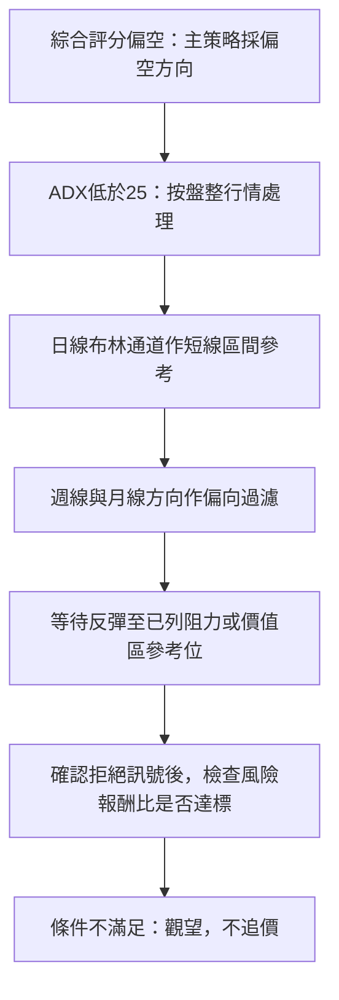

# ORCL 技術分析報告

> **報告日期**：2026-11-24 ｜ **語言**：繁體中文 ｜ **數據來源**：Yahoo Finance ｜ **當前價格**：$113.68 USD（2026-11-23 收盤）

---

## 目錄

| 章節 | 內容 |
|------|------|
| [1. 技術面概覽](#1-技術面概覽) | 核心指標速覽、評分卡 |
| [2. 趨勢分析](#2-趨勢分析) | 長中短期走勢、ADX |
| [3. 圖表形態分析](#3-圖表形態分析) | 形態、K線、缺口 |
| [4. 支撐與阻力](#4-支撐與阻力) | 關鍵價位、斐波那契 |
| [5. 技術指標深度解讀](#5-技術指標深度解讀) | MA/RSI/MACD/布林/成交量/進階指標 |
| [6. 動能與波動率](#6-動能與波動率) | ATR、Beta、相對強度 |
| [7. 多時框架總結](#7-多時框架總結) | 時框架評分矩陣 |
| [8. 交易策略建議](#8-交易策略建議) | 歷史基準、策略、風險報酬比 |
| [9. 風險提示與監控](#9-風險提示與監控) | 監控指標、風險場景 |

---

## 1. 技術面概覽

ORCL 技術面整體偏空：日、週、月三個時框均偏空，且股價受制於主要均線與雲層。最重要的兩項確認是空頭均線排列，以及價格相對 VTI、QQQ 的相對走弱；不過 ADX 顯示目前並非強趨勢行情，日線動能也未進入超賣區。最大反向風險是價格接近多個支撐參考區，若出現有效止跌與重新站回短期均線，空頭延續可能受阻。

### 📊 核心指標速覽表

| 指標類別 | 指標名稱 | 當前數值 | 訊號 | 解讀 |
|----------|----------|----------|------|------|
| **價格** | 當前價格 | $113.68 USD | 🔴 | 低於主要日、週、月趨勢均線；詳細位置見趨勢與指標章節。 |
| **均線** | MA20 / MA50 / MA200 | 見第 5 章 | 🔴 | 價格在三條均線下方，均線排列偏空。 |
| **動能** | RSI(14)（日線） | 見第 5 章 | 🟡 | 中性區，尚未呈現超賣讀值。 |
| **動能** | MACD 柱（日線） | 見第 5 章 | 🔴 | 柱值為負，空頭動能仍在。 |
| **趨勢** | ADX(14) | 見第 2 章 | 🟡 | 趨勢強度偏弱，按盤整規則處理。 |
| **波動** | ATR(14) | 見第 6 章 | 🔴 | 單日波動幅度相對價格偏大，止損須留有波動空間。 |
| **多時框** | 一致性 | 見第 7 章 | 🔴 | 日、週、月方向一致偏空。 |

### 🏆 技術評分卡

| 維度 | 評分（0–100） | 訊號 | 主要依據（引用數值所在章節） |
|------|---------------|------|------------------------------|
| 趨勢強度 | 25 | 🔴 | 日、週、月方向均偏空，但第 2 章的 ADX 顯示趨勢強度不足。 |
| 動能指標 | 40 | 🟡 | 第 5 章 RSI 未達超賣，但 MACD 柱仍偏空。 |
| 支撐穩定度 | 50 | 🟡 | 第 4 章支撐聚類與未回補缺口提供參考，但價格仍承受下行壓力。 |
| 成交量配合 | 35 | 🔴 | 第 5 章 OBV、A/D 與量比顯示量能確認價格弱勢，尚未出現明確反轉量訊號。 |
| 形態完整度 | 30 | 🔴 | 第 3 章未發現具足夠幾何依據的完整反轉形態。 |
| 均線排列 | 15 | 🔴 | 第 5 章主要均線呈空頭排列，價格低於主要均線。 |
| **綜合評分** | **33** | **偏空** | 六項算術平均為 32.5，四捨五入至 33。 |

---

## 2. 趨勢分析

**結論：長期與中期趨勢偏空，短線雖有反彈空間，但尚不足以扭轉多時框下行結構。** 近一年月收盤走勢呈現高位回落與反彈後再度走弱；週線收盤多數時間位於週線趨勢均線下方。ADX 位於盤整判斷區，因此日線布林通道是短線交易區間的主要參照，但週線與月線偏空仍限制反彈的趨勢解讀。

### 📈 長期趨勢（近 12 個月）

下表依月收盤整理為階段；起訖價與變動幅度採價格資料庫月收盤資料。最後一階段的 2026 年 11 月數據截至最新交易日，並非完整月末。

| 期間 | 起訖月收盤 | 階段漲跌幅 | 特徵 |
|------|------------|------------|------|
| 2025-12 至 2026-02 | $192.34 → $143.86 | -25.2% | 連續回落，長期趨勢轉弱。 |
| 2026-03 至 2026-05 | $145.55 → $224.17 | +54.0% | 強勢反彈，但未形成持續的高位穩定結構。 |
| 2026-06 至 2026-07 | $145.50 → $129.39 | -11.1% | 反彈後再次下行。 |
| 2026-08 至 2026-09 | $148.57 → $136.79 | -7.9% | 反彈未能延續，月收盤轉弱。 |
| 2026-10 至 2026-11 | $130.67 → $113.68 | -13.0% | 延續回落；11 月為截至最新交易日的月內收盤。 |

### 📊 中期趨勢（週線）

週線方向偏空：最新週線收盤低於週線趨勢均線，週 RSI 低於中性分界，週 MACD 柱仍為負值。近週收盤走勢顯示，2026 年 9 月的反彈未能扭轉 10 月以來的下行，11 月週線回落伴隨明顯的週成交量變化；但截至 2026-11-23 的週 K 為進行中 K 棒，不能視為完整週收盤確認。

### ⚡ 趨勢強度（ADX）

| 指標 | 數值 | 解讀 |
|------|------:|------|
| ADX(14) | 15.90 | 低於 25，屬弱趨勢／盤整判斷，不宜將當前走勢直接視為強趨勢行情。 |
| +DI | 21.16 | 多方方向指標低於空方方向指標。 |
| −DI | 29.39 | 空方方向指標占優，與均線及多時框偏空方向一致。 |

ADX 低於 25，故依規則 14，短線交易區間以日線布林通道上下軌為主要依據；週線與月線方向仍用於判斷較高級別偏向，不把盤整狀態誤讀為強空頭趨勢。

---

## 3. 圖表形態分析

**結論：現有資料支持空頭趨勢與指標型解讀，但不足以高信心確認雙底、頭肩、旗形等幾何形態。** 最近日 K 顯示大幅下跌後出現跳空反彈，但最新交易日為向上跳空且未回補，不能只按一般長紅或長黑 K 棒解讀。

### 🔍 形態識別

| 形態 | 信心度 | 判斷依據 | 完成度 | 目標價 |
|------|--------|----------|--------|--------|
| 完整反轉或延續幾何形態 | 低 | 近 10 根日 K 與近 8 根週 K 未提供足以確認頸線、形態高度及兩側對稱性的幾何結構。 | 訊號不足，僅做指標型解讀。 | N/A（數據未提供） |
| 空頭均線排列 | 高 | 日線短、中、長均線順序為空頭排列，且收盤低於主要均線；依均線訊號判定，不宣稱為傳統圖表形態。 | 已形成；仍需觀察價格能否收復均線。 | 不適用；此項不是具形態高度的幾何圖形。 |
| 布林通道下半區運行 | 中 | 日線 %B 位於中軌與下軌之間，與負值 MACD 柱及空頭均線排列方向一致。 | 指標型狀態，並非幾何形態。 | 不適用；沒有可據以計算的形態高度。 |

### 🕯️ 重要 K 線形態

以下 K 棒僅依 Yahoo Finance 的近 10 根日 K、近 8 根週 K 開高低收判讀。K 線形態不單獨作為反轉訊號，並須與缺口及趨勢指標一併解讀。

| 日期（日 K／週 K） | 開 | 高 | 低 | 收 | K 線形態 | 解讀 | 訊號 |
|------|----:|----:|----:|----:|---------|------|------|
| 2026-11-11（日 K） | $124.28 | $130.77 | $124.15 | $128.38 | 偏多實體 K | 收盤高於開盤，但其後幾個交易日價格轉弱；單根 K 棒未帶來趨勢反轉確認。 | 🟡 |
| 2026-11-20（日 K） | $108.48 | $108.99 | $100.25 | $101.19 | 長陰實體 K | 下跌延續且收近當日低位，顯示當日賣壓顯著；不代表後續必然延續。 | 🔴 |
| 2026-11-23（日 K） | $116.44 | $118.70 | $112.28 | $113.68 | 向上跳空後收低於開盤 | 此 K 棒屬跳空交易日；雖然盤中高於開盤，收盤仍低於開盤，顯示跳空後賣壓。 | 🔴 |
| 2026-11-06（週 K） | $125.88 | $129.85 | $109.21 | $116.10 | 長陰實體 K | 該週收盤低於開盤且處於週內低位區域，週成交量亦偏高；與中期偏空相符。 | 🔴 |
| 2026-11-20（週 K） | $122.78 | $123.14 | $100.25 | $101.19 | 長陰實體 K | 週線延續回落，表示中期賣壓未消退；須同時留意週線支撐參考。 | 🔴 |

### 跳空缺口

下表照列市場脈絡中的近 60 個交易日缺口資料；缺口價位為缺口區間，不代表已確認的支撐或阻力。未回補缺口可作為後續價格觀察參考。

| 日期 | 方向 | 缺口區間 | 回補狀態 | 技術解讀 |
|------|------|----------|----------|----------|
| 2026-11-23 | 向上跳空 | $108.99–$112.28（3.3%） | 未回補 | 形成短線向上缺口，但當日收盤低於開盤，須觀察後續能否守住缺口上緣。 |
| 2026-11-20 | 向下跳空 | $108.99–$110.24（1.1%） | 已回補 | 缺口已回補，不宜再視為尚未填補的缺口區。 |
| 2026-11-11 | 向上跳空 | $120.23–$124.15（3.3%） | 已回補 | 缺口已回補，較適合作為歷史價格行為背景。 |
| 2026-11-02 | 向下跳空 | $126.50–$129.00（1.9%） | 已回補 | 缺口已回補；區域仍可能有供需記憶，但不能稱為未回補缺口。 |
| 2026-09-24 | 向下跳空 | $139.82–$143.70（2.7%） | 已回補 | 缺口已回補，僅作為過往價格行為資料。 |

---

## 4. 支撐與阻力

**結論：支撐與阻力採程式由 OHLCV 計算的波段聚類價位，不另行推估。** 目前支撐群集中在現價下方，阻力則與上方壓力區相距較遠；ADX 所示盤整環境下，短線以布林通道區間判斷為主，波段聚類價位作為外層參考。

### 🚧 阻力位分析表

阻力位來自近一年波段高點聚類。

| 阻力級別 | 價位 | 形成原因 | 突破難度 | 重要性 |
|----------|------:|----------|----------|--------|
| R1 | $130.77 | 近一年波段高點聚類；亦為近 10 根日 K 中的局部高點。 | 中 | 短線首要反彈阻力；若無量突破，仍可能形成回落壓力。 |
| R2 | $147.63 | 近一年波段高點聚類。 | 高 | 中期阻力；若要挑戰，需先改善週線動能與相對強度。 |
| R3 | $153.03 | 近一年波段高點聚類。 | 高 | 較上層波段阻力；目前價格結構尚未提供重新測試的確認訊號。 |

### 🛡️ 支撐位分析表

支撐位依支撐價位區塊所列回溯期間，為近五年波段低點聚類；其中近年價格資料是較直接的參考，較長期聚類不代表支撐必然有效。

| 支撐級別 | 價位 | 形成原因 | 守住可能性 | 重要性 |
|----------|------:|----------|------------|--------|
| S1 | $112.88 | 近五年波段低點聚類，位於價格附近的首層參考。 | 中 | 短線觀察位；失守可能使價格再次測試較低支撐區。 |
| S2 | $109.21 | 近五年波段低點聚類。 | 中 | 中間支撐參考；若價格進一步轉弱，需觀察成交量是否放大。 |
| S3 | $106.91 | 近五年波段低點聚類。 | 低 | 下方波段支撐參考；若失守，技術風險將進一步升高。 |

### 未回補缺口參考

| 名稱 | 價位區間 | 狀態與用途 |
|------|----------|------------|
| 2026-11-23 向上跳空缺口 | $108.99–$112.28 | 尚未回補；可作為短線缺口參考區，不替代 S1–S3 的波段支撐標記。 |

### 📐 斐波那契回調位分析

下列數值直接引用 52 週區間斐波那契回調資料。現價位於 78.6% 回調位與 100.0%（52 週低點）之間，代表價格已回撤至區間低端；此處是位置描述，不等於支撐已確認。

| 回調位 | 價位 |
|--------|------:|
| 23.6% | $213.49 |
| 38.2% | $191.85 |
| 50.0% | $174.36 |
| 61.8% | $156.87 |
| 78.6% | $131.97 |
| 100.0%（52 週低點） | $100.25 |

---

## 5. 技術指標深度解讀

**結論：均線、MACD、一目均衡表與成交量分布偏空；RSI、布林位置與錨定 VWAP 則顯示下跌後仍有區間反彈空間，但尚未給出一致的反轉確認。** RSI 沒有明顯背離，故不以背離推論底部已形成。

### 📈 均線、RSI、MACD、布林通道

| 指標 | 數值 | 訊號 | 解讀 |
|------|------|------|------|
| MA20 / MA50 / MA200 與排列 | MA20 $121.89；MA50 $131.33；MA200 $152.05；MA20<MA50<MA200 | 🔴 | 收盤低於三條均線，短中長均線依序向下排列，確認趨勢偏空。 |
| RSI(14)（日線）與背離 | RSI(14) 43.43；近 20 根 K 棒首尾比較：無明顯背離 | 🟡 | 位於 30–70 中性區，未達超賣；依提供的背離檢查結果，沒有明顯頂背離或底背離。 |
| MACD 線 / Signal / 柱 | MACD -6.009；Signal -5.007；Hist -1.002 | 🔴 | MACD 線與訊號線均為負，柱值為負，表示日線空頭動能仍在。 |
| 布林上軌 / 中軌 / 下軌 / %B | 上軌 $142.04；中軌 $121.89；下軌 $101.73；%B 0.30 | 🟡 | 位於中軌下方、下軌上方的通道下半部，並非已觸及下軌；ADX 偏低時，布林區間較適合用於短線交易框架。 |
| Stoch %K / %D | %K 44.00；%D 17.80 | 🟡 | 數值呈現短線反彈動能可能改善，但不足以單獨確認反轉；仍需價格與均線同步確認。 |

均線與 MACD 方向互相確認偏空，RSI 則僅顯示動能未達超賣，並沒有提供反轉背離證據。布林 %B 位於通道下半部而非下軌外側，意味價格尚未形成明確的布林超跌回歸訊號。Stoch 的短線讀值不抵銷週、月線及均線的空頭背景；綜合判斷仍是偏空，但在 ADX 低於趨勢門檻時，短線應按區間而非強趨勢追價處理。

### 💹 成交量（量價配合度）

| 指標 | 數值／狀態 | 解讀 |
|------|-------------|------|
| 最新成交量 | 40,488,200 股 | 當日量低於 20 日均量，不能單憑最新一日確認放量買盤。 |
| 20 日均量 | 43,017,310 股 | 作為近期比較基準。 |
| 量比 | 0.94x | 略低於 20 日均量，反彈尚未獲得高於近期均值的量能確認。 |
| 50 日均量 | 35,205,846 股 | 最新成交量高於 50 日均量，但量比仍低於 20 日均量。 |
| OBV 趨勢 | OBV < MA；量能疲弱 | 未確認價格止跌或反轉，量能訊號偏空。 |
| A/D 線 | 近 20 根不高於其 20 日均值；A/D 下降、價格下跌 | A/D 與價格同向，確認近期賣壓，而非背離式吸籌。 |

量價結論偏空：OBV 低於其均線，A/D 下降並與價格下跌同向，成交量亦未呈現足以確認反彈的明確訊號。成交量對下行方向提供確認，但不等於預示必然持續下跌；若未來價格回升而 OBV、A/D 未同步改善，反彈可靠性仍偏低。

### 🧭 進階指標

| 指標 | 數值 | 收盤相對位置 | 解讀 |
|------|------|--------------|------|
| 一目均衡表（轉換線／基準線／雲層） | 轉換線 $115.51；基準線 $124.36；最新雲層先行帶 A $141.63／B $148.72；前方 26 根雲層先行帶 A $119.94／B $132.82 | 收盤位於最新雲層下方；轉換線低於基準線；前方雲層 A 在 B 下方 | 一目均衡表整體偏空，與主要均線及 MACD 結論互相確認。 |
| 成交量分布（POC／價值區） | POC $140.39；價值區 $124.95–$180.53（含 70% 成交量） | 收盤位於價值區下方 | 顯示價格低於過去一年高成交量價值區；上方價值區下緣可能形成回升阻力，與空頭均線結論一致。 |
| 錨定 VWAP（自 52 週高點／低點） | 自 2026-06-01 52 週高點起 $143.48；自 2026-11-20 52 週低點起 $108.71 | 收盤低於前者、高於後者 | 相對高點錨定 VWAP 偏空；相對低點錨定 VWAP 則顯示價格仍高於近期低點的成交量加權成本，形成短線相反訊號。 |
| A/D 線 | 近 20 根不高於其 20 日均值；A/D 下降、價格下跌 | — | 與價格同向，確認下行量價關係；沒有提供吸籌背離訊號。 |

---

## 6. 動能與波動率

**結論：ORCL 波動幅度偏大，停損距離不宜過窄；相對大盤及科技股基準均明顯走弱，支持偏空方向，但 Beta 亦意味反彈與跳空風險都較高。**

### 📊 ATR 波動率分析

| 指標 | 數值 | 解讀 |
|------|------:|------|
| ATR(14) | $8.62 | 依 Wilder 方法計算的日線真實波幅參考值。 |
| ATR 佔價格比例 | 7.58% | 單日常態波動相對價格偏高，止損若設得過近，容易受到日常波動干擾。 |
| 1.5 倍 ATR | $12.93 | 可作為波動緩衝距離參考，不替代策略表中依指定價位設定的止損。 |
| 2 倍 ATR | $17.24 | 較寬的波動緩衝參考；須同步降低倉位，以限制單筆風險。 |

ATR 的用途是估計風險距離，不是方向指標。由於本報告的交易價位須依已列支撐、阻力或進階指標價位設定，ATR 僅用於判斷止損是否容易被日常波動觸發；若價位型停損與 ATR 緩衝不相容，應減少部位，而非任意擴大風險。

### 📐 Beta 與相對強度

| 期間 | ORCL | VTI（美國整體市場） | 超額報酬 | 相對 VTI 比值趨勢 | QQQ（Nasdaq-100） | 超額報酬 | 相對 QQQ 比值趨勢 |
|------|-----:|---------------------:|---------:|------------------|------------------:|---------:|-------------------|
| 1 個月 | -19.4% | -9.3% | -10.1% | 相對走弱；比值低於 50 日均值 | -13.6% | -5.8% | 相對走弱；比值低於 50 日均值 |
| 3 個月 | -29.0% | -9.8% | -19.1% | 相對走弱；比值低於 50 日均值 | -13.9% | -15.1% | 相對走弱；比值低於 50 日均值 |
| 6 個月 | -47.3% | -7.3% | -40.0% | 相對走弱；比值低於 50 日均值 | -15.2% | -32.1% | 相對走弱；比值低於 50 日均值 |

| 風險指標 | 數值 | 解讀 |
|----------|------:|------|
| Beta | 1.778 | 歷史價格敏感度高於大盤基準；在市場波動時，ORCL 價格變動可能較大，方向並不保證。 |

相對強度在三個觀察期間均落後 VTI 與 QQQ，且比值趨勢均低於各自 50 日均值，對本報告的偏空主策略方向提供支持。相對走弱是價格表現比較，不代表公司基本面或未來報酬的必然結論；高 Beta 同時提高空頭回補與跳空反向風險。

---

## 7. 多時框架總結

**結論：多時框架方向一致偏空。** 日線 ADX 顯示盤整，短線以布林通道區間為主；週線與月線仍偏空，因此反彈交易不等於中長期趨勢翻多。

### 📋 時框架評分表

日、週、月的方向、RSI、MACD 柱及趨勢均線依多時框指標區塊列示。週、月最後一根為截至最新交易日的進行中 K 棒。

| 時框架 | 趨勢方向 | RSI(14) | MACD 柱 | 收盤 vs 趨勢均線 | 形態 | 建議 |
|--------|----------|--------:|--------:|------------------|------|------|
| 日線 | 偏空 | 43.43 | -1.002 | $113.68 < MA50 $131.33 | 空頭均線排列；非幾何形態確認 | 區間框架下等待反彈至阻力區再評估空方進場。 |
| 週線 | 偏空 | 39.97 | -2.056 | $113.68 < MA20 $133.94 | 週線收盤低於趨勢均線，週動能偏弱 | 以週線偏空作方向過濾，不因短線反彈改判中期多頭。 |
| 月線 | 偏空 | 35.14 | N/A（數據未提供） | $113.68 < MA10 $147.84 | 月線方向偏空；月 MACD 柱資料不足 | 月線趨勢仍弱，避免將短線回升解讀為月線反轉。 |

**多時框一致性：3/3 偏空。**

### ⚖️ 多時框收斂結論

ADX 低於 25，屬盤整判斷，故日線布林通道為短線主要區間依據；週線、月線與多時框一致性則提供方向過濾。唯一方向性結論為：**偏空**。這不是「強趨勢追空」判斷，而是偏空趨勢背景下，等待價格回升至已列阻力或價值區參考位，再檢查是否出現拒絕訊號。

---

## 8. 交易策略建議

**當前主策略方向 = 偏空（依評分 33/100）。** 由於 ADX 顯示盤整，策略採「反彈至阻力參考位後尋找空方觸發」的區間交易方式，不建議在低位直接追空。下列價格策略是條件式規劃，不代表已經觸發。

### 🧭 策略路由

### 📊 歷史基準機率

今日狀態定義為 **RSI(14) 30–50 且收盤在 MA200 下方**。樣本期間為 **2016-11-21 至 2026-11-23**，共 **2,515 個交易日**；以下歷史頻率由價格資料庫計算，為價格報酬、不含股息。

| 持有期 | 相同狀態樣本（段數） | 上漲比例 | 中位數報酬 | 25%–75% 分位 | 全部交易日上漲比例／中位數 |
|--------|----------------------|----------|------------|--------------|----------------------------|
| 5 日 | 481（90 段） | 53% | +0.4% | -3.3%–+3.3% | 54%／+0.3% |
| 20 日 | 468（89 段） | 58% | +1.6% | -5.6%–+9.1% | 56%／+1.0% |
| 60 日 | 441（83 段） | 66% | +5.8% | -4.2%–+15.7% | 60%／+3.4% |

歷史上相同狀態的上漲比例在各持有期均略高於全部交易日基準，差距並非一致擴大；這一點與目前多時框偏空方向存在反向提示，故不能把技術偏空等同於歷史上必然下跌。雖然交易日樣本數不少，但狀態連續出現、持有期互相重疊；更接近獨立事件數的是各持有期的段數，解讀時應保持審慎。以上是歷史頻率，不是預測，也不構成策略成功機率。

### 🎯 價格情境階梯（Price Scenarios）

| 觸發條件 | 下一目標 | 後續延伸 | 可能性 | 依據 |
|----------|----------|----------|--------|------|
| 有效突破並守住 R1 | R2 | R3 | 中 | 突破首層波段阻力可改善日線結構；仍需週線動能及量能跟進，否則可能是假突破。 |
| 價格在支撐與布林區間內震盪 | — | — | 中 | ADX 指向盤整；若 RSI 維持中性、且量能未顯著擴張，區間整理情境仍成立。 |
| 跌破 S1 並未能迅速收復 | S2 | S3 | 中 | 均線、週月方向及相對強度偏空，支撐失守會增加下探下一層支撐的風險；不代表必然抵達目標。 |

### 🟢 主策略詳情

以下風險報酬比採做空公式：**（進場價 − T1）÷（止損價 − 進場價）**。策略 A 進場價以價值區下緣的已列價位為限價參考，須先觀察價格是否出現拒絕訊號；若直接跌離而未回升觸及，不追空。風險報酬比以 T1 計，策略 B 為未達最低門檻的觀察案例，不是可執行策略。

| 策略要素 | 策略 A：反彈遇阻後做空 | 策略 B：支撐附近直接追空 |
|----------|------------------------|--------------------------|
| 參考收盤價 | $113.68（2026-11-23） | $113.68（2026-11-23） |
| 進場條件 | 價格反彈至價值區下緣 $124.95，且出現日線拒絕或反彈動能轉弱；未觸及或未出現拒絕訊號，不進場。 | 僅作風險報酬比檢核案例；若在 S1 附近直接追空，不視為可執行交易。 |
| 進場價格 | $124.95 | **此價位不交易（風險報酬比 1 : 0.91 不足）**；若價格反彈至策略 A 的已列進場位，再依策略 A 的觸發條件評估。 |
| 目標價 T1 | $112.88 | $106.91 |
| 目標價 T2 | $106.91 | $100.25 |
| 止損價格 | $130.77 | $119.46（樞軸 PS1） |
| 風險報酬比 | **1 : 2.07（以 T1 計）** | 1 : 0.91（以 T1 計，不達門檻） |
| 把握度 | 中：多時框與相對強度偏空支持方向，但盤整狀態、歷史基準與低位支撐均構成反向風險。 | 不適用：未達最低風險報酬比，不列為可執行策略。 |
| 建議倉位 | 佔可投資資金 0.25%–0.50% 風險額度；依止損距離反推股數。 | 0%；不建立此策略部位。 |

策略 A 的風險報酬比核算為：（$124.95 − $112.88）÷（$130.77 − $124.95）＝1 : 2.07；高於最低門檻。其進場價高於現價，須等待反彈，不可把「尚未觸發」誤解為立即建立空單。策略 B 的風險報酬比低於最低門檻，故不提供為可執行策略。

### 🔴 反向風險觸發點（對沖提示）

| 反向風險訊號 | 風控意義 |
|--------------|----------|
| 價格有效突破並站穩 R1 | 短線空方論點減弱；空單應依原始止損規則處理，避免擴大停損。 |
| 日線收復 MA20 並伴隨 RSI、MACD 改善 | 代表日線空頭動能可能減弱；在週線未確認前，仍不等於多時框翻多。 |
| 未回補缺口上方區域持續被守住，且 OBV、A/D 轉強 | 可能出現量價結構改善，需重新評估空方策略，不應只依既有方向持倉。 |

---

## 9. 風險提示與監控

**結論：執行重點是等待條件觸發、控制跳空與波動風險，並把財報事件納入持有期間管理。** 技術價位是風控參考，不保證價格必然停留、反轉或按預期成交。

### ✅ 關鍵監控指標

| 監控項目 | 價位／事件 | 觸發後動作 |
|----------|------------|------------|
| 首層波段支撐 | S1（見第 4 章） | 觀察收盤是否失守；未確認前避免把盤中跌破視為有效破位。 |
| 下方支撐階梯 | S2、S3（見第 4 章） | 若前一層失守，重新評估下行延伸與部位風險，不預設下一層必然守住。 |
| 首層阻力 | R1（見第 4 章） | 若有效突破並站穩，降低空方曝險或依策略止損規則處理。 |
| 未回補缺口 | 2026-11-23 向上跳空缺口（見第 3 章） | 觀察缺口是否維持未回補；缺口回補或失守需更新短線判斷。 |
| 日線布林與 ADX | 見第 5 章與第 2 章 | 若 ADX 仍處盤整區，按區間交易；若趨勢強度轉變，重新確認多時框取捨。 |
| 下次財報日 | **2026-12-14；距最新收盤日 21 個日曆天**（Yahoo Finance，日期可能調整） | 財報前檢查空單持有期限與倉位；財報可能造成跳空，止損不保證成交。 |

### ⚠️ 風險場景

| 情境 | 觸發條件 | 價位參考 | 可能性 | 應對 |
|------|----------|----------|--------|------|
| 樂觀反彈 | 支撐區出現承接，日線動能轉強，並進一步突破首層阻力 | S1、R1（見第 4 章） | 中 | 空單不提前加碼；若有效突破阻力，依止損紀律減倉或離場。 |
| 基本盤整 | 價格在布林通道區間及已列波段支撐、阻力間往返，ADX 仍弱 | 布林通道（見第 5 章）、S1 與 R1（見第 4 章） | 中 | 等待靠近預定進場位並出現確認訊號，避免區間中央追單。 |
| 悲觀續跌 | 價格有效跌破支撐，且週線賣壓延續 | S1、S2、S3（見第 4 章） | 中 | 不因跌破而無限加碼；依預設風險額度管理，逐層重估而非預測必達。 |

### 🛡️ 風險管理提醒

- 以策略 A 的預設止損價與單筆風險額度反推股數，不以帳戶可用資金直接決定倉位。
- 未等到反彈至預定進場位、或未出現拒絕訊號時，不追空；價格直接下跌並不等於交易條件改善。
- ATR 顯示日常波動幅度偏大，若停損距離不足以容納波動，應降低倉位，而不是任意擴大可承受損失。
- 財報可能引發跳空，停損單可能無法按設定價格成交；持有跨財報部位前，需重新衡量跳空風險。
- 價格觸及支撐、阻力或缺口區都不代表必然反轉；應以收盤確認、量價變化及多時框方向共同判斷。

---

## 📋 報告總結

| 項目 | 結論 |
|------|------|
| 報告日期 | 2026-11-24 |
| 當前價格 | 見標題列與第 1 章（2026-11-23 收盤） |
| 綜合評分／方向 | 33/100，偏空 |
| 長期／中期／短期趨勢 | 🔴 長期偏空；🔴 中期偏空；🟡 短期盤整框架下偏空 |
| 關鍵支撐／關鍵阻力 | S1–S3／R1–R3，精確價位見第 4 章 |
| 🥇 最佳機會 | 策略 A：等待反彈至價值區下緣並確認拒絕訊號後評估做空；未觸發前觀望。 |
| 最大風險 | 多時框偏空與歷史基準反向訊號並存，且財報跳空、較高波動可能令止損價格無法保證成交。 |

> ⚠️ **免責聲明**：本報告為 AI 自動生成之技術分析，所有數據及估算均基於歷史價格資訊。本報告**僅供研究與學術參考**，**不構成任何投資建議**。投資有風險，入市需謹慎。

---

## 資料與來源

| 項目 | 內容 |
|------|------|
| 價格 | 113.68 USD，2026-11-23 收盤（Yahoo Finance 日線） |
| K 棒 | 500 根日線，2024-11-25 至 2026-11-23（Yahoo Finance）；較長期間的價位與基準機率取自價格資料庫 |
| 關鍵價位回溯期間 | 阻力 近一年、支撐 近五年 |
| 下次財報日 | 2026-12-14（Yahoo Finance，日期可能調整） |
| 有回應的資料來源 | Yahoo Finance、Finviz、StockAnalysis、Roic.ai |
| 由程式計算 | 所有指標、R1–S3 與斐波那契價位、多時框方向、相對強度、缺口、歷史基準機率、綜合評分 |
| 撰寫模型 | openai / gpt-6-luna |

> 本區塊由產生報告的程式依實際取得的資料填寫，非模型撰寫。「由程式計算」的數字不是模型的估計；其餘判斷（評分、情境、策略）是模型的分析。
