# PL 技術分析報告

> **報告日期**：2026-10-11 ｜ **語言**：繁體中文 ｜ **數據來源**：Yahoo Finance ｜ **當前價格**：$17.18

---

## 目錄

| 章節 | 內容 |
|------|------|
| [1. 技術面概覽](#1-技術面概覽) | 訊號儀表板、核心指標、評分卡 |
| [2. 趨勢分析](#2-趨勢分析) | 多時框趨勢、長中短期走勢、ADX強度 |
| [3. 圖表形態分析](#3-圖表形態分析) | 形態識別、K線組合、目標價推算 |
| [4. 支撐與阻力](#4-支撐與阻力) | 關鍵價位、斐波那契回調結構 |
| [5. 技術指標深度解讀](#5-技術指標深度解讀) | MA/RSI/MACD/布林/量價配合度 |
| [6. 動能與波動率](#6-動能與波動率) | 動能評估、ATR波動測算、Beta敏感度 |
| [7. 多時框架總結](#7-多時框架總結) | 時框架評分矩陣、多時框收斂結論 |
| [8. 交易策略建議](#8-交易策略建議) | 策略路由、主策略、情境階梯與風險報酬比 |
| [9. 風險提示與監控](#9-風險提示與監控) | 監控指標Checklist、風險場景樹、報告總結 |

---

## 1. 技術面概覽

### 🎯 技術訊號儀表板

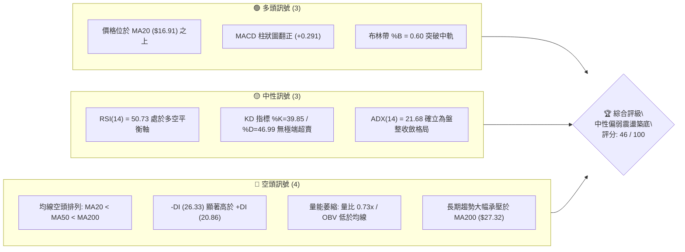

### 📊 核心指標速覽表

| 指標類別 | 指標名稱 | 當前數值 | 訊號 | 解讀 |
|:---|:---|:---|:---:|:---|
| **價格** | 當前收盤價 | $17.18 | 🟡 | 位於52週區間16.1%低位區，短線自 $16.42 築底回彈 |
| **均線** | MA20 (短週期) | $16.91 | 🟢 | 現價高於 MA20 (+1.57%)，短線多頭掌控超短期節奏 |
| **均線** | MA50 (中週期) | $19.54 | 🔴 | 現價低於 MA50 (-12.08%)，中期結構處於空方壓制區 |
| **均線** | MA200 (長週期) | $27.32 | 🔴 | 現價低於 MA200 (-37.12%)，長期技術面處於熊市格局 |
| **動能** | RSI(14) | 50.73 | 🟡 | 剛站回 50 中軸，短線超賣鈍化解除，無背離訊號 |
| **動能** | MACD (12,26,9) | 柱狀圖 +0.291 | 🟢 | DIF線 (-0.519) 穿越 DEA線 (-0.810)，低位弱勢金叉 |
| **波動** | ATR(14) | $0.97 | 🟡 | 佔現價 5.67%，每日波動幅度常態收斂，爆發力待蓄積 |

### 🏆 技術評分卡

```
╔══════════════════════════════════════════════════════════════════╗
║              技術評分卡 — PL (Planet Labs PBC) — 2026-10-11     ║
╠══════════════════════════════════════════════════════════════════╣
║ 趨勢強度 (ADX=21.68)      ████░░░░░░░░░░░░░░░░  22/100  🔴 空頭主導║
║ 動能指標 (RSI/MACD)       ███████████░░░░░░░░░  55/100  🟢 短線微多║
║ 支撐穩定度 (S1=$16.10)    ████████████░░░░░░░░  60/100  🟢 低檔有撐║
║ 成交量配合 (量比 0.73x)   ██████░░░░░░░░░░░░░░  30/100  🔴 價量背馳║
║ 形態完整度 (區間收斂)     ██████████░░░░░░░░░░  50/100  🟡 構築箱體║
║ 均線排列 (空頭排列)       ██████░░░░░░░░░░░░░░  30/100  🔴 長期承壓║
╠══════════════════════════════════════════════════════════════════╣
║ 綜合評分                  █████████░░░░░░░░░░░  46/100  🟡 中性區間║
║ 技術定調：低位盤整構築箱體，中期反彈動能醞釀，長期熊市壓制未解   ║
╚══════════════════════════════════════════════════════════════════╝
```

---

## 2. 趨勢分析

### 🌐 多時框趨勢分析

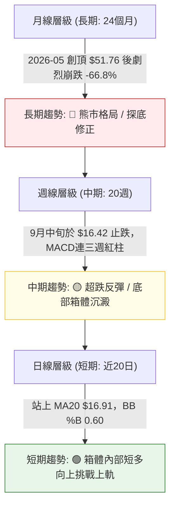

### 📈 長期趨勢 — 12個月走勢圖（Unicode）

```
PL 月線走勢圖（過去12個月：2025-11 至 2026-10）
價格軸 ($)
$52.00 ┤                                      ● $51.14 (高點 2026-05)
$46.00 ┤                                     ╱ ╲
$40.00 ┤                                    ╱   ╲
$34.00 ┤                             ● $36.97   ╲
$28.00 ┤                      ● $27.95           ● $33.13 (2026-06)
$22.00 ┤         ● $19.72    ╱                    ╲
$16.00 ┤ ● $11.90 ╲         ● $24.14               ● $20.48   ● $17.18 (現價)
$10.00 ┤           ● $13.45                         ╲       ╱
       └─┬─────────┬─────────┬─────────┬─────────┬───┴───────┴───────
        11        01        03        05        07  08  09  10 (月)
       (2025)             (2026)
```

#### 長期走勢特徵分析表

| 階段時間 | 起始 / 結束價位 | 區間漲跌幅 | 走勢結構與技術特徵 |
|:---|:---|:---:|:---|
| **第一階段：主升推升期**<br>(2025-11 ~ 2026-05) | $11.90 → $51.14 | +329.7% | 經典拋物線噴發行情，月成交量急遽放大，RSI 週線一度飆破 83.2，動能極度過熱。 |
| **第二階段：斷崖崩跌期**<br>(2026-05 ~ 2026-07) | $51.14 → $20.48 | -59.95% | 頂部破位後無量陰跌與恐慌殺盤交替，連續跌破所有短期均線，週成交量單週突破 1 億股。 |
| **第三階段：陰跌測底期**<br>(2026-07 ~ 2026-09) | $20.48 → $16.39 | -19.97% | 週線 RSI 於 2026-09 跌至 10.0 極限超賣區，空方動能逐漸衰竭，於 $16.42 探尋波段支撐。 |
| **第四階段：築底震盪期**<br>(2026-09 ~ 2026-10) | $16.39 → $17.18 | +4.82% | 跌勢暫歇，收斂至 $16.10 ~ $18.18 狹幅箱體，週線 MACD 連續 3 週翻紅，呈現籌碼沉澱特徵。 |

### 📊 中期趨勢（週線分析）

```
中期關鍵壓力與支撐階梯示意圖 (週線層級)
══════════════════════════════════════════════════════════════════
[強反彈目標]   $25.53 (R3) ─── 2026-07 跌破之平台頸線與波段密集成交區
                 ▲
[中期下行壓力] $20.99 (R2) ─── 2026-08 平台反彈高點 / 接近 MA50 ($19.54)
                 ▲
[短線突破阻力] $18.18 (R1) ─── 近 4 週震盪高點聚類區間 / 布林上軌 ($18.27)
───────────────── $17.18 ─── 當前現價 (收斂整理中) ───────────────
[短線箱體下緣] $16.10 (S1) ─── 2026-09 雙底回踩低點聚類 ($16.42 / $16.45)
                 ▼
[近期波段防守] $15.60 (S2) ─── 近一年波段低點聚類 / 布林下軌 ($15.56)
                 ▼
[長線極限防線] $11.97 (S3) ─── 2025-11 起漲突破口支撐區
══════════════════════════════════════════════════════════════════
```

### ⚡ 趨勢強度評估（ADX 解讀）

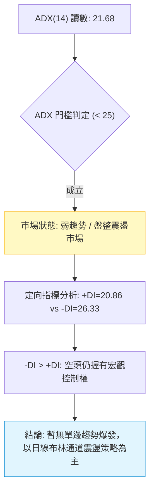

#### ADX 趨勢強度對照表

| 指標名稱 | 數值 | 區間定義 | 趨勢屬性判定 | 操作指引 |
|:---|:---:|:---:|:---|:---|
| **ADX (14)** | **21.68** | 0 ~ 25 | **弱趨勢 / 無趨勢盤整** | 避免盲目追突破，以區間低買高賣為主 |
| **+DI (14)** | **20.86** | 買方力量 | 短期多頭有所修復但力量不足 | 買方尚未具備推動單邊趨勢之動能 |
| **-DI (14)** | **26.33** | 賣方力量 | 空方仍居優勢但斜率放緩 | 賣盤殺跌動能已非主跌段的極端強度 |
| **DI 差值** | **-5.47** | 淨空頭敞口 | 空方佔優幅度正在收窄 | 觀察日後 +DI 能否上穿 -DI 形成黃金交叉 |

---

## 3. 圖表形態分析

### 🔍 形態識別系統

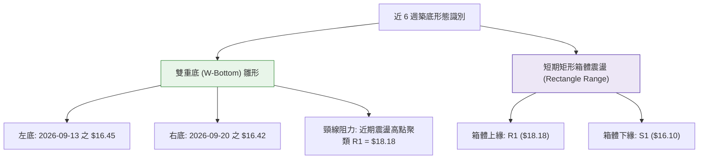

#### 幾何形態判定與信心度評估表

| 形態名稱 | 信心度 | 判斷依據（引用真實數據） | 完成度 | 目標價（附嚴謹計算式） |
|:---|:---:|:---|:---:|:---|
| **潛在雙重底**<br>(W-Bottom) | **62%** | 2026-09-13 低點 $16.45 與 2026-09-20 低點 $16.42 形成對稱雙底（接近 S1=$16.10 聚類）；隨後收盤回升至 $17.18 站上 MA20。 | 65%<br>(未突破頸線) | **測算目標價 = $19.94**<br>形態頸線：R1 $18.18<br>形態底部：取雙底平均 $16.42<br>高度 $H = 18.18 - 16.42 = 1.76<br>目標 = $18.18 + $1.76 = $19.94<br>*(接近 MA60 $19.85 與 MA50 $19.54)* |
| **短期震盪箱體**<br>(Range Box) | **78%** | 價格在近 4 週內收盤持續鎖定在 $16.42 至 $17.50 之間，且日線布林通道上下軌收縮於 $15.56 ~ $18.27。 | 85% | **箱體滿足目標 = $20.26**<br>箱頂：$18.18，箱底：$16.10<br>高度 $H = 18.18 - 16.10 = 2.08<br>突破目標 = $18.18 + 2.08 = $20.26<br>*(接近阻力位 R2 $20.99)* |
| **頭肩底形態** | **18%** | 數據中未偵測到完整的左肩與右肩結構，僅有單一低點聚集區。 | 0% | *訊號不足，不予推算，僅做指標型解讀* |

### 🕯️ 重要K線形態分析

| 週期 / 日期 | 收盤價 | K線形態名稱 | 技術面解讀 | 訊號 |
|:---|:---:|:---|:---|:---:|
| **2026-09-13** | $16.45 | 長下影錘頭線試探 (Hammer Test) | 週成交量達 6,220 萬股，RSI 觸及 10.0 極限超賣後引發抄底買盤，確立初段支撐。 | 🟢 |
| **2026-09-20** | $16.42 | 縮量十字星 (Doji) | 成交量縮至 4,644 萬股，空頭砸盤力量耗竭，多空於 $16.42 達成臨時均衡。 | 🟡 |
| **2026-09-27** | $17.43 | 多頭反轉長陽 (Bullish Engulfing) | 週線大漲 +6.15%，一舉吞沒前週實體，MACD 柱狀圖由負翻正 (+0.272)，發出回穩訊號。 | 🟢 |
| **2026-10-04** | $17.50 | 高位窄幅整理線 (Spinning Top) | 向上測試布林上軌與 R1 聚類區受阻，買方推升意願有所減緩，轉入橫盤。 | 🟡 |
| **2026-10-11** | $17.18 | 小陰線回踩確認 (Pullback) | 回測 MA20 ($16.91) 獲得支撐，成交量放大至 5,985 萬股，維持區間震盪常態。 | 🟡 |

### 📉 ASCII 走勢形態示意圖

```
雙重底 (W-Bottom) 與箱體震盪示意圖
價格軸 ($)
$18.18 ┤           頸線阻力 R1 (箱體上緣)
       │           ┌───────────┐           ▲ (向上突破目標: $19.94 ~ $20.26)
$17.50 ┤           │           ● (10-04)   │
$17.18 ┤─ ─ ─ ─ ─ ─│─ ─ ─ ─ ─ ─│─ ─ ─ ●現價 ─ ─ ─ ─ ─ ─ ─ ─ ─ ─
$16.91 ┤┄┄┄┄┄┄┄┄┄┄┄┼┄┄┄┄┄┄┄┄┄┄┄┼┄┄┄┄┄┄┄ MA20 中軌支撐
$16.45 ┤    ●(09-13)           │
$16.42 ┤    └── 左底 ──────── 右底 ─┘ (09-20)
$16.10 ┤           支撐 S1 (箱體下緣)
       └───────────────────────────────────
```

### 🎯 形態目標價計算

依據幾何形態學原理，突破目標價計算如下：
1. **雙底頸線測幅**：
   $$\text{目標價} = \text{頸線位 (R1)} + (\text{頸線位} - \text{雙底低點}) = \$18.18 + (\$18.18 - \$16.42) = \$19.94$$
2. **箱體等距測幅**：
   $$\text{目標價} = \text{箱頂 (R1)} + (\text{箱頂} - \text{箱底 (S1)}) = \$18.18 + (\$18.18 - \$16.10) = \$20.26$$
此兩組由形態推導之目標價，與數據中列出之中期阻力聚類 **R2 ($20.99)** 及中期均線 **MA50 ($19.54) / MA60 ($19.85)** 形成高度技術共振。

---

## 4. 支撐與阻力

### 🗺️ 關鍵價位分布圖（Unicode）

```
PL 價位結構分布圖 (由 OHLCV 與歷史波段聚類精確計算)
══════════════════════════════════════════════════════════════════
$25.53 ║████████████████████████║ 強阻力 R3 (中期波段解套賣壓帶)
$20.99 ║████████████████        ║ 中期阻力 R2 (反彈高點聚類)
$19.35 ║▓▓▓▓▓▓▓▓▓▓▓▓▓▓▓▓        ║ 斐波那契 78.6% 回調關鍵樞軸
$18.18 ║████████████████████████║ 關鍵阻力 R1 (近一年波段高點聚類)
═══════╬════════════════════════╣ ◄ 當前價格 $17.18 (收盤價)
$16.10 ║▓▓▓▓▓▓▓▓▓▓▓▓▓▓▓▓▓▓▓▓    ║ 近期支撐 S1 (雙底回踩低點聚類)
$15.60 ║████████████████████████║ 強支撐 S2 (波段極端低點 / BB下軌)
$11.97 ║████████████████████████║ 長線終極防線 S3 (2025年起漲原點)
$10.52 ║████████████████████████║ 52週歷史低點 (斐波那契 100.0%)
══════════════════════════════════════════════════════════════════
```

### 🚧 阻力位分析表

| 阻力級別 | 價位 | 形成原因（引用真實數據聚類） | 突破難度 | 重要性評級 |
|:---|:---:|:---|:---:|:---:|
| **阻力 R1** | **$18.18** | 近一年波段高點聚類；與日線布林上軌 ($18.27) 形成重疊壓力帶。 | 中等 | 🟢🟢🟢⚪⚪<br>(短線生命線) |
| **阻力 R2** | **$20.99** | 2026-08 反彈波段頂部聚類；上方緊鄰 MA50 ($19.54) 與 MA60 ($19.85)。 | 偏高 | 🟢🟢🟢🟢⚪<br>(中期趨勢線) |
| **阻力 R3** | **$25.53** | 崩跌前橫盤大平台低點轉換之強阻力；接近 MA240 ($25.02) 與 MA200 ($27.32)。 | 極高 | 🟢🟢🟢🟢🟢<br>(牛熊分水嶺) |

### 🛡️ 支撐位分析表

| 支撐級別 | 價位 | 形成原因（引用真實數據聚類） | 守住機率 | 重要性評級 |
|:---|:---:|:---|:---:|:---:|
| **支撐 S1** | **$16.10** | 2026-09 波段低點聚類 ($16.42 ~ $16.45) 之下方安全邊際。 | 70% | 🟢🟢🟢🟢⚪<br>(短線防守底線) |
| **支撐 S2** | **$15.60** | 近一年波段極限低點聚類；完美共振日線布林通道下軌 ($15.56)。 | 85% | 🟢🟢🟢🟢🟢<br>(箱體破位警戒) |
| **支撐 S3** | **$11.97** | 2025-11 大牛市主升段前最後起漲防線；極端崩盤下之歷史籌碼密集區。 | 95% | 🟢🟢🟢🟢🟢<br>(多頭最後堡壘) |

### 📐 斐波那契回調位分析

依據 52 週歷史區間最高點 **$51.76** 至最低點 **$10.52** 進行黃金分割回調測算（波幅 \$41.24）：

| 回調比率 | 對應價位 | 技術結構意義與目前相對位置解讀 |
|:---:|:---:|:---|
| **0.0% (52W High)** | **$51.76** | 歷史拋物線終點頂部，極端牛市派發區間。 |
| **23.6%** | **$42.03** | 頂部回撤第一回調位，下破後引發恐慌拋售。 |
| **38.2%** | **$36.01** | 中期回調分界線，2026-04 突破後的強支撐轉強阻力。 |
| **50.0%** | **$31.14** | 半數波幅平衡點，2026-06 曾在此作短暫抵抗。 |
| **61.8%** | **$26.27** | 黃金分割強防守位，跌破後確認本輪大牛市結構終結。 |
| **78.6%** | **$19.35** | **深幅回調關鍵樞軸**；目前與 MA50 ($19.54) 形成極重反彈壓制。 |
| **當前現價** | **$17.18** | **處於 78.6% ($19.35) 與 100.0% ($10.52) 之間的深度築底區間。** |
| **100.0% (52W Low)**| **$10.52** | 完整回吐過去兩年全數漲幅之底線支撐。 |

**結構解讀**：現價 $17.18 位於 52 週波幅的極度低位（僅 16.1% 分位），上方 78.6% 回調位 **$19.35** 與阻力位 R2 **$20.99** 構成了多頭反彈的第一道厚重天花板。未放量突破 $19.35 之前，所有反彈均屬超跌修復性質。

---

## 5. 技術指標深度解讀

### 🎛️ 指標訊號總覽

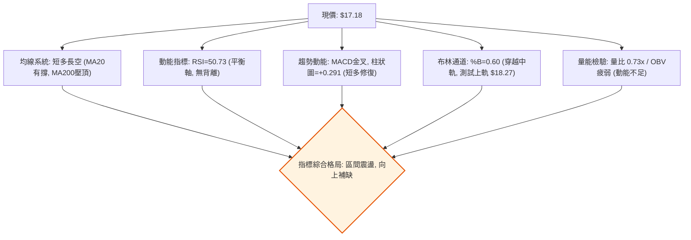

### 📈 移動平均線排列分析

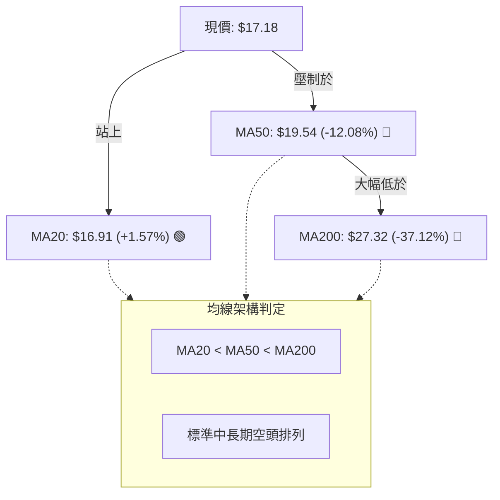

#### 各週期均線數據詳細分析

| 週期 | 均線數值 | 現價偏離度 (Bias) | 走勢趨向 | 技術含義 |
|:---|:---:|:---:|:---:|:---|
| **MA5** | $17.61 | -2.44% | ▼ 走平微跌 | 短線衝高受阻於 R1 後的常態性微幅回檔 |
| **MA10** | $17.12 | +0.33% | ▲ 轉折向上 | 5 日與 10 日均線糾纏，支撐現價重心逐步抬高 |
| **MA20** | $16.91 | +1.57% | ▲ 向上扣低 | 日線布林中軌，短多防守生命線，支撐強勁 |
| **MA60** | $19.85 | -13.46% | ▼ 加速向下 | 季線下壓，是多方中級反彈的重大阻力區間 |
| **MA120** | $27.70 | -37.99% | ▼ 持續走低 | 半年線沉重蓋頂，鎖死中長期大型行情發動空間 |
| **MA200** | $27.32 | -37.12% | ▼ 緩步下行 | 年線熊市分界線，宣告宏觀週期仍處空頭循環 |
| **MA240** | $25.02 | -31.33% | ▼ 轉折向下 | 兩年線下壓，長期筹碼深度套牢 |

### 📉 RSI(14) 分析

#### RSI 數值強度展示
```
RSI(14) 當前數值: 50.73
超賣 [0] ─────────────── [30] ────── [50] ────── [70] ─────────────── [100] 超買
                                       ▲ (50.73 現值)
進度條: █████████████████████████░░░░░░░░░░░░░░░░░░░░░░░░░  50.7%
```

- **區間評估**：RSI 讀數為 **50.73**，精確座落於多空分界線 50 之上。週線維度由 9 月初的 **10.0（極端恐慌超賣）** 強勁回升至 50.7，表明殺跌力道完全衰竭，市場重新尋回定價平衡。
- **背離檢驗**：
  - **頂背離**：無。目前價格未創波段新高。
  - **底背離**：無明顯背離。2026-09-13 低點 $16.45 (RSI 10.0) 至 2026-09-20 低點 $16.42 (RSI 24.4)，RSI 出現同向回升但價差極小，屬常態性動能修復，尚未構成具備強發動力的標準二度底背離。

### 📊 MACD(12,26,9) 訊號解讀

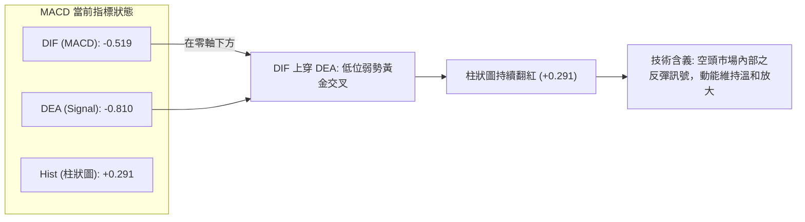

- **指標解讀**：MACD 線 (-0.519) 高於訊號線 (-0.810)，柱狀圖為 **+0.291**。週線級別上，MACD 柱狀圖從 09-13 的 -0.328 翻正至 +0.291，並維持 3 週紅柱，發出可靠的短線止跌修復訊號；然而由於雙線依然深處零軸下方，該金叉僅能定性為「熊市反彈」，不可誤判為波段反轉。

### 📦 布林通道分析

```
日線布林通道 (Bollinger Bands, 20, 2) 結構示意圖
價格軸 ($)
$18.27 ┤ ───────────────────────────────────── BB 上軌 (Upper)
       │                        ▲
$17.18 ┤ ═══════════════════════●═════════════ 現價 (收盤價)
       │                        ▼
$16.91 ┤ ┄┄┄┄┄┄┄┄┄┄┄┄┄┄┄┄┄┄┄┄┄┄┄┄┄┄┄┄┄┄┄┄┄┄┄ BB 中軌 (MA20)
       │
$15.56 ┤ ───────────────────────────────────── BB 下軌 (Lower)
```

- **帶寬與位置**：上軌 **$18.27**，中軌 **$16.91**，下軌 **$15.56**。
- **%B 指標解析**：
  $$\%B = \frac{\text{現價} - \text{下軌}}{\text{上軌} - \text{下軌}} = \frac{17.18 - 15.56}{18.27 - 15.56} = \frac{1.62}{2.71} = 0.598 \approx 0.60$$
- **技術意義**：%B 讀數為 **0.60**，說明現價已穩健脫離下軌超賣區並站上中軌，當前處於「中軌至上軌」的多頭主動進攻半區，短線第一阻力直指上軌 **$18.27**（與 R1 $18.18 形成壓制共振）。

### 💹 成交量分析（量價配合度）

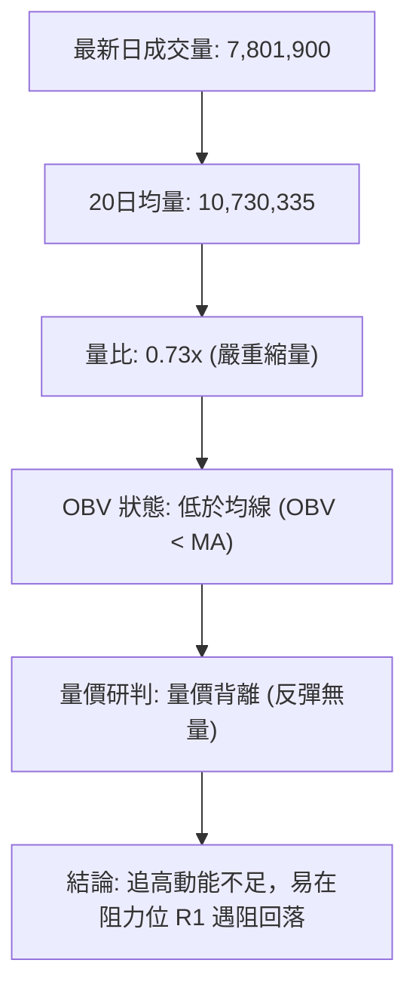

- **量比與均量比較**：最新成交量僅 **7,801,900 股**，相對於 20 日均量 (10,730,335 股) 之量比僅 **0.73x**。相較於 50 日均量 (9,354,936 股) 亦明顯萎縮。
- **能量潮 (OBV) 解讀**：數據明確提示 **OBV < MA**，代表資金活躍度依然疲軟，場外主力大資金並未在當前價位大舉進場掃貨。此種「縮量反彈」在面對 R1 ($18.18) 時極易引發量價背離式夭折，難以直接啟動單邊噴發行情。

---

## 6. 動能與波動率

### ⚡ 動能評估四象限

| 象限 | 動能維度 | 波動維度 | 歷史典型環境 | PL 當前技術定位評估 |
|:---:|:---:|:---:|:---|:---|
| **Q1** | 強動能 (Bull) | 低波動 (Low Vol) | 主升浪穩步推進 | ✕ 均線空頭排列，非主升階段 |
| **Q2** | **弱動能 (Weak)** | **低波動 (Low Vol)** | **低位築底沉澱期** | **✓ 當前狀態**：ADX 21.68 低於 25，波動率 ATR 收斂至 5.67%，動能溫和，市場處於等待方向的相持階段 |
| **Q3** | 強動能 (Strong) | 高波動 (High Vol) | 突破爆發 / 拋物線頂 | ✕ 歷史出現在 2026-05 頂部 $51.76 區域 |
| **Q4** | 弱動能 (Weak) | 高波動 (High Vol) | 恐慌主跌殺盤段 | ✕ 恐慌殺跌已於 2026-09 隨成交量釋放完畢 |

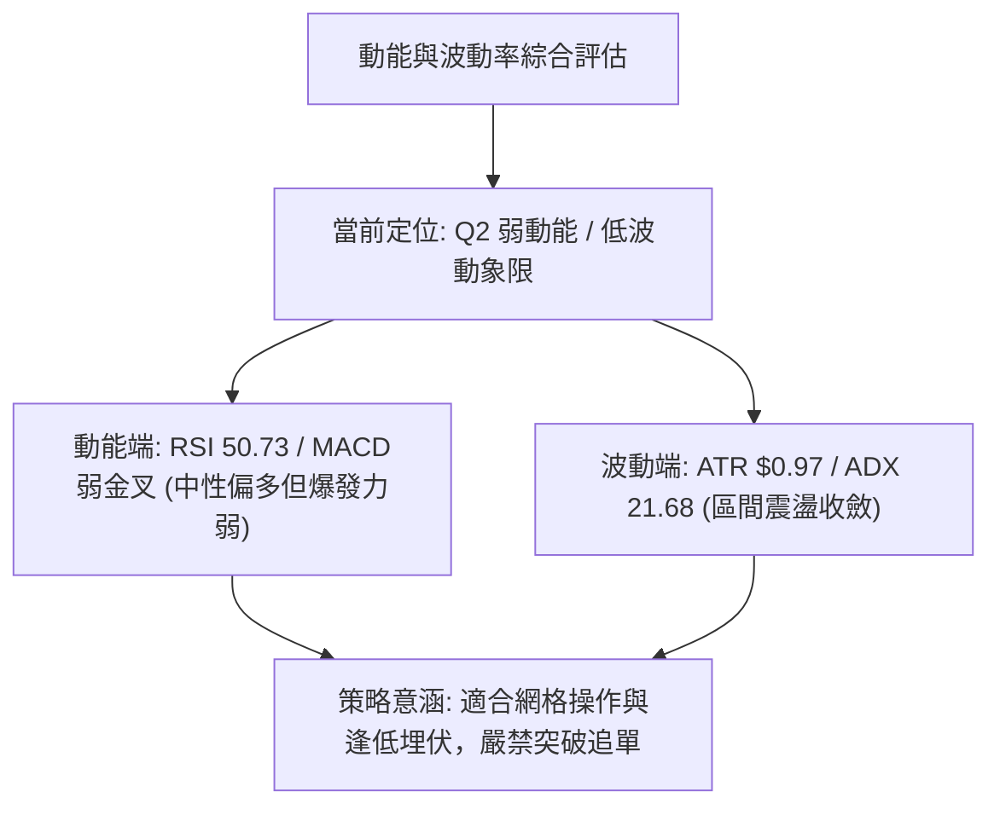

### 📊 ATR 波動率分析

- **ATR(14) 數值**：**$0.97**（佔當前股價之 **5.67%**）。
- **日內波動特徵**：PL 每日平均常態波動區間約為 \$1.00 左右，顯示個股投機彈性雖自歷史高位收斂，但依然具備顯著日內波幅。
- **風控止損距離精算**：
  - **保守型交易者 (1.5 × ATR)**：
    $$\text{止損安全距離} = 1.5 \times \$0.97 = \$1.46 \implies \text{進場點} - \$1.46$$
  - **激進型交易者 (1.0 × ATR)**：
    $$\text{止損安全距離} = 1.0 \times \$0.97 = \$0.97 \implies \text{進場點} - \$0.97$$
  - **短線防守極限**：以現價 $17.18 扣減 1.5×ATR 為 **$15.72**，精確座落於波段強支撐 S2 **$15.60** 之上，證實此支撐位極具技術防守價值。

### 📐 Beta 與市場相關性

- **Beta 數值**：**2.17**（極高 Beta 屬性）。
- **市場敏感度分析**：PL 對美股大盤（標普500指數）展現出高達 2.17 倍的敏感度。當市場整體情緒轉向 Risk-Off（避險）時，PL 的下行回撤幅度通常是大盤的兩倍以上；反之，若大盤反彈，其短線具備極佳的彈性放大效應。
- **融券放空指標**：
  - **Short Ratio (空單回補天數)**：**2.62 天**。
  - **Short % Float (空頭部位佔流通盤)**：**11.0%**。
  - **空頭部位解讀**：11.0% 的做空比例處於偏高水平（高於 10% 警戒線），顯示市場仍有相當空頭部隊進駐。一旦價格放量向上突破阻力 R1 ($18.18)，偏高的做空比例將極易引發軋空（Short Squeeze）回補買盤。

---

## 7. 多時框架總結

### 📋 時框架評分表

| 時框架 | 趨勢方向 | 動能狀態 | 均線排列狀況 | 圖表形態識別 | 綜合評分 | 操作指引 |
|:---:|:---:|:---:|:---:|:---:|:---:|:---|
| **長期 (月線)** | 🔴 熊市回撤 | 弱勢築底中 | 空頭排列 (低於MA200) | 歷史拋物線崩跌探底 | **25 / 100** | 宏觀壓制沉重，長線現貨不宜重倉 |
| **中期 (週線)** | 🟡 橫盤蓄勢 | 溫和修復 (MACD翻紅) | 壓制於 MA50 / MA60 | 潛在雙重底結構 (62%) | **50 / 100** | 區間沉澱籌碼，觀察 $18.18 頸線爭奪 |
| **短期 (日線)** | 🟢 震盪偏多 | 中性偏強 (站回50) | 突破 MA20，受阻 MA50 | 布林中上軌箱體震盪 | **62 / 100** | 依托 MA20 支撐，逢低短多參與反彈 |

### 🔲 綜合訊號矩陣

```
時框架訊號一致性評估矩陣
══════════════════════════════════════════════════════════════════
時框層級       趨勢評級      動能評級      量能配合      最終方向取向
──────────────────────────────────────────────────────────────────
月線 (長線)     🔴 空頭       🔴 空頭       🟡 中性       🔴 逢高偏空防守
週線 (中線)     🟡 震盪       🟢 多頭       🔴 疲弱       🟡 觀望蓄勢
日線 (短線)     🟢 多頭       🟢 多頭       🔴 疲弱       🟢 區間短多反彈
══════════════════════════════════════════════════════════════════
一致性研判：長短期訊號存在結構性衝突，短線多頭受制於長線均線壓制。
```

### ⚖️ 多時框收斂結論

依據多時框收斂規則第 14 條嚴格推演：
1. **行情性質判定**：當前 **ADX(14) 讀數為 21.68**，低於臨界值 25，明確判定目前處於 **「盤整行情（Range-bound Market）」**，而非單邊趨勢行情。
2. **主導時框與交易邊界收斂**：在 ADX < 25 的盤整結構下，多時框系統以 **日線布林通道 ($15.56 ~ $18.27) 及波段支撐阻力 ($16.10 ~ $18.18) 為主要交易區間**。中長期均線（MA50 $19.54、MA200 $27.32）僅充當中長期空間反彈之天花板壓制，不作為日內或短線進場的單邊依據。
3. **唯一方向性結論**：**【中性觀望，區間箱體短線偏多操作】**。此結論與第 1 章技術評分卡（46/100 處於 40–60 中性區間）高度收斂一致，奠定第 8 章以「布林通道區間操作」為核心之交易策略。

---

## 8. 交易策略建議

### 🗺️ 策略決策流程圖

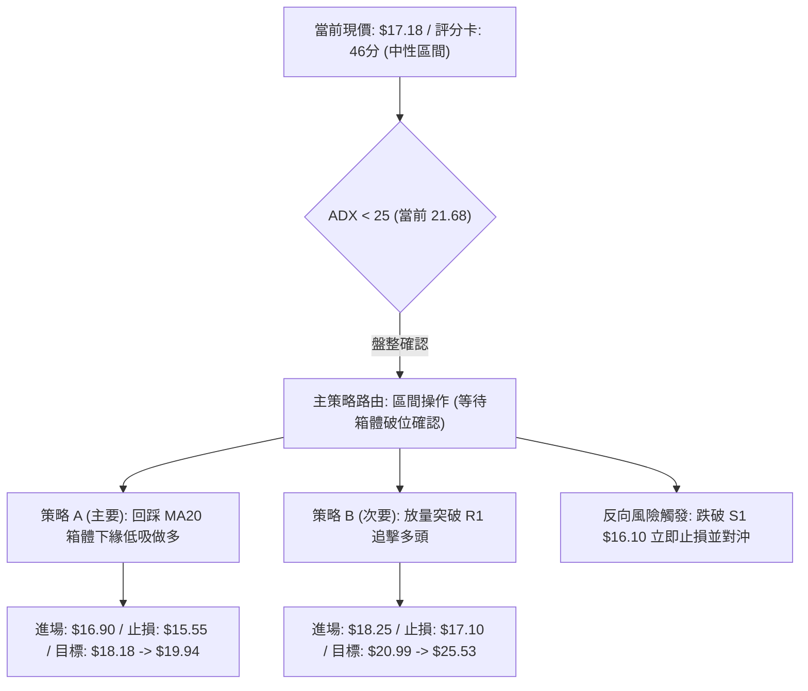

### 🧭 策略路由（依評分卡分流）

> **當前主策略方向 = 【區間操作 / 箱體下緣逢低做多】（依綜合評分 46/100 定調，介於 40–60 之中性盤整區間）**

本策略專注於利用日線布林通道中軌至下軌的支撐位進行低吸，向上搏取測試布林上軌與阻力位 R1 的震盪波段收益，嚴禁在未放量前盲目追高。

### 🎯 價格情境階梯（Price Scenarios）

價位嚴格引用關鍵價位數據，向上向下推演劇本如下：

| 觸發條件 | 第一階段目標 | 後續延伸目標 | 情境含義與技術應對 |
|:---|:---:|:---:|:---|
| **放量突破 R1 $18.18** | **R2 $20.99** | **R3 $25.53** | **短線轉強**：突破頸線，雙底形態確認，空頭回補引發軋空。 |
| **站穩現價區間 ($16.91~$17.50)** | **R1 $18.18** | — | **區間震盪**：維持中軌與上軌間拉鋸，沿 MA20 震盪蓄勢。 |
| **跌破 S1 $16.10** | **S2 $15.60** | **S3 $11.97** | **中期轉弱**：箱體破位，考驗布林下軌；若破 S2 則宣告築底失敗。 |

### 📊 情境機率分佈

| 情境劇本 | 機率估算 | 主要技術依據 |
|:---|:---:|:---|
| **區間震盪後向上反彈** | **55%** | MACD 柱狀圖翻紅 (+0.291) 連續 3 週走強；現價站上 MA20；週線 RSI 自極限超賣區修復至 50.73 平衡軸。 |
| **維持窄幅箱體橫盤** | **30%** | ADX 21.68 確立弱趨勢特徵；成交量量比僅 0.73x，OBV 疲軟，場外資金追高意願不足，需時間換取空間。 |
| **跌破支撐回落探底** | **15%** | 均線系統長週期空頭排列 (MA200 $27.32 嚴重下壓)；-DI 仍大於 +DI；若大盤劇烈回調易受高 Beta (2.17) 拖累。 |

### 🟢 主策略詳情

本策略基於評分卡分流，提供「回踩箱體低吸（策略 A）」與「突破頸線追擊（策略 B）」兩套方案：

| 策略要素 | 策略 A：箱體回踩低吸 (穩健型) | 策略 B：突破頸線順勢追擊 (積極型) |
|:---|:---|:---|
| **適用場景** | 現價回踩 MA20 或箱體下緣獲得支撐 | 盤中放量大陽線實體突破阻力位 R1 |
| **進場條件** | 回踩接近 MA20 ($16.91)，5分K出反轉線 | 收盤價確認站上 R1 ($18.18) 且成交量放大 |
| **進場價格** | **$16.90** (依 MA20 $16.91 精準掛單) | **$18.25** (高於 R1 $18.18 之突破確認價) |
| **目標價 T1** | **$18.18** (阻力位 R1，勝率高之第一平倉點) | **$20.99** (阻力位 R2，中期波段高點) |
| **目標價 T2** | **$19.94** (雙底形態推算目標價) | **$25.53** (阻力位 R3 / 接近 MA240 $25.02) |
| **止損價格** | **$15.55** (略低於 S2 $15.60 及布林下軌 $15.56) | **$17.10** (跌回 MA10 $17.12 與 MA20 之下) |
| **風險報酬比** | **1 : 2.25**<br>風險: \$1.35 ｜ 潛在報酬: \$3.04 (至T2) | **1 : 2.38**<br>風險: \$1.15 ｜ 潛在報酬: \$2.74 (至T1) |
| **預估勝率** | **60%** (受布林通道與均線支撐保護) | **50%** (需防範假突破之拉回風險) |
| **建議倉位** | **8% ~ 10%** 總資金 | **5% ~ 8%** 總資金 |

### 🔴 反向風險觸發點（對沖提示）

- **多單嚴格撤退線**：若日線收盤價**跌破支撐位 S1 ($16.10)**，視為箱體下破初期警訊，部位應減半；若盤中進一步**跌破強支撐 S2 ($15.60)**，則宣告本輪雙底與箱體構築徹底瓦解，必須**全數無條件止損出局**。
- **反手放空 / 對沖觸發條件**：當價格有效跌破 $15.60 且日成交量放大超過 20 日均量時，空頭主跌段重啟，可利用反向 ETF 或少量 Put 選擇權進行部位對沖，下方空間將直指長線防線 **S3 ($11.97)** 及 52 週低點 **$10.52**。

### ⭐ 整體訊號強度評星

```
做多訊號強度：★★★☆☆  (3.0 / 5 星)  ── 依托 MA20 與布林中軌，具備短線反彈性價比
做空訊號強度：★★☆☆☆  (2.5 / 5 星)  ── 恐慌量能已宣洩，空方動能減弱，此處放空盈虧比差
整體可信度：  ★★★☆☆  (3.5 / 5 星)  ── 盤整市指標收斂，支撐阻力結構清晰，受量能限制
```

---

## 9. 風險提示與監控

### ✅ 關鍵監控指標 Checklist

```
╔══════════════════════════════════════════════════════════════════╗
║              PL 技術面日常監控 Checklist (每日盤後必檢)          ║
╠══════════════════════════════════════════════════════════════════╣
║ [ ] 1. 均線生命線防守：收盤價是否持續站穩 MA20 ($16.91) 之上？   ║
║ [ ] 2. 阻力衝擊檢驗：盤中上衝 R1 ($18.18) 時，日成交量是否 > 1,000萬?║
║ [ ] 3. 布林通道走態：%B 指標是否維持在 0.50 以上，並沿上軌開口擴張?║
║ [ ] 4. 動能指標警戒：RSI(14) 能否持穩於 50 之上，避免跌回 40 弱勢區?║
║ [ ] 5. 空頭反撲監測：-DI (當前 26.33) 是否持續回落，縮小與 +DI 差距? ║
║ [ ] 6. 融券動向跟蹤：空單比例 (11.0%) 是否因反彈突破引發補單潮？║
╚══════════════════════════════════════════════════════════════════╝
```

### ⚠️ 風險場景分析

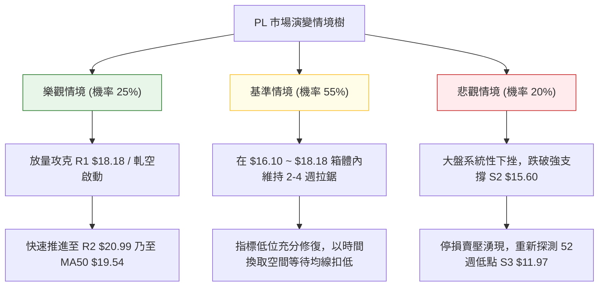

### 🛡️ 風險管理重要提醒

1. **Beta 敏感性防禦**：PL 的 **Beta 高達 2.17**，極易受美股整體科技板塊波動放大影響。在宏觀市場尚未完全明朗前，任何單一個股的交易部位**不得超過個人總投資組合資金的 10%**。
2. **量價背離陷阱防範**：目前量比僅 **0.73x** 且 **OBV 低於均線**，表明買盤動能尚未完全被機構激活。若價格在接近 **R1 ($18.18)** 時出現成交量持續萎縮、日K留長上影線，必須立即將短線部位獲利了結，嚴防假突破誘多。
3. **ATR 動態止損紀律**：當前 ATR 為 **$0.97**，單日潛在波動達 5.67%。進場後必須在交易終端設定硬性止損單（如策略 A 之 **$15.55**），絕不可因「跌深必反彈」的心態而隨意撤銷或下移止損線。

---

## 📋 報告總結

```
╔══════════════════════════════════════════════════════════════════╗
║                    PL 技術分析報告總結                          ║
╠══════════════════════════════════════════════════════════════════╣
║ 報告日期：2026-10-11                                            ║
║ 當前價格：$17.18                                                 ║
║ 分析評級：⚖️ 中性偏多區間操作 (技術評分: 46 / 100)               ║
║                                                                  ║
║ 關鍵結論：                                                       ║
║ ├─ 長期趨勢：🔴 熊市回撤探底中，大幅承壓於 MA200 ($27.32)       ║
║ ├─ 中期趨勢：🟡 超跌反彈蓄勢，築造潛在雙底形態 ($16.42 雙底)    ║
║ ├─ 短期趨勢：🟢 震盪偏多，站穩 MA20 ($16.91)，挑戰布林上軌     ║
║ ├─ 關鍵支撐：S1 $16.10 (波段低點聚類) ｜ S2 $15.60 (強支撐)      ║
║ ├─ 關鍵阻力：R1 $18.18 (短線頸線) ｜ R2 $20.99 (中期天花板)      ║
║ └─ 分析師目標：共識均價 $31.91 (最低 $17.00 / 最高 $50.00)      ║
║                                                                  ║
║ 最優策略組合：                                                   ║
║ 1. 🥇 最佳機會：回踩 MA20 ($16.90) 逢低掛單低吸，防守 S2 ($15.55)║
║ 2. 🥈 次選機會：突破頸線 R1 ($18.25) 放量順勢追擊，目標 R2 $20.99 ║
║ 3. 🥉 保守選擇：空手觀望，靜待日線 ADX 站上 25 且放量再行介入    ║
╚══════════════════════════════════════════════════════════════════╝
```

---

> ⚠️ **免責聲明**：本報告為技術分析專業推演，所有價位依據 Yahoo Finance 歷史與即時數據嚴格精算。本報告**僅供研究與學術參考**，**不構成任何要約、招攬或投資建議**。金融市場瞬息萬變，個股高 Beta 屬性蘊含較大波動風險，投資人應獨立評估風險並自負盈虧。

---

*報告生成時間：2026-10-11 ｜ 數據來源：Yahoo Finance ｜ 分析框架：多時框技術分析模型*